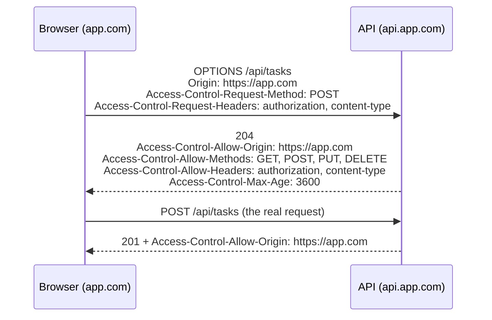

# Frontend 25 — Web Security and Browser APIs

> **The browser runs code from many places, so it has strict security rules,** and attackers look for gaps in how your frontend and backend use them. This module covers the attacks that matter (XSS, CSRF), where to keep tokens, CORS and CSP in depth, and the browser storage and background APIs you'll meet.

<!-- subtopic: f25_s1 -->
### XSS: cross-site scripting

**XSS** is an attacker getting **their JavaScript to run in your page**, for example by saving a "comment" that contains a script. Once it runs, it can do anything the user can: read the page, read `localStorage` (including tokens), and call your API as them.

Three kinds:

| Kind | The script comes from |
|---|---|
| **Stored** | your database: a comment, a task title, a profile name shown to other users |
| **Reflected** | the URL: `/search?q=` with markup that the page echoes back |
| **DOM-based** | frontend code putting untrusted data into the DOM unsafely |

**React escapes by default.** Anything in `{ }` is inserted as text, so a title containing an HTML tag shows the tag's text instead of running it. The dangerous exits are the ones React names loudly:

```tsx
<div dangerouslySetInnerHTML={{ __html: comment }} />   // ❌ runs any HTML/JS in comment
<a href={userWebsite}>Website</a>                       // ⚠️ a "javascript:alert(1)" URL runs on click
el.innerHTML = value;                                    // ❌ (plain DOM, Module 9)
```

Defences:

- **Render user content as text** (the default). If you truly need user HTML (rich text, Markdown), **sanitise** it with **DOMPurify** first: `{ __html: DOMPurify.sanitize(html) }`.
- **Validate URLs**: allow only `http:` and `https:` for user-supplied links.
- **Escape on the server too**, and never build HTML strings from user input in Spring templates.
- **Content Security Policy** (below) as a second line of defence.
- **HttpOnly cookies** for tokens, so even a successful XSS can't read them (next sections).

<details>
<summary>Is a React app automatically safe from XSS?</summary>

Mostly, because React escapes everything it renders as text. You're exposed again when you bypass that: dangerouslySetInnerHTML with unsanitised content, user-controlled href values like javascript: URLs, direct DOM manipulation with innerHTML, or unsafe third-party scripts.
</details>

<!-- subtopic: f25_s2 -->
### CSRF and SameSite cookies

**CSRF** (cross-site request forgery) tricks a logged-in user's browser into sending a request to **your** site from **another** site. It works because browsers automatically attach your site's **cookies** to requests going to your site:

```html
<!-- on evil.example: the victim is logged in to bank.example with a session cookie -->
<form action="https://bank.example/api/transfer" method="POST">
  <input type="hidden" name="to" value="attacker"><input type="hidden" name="amount" value="1000">
</form>
<script>document.forms[0].submit()</script>
```

The attacker can't **read** the response, but the request **happens**, with the victim's cookie.

Defences:

- **`SameSite` cookies**: `SameSite=Lax` (the browser default now) doesn't send the cookie on cross-site POSTs; `SameSite=Strict` never sends it cross-site.
- **CSRF tokens**: the server gives the page a random token, and every state-changing request must include it (in a header or form field), which another site can't read. Spring Security does this by default for session-based apps.
- **Only change data on POST/PUT/PATCH/DELETE**, never on GET.
- Check the `Origin` header on the server.

Note the connection to tokens: an app that sends a JWT in the **`Authorization` header** (not a cookie) isn't vulnerable to classic CSRF, because the browser never adds that header automatically. That's why stateless JWT APIs often disable Spring's CSRF protection, and why moving the token into a cookie brings CSRF back into the picture.

<details>
<summary>Why are APIs that use an Authorization: Bearer header not vulnerable to classic CSRF?</summary>

CSRF relies on the browser attaching credentials automatically, which it does for cookies but never for a custom Authorization header. A forged request from another site arrives without the token, so it's rejected.
</details>

<!-- subtopic: f25_s3 -->
### Where to keep tokens: localStorage vs HttpOnly cookies

| | localStorage + `Authorization` header | HttpOnly cookie |
|---|---|---|
| Readable by JavaScript | **yes**: any XSS can steal it | **no** |
| Sent automatically | no (your code adds the header) | yes, to your API's domain |
| CSRF risk | none | yes, mitigated with SameSite + CSRF tokens |
| Works across domains | easily | needs CORS with credentials and cookie settings |
| Simplicity | simplest | more setup (cookie flags, CSRF, CORS credentials) |

The widely recommended setup for sensitive apps:

```text
Set-Cookie: refresh_token=…; HttpOnly; Secure; SameSite=Strict; Path=/api/auth/refresh
```

- a **short-lived access token** (5–15 minutes) kept **in memory** (a JavaScript variable or React state, not localStorage), sent as a Bearer header;
- a **long-lived refresh token** in an **HttpOnly, Secure, SameSite** cookie, usable only by the refresh endpoint;
- on page load or a 401, call `/api/auth/refresh` to get a new access token.

A stolen access token (via XSS) is only valid for minutes, and the refresh token can't be read at all. Many apps (including the Task Manager project) start with localStorage for simplicity; just know the trade-off and how to explain it in an interview.

Cookie flags to know: **`HttpOnly`** (no JavaScript access), **`Secure`** (HTTPS only), **`SameSite`** (`Strict`, `Lax` or `None`; `None` requires `Secure`), **`Path`** and **`Domain`** (where it's sent), **`Max-Age`/`Expires`**.

<details>
<summary>Why is a token in localStorage considered risky?</summary>

Any JavaScript running on the page can read localStorage, so a single XSS bug (or a compromised third-party script) can steal the token and use it from anywhere. An HttpOnly cookie can't be read by JavaScript at all.
</details>

<!-- subtopic: f25_s4 -->
### CORS in depth

The browser's **same-origin policy** stops a page from reading responses from another **origin** (scheme + host + port: `https://app.com` ≠ `https://api.app.com` ≠ `http://app.com:8080`). **CORS** is how a server opts in to sharing (Module 20 showed the fixes).

**Simple requests** (GET/HEAD/POST with only basic headers and content types like form data or plain text) are sent directly; the browser then checks the response's `Access-Control-Allow-Origin`.

Anything else, such as `PUT`/`DELETE`, `Content-Type: application/json` or an `Authorization` header, first triggers a **preflight**: an automatic `OPTIONS` request asking permission:



**Credentials** (cookies) across origins need both sides to agree:

```ts
fetch("https://api.app.com/me", { credentials: "include" });
```

```text
Access-Control-Allow-Origin: https://app.com        ← must be the exact origin, not *
Access-Control-Allow-Credentials: true
```

Common mistakes: Spring Security rejecting the preflight `OPTIONS` (enable CORS in the security chain), using `*` together with credentials (not allowed), and forgetting that CORS is **not** a security feature for your API. It protects **users' browsers**, not your server; anyone can still call your API from curl or a server, so authentication is what protects the data.

<details>
<summary>What is a preflight request, and what triggers it?</summary>

An automatic OPTIONS request the browser sends before a cross-origin request that isn't "simple", asking the server whether the method and headers are allowed. It's triggered by methods like PUT/DELETE, a JSON content type, or custom headers such as Authorization.
</details>

<!-- subtopic: f25_s5 -->
### Content Security Policy and HTTPS

A **Content Security Policy (CSP)** header tells the browser which sources of scripts, styles, images and connections are allowed. Even if an attacker injects a script tag, the browser refuses to run it:

```text
Content-Security-Policy:
  default-src 'self';
  script-src 'self';
  style-src 'self' https://fonts.googleapis.com;
  font-src https://fonts.gstatic.com;
  img-src 'self' data: https:;
  connect-src 'self' https://api.mytasks.com;
  frame-ancestors 'none'
```

- No `'unsafe-inline'` in `script-src` means inline scripts and `onclick="…"` attributes are blocked, which kills most XSS.
- `connect-src` limits where `fetch` can send data, so stolen data can't be sent to an attacker's server.
- `frame-ancestors 'none'` stops other sites from framing yours (clickjacking).
- Roll it out safely with `Content-Security-Policy-Report-Only` first.

**HTTPS** encrypts traffic so nobody on the network (public Wi-Fi) can read or change it, including tokens. It's required for HTTP/2, service workers, `Secure` cookies and many browser APIs. Add **HSTS** (`Strict-Transport-Security: max-age=31536000; includeSubDomains`) so browsers never connect over plain HTTP again.

Other security headers worth setting (Spring Security adds several by default): `X-Content-Type-Options: nosniff`, `Referrer-Policy: strict-origin-when-cross-origin`, `Permissions-Policy` to disable APIs you don't use.

Also: keep dependencies updated (`npm audit`, Dependabot), and add `integrity` hashes when loading scripts from CDNs.

<details>
<summary>How does a Content Security Policy reduce the damage of an XSS bug?</summary>

Even if an attacker manages to inject a script tag or inline handler, the browser refuses to run scripts that aren't from an allowed source, and connect-src stops the page sending data to the attacker's server.
</details>

<!-- subtopic: f25_s6 -->
### Browser APIs: storage, IndexedDB, service workers, web workers

**Where to store data in the browser:**

| Storage | Capacity | API | Lifetime | Use for |
|---|---|---|---|---|
| Cookies | ~4 KB each | `document.cookie`, sent with requests | set by expiry | session/refresh tokens (HttpOnly) |
| localStorage | ~5 MB | sync, strings | until cleared | small preferences (theme, last tab) |
| sessionStorage | ~5 MB | sync, strings | until the tab closes | per-tab draft state |
| **IndexedDB** | large (a share of the disk) | async, stores objects and files | until cleared | offline data, big caches, drafts with attachments |
| Cache Storage | large | async, request → response | until cleared | offline copies of pages and assets (with a service worker) |

IndexedDB's raw API is awkward; the small `idb` library wraps it in promises.

**Service workers** are scripts that sit between your page and the network, running in the background even when the page is closed. They enable:

- **offline support**: serve cached pages and data when there's no connection;
- **caching strategies**: cache-first for assets, network-first for API data, stale-while-revalidate;
- **push notifications** and background sync.

With a web app manifest (name, icons, colours), a site with a service worker becomes an installable **Progressive Web App (PWA)**. The `vite-plugin-pwa` plugin generates most of it.

**Web workers** run JavaScript on a **separate thread**, so heavy work (parsing a huge CSV, image processing, complex calculations) doesn't freeze the page:

```js
// main.js
const worker = new Worker(new URL("./parse-worker.js", import.meta.url), { type: "module" });
worker.postMessage(csvText);
worker.onmessage = (e) => showRows(e.data);

// parse-worker.js
self.onmessage = (e) => {
  const rows = e.data.split("\n").map(line => line.split(","));
  self.postMessage(rows);
};
```

Workers can't touch the DOM; they communicate only by messages. Other APIs worth knowing exist: Intersection Observer (detect when an element scrolls into view, used for lazy loading and infinite scroll), Resize Observer, Broadcast Channel (talk between tabs), Clipboard, Geolocation, and the History API that routers use.

<details>
<summary>Service worker vs web worker?</summary>

A service worker is a background proxy between the page and the network: it intercepts requests to enable caching, offline support and push notifications. A web worker is a background thread for heavy computation so the main thread stays responsive. Neither can access the DOM.
</details>

## 📝 Module 25 Recap

1. What is XSS? → **an attacker's script running in your page with the user's privileges**
2. When is React exposed to XSS? → **dangerouslySetInnerHTML, javascript: URLs, direct innerHTML**
3. How do you render user HTML safely? → **sanitise it with DOMPurify first**
4. What is CSRF? → **another site making the user's browser send an authenticated request to yours**
5. Main CSRF defences? → **SameSite cookies and CSRF tokens**
6. localStorage token risk? → **any XSS can read and steal it**
7. A common secure token setup? → **short-lived access token in memory + refresh token in an HttpOnly, Secure, SameSite cookie**
8. What triggers a CORS preflight? → **non-simple requests: PUT/DELETE, JSON content type, Authorization header**
9. Does CORS protect your API from attackers? → **no; it protects users' browsers; authentication protects the API**
10. What does CSP do? → **limits where scripts and other resources may come from**
11. Service worker vs web worker? → **network proxy for offline/caching vs background thread for computation**
