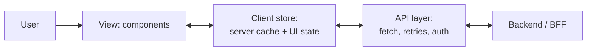

# Frontend 26 — Frontend System Design

> **Frontend system design rounds ask you to design a UI product, not a backend:** components, state, data flow, the API between client and server, performance and accessibility. Like backend HLD (the system design days), there's no single right answer; interviewers grade your structure and your trade-offs. This module gives you a framework and two worked designs.

<!-- subtopic: f26_s1 -->
### A framework for the round

A 45–60 minute round, in five steps. Say each step out loud as you start it, so the interviewer can follow and steer.

| Step | Time | What you do |
|---|---|---|
| **1. Requirements** | 5–8 min | functional (what users can do) and non-functional (devices, scale, performance, offline, accessibility, i18n); agree on what's **out of scope** |
| **2. Architecture** | 5–10 min | a box diagram: views and main components, client-side store, API layer, server |
| **3. Data model** | 5 min | the entities and their fields, which live in which store, what's derived |
| **4. API (interface)** | 5–10 min | the endpoints or messages between client and server, with request/response shapes, pagination |
| **5. Deep dives** | 15–20 min | optimisations: performance, network, rendering, UX states, accessibility, security, and edge cases |

The acronym some candidates use: **RADIO**: Requirements, Architecture, Data model, Interface, Optimisations.



Good habits:

- **Ask before assuming**: "Mobile web or desktop? How many items? Real-time updates? Must it work offline?"
- **Name trade-offs**: "Infinite scroll is better for discovery but bad for reaching the footer and for accessibility; I'll add a 'Load more' fallback."
- **Cover the UX states**: loading, empty, error, partial data, slow network, offline.
- **Mention accessibility and performance unprompted**; it's what separates frontend specialists.

<details>
<summary>What does RADIO stand for in frontend system design?</summary>

Requirements, Architecture, Data model, Interface (the API), Optimisations (deep dives). It's a structure for covering everything an interviewer expects, in an order that builds on itself.
</details>

<!-- subtopic: f26_s2 -->
### Component design, data model, API and state

Take "a Kanban board" (like Trello) as a small example of each step.

**Components**: break the screen into a tree, and decide who owns which state:

```text
BoardPage                       owns: board query, filters (URL)
├─ BoardHeader                  title, member avatars, filter controls
├─ Column  × n                  receives column + its cards
│  ├─ ColumnHeader              name, card count, menu
│  ├─ CardList (virtualized if long)
│  │  └─ Card × n               title, labels, assignee; draggable
│  └─ AddCardForm               local state: draft text
└─ CardModal (route: /board/:id/card/:cardId)   lazy-loaded
```

**Data model**: normalise server data, so each card lives in one place:

```ts
type Board = { id: string; title: string; columnIds: string[] };
type Column = { id: string; title: string; cardIds: string[] };     // order lives here
type Card = { id: string; title: string; labels: string[]; assigneeId?: string; version: number };
// client: { boards: Record<id, Board>, columns: Record<id, Column>, cards: Record<id, Card> }
```

**API**:

```text
GET    /api/boards/:id                     → { board, columns, cards }   (one request for the first paint)
POST   /api/columns/:id/cards              { title }            → Card
PATCH  /api/cards/:id                      { title?, labels?, version }  → Card   (version: optimistic locking)
POST   /api/cards/:id/move                 { toColumnId, toIndex }       → { columns }
WS     /ws/boards/:id                      server pushes card.created / card.moved / card.updated
```

**State placement** (Module 19): board data in a server cache (TanStack Query), filters in the URL, the dragged card and open menus as local UI state.

**Key decisions to discuss**: optimistic moves (move the card instantly, roll back if the server rejects); conflicts between two users (version numbers, last-write-wins, or server-authoritative ordering); real-time sync (WebSocket vs polling); and accessible drag-and-drop (keyboard moves with a "Move to…" menu).

<details>
<summary>Why normalise data (store entities by id) instead of keeping nested board → columns → cards objects?</summary>

Each card exists in exactly one place, so updating it (from a mutation or a real-time event) is one change, and every view that shows it stays consistent. Moving a card only changes two id arrays instead of copying nested objects.
</details>

<!-- subtopic: f26_s3 -->
### Design an autocomplete / typeahead

**Requirements**: suggestions as the user types; keyboard navigation; highlight the matching part; works for a large dataset on the server; fast and accessible; reusable across the app.

**Component API** (designing it as a reusable component is part of the question):

```tsx
<Autocomplete<User>
  fetchSuggestions={(q, signal) => api.searchUsers(q, signal)}
  renderItem={(user, query) => <UserOption user={user} query={query} />}
  onSelect={user => navigate(`/users/${user.id}`)}
  minChars={2}
  debounceMs={250}
  placeholder="Search people"
/>
```

**How it works:**

1. **Debounce** input (250 ms) so you don't send a request per keystroke (Module 12).
2. **Ignore stale responses**: abort the previous request with `AbortController` (Module 17), or tag responses with their query and drop old ones.
3. **Cache** results per query in a `Map` (with a size limit): backspacing to a previous query is instant. TanStack Query does this with `queryKey: ["users", q]`.
4. **Minimum length** (2 characters) avoids huge, useless result sets.
5. **States**: idle, loading (a subtle spinner, keep old results visible), results, no results, error.

**Keyboard and accessibility** (the WAI-ARIA combobox pattern):

```html
<input role="combobox" aria-expanded="true" aria-controls="user-list"
       aria-activedescendant="user-opt-2" aria-autocomplete="list">
<ul id="user-list" role="listbox">
  <li id="user-opt-1" role="option">Asha Rao</li>
  <li id="user-opt-2" role="option" aria-selected="true">Ashok Kumar</li>
</ul>
```

↓/↑ move the highlight, Enter selects, Escape closes, and focus **stays in the input** (`aria-activedescendant` points at the highlighted option). Announce "5 results" through a live region.

**Performance**: virtualize if the list can be long; render the matching text with `<mark>` safely (split strings, never `innerHTML`); prefetch popular queries.

**Server side** to mention: a prefix index or search engine (Elasticsearch, or a trie for a small fixed list, as in the DSA days), returning the top N ranked results, with a response cache.

<details>
<summary>How do you stop an older, slower search response from overwriting newer results?</summary>

Abort the previous request when a new query starts (AbortController), or keep track of the latest query and ignore any response whose query doesn't match it. Debouncing reduces how often it happens but doesn't prevent it.
</details>

<!-- subtopic: f26_s4 -->
### Design a news feed with infinite scroll

**Requirements**: a feed of posts (text, images, likes, comments); scroll to load more; new posts appear; like a post; works on slow mobile networks.

**Pagination: cursor, not offset.** With `?page=3`, new posts arriving at the top shift everything, so users see duplicates or miss posts. A **cursor** marks "after this item":

```text
GET /api/feed?limit=20                       → { items: [...], nextCursor: "p_8812" }
GET /api/feed?limit=20&cursor=p_8812         → { items: [...], nextCursor: "p_8790" }   (null at the end)
```

**Loading more** with an **Intersection Observer** on a sentinel element near the bottom (not a scroll listener):

```tsx
function Feed() {
  const { data, fetchNextPage, hasNextPage, isFetchingNextPage } = useInfiniteQuery({
    queryKey: ["feed"],
    queryFn: ({ pageParam }) => api.get<FeedPage>(`/feed?limit=20${pageParam ? `&cursor=${pageParam}` : ""}`),
    initialPageParam: null as string | null,
    getNextPageParam: last => last.nextCursor,
  });

  const sentinel = useRef<HTMLDivElement>(null);
  useEffect(() => {
    const el = sentinel.current;
    if (!el) return;
    const observer = new IntersectionObserver(([entry]) => {
      if (entry.isIntersecting && hasNextPage && !isFetchingNextPage) fetchNextPage();
    }, { rootMargin: "600px" });                      // start loading before the user reaches the end
    observer.observe(el);
    return () => observer.disconnect();
  }, [hasNextPage, isFetchingNextPage, fetchNextPage]);

  return (
    <>
      {data?.pages.flatMap(p => p.items).map(post => <PostCard key={post.id} post={post} />)}
      <div ref={sentinel} />
      {isFetchingNextPage && <PostSkeleton />}
    </>
  );
}
```

**Deep-dive topics:**

- **Many posts in the DOM**: virtualize (Module 21), or remove posts far above the viewport; keep heights stable to avoid CLS.
- **Images**: lazy-load, responsive sizes, blur placeholders, fixed aspect ratios.
- **New posts**: don't jump the list; show a "5 new posts" pill that scrolls to the top (polling, SSE or WebSocket).
- **Likes**: optimistic update with rollback on failure; debounce double taps.
- **Restoring scroll position** when the user goes back to the feed from a post (cache pages, save the position).
- **Accessibility**: infinite scroll traps keyboard users above the footer; provide a "Load more" button, and announce new content politely.

<details>
<summary>Why use cursor-based pagination for a feed instead of page numbers?</summary>

Feeds change while you scroll. With offsets, new items inserted at the top shift every page, causing duplicates and gaps. A cursor says "items after this one", which stays correct no matter what's added before it, and it's efficient for the database too.
</details>

<!-- subtopic: f26_s5 -->
### Rendering and data strategies

Decisions that come up in almost every design:

**Rendering strategy** (Module 22): CSR for logged-in apps; SSR or SSG for public, SEO-sensitive pages; streaming SSR to show the shell early.

**Fetching**:

| Pattern | When |
|---|---|
| fetch on mount (+ cache) | most screens |
| prefetch on hover / route preload | links users are likely to click |
| parallel requests | independent data on one screen |
| a **BFF** (backend-for-frontend) endpoint | when one screen would otherwise make many calls; the server aggregates |
| GraphQL | clients needing flexible shapes over many entities |

**Pagination**: offset (simple, jump to page N, fine for admin tables), cursor (feeds, large or changing data), "Load more" vs infinite scroll vs numbered pages (a UX choice).

**Caching layers**: browser HTTP cache (`Cache-Control`, `ETag`), CDN, the client cache (TanStack Query, with `staleTime`), service worker cache for offline.

**Optimistic updates**: update the UI immediately, send the request, roll back and show an error if it fails. Great for likes, toggles and reordering; risky for payments.

**Real-time**:

| | Polling | Server-Sent Events | WebSocket |
|---|---|---|---|
| Direction | client asks every N s | server → client | both ways |
| Complexity | lowest | low (plain HTTP, auto-reconnect) | higher (connection state, scaling) |
| Use for | dashboards updated every minute | notifications, live scores, feeds | chat, collaborative editing, games |

**Offline**: a service worker caches the app shell; IndexedDB stores data and a queue of pending changes that sync when the connection returns (with conflict handling).

<details>
<summary>Polling, Server-Sent Events or WebSockets for a notifications badge?</summary>

Server-Sent Events fit well: updates only flow from server to client, it works over normal HTTP and reconnects automatically. Polling every 30–60 seconds is also acceptable if near-real-time isn't required. WebSockets are more than needed unless the client also sends frequent messages.
</details>

<!-- subtopic: f26_s6 -->
### Cross-cutting concerns

Close every design by walking through these (interviewers often ask "what else?"):

**Performance**: bundle size and code splitting, image optimisation, virtualization, memoisation where measured, Core Web Vitals targets (Module 24), skeletons instead of spinners.

**Accessibility**: semantic HTML, keyboard support for every interaction (including drag-and-drop alternatives), focus management for modals and route changes, ARIA patterns for complex widgets, contrast, reduced motion.

**Internationalisation (i18n)**: no hard-coded strings (a library like i18next or FormatJS); dates, numbers and currencies with `Intl.DateTimeFormat`/`Intl.NumberFormat`; plural rules; text that grows 30–40% in some languages; right-to-left layouts (use CSS logical properties like `margin-inline-start`).

**Security**: escape user content (React does), sanitise any rich text, token storage, CSP, never trust client-side checks (Module 25).

**Reliability**: error boundaries per section, retries with backoff for idempotent requests, graceful degradation when a non-critical service fails.

**Observability**: error reporting (Sentry), real-user performance metrics (web-vitals), analytics events, feature flags for gradual rollouts.

**Testing**: unit tests for logic, component tests for interactions and states, E2E for critical flows (Module 23).

You won't have time to go deep on all seven. Mention each in a sentence, then go deep on the two that matter most for the product you're designing (performance and accessibility for a feed; security and reliability for payments).

<details>
<summary>Name three things to check for internationalisation in a UI design.</summary>

No hard-coded strings (use translation keys), locale-aware formatting of dates, numbers and currency (Intl APIs), and layouts that handle longer text and right-to-left languages (logical CSS properties).
</details>

## 📝 Module 26 Recap

1. The RADIO steps? → **Requirements, Architecture, Data model, Interface, Optimisations**
2. First thing to do in the round? → **clarify functional and non-functional requirements and scope**
3. Why normalise client data? → **each entity lives in one place, so updates stay consistent**
4. Autocomplete: three must-haves? → **debounce, cancel stale requests, cache results**
5. Which ARIA pattern does an autocomplete follow? → **combobox with a listbox of options**
6. Feed pagination? → **cursor-based, not offset**
7. How do you trigger loading more? → **an IntersectionObserver on a sentinel near the bottom**
8. What is an optimistic update? → **change the UI first, roll back if the request fails**
9. Polling vs SSE vs WebSocket? → **client asks repeatedly / server pushes one way / two-way connection**
10. What is a BFF? → **a backend-for-frontend endpoint that aggregates data for one screen**
