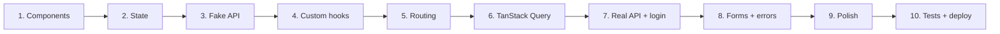

# Frontend 29 — Project: Build the Task Manager UI

> **Ten steps, one per React day, from an empty folder to a deployed full-stack app.** You'll build the React front end for the Task Manager API you write on Beginner Days 65–67 (projects, tasks, JWT login). Each step uses what that day's module taught, ends with a checkpoint, and leaves you with a working app to commit. By step 10 you have a portfolio project you can demo and explain in an interview.

**How to use this project**

- Do each step on its day, after reading the module notes. Type the code yourself; copy only when stuck.
- Commit after every checkpoint (`git commit -m "step 3: fake API with loading states"`), so you can always go back.
- Steps 1–6 use a **fake API** in the browser, so you don't need the backend yet. Step 7 switches to your real Spring Boot API, which you'll have built by then (Days 65–67).
- The code uses TypeScript (Modules 13–14), React 19, React Router 7 and TanStack Query 5. If a newer version has changed something small, the error message and the library's docs will point you to the fix.



<!-- subtopic: f29_s1 -->
### Step 1: set up the project and build the task list

**Goal:** a Vite + React + TypeScript project that shows a list of tasks from hard-coded data, built from small components.

**1. Create the project.**

```bash
npm create vite@latest task-ui -- --template react-ts
cd task-ui
npm install
npm run dev            # open http://localhost:5173
git init && git add . && git commit -m "step 0: vite template"
```

Delete the demo content in `src/App.tsx` and `src/App.css`. Keep `src/index.css` for global styles.

**2. Describe the data.** These types mirror your Spring `TaskResponse` record (`id, title, status, priority, dueDate`), so the switch to the real API in step 7 needs no changes here:

```ts
// src/types.ts
export type TaskStatus = "TODO" | "IN_PROGRESS" | "DONE";

export type Task = {
  id: number;
  title: string;
  status: TaskStatus;
  priority: number;          // 1 (low) to 5 (urgent)
  dueDate: string | null;    // "2026-11-30": Spring sends LocalDate as an ISO string
};

export const STATUS_LABELS: Record<TaskStatus, string> = {
  TODO: "To do",
  IN_PROGRESS: "In progress",
  DONE: "Done",
};
```

**3. Some sample data** for now:

```ts
// src/data/sampleTasks.ts
import type { Task } from "../types";

export const sampleTasks: Task[] = [
  { id: 1, title: "Design the database", status: "DONE", priority: 4, dueDate: "2026-11-10" },
  { id: 2, title: "Build the task API", status: "IN_PROGRESS", priority: 5, dueDate: "2026-11-20" },
  { id: 3, title: "Write the README", status: "TODO", priority: 2, dueDate: null },
];
```

**4. Components.** One for a task, one for the list:

```tsx
// src/components/TaskCard.tsx
import { STATUS_LABELS, type Task } from "../types";

export function TaskCard({ task }: { task: Task }) {
  return (
    <article className={`task-card status-${task.status.toLowerCase()}`}>
      <h3>{task.title}</h3>
      <p className="meta">
        <span className="badge">{STATUS_LABELS[task.status]}</span>
        <span>Priority {task.priority}</span>
        {task.dueDate && <span>Due {task.dueDate}</span>}
      </p>
    </article>
  );
}
```

```tsx
// src/components/TaskList.tsx
import type { Task } from "../types";
import { TaskCard } from "./TaskCard";

export function TaskList({ tasks }: { tasks: Task[] }) {
  if (tasks.length === 0) return <p className="empty">No tasks yet.</p>;
  return (
    <ul className="task-list">
      {tasks.map(task => (
        <li key={task.id}>
          <TaskCard task={task} />
        </li>
      ))}
    </ul>
  );
}
```

```tsx
// src/App.tsx
import { TaskList } from "./components/TaskList";
import { sampleTasks } from "./data/sampleTasks";

export default function App() {
  return (
    <main className="container">
      <h1>My tasks</h1>
      <TaskList tasks={sampleTasks} />
    </main>
  );
}
```

**5. A little CSS** in `src/index.css` (or Tailwind, if you set it up following its Vite guide):

```css
* { box-sizing: border-box; }
body { margin: 0; font-family: system-ui, sans-serif; background: #f8fafc; color: #0f172a; }
.container { max-width: 720px; margin: 0 auto; padding: 24px 16px; }
.task-list { list-style: none; padding: 0; display: grid; gap: 12px; }
.task-card { background: #fff; border: 1px solid #e2e8f0; border-radius: 12px; padding: 14px 16px; }
.task-card h3 { margin: 0 0 6px; font-size: 1.05rem; }
.status-done h3 { text-decoration: line-through; color: #64748b; }
.meta { display: flex; gap: 12px; margin: 0; font-size: 0.85rem; color: #475569; }
.badge { padding: 1px 8px; border-radius: 999px; background: #e0f2fe; }
.empty { color: #64748b; }
```

**✅ Checkpoint**

- [ ] The page shows three task cards, and the done one is crossed out.
- [ ] Changing `sampleTasks` to `[]` shows "No tasks yet."
- [ ] No warnings in the browser console (a missing `key` would show one).
- [ ] `npm run build` succeeds (it type-checks too). Commit: `step 1: task list from components`.

**Stretch:** sort the list by priority (highest first) before rendering, without changing the original array.

<!-- subtopic: f29_s2 -->
### Step 2: make it interactive with state

**Goal:** add tasks with a form, change their status, delete them, and filter the list, all with React state (Module 16).

**1. State lives in `App`**, the closest common parent of the form and the list (lifting state up):

```tsx
// src/App.tsx
import { useState } from "react";
import { AddTaskForm } from "./components/AddTaskForm";
import { FilterTabs, type Filter } from "./components/FilterTabs";
import { TaskList } from "./components/TaskList";
import { sampleTasks } from "./data/sampleTasks";
import type { Task, TaskStatus } from "./types";

export default function App() {
  const [tasks, setTasks] = useState<Task[]>(sampleTasks);
  const [filter, setFilter] = useState<Filter>("ALL");

  // Derived, not stored (Module 16): always consistent with tasks
  const visible = filter === "ALL" ? tasks : tasks.filter(t => t.status === filter);
  const openCount = tasks.filter(t => t.status !== "DONE").length;

  function addTask(title: string, priority: number) {
    setTasks(ts => [...ts, { id: Date.now(), title, priority, status: "TODO", dueDate: null }]);
  }
  function changeStatus(id: number, status: TaskStatus) {
    setTasks(ts => ts.map(t => (t.id === id ? { ...t, status } : t)));
  }
  function deleteTask(id: number) {
    setTasks(ts => ts.filter(t => t.id !== id));
  }

  return (
    <main className="container">
      <h1>My tasks <small>{openCount} open</small></h1>
      <AddTaskForm onAdd={addTask} />
      <FilterTabs value={filter} onChange={setFilter} />
      <TaskList tasks={visible} onStatusChange={changeStatus} onDelete={deleteTask} />
    </main>
  );
}
```

**2. A controlled form** (Module 16):

```tsx
// src/components/AddTaskForm.tsx
import { useState } from "react";

export function AddTaskForm({ onAdd }: { onAdd: (title: string, priority: number) => void }) {
  const [title, setTitle] = useState("");
  const [priority, setPriority] = useState(3);

  function handleSubmit(e: React.FormEvent<HTMLFormElement>) {
    e.preventDefault();
    const trimmed = title.trim();
    if (!trimmed) return;
    onAdd(trimmed, priority);
    setTitle("");
    setPriority(3);
  }

  return (
    <form className="add-form" onSubmit={handleSubmit}>
      <label htmlFor="new-title">New task</label>
      <input id="new-title" value={title} onChange={e => setTitle(e.target.value)} maxLength={200} />
      <label htmlFor="new-priority">Priority</label>
      <select id="new-priority" value={priority} onChange={e => setPriority(Number(e.target.value))}>
        {[1, 2, 3, 4, 5].map(p => <option key={p} value={p}>{p}</option>)}
      </select>
      <button disabled={!title.trim()}>Add</button>
    </form>
  );
}
```

**3. Filter tabs**, a small controlled component:

```tsx
// src/components/FilterTabs.tsx
import { STATUS_LABELS, type TaskStatus } from "../types";

export type Filter = "ALL" | TaskStatus;
const FILTERS: Filter[] = ["ALL", "TODO", "IN_PROGRESS", "DONE"];

export function FilterTabs({ value, onChange }: { value: Filter; onChange: (f: Filter) => void }) {
  return (
    <div className="filters" role="group" aria-label="Filter tasks">
      {FILTERS.map(f => (
        <button key={f} aria-pressed={value === f} onClick={() => onChange(f)}>
          {f === "ALL" ? "All" : STATUS_LABELS[f]}
        </button>
      ))}
    </div>
  );
}
```

**4. Pass the callbacks down.** `TaskList` forwards them to each `TaskCard`, which gets a status `select` and a delete button:

```tsx
// src/components/TaskCard.tsx (the new parts)
type Props = {
  task: Task;
  onStatusChange: (id: number, status: TaskStatus) => void;
  onDelete: (id: number) => void;
};

export function TaskCard({ task, onStatusChange, onDelete }: Props) {
  return (
    <article className={`task-card status-${task.status.toLowerCase()}`}>
      <h3>{task.title}</h3>
      <p className="meta">{/* … as before … */}</p>
      <div className="actions">
        <label>
          Status{" "}
          <select value={task.status} onChange={e => onStatusChange(task.id, e.target.value as TaskStatus)}>
            {(Object.keys(STATUS_LABELS) as TaskStatus[]).map(s => <option key={s} value={s}>{STATUS_LABELS[s]}</option>)}
          </select>
        </label>
        <button onClick={() => onDelete(task.id)} aria-label={`Delete ${task.title}`}>Delete</button>
      </div>
    </article>
  );
}
```

Update `TaskList`'s props the same way and pass `onStatusChange={onStatusChange} onDelete={onDelete}` to each card.

**✅ Checkpoint**

- [ ] Adding a task puts it at the end with status "To do"; the input clears; Add is disabled while it's empty.
- [ ] Changing a status updates the card and the "open" count; the filter tabs show the right tasks.
- [ ] Deleting removes the task. Nothing mutates state (no `push`, no `task.status = …`).
- [ ] Reloading the page loses your changes: that's expected, and step 3 fixes it. Commit: `step 2: state and events`.

**Stretch:** let the user edit a title in place (double-click to show an input, Enter to save, Escape to cancel).

<!-- subtopic: f29_s3 -->
### Step 3: a fake API with loading, error and empty states

**Goal:** load and save tasks through an async API module (Module 17), so the app already behaves like it talks to a server. The fake API stores data in `localStorage` and adds a delay, and the functions have the **same shape as the real API** you'll call in step 7.

**1. The fake API.** Tasks belong to projects, like on the backend. For now there's one project, id 1, "Inbox":

```ts
// src/api/fakeApi.ts
import type { Task, TaskStatus } from "../types";

export type NewTask = { title: string; priority: number; dueDate: string | null };
export type TaskPatch = Partial<Pick<Task, "title" | "status" | "priority" | "dueDate">>;

type StoredTask = Task & { projectId: number };
type Db = { tasks: StoredTask[]; nextId: number };

const KEY = "task-ui-db";
const delay = (ms = 400) => new Promise(resolve => setTimeout(resolve, ms));

function load(): Db {
  try {
    const saved = localStorage.getItem(KEY);
    if (saved) return JSON.parse(saved);
  } catch { /* storage blocked or corrupt: start fresh */ }
  return {
    nextId: 4,
    tasks: [
      { id: 1, projectId: 1, title: "Design the database", status: "DONE", priority: 4, dueDate: "2026-11-10" },
      { id: 2, projectId: 1, title: "Build the task API", status: "IN_PROGRESS", priority: 5, dueDate: "2026-11-20" },
      { id: 3, projectId: 1, title: "Write the README", status: "TODO", priority: 2, dueDate: null },
    ],
  };
}

function save(db: Db) {
  try { localStorage.setItem(KEY, JSON.stringify(db)); } catch { /* ignore */ }
}

const strip = ({ projectId, ...task }: StoredTask): Task => task;   // the API never returns projectId

export async function getTasks(projectId: number, status?: TaskStatus): Promise<Task[]> {
  await delay();
  if (Math.random() < 0.1) throw new Error("Server error (simulated)");   // try your error state
  return load().tasks
    .filter(t => t.projectId === projectId && (!status || t.status === status))
    .sort((a, b) => b.priority - a.priority)
    .map(strip);
}

export async function createTask(projectId: number, input: NewTask): Promise<Task> {
  await delay();
  const db = load();
  const task: StoredTask = { id: db.nextId++, projectId, status: "TODO", ...input };
  db.tasks.push(task);
  save(db);
  return strip(task);
}

export async function updateTask(id: number, patch: TaskPatch): Promise<Task> {
  await delay(200);
  const db = load();
  const task = db.tasks.find(t => t.id === id);
  if (!task) throw new Error(`Task ${id} not found`);
  Object.assign(task, patch);
  save(db);
  return strip(task);
}

export async function deleteTask(id: number): Promise<void> {
  await delay(200);
  const db = load();
  db.tasks = db.tasks.filter(t => t.id !== id);
  save(db);
}
```

**2. Load in an effect, and handle every state.** Model the request with a discriminated union (Module 14) so impossible combinations can't happen:

```tsx
// src/App.tsx (the loading part)
import { useEffect, useState } from "react";
import * as api from "./api/fakeApi";
import type { Task } from "./types";

type Load = { status: "loading" } | { status: "error"; message: string } | { status: "ready" };

export default function App() {
  const [tasks, setTasks] = useState<Task[]>([]);
  const [load, setLoad] = useState<Load>({ status: "loading" });
  const [reloadKey, setReloadKey] = useState(0);

  useEffect(() => {
    let ignore = false;                                  // drop late results (Module 17)
    setLoad({ status: "loading" });
    api.getTasks(1)
      .then(data => { if (!ignore) { setTasks(data); setLoad({ status: "ready" }); } })
      .catch(err => { if (!ignore) setLoad({ status: "error", message: err.message }); });
    return () => { ignore = true; };
  }, [reloadKey]);

  async function addTask(title: string, priority: number) {
    const created = await api.createTask(1, { title, priority, dueDate: null });
    setTasks(ts => [...ts, created]);
  }
  async function changeStatus(id: number, status: Task["status"]) {
    const updated = await api.updateTask(id, { status });
    setTasks(ts => ts.map(t => (t.id === id ? updated : t)));
  }
  async function removeTask(id: number) {
    await api.deleteTask(id);
    setTasks(ts => ts.filter(t => t.id !== id));
  }

  // … filter as in step 2 …

  return (
    <main className="container">
      <h1>My tasks</h1>
      <AddTaskForm onAdd={addTask} />
      {load.status === "loading" && <p aria-live="polite">Loading tasks…</p>}
      {load.status === "error" && (
        <p role="alert">
          Couldn't load tasks: {load.message} <button onClick={() => setReloadKey(k => k + 1)}>Try again</button>
        </p>
      )}
      {load.status === "ready" && <TaskList tasks={visible} onStatusChange={changeStatus} onDelete={removeTask} />}
    </main>
  );
}
```

**3. Focus the title input** when the page loads, with a ref (Module 17):

```tsx
const inputRef = useRef<HTMLInputElement>(null);
useEffect(() => { inputRef.current?.focus(); }, []);
// <input ref={inputRef} … />
```

**4. Pending state on the form.** Make `onAdd` return the promise, and disable the button while it runs:

```tsx
const [saving, setSaving] = useState(false);
async function handleSubmit(e: React.FormEvent<HTMLFormElement>) {
  e.preventDefault();
  if (!title.trim()) return;
  setSaving(true);
  try { await onAdd(title.trim(), priority); setTitle(""); }
  finally { setSaving(false); }
}
// <button disabled={saving || !title.trim()}>{saving ? "Adding…" : "Add"}</button>
```

**✅ Checkpoint**

- [ ] On load you briefly see "Loading tasks…", then the list. Your changes survive a reload.
- [ ] Sometimes (1 in 10) you get the error message; **Try again** reloads.
- [ ] In development the effect runs twice (StrictMode, Module 17) and nothing breaks.
- [ ] The Add button says "Adding…" while saving. Commit: `step 3: fake API and loading states`.

**Stretch:** show a skeleton (three grey placeholder cards) instead of the "Loading…" text.

<!-- subtopic: f29_s4 -->
### Step 4: custom hooks, debounced search and a dark mode context

**Goal:** `App` is getting crowded. Move the task logic into a **custom hook**, manage it with a **reducer**, add a **debounced search**, and a **dark mode** shared through **context** (Module 18).

**1. A reducer for the task list:**

```ts
// src/hooks/tasksReducer.ts
import type { Task } from "../types";

export type TasksAction =
  | { type: "loaded"; tasks: Task[] }
  | { type: "added"; task: Task }
  | { type: "updated"; task: Task }
  | { type: "deleted"; id: number };

export function tasksReducer(tasks: Task[], action: TasksAction): Task[] {
  switch (action.type) {
    case "loaded":  return action.tasks;
    case "added":   return [...tasks, action.task];
    case "updated": return tasks.map(t => (t.id === action.task.id ? action.task : t));
    case "deleted": return tasks.filter(t => t.id !== action.id);
  }
}
```

**2. `useTasks`: everything about tasks in one hook.** Components get data and actions; they don't know how loading works:

```ts
// src/hooks/useTasks.ts
import { useCallback, useEffect, useReducer, useState } from "react";
import * as api from "../api/fakeApi";
import { tasksReducer } from "./tasksReducer";
import type { TaskStatus } from "../types";

export function useTasks(projectId: number) {
  const [tasks, dispatch] = useReducer(tasksReducer, []);
  const [status, setStatus] = useState<"loading" | "error" | "ready">("loading");
  const [error, setError] = useState<string | null>(null);
  const [reloadKey, setReloadKey] = useState(0);

  useEffect(() => {
    let ignore = false;
    setStatus("loading");
    api.getTasks(projectId)
      .then(data => { if (!ignore) { dispatch({ type: "loaded", tasks: data }); setStatus("ready"); } })
      .catch(err => { if (!ignore) { setError(err.message); setStatus("error"); } });
    return () => { ignore = true; };
  }, [projectId, reloadKey]);

  const add = useCallback(async (title: string, priority: number) => {
    dispatch({ type: "added", task: await api.createTask(projectId, { title, priority, dueDate: null }) });
  }, [projectId]);
  const setTaskStatus = useCallback(async (id: number, s: TaskStatus) => {
    dispatch({ type: "updated", task: await api.updateTask(id, { status: s }) });
  }, []);
  const remove = useCallback(async (id: number) => {
    await api.deleteTask(id);
    dispatch({ type: "deleted", id });
  }, []);
  const reload = useCallback(() => setReloadKey(k => k + 1), []);

  return { tasks, status, error, add, setTaskStatus, remove, reload };
}
```

**3. `useDebounce` for search** (Module 12's debounce, as a hook):

```ts
// src/hooks/useDebounce.ts
import { useEffect, useState } from "react";

export function useDebounce<T>(value: T, delay = 300): T {
  const [debounced, setDebounced] = useState(value);
  useEffect(() => {
    const id = setTimeout(() => setDebounced(value), delay);
    return () => clearTimeout(id);
  }, [value, delay]);
  return debounced;
}
```

```tsx
// in App: filter by the debounced text, during render
const [query, setQuery] = useState("");
const debouncedQuery = useDebounce(query, 250);
const visible = tasks
  .filter(t => filter === "ALL" || t.status === filter)
  .filter(t => t.title.toLowerCase().includes(debouncedQuery.trim().toLowerCase()));
// <input type="search" aria-label="Search tasks" value={query} onChange={e => setQuery(e.target.value)} />
```

**4. Dark mode with context**, remembered in `localStorage`:

```tsx
// src/theme/ThemeContext.tsx
import { createContext, useContext, useEffect, useState } from "react";

type Theme = "light" | "dark";
const ThemeContext = createContext<{ theme: Theme; toggle: () => void } | null>(null);

export function ThemeProvider({ children }: { children: React.ReactNode }) {
  const [theme, setTheme] = useState<Theme>(() => (localStorage.getItem("theme") === "dark" ? "dark" : "light"));
  useEffect(() => {
    document.documentElement.dataset.theme = theme;
    localStorage.setItem("theme", theme);
  }, [theme]);
  const toggle = () => setTheme(t => (t === "dark" ? "light" : "dark"));
  return <ThemeContext.Provider value={{ theme, toggle }}>{children}</ThemeContext.Provider>;
}

export function useTheme() {
  const ctx = useContext(ThemeContext);
  if (!ctx) throw new Error("useTheme must be used inside ThemeProvider");
  return ctx;
}
```

Wrap the app in `main.tsx`: `<ThemeProvider><App /></ThemeProvider>`. Add a `ThemeToggle` button anywhere that calls `useTheme().toggle`, and dark colours in CSS with `[data-theme="dark"] body { … }` (CSS variables make this easy, Module 4).

**Now `App` reads like a summary:**

```tsx
const { tasks, status, error, add, setTaskStatus, remove, reload } = useTasks(1);
```

**✅ Checkpoint**

- [ ] Everything from step 3 still works, but `App.tsx` is much shorter.
- [ ] Typing in search filters the list a moment after you stop typing.
- [ ] The dark mode toggle works anywhere in the tree and survives a reload.
- [ ] The reducer is a pure function, testable without React: one reason reducers are popular. Commit: `step 4: custom hooks and context`.

**Stretch:** add a `useLocalStorage<T>(key, initial)` hook and use it for the filter, so the chosen tab is remembered.

<!-- subtopic: f29_s5 -->
### Step 5: pages with React Router

**Goal:** real URLs (Module 19). The backend has **projects**, so the app becomes three pages:

| URL | Page |
|---|---|
| `/` | your projects, with a form to create one |
| `/projects/:projectId?status=TODO` | one project's tasks; the filter lives in the URL |
| `/tasks/:taskId` | one task's details, with edit and delete |
| anything else | "Page not found" |

**1. Install and add projects to the fake API:**

```bash
npm install react-router
```

```ts
// src/api/fakeApi.ts (new parts): store projects too, Db = { projects, tasks, nextId }
export type Project = { id: number; name: string };

export async function getProjects(): Promise<Project[]> {
  await delay();
  return load().projects;
}
export async function createProject(name: string): Promise<Project> {
  await delay();
  const db = load();
  const project = { id: db.nextId++, name };
  db.projects.push(project);
  save(db);
  return project;
}
export async function getTask(id: number): Promise<Task> {
  await delay();
  const task = load().tasks.find(t => t.id === id);
  if (!task) throw new Error(`Task ${id} not found`);
  return strip(task);
}
```

(Seed `projects: [{ id: 1, name: "Inbox" }]` in `load()`. If you already have saved data from step 3, clear it once: DevTools → Application → Local Storage.)

**2. Routes and a layout:**

```tsx
// src/App.tsx
import { BrowserRouter, Routes, Route, NavLink, Outlet } from "react-router";
import { ProjectsPage } from "./pages/ProjectsPage";
import { ProjectPage } from "./pages/ProjectPage";
import { TaskPage } from "./pages/TaskPage";
import { ThemeToggle } from "./theme/ThemeToggle";

function Layout() {
  return (
    <>
      <header className="topbar">
        <NavLink to="/">Projects</NavLink>
        <ThemeToggle />
      </header>
      <main className="container"><Outlet /></main>
    </>
  );
}

export default function App() {
  return (
    <BrowserRouter>
      <Routes>
        <Route element={<Layout />}>
          <Route index element={<ProjectsPage />} />
          <Route path="projects/:projectId" element={<ProjectPage />} />
          <Route path="tasks/:taskId" element={<TaskPage />} />
          <Route path="*" element={<p>Page not found. <a href="/">Go home</a></p>} />
        </Route>
      </Routes>
    </BrowserRouter>
  );
}
```

**3. The project page** reads the id from the URL and keeps the filter in the query string, so refresh, bookmarks and the back button all work:

```tsx
// src/pages/ProjectPage.tsx
import { Link, useParams, useSearchParams } from "react-router";
import { useTasks } from "../hooks/useTasks";
import type { TaskStatus } from "../types";

export function ProjectPage() {
  const { projectId } = useParams();                 // a string from the URL
  const id = Number(projectId);
  const [params, setParams] = useSearchParams();
  const filter = (params.get("status") as TaskStatus | null) ?? "ALL";
  const { tasks, status, error, add, setTaskStatus, remove, reload } = useTasks(id);

  if (!Number.isInteger(id)) return <p>That project doesn't exist.</p>;
  const visible = filter === "ALL" ? tasks : tasks.filter(t => t.status === filter);

  return (
    <>
      <p><Link to="/">← All projects</Link></p>
      {/* AddTaskForm, FilterTabs with onChange={f => setParams(f === "ALL" ? {} : { status: f })}, TaskList … */}
    </>
  );
}
```

In `TaskCard`, make the title a link: `<Link to={`/tasks/${task.id}`}>{task.title}</Link>`.

**4. The task page** loads one task with `getTask`, shows its details, and after deleting uses `useNavigate()` to go back: `navigate(-1)`.

**✅ Checkpoint**

- [ ] `/` lists projects and can create one; clicking a project opens `/projects/1`.
- [ ] Choosing a filter changes the URL to `?status=DONE`; refreshing keeps it; Back undoes it.
- [ ] `/tasks/2` shows that task; `/tasks/999` shows a not-found message; `/nonsense` shows the 404 page.
- [ ] Navigating never reloads the page (the network tab shows no new HTML requests). Commit: `step 5: routing`.

**Stretch:** add `/projects/:projectId/new` as its own page for the add form, and redirect back to the project after saving.

<!-- subtopic: f29_s6 -->
### Step 6: replace the hand-written fetching with TanStack Query

**Goal:** swap `useTasks`'s internals for TanStack Query (Module 19): caching, refetching and no race conditions, for free. Because components only use the hook, **no page component needs to change**: the payoff of step 4.

```bash
npm install @tanstack/react-query @tanstack/react-query-devtools
```

```tsx
// src/main.tsx
import { QueryClient, QueryClientProvider } from "@tanstack/react-query";
import { ReactQueryDevtools } from "@tanstack/react-query-devtools";

const queryClient = new QueryClient({ defaultOptions: { queries: { staleTime: 30_000, retry: 1 } } });

createRoot(document.getElementById("root")!).render(
  <StrictMode>
    <QueryClientProvider client={queryClient}>
      <ThemeProvider><App /></ThemeProvider>
      <ReactQueryDevtools />
    </QueryClientProvider>
  </StrictMode>
);
```

```ts
// src/hooks/useTasks.ts: same return shape as before
import { useMutation, useQuery, useQueryClient } from "@tanstack/react-query";
import * as api from "../api/fakeApi";
import type { Task, TaskStatus } from "../types";

export function useTasks(projectId: number) {
  const queryClient = useQueryClient();
  const key = ["projects", projectId, "tasks"];

  const query = useQuery({ queryKey: key, queryFn: () => api.getTasks(projectId) });
  const invalidate = () => queryClient.invalidateQueries({ queryKey: key });

  const addMutation = useMutation({
    mutationFn: ({ title, priority }: { title: string; priority: number }) =>
      api.createTask(projectId, { title, priority, dueDate: null }),
    onSuccess: invalidate,
  });

  // Optimistic: change the status on screen first, roll back if the request fails
  const statusMutation = useMutation({
    mutationFn: ({ id, status }: { id: number; status: TaskStatus }) => api.updateTask(id, { status }),
    onMutate: async ({ id, status }) => {
      await queryClient.cancelQueries({ queryKey: key });
      const previous = queryClient.getQueryData<Task[]>(key);
      queryClient.setQueryData<Task[]>(key, old => old?.map(t => (t.id === id ? { ...t, status } : t)));
      return { previous };
    },
    onError: (_err, _vars, context) => queryClient.setQueryData(key, context?.previous),
    onSettled: invalidate,
  });

  const deleteMutation = useMutation({ mutationFn: api.deleteTask, onSuccess: invalidate });

  return {
    tasks: query.data ?? [],
    status: query.isPending ? "loading" : query.isError ? "error" : "ready",
    error: query.error?.message ?? null,
    add: (title: string, priority: number) => addMutation.mutateAsync({ title, priority }),
    setTaskStatus: (id: number, status: TaskStatus) => statusMutation.mutate({ id, status }),
    remove: (id: number) => deleteMutation.mutateAsync(id),
    reload: () => query.refetch(),
  } as const;
}
```

Do the same for projects (`useProjects`) and a single task (`useTask(id)` with key `["tasks", id]`).

What changed for the user:

- Going back to a project you've opened shows its tasks **instantly** from the cache, then refreshes in the background.
- Switching browser tabs and coming back refetches (fresh data).
- Status changes feel instant (optimistic), and roll back if the fake API fails.

**✅ Checkpoint**

- [ ] The app works exactly as before, and the page components didn't change.
- [ ] The React Query Devtools (the flower icon) show your queries, their keys and their states.
- [ ] Revisiting a project shows cached tasks with no "Loading…" flash.
- [ ] The tasks reducer and the hand-written effect are gone from `useTasks`. Commit: `step 6: TanStack Query`.

**Stretch:** make deleting optimistic too, with an "Undo" toast for 5 seconds before the request is sent.

<!-- subtopic: f29_s7 -->
### Step 7: connect to your Spring Boot API and log in

**Goal:** replace the fake API with your real Task Manager API from Days 65–67, including sign-up and JWT login (Module 20). Start your Spring Boot app (`./mvnw spring-boot:run`) on port 8080.

**1. Proxy `/api` to Spring in development**, so there's no CORS to fight yet:

```ts
// vite.config.ts
import { defineConfig } from "vite";
import react from "@vitejs/plugin-react";

export default defineConfig({
  plugins: [react()],
  server: { proxy: { "/api": "http://localhost:8080" } },
});
```

**2. One HTTP client** that adds the token and turns Spring's `ProblemDetail` errors into JavaScript errors:

```ts
// src/api/client.ts
const BASE = import.meta.env.VITE_API_URL ?? "/api";

export class ApiError extends Error {
  constructor(public status: number, message: string) { super(message); }
}

let token: string | null = localStorage.getItem("token");
export const setToken = (t: string | null) => {
  token = t;
  if (t) localStorage.setItem("token", t); else localStorage.removeItem("token");
};
export const getToken = () => token;

let onUnauthorized: () => void = () => {};
export const handleUnauthorized = (fn: () => void) => { onUnauthorized = fn; };

export async function request<T>(path: string, options: RequestInit = {}): Promise<T> {
  // An absolute URL works with the proxy, with VITE_API_URL, and in tests (Node's fetch needs one)
  const res = await fetch(new URL(`${BASE}${path}`, window.location.origin), {
    ...options,
    headers: {
      "Content-Type": "application/json",
      ...(token ? { Authorization: `Bearer ${token}` } : {}),
      ...options.headers,
    },
  });
  if (res.status === 401 && token) onUnauthorized();          // expired or invalid token
  if (res.status === 204) return undefined as T;
  const body = await res.json().catch(() => null);
  if (!res.ok) throw new ApiError(res.status, body?.detail ?? body?.title ?? `Request failed (${res.status})`);
  return body as T;
}
```

**3. The real API**, with the same function names as the fake one:

```ts
// src/api/tasksApi.ts
import { request } from "./client";
import type { Task, TaskStatus } from "../types";
import type { NewTask, TaskPatch, Project } from "./types";

type Page<T> = { content: T[]; totalPages?: number; page?: { totalPages: number } };   // Spring's Page JSON

export const getProjects = () => request<Project[]>("/projects");
export const createProject = (name: string) =>
  request<Project>("/projects", { method: "POST", body: JSON.stringify({ name }) });

export async function getTasks(projectId: number, status?: TaskStatus): Promise<Task[]> {
  const query = new URLSearchParams({ size: "100", ...(status ? { status } : {}) });
  const page = await request<Page<Task>>(`/projects/${projectId}/tasks?${query}`);
  return page.content;                                // step 9 adds real pagination
}

export const getTask = (id: number) => request<Task>(`/tasks/${id}`);
export const createTask = (projectId: number, input: NewTask) =>
  request<Task>(`/projects/${projectId}/tasks`, { method: "POST", body: JSON.stringify(input) });
export const updateTask = (id: number, patch: TaskPatch) =>
  request<Task>(`/tasks/${id}`, { method: "PATCH", body: JSON.stringify(patch) });
export const deleteTask = (id: number) => request<void>(`/tasks/${id}`, { method: "DELETE" });
```

(Move the `NewTask`, `TaskPatch` and `Project` types from `fakeApi.ts` into `src/api/types.ts` so both files share them.) Then change the import in your hooks from `../api/fakeApi` to `../api/tasksApi`: one line per hook.

**4. Auth:** a context with the user, login, sign-up and logout (`/api/auth/login` returns `{ "token": "…" }`, valid for 15 minutes):

```tsx
// src/auth/AuthContext.tsx
import { createContext, useContext, useEffect, useState } from "react";
import { request, setToken, getToken, handleUnauthorized } from "../api/client";
import { useQueryClient } from "@tanstack/react-query";

type User = { email: string };
type AuthCtx = {
  user: User | null;
  login: (email: string, password: string) => Promise<void>;
  signup: (email: string, password: string) => Promise<void>;
  logout: () => void;
};
const AuthContext = createContext<AuthCtx | null>(null);

function userFromToken(token: string | null): User | null {
  if (!token) return null;
  try {
    const payload = JSON.parse(atob(token.split(".")[1].replace(/-/g, "+").replace(/_/g, "/")));
    return payload.exp * 1000 > Date.now() ? { email: payload.sub } : null;   // display only; the server verifies
  } catch { return null; }
}

export function AuthProvider({ children }: { children: React.ReactNode }) {
  const queryClient = useQueryClient();
  const [user, setUser] = useState<User | null>(() => userFromToken(getToken()));

  const logout = () => { setToken(null); setUser(null); queryClient.clear(); };
  useEffect(() => { handleUnauthorized(logout); }, []);       // any 401 logs out

  async function login(email: string, password: string) {
    const { token } = await request<{ token: string }>("/auth/login", { method: "POST", body: JSON.stringify({ email, password }) });
    setToken(token);
    setUser(userFromToken(token));
  }
  async function signup(email: string, password: string) {
    await request("/auth/signup", { method: "POST", body: JSON.stringify({ email, password }) });
    await login(email, password);
  }

  return <AuthContext.Provider value={{ user, login, signup, logout }}>{children}</AuthContext.Provider>;
}

export function useAuth() {
  const ctx = useContext(AuthContext);
  if (!ctx) throw new Error("useAuth must be used inside AuthProvider");
  return ctx;
}
```

(The `sub` claim must be what your Spring token puts there; if your JWT stores the user id instead of the email, show that, or call a `/api/me` endpoint.)

**5. A login page and protected routes** (Module 19):

```tsx
// src/auth/RequireAuth.tsx
import { Navigate, Outlet, useLocation } from "react-router";
import { useAuth } from "./AuthContext";

export function RequireAuth() {
  const { user } = useAuth();
  const location = useLocation();
  return user ? <Outlet /> : <Navigate to="/login" replace state={{ from: location }} />;
}
```

Wrap the three app routes in `<Route element={<RequireAuth />}>…</Route>`, add a `/login` route, and wrap `<App />` in `<AuthProvider>` (inside `QueryClientProvider`). The login page is a small form calling `login`, then `navigate(location.state?.from?.pathname ?? "/", { replace: true })`, and showing `error.message` on failure. Add a Log out button to the top bar.

**✅ Checkpoint**

- [ ] With Spring running, signing up creates a user (check the database) and logs you in.
- [ ] Projects and tasks now come from PostgreSQL: create a task in the UI and see it with `GET /api/...` in Postman (with the token).
- [ ] Logging out (or deleting the token in DevTools and refreshing) sends you to `/login`, and you come back to the page you wanted after logging in.
- [ ] Two different users never see each other's projects (your Day 66 ownership checks). Commit: `step 7: real API and JWT login`.

**If it doesn't work:** a 401 on everything means the `Authorization` header is missing or the token is wrong (check the Network tab); a 404 on `/api/...` from Vite means the proxy isn't running (restart `npm run dev` after editing the config); a 403 on POST may be Spring's CSRF protection, which a stateless JWT API should disable.

<!-- subtopic: f29_s8 -->
### Step 8: forms with React Hook Form and Zod, server errors, and expiry

**Goal:** a proper task form (create and edit) with validation that matches the backend's rules, server errors shown in the right place, and a smooth experience when the 15-minute token expires (Module 20).

```bash
npm install react-hook-form zod @hookform/resolvers
```

**1. One schema with the backend's rules** (title required, max 200; priority 1–5; due date not in the past):

```ts
// src/features/tasks/taskSchema.ts
import { z } from "zod";

const today = () => new Date().toISOString().slice(0, 10);   // "2026-11-04"

export const taskSchema = z.object({
  title: z.string().trim().min(1, "Title is required").max(200, "At most 200 characters"),
  priority: z.coerce.number().int().min(1).max(5),
  dueDate: z.string()
    .refine(v => v === "" || v >= today(), "The due date can't be in the past")
    .transform(v => (v === "" ? null : v)),
});

export type TaskFormInput = z.input<typeof taskSchema>;     // what the form holds (strings)
export type TaskFormValues = z.output<typeof taskSchema>;   // what you send (number, null)
```

**2. A reusable form for both create and edit:**

```tsx
// src/features/tasks/TaskForm.tsx
import { useForm } from "react-hook-form";
import { zodResolver } from "@hookform/resolvers/zod";
import { taskSchema, type TaskFormInput, type TaskFormValues } from "./taskSchema";
import { ApiError } from "../../api/client";

type Props = {
  defaultValues?: Partial<TaskFormInput>;
  submitLabel: string;
  onSubmit: (values: TaskFormValues) => Promise<unknown>;
};

export function TaskForm({ defaultValues, submitLabel, onSubmit }: Props) {
  const { register, handleSubmit, reset, setError, formState: { errors, isSubmitting } } =
    useForm<TaskFormInput, unknown, TaskFormValues>({
      resolver: zodResolver(taskSchema),
      defaultValues: { title: "", priority: 3, dueDate: "", ...defaultValues },
    });

  async function submit(values: TaskFormValues) {
    try {
      await onSubmit(values);
      reset();
    } catch (e) {
      // Spring's ProblemDetail for a 400 looks like "title: must not be blank"
      const message = e instanceof ApiError ? e.message : "Couldn't save. Try again.";
      const field = message.split(":")[0] as keyof TaskFormInput;
      if (e instanceof ApiError && e.status === 400 && ["title", "priority", "dueDate"].includes(field)) {
        setError(field, { message: message.slice(field.length + 1).trim() });
      } else {
        setError("root", { message });
      }
    }
  }

  return (
    <form onSubmit={handleSubmit(submit)} noValidate className="task-form">
      <label htmlFor="title">Title</label>
      <input id="title" {...register("title")} aria-invalid={!!errors.title} aria-describedby="title-error" />
      <p id="title-error" className="error">{errors.title?.message}</p>

      <label htmlFor="priority">Priority</label>
      <select id="priority" {...register("priority")}>
        {[1, 2, 3, 4, 5].map(p => <option key={p} value={p}>{p}</option>)}
      </select>

      <label htmlFor="dueDate">Due date</label>
      <input id="dueDate" type="date" {...register("dueDate")} aria-invalid={!!errors.dueDate} aria-describedby="due-error" />
      <p id="due-error" className="error">{errors.dueDate?.message}</p>

      {errors.root && <p role="alert" className="error">{errors.root.message}</p>}
      <button disabled={isSubmitting}>{isSubmitting ? "Saving…" : submitLabel}</button>
    </form>
  );
}
```

Use it on the project page (`submitLabel="Add task"`, calling `add`) and on the task page for editing (`defaultValues` from the task, calling `updateTask` with a mutation). To see a server error, temporarily remove the `.min(1)` from the schema and submit a blank title: Spring's 400 message appears under the field.

**3. Token expiry.** The token lasts 15 minutes. Two touches make expiry painless:

- The client already calls `logout` on any 401 (step 7), and `RequireAuth` sends the user to `/login`, remembering where they were.
- Tell the user why: when `logout` happens because of a 401, set a flag and show "Your session expired, please log in again" on the login page (pass it in the navigation `state`, or in a context).

(Real apps add refresh tokens so users stay logged in; Module 25 explains the secure setup. It's a great stretch goal once your backend issues them.)

**✅ Checkpoint**

- [ ] A blank title or a past date shows a message under the field, without sending a request.
- [ ] A server-side 400 appears under the right field; other failures appear above the button.
- [ ] Editing a task pre-fills the form and saves with PATCH.
- [ ] After the token expires (temporarily shorten it to 1 minute in Spring to test), the next action sends you to login with a clear message. Commit: `step 8: forms and errors`.

<!-- subtopic: f29_s9 -->
### Step 9: polish: pagination, skeletons, an error boundary, lazy routes, accessibility

**Goal:** the difference between "it works" and "it's good" (Modules 21, 24).

**1. Real pagination.** Your API pages results (`?page=0&size=20`, Day 67). Use TanStack Query's `useInfiniteQuery` with a "Load more" button:

(Export the `Page` type from `tasksApi.ts` and import it and `request` into the hook.)

```ts
// in useTasks: replace the useQuery with
const query = useInfiniteQuery({
  queryKey: ["projects", projectId, "tasks", status ?? "ALL"],
  queryFn: ({ pageParam }) =>
    request<Page<Task>>(`/projects/${projectId}/tasks?page=${pageParam}&size=20${status ? `&status=${status}` : ""}`),
  initialPageParam: 0,
  getNextPageParam: (last, _all, lastPageParam) => {
    const totalPages = last.totalPages ?? last.page?.totalPages ?? 0;   // either Spring Page JSON shape
    return lastPageParam + 1 < totalPages ? lastPageParam + 1 : undefined;
  },
});
const tasks = query.data?.pages.flatMap(p => p.content) ?? [];
// expose hasNextPage, fetchNextPage, isFetchingNextPage, and render a "Load more" button
```

Passing the status to the server (instead of filtering in the browser) is now required: with pages, the browser no longer has every task.

**2. Skeletons instead of "Loading…"**, the same size as real cards so nothing jumps (CLS):

```tsx
export function TaskSkeleton() {
  return <div className="task-card skeleton" aria-hidden="true"><div className="line" /><div className="line short" /></div>;
}
```

```css
.skeleton .line { height: 14px; margin: 6px 0; border-radius: 6px; background: linear-gradient(90deg, #e2e8f0, #f1f5f9, #e2e8f0); background-size: 200% 100%; animation: shimmer 1.2s infinite; }
.skeleton .short { width: 40%; }
@keyframes shimmer { to { background-position: -200% 0; } }
@media (prefers-reduced-motion: reduce) { .skeleton .line { animation: none; } }
```

**3. An error boundary** around the routes, so a rendering bug shows a message instead of a blank page (Module 22):

```bash
npm install react-error-boundary
```

```tsx
<ErrorBoundary fallback={<p role="alert">Something went wrong. <a href="/">Reload</a></p>}>
  <Outlet />
</ErrorBoundary>
```

**4. Lazy-load the pages** (Module 21) and check the build output: each page becomes its own chunk.

```tsx
const ProjectPage = lazy(() => import("./pages/ProjectPage").then(m => ({ default: m.ProjectPage })));
// wrap <Outlet /> in <Suspense fallback={<TaskSkeleton />}>
```

**5. An accessibility pass** (Module 24):

- Every input has a visible label; icon buttons have `aria-label`.
- Tab through the whole app: every action works with the keyboard and focus is always visible.
- After adding a task, announce it: an `aria-live="polite"` region saying "Task added".
- After a route change, move focus to the page's `h1` (`ref` + `focus()` in an effect, with `tabIndex={-1}` on the heading).
- Run Lighthouse (DevTools) on a production build (`npm run build && npm run preview`) and fix what it reports. Aim for 90+ on Accessibility.

**6. Profile once** with the React DevTools Profiler (Module 21): type in the search box and check that only the list re-renders. If every `TaskCard` re-renders on each keystroke, wrap it in `memo` and make sure its callback props are stable.

**✅ Checkpoint**

- [ ] A project with 50+ tasks loads 20 at a time with "Load more"; filters still work.
- [ ] Loading shows skeletons; a thrown error inside a page shows the boundary's message.
- [ ] The build output lists separate chunks for the pages.
- [ ] Lighthouse Accessibility is 90 or more; the whole app works without a mouse. Commit: `step 9: polish`.

<!-- subtopic: f29_s10 -->
### Step 10: tests and deployment

**Goal:** prove it works with automated tests (Module 23), then put both halves online (Module 20) and write the README that makes it a portfolio project.

**1. Set up testing:**

```bash
npm install -D vitest jsdom @testing-library/react @testing-library/user-event @testing-library/jest-dom msw
```

```ts
// vite.config.ts: add
test: { environment: "jsdom", setupFiles: "./src/test/setup.ts" },
// (and add /// <reference types="vitest/config" /> at the top of the file)
```

```ts
// src/test/setup.ts
import "@testing-library/jest-dom/vitest";
import { afterAll, afterEach, beforeAll } from "vitest";
import { server } from "./server";
beforeAll(() => server.listen({ onUnhandledRequest: "error" }));
afterEach(() => server.resetHandlers());
afterAll(() => server.close());
```

```ts
// src/test/server.ts: a fake Spring API for tests
import { http, HttpResponse } from "msw";
import { setupServer } from "msw/node";

export const server = setupServer(
  http.get("*/api/projects/:id/tasks", () =>
    HttpResponse.json({ content: [{ id: 1, title: "Write tests", status: "TODO", priority: 3, dueDate: null }], totalPages: 1 })),
);
```

**2. Three kinds of tests:**

```ts
// src/features/tasks/taskSchema.test.ts: a pure function, no React needed
import { expect, it } from "vitest";
import { taskSchema } from "./taskSchema";

it("cleans up valid input", () => {
  expect(taskSchema.parse({ title: "  Ship it  ", priority: "2", dueDate: "" }))
    .toEqual({ title: "Ship it", priority: 2, dueDate: null });
});

it("rejects a blank title and a past date", () => {
  const result = taskSchema.safeParse({ title: " ", priority: 3, dueDate: "2000-01-01" });
  expect(result.success).toBe(false);
  expect(result.error?.issues.map(i => i.path[0])).toEqual(["title", "dueDate"]);
});
```

```tsx
// src/features/tasks/TaskForm.test.tsx: behaviour, the way a user sees it
import { render, screen } from "@testing-library/react";
import userEvent from "@testing-library/user-event";
import { expect, it, vi } from "vitest";
import { TaskForm } from "./TaskForm";

it("validates the title and submits clean values", async () => {
  const user = userEvent.setup();
  const onSubmit = vi.fn().mockResolvedValue(undefined);
  render(<TaskForm submitLabel="Add task" onSubmit={onSubmit} />);

  await user.click(screen.getByRole("button", { name: "Add task" }));
  expect(await screen.findByText("Title is required")).toBeInTheDocument();
  expect(onSubmit).not.toHaveBeenCalled();

  await user.type(screen.getByLabelText("Title"), "  Ship it  ");
  await user.click(screen.getByRole("button", { name: "Add task" }));
  expect(onSubmit).toHaveBeenCalledWith({ title: "Ship it", priority: 3, dueDate: null });
});
```

And one integration test that renders the project page inside the providers (QueryClient, a `MemoryRouter` at `/projects/1`, Auth) and expects "Write tests" to appear from MSW. Add `"test": "vitest"` to `package.json` scripts and run `npm test`.

**3. Deploy the backend** (Render, Railway, or AWS from the cloud days) with its database, `JWT` secret and an allowed CORS origin for your frontend's URL (Module 20 shows the Spring config).

**4. Deploy the frontend to Vercel or Netlify:** import the GitHub repo, set the environment variable `VITE_API_URL=https://your-api.example.com/api`, and add the SPA rewrite so deep links work:

```json
{ "rewrites": [{ "source": "/(.*)", "destination": "/index.html" }] }
```

(That's `vercel.json`; on Netlify, a `_redirects` file in `public/` with `/* /index.html 200`.)

**5. Write the README** (it's what recruiters read first): a screenshot or GIF, the live link, features, the tech stack (React, TypeScript, React Router, TanStack Query, React Hook Form + Zod, Vitest, MSW / Spring Boot, PostgreSQL, JWT), how to run both parts locally, and a short "what I'd do next".

**✅ Checkpoint: the finished project**

- [ ] `npm test` passes: schema, form and page tests.
- [ ] The live frontend talks to the live backend: sign up, create a project, add tasks, log out, log back in.
- [ ] Refreshing a deep link like `/projects/3` works on the deployed site.
- [ ] No secrets in the frontend code or the repo; CORS allows only your frontend's origin.
- [ ] The README has the live link and a screenshot. Commit: `step 10: tests and deployment`, and pin the repo on your GitHub profile.

**You built a full-stack app.** Practise telling its story in two minutes (Module 28): what it does, the architecture, one hard problem you solved (the race condition, CORS, token expiry), and one trade-off you'd revisit (tokens in localStorage vs an HttpOnly refresh cookie).

## 📝 Module 29 Recap

1. Why give the fake API the same functions as the real one? → **switching to the real API changes only imports, not components**
2. Why keep the filter in the URL? → **refresh, bookmarks and the back button keep it**
3. What did moving logic into useTasks buy you in step 6? → **swapping to TanStack Query changed one hook and no pages**
4. What does an optimistic update do? → **changes the screen first, rolls back if the request fails**
5. Why proxy /api through Vite in development? → **same origin, so no CORS while developing**
6. Where should one HTTP client handle 401? → **in one place: log out and send the user to login**
7. Why does the server still validate when Zod already does? → **the client can be bypassed; the server is the real gate**
8. Why send the status filter to the server once you paginate? → **the browser no longer has every task**
9. Three test types in the project? → **a pure schema test, a component behaviour test, a page test with MSW**
10. What makes deep links work on Vercel or Netlify? → **a rewrite that serves index.html for every path**
