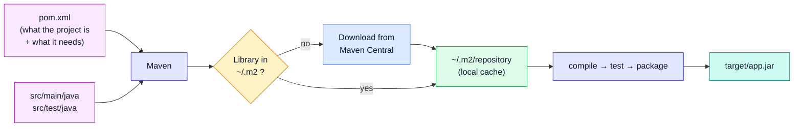
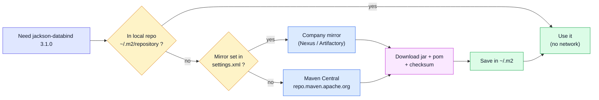
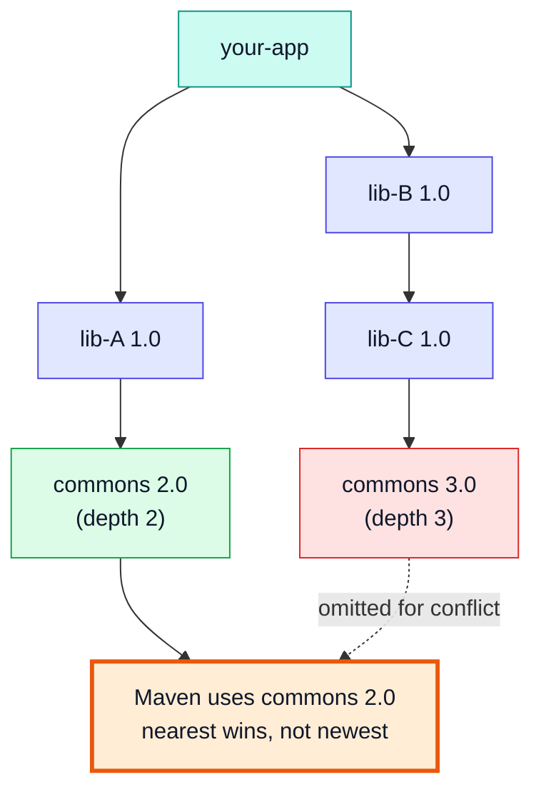
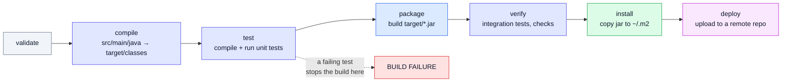
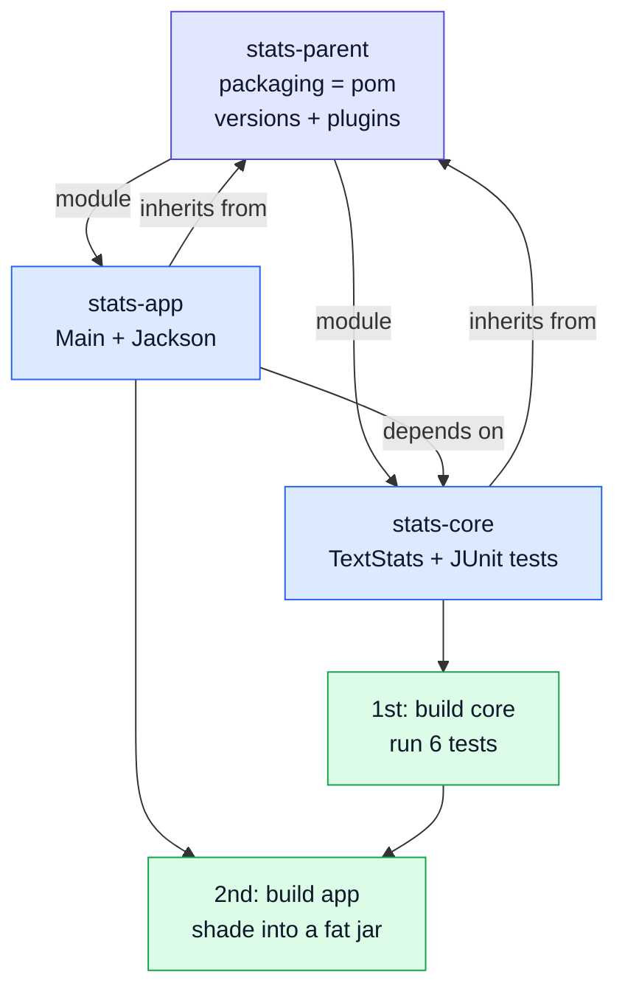

# Maven in Depth — Complete In-Depth Guide

**Spring Boot notes #1 of 18** · Priority 🔴 · Track: Spring Boot ([README](README.md))

Every Spring Boot project starts as a Maven (or Gradle) project. Before Spring itself, you need to know what the build tool does for you:

| Job | Without a build tool | With Maven |
|---|---|---|
| Get libraries | Download jars by hand, put them on `-cp`, repeat for *their* dependencies | List them in `pom.xml`; Maven downloads them **and their dependencies** |
| Compile | `javac -d out -cp a.jar:b.jar $(find src -name "*.java")` | `./mvnw compile` |
| Test | Run a test runner by hand | `./mvnw test` (runs on every build) |
| Package | `jar cfe app.jar Main -C out .` | `./mvnw package` |
| Same build on every laptop | "Works on my machine" | Same `pom.xml` + Maven wrapper = same build everywhere |

[Java gap #12](../Java%20Topics%20Not%20Covered%20Notes/java_gap_12_junit_maven_gradle_jdbc.md#6-maven) gave a first look at Maven. This file goes deeper, because Spring Boot leans on Maven features (parent POMs, BOMs, plugins) that you need to understand to read any real project.

> [!NOTE]
> This topic isn't in the playlist, so there are no video timestamps.
>
> **What was run:** everything in the [Complete Example](#-complete-example-everything-together) was built and run with **Maven 3.9.14** (through the Maven wrapper) on **JDK 21**, and the outputs shown are real. The project is in [`examples/01-maven-multimodule/`](examples/01-maven-multimodule/). Short XML fragments in Sections 2–9 illustrate one idea each; the ones used by the example were run as part of it.

---

## Table of Contents

| # | Topic (anchor link) | Level |
|---|---|---|
| 0 | [What Maven Is (and Isn't)](#0-what-maven-is-and-isnt) | Basics |
| 1 | [Project Layout and the Maven Wrapper](#1-project-layout-and-the-maven-wrapper) | Basics |
| 2 | [The POM: Coordinates, Packaging, Properties](#2-the-pom-coordinates-packaging-properties) | Core |
| 3 | [Dependencies, Repositories and Transitive Dependencies](#3-dependencies-repositories-and-transitive-dependencies) | Core |
| 4 | [Dependency Scopes](#4-dependency-scopes) | Core |
| 5 | [Version Conflicts, Exclusions, dependencyManagement and BOMs](#5-version-conflicts-exclusions-dependencymanagement-and-boms) | In depth |
| 6 | [The Build Lifecycle: Phases and Goals](#6-the-build-lifecycle-phases-and-goals) | Core |
| 7 | [Plugins](#7-plugins) | In depth |
| 8 | [Multi-Module Projects and Inheritance](#8-multi-module-projects-and-inheritance) | In depth |
| 9 | [Profiles, Resource Filtering and settings.xml](#9-profiles-resource-filtering-and-settingsxml) | In depth |
| 10 | [Everyday Commands and Troubleshooting](#10-everyday-commands-and-troubleshooting) | Core |
| 11 | [How Spring Boot Uses Maven](#11-how-spring-boot-uses-maven) | Core |
| 12 | [Maven vs Gradle and Interview Questions](#12-maven-vs-gradle-and-interview-questions) | Interview |

---

## 0. What Maven Is (and Isn't)

Maven is a **build tool** and a **dependency manager**. You *describe* the project in `pom.xml` (what it is, what it needs), and Maven decides *how* to build it using fixed conventions. This is called **convention over configuration**: if you put code where Maven expects it, you write almost no build logic.



| Maven **is** | Maven **is not** |
|---|---|
| A way to download and version libraries | A compiler (it calls `javac` through a plugin) |
| A fixed, standard build lifecycle | A general scripting tool (that's closer to Gradle or Ant) |
| A project model (`pom.xml` = Project Object Model) | An IDE (IntelliJ/VS Code *read* the POM) |

> [!TIP]
> Almost everything Maven does is done by **plugins**. Maven's core only knows the lifecycle and how to download things. "Compile" is the `maven-compiler-plugin`, "test" is `maven-surefire-plugin`, and so on (Section 7).

---

## 1. Project Layout and the Maven Wrapper

### 1.1 The standard directory layout

```
my-app/
├── pom.xml                      ← the project description
├── mvnw, mvnw.cmd               ← Maven wrapper scripts (Linux/macOS, Windows)
├── .mvn/wrapper/
│   └── maven-wrapper.properties ← which Maven version the wrapper uses
├── src/
│   ├── main/
│   │   ├── java/                ← production code   (com/notes/app/Main.java)
│   │   └── resources/           ← config files copied into the jar (application.yml)
│   └── test/
│       ├── java/                ← test code (never goes into the jar)
│       └── resources/           ← test-only config
└── target/                      ← EVERYTHING Maven generates (safe to delete)
    ├── classes/                 ← compiled main code + resources
    ├── test-classes/
    ├── surefire-reports/        ← test results
    └── my-app-1.0.0.jar
```

> [!IMPORTANT]
> The package folders must match the `package` line: `package com.notes.app;` lives in `src/main/java/com/notes/app/`. Never commit `target/` to git; add it to `.gitignore`.

### 1.2 The Maven wrapper (`mvnw`)

The wrapper is a small script committed with the project. The first time you run it, it downloads the **exact Maven version** written in `.mvn/wrapper/maven-wrapper.properties` into `~/.m2/wrapper/`, then uses it. Nobody has to install Maven, and everyone builds with the same version.

```properties
# .mvn/wrapper/maven-wrapper.properties (generated for the example project)
wrapperVersion=3.3.4
distributionType=only-script
distributionUrl=https://repo.maven.apache.org/maven2/org/apache/maven/apache-maven/3.9.14/apache-maven-3.9.14-bin.zip
```

| Command | Where |
|---|---|
| `./mvnw package` | Git Bash, Linux, macOS |
| `.\mvnw.cmd package` (or `.\mvnw package`) | PowerShell / cmd on Windows |
| `mvn -N wrapper:wrapper -Dmaven=3.9.14` | Adds the wrapper to an existing project (needs any Maven once) |

> [!TIP]
> Projects created by [start.spring.io](https://start.spring.io) already include `mvnw`. Always use `./mvnw`, not a globally installed `mvn`, in a project that has the wrapper. The wrapper needs `JAVA_HOME` to point at a JDK (or `java` on the `PATH`).

---

## 2. The POM: Coordinates, Packaging, Properties

### 2.1 Coordinates (GAV)

Every Maven artifact in the world is identified by three values, the **GAV**:

| Element | Meaning | Example |
|---|---|---|
| `groupId` | Who owns it: usually a reversed domain | `org.springframework.boot` |
| `artifactId` | The project's name | `spring-boot-starter-webmvc` |
| `version` | Which release | `4.0.5` |

On disk, an artifact lives at `~/.m2/repository/<groupId with / >/<artifactId>/<version>/`. For example, `org.postgresql:postgresql:42.7.10` is in `~/.m2/repository/org/postgresql/postgresql/42.7.10/postgresql-42.7.10.jar`.

### 2.2 A minimal POM

```xml
<?xml version="1.0" encoding="UTF-8"?>
<project xmlns="http://maven.apache.org/POM/4.0.0"
         xmlns:xsi="http://www.w3.org/2001/XMLSchema-instance"
         xsi:schemaLocation="http://maven.apache.org/POM/4.0.0 https://maven.apache.org/xsd/maven-4.0.0.xsd">
    <modelVersion>4.0.0</modelVersion>          <!-- always 4.0.0 for Maven 3 -->

    <groupId>com.notes</groupId>
    <artifactId>my-app</artifactId>
    <version>1.0.0-SNAPSHOT</version>
    <packaging>jar</packaging>                   <!-- jar (default), war, or pom -->

    <properties>
        <maven.compiler.release>21</maven.compiler.release>   <!-- compile for Java 21 -->
        <project.build.sourceEncoding>UTF-8</project.build.sourceEncoding>
    </properties>
</project>
```

| `packaging` | Produces | Used for |
|---|---|---|
| `jar` | `.jar` | Libraries and Spring Boot apps (Boot apps are runnable jars) |
| `war` | `.war` | Old-style apps deployed to an external Tomcat |
| `pom` | Nothing but the POM | Parent and aggregator projects (Section 8), BOMs |

> [!NOTE]
> `maven.compiler.release` (Java 9+) is better than the older `maven.compiler.source` + `target` pair. `release` also checks that you only use APIs that exist in that Java version.

### 2.3 SNAPSHOT vs release versions

| Version | Meaning | Can it change? |
|---|---|---|
| `1.0.0-SNAPSHOT` | "Work in progress towards 1.0.0" | **Yes**: Maven re-checks remote repositories for newer snapshot builds (once a day by default; `-U` forces it) |
| `1.0.0` | A release | **No**: a release in Maven Central is never replaced |

Most libraries use **semantic versioning**, `MAJOR.MINOR.PATCH`: patch = bug fixes, minor = new features (compatible), major = breaking changes. Spring Boot 3 → 4 is a major upgrade and needs code changes; 4.0.4 → 4.0.5 is a drop-in fix.

### 2.4 Properties

Properties are variables. You define them in `<properties>` and use them as `${name}`:

```xml
<properties>
    <jackson.version>3.1.0</jackson.version>
</properties>
...
<version>${jackson.version}</version>
```

Built-in ones include `${project.version}`, `${project.artifactId}`, `${project.basedir}`, `${project.build.directory}` (= `target`), and `${java.version}` (the JDK running Maven). You can override any property from the command line with `-Djackson.version=3.1.1`.

---

## 3. Dependencies, Repositories and Transitive Dependencies

### 3.1 Declaring a dependency

```xml
<dependencies>
    <dependency>
        <groupId>tools.jackson.core</groupId>
        <artifactId>jackson-databind</artifactId>
        <version>3.1.0</version>
    </dependency>
</dependencies>
```

Find coordinates on [central.sonatype.com](https://central.sonatype.com) (Maven Central's search) or [mvnrepository.com](https://mvnrepository.com). Both show the snippet to copy.

### 3.2 Where Maven looks



| Repository | What it is |
|---|---|
| **Local** (`~/.m2/repository`) | A cache on your laptop. Shared by **all** your projects, so a library is downloaded once. |
| **Maven Central** | The default public repository. Built into Maven, no setup needed. |
| **Mirrors / private repos** | Companies run Nexus or Artifactory to cache Central and host their own internal libraries. |

### 3.3 Transitive dependencies

A library's POM lists **its** dependencies, and Maven downloads those too, recursively. You asked for `jackson-databind`; you got three jars. From the example project (real output):

```
[INFO] com.notes:stats-app:jar:1.0.0
[INFO] +- com.notes:stats-core:jar:1.0.0:compile
[INFO] \- tools.jackson.core:jackson-databind:jar:3.1.0:compile
[INFO]    +- com.fasterxml.jackson.core:jackson-annotations:jar:2.21:compile
[INFO]    \- tools.jackson.core:jackson-core:jar:3.1.0:compile
```

> [!NOTE]
> Look at that tree: Jackson 3 moved to the new group `tools.jackson.*`, but it still uses the **2.x** `jackson-annotations` (`com.fasterxml...:2.21`), so annotations like `@JsonProperty` work in both. Spring Boot 4 uses Jackson 3; Boot 3 used Jackson 2 (`com.fasterxml.jackson.core:jackson-databind`). You'll meet this again in file 05.

Read the tree with `./mvnw dependency:tree`. It is the first command to run when you get a `ClassNotFoundException`, `NoSuchMethodError` or a "two versions of the same library" problem.

---

## 4. Dependency Scopes

A **scope** says on which classpaths a dependency appears, and whether it is passed on to projects that depend on yours.

| Scope | Compile main | Run tests | In packaged app | Passed on transitively | Typical example |
|---|---|---|---|---|---|
| `compile` (default) | ✅ | ✅ | ✅ | ✅ | `spring-boot-starter-webmvc`, Jackson |
| `provided` | ✅ | ✅ | ❌ (the server provides it) | ❌ | Servlet API in a WAR, Lombok |
| `runtime` | ❌ | ✅ | ✅ | ✅ (as runtime) | JDBC driver (`org.postgresql:postgresql`) |
| `test` | ❌ | ✅ | ❌ | ❌ | JUnit, Mockito, `spring-boot-starter-test` |
| `system` | ✅ | ✅ | ❌ | ❌ | A jar from a fixed path. **Deprecated, avoid** |
| `import` | — | — | — | — | Only inside `dependencyManagement`, for BOMs (Section 5.4) |

```xml
<dependency>
    <groupId>org.postgresql</groupId>
    <artifactId>postgresql</artifactId>
    <scope>runtime</scope>   <!-- your code only uses java.sql.*; the driver is needed only when running -->
</dependency>
```

> [!TIP]
> **Why `runtime` for a JDBC driver?** Your code talks to the `java.sql` interfaces (or JPA), never to `org.postgresql.*` classes. Putting the driver on `runtime` stops you from accidentally importing driver-specific classes.

You can see the test scope at work in the example: `stats-core` uses JUnit with `test` scope, and `stats-app` depends on `stats-core`, yet JUnit does **not** show up in `stats-app`'s tree (Section 3.3). Test dependencies never leak.

**`<optional>true</optional>`** is a separate flag: "I need this, but projects using me don't get it automatically". Spring Boot's own auto-configuration jars use optional dependencies heavily. That's how they can *support* Postgres, MySQL and H2 without dragging all three into your app.

---

## 5. Version Conflicts, Exclusions, dependencyManagement and BOMs

### 5.1 How Maven picks a version: "nearest wins"

If two paths bring in **different versions of the same library**, Maven keeps **exactly one**: the one **nearest to your project** in the tree. If two are equally near, **the one declared first** in the POM wins. Maven does **not** pick the highest version.



> [!WARNING]
> If `lib-C` needs a method that only exists in `commons 3.0`, this compiles fine and then fails at **runtime** with `NoSuchMethodError`. That's the classic "dependency hell" bug. `./mvnw dependency:tree -Dverbose` shows the omitted versions.

There are three ways to take control.

### 5.2 Declare it yourself (depth 1 always wins)

```xml
<dependency>
    <groupId>org.example</groupId>
    <artifactId>commons</artifactId>
    <version>3.0</version>
</dependency>
```

### 5.3 Exclusions: cut a transitive dependency off

```xml
<dependency>
    <groupId>org.springframework.boot</groupId>
    <artifactId>spring-boot-starter-webmvc</artifactId>
    <exclusions>
        <exclusion>  <!-- drop embedded Tomcat ... -->
            <groupId>org.springframework.boot</groupId>
            <artifactId>spring-boot-starter-tomcat</artifactId>
        </exclusion>
    </exclusions>
</dependency>
<dependency>         <!-- ... and use Jetty instead -->
    <groupId>org.springframework.boot</groupId>
    <artifactId>spring-boot-starter-jetty</artifactId>
</dependency>
```

### 5.4 `dependencyManagement`: decide versions in one place

`<dependencyManagement>` is a **version table**. It adds **nothing** to the classpath. It only says, "*if* this library is used anywhere, here or transitively, use this version". Modules then declare dependencies **without** a `<version>`.

```xml
<dependencyManagement>
    <dependencies>
        <dependency>
            <groupId>tools.jackson.core</groupId>
            <artifactId>jackson-databind</artifactId>
            <version>3.1.0</version>
        </dependency>
    </dependencies>
</dependencyManagement>

<dependencies>
    <dependency>                               <!-- actually adds it -->
        <groupId>tools.jackson.core</groupId>
        <artifactId>jackson-databind</artifactId>  <!-- no version needed -->
    </dependency>
</dependencies>
```

A **BOM** ("bill of materials") is a POM with only a big `dependencyManagement` section, published so that you can **import** a whole set of versions that are known to work together:

```xml
<dependencyManagement>
    <dependencies>
        <dependency>
            <groupId>org.junit</groupId>
            <artifactId>junit-bom</artifactId>
            <version>6.0.3</version>
            <type>pom</type>
            <scope>import</scope>   <!-- copy the BOM's version table into mine -->
        </dependency>
    </dependencies>
</dependencyManagement>
```

| | `<dependencies>` | `<dependencyManagement>` |
|---|---|---|
| Adds jars to the classpath | ✅ | ❌ |
| Sets versions | Only for that one dependency | For any use, including transitive ones |
| Inherited by child modules | ✅ (children get the jars) | ✅ (children get the versions) |

> [!IMPORTANT]
> This is **the** Spring Boot trick. `spring-boot-dependencies` is a BOM that pins compatible versions for hundreds of libraries (Hibernate, Jackson, Tomcat, the Postgres driver, JUnit…). That's why, in a Boot project, you write dependencies with **no version** at all (Section 11).

### 5.5 Enforcing rules

The `maven-enforcer-plugin` can fail the build on problems, for example `dependencyConvergence` (two versions of a library in the tree) or `requireJavaVersion`. Bigger teams use it so that conflicts are found at build time instead of at runtime.

---

## 6. The Build Lifecycle: Phases and Goals

### 6.1 Three lifecycles

| Lifecycle | What it does | Main phases |
|---|---|---|
| `clean` | Deletes `target/` | `clean` |
| `default` | Builds the project | `validate → compile → test → package → verify → install → deploy` |
| `site` | Generates a documentation website (rarely used now) | `site` |

### 6.2 Phases run in order

Running a phase runs **every earlier phase of the same lifecycle first**. `./mvnw package` therefore does validate, compile, test **and** package.



### 6.3 Phases vs goals

A **phase** is a step name. A **goal** is a concrete task done by a plugin, written `plugin:goal`. Phases do nothing by themselves: Maven **binds** plugin goals to them according to the packaging. Here is real output for a `jar` module (`./mvnw help:describe -Dcmd=package`, trimmed to the phases that have a goal):

```
* process-resources: org.apache.maven.plugins:maven-resources-plugin:3.4.0:resources
* compile: org.apache.maven.plugins:maven-compiler-plugin:3.15.0:compile
* process-test-resources: org.apache.maven.plugins:maven-resources-plugin:3.4.0:testResources
* test-compile: org.apache.maven.plugins:maven-compiler-plugin:3.15.0:testCompile
* test: org.apache.maven.plugins:maven-surefire-plugin:3.5.4:test
* package: org.apache.maven.plugins:maven-jar-plugin:3.5.0:jar
* install: org.apache.maven.plugins:maven-install-plugin:3.1.4:install
* deploy: org.apache.maven.plugins:maven-deploy-plugin:3.1.4:deploy
```

> [!NOTE]
> These are Maven 3.9.14's **default** plugin versions. If your POM pins a version in `pluginManagement` (the example pins compiler 3.14.1), the pinned version is what actually runs. Pinning is good practice, because default versions change between Maven releases.

You can mix phases and goals in one command. They run left to right:

```bash
./mvnw clean package              # clean lifecycle, then default lifecycle up to package
./mvnw dependency:tree            # run one goal only, no lifecycle
./mvnw clean install -DskipTests  # build and install, compile tests but don't run them
./mvnw package -Dmaven.test.skip=true  # skip compiling AND running tests (faster, riskier)
```

| Phase | Typical use |
|---|---|
| `compile` | Quick "does it compile?" check |
| `test` | Run unit tests |
| `package` | Build the jar you will run or deploy (most common) |
| `verify` | Run integration tests (`maven-failsafe-plugin`, file 10) and quality checks. Use this in CI. |
| `install` | Put your jar in `~/.m2` so **other local projects** can depend on it |
| `deploy` | Publish to a company or public repository |

> [!WARNING]
> `install` is **not** "install the app". It only copies the jar into your local Maven cache. You rarely need it in a multi-module project, because the reactor (Section 8) builds modules together.

---

## 7. Plugins

Plugins are configured in `<build><plugins>`. Each one can have **executions**, which bind a goal to a phase:

```xml
<build>
    <plugins>
        <plugin>
            <groupId>org.apache.maven.plugins</groupId>
            <artifactId>maven-surefire-plugin</artifactId>
            <version>3.5.5</version>
            <configuration>
                <excludes><exclude>**/*SlowTest.java</exclude></excludes>
            </configuration>
        </plugin>

        <plugin>
            <groupId>org.apache.maven.plugins</groupId>
            <artifactId>maven-shade-plugin</artifactId>
            <version>3.6.0</version>
            <executions>
                <execution>
                    <phase>package</phase>         <!-- WHEN -->
                    <goals><goal>shade</goal></goals>  <!-- WHAT -->
                </execution>
            </executions>
        </plugin>
    </plugins>
</build>
```

| Plugin | Job | Bound to |
|---|---|---|
| `maven-compiler-plugin` | Runs `javac` | `compile`, `test-compile` |
| `maven-surefire-plugin` | Runs **unit** tests (`*Test.java`, `*Tests.java`) | `test` |
| `maven-failsafe-plugin` | Runs **integration** tests (`*IT.java`) | `integration-test`, `verify` |
| `maven-jar-plugin` | Builds a plain jar (your classes only) | `package` |
| `maven-shade-plugin` | Builds a **fat jar**: your classes + all dependencies, unpacked into one jar | `package` (when configured) |
| `spring-boot-maven-plugin` | Builds a Boot fat jar (dependencies kept as nested jars), and `spring-boot:run` | `package` (repackage) |
| `maven-dependency-plugin` | `dependency:tree`, `dependency:analyze` | Run by hand |
| `exec-maven-plugin` | Runs a `main` method (`exec:java`) | Run by hand |

`<pluginManagement>` is to plugins what `<dependencyManagement>` is to dependencies: it pins versions and configuration, but doesn't activate a plugin until a module lists it in `<plugins>`.

> [!TIP]
> A plain `jar` built by `maven-jar-plugin` **cannot** run with `java -jar` if it needs libraries: they aren't inside it. That's why the example uses `maven-shade-plugin`, and why Spring Boot has its own plugin.

---

## 8. Multi-Module Projects and Inheritance

Big projects are split into **modules**: for example `api`, `service` and `persistence`, or a shared `common` library used by several apps. One parent POM with `<packaging>pom</packaging>` ties them together.

### 8.1 Two separate ideas

| Idea | Declared with | Effect |
|---|---|---|
| **Aggregation** | Parent lists `<modules>` | One command builds all modules |
| **Inheritance** | Child has a `<parent>` | Child inherits properties, `dependencyManagement`, `pluginManagement`, `groupId`, `version` |

Usually one POM does both, as in the example, but they're independent. Spring Boot's `spring-boot-starter-parent` is a parent you inherit from **without** it aggregating your project.

### 8.2 The reactor

When you build the parent, Maven's **reactor** reads all modules, works out which depends on which, and builds them in **dependency order**. In the example the parent deliberately lists `stats-app` **before** `stats-core`, yet the real build order was:

```
[INFO] Reactor Summary for stats-parent 1.0.0:
[INFO] stats-parent ....................................... SUCCESS [  1.274 s]
[INFO] stats-core ......................................... SUCCESS [  6.904 s]
[INFO] stats-app .......................................... SUCCESS [  1.588 s]
```



### 8.3 Building part of a project

| Command | Builds |
|---|---|
| `./mvnw package` | Every module |
| `./mvnw -pl stats-app package` | Only `stats-app`. It needs `stats-core` already in `~/.m2`, or it fails. |
| `./mvnw -pl stats-app -am package` | `stats-app` **and** the modules it needs ("also make") |
| `./mvnw -pl stats-core -amd package` | `stats-core` and every module that depends on it ("also make dependents") |
| `./mvnw -rf :stats-app package` | Resume the build from `stats-app` after a failure |

---

## 9. Profiles, Resource Filtering and settings.xml

### 9.1 Profiles

A **profile** is a block of POM settings that only applies when it is activated:

```xml
<profiles>
    <profile>
        <id>ci</id>
        <properties>
            <skipITs>false</skipITs>
        </properties>
    </profile>
    <profile>
        <id>jdk25</id>
        <activation><jdk>[25,)</jdk></activation>   <!-- auto-activates on JDK 25+ -->
        <properties><maven.compiler.release>25</maven.compiler.release></properties>
    </profile>
</profiles>
```

Activate one by hand with `./mvnw verify -Pci`. A profile can also activate itself on a JDK version, an OS, a property (`-Denv=prod`) or a missing file.

> [!WARNING]
> **Maven profiles ≠ Spring profiles.** A Maven profile changes the **build**. A Spring profile (`spring.profiles.active=prod`, file 04) changes the **running app's configuration**. In Spring Boot projects you almost always want Spring profiles. Building a different jar per environment is an anti-pattern: build once, configure at runtime.

### 9.2 Resource filtering

With filtering on, Maven replaces `${...}` placeholders inside files in `src/main/resources` when it copies them:

```xml
<build>
    <resources>
        <resource>
            <directory>src/main/resources</directory>
            <filtering>true</filtering>
        </resource>
    </resources>
</build>
```

```properties
# src/main/resources/version.properties  →  target/classes/version.properties
app.version=${project.version}
```

> [!NOTE]
> Spring Boot's parent switches the delimiter to `@...@` (e.g. `app.version=@project.version@`), so that `${...}` stays free for Spring's own placeholders.

### 9.3 `settings.xml`: per-machine settings

`~/.m2/settings.xml` holds things that **must not** go into the project's POM: credentials for private repositories, mirrors, proxies, and the local repository location.

```xml
<settings>
    <mirrors>
        <mirror>
            <id>company-nexus</id>
            <mirrorOf>central</mirrorOf>
            <url>https://nexus.example.com/repository/maven-public/</url>
        </mirror>
    </mirrors>
    <servers>
        <server>
            <id>company-nexus</id>
            <username>${env.NEXUS_USER}</username>      <!-- read from environment variables -->
            <password>${env.NEXUS_PASSWORD}</password>
        </server>
    </servers>
</settings>
```

---

## 10. Everyday Commands and Troubleshooting

| Command | Does |
|---|---|
| `./mvnw clean package` | Fresh build + tests + jar |
| `./mvnw test -Dtest=TextStatsTest` | Run one test class |
| `./mvnw test -Dtest=TextStatsTest#countsWords` | Run one test method |
| `./mvnw dependency:tree` | Show the full dependency tree |
| `./mvnw dependency:analyze` | List used-but-undeclared and declared-but-unused dependencies |
| `./mvnw help:effective-pom` | The final POM after inheritance and profiles: **what Maven really sees** |
| `./mvnw versions:display-dependency-updates` | Show newer versions of your dependencies |
| `./mvnw -o package` | Offline: use only `~/.m2` |
| `./mvnw -U package` | Force re-checking snapshots and failed downloads |
| `./mvnw -X package` | Debug logging (very long) |
| `./mvnw -B package` | Batch mode: no colours or progress bars. Use in CI. |
| `./mvnw -T 1C package` | Build modules in parallel, 1 thread per CPU core |

| Symptom | Likely cause | Fix |
|---|---|---|
| `package org.x does not exist` | Dependency missing, or it's `test`/`runtime` scope | Add it with the right scope |
| `ClassNotFoundException` when running `java -jar` | Plain jar without its dependencies | Use the shade plugin or the Spring Boot plugin |
| `NoSuchMethodError` at runtime | Version conflict (Section 5.1) | `dependency:tree -Dverbose`, then pin the version |
| `Could not resolve dependencies` | Typo in GAV, no network, or a private repo with no credentials | Check the coordinates on Maven Central; check `settings.xml` |
| "Failed to read artifact descriptor" / corrupt jar | Interrupted download in `~/.m2` | Delete that artifact's folder in `~/.m2/repository` and rebuild |
| `invalid target release: 21` | Maven is running on an older JDK | Set `JAVA_HOME` to JDK 21 (`./mvnw -v` shows which JDK is used) |
| IDE shows red imports, but `./mvnw` builds | IDE didn't reload the POM | IntelliJ: Maven tool window → *Reload All Maven Projects* |

---

## 11. How Spring Boot Uses Maven

Here is the core of a Spring Boot 4 POM (you'll build this for real in file 04):

```xml
<parent>
    <groupId>org.springframework.boot</groupId>
    <artifactId>spring-boot-starter-parent</artifactId>
    <version>4.0.5</version>
</parent>

<dependencies>
    <dependency>
        <groupId>org.springframework.boot</groupId>
        <artifactId>spring-boot-starter-webmvc</artifactId>   <!-- no version! -->
    </dependency>
    <dependency>
        <groupId>org.postgresql</groupId>
        <artifactId>postgresql</artifactId>
        <scope>runtime</scope>
    </dependency>
    <dependency>
        <groupId>org.springframework.boot</groupId>
        <artifactId>spring-boot-starter-test</artifactId>
        <scope>test</scope>
    </dependency>
</dependencies>

<build>
    <plugins>
        <plugin>
            <groupId>org.springframework.boot</groupId>
            <artifactId>spring-boot-maven-plugin</artifactId>
        </plugin>
    </plugins>
</build>
```

Every idea from this file appears here:

| Boot feature | Maven idea behind it |
|---|---|
| `spring-boot-starter-parent` | **Inheritance** (Section 8). It sets Java/encoding defaults, `@...@` resource filtering and plugin configuration, and its own parent is the `spring-boot-dependencies` **BOM**. |
| Dependencies with no `<version>` | **dependencyManagement** from that BOM (Section 5.4) |
| "Starters" (`spring-boot-starter-webmvc`) | Plain dependencies whose job is to bring in a well-chosen set of **transitive dependencies** (Spring MVC, Jackson, embedded Tomcat…) |
| `spring-boot-maven-plugin` | A **plugin** (Section 7) bound to `package`: it repackages your jar into a runnable fat jar. `./mvnw spring-boot:run` starts the app from source. |
| Override one library's version | Set a **property** the BOM uses, e.g. `<jackson-bom.version>3.1.1</jackson-bom.version>` |

> [!TIP]
> Can't use the Boot parent because your company has its own parent POM? Import `spring-boot-dependencies` as a BOM in `dependencyManagement` (`<type>pom</type><scope>import</scope>`). You get the same version management, but you must configure the plugins yourself.

---

## 12. Maven vs Gradle and Interview Questions

### 12.1 Maven vs Gradle

| | Maven | Gradle |
|---|---|---|
| Build file | `pom.xml` (XML, declarative) | `build.gradle.kts` (Kotlin) or `build.gradle` (Groovy): code |
| Model | Fixed lifecycle of phases | A graph of tasks you can customise freely |
| Speed | Good | Usually faster (incremental builds, build cache, daemon) |
| Learning curve | Lower: every project looks the same | Higher: builds can contain arbitrary logic |
| Where you see it | Most Spring Boot tutorials, enterprise Java | Android (standard), many newer projects |
| Wrapper | `mvnw` | `gradlew` |

The same dependencies in Gradle (Kotlin DSL), for comparison:

```kotlin
plugins {
    java
    id("org.springframework.boot") version "4.0.5"
    id("io.spring.dependency-management") version "1.1.7"
}

dependencies {
    implementation("org.springframework.boot:spring-boot-starter-webmvc")   // ≈ compile
    runtimeOnly("org.postgresql:postgresql")                               // ≈ runtime
    testImplementation("org.springframework.boot:spring-boot-starter-test") // ≈ test
}
```

> [!NOTE]
> The Gradle snippet is for comparison and wasn't run. The `io.spring.dependency-management` plugin version is the one start.spring.io used for Boot 3.x/4.0 when these notes were written; start.spring.io always gives you the current pairing.

### 12.2 Interview questions

| Question | Answer |
|---|---|
| What is a POM? | The Project Object Model, `pom.xml`: the project's coordinates, dependencies, plugins and build configuration. |
| What are GAV coordinates? | `groupId:artifactId:version`, which uniquely identify an artifact. |
| Phase vs goal? | A phase is a lifecycle step (`package`). A goal is a plugin task (`jar:jar`) bound to a phase. Running a phase runs all earlier phases. |
| What happens on `mvn install`? | All phases up to `install`, ending with the artifact being copied into the local repository `~/.m2`. |
| `dependencies` vs `dependencyManagement`? | The first adds jars; the second only sets versions (and scopes) to use *if* a jar is used. |
| What is a BOM? | A POM that only manages versions, imported with `scope import`, e.g. `spring-boot-dependencies`. |
| How does Maven resolve version conflicts? | Nearest definition in the tree wins; on a tie, the first declared. Not the highest version. |
| `provided` vs `runtime`? | `provided`: needed to compile, supplied by the environment at runtime. `runtime`: not needed to compile, needed to run (JDBC drivers). |
| What is a SNAPSHOT? | A development version that can be replaced by newer builds; releases are immutable. |
| Why commit `mvnw`? | Everyone, including CI, builds with the same Maven version without installing it. |
| How do you skip tests? | `-DskipTests` (compile but don't run) or `-Dmaven.test.skip=true` (don't even compile them). |
| What is a fat jar? | A jar that contains your code plus all its dependencies, so `java -jar` works by itself. |

---

## 🧩 Complete Example: Everything Together

A two-module project: a small library (`stats-core`, with JUnit tests) and an app (`stats-app`) that uses the library plus Jackson to print a JSON word report. It shows inheritance, a BOM, `dependencyManagement`, scopes, transitive dependencies, the reactor, a plugin execution and a fat jar.

Source: [`examples/01-maven-multimodule/`](examples/01-maven-multimodule/)

```
01-maven-multimodule/
├── pom.xml                  (parent: packaging pom, modules, BOM, versions)
├── mvnw, mvnw.cmd, .mvn/
├── stats-core/
│   ├── pom.xml              (JUnit, test scope)
│   └── src/main/java/com/notes/stats/TextStats.java
│       src/test/java/com/notes/stats/TextStatsTest.java
└── stats-app/
    ├── pom.xml              (depends on stats-core + Jackson; shade plugin)
    └── src/main/java/com/notes/app/Main.java
```

**Parent `pom.xml`** (the key parts):

```xml
<groupId>com.notes</groupId>
<artifactId>stats-parent</artifactId>
<version>1.0.0</version>
<packaging>pom</packaging>

<modules>                           <!-- Maven sorts these by dependency, not by this order -->
    <module>stats-app</module>
    <module>stats-core</module>
</modules>

<properties>
    <maven.compiler.release>21</maven.compiler.release>
    <project.build.sourceEncoding>UTF-8</project.build.sourceEncoding>
    <junit.version>6.0.3</junit.version>
    <jackson.version>3.1.0</jackson.version>
</properties>

<dependencyManagement>
    <dependencies>
        <dependency>                <!-- a BOM: imports many pinned versions at once -->
            <groupId>org.junit</groupId>
            <artifactId>junit-bom</artifactId>
            <version>${junit.version}</version>
            <type>pom</type>
            <scope>import</scope>
        </dependency>
        <dependency>
            <groupId>tools.jackson.core</groupId>
            <artifactId>jackson-databind</artifactId>
            <version>${jackson.version}</version>
        </dependency>
        <dependency>
            <groupId>com.notes</groupId>
            <artifactId>stats-core</artifactId>
            <version>${project.version}</version>
        </dependency>
    </dependencies>
</dependencyManagement>
<!-- + pluginManagement pinning compiler 3.14.1, surefire 3.5.5, shade 3.6.0 -->
```

**`stats-core/pom.xml`** (inherits everything; JUnit has no version because the BOM supplies it):

```xml
<parent>
    <groupId>com.notes</groupId>
    <artifactId>stats-parent</artifactId>
    <version>1.0.0</version>
</parent>
<artifactId>stats-core</artifactId>

<dependencies>
    <dependency>
        <groupId>org.junit.jupiter</groupId>
        <artifactId>junit-jupiter</artifactId>
        <scope>test</scope>
    </dependency>
</dependencies>
```

**`TextStats.java`**:

```java
package com.notes.stats;

import java.util.*;
import java.util.stream.*;

/** A tiny library: word statistics for a piece of text. */
public final class TextStats {
    private TextStats() {}

    /** Lower-cased words; anything that is not a letter or digit separates words. */
    public static List<String> words(String text) {
        if (text == null || text.isBlank()) return List.of();
        return Arrays.stream(text.toLowerCase().split("[^\\p{L}\\p{N}]+"))
                     .filter(w -> !w.isEmpty())
                     .toList();
    }

    public static int wordCount(String text) {
        return words(text).size();
    }

    /** The k most frequent words; ties are broken alphabetically. */
    public static List<Map.Entry<String, Long>> topWords(String text, int k) {
        if (k < 0) throw new IllegalArgumentException("k must be >= 0, was " + k);
        Map<String, Long> freq = words(text).stream()
                .collect(Collectors.groupingBy(w -> w, Collectors.counting()));
        return freq.entrySet().stream()
                .sorted(Map.Entry.<String, Long>comparingByValue().reversed()
                        .thenComparing(Map.Entry.comparingByKey()))
                .limit(k)
                .map(e -> Map.entry(e.getKey(), e.getValue()))
                .toList();
    }
}
```

**`TextStatsTest.java`** (JUnit 6; same API as JUnit 5):

```java
package com.notes.stats;

import org.junit.jupiter.api.Test;
import org.junit.jupiter.params.ParameterizedTest;
import org.junit.jupiter.params.provider.CsvSource;

import java.util.List;
import java.util.Map;

import static org.junit.jupiter.api.Assertions.*;

class TextStatsTest {

    @ParameterizedTest
    @CsvSource(delimiter = '|', value = {
        "hello world               | 2",
        "'  spaces   everywhere  ' | 2",
        "one,two;three             | 3",
        "''                        | 0"
    })
    void countsWords(String text, int expected) {
        assertEquals(expected, TextStats.wordCount(text));
    }

    @Test
    void topWordsBreaksTiesAlphabetically() {
        var top = TextStats.topWords("b a c a b d", 3);
        assertEquals(List.of(Map.entry("a", 2L), Map.entry("b", 2L), Map.entry("c", 1L)), top);
    }

    @Test
    void negativeKIsRejected() {
        var ex = assertThrows(IllegalArgumentException.class, () -> TextStats.topWords("x", -1));
        assertTrue(ex.getMessage().contains("-1"));
    }
}
```

**`stats-app/pom.xml`** (the important part):

```xml
<dependencies>
    <dependency>                     <!-- our own module: makes Maven build core first -->
        <groupId>com.notes</groupId>
        <artifactId>stats-core</artifactId>
    </dependency>
    <dependency>                     <!-- pulls jackson-core + jackson-annotations transitively -->
        <groupId>tools.jackson.core</groupId>
        <artifactId>jackson-databind</artifactId>
    </dependency>
</dependencies>

<build>
    <plugins>
        <plugin>                     <!-- builds a "fat" jar that includes all dependencies -->
            <groupId>org.apache.maven.plugins</groupId>
            <artifactId>maven-shade-plugin</artifactId>
            <executions>
                <execution>
                    <phase>package</phase>
                    <goals><goal>shade</goal></goals>
                    <configuration>
                        <transformers>
                            <transformer implementation="org.apache.maven.plugins.shade.resource.ManifestResourceTransformer">
                                <mainClass>com.notes.app.Main</mainClass>
                            </transformer>
                        </transformers>
                        <!-- + filters that drop signature files and module-info.class; see the full file -->
                    </configuration>
                </execution>
            </executions>
        </plugin>
    </plugins>
</build>
```

**`Main.java`**:

```java
package com.notes.app;

import com.notes.stats.TextStats;
import tools.jackson.databind.SerializationFeature;
import tools.jackson.databind.json.JsonMapper;

import java.util.LinkedHashMap;
import java.util.List;
import java.util.Map;

public class Main {
    public static void main(String[] args) {
        String text = args.length > 0 ? String.join(" ", args)
                : "Maven builds the code, Maven runs the tests, Maven packages the code";

        Map<String, Object> report = new LinkedHashMap<>();
        report.put("words", TextStats.wordCount(text));
        List<Map<String, Object>> top = TextStats.topWords(text, 3).stream()
                .map(e -> {
                    Map<String, Object> m = new LinkedHashMap<>();
                    m.put("word", e.getKey());
                    m.put("count", e.getValue());
                    return m;
                })
                .toList();
        report.put("top3", top);

        JsonMapper mapper = JsonMapper.builder()
                .enable(SerializationFeature.INDENT_OUTPUT)
                .build();
        System.out.println(mapper.writeValueAsString(report));
    }
}
```

**Commands** (run from `examples/01-maven-multimodule/`):

```bash
./mvnw -B clean package
```

```bash
java -jar stats-app/target/stats-app-1.0.0.jar
```

```bash
java -jar stats-app/target/stats-app-1.0.0.jar "to be or not to be"
```

```bash
./mvnw -B dependency:tree
```

**Expected Output:**

`./mvnw -B clean package` (download lines and blank lines removed):

```
[INFO] Building stats-core 1.0.0                                          [2/3]
...
[INFO] Compiling 1 source file with javac [debug release 21] to target\classes
...
[INFO] -------------------------------------------------------
[INFO]  T E S T S
[INFO] -------------------------------------------------------
[INFO] Running com.notes.stats.TextStatsTest
[INFO] Tests run: 6, Failures: 0, Errors: 0, Skipped: 0, Time elapsed: 0.372 s -- in com.notes.stats.TextStatsTest
[INFO] Results:
[INFO] Tests run: 6, Failures: 0, Errors: 0, Skipped: 0
[INFO] Building jar: ...\stats-core\target\stats-core-1.0.0.jar
...
[INFO] Building stats-app 1.0.0                                           [3/3]
[INFO] Including com.notes:stats-core:jar:1.0.0 in the shaded jar.
[INFO] Including tools.jackson.core:jackson-databind:jar:3.1.0 in the shaded jar.
[INFO] Including com.fasterxml.jackson.core:jackson-annotations:jar:2.21 in the shaded jar.
[INFO] Including tools.jackson.core:jackson-core:jar:3.1.0 in the shaded jar.
[WARNING] jackson-annotations-2.21.jar, jackson-core-3.1.0.jar, jackson-databind-3.1.0.jar define 2 overlapping resources:
[WARNING]   - META-INF/LICENSE
[WARNING]   - META-INF/NOTICE
...
[INFO] Replacing original artifact with shaded artifact.
[INFO] ------------------------------------------------------------------------
[INFO] Reactor Summary for stats-parent 1.0.0:
[INFO] stats-parent ....................................... SUCCESS [  1.274 s]
[INFO] stats-core ......................................... SUCCESS [  6.904 s]
[INFO] stats-app .......................................... SUCCESS [  1.588 s]
[INFO] ------------------------------------------------------------------------
[INFO] BUILD SUCCESS
```

`java -jar stats-app/target/stats-app-1.0.0.jar`:

```
{
  "words" : 12,
  "top3" : [ {
    "word" : "maven",
    "count" : 3
  }, {
    "word" : "the",
    "count" : 3
  }, {
    "word" : "code",
    "count" : 2
  } ]
}
```

`java -jar stats-app/target/stats-app-1.0.0.jar "to be or not to be"`:

```
{
  "words" : 6,
  "top3" : [ {
    "word" : "be",
    "count" : 2
  }, {
    "word" : "to",
    "count" : 2
  }, {
    "word" : "not",
    "count" : 1
  } ]
}
```

`./mvnw -B dependency:tree` (tree lines only):

```
[INFO] com.notes:stats-core:jar:1.0.0
[INFO] \- org.junit.jupiter:junit-jupiter:jar:6.0.3:test
[INFO]    +- org.junit.jupiter:junit-jupiter-api:jar:6.0.3:test
[INFO]    |  +- org.opentest4j:opentest4j:jar:1.3.0:test
[INFO]    |  +- org.junit.platform:junit-platform-commons:jar:6.0.3:test
[INFO]    |  +- org.apiguardian:apiguardian-api:jar:1.1.2:test
[INFO]    |  \- org.jspecify:jspecify:jar:1.0.0:test
[INFO]    +- org.junit.jupiter:junit-jupiter-params:jar:6.0.3:test
[INFO]    \- org.junit.jupiter:junit-jupiter-engine:jar:6.0.3:test
[INFO]       \- org.junit.platform:junit-platform-engine:jar:6.0.3:test

[INFO] com.notes:stats-app:jar:1.0.0
[INFO] +- com.notes:stats-core:jar:1.0.0:compile
[INFO] \- tools.jackson.core:jackson-databind:jar:3.1.0:compile
[INFO]    +- com.fasterxml.jackson.core:jackson-annotations:jar:2.21:compile
[INFO]    \- tools.jackson.core:jackson-core:jar:3.1.0:compile
```

**What to notice in the output:**

| Output | Concept |
|---|---|
| `stats-core` built before `stats-app`, although the POM lists `stats-app` first | The **reactor** sorts modules by dependency (Section 8.2) |
| `Tests run: 6`: there are 3 test methods, but `countsWords` runs once per CSV row (4) | Surefire runs tests in the `test` phase; parameterized tests count each case |
| One dependency (`jackson-databind`) became three jars | **Transitive** dependencies (Section 3.3) |
| JUnit's 9 jars are in `stats-core`'s tree but absent from `stats-app`'s | **`test` scope** is not passed on (Section 4) |
| Versions written nowhere in the module POMs | **dependencyManagement + BOM** from the parent (Section 5.4) |
| "Including … in the shaded jar" | A **plugin execution** bound to `package` (Section 7) |
| `java -jar` works with no `-cp` | It's a **fat jar** |
| The `[WARNING]` about `META-INF/LICENSE` | Harmless: several jars contain a licence file and only one copy fits. Shade can merge them with an `ApacheLicenseResourceTransformer` if you want a clean log. |
| `maven` and `the` both have count 3; `maven` is first | The tie is broken alphabetically by `thenComparing(comparingByKey())` |

---

## Quick Reference Cheat Sheet

| Concept | Key point |
|---|---|
| POM | `pom.xml`: coordinates + dependencies + plugins |
| GAV | `groupId:artifactId:version` |
| Wrapper | `./mvnw` (Git Bash/Linux/macOS), `.\mvnw.cmd` (Windows); pins the Maven version |
| Layout | `src/main/java`, `src/main/resources`, `src/test/java`; output in `target/` |
| Local repo | `~/.m2/repository`, shared by all projects |
| SNAPSHOT | Changeable dev version; releases are immutable |
| Transitive deps | Your dependencies' dependencies come too; see `dependency:tree` |
| Scopes | `compile` (default), `provided`, `runtime` (JDBC driver), `test` (JUnit), `import` (BOM) |
| Conflicts | Nearest wins, then first declared; **not** the newest |
| Fix conflicts | Declare it directly, `<exclusions>`, or `dependencyManagement` |
| `dependencyManagement` | Sets versions only; adds no jars |
| BOM | Imported version table (`type pom`, `scope import`), e.g. `spring-boot-dependencies` |
| Lifecycle | `validate → compile → test → package → verify → install → deploy` (+ `clean`) |
| Phase vs goal | Phase = step; goal = plugin task bound to it; a phase runs all earlier phases |
| `install` | Copies the jar to `~/.m2`; it does not install the app |
| Skip tests | `-DskipTests` (compile, don't run) / `-Dmaven.test.skip=true` (skip both) |
| Plugins | compiler, surefire (unit), failsafe (IT), jar, shade/Boot plugin (fat jar) |
| Multi-module | Parent `packaging pom` + `<modules>`; children have `<parent>` |
| Partial build | `-pl module -am` |
| Profiles | `-Pname`; change the **build**, not the app's runtime config |
| settings.xml | Mirrors, credentials, proxies: never in the POM |
| Debug the model | `help:effective-pom`, `dependency:tree -Dverbose` |
| Boot + Maven | Starter parent → BOM → no versions; starters = curated transitive deps; Boot plugin = runnable jar |
