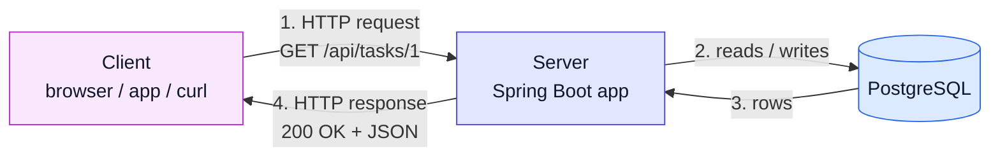
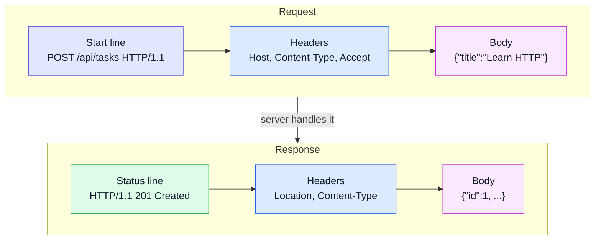
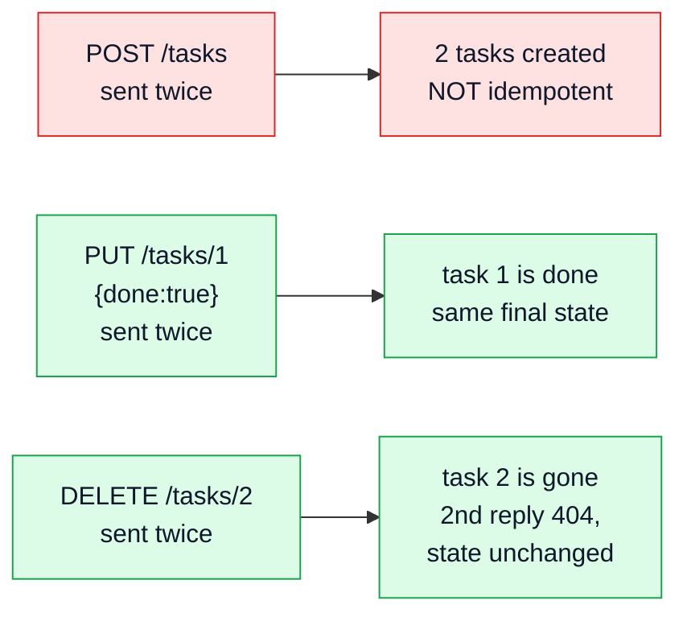
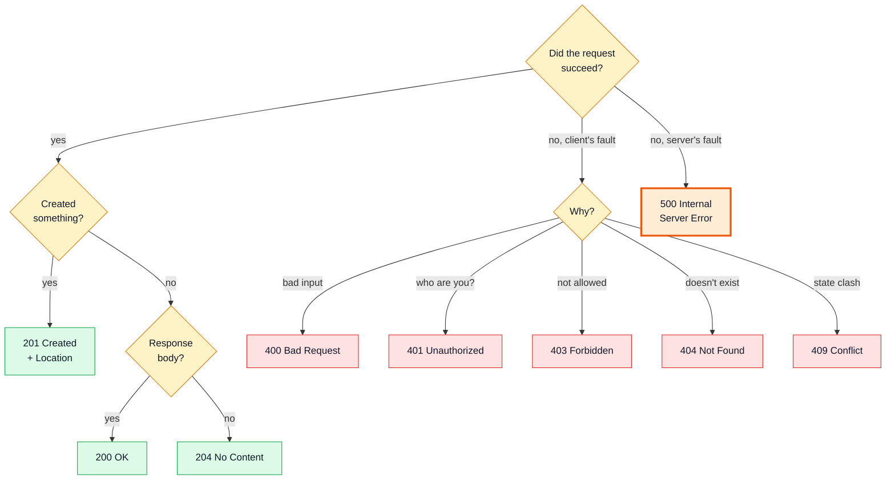
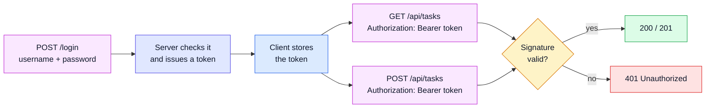
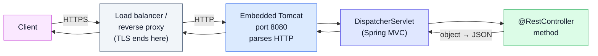

# HTTP & REST Basics — Complete In-Depth Guide

**Spring Boot notes #2 of 18** · Priority 🔴 · Track: Spring Boot ([README](README.md))

A Spring Boot web app is, at heart, a program that **receives HTTP requests and sends HTTP responses**. Spring hides most of the plumbing, but you can't design an API, read an error, or answer interview questions without knowing what travels over the wire. This file covers HTTP itself, then REST, a style for designing APIs on top of HTTP.

> [!NOTE]
> This topic isn't in the playlist, so there are no video timestamps.
>
> **What was run:** every Java block with a `main` method was compiled and run on **JDK 21**, using only the JDK. The [Complete Example](#-complete-example-everything-together) is a small REST API built on the JDK's own HTTP server (`com.sun.net.httpserver`), driven by `java.net.http.HttpClient`, and its output is real. `curl` lines are there for you to try against a running server; their outputs are shown in the same form as the example's.

---

## Table of Contents

| # | Topic (anchor link) | Level |
|---|---|---|
| 0 | [Clients, Servers and URLs](#0-clients-servers-and-urls) | Basics |
| 1 | [Anatomy of a Request and a Response](#1-anatomy-of-a-request-and-a-response) | Core |
| 2 | [HTTP Methods: Safe and Idempotent](#2-http-methods-safe-and-idempotent) | Core |
| 3 | [Status Codes](#3-status-codes) | Core |
| 4 | [Headers You Must Know](#4-headers-you-must-know) | Core |
| 5 | [JSON](#5-json) | Core |
| 6 | [Statelessness, Cookies, Sessions and Tokens](#6-statelessness-cookies-sessions-and-tokens) | In depth |
| 7 | [REST Principles](#7-rest-principles) | Core |
| 8 | [Designing a REST API: URLs, Filtering, Pagination, Versioning](#8-designing-a-rest-api-urls-filtering-pagination-versioning) | In depth |
| 9 | [Error Responses: Problem Details](#9-error-responses-problem-details) | In depth |
| 10 | [HTTP Versions, HTTPS and Where Tomcat Fits](#10-http-versions-https-and-where-tomcat-fits) | In depth |
| 11 | [Tools: curl, Postman, Browser DevTools](#11-tools-curl-postman-browser-devtools) | Core |
| 12 | [Interview Questions](#12-interview-questions) | Interview |

---

## 0. Clients, Servers and URLs

The **client** (a browser, a mobile app, `curl`, another server) sends a **request**. The **server** (your Spring Boot app) sends back **exactly one response**. HTTP is a **request–response** protocol: the server never speaks first.



### 0.1 Anatomy of a URL

```
https://api.example.com:8443/api/v1/tasks/42?done=true&sort=title#notes
└─┬──┘  └──────┬──────┘ └┬─┘└──────┬───────┘└────────┬──────────┘└─┬──┘
scheme       host      port      path            query       fragment
```

| Part | Meaning | Reaches the server? |
|---|---|---|
| Scheme | `http` or `https` (TLS-encrypted) | Decides how to connect |
| Host | Domain name, turned into an IP address by DNS | Yes, in the `Host` header |
| Port | Default 80 for `http`, 443 for `https`; Spring Boot defaults to **8080** | Decides where to connect |
| Path | Which resource | ✅ |
| Query | `key=value` pairs after `?`, joined by `&`: filters and options | ✅ |
| Fragment | After `#`: a place inside the page | ❌ **Never sent**; browser-only |

Java can split a URL for you, and it shows how special characters must be **percent-encoded**:

```java
import java.net.URI;
import java.net.URLDecoder;
import java.net.URLEncoder;
import java.nio.charset.StandardCharsets;

public class UrlParts {
    public static void main(String[] args) {
        URI u = URI.create("https://api.example.com:8443/api/v1/tasks/42?done=true&sort=title#notes");
        System.out.println("scheme   = " + u.getScheme());     // https
        System.out.println("host     = " + u.getHost());       // api.example.com
        System.out.println("port     = " + u.getPort());       // 8443
        System.out.println("path     = " + u.getPath());       // /api/v1/tasks/42
        System.out.println("query    = " + u.getQuery());      // done=true&sort=title
        System.out.println("fragment = " + u.getFragment());   // notes

        // Spaces, &, = and non-ASCII characters can't appear raw in a query value
        String q = URLEncoder.encode("rock & roll = fun", StandardCharsets.UTF_8);
        System.out.println(q);                                          // rock+%26+roll+%3D+fun
        System.out.println(URLDecoder.decode(q, StandardCharsets.UTF_8)); // rock & roll = fun
    }
}
```

> [!TIP]
> `URLEncoder` does **form** encoding, so a space becomes `+`. In a URL **path**, a space must be `%20`. Spring and `HttpClient` builders handle this when you pass parameters separately instead of gluing strings together.

---

## 1. Anatomy of a Request and a Response

HTTP/1.1 messages are plain text: a start line, headers, a blank line, then an optional body.

**Request:**

```http
POST /api/tasks HTTP/1.1
Host: localhost:8080
Content-Type: application/json
Accept: application/json
Content-Length: 22

{"title":"Learn HTTP"}
```

**Response:**

```http
HTTP/1.1 201 Created
Location: /api/tasks/1
Content-Type: application/json
Content-Length: 42

{"id":1,"title":"Learn HTTP","done":false}
```

| Part | Request | Response |
|---|---|---|
| Start line | **Method**, path (+ query), version | Version, **status code**, reason phrase |
| Headers | Metadata: `Host` (required in HTTP/1.1), `Content-Type`, `Accept`, `Authorization`… | Metadata: `Content-Type`, `Location`, `Cache-Control`, `Set-Cookie`… |
| Blank line | Ends the headers | Ends the headers |
| Body | Optional: data sent by the client (JSON for POST/PUT) | Optional: the resource or error details |



> [!NOTE]
> Header **names** are case-insensitive (`content-type` = `Content-Type`); HTTP/2 even sends them in lowercase. Header **values** and the path are case-sensitive.

---

## 2. HTTP Methods: Safe and Idempotent

| Method | Purpose | Has a request body? | **Safe**? | **Idempotent**? |
|---|---|---|---|---|
| `GET` | Read a resource | No | ✅ | ✅ |
| `HEAD` | Like GET, but headers only (no body) | No | ✅ | ✅ |
| `OPTIONS` | Which methods are allowed? (used by CORS preflight) | No | ✅ | ✅ |
| `POST` | Create a resource, or run an action | Yes | ❌ | ❌ |
| `PUT` | **Replace** a resource completely | Yes | ❌ | ✅ |
| `PATCH` | **Change part** of a resource | Yes | ❌ | ❌ (not guaranteed) |
| `DELETE` | Remove a resource | Usually no | ❌ | ✅ |

- **Safe** = doesn't change anything on the server. Browsers, crawlers and caches may call safe methods freely, which is why a `GET` must **never** delete or update data.
- **Idempotent** = sending the same request **once or ten times leaves the server in the same state**. This makes retries safe: if a `PUT` times out, the client can just send it again.



> [!IMPORTANT]
> Idempotency is about the **server's state**, not the **response**. Deleting the same task twice gives `204` then `404`, which are different responses, but the state is the same: the task is gone. The Complete Example shows exactly this.

**PUT vs PATCH:** `PUT` sends the **whole** new resource; fields you leave out are reset. `PATCH` sends **only the changes**. `PATCH` *can* be idempotent (`{"done":true}`) but doesn't have to be (`{"op":"increment","field":"views"}`).

**Making POST safe to retry:** payment and order APIs accept an `Idempotency-Key: <uuid>` header. The server remembers the key and returns the first result instead of creating a duplicate (file 13).

---

## 3. Status Codes

The first digit gives the class:

| Class | Meaning | Who's at fault? |
|---|---|---|
| `1xx` | Informational (rare in APIs) | — |
| `2xx` | ✅ Success | — |
| `3xx` | Redirect: look somewhere else | — |
| `4xx` | ❌ **Client** error: fix the request | Client |
| `5xx` | 💥 **Server** error: the server failed | Server |

The ones you'll use in a REST API:

| Code | Name | When to return it |
|---|---|---|
| **200** | OK | Successful GET, or PUT/PATCH that returns the resource |
| **201** | Created | POST created something. Include a `Location` header pointing to it |
| **204** | No Content | Success with no body: typical for DELETE |
| 301 / 308 | Moved Permanently / Permanent Redirect | A URL moved for good (308 keeps the method) |
| 302 / 307 | Found / Temporary Redirect | Temporary move (307 keeps the method) |
| 304 | Not Modified | The client's cached copy is still valid (Section 4.2) |
| **400** | Bad Request | Malformed JSON, missing required field, failed validation |
| **401** | Unauthorized | Not **authenticated**: no or invalid login/token. (The name is misleading.) |
| **403** | Forbidden | Authenticated, but **not allowed** to do this |
| **404** | Not Found | The resource doesn't exist |
| **405** | Method Not Allowed | The URL exists but not with this method. Include an `Allow` header. |
| **409** | Conflict | Clashes with the current state: duplicate email, version conflict |
| 415 | Unsupported Media Type | Wrong `Content-Type`, e.g. sent XML to a JSON-only API |
| 422 | Unprocessable Content | Well-formed but semantically invalid. Some APIs use it for validation errors instead of 400. |
| **429** | Too Many Requests | Rate limit hit. Often with a `Retry-After` header. |
| **500** | Internal Server Error | An unhandled exception: a bug on the server |
| 502 / 503 / 504 | Bad Gateway / Service Unavailable / Gateway Timeout | A proxy or upstream service failed, is down, or was too slow |



> [!WARNING]
> Two common mistakes: (1) returning `200 OK` with `{"error": "not found"}` in the body: clients, caches and monitoring tools all read the **status code**, so use the right one. (2) Returning `500` for bad input: a `500` means *your* code broke, and it pages the on-call engineer.

---

## 4. Headers You Must Know

### 4.1 Content negotiation

| Header | Sent by | Meaning |
|---|---|---|
| `Content-Type: application/json` | Whoever sends a body | "The body I'm sending is JSON" |
| `Accept: application/json` | Client | "Please answer in JSON" |
| `Content-Length: 42` | Sender | Body size in bytes |

If the client sends a body with a `Content-Type` the server can't read, the answer is `415`. If the server can't produce any type listed in `Accept`, it's `406 Not Acceptable`. Spring does both checks for you (file 05).

### 4.2 Other important headers

| Header | Example | Used for |
|---|---|---|
| `Authorization` | `Bearer eyJhbGciOi...` | Sending a token or credentials (file 11) |
| `Location` | `/api/tasks/1` | Where a newly created resource lives (with 201) |
| `Allow` | `GET, PUT, DELETE` | Which methods work (with 405) |
| `Cache-Control` | `no-store`, `max-age=3600` | Whether and how long responses may be cached |
| `ETag` / `If-None-Match` | `"v7"` | Version tag: the client sends it back, and the server answers `304 Not Modified` if nothing changed |
| `Set-Cookie` / `Cookie` | `SESSION=abc; HttpOnly; Secure` | Server stores a small value in the browser, which sends it back on each request |
| `Origin` + `Access-Control-Allow-*` | `Origin: http://localhost:5173` | **CORS**: whether a browser page from another origin may call your API (file 11) |
| `User-Agent` | `curl/8.x` | Which client is calling |
| `X-Request-Id` | a UUID | Custom header used to trace one request through logs (file 12) |

---

## 5. JSON

JSON (JavaScript Object Notation) is the standard body format for REST APIs: text, readable, and supported by every language.

```json
{
  "id": 1,
  "title": "Learn HTTP",
  "done": false,
  "tags": ["web", "basics"],
  "owner": { "name": "Asha", "email": "asha@example.com" },
  "dueDate": "2026-12-01",
  "notes": null
}
```

| JSON type | Example | Java type (with Jackson, file 05) |
|---|---|---|
| object | `{ "k": v }` | a class or `record`, or `Map<String, Object>` |
| array | `[1, 2]` | `List<T>` or an array |
| string | `"text"` | `String`, `enum`, `LocalDate` (as `"2026-12-01"`) |
| number | `42`, `3.14` | `int`, `long`, `double`, `BigDecimal` |
| boolean | `true` | `boolean` |
| null | `null` | `null` (or a missing field) |

> [!WARNING]
> JSON rules that trip people up: keys **must** be in double quotes; **no** trailing commas; **no** comments; no single quotes. Dates have no JSON type, so send ISO-8601 strings (`"2026-12-01T10:15:30Z"`). Send money as a string or as an integer number of cents, never as a floating-point number.

---

## 6. Statelessness, Cookies, Sessions and Tokens

HTTP is **stateless**: each request is handled on its own, and the server doesn't remember the previous one. So how does a site know you're logged in? The client sends proof **with every request**.

| Approach | How it works | Typical use |
|---|---|---|
| **Session + cookie** | After login, the server stores session data and sends `Set-Cookie: JSESSIONID=...`. The browser sends the cookie back automatically. | Classic server-rendered web apps |
| **Token (e.g. JWT)** | After login, the server returns a signed token. The client sends `Authorization: Bearer <token>`. The server checks the signature, so it doesn't need to store anything. | REST APIs, mobile apps, SPAs (file 11) |
| **API key** | A long secret in a header, e.g. `X-API-Key` | Server-to-server, public APIs |



> [!TIP]
> **Why statelessness matters for scaling:** if no server keeps per-client memory, any of 10 identical servers behind a load balancer can answer any request. Keep your REST API stateless and put shared state in the database or a cache.

---

## 7. REST Principles

**REST** (Representational State Transfer, Roy Fielding's 2000 dissertation) is an architectural **style**, not a protocol or a library. In practice, a "REST API" means:

| Principle | In practice |
|---|---|
| **Resources** identified by URLs | `/api/tasks/42` is task 42 |
| **Representations** | The server sends a JSON *representation* of the task, not the task's database row itself |
| **Uniform interface** | The standard HTTP methods do the standard things: GET reads, POST creates… |
| **Stateless** | Each request carries everything needed (Section 6) |
| **Client–server** | UI and data storage evolve separately |
| **Cacheable** | Responses say whether they may be cached (`Cache-Control`, `ETag`) |
| **Layered system** | The client can't tell whether it talks to the app, a load balancer or a cache |
| HATEOAS (optional) | Responses contain links to related actions. Rare in practice (file 05) |

**The Richardson maturity model** describes how "RESTful" an API is:

| Level | Description | Example |
|---|---|---|
| 0 | One URL, everything is a POST (RPC over HTTP) | `POST /api` with `{"action":"getTask","id":1}` |
| 1 | Resources have their own URLs | `POST /api/tasks/1/get` |
| 2 | **Resources + correct methods + correct status codes** ← what most "REST APIs" are | `GET /api/tasks/1` → 200 |
| 3 | Level 2 + hypermedia links (HATEOAS) | Response has `"_links": {"self": ...}` |

---

## 8. Designing a REST API: URLs, Filtering, Pagination, Versioning

### 8.1 URL rules

| ✅ Do | ❌ Don't | Why |
|---|---|---|
| `GET /api/tasks` | `GET /api/getAllTasks` | The method is the verb; the URL is a noun |
| `POST /api/tasks` | `POST /api/createTask` | Same |
| `/api/tasks/42` | `/api/task?id=42` | The ID identifies the resource, so it goes in the path |
| Plural nouns: `/users`, `/tasks` | Mixing `/user` and `/tasks` | Consistency |
| `kebab-case`: `/order-items` | `/orderItems`, `/Order_Items` | Convention; paths are case-sensitive |
| `/api/users/7/tasks` | `/api/users/7/tasks/42/comments/3/likes` | Nest one level for ownership, not deeper |
| `POST /api/orders/42/cancel` | `GET /api/orders/42/cancel` | Actions that aren't CRUD are OK as sub-resources, but never with GET |

### 8.2 The API you'll build in this track

The Task Tracker that starts in file 04 will expose these endpoints. The Complete Example below implements the core ones with plain JDK classes:

| Method | URL | Meaning | Success |
|---|---|---|---|
| `GET` | `/api/tasks` | List tasks | 200 |
| `GET` | `/api/tasks?done=true` | Filter | 200 |
| `GET` | `/api/tasks?page=0&size=20&sort=title,asc` | Paginate and sort (file 09) | 200 |
| `GET` | `/api/tasks/{id}` | One task | 200 / 404 |
| `POST` | `/api/tasks` | Create | 201 + `Location` |
| `PUT` | `/api/tasks/{id}` | Replace | 200 / 404 |
| `PATCH` | `/api/tasks/{id}` | Partial update | 200 / 404 |
| `DELETE` | `/api/tasks/{id}` | Delete | 204 / 404 |

### 8.3 Filtering, sorting, pagination

Query parameters are the standard place for options that **don't identify** the resource:

```
GET /api/tasks?done=false&tag=web          ← filter
GET /api/tasks?sort=dueDate,desc           ← sort
GET /api/tasks?page=2&size=20              ← page-based pagination
GET /api/tasks?after=1234&limit=20         ← cursor-based pagination (better for huge or fast-changing lists)
```

Never return an unbounded list from a real API. A table with a million rows becomes a million-item JSON array and an out-of-memory error.

### 8.4 Versioning

| Style | Example | Notes |
|---|---|---|
| URL path | `/api/v1/tasks` | Most common and easiest to see and test |
| Header | `X-API-Version: 1` or `Accept: application/vnd.tasks.v1+json` | Cleaner URLs, harder to try in a browser |
| Query param | `/api/tasks?version=1` | Simple, less common |

Only bump the version for **breaking** changes (removing or renaming a field, changing a type). Adding a new optional field is not breaking. Spring Framework 7 (Boot 4) adds built-in API versioning support, covered in file 05.

---

## 9. Error Responses: Problem Details

Every error should have the right status code **and** a body that helps the client. The standard format is **Problem Details**, RFC 9457 (which replaced RFC 7807), with the media type `application/problem+json`:

```json
{
  "type": "about:blank",
  "title": "Not Found",
  "status": 404,
  "detail": "Task 99 does not exist",
  "instance": "/api/tasks/99"
}
```

| Field | Meaning |
|---|---|
| `type` | A URI naming the error type (`about:blank` = "just the status code") |
| `title` | A short, human-readable summary of the type |
| `status` | The HTTP status code, repeated for convenience |
| `detail` | What went wrong **this time** |
| `instance` | Which request or resource it was about |
| *(extensions)* | Any extra fields, e.g. `"errors": [{"field":"title","message":"must not be blank"}]` |

Spring supports this format directly with `ProblemDetail` (file 06).

> [!WARNING]
> Never put stack traces, SQL or internal class names in error bodies sent to clients. They help attackers, not users. Log them on the server instead.

---

## 10. HTTP Versions, HTTPS and Where Tomcat Fits

| Version | Key idea |
|---|---|
| HTTP/1.1 (1997) | Text messages, one request at a time per connection (connections are kept alive and reused) |
| HTTP/2 (2015) | Binary framing, **many requests in parallel on one connection**, header compression |
| HTTP/3 (2022) | HTTP/2 ideas over **QUIC** (on UDP): faster connection setup, no head-of-line blocking from TCP |

The methods, status codes and headers are the **same** in all three, so your controllers don't change.

**HTTPS** = HTTP inside a **TLS**-encrypted connection. TLS gives **encryption** (nobody on the network can read the data), **integrity** (nobody can change it) and **authentication** (the certificate proves you're talking to the real server). In production, TLS is often handled by a load balancer or reverse proxy in front of your app.

**Where Spring fits:** your Spring Boot app contains an **embedded web server**, Tomcat by default. Tomcat accepts the TCP connection, parses the HTTP bytes into a request object, and hands it to Spring's `DispatcherServlet`, which calls your `@RestController` method (file 05).



---

## 11. Tools: curl, Postman, Browser DevTools

### 11.1 curl

`curl` is built into Windows 10/11, macOS and Linux. In **PowerShell**, type `curl.exe`, because plain `curl` can be an alias for `Invoke-WebRequest`, which takes different options.

```bash
curl -i http://localhost:8080/api/tasks
```

```bash
curl -i -X POST http://localhost:8080/api/tasks -H "Content-Type: application/json" -d '{"title":"Learn HTTP"}'
```

```bash
curl -i -X DELETE http://localhost:8080/api/tasks/2
```

| Option | Meaning |
|---|---|
| `-i` | Show the response status line and headers too |
| `-v` | Verbose: also show the request that was sent |
| `-X PUT` | Choose the method (GET is the default; `-d` alone implies POST) |
| `-H "Name: value"` | Add a request header |
| `-d '...'` | Request body |
| `-s` | Silent: no progress bar |

> [!TIP]
> Quoting JSON on Windows is painful. In PowerShell, write the body to a file and send it with `curl.exe -d "@task.json" ...`. In Git Bash, the single-quoted form above works as-is.

### 11.2 Other tools

| Tool | Good for |
|---|---|
| **Postman / Insomnia / Bruno** | Saving collections of requests, environments (dev/prod URLs), auth helpers |
| **Browser DevTools → Network tab** | Seeing exactly what a web page sends and receives, including CORS errors |
| **IntelliJ HTTP Client** (`.http` files) | Requests saved next to your code, in git |
| **Swagger UI** | Interactive docs generated from your Spring app (file 12) |
| **Java `HttpClient`** | Calling APIs from Java code. The example below uses it. In Spring, you'll mostly use `RestClient` (file 13). |

---

## 12. Interview Questions

| Question | Answer |
|---|---|
| What happens when you type a URL and press Enter? | DNS turns the host into an IP → TCP connection (+ TLS handshake for HTTPS) → HTTP request sent → server processes it → response → browser renders it and fetches more resources (CSS, JS, images) |
| GET vs POST? | GET reads, is safe and idempotent, has no body, can be cached and bookmarked. POST creates or acts, isn't idempotent, and carries a body. |
| PUT vs PATCH? | PUT replaces the whole resource (idempotent); PATCH changes part of it (not necessarily idempotent). |
| PUT vs POST? | POST to a collection creates a new item with a server-chosen ID. PUT to a specific URL replaces that item; repeating it has no further effect. |
| What does idempotent mean? | The same request repeated leaves the server in the same state as sending it once. |
| 401 vs 403? | 401: we don't know who you are (missing or bad credentials). 403: we know who you are, and you aren't allowed. |
| 400 vs 422? | 400: the request is malformed. 422: it's well-formed but fails business validation. Many APIs use 400 for both. Be consistent. |
| What is REST? | An architectural style: resources at URLs, standard methods, stateless requests, cacheable representations. |
| Is REST a protocol? | No. HTTP is the protocol; REST is a style of using it. |
| What does stateless mean? | The server keeps no client context between requests; each request carries its own auth and data. |
| Cookies vs tokens? | Cookies are sent automatically by browsers (so you need CSRF protection). Tokens are sent explicitly in the `Authorization` header, which suits APIs and mobile clients. |
| HTTP vs HTTPS? | HTTPS is HTTP over TLS: encrypted, tamper-proof, and the server is authenticated by its certificate. |
| What is CORS? | A browser rule: a page from origin A can only read responses from origin B if B allows it with `Access-Control-Allow-Origin`. It doesn't apply to server-to-server calls or to curl. |
| How do you version an API? | URL path (`/v1/`) is most common; headers or media types are alternatives. Bump only for breaking changes. |
| What should an error response look like? | The correct status code plus a Problem Details JSON body (RFC 9457), without internal details. |

---

## 🧩 Complete Example: Everything Together

A working mini REST API for tasks, written with **only the JDK**:

- the server is `com.sun.net.httpserver.HttpServer` (shipped with the JDK; fine for demos, not for production);
- the client is `java.net.http.HttpClient`, which sends 14 requests and prints each request and response;
- errors use the Problem Details format.

It demonstrates every method, the main status codes, `Location` and `Allow` headers, query-parameter filtering, idempotent `PUT` and `DELETE`, and a non-idempotent `POST`. In file 05 you'll rebuild the same API with Spring in far fewer lines, and you'll see how much Spring does for you.

```java
import com.sun.net.httpserver.HttpExchange;
import com.sun.net.httpserver.HttpServer;

import java.io.IOException;
import java.io.OutputStream;
import java.net.InetSocketAddress;
import java.net.URI;
import java.net.http.HttpClient;
import java.net.http.HttpRequest;
import java.net.http.HttpResponse;
import java.nio.charset.StandardCharsets;
import java.util.Map;
import java.util.concurrent.ConcurrentSkipListMap;
import java.util.concurrent.atomic.AtomicLong;
import java.util.regex.Matcher;
import java.util.regex.Pattern;
import java.util.stream.Collectors;

public class TaskApiDemo {

    // ---------------- the "database" ----------------
    record Task(long id, String title, boolean done) {
        String toJson() {
            return "{\"id\":%d,\"title\":\"%s\",\"done\":%b}".formatted(id, esc(title), done);
        }
    }

    static final Map<Long, Task> TASKS = new ConcurrentSkipListMap<>();   // sorted by id
    static final AtomicLong NEXT_ID = new AtomicLong(1);

    // ---------------- tiny JSON helpers (a real app uses Jackson) ----------------
    static final Pattern TITLE = Pattern.compile("\"title\"\\s*:\\s*\"((?:[^\"\\\\]|\\\\.)*)\"");
    static final Pattern DONE  = Pattern.compile("\"done\"\\s*:\\s*(true|false)");

    static String esc(String s) { return s.replace("\\", "\\\\").replace("\"", "\\\""); }

    static String problem(int status, String title, String detail, String instance) {
        return "{\"type\":\"about:blank\",\"title\":\"%s\",\"status\":%d,\"detail\":\"%s\",\"instance\":\"%s\"}"
                .formatted(title, status, esc(detail), instance);
    }

    // ---------------- the server side ----------------
    static void handle(HttpExchange ex) throws IOException {
        String method = ex.getRequestMethod();
        String path = ex.getRequestURI().getPath();                  // /api/tasks or /api/tasks/7
        String query = ex.getRequestURI().getQuery();                // done=true or null
        String body = new String(ex.getRequestBody().readAllBytes(), StandardCharsets.UTF_8);
        String[] parts = path.split("/");                            // ["", "api", "tasks", "7"]

        try {
            if (parts.length == 3) {                                 // the collection: /api/tasks
                switch (method) {
                    case "GET" -> {
                        Boolean done = query != null && query.startsWith("done=")
                                ? Boolean.valueOf(query.substring(5)) : null;
                        String json = TASKS.values().stream()
                                .filter(t -> done == null || t.done() == done)
                                .map(Task::toJson)
                                .collect(Collectors.joining(",", "[", "]"));
                        send(ex, 200, "application/json", json);
                    }
                    case "POST" -> {
                        Matcher m = TITLE.matcher(body);
                        if (!m.find() || m.group(1).isBlank()) {
                            send(ex, 400, "application/problem+json",
                                    problem(400, "Bad Request", "field 'title' is required", path));
                            return;
                        }
                        Task t = new Task(NEXT_ID.getAndIncrement(), m.group(1), false);
                        TASKS.put(t.id(), t);
                        ex.getResponseHeaders().set("Location", "/api/tasks/" + t.id());
                        send(ex, 201, "application/json", t.toJson());
                    }
                    default -> notAllowed(ex, "GET, POST", path);
                }
            } else if (parts.length == 4) {                          // one item: /api/tasks/{id}
                long id = Long.parseLong(parts[3]);
                Task existing = TASKS.get(id);
                if (!method.equals("GET") && !method.equals("PUT") && !method.equals("DELETE")) {
                    notAllowed(ex, "GET, PUT, DELETE", path);
                } else if (existing == null) {
                    send(ex, 404, "application/problem+json",
                            problem(404, "Not Found", "Task " + id + " does not exist", path));
                } else {
                    switch (method) {
                        case "GET" -> send(ex, 200, "application/json", existing.toJson());
                        case "PUT" -> {                              // replace the whole task
                            Matcher m = TITLE.matcher(body);
                            Matcher d = DONE.matcher(body);
                            if (!m.find()) {
                                send(ex, 400, "application/problem+json",
                                        problem(400, "Bad Request", "field 'title' is required", path));
                                return;
                            }
                            Task t = new Task(id, m.group(1), d.find() && Boolean.parseBoolean(d.group(1)));
                            TASKS.put(id, t);
                            send(ex, 200, "application/json", t.toJson());
                        }
                        case "DELETE" -> {
                            TASKS.remove(id);
                            send(ex, 204, null, null);
                        }
                    }
                }
            } else {
                send(ex, 404, "application/problem+json", problem(404, "Not Found", "no such path", path));
            }
        } catch (NumberFormatException e) {
            send(ex, 400, "application/problem+json", problem(400, "Bad Request", "id must be a number", path));
        }
    }

    static void notAllowed(HttpExchange ex, String allow, String path) throws IOException {
        ex.getResponseHeaders().set("Allow", allow);
        send(ex, 405, "application/problem+json",
                problem(405, "Method Not Allowed", ex.getRequestMethod() + " is not supported here", path));
    }

    static void send(HttpExchange ex, int status, String type, String body) throws IOException {
        if (body == null) {                                          // 204: no body at all
            ex.sendResponseHeaders(status, -1);
            ex.close();
            return;
        }
        byte[] bytes = body.getBytes(StandardCharsets.UTF_8);
        ex.getResponseHeaders().set("Content-Type", type);
        ex.sendResponseHeaders(status, bytes.length);
        try (OutputStream os = ex.getResponseBody()) { os.write(bytes); }
    }

    // ---------------- the client side ----------------
    static final Map<Integer, String> REASON = Map.of(
            200, "OK", 201, "Created", 204, "No Content", 400, "Bad Request",
            404, "Not Found", 405, "Method Not Allowed");

    static void call(HttpClient client, String base, String method, String target, String json, String note)
            throws Exception {
        HttpRequest.Builder b = HttpRequest.newBuilder(URI.create(base + target))
                .header("Accept", "application/json");
        if (json != null) b.header("Content-Type", "application/json");
        b.method(method, json == null ? HttpRequest.BodyPublishers.noBody()
                                      : HttpRequest.BodyPublishers.ofString(json));

        HttpResponse<String> r = client.send(b.build(), HttpResponse.BodyHandlers.ofString());

        System.out.printf("> %s %s%s   %s%n", method, target, json == null ? "" : " " + json, note);
        StringBuilder line = new StringBuilder("< " + r.statusCode() + " " + REASON.get(r.statusCode()));
        r.headers().firstValue("Location").ifPresent(v -> line.append("  Location: ").append(v));
        r.headers().firstValue("Allow").ifPresent(v -> line.append("  Allow: ").append(v));
        r.headers().firstValue("Content-Type").ifPresent(v -> line.append("  [").append(v).append("]"));
        System.out.println(line);
        if (!r.body().isEmpty()) System.out.println("  " + r.body());
        System.out.println();
    }

    public static void main(String[] args) throws Exception {
        HttpServer server = HttpServer.create(new InetSocketAddress("localhost", 0), 0); // 0 = any free port
        server.createContext("/api/tasks", TaskApiDemo::handle);
        server.start();
        String base = "http://localhost:" + server.getAddress().getPort();
        HttpClient client = HttpClient.newBuilder().version(HttpClient.Version.HTTP_1_1).build();

        try {
            call(client, base, "GET",    "/api/tasks", null, "(empty list)");
            call(client, base, "POST",   "/api/tasks", "{\"title\":\"Learn HTTP\"}", "(create)");
            call(client, base, "POST",   "/api/tasks", "{\"title\":\"Learn REST\"}", "(create again: new id)");
            call(client, base, "GET",    "/api/tasks/1", null, "(read one)");
            call(client, base, "PUT",    "/api/tasks/1", "{\"title\":\"Learn HTTP\",\"done\":true}", "(replace)");
            call(client, base, "PUT",    "/api/tasks/1", "{\"title\":\"Learn HTTP\",\"done\":true}", "(same PUT again)");
            call(client, base, "GET",    "/api/tasks?done=true", null, "(filter)");
            call(client, base, "POST",   "/api/tasks", "{\"name\":\"oops\"}", "(missing title)");
            call(client, base, "GET",    "/api/tasks/99", null, "(no such task)");
            call(client, base, "GET",    "/api/tasks/abc", null, "(not a number)");
            call(client, base, "DELETE", "/api/tasks/2", null, "(delete)");
            call(client, base, "DELETE", "/api/tasks/2", null, "(delete again)");
            call(client, base, "PATCH",  "/api/tasks/1", "{\"done\":false}", "(not supported here)");
            call(client, base, "GET",    "/api/tasks", null, "(final state)");
        } finally {
            server.stop(0);
        }
    }
}
```

**Expected Output:**

```
> GET /api/tasks   (empty list)
< 200 OK  [application/json]
  []

> POST /api/tasks {"title":"Learn HTTP"}   (create)
< 201 Created  Location: /api/tasks/1  [application/json]
  {"id":1,"title":"Learn HTTP","done":false}

> POST /api/tasks {"title":"Learn REST"}   (create again: new id)
< 201 Created  Location: /api/tasks/2  [application/json]
  {"id":2,"title":"Learn REST","done":false}

> GET /api/tasks/1   (read one)
< 200 OK  [application/json]
  {"id":1,"title":"Learn HTTP","done":false}

> PUT /api/tasks/1 {"title":"Learn HTTP","done":true}   (replace)
< 200 OK  [application/json]
  {"id":1,"title":"Learn HTTP","done":true}

> PUT /api/tasks/1 {"title":"Learn HTTP","done":true}   (same PUT again)
< 200 OK  [application/json]
  {"id":1,"title":"Learn HTTP","done":true}

> GET /api/tasks?done=true   (filter)
< 200 OK  [application/json]
  [{"id":1,"title":"Learn HTTP","done":true}]

> POST /api/tasks {"name":"oops"}   (missing title)
< 400 Bad Request  [application/problem+json]
  {"type":"about:blank","title":"Bad Request","status":400,"detail":"field 'title' is required","instance":"/api/tasks"}

> GET /api/tasks/99   (no such task)
< 404 Not Found  [application/problem+json]
  {"type":"about:blank","title":"Not Found","status":404,"detail":"Task 99 does not exist","instance":"/api/tasks/99"}

> GET /api/tasks/abc   (not a number)
< 400 Bad Request  [application/problem+json]
  {"type":"about:blank","title":"Bad Request","status":400,"detail":"id must be a number","instance":"/api/tasks/abc"}

> DELETE /api/tasks/2   (delete)
< 204 No Content

> DELETE /api/tasks/2   (delete again)
< 404 Not Found  [application/problem+json]
  {"type":"about:blank","title":"Not Found","status":404,"detail":"Task 2 does not exist","instance":"/api/tasks/2"}

> PATCH /api/tasks/1 {"done":false}   (not supported here)
< 405 Method Not Allowed  Allow: GET, PUT, DELETE  [application/problem+json]
  {"type":"about:blank","title":"Method Not Allowed","status":405,"detail":"PATCH is not supported here","instance":"/api/tasks/1"}

> GET /api/tasks   (final state)
< 200 OK  [application/json]
  [{"id":1,"title":"Learn HTTP","done":true}]
```

**Reading the output:**

| Requests | What they show |
|---|---|
| Two `POST`s | Not idempotent: each one creates a **new** task (ids 1 and 2), and `201` comes with a `Location` header |
| Two identical `PUT`s | Idempotent: the second one changes nothing; both return the same `200` body |
| `GET ?done=true` | A query parameter filters the collection |
| Missing `title` | `400` with a Problem Details body and `application/problem+json` |
| `/api/tasks/99` vs `/api/tasks/abc` | `404` (valid id, no task) vs `400` (the id isn't even a number) |
| Two `DELETE`s | `204` then `404`: different responses, same final state, so still idempotent |
| `PATCH` | `405` plus an `Allow` header listing what *is* supported |

---

## Quick Reference Cheat Sheet

| Concept | Key point |
|---|---|
| HTTP | Request–response, text-based (1.1), **stateless** |
| URL parts | scheme://host:port/path?query#fragment; the fragment is never sent |
| Request | Method + path + headers + optional body |
| Response | Status code + headers + optional body |
| GET | Read; safe + idempotent; no body |
| POST | Create / action; **not** idempotent → 201 + `Location` |
| PUT | Replace whole resource; idempotent |
| PATCH | Partial update; not guaranteed idempotent |
| DELETE | Remove; idempotent → 204 (then 404) |
| Safe | Changes nothing (GET, HEAD, OPTIONS) |
| Idempotent | Repeating = same server state (GET, PUT, DELETE, HEAD, OPTIONS) |
| 2xx / 4xx / 5xx | Success / client's fault / server's fault |
| 401 vs 403 | Not authenticated vs not allowed |
| 404 / 405 / 409 | Missing / wrong method (+ `Allow`) / state conflict |
| `Content-Type` vs `Accept` | What I'm sending vs what I want back |
| JSON | Double-quoted keys, no trailing commas or comments; ISO-8601 dates |
| Auth | Session cookie or `Authorization: Bearer <token>` |
| REST | Resources (nouns, plural) + standard methods + correct status codes |
| Pagination | `?page=&size=` or a cursor; never unbounded lists |
| Versioning | `/api/v1/...` most common; bump only for breaking changes |
| Errors | Problem Details (RFC 9457), `application/problem+json`, no stack traces |
| curl | `-i` headers, `-X` method, `-H` header, `-d` body; `curl.exe` in PowerShell |
| In Spring | Tomcat parses HTTP → DispatcherServlet → your controller (file 05) |
