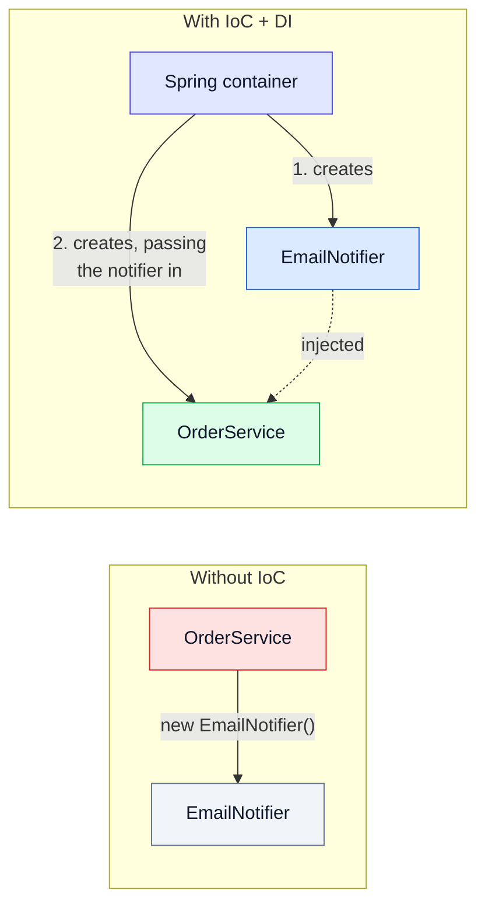
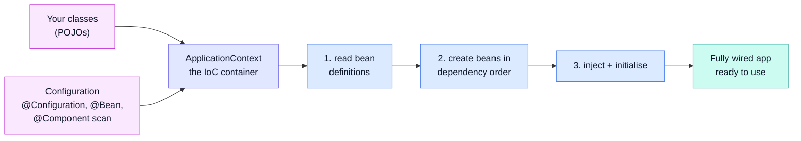
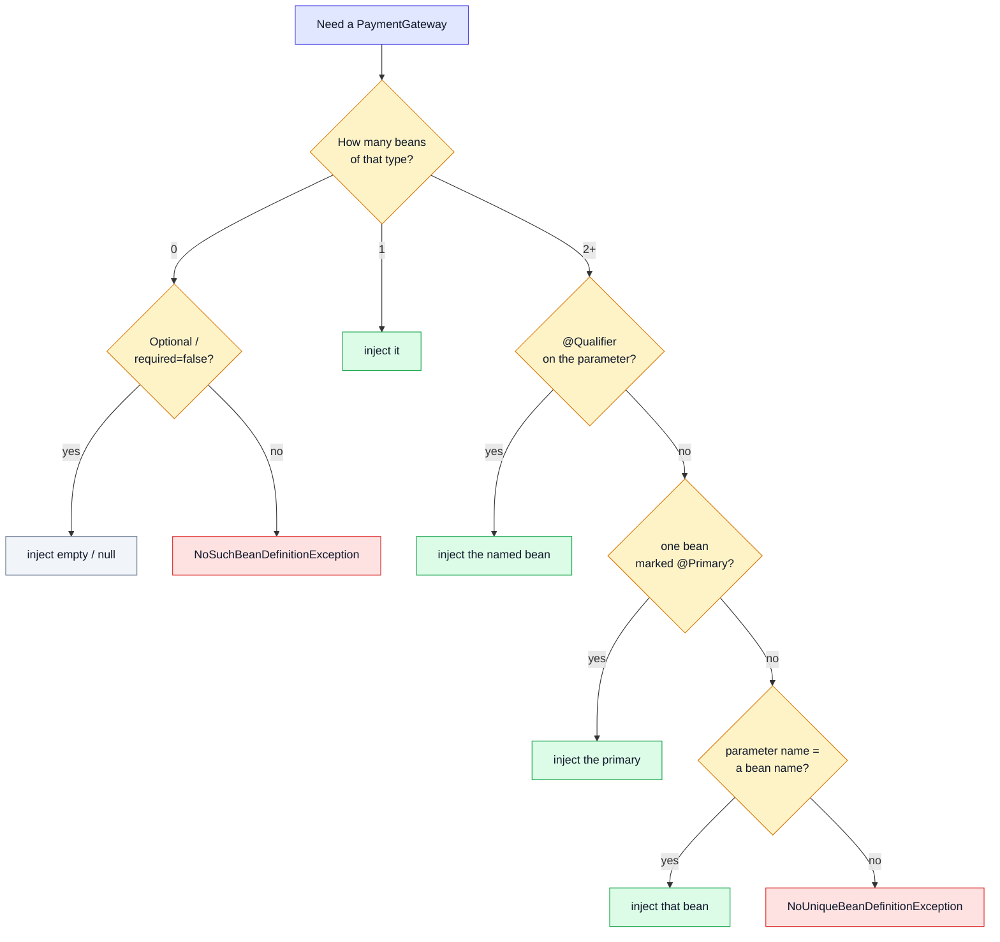
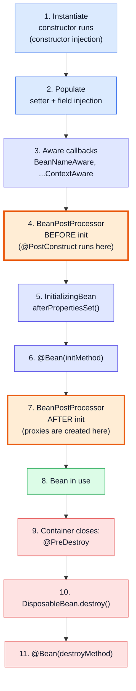
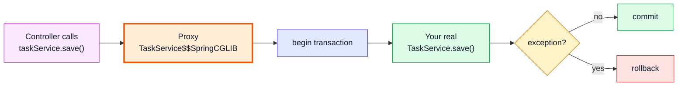
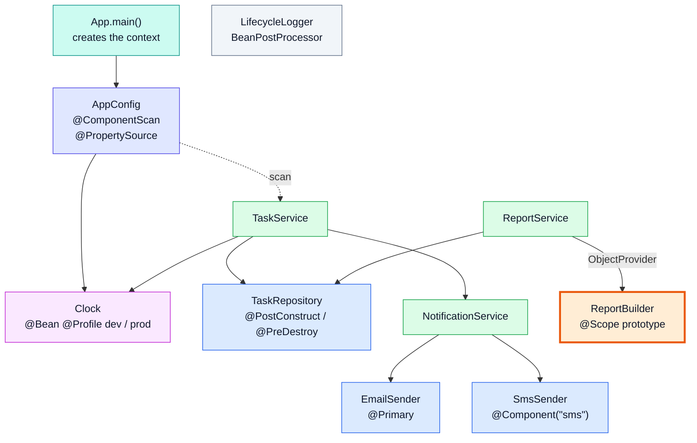

# Spring Core: IoC, Dependency Injection and Beans — Complete In-Depth Guide

**Spring Boot notes #3 of 18** · Priority 🔴 · Track: Spring Boot ([README](README.md))

Spring Boot is built on the **Spring Framework**, and the heart of the framework is one idea: **your objects don't create the objects they need; a container creates everything and plugs it together.** Every annotation you'll use later (`@RestController`, `@Service`, `@Transactional`, `@Autowired`) only makes sense once you understand that container.

This file uses **plain Spring, without Boot**, on purpose. Boot adds auto-configuration *on top of* this (file 04), and it's much easier to see what Boot does once you have done it by hand.

> [!NOTE]
> This topic isn't in the playlist, so there are no video timestamps.
>
> **What was run:** every Java block with a `main` method was compiled and run on **JDK 21** with **Spring Framework 7.0.6** (`spring-context` + `jakarta.annotation-api` on the classpath). The outputs shown are real. The [Complete Example](#-complete-example-everything-together) is a Maven project in [`examples/03-spring-core/`](examples/03-spring-core/), run with `./mvnw compile exec:java`.
>
> The snippets put several small classes inside one file as `static` nested classes so each one runs by itself. In a real project, each class goes in its own file, as in the Complete Example.

---

## Table of Contents

| # | Topic (anchor link) | Level |
|---|---|---|
| 0 | [The Problem: Tight Coupling](#0-the-problem-tight-coupling) | Basics |
| 1 | [Inversion of Control and Dependency Injection](#1-inversion-of-control-and-dependency-injection) | Core |
| 2 | [The Container: ApplicationContext and Beans](#2-the-container-applicationcontext-and-beans) | Core |
| 3 | [Java Configuration: @Configuration and @Bean](#3-java-configuration-configuration-and-bean) | Core |
| 4 | [Component Scanning and Stereotype Annotations](#4-component-scanning-and-stereotype-annotations) | Core |
| 5 | [Constructor, Setter and Field Injection](#5-constructor-setter-and-field-injection) | Core |
| 6 | [Choosing Between Beans: @Primary, @Qualifier, Lists, Optional](#6-choosing-between-beans-primary-qualifier-lists-optional) | In depth |
| 7 | [Bean Scopes](#7-bean-scopes) | In depth |
| 8 | [The Bean Lifecycle](#8-the-bean-lifecycle) | In depth |
| 9 | [Configuration Values and Profiles](#9-configuration-values-and-profiles) | Core |
| 10 | [Circular Dependencies and @Lazy](#10-circular-dependencies-and-lazy) | In depth |
| 11 | [Proxies: How Spring Adds Behaviour](#11-proxies-how-spring-adds-behaviour) | In depth |
| 12 | [Interview Questions](#12-interview-questions) | Interview |

---

## 0. The Problem: Tight Coupling

When a class creates its own dependencies with `new`, it is **welded** to them. You can't swap the email provider, and you can't test the class without really sending email.

```java
import java.util.ArrayList;
import java.util.List;

public class CouplingDemo {

    // ---------- tightly coupled ----------
    static class GmailClient {
        String send(String to, String msg) { return "gmail -> " + to + ": " + msg; }
    }

    static class TightOrderService {
        private final GmailClient mail = new GmailClient();   // creates its own dependency
        String placeOrder(String user) { return mail.send(user, "order placed"); }
    }

    // ---------- loosely coupled ----------
    interface Notifier { String send(String to, String msg); }

    static class EmailNotifier implements Notifier {
        public String send(String to, String msg) { return "email -> " + to + ": " + msg; }
    }

    static class FakeNotifier implements Notifier {           // for tests: records, sends nothing
        final List<String> sentTo = new ArrayList<>();
        public String send(String to, String msg) { sentTo.add(to); return "fake -> " + to; }
    }

    static class OrderService {
        private final Notifier notifier;
        OrderService(Notifier notifier) { this.notifier = notifier; }  // the dependency is GIVEN to it
        String placeOrder(String user) { return notifier.send(user, "order placed"); }
    }

    public static void main(String[] args) {
        System.out.println(new TightOrderService().placeOrder("asha"));   // can only ever use Gmail

        // Someone else ("the wiring code") decides which Notifier to use:
        System.out.println(new OrderService(new EmailNotifier()).placeOrder("asha"));

        FakeNotifier fake = new FakeNotifier();
        new OrderService(fake).placeOrder("ravi");
        new OrderService(fake).placeOrder("meera");
        System.out.println("test check, notified: " + fake.sentTo);
    }
}
```

```
gmail -> asha: order placed
email -> asha: order placed
test check, notified: [ravi, meera]
```

`OrderService` now depends on an **interface**, and its dependency is passed in through the constructor. That's **dependency injection (DI)**. It's plain Java, with no framework involved yet.

The catch: *somebody* still has to write `new OrderService(new EmailNotifier())`. In an app with 200 classes, that wiring code becomes huge and fragile. Spring's container writes it for you.

---

## 1. Inversion of Control and Dependency Injection

| Term | Meaning |
|---|---|
| **Inversion of Control (IoC)** | The general principle: your code no longer controls object creation and the program's flow; a framework does, and calls your code. "Don't call us, we'll call you." |
| **Dependency Injection (DI)** | One way to do IoC: an object receives its dependencies from outside (constructor, setter or field) instead of creating or looking them up itself. |
| **IoC container** | The part of Spring that creates objects, injects their dependencies and manages their lifecycle. In code, it's an `ApplicationContext`. |
| **Bean** | Any object created and managed by the container. A plain object you create with `new` yourself is **not** a bean. |



**Why bother?**

| Benefit | Because |
|---|---|
| Loose coupling | Classes depend on interfaces; the implementation is chosen in one place |
| Easy testing | Pass a fake or a Mockito mock into the constructor (file 10) |
| One place for configuration | Swap H2 for PostgreSQL, or email for SMS, without touching business code |
| Shared infrastructure | The container can wrap beans with transactions, security and caching (Section 11) |

This is the **D** in SOLID: the Dependency Inversion Principle ([Java gap #5](../Java%20Topics%20Not%20Covered%20Notes/java_gap_05_solid_low_level_design.md)).

---

## 2. The Container: ApplicationContext and Beans

The container needs two inputs: **your classes** and **configuration metadata** that says which beans to create and how. Today the metadata is almost always annotations and Java code. XML (`applicationContext.xml`) still works but is legacy.



| Type | What it is |
|---|---|
| `BeanFactory` | The basic container interface: create beans, get beans |
| `ApplicationContext` | Extends `BeanFactory` with events, i18n messages, resource loading, `Environment`/profiles, and **eager** creation of singletons at startup. Always use this. |
| `AnnotationConfigApplicationContext` | The implementation for annotation/Java config, used in this file |
| (Spring Boot) | `SpringApplication.run(...)` creates the right `ApplicationContext` for you (file 04) |

Main operations:

| Code | Meaning |
|---|---|
| `new AnnotationConfigApplicationContext(AppConfig.class)` | Create the container and start it (`refresh()`) |
| `ctx.getBean(TaskService.class)` | Get a bean **by type** (the usual way) |
| `ctx.getBean("taskService")` | Get a bean **by name** |
| `ctx.getBeanDefinitionNames()` | All bean names |
| `ctx.close()` (or try-with-resources) | Shut down: destroy callbacks run (Section 8) |

> [!TIP]
> In application code you almost **never** call `getBean`. You let Spring inject what you need. `getBean` is for `main` methods, tests and demos like these. Calling it from business code is the "service locator" anti-pattern.

---

## 3. Java Configuration: @Configuration and @Bean

A `@Configuration` class contains `@Bean` methods. Each method's return value becomes a bean, and the method name becomes the bean name. Use `@Bean` for classes **you can't annotate**: library classes like `Clock`, `ObjectMapper`, `DataSource`, or `RestClient`.

```java
import org.springframework.context.annotation.AnnotationConfigApplicationContext;
import org.springframework.context.annotation.Bean;
import org.springframework.context.annotation.Configuration;

public class JavaConfigDemo {
    static int enginesBuilt = 0;

    static class Engine { final int serial = ++enginesBuilt; }
    static class Car {
        final Engine engine;
        Car(Engine engine) { this.engine = engine; }
    }

    @Configuration                                   // "full" mode: the class is proxied
    static class FullConfig {
        @Bean Engine engine() { return new Engine(); }
        @Bean Car car() { return new Car(engine()); } // calls engine() directly
    }

    @Configuration(proxyBeanMethods = false)         // "lite" mode: no proxy
    static class LiteConfig {
        @Bean Engine engine() { return new Engine(); }
        @Bean Car car() { return new Car(engine()); }
    }

    public static void main(String[] args) {
        try (var ctx = new AnnotationConfigApplicationContext(FullConfig.class)) {
            Car car = ctx.getBean(Car.class);                // by type
            Engine engine = (Engine) ctx.getBean("engine");  // by name = the method name
            System.out.println("full: car uses the engine bean? " + (car.engine == engine)
                    + " (engine #" + engine.serial + ", car's #" + car.engine.serial + ")");
            System.out.println("full: config class = " + ctx.getBean(FullConfig.class).getClass().getName());
        }
        try (var ctx = new AnnotationConfigApplicationContext(LiteConfig.class)) {
            Car car = ctx.getBean(Car.class);
            Engine engine = ctx.getBean(Engine.class);
            System.out.println("lite: car uses the engine bean? " + (car.engine == engine)
                    + " (engine #" + engine.serial + ", car's #" + car.engine.serial + ")");
        }
    }
}
```

```
full: car uses the engine bean? true (engine #1, car's #1)
full: config class = JavaConfigDemo$FullConfig$$SpringCGLIB$$0
lite: car uses the engine bean? false (engine #2, car's #3)
```

> [!IMPORTANT]
> In a normal `@Configuration` class, Spring generates a **CGLIB subclass** (the `$$SpringCGLIB$$` in the class name). Its `engine()` method checks the container first, so calling `engine()` inside `car()` returns **the same singleton** instead of building a second `Engine`. With `proxyBeanMethods = false` there's no proxy, so the direct call really does create a second engine. The fix in lite mode is to take the dependency as a **parameter** instead: `@Bean Car car(Engine engine)`. Spring Boot's own auto-configuration classes use lite mode for faster startup.

---

## 4. Component Scanning and Stereotype Annotations

For **your own** classes, it's easier to annotate the class and let Spring find it:

```java
@Configuration
@ComponentScan("com.notes.core")   // scan this package and all sub-packages
public class AppConfig { }

@Service
public class TaskService { ... }   // becomes a bean named "taskService"
```

| Annotation | Meaning | Extra behaviour |
|---|---|---|
| `@Component` | Generic Spring-managed component | — |
| `@Service` | Business logic layer | None. It's a label for readers and tools. |
| `@Repository` | Data access layer | Database exceptions are translated into Spring's `DataAccessException` hierarchy |
| `@Controller` / `@RestController` | Web layer (file 05) | Handles HTTP requests |
| `@Configuration` | Holds `@Bean` methods | Itself a component, so it's also found by scanning |

All of them are "meta-annotated" with `@Component`, which is why scanning finds them. The default bean name is the class name with a lower-case first letter (`TaskService` → `taskService`). `@Component("sms")` sets it explicitly.

| | `@Component` (on a class) | `@Bean` (on a method) |
|---|---|---|
| Use for | Your own classes | Third-party classes, or when creation needs logic |
| Found by | Component scanning | Being inside a `@Configuration` class |
| Control over construction | Spring calls the constructor | You write the construction code |

> [!TIP]
> In Spring Boot, `@SpringBootApplication` includes `@ComponentScan` for **its own package and below**. That's why the main class must sit in the root package (e.g. `com.notes.tasks`) and everything else in sub-packages. A class in a sibling package is silently **not** found (file 04).

---

## 5. Constructor, Setter and Field Injection

| Style | Looks like | Verdict |
|---|---|---|
| **Constructor** | `TaskService(TaskRepository repo) { this.repo = repo; }` | ✅ **Use this.** Fields can be `final`, the object is never half-built, dependencies are visible, and tests just call `new` |
| Setter | `@Autowired void setRepo(TaskRepository r)` | For **optional** dependencies, or ones that change after creation (rare) |
| Field | `@Autowired private TaskRepository repo;` | ❌ Avoid: can't be `final`, hides dependencies, needs reflection or Spring to test |

> [!NOTE]
> If a class has **exactly one constructor**, Spring uses it automatically, so `@Autowired` is unnecessary (true since Spring 4.3). You only need `@Autowired` to choose one when there are several constructors.

```java
import org.springframework.beans.factory.annotation.Autowired;
import org.springframework.context.annotation.AnnotationConfigApplicationContext;

public class InjectionStylesDemo {
    static class Repo { String find() { return "task #1"; } }
    static class Audit { String log(String s) { return "audited(" + s + ")"; } }

    static class ConstructorStyle {                 // ✅ recommended
        private final Repo repo;
        ConstructorStyle(Repo repo) { this.repo = repo; }
        String run() { return "constructor -> " + repo.find(); }
    }

    static class SetterStyle {                      // optional dependency
        private Audit audit;
        @Autowired(required = false)
        void setAudit(Audit audit) { this.audit = audit; }
        String run() { return "setter -> " + (audit == null ? "no audit bean" : audit.log("x")); }
    }

    static class FieldStyle {                       // ❌ works, but avoid
        @Autowired private Repo repo;
        String run() { return "field -> " + repo.find(); }
    }

    public static void main(String[] args) {
        try (var ctx = new AnnotationConfigApplicationContext(
                Repo.class, ConstructorStyle.class, SetterStyle.class, FieldStyle.class)) {
            System.out.println(ctx.getBean(ConstructorStyle.class).run());
            System.out.println(ctx.getBean(SetterStyle.class).run());   // no Audit bean registered
            System.out.println(ctx.getBean(FieldStyle.class).run());
        }
        // Constructor injection needs no Spring at all in a unit test:
        System.out.println(new ConstructorStyle(new Repo()).run() + "   (plain new, no container)");
    }
}
```

```
constructor -> task #1
setter -> no audit bean
field -> task #1
constructor -> task #1   (plain new, no container)
```

`new AnnotationConfigApplicationContext(A.class, B.class, ...)` registers those classes as beans directly, with no scanning needed. It's handy for small demos.

---

## 6. Choosing Between Beans: @Primary, @Qualifier, Lists, Optional

What if **two beans** match the requested type? Spring resolves it in this order:



```java
import org.springframework.beans.factory.UnsatisfiedDependencyException;
import org.springframework.beans.factory.annotation.Qualifier;
import org.springframework.context.annotation.AnnotationConfigApplicationContext;
import org.springframework.context.annotation.Bean;
import org.springframework.context.annotation.Configuration;
import org.springframework.context.annotation.Primary;

import java.util.List;
import java.util.Map;
import java.util.Optional;

public class AmbiguityDemo {
    interface PaymentGateway { String name(); }
    record Gateway(String name) implements PaymentGateway {}
    record Checkout(String label, PaymentGateway gateway) {}
    interface Coupon {}

    @Configuration
    static class Ambiguous {
        @Bean PaymentGateway stripe()   { return new Gateway("Stripe"); }
        @Bean PaymentGateway razorpay() { return new Gateway("Razorpay"); }
        @Bean Checkout checkout(PaymentGateway gw) { return new Checkout("checkout", gw); } // which one?!
    }

    @Configuration
    static class Resolved {
        @Bean @Primary PaymentGateway stripe() { return new Gateway("Stripe"); }
        @Bean PaymentGateway razorpay()        { return new Gateway("Razorpay"); }

        @Bean Checkout global(PaymentGateway gw)                        { return new Checkout("global", gw); }
        @Bean Checkout india(@Qualifier("razorpay") PaymentGateway gw)  { return new Checkout("india", gw); }
        @Bean Checkout byName(PaymentGateway razorpay)                  { return new Checkout("byName", razorpay); }

        @Bean String summary(List<PaymentGateway> all, Map<String, PaymentGateway> byBeanName,
                             Optional<Coupon> coupon) {
            return "list=" + all.stream().map(PaymentGateway::name).toList()
                 + " map keys=" + byBeanName.keySet()
                 + " coupon present=" + coupon.isPresent();
        }
    }

    public static void main(String[] args) {
        try (var ctx = new AnnotationConfigApplicationContext(Ambiguous.class)) {
            System.out.println("unexpected: started");
        } catch (UnsatisfiedDependencyException e) {
            String msg = e.getMostSpecificCause().getMessage();
            System.out.println("Ambiguous config fails: " + e.getMostSpecificCause().getClass().getSimpleName());
            System.out.println("  " + msg.substring(0, msg.indexOf(':')));
        }

        try (var ctx = new AnnotationConfigApplicationContext(Resolved.class)) {
            for (String name : List.of("global", "india", "byName")) {
                Checkout c = ctx.getBean(name, Checkout.class);
                System.out.println(c.label() + " -> " + c.gateway().name());
            }
            System.out.println(ctx.getBean("summary"));
        }
    }
}
```

```
Ambiguous config fails: NoUniqueBeanDefinitionException
  No qualifying bean of type 'AmbiguityDemo$PaymentGateway' available
global -> Stripe
india -> Razorpay
byName -> Stripe
list=[Stripe, Razorpay] map keys=[stripe, razorpay] coupon present=false
```

Notice `byName -> Stripe`. The parameter is called `razorpay`, but `stripe` is `@Primary`, and `@Primary` is checked **before** the parameter name (see the diagram). The name match only kicks in when no bean is primary, which is exactly what makes it fragile.

| Tool | Use it when |
|---|---|
| `@Primary` | One implementation is the normal default (EmailSender, the main DataSource) |
| `@Qualifier("name")` | A specific consumer needs a specific bean. It overrides `@Primary`. |
| Parameter name = bean name | A last-resort fallback, used only when there's no `@Qualifier` and no `@Primary`. It needs the `-parameters` compiler flag, which Spring Boot's Maven parent turns on. It's fragile, because renaming a variable changes behaviour. Prefer `@Qualifier`. |
| `List<T>` / `Map<String, T>` | You want **all** implementations: strategy pattern, plugins, validators |
| `Optional<T>` / `ObjectProvider<T>` / `@Autowired(required=false)` | The bean might not exist |

> [!TIP]
> You can also create your own qualifier annotation, e.g. `@Qualifier @Retention(RUNTIME) @interface Urgent {}`, and put `@Urgent` on both the bean and the injection point. It's type-safe, with no strings that can be misspelled.

---

## 7. Bean Scopes

A **scope** decides **how many instances** of a bean exist and how long they live.

| Scope | Instances | Lives until | Notes |
|---|---|---|---|
| **`singleton`** (default) | **One per container** | Container closes | Shared by everyone, so it must be **thread-safe**: no per-request data in fields |
| `prototype` | **New one on every request** for the bean | Garbage collected | Spring creates it and then forgets it: **no `@PreDestroy`** is called |
| `request` | One per HTTP request | The request ends | Web apps only |
| `session` | One per HTTP session | The session expires | Web apps only |
| `application` | One per `ServletContext` | App stops | Rarely needed |

> [!NOTE]
> Spring's "singleton" means one per container (per bean definition), **not** the Gang-of-Four Singleton pattern ([Java gap #4](../Java%20Topics%20Not%20Covered%20Notes/java_gap_04_design_patterns.md)) with a private constructor. You can still call `new` on the class yourself.

**The classic trap: a prototype inside a singleton.** A singleton is created once, so its dependencies are injected once. A prototype injected into it is therefore effectively a singleton too. Ask for a fresh instance each time with `ObjectProvider<T>` (or `@Lookup`, or a scoped proxy).

```java
import org.springframework.beans.factory.ObjectProvider;
import org.springframework.context.annotation.AnnotationConfigApplicationContext;
import org.springframework.context.annotation.Bean;
import org.springframework.context.annotation.Configuration;
import org.springframework.context.annotation.Scope;

public class ScopeDemo {
    static int made = 0;
    static class Counter { final int n = ++made; }

    record InjectedOnce(Counter counter) {}                    // gets ONE counter, forever
    record AsksEachTime(ObjectProvider<Counter> counters) {    // gets a NEW one each call
        Counter next() { return counters.getObject(); }
    }

    @Configuration
    static class Cfg {
        @Bean @Scope("prototype") Counter counter() { return new Counter(); }
        @Bean InjectedOnce injectedOnce(Counter c) { return new InjectedOnce(c); }
        @Bean AsksEachTime asksEachTime(ObjectProvider<Counter> p) { return new AsksEachTime(p); }
    }

    public static void main(String[] args) {
        try (var ctx = new AnnotationConfigApplicationContext(Cfg.class)) {
            System.out.println("getBean(Counter) x2  : #" + ctx.getBean(Counter.class).n
                    + ", #" + ctx.getBean(Counter.class).n);
            InjectedOnce once = ctx.getBean(InjectedOnce.class);
            System.out.println("singleton's field x2 : #" + once.counter().n + ", #" + once.counter().n);
            AsksEachTime each = ctx.getBean(AsksEachTime.class);
            System.out.println("ObjectProvider x2    : #" + each.next().n + ", #" + each.next().n);
            System.out.println("singletons identical : " + (once == ctx.getBean(InjectedOnce.class)));
        }
    }
}
```

```
getBean(Counter) x2  : #2, #3
singleton's field x2 : #1, #1
ObjectProvider x2    : #4, #5
singletons identical : true
```

Why does the first line start at `#2`? Counter `#1` was already taken at **startup**: the singleton `injectedOnce` is created eagerly during `refresh()`, before `main` asks for anything, and it keeps that same `#1` forever (line 2).

---

## 8. The Bean Lifecycle

From "Spring knows about the class" to "the container closed", every singleton goes through these steps:



This snippet logs every callback, so you can see the real order:

```java
import jakarta.annotation.PostConstruct;
import jakarta.annotation.PreDestroy;
import org.springframework.beans.factory.BeanNameAware;
import org.springframework.beans.factory.DisposableBean;
import org.springframework.beans.factory.InitializingBean;
import org.springframework.beans.factory.annotation.Autowired;
import org.springframework.beans.factory.config.BeanPostProcessor;
import org.springframework.context.annotation.AnnotationConfigApplicationContext;
import org.springframework.context.annotation.Bean;
import org.springframework.context.annotation.Configuration;

public class LifecycleDemo {
    static int step = 0;
    static void log(String s) { System.out.println(++step + ". " + s); }

    static class Dep {}

    static class Tracked implements BeanNameAware, InitializingBean, DisposableBean {
        Tracked()                                 { log("constructor"); }
        @Autowired void setDep(Dep d)             { log("setter injection (@Autowired)"); }
        @Override public void setBeanName(String n) { log("BeanNameAware.setBeanName(\"" + n + "\")"); }
        @PostConstruct void postConstruct()       { log("@PostConstruct"); }
        @Override public void afterPropertiesSet() { log("InitializingBean.afterPropertiesSet()"); }
        void customInit()                         { log("@Bean(initMethod = \"customInit\")"); }
        @PreDestroy void preDestroy()             { log("@PreDestroy"); }
        @Override public void destroy()           { log("DisposableBean.destroy()"); }
        void customDestroy()                      { log("@Bean(destroyMethod = \"customDestroy\")"); }
    }

    static class LoggingPostProcessor implements BeanPostProcessor {
        @Override public Object postProcessBeforeInitialization(Object bean, String name) {
            if (bean instanceof Tracked) log("our BeanPostProcessor: BEFORE initialization");
            return bean;
        }
        @Override public Object postProcessAfterInitialization(Object bean, String name) {
            if (bean instanceof Tracked) log("our BeanPostProcessor: AFTER initialization");
            return bean;
        }
    }

    @Configuration
    static class Cfg {
        @Bean Dep dep() { return new Dep(); }

        @Bean(initMethod = "customInit", destroyMethod = "customDestroy")
        Tracked tracked() { return new Tracked(); }

        @Bean static LoggingPostProcessor loggingPostProcessor() {  // static: see the tip below
            return new LoggingPostProcessor();
        }
    }

    public static void main(String[] args) {
        var ctx = new AnnotationConfigApplicationContext(Cfg.class);
        log("--- bean is ready and in use ---");
        ctx.close();
    }
}
```

```
1. constructor
2. setter injection (@Autowired)
3. BeanNameAware.setBeanName("tracked")
4. our BeanPostProcessor: BEFORE initialization
5. @PostConstruct
6. InitializingBean.afterPropertiesSet()
7. @Bean(initMethod = "customInit")
8. our BeanPostProcessor: AFTER initialization
9. --- bean is ready and in use ---
10. @PreDestroy
11. DisposableBean.destroy()
12. @Bean(destroyMethod = "customDestroy")
```

> [!NOTE]
> Look where `@PostConstruct` lands: **after** "our BeanPostProcessor: BEFORE initialization". `@PostConstruct` and `@PreDestroy` aren't special to the container. They're implemented by a built-in post-processor, `CommonAnnotationBeanPostProcessor`, during the same "before initialization" step. When Spring registers post-processors, it moves its *internal* ones (like that one) to the **end** of the list, so ordinary post-processors like ours run first. That's why the diagram puts both in step 4: the order *inside* that step depends on post-processor ordering, which you should never rely on.

| Hook | Use it for | Prefer |
|---|---|---|
| `@PostConstruct` | Checking config, warming a cache, seeding data **after** injection | ✅ The standard choice |
| `InitializingBean` / `DisposableBean` | Same, but ties your class to Spring interfaces | Rarely |
| `@Bean(initMethod/destroyMethod)` | Third-party classes you can't annotate | For library objects. Spring also auto-detects a public `close()` or `shutdown()` method as the destroy method of a `@Bean`. |
| `@PreDestroy` | Closing connections, flushing buffers | ✅ The standard choice |
| `BeanPostProcessor` | Framework code that changes or wraps **every** bean | Framework-level code only |

> [!TIP]
> Declare `BeanPostProcessor` `@Bean` methods as **`static`**. A post-processor must exist *before* other beans are created. A non-static method needs its `@Configuration` instance first, which forces that config class to be created too early. Spring logs an INFO-level warning when this happens.

> [!WARNING]
> Don't do heavy work (network calls, long loops) in constructors or `@PostConstruct`. It slows startup, and an exception there **stops the whole application from starting**. That is useful for validating config, but bad for "nice to have" work.

---

## 9. Configuration Values and Profiles

### 9.1 `@Value` and the `Environment`

Spring merges settings from several **property sources** into one `Environment`: system properties (`-Dkey=value`), environment variables, and `.properties` files (`@PropertySource`). `@Value("${key}")` injects one value; `${key:default}` gives a fallback.

### 9.2 Profiles

`@Profile("dev")` on a `@Bean` or `@Component` means "only create this when the `dev` profile is active". `!dev` means "when dev is **not** active". Typical uses are a local file store in dev vs S3 in prod, a fake payment gateway in tests, or seeding sample data only in dev.

```java
import org.springframework.beans.factory.annotation.Value;
import org.springframework.context.annotation.AnnotationConfigApplicationContext;
import org.springframework.context.annotation.Bean;
import org.springframework.context.annotation.Configuration;
import org.springframework.context.annotation.Profile;
import org.springframework.core.env.MapPropertySource;

import java.util.List;
import java.util.Map;

public class ConfigDemo {
    interface Storage { String where(); }

    record MailSettings(String host, int port, boolean ssl, List<String> admins) {}

    @Configuration
    static class Cfg {
        @Bean
        MailSettings mailSettings(@Value("${mail.host}") String host,
                                  @Value("${mail.port:25}") int port,          // default 25
                                  @Value("${mail.ssl:false}") boolean ssl,     // String -> boolean
                                  @Value("${mail.admins}") String[] admins) {  // "a,b" -> 2 elements
            return new MailSettings(host, port, ssl, List.of(admins));
        }

        @Bean @Profile("dev")  Storage localStorage() { return () -> "local folder ./uploads"; }
        @Bean @Profile("!dev") Storage s3Storage()    { return () -> "S3 bucket tasks-prod"; }
    }

    static void start(String profile) {
        try (var ctx = new AnnotationConfigApplicationContext()) {
            ctx.getEnvironment().setActiveProfiles(profile);
            ctx.getEnvironment().getPropertySources().addFirst(new MapPropertySource("demo",
                    Map.of("mail.host", "smtp.example.com", "mail.admins", "asha,ravi")));
            ctx.register(Cfg.class);
            ctx.refresh();

            System.out.println("[" + profile + "] " + ctx.getBean(MailSettings.class));
            System.out.println("[" + profile + "] storage = " + ctx.getBean(Storage.class).where());
            System.out.println("[" + profile + "] env lookup mail.port = "
                    + ctx.getEnvironment().getProperty("mail.port", Integer.class, 25));
        }
    }

    public static void main(String[] args) {
        start("dev");
        System.setProperty("mail.port", "587");   // like running with -Dmail.port=587
        System.setProperty("mail.ssl", "true");
        start("prod");
    }
}
```

```
[dev] MailSettings[host=smtp.example.com, port=25, ssl=false, admins=[asha, ravi]]
[dev] storage = local folder ./uploads
[dev] env lookup mail.port = 25
[prod] MailSettings[host=smtp.example.com, port=587, ssl=true, admins=[asha, ravi]]
[prod] storage = S3 bucket tasks-prod
[prod] env lookup mail.port = 587
```

> [!WARNING]
> **Why `String[]` and not `List<String>`?** In plain Spring, with no `ConversionService` registered, `"asha,ravi"` is split for an **array** but wrapped as a **one-element** list for a `List<String>`. You'd get `["asha,ravi"]`, a single string. This was tested: list size 1, array length 2. Registering a `ConversionService` (e.g. `ctx.getBeanFactory().setConversionService(new DefaultConversionService())`) makes the list split into 2 elements too. Spring Boot registers one for you, so in a Boot app a `List<String>` works. File 04 shows it.

> [!IMPORTANT]
> Spring Boot makes this much easier: `application.yml`, profile-specific files (`application-prod.yml`), type-safe `@ConfigurationProperties` records, and a fixed precedence order where environment variables override files. That's file 04. Underneath, it is the same `Environment` and the same profiles you see here.

---

## 10. Circular Dependencies and @Lazy

If `A` needs `B` and `B` needs `A` through **constructors**, neither can be created first, and startup fails:

```java
import org.springframework.beans.factory.BeanCreationException;
import org.springframework.context.annotation.AnnotationConfigApplicationContext;
import org.springframework.context.annotation.Lazy;

public class CircularDemo {
    static class A { A(B b) {} }
    static class B { B(A a) {} }

    static class Orders {
        private final Invoices invoices;
        Orders(@Lazy Invoices invoices) { this.invoices = invoices; }   // gets a lazy proxy
        String place() { return "order placed, " + invoices.create(); }
    }
    static class Invoices {
        private final Orders orders;
        Invoices(Orders orders) { this.orders = orders; }
        String create() { return "invoice created"; }
    }

    public static void main(String[] args) {
        try (var ctx = new AnnotationConfigApplicationContext(A.class, B.class)) {
            System.out.println("unexpected: started");
        } catch (BeanCreationException e) {
            Throwable root = e.getMostSpecificCause();
            System.out.println("A <-> B fails: " + root.getClass().getSimpleName());
            String m = root.getMessage();
            System.out.println("  " + m.substring(m.indexOf("Requested bean")));
        }

        try (var ctx = new AnnotationConfigApplicationContext(Orders.class, Invoices.class)) {
            Orders orders = ctx.getBean(Orders.class);
            System.out.println("with @Lazy: " + orders.place());
            System.out.println("  Orders got a proxy: " + orders.invoices.getClass().getSimpleName().contains("$$"));
        }
    }
}
```

```
A <-> B fails: BeanCurrentlyInCreationException
  Requested bean is currently in creation: Is there an unresolvable circular reference or an asynchronous initialization dependency?
with @Lazy: order placed, invoice created
  Orders got a proxy: true
```

| Fix | Verdict |
|---|---|
| **Redesign**: move the shared logic into a third class both can use, or publish an event (file 13) | ✅ Best. A cycle usually means two classes have mixed responsibilities. |
| `@Lazy` on one constructor parameter | OK as a stop-gap. Spring injects a proxy that finds the real bean on first use. |
| Switch to setter or field injection | Plain Spring allows cycles through setters/fields. **Spring Boot forbids them by default** (since 2.6; `spring.main.allow-circular-references=false`). Don't rely on it. |

---

## 11. Proxies: How Spring Adds Behaviour

How does adding `@Transactional` to a method make it run inside a database transaction? You never call any transaction code. The answer is **proxies**. In step 7 of the lifecycle, a `BeanPostProcessor` can return a **wrapper object** in place of your bean. Everyone who injects the bean receives the wrapper, which does extra work before and after calling your real method.



| Proxy type | Used when | How |
|---|---|---|
| JDK dynamic proxy | The bean is used through an interface | `java.lang.reflect.Proxy` ([Java gap #11](../Java%20Topics%20Not%20Covered%20Notes/java_gap_11_serialization_reflection_regex_time.md)) |
| CGLIB subclass | Default in Spring Boot, and for classes without interfaces | Generates a subclass at runtime that overrides your methods |

`@Transactional`, `@Cacheable`, `@Async`, `@PreAuthorize`, and your own AOP aspects all work this way. That explains three rules you'll meet later:

| Rule | Why |
|---|---|
| Calling `this.otherMethod()` inside the same class **skips** `@Transactional` on `otherMethod` | `this` is the real object, not the proxy ("self-invocation") |
| Annotated methods should be `public` and **not** `final`; the class must not be `final` | CGLIB overrides methods in a subclass, and `final` can't be overridden |
| Only Spring **beans** get the behaviour | An object you create with `new` was never wrapped |

Files 08 (transactions) and 13 (AOP) build on this.

---

## 12. Interview Questions

| Question | Answer |
|---|---|
| What is IoC? | Handing control of object creation and wiring to a framework (the container) instead of doing it in your code. |
| What is DI? | A way to do IoC: objects receive their dependencies from outside (constructor, setter or field) instead of creating them. |
| What is a Spring bean? | An object created, wired and managed by the Spring container. |
| `BeanFactory` vs `ApplicationContext`? | `ApplicationContext` extends `BeanFactory` with events, `Environment`/profiles, i18n and resources, and creates singletons eagerly at startup. |
| Which injection type is best, and why? | Constructor injection: `final` fields, complete objects, visible dependencies, easy unit tests. |
| Is `@Autowired` required on a constructor? | Not when the class has a single constructor (Spring 4.3+). |
| `@Component` vs `@Bean`? | `@Component` goes on your own class and is found by scanning; `@Bean` is a factory method in a `@Configuration` class, used for third-party types or custom creation logic. |
| `@Component` vs `@Service` vs `@Repository`? | All are components. `@Service` is a label; `@Repository` also translates database exceptions into `DataAccessException`. |
| Two beans of the same type. What happens? | `NoUniqueBeanDefinitionException`, unless resolved by `@Qualifier`, `@Primary`, or a matching parameter name. |
| `@Primary` vs `@Qualifier`? | `@Primary` sets a default on the bean side; `@Qualifier` picks one at the injection point and wins over `@Primary`. |
| Default bean scope? | Singleton: one instance per container. |
| Are singleton beans thread-safe? | Not automatically. They're shared, so keep them stateless, with no mutable per-request fields. |
| Prototype bean injected into a singleton? | It's injected once, so it behaves like a singleton. Use `ObjectProvider`, `@Lookup` or a scoped proxy to get a new one each time. |
| Does Spring call `@PreDestroy` on prototypes? | No. The container doesn't track prototypes after creating them. |
| Order of lifecycle callbacks? | Constructor → injection → Aware → BPP before init (`@PostConstruct` is run by one of these) → `afterPropertiesSet` → init-method → BPP after init (proxies) → … → `@PreDestroy` → `destroy()` → destroy-method. |
| What is a `BeanPostProcessor`? | A hook called for every bean before and after initialization. Spring uses it to handle `@Autowired`, `@PostConstruct` and to create AOP proxies. |
| Why is `@Configuration` proxied? | So that calls between `@Bean` methods return the container's singleton instead of creating new objects. |
| How do you fix a circular dependency? | Redesign (best), or `@Lazy` on one side. Spring Boot disallows circular references by default. |
| Why doesn't `@Transactional` work on a self-call? | Spring adds the behaviour through a proxy, and `this.method()` bypasses the proxy. |

---

## 🧩 Complete Example: Everything Together

A small Task Tracker **service layer** in plain Spring, with no Boot and no web server. It uses component scanning, a `@Configuration` class with profile-specific `@Bean`s, constructor injection everywhere, `@Primary` + `@Qualifier` + `List` injection, `@Value` with a default, singleton and prototype scopes with `ObjectProvider`, lifecycle callbacks and a `BeanPostProcessor`.

Source: [`examples/03-spring-core/`](examples/03-spring-core/)



**`pom.xml`** (the important part: just the IoC container, through Spring's own BOM):

```xml
<dependencyManagement>
    <dependencies>
        <dependency>
            <groupId>org.springframework</groupId>
            <artifactId>spring-framework-bom</artifactId>
            <version>7.0.6</version>
            <type>pom</type>
            <scope>import</scope>
        </dependency>
    </dependencies>
</dependencyManagement>

<dependencies>
    <dependency>                               <!-- the IoC container (+ beans, core, aop, expression) -->
        <groupId>org.springframework</groupId>
        <artifactId>spring-context</artifactId>
    </dependency>
    <dependency>                               <!-- @PostConstruct / @PreDestroy -->
        <groupId>jakarta.annotation</groupId>
        <artifactId>jakarta.annotation-api</artifactId>
        <version>3.0.0</version>
    </dependency>
</dependencies>
<!-- + exec-maven-plugin with mainClass com.notes.core.App -->
```

**`src/main/resources/app.properties`**:

```properties
app.name=TaskTracker
app.max-tasks=3
```

**`AppConfig.java`**:

```java
package com.notes.core;

import org.springframework.context.annotation.Bean;
import org.springframework.context.annotation.ComponentScan;
import org.springframework.context.annotation.Configuration;
import org.springframework.context.annotation.Profile;
import org.springframework.context.annotation.PropertySource;

import java.time.Clock;
import java.time.Instant;
import java.time.ZoneOffset;

@Configuration                                   // a source of bean definitions
@ComponentScan("com.notes.core")                 // find @Component/@Service/@Repository classes
@PropertySource("classpath:app.properties")      // load key=value settings into the Environment
public class AppConfig {

    // A class we don't own (java.time.Clock) can't get @Component, so we use a @Bean method.
    @Bean
    @Profile("dev")                              // only exists when the "dev" profile is active
    Clock fixedClock() {
        return Clock.fixed(Instant.parse("2026-11-16T09:00:00Z"), ZoneOffset.UTC);
    }

    @Bean
    @Profile("prod")
    Clock systemClock() {
        return Clock.systemUTC();
    }
}
```

**`MessageSender.java`, `EmailSender.java`, `SmsSender.java`**:

```java
package com.notes.core;

/** Anything that can deliver a message. Services depend on this interface, not on a class. */
public interface MessageSender {
    String channel();
    String send(String to, String text);
}
```

```java
package com.notes.core;

import org.springframework.context.annotation.Primary;
import org.springframework.stereotype.Component;

@Component
@Primary                       // chosen when someone asks for "a MessageSender" without saying which
public class EmailSender implements MessageSender {
    public String channel() { return "email"; }
    public String send(String to, String text) { return "[email to " + to + "] " + text; }
}
```

```java
package com.notes.core;

import org.springframework.stereotype.Component;

@Component("sms")              // explicit bean name, used with @Qualifier("sms")
public class SmsSender implements MessageSender {
    public String channel() { return "sms"; }
    public String send(String to, String text) { return "[sms to " + to + "] " + text; }
}
```

**`TaskRepository.java`**:

```java
package com.notes.core;

import jakarta.annotation.PostConstruct;
import jakarta.annotation.PreDestroy;
import org.springframework.stereotype.Repository;

import java.util.List;
import java.util.Map;
import java.util.concurrent.ConcurrentSkipListMap;
import java.util.concurrent.atomic.AtomicLong;

@Repository                    // a @Component for data-access classes
public class TaskRepository {
    public record Task(long id, String title, String owner) {}

    private final Map<Long, Task> tasks = new ConcurrentSkipListMap<>();
    private final AtomicLong ids = new AtomicLong(1);

    @PostConstruct             // runs once, after injection, before anyone uses the bean
    void seed() {
        save("Read Spring docs", "asha");
        System.out.println("  [lifecycle] TaskRepository @PostConstruct: seeded " + tasks.size() + " task");
    }

    @PreDestroy                // runs when the container closes
    void shutdown() {
        System.out.println("  [lifecycle] TaskRepository @PreDestroy: " + tasks.size() + " tasks in memory");
    }

    public Task save(String title, String owner) {
        Task t = new Task(ids.getAndIncrement(), title, owner);
        tasks.put(t.id(), t);
        return t;
    }

    public List<Task> findAll() { return List.copyOf(tasks.values()); }
}
```

**`NotificationService.java`**:

```java
package com.notes.core;

import org.springframework.beans.factory.annotation.Qualifier;
import org.springframework.stereotype.Service;

import java.util.List;

@Service
public class NotificationService {
    private final MessageSender defaultSender;     // the @Primary one (email)
    private final MessageSender smsSender;         // picked by name
    private final List<MessageSender> allSenders;  // every MessageSender bean

    // One constructor => Spring uses it automatically (no @Autowired needed)
    public NotificationService(MessageSender defaultSender,
                               @Qualifier("sms") MessageSender smsSender,
                               List<MessageSender> allSenders) {
        this.defaultSender = defaultSender;
        this.smsSender = smsSender;
        this.allSenders = allSenders;
    }

    public String notify(String to, String text)       { return defaultSender.send(to, text); }
    public String notifyUrgent(String to, String text) { return smsSender.send(to, text); }
    public List<String> channels() { return allSenders.stream().map(MessageSender::channel).toList(); }
}
```

**`TaskService.java`**:

```java
package com.notes.core;

import org.springframework.beans.factory.annotation.Value;
import org.springframework.stereotype.Service;

import java.time.Clock;
import java.time.LocalTime;

@Service
public class TaskService {
    private final TaskRepository repo;
    private final NotificationService notifications;
    private final Clock clock;
    private final String appName;
    private final int maxTasks;

    public TaskService(TaskRepository repo,
                       NotificationService notifications,
                       Clock clock,                                   // dev: fixed, prod: real
                       @Value("${app.name}") String appName,          // from app.properties
                       @Value("${app.max-tasks:3}") int maxTasks) {   // ":3" = default if missing
        this.repo = repo;
        this.notifications = notifications;
        this.clock = clock;
        this.appName = appName;
        this.maxTasks = maxTasks;
        System.out.println("  [lifecycle] TaskService constructed (all 5 dependencies injected)");
    }

    public String addTask(String title, String owner) {
        if (repo.findAll().size() >= maxTasks) {
            return notifications.notifyUrgent(owner,
                    "limit of " + maxTasks + " tasks reached, '" + title + "' rejected");
        }
        var t = repo.save(title, owner);
        String time = LocalTime.now(clock).toString();
        return notifications.notify(owner,
                appName + " @" + time + ": task #" + t.id() + " '" + t.title() + "' created");
    }
}
```

**`ReportBuilder.java`** (prototype) and **`ReportService.java`** (singleton using it):

```java
package com.notes.core;

import org.springframework.context.annotation.Scope;
import org.springframework.stereotype.Component;

import java.util.concurrent.atomic.AtomicInteger;

@Component
@Scope("prototype")            // a NEW instance every time one is requested
public class ReportBuilder {
    private static final AtomicInteger CREATED = new AtomicInteger();
    private final int number = CREATED.incrementAndGet();
    private final StringBuilder lines = new StringBuilder();

    public ReportBuilder line(String s) { lines.append("    ").append(s).append('\n'); return this; }
    public String build() { return "  Report #" + number + "\n" + lines; }
}
```

```java
package com.notes.core;

import org.springframework.beans.factory.ObjectProvider;
import org.springframework.stereotype.Service;

@Service                       // a singleton...
public class ReportService {
    private final TaskRepository repo;
    private final ObjectProvider<ReportBuilder> builders;   // ...that needs a fresh prototype each call

    public ReportService(TaskRepository repo, ObjectProvider<ReportBuilder> builders) {
        this.repo = repo;
        this.builders = builders;
    }

    public String report() {
        ReportBuilder b = builders.getObject();             // new ReportBuilder every time
        repo.findAll().forEach(t -> b.line("#" + t.id() + " " + t.title() + " (" + t.owner() + ")"));
        return b.build();
    }
}
```

**`LifecycleLogger.java`**:

```java
package com.notes.core;

import org.springframework.beans.factory.config.BeanPostProcessor;
import org.springframework.stereotype.Component;

/** Spring calls this for EVERY bean it creates: the hook that @Transactional, AOP etc. are built on. */
@Component
public class LifecycleLogger implements BeanPostProcessor {
    @Override
    public Object postProcessAfterInitialization(Object bean, String beanName) {
        if (bean.getClass().getPackageName().equals("com.notes.core")) {
            System.out.println("  [bpp] ready: " + beanName);
        }
        return bean;           // could return a proxy (wrapper) instead
    }
}
```

**`App.java`**:

```java
package com.notes.core;

import org.springframework.beans.factory.NoSuchBeanDefinitionException;
import org.springframework.context.annotation.AnnotationConfigApplicationContext;

import java.time.Clock;
import java.util.Arrays;

public class App {
    public static void main(String[] args) {
        String profile = args.length > 0 ? args[0] : "dev";
        System.out.println("1) Starting the container with profile '" + profile + "'");

        try (var ctx = new AnnotationConfigApplicationContext()) {
            ctx.getEnvironment().setActiveProfiles(profile);
            ctx.register(AppConfig.class);
            ctx.refresh();                       // scan, create and wire all singleton beans NOW

            System.out.println("\n2) Our beans in the container:");
            Arrays.stream(ctx.getBeanDefinitionNames())
                  .filter(n -> !n.startsWith("org.springframework"))
                  .sorted()
                  .forEach(n -> System.out.println("   - " + n + " : " + ctx.getType(n).getSimpleName()));

            System.out.println("\n3) Using the services:");
            TaskService tasks = ctx.getBean(TaskService.class);
            System.out.println("  " + tasks.addTask("Learn DI", "asha"));
            System.out.println("  " + tasks.addTask("Learn bean scopes", "ravi"));
            System.out.println("  " + tasks.addTask("Learn AOP", "ravi"));

            NotificationService ns = ctx.getBean(NotificationService.class);
            System.out.println("  channels injected as a List: " + ns.channels());

            System.out.println("\n4) Singleton vs prototype:");
            System.out.println("  same TaskService twice?   " + (tasks == ctx.getBean(TaskService.class)));
            System.out.println("  same ReportBuilder twice? "
                    + (ctx.getBean(ReportBuilder.class) == ctx.getBean(ReportBuilder.class)));
            ReportService reports = ctx.getBean(ReportService.class);
            System.out.print(reports.report());
            System.out.print(reports.report());

            System.out.println("\n5) Profiles:");
            System.out.println("  Clock bean: " + ctx.getBean(Clock.class));
            try {
                ctx.getBean("systemClock");
            } catch (NoSuchBeanDefinitionException e) {
                System.out.println("  no 'systemClock' bean: the 'prod' profile is not active");
            }

            System.out.println("\n6) Closing the container:");
        }                                        // try-with-resources calls ctx.close()
        System.out.println("Done.");
    }
}
```

**Command** (from `examples/03-spring-core/`):

```bash
./mvnw -q compile exec:java
```

**Expected Output:**

```
1) Starting the container with profile 'dev'
  [bpp] ready: appConfig
  [bpp] ready: emailSender
  [bpp] ready: sms
  [bpp] ready: notificationService
  [lifecycle] TaskRepository @PostConstruct: seeded 1 task
  [bpp] ready: taskRepository
  [bpp] ready: reportService
  [lifecycle] TaskService constructed (all 5 dependencies injected)
  [bpp] ready: taskService

2) Our beans in the container:
   - appConfig : AppConfig$$SpringCGLIB$$0
   - emailSender : EmailSender
   - fixedClock : FixedClock
   - lifecycleLogger : LifecycleLogger
   - notificationService : NotificationService
   - reportBuilder : ReportBuilder
   - reportService : ReportService
   - sms : SmsSender
   - taskRepository : TaskRepository
   - taskService : TaskService

3) Using the services:
  [email to asha] TaskTracker @09:00: task #2 'Learn DI' created
  [email to ravi] TaskTracker @09:00: task #3 'Learn bean scopes' created
  [sms to ravi] limit of 3 tasks reached, 'Learn AOP' rejected
  channels injected as a List: [email, sms]

4) Singleton vs prototype:
  same TaskService twice?   true
  [bpp] ready: reportBuilder
  [bpp] ready: reportBuilder
  same ReportBuilder twice? false
  [bpp] ready: reportBuilder
  Report #3
    #1 Read Spring docs (asha)
    #2 Learn DI (asha)
    #3 Learn bean scopes (ravi)
  [bpp] ready: reportBuilder
  Report #4
    #1 Read Spring docs (asha)
    #2 Learn DI (asha)
    #3 Learn bean scopes (ravi)

5) Profiles:
  Clock bean: FixedClock[2026-11-16T09:00:00Z,Z]
  no 'systemClock' bean: the 'prod' profile is not active

6) Closing the container:
  [lifecycle] TaskRepository @PreDestroy: 3 tasks in memory
Done.
```

**Reading the output:**

| Output | Concept |
|---|---|
| All `[bpp] ready` lines come before step 2 | `ApplicationContext` creates **singletons eagerly** during `refresh()` |
| `emailSender` and `sms` are ready before `notificationService`; `taskRepository` before `taskService` | Spring creates **dependencies first** |
| `@PostConstruct` prints before `[bpp] ready: taskRepository` | Init callbacks run **before** "after-initialization" post-processing (Section 8) |
| `appConfig : AppConfig$$SpringCGLIB$$0` | `@Configuration` classes are **proxied** (Section 3) |
| `fixedClock` exists, `systemClock` doesn't, and `fixedClock` has no `[bpp]` line | `@Profile("dev")`; the logger only prints for classes in `com.notes.core`, and `FixedClock` is a JDK class |
| Task #2, not #1 | `@PostConstruct` already seeded task #1 |
| `@09:00` | The `Clock` was **injected**, so dev can use a fixed time (great for tests) and prod the real one |
| The third task goes by **sms** | `app.max-tasks=3` from `@Value`; `@Qualifier("sms")` picks the urgent channel |
| `[email, sms]` | `List<MessageSender>` gets **every** implementation |
| `true` / `false` | Singleton vs **prototype** |
| Report **#3** and **#4** | Each `getObject()` makes a new prototype. #1 and #2 were the two made for the `==` check. |
| No `@PreDestroy` for the `ReportBuilder`s | Prototypes aren't tracked after creation, so only the singleton repository's `@PreDestroy` runs |

> [!TIP]
> Try `./mvnw -q compile exec:java -Dexec.args=prod`. The `systemClock` bean is used instead, so the times show the real current UTC time (e.g. `@16:25:19.570130900`), step 5 prints `Clock bean: SystemClock[Z]`, and the "no systemClock" line disappears because that bean now exists. Not one line of `TaskService` changed: that is the point of injecting the `Clock`.

---

## Quick Reference Cheat Sheet

| Concept | Key point |
|---|---|
| IoC | The container creates and wires objects, not your code |
| DI | Dependencies are passed in (constructor ✅, setter, field ❌) |
| Bean | An object managed by the container |
| `ApplicationContext` | The container; creates singletons at startup; `close()` runs destroy callbacks |
| `@Configuration` + `@Bean` | Factory methods; bean name = method name; class is CGLIB-proxied |
| `proxyBeanMethods = false` | Lite mode: no proxy, take dependencies as `@Bean` method parameters |
| `@ComponentScan` | Finds `@Component`, `@Service`, `@Repository`, `@Controller` in a package and below |
| `@Repository` | Also translates DB exceptions to `DataAccessException` |
| One constructor | Injected automatically, no `@Autowired` needed |
| Two candidates | `@Qualifier` > `@Primary` > parameter name, else `NoUniqueBeanDefinitionException` |
| All candidates | Inject `List<T>` or `Map<String, T>` |
| Optional | `Optional<T>`, `ObjectProvider<T>`, `@Autowired(required = false)` |
| Scopes | `singleton` (default, shared, must be thread-safe), `prototype`, `request`, `session` |
| Prototype in singleton | Use `ObjectProvider<T>.getObject()` |
| Lifecycle | constructor → inject → Aware → `@PostConstruct` → `afterPropertiesSet` → init-method → proxy → use → `@PreDestroy` → `destroy` |
| `BeanPostProcessor` | Hook for every bean; declare its `@Bean` method `static` |
| `@Value("${k:def}")` | Inject a property with a default |
| `@Profile("dev")` / `"!dev"` | Bean only exists when that profile is (not) active |
| Circular dependency | Redesign, or `@Lazy`; Boot forbids cycles by default |
| Proxies | `@Transactional`, `@Cacheable`, `@Async` work through proxies; self-calls bypass them |
