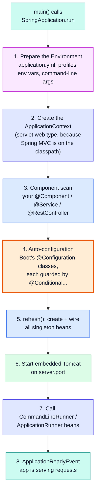
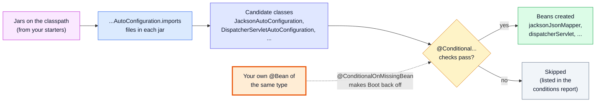
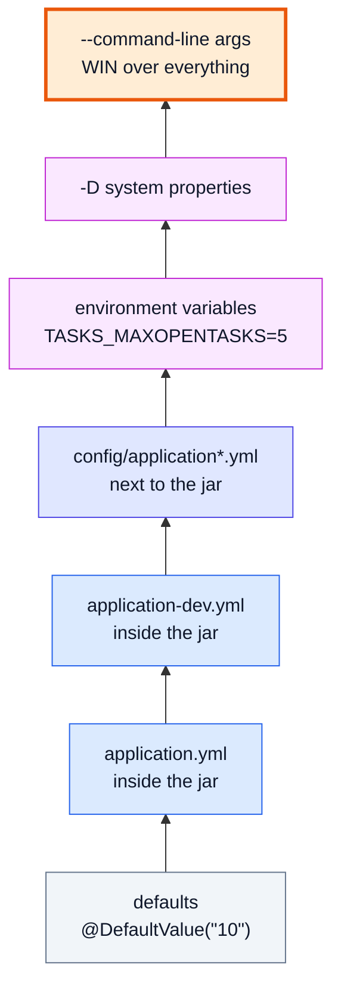

# Spring Boot Fundamentals — Complete In-Depth Guide

**Spring Boot notes #4 of 18** · Priority 🔴 · Track: Spring Boot ([README](README.md))

In [file 03](spring_03_spring_core_ioc_di.md) you built a Spring container by hand: you created an `ApplicationContext`, registered a config class, loaded a properties file and picked profiles yourself. A web app needs much more on top of that: a web server, JSON conversion, error handling, logging, a thread pool and so on. **Spring Boot** wires all of it for you, using sensible defaults that you can override.

| You want… | Plain Spring (file 03) | Spring Boot |
|---|---|---|
| Libraries with compatible versions | Pick each version yourself | One parent POM + **starters** |
| A web server | Install Tomcat, deploy a WAR | **Embedded** Tomcat inside your jar |
| JSON, error pages, encoding filter… | Write `@Bean`s for each | **Auto-configuration** creates them if you didn't |
| Configuration | `@PropertySource` + `@Value` | `application.yml`, env vars, args; typed `@ConfigurationProperties` |
| Run it | A `main` building a context | `SpringApplication.run(...)`, or `java -jar app.jar` |

> [!NOTE]
> This topic isn't in the playlist, so there are no video timestamps.
>
> **What was run:** the [Complete Example](#-complete-example-everything-together) is a real **Spring Boot 4.0.5** app ([`examples/04-boot-fundamentals/`](examples/04-boot-fundamentals/)), built with `./mvnw package` and started with `java -jar` on JDK 21. The logs, the conditions report and the HTTP responses shown are real; timestamps, PIDs and random ports change on every run. The project from here on is the **Task Tracker**, and each later file adds a layer to it.

---

## Table of Contents

| # | Topic (anchor link) | Level |
|---|---|---|
| 0 | [Creating a Project with Spring Initializr](#0-creating-a-project-with-spring-initializr) | Basics |
| 1 | [The Boot POM: Parent, Starters, Plugin](#1-the-boot-pom-parent-starters-plugin) | Core |
| 2 | [@SpringBootApplication and What Happens at Startup](#2-springbootapplication-and-what-happens-at-startup) | Core |
| 3 | [Auto-Configuration: How the Magic Works](#3-auto-configuration-how-the-magic-works) | In depth |
| 4 | [Overriding and Excluding Auto-Configuration](#4-overriding-and-excluding-auto-configuration) | In depth |
| 5 | [application.properties vs application.yml](#5-applicationproperties-vs-applicationyml) | Core |
| 6 | [Externalized Configuration: Precedence and Relaxed Binding](#6-externalized-configuration-precedence-and-relaxed-binding) | Core |
| 7 | [Type-Safe Configuration with @ConfigurationProperties](#7-type-safe-configuration-with-configurationproperties) | Core |
| 8 | [Profiles in Spring Boot](#8-profiles-in-spring-boot) | Core |
| 9 | [Runners, Startup Events and Startup Failures](#9-runners-startup-events-and-startup-failures) | In depth |
| 10 | [The Embedded Server and the Executable Jar](#10-the-embedded-server-and-the-executable-jar) | In depth |
| 11 | [DevTools, Logging Basics and the Banner](#11-devtools-logging-basics-and-the-banner) | Basics |
| 12 | [Spring Boot 3 vs 4, and Interview Questions](#12-spring-boot-3-vs-4-and-interview-questions) | Interview |

---

## 0. Creating a Project with Spring Initializr

Go to **[start.spring.io](https://start.spring.io)** (IntelliJ's *New Project → Spring Boot* uses the same service):

| Field | Choose | Why |
|---|---|---|
| Project | **Maven** | What these notes use (Gradle works the same way) |
| Language | Java | |
| Spring Boot | The latest **non-SNAPSHOT, non-M/RC** version | Snapshots and milestones are previews |
| Group / Artifact | `com.notes` / `task-tracker` | Becomes the GAV ([file 01](spring_01_maven_in_depth.md#21-coordinates-gav)) and the base package `com.notes.tasktracker` |
| Packaging | **Jar** | Boot apps run as jars with an embedded server |
| Java | **21** | Current LTS |
| Dependencies | The **web** dependency (listed as Spring Web) to start; add the rest when you need it | Each one adds a **starter** to the POM. For Boot 4, check that the generated POM has `spring-boot-starter-webmvc` |

Click **Generate**, unzip, and open the folder in your IDE. You get:

```
task-tracker/
├── mvnw, mvnw.cmd, .mvn/                  ← Maven wrapper (file 01)
├── pom.xml                                ← Boot parent + starters + Boot plugin
└── src/
    ├── main/
    │   ├── java/com/notes/tasktracker/
    │   │   └── TaskTrackerApplication.java ← the main class
    │   └── resources/
    │       ├── application.properties     ← configuration (rename to .yml if you prefer)
    │       ├── static/                    ← static files served as-is (HTML, JS, CSS)
    │       └── templates/                 ← server-side templates (Thymeleaf), unused for REST APIs
    └── test/java/com/notes/tasktracker/
        └── TaskTrackerApplicationTests.java ← one @SpringBootTest that checks the context starts
```

> [!IMPORTANT]
> **Package layout rule:** the main class goes in the **root** package, and everything else in **sub-packages** (`...tasks.web`, `...tasks.service`, `...tasks.config`). `@SpringBootApplication` scans **its own package and below** ([file 03 §4](spring_03_spring_core_ioc_di.md#4-component-scanning-and-stereotype-annotations)). A `@Service` in a sibling package such as `com.notes.other` is silently ignored, and you get "No qualifying bean" errors.

---

## 1. The Boot POM: Parent, Starters, Plugin

Here is the POM of this file's example (trimmed). Every part maps to a Maven idea from [file 01 §11](spring_01_maven_in_depth.md#11-how-spring-boot-uses-maven):

```xml
<parent>                                    <!-- versions, plugin config, -parameters, @..@ filtering -->
    <groupId>org.springframework.boot</groupId>
    <artifactId>spring-boot-starter-parent</artifactId>
    <version>4.0.5</version>
    <relativePath/>
</parent>

<groupId>com.notes</groupId>
<artifactId>task-tracker</artifactId>
<version>0.4.0</version>

<properties>
    <java.version>21</java.version>        <!-- the Boot parent turns this into maven.compiler.release -->
</properties>

<dependencies>
    <dependency>                            <!-- Spring MVC + Jackson + embedded Tomcat -->
        <groupId>org.springframework.boot</groupId>
        <artifactId>spring-boot-starter-webmvc</artifactId>
    </dependency>
    <dependency>                            <!-- generates metadata so IDEs autocomplete tasks.* keys -->
        <groupId>org.springframework.boot</groupId>
        <artifactId>spring-boot-configuration-processor</artifactId>
        <optional>true</optional>
    </dependency>
</dependencies>

<build>
    <plugins>
        <plugin>                            <!-- annotation processors must be listed explicitly -->
            <groupId>org.apache.maven.plugins</groupId>
            <artifactId>maven-compiler-plugin</artifactId>
            <configuration>
                <annotationProcessorPaths>
                    <path>
                        <groupId>org.springframework.boot</groupId>
                        <artifactId>spring-boot-configuration-processor</artifactId>
                    </path>
                </annotationProcessorPaths>
            </configuration>
        </plugin>
        <plugin>                            <!-- repackages target/*.jar into a runnable fat jar -->
            <groupId>org.springframework.boot</groupId>
            <artifactId>spring-boot-maven-plugin</artifactId>
        </plugin>
    </plugins>
</build>
```

### 1.1 Starters

A **starter** is a dependency that has almost no code of its own. Its job is to pull in a tested set of libraries for one purpose. In Boot 4 they look like this:

| Starter | Brings in | Use for |
|---|---|---|
| `spring-boot-starter-webmvc` | Spring MVC, Jackson 3, embedded Tomcat | REST APIs (files 05–06) |
| `spring-boot-starter-validation` | Hibernate Validator (Bean Validation) | `@Valid`, `@NotBlank` (file 06) |
| `spring-boot-starter-data-jpa` | Hibernate, Spring Data JPA, HikariCP, JDBC | Databases (file 08) |
| `spring-boot-starter-security` | Spring Security | Login, JWT (file 11) |
| `spring-boot-starter-actuator` | Health checks, metrics | Production (file 12) |
| `spring-boot-starter-test` | JUnit, AssertJ, Mockito, Spring Test | Tests (file 10) |
| `spring-boot-starter-webmvc-test` | The above + MockMvc support for MVC | Controller tests (file 10) |
| `spring-boot-starter` | Core Boot, logging, YAML | Non-web apps; every starter depends on it |

> [!NOTE]
> **Boot 4 renamed the web starter.** Boot 3 projects use `spring-boot-starter-web`. In 4.0.5 that artifact still exists, but its Maven Central description says it is *"deprecated in favor of spring-boot-starter-webmvc"*. Boot 4 also split its auto-configuration into many small modules (`spring-boot-webmvc`, `spring-boot-jackson`, `spring-boot-tomcat`…), which is why matching **test starters** now exist per technology.

### 1.2 The configuration processor (optional, recommended)

`spring-boot-configuration-processor` runs at compile time and writes `META-INF/spring-configuration-metadata.json`, describing your own `@ConfigurationProperties` (Section 7). IntelliJ and VS Code read it to **autocomplete and document your `tasks.*` keys** in `application.yml`. It's `optional` because it's only needed while compiling.

---

## 2. @SpringBootApplication and What Happens at Startup

```java
package com.notes.tasks;

import org.springframework.boot.SpringApplication;
import org.springframework.boot.autoconfigure.SpringBootApplication;
import org.springframework.boot.context.properties.ConfigurationPropertiesScan;

@SpringBootApplication          // = @Configuration + @EnableAutoConfiguration + @ComponentScan (this package and below)
@ConfigurationPropertiesScan    // find @ConfigurationProperties records in this package and below
public class TaskTrackerApplication {

    public static void main(String[] args) {
        SpringApplication.run(TaskTrackerApplication.class, args);
    }
}
```

`@SpringBootApplication` combines three annotations:

| Part | Does | You know it from |
|---|---|---|
| `@SpringBootConfiguration` (a `@Configuration`) | This class may contain `@Bean` methods | [File 03 §3](spring_03_spring_core_ioc_di.md#3-java-configuration-configuration-and-bean) |
| `@ComponentScan` | Scan this package and sub-packages | [File 03 §4](spring_03_spring_core_ioc_di.md#4-component-scanning-and-stereotype-annotations) |
| `@EnableAutoConfiguration` | Load Boot's auto-configuration classes (Section 3) | New |

`SpringApplication.run(...)` does what your `App.main` did in file 03, plus a lot more:



The log shows the same steps (real output, trimmed):

```
INFO ... com.notes.tasks.TaskTrackerApplication   : Starting TaskTrackerApplication v0.4.0 using Java 21 with PID 10420 (...)
INFO ... com.notes.tasks.TaskTrackerApplication   : No active profile set, falling back to 1 default profile: "default"
INFO ... o.s.boot.tomcat.TomcatWebServer          : Tomcat initialized with port 0 (http)
INFO ... o.s.boot.tomcat.TomcatWebServer          : Tomcat started on port 57477 (http) with context path '/'
INFO ... com.notes.tasks.TaskTrackerApplication   : Started TaskTrackerApplication in 3.346 seconds (process running for 4.145)
```

> [!TIP]
> `main` never returns while the app is running. Tomcat's threads keep the JVM alive until you press **Ctrl+C**, which triggers a graceful shutdown with `@PreDestroy` callbacks ([file 03 §8](spring_03_spring_core_ioc_di.md#8-the-bean-lifecycle)).

---

## 3. Auto-Configuration: How the Magic Works

With one starter and a 10-line main class, the example ended up with **148 beans**. You wrote 6 of them. Where did the rest come from?

### 3.1 The mechanism

1. Every Boot module jar lists its auto-configuration classes in a file named `META-INF/spring/org.springframework.boot.autoconfigure.AutoConfiguration.imports`. For example, the file inside `spring-boot-jackson-4.0.5.jar` contains one line:

   ```
   org.springframework.boot.jackson.autoconfigure.JacksonAutoConfiguration
   ```

2. `@EnableAutoConfiguration` reads **all** these files from the classpath, giving a list of candidate `@Configuration` classes.
3. Each candidate is guarded by **conditions**. It is only applied if its conditions pass, for example "the Jackson classes are on the classpath" and "you haven't defined a `JsonMapper` yourself".
4. Auto-configuration runs **after** your own configuration, so that conditions like `@ConditionalOnMissingBean` can see your beans and **back off**.



### 3.2 The conditions

| Annotation | Passes when | Typical use |
|---|---|---|
| `@ConditionalOnClass(X.class)` | Class X is on the classpath | "Configure Jackson only if Jackson is present" |
| `@ConditionalOnMissingClass` | A class is **not** present | Fallback implementations |
| `@ConditionalOnBean` / `@ConditionalOnMissingBean` | A bean of that type exists / doesn't exist | **Back off** if you defined your own |
| `@ConditionalOnProperty(name, havingValue)` | A property has a value | Feature switches: `spring.servlet.encoding.enabled` |
| `@ConditionalOnBooleanProperty` | A boolean property is true (Boot 3.5+) | Shorthand for the above |
| `@ConditionalOnWebApplication` / `...OnNotWebApplication` | It is (or isn't) a web app | Servlet-only beans |
| `@ConditionalOnResource` | A file exists on the classpath | e.g. `logback.xml` |

You can use these in **your own** configuration too. The example's `NotifierConfig` does exactly what Boot does:

```java
package com.notes.tasks.notify;

import com.notes.tasks.config.TaskTrackerProperties;
import org.springframework.boot.autoconfigure.condition.ConditionalOnMissingBean;
import org.springframework.boot.autoconfigure.condition.ConditionalOnProperty;
import org.springframework.context.annotation.Bean;
import org.springframework.context.annotation.Configuration;

/**
 * The same trick Spring Boot's own auto-configuration uses:
 * a bean that only exists when a property says so, and a fallback that only exists
 * when nobody else defined one.
 */
@Configuration(proxyBeanMethods = false)
public class NotifierConfig {

    @Bean
    @ConditionalOnProperty(name = "tasks.notifications.enabled", havingValue = "true")
    Notifier realNotifier(TaskTrackerProperties props) {
        String channel = props.notifications().channel();
        return () -> "sending real notifications by " + channel;
    }

    @Bean
    @ConditionalOnMissingBean(Notifier.class)    // only if realNotifier was NOT created
    Notifier noOpNotifier() {
        return () -> "notifications disabled (no-op notifier)";
    }
}
```

> [!WARNING]
> `@ConditionalOnMissingBean` is only reliable in **auto-configuration** classes, which are processed after all user configuration. In normal `@Configuration` classes, it depends on the order the classes are processed. It works here because both beans live in **one** class and `realNotifier` is declared first. For real libraries, put such beans in an `@AutoConfiguration` class listed in your own `.imports` file.

### 3.3 Seeing what Boot did: the conditions report

Start the app with `--debug` (or set `debug: true`). Boot then prints a **CONDITIONS EVALUATION REPORT** saying, for every auto-configuration, whether it matched and **why**. Real excerpts from the example (52 positive matches in total):

```
============================
CONDITIONS EVALUATION REPORT
============================

Positive matches:
-----------------

   DispatcherServletAutoConfiguration matched:
      - @ConditionalOnClass found required class 'org.springframework.web.servlet.DispatcherServlet' (OnClassCondition)
      - found 'session' scope (OnWebApplicationCondition)

   HttpEncodingAutoConfiguration matched:
      - @ConditionalOnClass found required class 'org.springframework.web.filter.CharacterEncodingFilter' (OnClassCondition)
      - found 'session' scope (OnWebApplicationCondition)
      - @ConditionalOnBooleanProperty (spring.servlet.encoding.enabled=true) matched (OnPropertyCondition)

   JacksonAutoConfiguration matched:
      - @ConditionalOnClass found required class 'tools.jackson.databind.json.JsonMapper' (OnClassCondition)

   JacksonAutoConfiguration#jacksonJsonMapper matched:
      - @ConditionalOnMissingBean (types: tools.jackson.databind.json.JsonMapper; SearchStrategy: all) did not find any beans (OnBeanCondition)

   NotifierConfig#noOpNotifier matched:
      - @ConditionalOnMissingBean (types: com.notes.tasks.notify.Notifier; SearchStrategy: all) did not find any beans (OnBeanCondition)

Negative matches:
-----------------

   GsonHttpMessageConvertersConfiguration:
      Did not match:
         - @ConditionalOnClass did not find required class 'com.google.gson.Gson' (OnClassCondition)

   Jackson2HttpMessageConvertersConfiguration.MappingJackson2HttpMessageConverterConfiguration:
      Did not match:
         - @ConditionalOnClass did not find required class 'com.fasterxml.jackson.databind.ObjectMapper' (OnClassCondition)

   NotifierConfig#realNotifier:
      Did not match:
         - @ConditionalOnProperty (tasks.notifications.enabled=true) found different value in property 'tasks.notifications.enabled' (OnPropertyCondition)
```

| Line | Meaning |
|---|---|
| `JacksonAutoConfiguration matched` because `tools.jackson...JsonMapper` was found | Boot 4 configures **Jackson 3** by default |
| `Jackson2...` did **not** match: no `com.fasterxml...ObjectMapper` | Jackson **2** isn't on the classpath, so its converter is skipped |
| `Gson...` did not match | No Gson jar, so no Gson converter |
| Your own `NotifierConfig` beans appear too | The report covers **all** conditional beans, not only Boot's |

> [!TIP]
> When something "should have been configured but wasn't" (no `DataSource`, no security filter…), the conditions report tells you which condition failed. It's usually a missing starter or a property typo.

---

## 4. Overriding and Excluding Auto-Configuration

Auto-configuration is a set of **defaults**. You have three ways to change them, from lightest to heaviest:

| Want | Do | Example |
|---|---|---|
| Tweak a default | Set a **property** | `server.port=9090`, `spring.servlet.encoding.enabled=false` (the condition in the report above) |
| Replace a bean | Define **your own `@Bean`** of that type; Boot's `@ConditionalOnMissingBean` backs off | Your own `JsonMapper`, `Clock`, `RestClient.Builder` |
| Remove an auto-configuration entirely | **Exclude** it | `@SpringBootApplication(exclude = SomeAutoConfiguration.class)` or `spring.autoconfigure.exclude=...` |

> [!TIP]
> Prefer properties. Every auto-configuration documents its properties in the [Common Application Properties appendix](https://docs.spring.io/spring-boot/appendix/application-properties/index.html), and with the configuration processor your IDE autocompletes them. Replace a bean only when no property does what you need.

---

## 5. application.properties vs application.yml

Both live in `src/main/resources/`. Use **one** style per project.

```properties
# application.properties
spring.application.name=task-tracker
server.port=8080
tasks.display-name=Task Tracker
tasks.max-open-tasks=10
tasks.admins[0]=asha
tasks.notifications.enabled=false
```

```yaml
# application.yml — the same settings
spring:
  application:
    name: task-tracker
server:
  port: 8080
tasks:
  display-name: Task Tracker
  max-open-tasks: 10
  admins:
    - asha
  notifications:
    enabled: false
```

| | `.properties` | `.yml` |
|---|---|---|
| Structure | Flat `a.b.c=value` | Nested by indentation |
| Lists | `admins[0]=asha` or `admins=asha,ravi` | `- asha` lines, or `asha,ravi` |
| Several "documents" in one file | `#---` separator | `---` separator |
| Pitfalls | Hard to read when long | **Indentation matters**, and spaces only, never tabs; `on`, `yes` and `no` are booleans in some YAML parsers, so quote them |

You can reference other values: `app.url: http://localhost:${server.port}/api`. With a default: `${API_KEY:dev-key}`.

---

## 6. Externalized Configuration: Precedence and Relaxed Binding

"Externalized" means the **same jar** runs everywhere, and each environment supplies its own values from outside the jar. Boot reads many sources. When a key appears in several, the **higher** one in this list wins (most important rows only):

| Rank (higher wins) | Source | Example |
|---|---|---|
| 1 (highest) | **Command-line arguments** | `java -jar app.jar --server.port=9090` |
| 2 | `SPRING_APPLICATION_JSON` | `SPRING_APPLICATION_JSON='{"server":{"port":9090}}'` |
| 3 | Java system properties | `java -Dserver.port=9090 -jar app.jar` |
| 4 | **OS environment variables** | `SERVER_PORT=9090` |
| 5 | Profile-specific file **outside** the jar | `./config/application-prod.yml` next to the jar |
| 6 | Plain file **outside** the jar | `./application.yml` or `./config/application.yml` |
| 7 | Profile-specific file **inside** the jar | `src/main/resources/application-dev.yml` |
| 8 | Plain file **inside** the jar | `src/main/resources/application.yml` |
| 9 | `@PropertySource` on a config class | Rarely used in Boot |
| 10 (lowest) | Defaults | `SpringApplication.setDefaultProperties`, `@DefaultValue` on a record |

(Test-only sources like `@TestPropertySource` sit even higher. That's file 10.)



### 6.1 Relaxed binding

Boot matches keys loosely, so each source can use its own natural style. All of these set the same property:

| Where | Spelling |
|---|---|
| `.yml` / `.properties` (recommended form) | `tasks.max-open-tasks` (kebab-case) |
| Also accepted in files | `tasks.maxOpenTasks`, `tasks.max_open_tasks` |
| Environment variable | `TASKS_MAXOPENTASKS`: upper case, `.` → `_`, dashes **removed** |
| Command line | `--tasks.max-open-tasks=5` |

The example's run 2 really did set `TASKS_MAXOPENTASKS=5`, and the bound value became `maxOpenTasks=5`, overriding the `3` from `application-dev.yml`.

> [!WARNING]
> **Secrets** (database passwords, JWT keys, API keys) must **never** be committed in `application.yml`. Put a placeholder in the file, `password: ${DB_PASSWORD}`, and supply the real value from an environment variable or a secrets manager in each environment (file 14).

---

## 7. Type-Safe Configuration with @ConfigurationProperties

`@Value("${...}")` ([file 03 §9](spring_03_spring_core_ioc_di.md#9-configuration-values-and-profiles)) is fine for one value. For a **group** of related settings, bind them all into one typed object:

```java
package com.notes.tasks.config;

import org.springframework.boot.context.properties.ConfigurationProperties;
import org.springframework.boot.context.properties.bind.DefaultValue;

import java.time.Duration;
import java.util.List;

/**
 * Every "tasks.*" key from application.yml, env vars, command-line args... bound into one
 * immutable, typed object. Relaxed binding: tasks.max-open-tasks, TASKS_MAXOPENTASKS and
 * --tasks.maxOpenTasks all fill maxOpenTasks.
 */
@ConfigurationProperties(prefix = "tasks")
public record TaskTrackerProperties(
        @DefaultValue("Task Tracker") String displayName,
        @DefaultValue("10") int maxOpenTasks,
        @DefaultValue("1h") Duration reminderEvery,          // "30m", "1h", "PT15M" all work
        List<String> admins,                                 // YAML list or "a,b"
        Notifications notifications) {

    public record Notifications(
            @DefaultValue("false") boolean enabled,
            @DefaultValue("email") String channel) {}
}
```

Register it with `@ConfigurationPropertiesScan` on the main class (as in the example), or with `@EnableConfigurationProperties(TaskTrackerProperties.class)`. Then inject it like any bean: `TaskService(TaskTrackerProperties props)`.

| | `@Value("${tasks.max-open-tasks}")` | `@ConfigurationProperties("tasks")` |
|---|---|---|
| Scope | One value | A whole group, including nested objects |
| Type conversion | Basic | Rich: `Duration` (`30s`, `1h`), `DataSize` (`10MB`), lists, maps, enums, nested records |
| Relaxed binding | Limited | ✅ Full |
| Validation | ❌ | ✅ with `@Validated` + `@NotBlank`, `@Min` (file 06) |
| IDE autocomplete for your keys | ❌ | ✅ with the configuration processor |
| Typos in keys | Startup error: "Could not resolve placeholder" | Unknown keys are ignored. Validation catches missing ones. |
| Verdict | Quick one-offs | ✅ **Preferred** for application settings |

> [!NOTE]
> Boot registers a `ConversionService` for you. That's why `admins: asha,ravi` in `application-dev.yml` became the list `[asha, ravi]` (run 2 below). The same is true for `@Value` with a `List<String>` in a Boot app, which was tested separately and gave size 2. In plain Spring without a conversion service, you get a one-element list (see [file 03 §9](spring_03_spring_core_ioc_di.md#9-configuration-values-and-profiles)).

---

## 8. Profiles in Spring Boot

You know `@Profile` from [file 03 §9](spring_03_spring_core_ioc_di.md#92-profiles). Boot adds **profile-specific config files**:

| File | Loaded when |
|---|---|
| `application.yml` | Always |
| `application-dev.yml` | Profile `dev` is active, **on top of** `application.yml` (same keys are overridden, others kept) |
| `application-prod.yml` | Profile `prod` is active |
| A `---` document with `spring.config.activate.on-profile: demo` | Profile `demo` is active (several profiles in one file) |

Activate profiles with any configuration source (Section 6):

```bash
java -jar target/task-tracker-0.4.0.jar --spring.profiles.active=dev
```

```bash
SPRING_PROFILES_ACTIVE=prod java -jar target/task-tracker-0.4.0.jar
```

In IntelliJ: *Run configuration → Active profiles*. With Maven: `./mvnw spring-boot:run -Dspring-boot.run.profiles=dev`.

| Feature | Example |
|---|---|
| Several profiles | `--spring.profiles.active=dev,local-db` (later ones override earlier ones) |
| Profile groups | `spring.profiles.group.local: dev,local-db`, so activating `local` turns on both |
| Default profile | With nothing active, Boot uses the profile `default` (log: *"falling back to 1 default profile"*) |
| Profile-specific beans | `@Profile("dev")` on a `@Component` or `@Bean`, as in file 03 |

> [!WARNING]
> Don't set `spring.profiles.active` inside `application.yml` in the jar. That hard-codes the environment into the artifact. Let each environment choose its profile from outside (an env var in the server or container).

---

## 9. Runners, Startup Events and Startup Failures

### 9.1 Run code once at startup

| Interface | `run(...)` receives | Use |
|---|---|---|
| `CommandLineRunner` | `String... args` (raw) | Simple startup tasks |
| `ApplicationRunner` | `ApplicationArguments`: parsed `--options` and plain args | When you need the arguments |
| `@EventListener(ApplicationReadyEvent.class)` | The event | "App is fully up and serving" |

Runners are called **after** the context is ready and Tomcat is listening (step 7 in the Section 2 diagram). If a runner throws an exception, the app **shuts down**. That's good for "seed the database or fail", but bad for optional work. Use `@Order(1)`, `@Order(2)` to order several runners.

The example's `StartupReport` is an `ApplicationRunner`. It prints the active profiles, the bound properties, the chosen notifier and the real port.

### 9.2 When startup fails

Boot's **failure analyzers** turn common exceptions into readable messages. Here is real output from starting the example twice with `--server.port=18080` (the second copy exits with code 1):

```
***************************
APPLICATION FAILED TO START
***************************

Description:

Web server failed to start. Port 18080 was already in use.

Action:

Identify and stop the process that's listening on port 18080 or configure this application to listen on another port.
```

> [!TIP]
> The usual cause is your previous run still going in another terminal or in the IDE. On Windows, find the process holding a port with `netstat -ano | findstr :8080` (the last column is the PID). The example uses `--server.port=0`, which picks a free random port, to avoid this clash.

| Common failure | Read this part |
|---|---|
| `Port 8080 was already in use` | Another app (often your previous run) is still running |
| `Parameter 0 of constructor in X required a bean of type 'Y' that could not be found` | Y isn't a bean: missing annotation, wrong package (outside the scan), or a missing starter |
| `Failed to bind properties under 'tasks.max-open-tasks'` | A value of the wrong type, e.g. `ten` for an `int` |
| `Failed to configure a DataSource: 'url' attribute is not specified` | You added JPA but no database settings (file 08) |
| `The dependencies of some of the beans form a cycle` | A circular dependency, which Boot forbids by default ([file 03 §10](spring_03_spring_core_ioc_di.md#10-circular-dependencies-and-lazy)) |

---

## 10. The Embedded Server and the Executable Jar

### 10.1 Embedded Tomcat

The webmvc starter includes Tomcat **as a library** (`tomcat-embed-core-11.0.20.jar` in this build). Boot starts it inside your process, so no separate server installation is needed.

| Property | Default | Meaning |
|---|---|---|
| `server.port` | `8080` | Port. `0` picks a random free port. |
| `server.servlet.context-path` | `/` | Prefix for all URLs, e.g. `/tasks-app` |
| `server.shutdown` | `graceful` | Finish in-flight requests before stopping |
| `server.tomcat.threads.max` | `200` | Max request-handling threads |
| `spring.threads.virtual.enabled` | `false` | Handle requests on virtual threads ([Java gap #7](../Java%20Topics%20Not%20Covered%20Notes/java_gap_07_modern_java_features.md)); file 12 |

Swap Tomcat for **Jetty** by excluding `spring-boot-starter-tomcat` and adding `spring-boot-starter-jetty` ([file 01 §5.3](spring_01_maven_in_depth.md#53-exclusions-cut-a-transitive-dependency-off)).

### 10.2 The executable ("fat") jar

`spring-boot-maven-plugin` repackages the normal jar. Real contents of this build's 19.8 MB jar:

```
META-INF/MANIFEST.MF
org/springframework/boot/loader/launch/JarLauncher.class     ← Boot's launcher
BOOT-INF/classes/application.yml                             ← your resources
BOOT-INF/classes/application-dev.yml
BOOT-INF/classes/com/notes/tasks/TaskTrackerApplication.class ← your classes
BOOT-INF/classes/com/notes/tasks/StartupReport.class
BOOT-INF/lib/tomcat-embed-core-11.0.20.jar                   ← one of 35 dependency jars, kept whole
BOOT-INF/classpath.idx
BOOT-INF/layers.idx                                          ← used for efficient Docker layers (file 14)
```

```
Main-Class: org.springframework.boot.loader.launch.JarLauncher
Start-Class: com.notes.tasks.TaskTrackerApplication
Spring-Boot-Version: 4.0.5
Spring-Boot-Classes: BOOT-INF/classes/
Spring-Boot-Lib: BOOT-INF/lib/
```

`java -jar` runs `Main-Class`, which is Boot's `JarLauncher`, **not** your class. The launcher builds a class loader that can read the **nested** jars in `BOOT-INF/lib/`, then calls your `Start-Class`. That's the difference from the shade plugin in file 01, which **unpacks** every dependency into one flat jar.

| Command | Use |
|---|---|
| `./mvnw spring-boot:run` | During development: runs from source, no jar needed |
| `./mvnw package` then `java -jar target/task-tracker-0.4.0.jar` | What production runs |
| `java -jar app.jar --server.port=9090 --spring.profiles.active=prod` | Same jar, different config |

---

## 11. DevTools, Logging Basics and the Banner

**DevTools** (`spring-boot-devtools`, `runtime` scope, `optional`) speeds up development: it **restarts the app automatically** when classes change (in IntelliJ, after *Build → Build Project*), turns off template caching, and turns on LiveReload. It switches itself **off** when you run a packaged jar with `java -jar`, so it never reaches production.

**Logging:** Boot uses **SLF4J + Logback** by default, at `INFO` level. Change levels per package:

```yaml
logging:
  level:
    root: WARN                  # quiet log for the notes; INFO is the normal default
    com.notes: INFO
    org.springframework.boot.tomcat: INFO   # keep the "Tomcat started on port" line (Boot 4 package)
```

> [!NOTE]
> In Boot 4, Tomcat support moved to the package `org.springframework.boot.tomcat` (in Boot 3 it was `org.springframework.boot.web.embedded.tomcat`). This was found while building the example: a logger setting for the old package simply had no effect. File 12 covers logging properly: log format, files, JSON logs, MDC.

**Banner:** the ASCII-art "Spring" banner at startup. Turn it off with `spring.main.banner-mode: off`, or replace it with your own `src/main/resources/banner.txt`.

---

## 12. Spring Boot 3 vs 4, and Interview Questions

### 12.1 What changed in Boot 4 (and why tutorials may look different)

| Topic | Boot 3.x | Boot 4.x |
|---|---|---|
| Spring Framework | 6.x | 7.x |
| Java baseline | 17 | 17 (these notes use 21) |
| Jakarta EE | `jakarta.*` (the `javax.*` → `jakarta.*` switch happened in Boot **3.0**) | `jakarta.*`, newer versions (Servlet 6.1, Tomcat 11) |
| JSON | Jackson 2 (`com.fasterxml.jackson.databind.ObjectMapper`) | **Jackson 3** (`tools.jackson.databind.json.JsonMapper`) by default |
| Web starter | `spring-boot-starter-web` | `spring-boot-starter-webmvc` (old name deprecated) |
| Auto-configuration jars | Mostly one big `spring-boot-autoconfigure` jar | Split into modules per technology, with matching test starters |
| Tomcat package | `org.springframework.boot.web.embedded.tomcat` | `org.springframework.boot.tomcat` |
| Error-page properties | `server.error.include-message` etc. | `spring.web.error.include-message` (the old names are deprecated and **ignored**; see [file 05](spring_05_rest_controllers.md#3-writing-the-response-responseentity-and-status-codes)) |

> [!TIP]
> Copying code from a Boot 2 tutorial? Replace `javax.persistence` / `javax.validation` / `javax.servlet` imports with `jakarta.*`. From Boot 3 code, mainly watch the Jackson package names and the starter names.

### 12.2 Interview questions

| Question | Answer |
|---|---|
| What is Spring Boot? | An opinionated layer on top of the Spring Framework: starters for dependencies, auto-configuration for beans, an embedded server, and externalized configuration, so an app runs with almost no setup. |
| Spring vs Spring Boot? | Spring is the framework (IoC, MVC, data…). Boot is a tool for creating and running Spring apps quickly with defaults. Boot uses Spring; it doesn't replace it. |
| What does `@SpringBootApplication` do? | `@SpringBootConfiguration` + `@EnableAutoConfiguration` + `@ComponentScan` of its package and sub-packages. |
| How does auto-configuration work? | Boot loads auto-configuration classes listed in `META-INF/spring/...AutoConfiguration.imports` files. Each is guarded by `@Conditional...` annotations (class on classpath, missing bean, property value), and they run after user config so they can back off. |
| How do you see which auto-configurations were applied? | Run with `--debug` for the conditions report, or use the Actuator `/actuator/conditions` endpoint (file 12). |
| How do you override auto-configuration? | Set properties; define your own bean (Boot backs off through `@ConditionalOnMissingBean`); or exclude it (`exclude = ...`, `spring.autoconfigure.exclude`). |
| What is a starter? | A dependency descriptor that brings a curated, version-compatible set of libraries for one purpose. |
| `application.properties` vs `.yml`? | Same features; YAML is hierarchical and supports multiple documents. Pick one. |
| Configuration precedence? | Command-line args > system properties > env vars > external files > files in the jar (profile-specific over plain) > defaults. |
| What is relaxed binding? | `max-open-tasks`, `maxOpenTasks` and `MAX_OPEN_TASKS`-style env vars all bind to the same property. |
| `@Value` vs `@ConfigurationProperties`? | `@Value` for single values; `@ConfigurationProperties` for typed, validated, grouped settings. Prefer the latter. |
| How do you activate a profile? | `--spring.profiles.active=dev`, `SPRING_PROFILES_ACTIVE=dev`, or IDE run configurations. |
| `CommandLineRunner` vs `ApplicationRunner`? | Both run once after startup; `ApplicationRunner` gets parsed `ApplicationArguments`. |
| How does `java -jar` run a Boot app with nested jars? | `Main-Class` is Boot's `JarLauncher`, which sets up a class loader for `BOOT-INF/lib/*.jar` and then calls your `Start-Class`. |
| How do you change the port? | `server.port=9090` (or `0` for random), from any configuration source. |
| What is DevTools? | A development-only dependency that restarts the app on code changes; it's disabled in packaged jars. |

---

## 🧩 Complete Example: Everything Together

**Task Tracker, stage 04.** A runnable Spring Boot 4 app (no database yet) that shows:

- the Boot parent, a starter and the Boot plugin
- `@SpringBootApplication` scanning sub-packages
- typed `@ConfigurationProperties` with defaults, a `Duration` and a list
- `application.yml` with a second `---` document, plus `application-dev.yml`
- a conditional bean (`@ConditionalOnProperty` + `@ConditionalOnMissingBean`)
- an `ApplicationRunner`, and one controller as a preview of file 05

Source: [`examples/04-boot-fundamentals/`](examples/04-boot-fundamentals/)

```
04-boot-fundamentals/
├── pom.xml
└── src/main/
    ├── java/com/notes/tasks/
    │   ├── TaskTrackerApplication.java      (main class, root package)
    │   ├── StartupReport.java               (ApplicationRunner)
    │   ├── config/TaskTrackerProperties.java
    │   ├── notify/Notifier.java
    │   ├── notify/NotifierConfig.java       (conditional beans)
    │   └── web/InfoController.java          (GET /api/info)
    └── resources/
        ├── application.yml
        └── application-dev.yml
```

`pom.xml`, `TaskTrackerApplication.java`, `TaskTrackerProperties.java` and `NotifierConfig.java` are shown in full in Sections 1, 2, 7 and 3.2. The remaining files:

**`Notifier.java`**:

```java
package com.notes.tasks.notify;

public interface Notifier {
    String describe();
}
```

**`StartupReport.java`**:

```java
package com.notes.tasks;

import com.notes.tasks.config.TaskTrackerProperties;
import com.notes.tasks.notify.Notifier;
import org.springframework.boot.ApplicationArguments;
import org.springframework.boot.ApplicationRunner;
import org.springframework.context.ApplicationContext;
import org.springframework.core.env.Environment;
import org.springframework.stereotype.Component;

import java.util.Arrays;

/** Runs once, after the context has started (and after Tomcat is listening). */
@Component
public class StartupReport implements ApplicationRunner {
    private final TaskTrackerProperties props;
    private final Notifier notifier;
    private final Environment env;
    private final ApplicationContext ctx;

    public StartupReport(TaskTrackerProperties props, Notifier notifier, Environment env, ApplicationContext ctx) {
        this.props = props;
        this.notifier = notifier;
        this.env = env;
        this.ctx = ctx;
    }

    @Override
    public void run(ApplicationArguments args) {
        System.out.println("=== Startup report ===");
        System.out.println("active profiles : " + Arrays.toString(env.getActiveProfiles()));
        System.out.println("app name        : " + env.getProperty("spring.application.name"));
        System.out.println("properties      : " + props);
        System.out.println("notifier        : " + notifier.describe());
        System.out.println("server port     : " + env.getProperty("local.server.port"));
        System.out.println("bean count      : " + ctx.getBeanDefinitionCount());
        System.out.println("auto-configured : jsonMapper=" + ctx.containsBean("jacksonJsonMapper")
                + ", dispatcherServlet=" + ctx.containsBean("dispatcherServlet")
                + ", dataSource=" + ctx.containsBean("dataSource"));
        System.out.println("non-option args : " + args.getNonOptionArgs());
        System.out.println("======================");
    }
}
```

**`InfoController.java`**:

```java
package com.notes.tasks.web;

import com.notes.tasks.config.TaskTrackerProperties;
import com.notes.tasks.notify.Notifier;
import org.springframework.core.env.Environment;
import org.springframework.web.bind.annotation.GetMapping;
import org.springframework.web.bind.annotation.RestController;

import java.util.List;

/** A first taste of file 05: a record returned from a controller becomes JSON automatically. */
@RestController
public class InfoController {
    private final TaskTrackerProperties props;
    private final Notifier notifier;
    private final Environment env;

    public InfoController(TaskTrackerProperties props, Notifier notifier, Environment env) {
        this.props = props;
        this.notifier = notifier;
        this.env = env;
    }

    public record Info(String name, List<String> profiles, int maxOpenTasks,
                       String reminderEvery, String notifier) {}

    @GetMapping("/api/info")
    public Info info() {
        return new Info(props.displayName(), List.of(env.getActiveProfiles()),
                props.maxOpenTasks(), props.reminderEvery().toString(), notifier.describe());
    }
}
```

**`application.yml`**:

```yaml
# Defaults for every environment
spring:
  application:
    name: task-tracker
  main:
    banner-mode: off            # hide the ASCII banner to keep the log short

server:
  port: 8080

tasks:
  display-name: Task Tracker
  max-open-tasks: 10
  reminder-every: 1h
  admins:
    - asha
  notifications:
    enabled: false

logging:
  level:
    root: WARN                  # quiet log for the notes; INFO is the normal default
    com.notes: INFO
    org.springframework.boot.tomcat: INFO   # keep the "Tomcat started on port" line (Boot 4 package)

---
# A second document in the same file, only active with the "demo" profile
spring:
  config:
    activate:
      on-profile: demo
tasks:
  display-name: Task Tracker (demo)
```

**`application-dev.yml`**:

```yaml
# Loaded on top of application.yml when the "dev" profile is active
tasks:
  display-name: Task Tracker (dev)
  max-open-tasks: 3
  reminder-every: 30s
  admins: asha,ravi             # a comma-separated string also binds to List<String>
  notifications:
    enabled: true
    channel: console
```

**Commands** (from `examples/04-boot-fundamentals/`; in PowerShell use `.\mvnw.cmd` and `curl.exe`):

```bash
./mvnw package
```

```bash
java -jar target/task-tracker-0.4.0.jar --server.port=0
```

```bash
curl -i http://localhost:<port>/api/info
```

```bash
TASKS_MAXOPENTASKS=5 java -jar target/task-tracker-0.4.0.jar --server.port=0 --spring.profiles.active=dev extra-arg
```

```bash
java -jar target/task-tracker-0.4.0.jar --server.port=0 --spring.profiles.active=demo --tasks.notifications.enabled=true
```

(`--server.port=0` picks a free port; read it from the log line *"Tomcat started on port …"* and use it in place of `<port>`. Stop the app with Ctrl+C.)

**Expected Output:**

**Run 1: defaults** (log lines trimmed after the logger name):

```
INFO 10420 --- [task-tracker] [main] com.notes.tasks.TaskTrackerApplication : Starting TaskTrackerApplication v0.4.0 using Java 21 with PID 10420 (...)
INFO 10420 --- [task-tracker] [main] com.notes.tasks.TaskTrackerApplication : No active profile set, falling back to 1 default profile: "default"
INFO 10420 --- [task-tracker] [main] o.s.boot.tomcat.TomcatWebServer        : Tomcat initialized with port 0 (http)
INFO 10420 --- [task-tracker] [main] o.s.boot.tomcat.TomcatWebServer        : Tomcat started on port 57477 (http) with context path '/'
INFO 10420 --- [task-tracker] [main] com.notes.tasks.TaskTrackerApplication : Started TaskTrackerApplication in 3.346 seconds (process running for 4.145)
=== Startup report ===
active profiles : []
app name        : task-tracker
properties      : TaskTrackerProperties[displayName=Task Tracker, maxOpenTasks=10, reminderEvery=PT1H, admins=[asha], notifications=Notifications[enabled=false, channel=email]]
notifier        : notifications disabled (no-op notifier)
server port     : 57477
bean count      : 148
auto-configured : jsonMapper=true, dispatcherServlet=true, dataSource=false
non-option args : []
======================
```

`GET /api/info` and `GET /api/nope` against run 1:

```
> GET /api/info
< 200  [application/json]
{
  "name": "Task Tracker",
  "profiles": [],
  "maxOpenTasks": 10,
  "reminderEvery": "PT1H",
  "notifier": "notifications disabled (no-op notifier)"
}

> GET /api/nope
< 404  [application/json]
{
  "timestamp": "2026-11-16T16:35:33.474Z",
  "status": 404,
  "error": "Not Found",
  "path": "/api/nope"
}
```

**Run 2: `dev` profile + env var `TASKS_MAXOPENTASKS=5` + a plain argument:**

```
=== Startup report ===
active profiles : [dev]
app name        : task-tracker
properties      : TaskTrackerProperties[displayName=Task Tracker (dev), maxOpenTasks=5, reminderEvery=PT30S, admins=[asha, ravi], notifications=Notifications[enabled=true, channel=console]]
notifier        : sending real notifications by console
server port     : 57480
bean count      : 148
auto-configured : jsonMapper=true, dispatcherServlet=true, dataSource=false
non-option args : [extra-arg]
======================
```

```
> GET /api/info
< 200  [application/json]
{
  "name": "Task Tracker (dev)",
  "profiles": [
    "dev"
  ],
  "maxOpenTasks": 5,
  "reminderEvery": "PT30S",
  "notifier": "sending real notifications by console"
}
```

**Run 3: `demo` profile (the `---` document) + a command-line override:**

```
active profiles : [demo]
properties      : TaskTrackerProperties[displayName=Task Tracker (demo), maxOpenTasks=10, reminderEvery=PT1H, admins=[asha], notifications=Notifications[enabled=true, channel=email]]
notifier        : sending real notifications by email
```

**Reading the output:**

| Output | Concept |
|---|---|
| `bean count : 148` with 6 classes of ours | **Auto-configuration** created the rest (Section 3) |
| `jsonMapper=true, dispatcherServlet=true, dataSource=false` | Jackson and MVC were configured because the starter put them on the classpath. No JDBC jar means no `DataSource`. |
| Run 1: `displayName=Task Tracker`, `reminderEvery=PT1H` | Values from `application.yml`; `1h` was converted to a `Duration` (printed in ISO-8601 as `PT1H`) |
| Run 1: no-op notifier | `tasks.notifications.enabled=false`, so `realNotifier`'s condition failed and the fallback was created |
| `GET /api/nope` → 404 with a JSON body | Boot's auto-configured error handling (`ErrorMvcAutoConfiguration`). File 06 replaces it with Problem Details. |
| Run 2: `Task Tracker (dev)`, `PT30S`, `console` | `application-dev.yml` overrides `application.yml` |
| Run 2: `maxOpenTasks=5`, not the dev file's `3` | **Env var beats files** (Section 6), through relaxed binding of `TASKS_MAXOPENTASKS` |
| Run 2: `admins=[asha, ravi]` from `asha,ravi` | Comma-separated string → `List<String>` |
| Run 2: `non-option args : [extra-arg]` | `ApplicationRunner` separates `--options` from plain arguments |
| Run 3: `Task Tracker (demo)` | The `---` document in `application.yml` activated by `on-profile: demo` |
| Run 3: `enabled=true, channel=email` | The command-line arg enabled notifications; `channel` fell back to the record's `@DefaultValue("email")` |
| Same jar in all three runs | **Build once, configure per environment** |

---

## Quick Reference Cheat Sheet

| Concept | Key point |
|---|---|
| Create a project | start.spring.io → Maven, Java 21, Jar, add starters |
| Main class | `@SpringBootApplication` in the **root** package; scans that package and below |
| `@SpringBootApplication` | `@SpringBootConfiguration` + `@EnableAutoConfiguration` + `@ComponentScan` |
| Starter | Curated dependency set; Boot 4 web = `spring-boot-starter-webmvc` |
| Boot parent | Manages versions (BOM), plugin config, `-parameters`, `@..@` filtering |
| Auto-configuration | `...AutoConfiguration.imports` → candidate configs → `@Conditional...` → beans |
| Key conditions | `OnClass`, `OnMissingBean` (backs off), `OnProperty`, `OnWebApplication` |
| See decisions | `--debug` → CONDITIONS EVALUATION REPORT |
| Override defaults | Property → your own `@Bean` → `exclude` |
| Config files | `application.yml` or `.properties` in `src/main/resources` |
| Precedence | CLI args > `-D` > env vars > external files > jar files (profile > plain) > defaults |
| Relaxed binding | `max-open-tasks` = `maxOpenTasks` = env `..._MAXOPENTASKS` |
| Typed config | `@ConfigurationProperties("prefix")` record + `@ConfigurationPropertiesScan` |
| Defaults in records | `@DefaultValue("10")`; `Duration` from `30s`, `1h` |
| Profiles | `application-dev.yml`; `--spring.profiles.active=dev`; `SPRING_PROFILES_ACTIVE` |
| Multi-document YAML | `---` + `spring.config.activate.on-profile` |
| Runners | `CommandLineRunner` / `ApplicationRunner`, after startup; an exception stops the app |
| Embedded server | Tomcat in the jar; `server.port` (0 = random) |
| Fat jar | `BOOT-INF/classes` + `BOOT-INF/lib/*.jar`; `JarLauncher` → `Start-Class` |
| Dev loop | `./mvnw spring-boot:run`; DevTools restarts on change |
| Secrets | `${DB_PASSWORD}` placeholders, values from the environment, never in git |
| Boot 3 → 4 | Spring 7, Jackson 3 (`tools.jackson`), `starter-webmvc`, modular auto-config |
