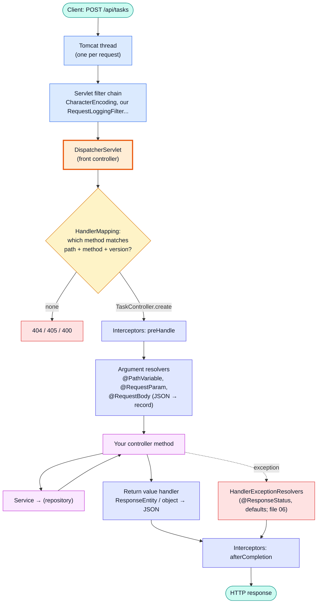
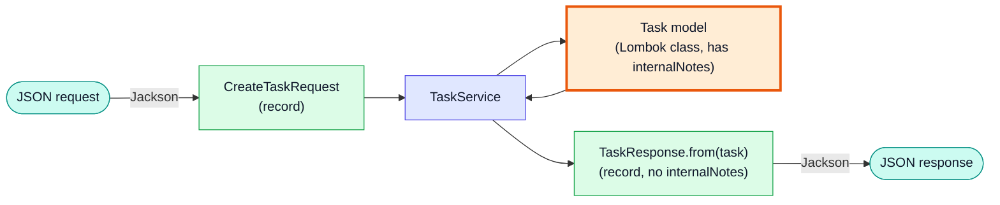
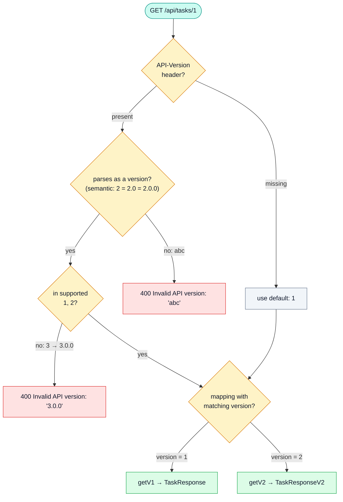
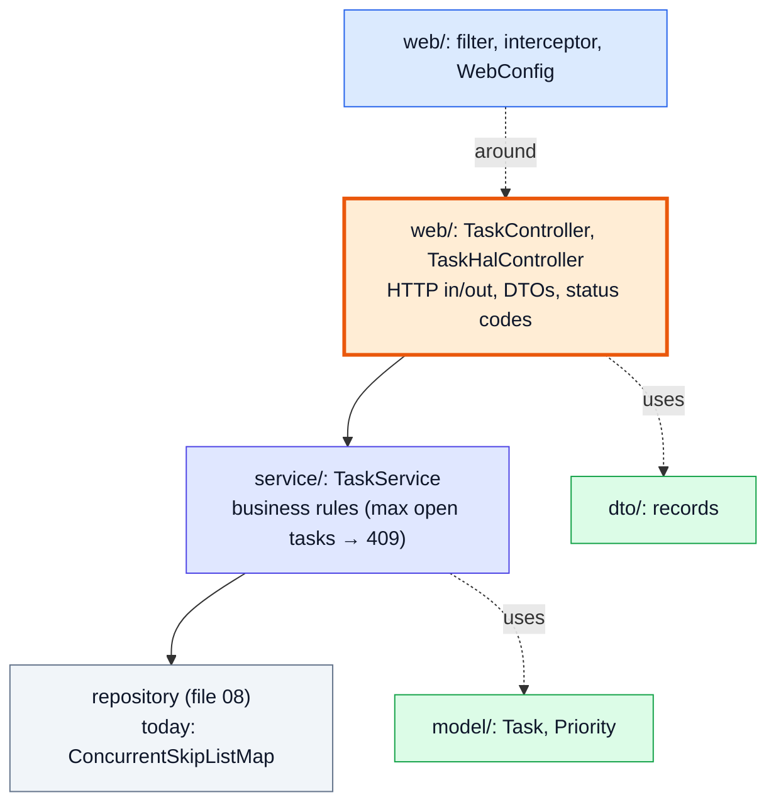

# REST Controllers with Spring MVC — Complete In-Depth Guide

**Spring Boot notes #5 of 18** · Priority 🔴 · Track: Spring Boot ([README](README.md))

[File 02](spring_02_http_rest_basics.md) explained HTTP and REST, and [file 04](spring_04_spring_boot_fundamentals.md) started a Boot app with one tiny controller. This file builds the **real Task API**: every HTTP method, reading anything from a request, choosing status codes and headers, JSON with Jackson 3, DTOs with records and Lombok, file upload, API versioning, filters vs interceptors, a custom annotation, HATEOAS links and request-scoped beans.

| You want… | Spring MVC gives you |
|---|---|
| Map `GET /api/tasks/7` to a Java method | `@GetMapping("/{id}")` + `@PathVariable` |
| Read JSON into an object, write an object as JSON | `@RequestBody` / return value, converted by **Jackson** |
| Control status code and headers | `ResponseEntity` |
| Run code around every request | A servlet **Filter** or a Spring **HandlerInterceptor** |
| Serve two shapes of the same resource | Spring 7 **API versioning** (`version = "2"`) |

> [!NOTE]
> This topic isn't in Kunal's playlist, so there are no video timestamps. The reference playlist's videos on controllers, interceptors, filters, custom annotations and HATEOAS map here (see the [README](README.md#reference-playlist-where-each-video-is-covered)).
>
> **What was run:** the [Complete Example](#-complete-example-everything-together) is the **Task Tracker, stage 05** ([`examples/05-rest-controllers/`](examples/05-rest-controllers/)), a **Spring Boot 4.0.5** app built with `./mvnw package` and started with `java -jar` on JDK 21. Every response, status code and log line in this file comes from real requests sent to it (21 in the main run, 8 in the edge-case run and 2 in the limit run). Timestamps and PIDs change on every run. JSON bodies are shown pretty-printed by the client.

---

## Table of Contents

| # | Topic (anchor link) | Level |
|---|---|---|
| 0 | [The Journey of a Request: DispatcherServlet](#0-the-journey-of-a-request-dispatcherservlet) | Core |
| 1 | [@RestController and the Mapping Annotations](#1-restcontroller-and-the-mapping-annotations) | Basics |
| 2 | [Reading the Request: Path, Query, Headers, Body](#2-reading-the-request-path-query-headers-body) | Core |
| 3 | [Writing the Response: ResponseEntity and Status Codes](#3-writing-the-response-responseentity-and-status-codes) | Core |
| 4 | [DTOs, Records and Lombok](#4-dtos-records-and-lombok) | Core |
| 5 | [JSON with Jackson 3 and Content Negotiation](#5-json-with-jackson-3-and-content-negotiation) | In depth |
| 6 | [CRUD Done Right: POST, GET, PUT, PATCH, DELETE](#6-crud-done-right-post-get-put-patch-delete) | Core |
| 7 | [File Upload with Multipart](#7-file-upload-with-multipart) | Core |
| 8 | [API Versioning (Spring 7)](#8-api-versioning-spring-7) | In depth |
| 9 | [Filters vs Interceptors](#9-filters-vs-interceptors) | In depth |
| 10 | [Custom Annotations Read by an Interceptor](#10-custom-annotations-read-by-an-interceptor) | In depth |
| 11 | [HATEOAS: Responses with Links](#11-hateoas-responses-with-links) | In depth |
| 12 | [Request Scope and the Layered Architecture](#12-request-scope-and-the-layered-architecture) | Core |
| 13 | [Interview Questions](#13-interview-questions) | Interview |

---

## 0. The Journey of a Request: DispatcherServlet

Spring MVC is built around one servlet, the **`DispatcherServlet`**. This is the **front controller** pattern: Tomcat hands *every* request to this single servlet, and it decides which of your methods runs. Boot registers it for `/` automatically (file 04 showed the `dispatcherServlet` bean).



| Component | Job | Real class in Spring 7.0.6 |
|---|---|---|
| Front controller | Receives every request | `DispatcherServlet` |
| Handler mapping | Finds the method for path + HTTP method (+ version, headers, media types) | `RequestMappingHandlerMapping` |
| Handler adapter | Calls the method: resolves arguments, handles the return value | `RequestMappingHandlerAdapter` |
| Message converter | Body ↔ object (JSON) | `JacksonJsonHttpMessageConverter` (Jackson 3) |
| Exception resolvers | Turn exceptions into status codes | `DefaultHandlerExceptionResolver` and others |

> [!TIP]
> The 500 stack trace from the first run's HATEOAS bug ([Section 11](#11-hateoas-responses-with-links)) showed this chain for real, read bottom to top: `CharacterEncodingFilter` → `FormContentFilter` → `RequestContextFilter` → `RequestLoggingFilter` (ours) → `WsFilter` → `DispatcherServlet.doDispatch` → `RequestMappingHandlerAdapter` → `InvocableHandlerMethod.doInvoke` → our controller.

---

## 1. @RestController and the Mapping Annotations

```java
@RestController                         // = @Controller + @ResponseBody on every method
@RequestMapping("/api/tasks")           // common prefix for every method below
public class TaskController { ... }
```

| Annotation | Meaning |
|---|---|
| `@Controller` | A web component (a `@Component`, so it's scanned). Methods return **view names** (HTML templates) by default. |
| `@ResponseBody` | "The return value **is** the response body": convert it (to JSON) instead of looking up a view |
| `@RestController` | `@Controller` + `@ResponseBody` on the class: what every REST API uses |
| `@RequestMapping("/api/tasks")` | On the class: a path prefix. On a method: a mapping for any HTTP method unless `method = ...` is set |
| `@GetMapping`, `@PostMapping`, `@PutMapping`, `@PatchMapping`, `@DeleteMapping` | Shortcuts for `@RequestMapping(method = ...)` |

A mapping can match on more than the path:

| Attribute | Example | Matches when… |
|---|---|---|
| `path` / `value` | `"/{id}"`, `"/{id}/attachment"` | The URL path matches (with `{variables}`) |
| `consumes` | `MediaType.MULTIPART_FORM_DATA_VALUE` | The request `Content-Type` matches (else **415**) |
| `produces` | `MediaType.APPLICATION_JSON_VALUE` | The client's `Accept` allows it (else **406**) |
| `params` | `params = "done"` | A query parameter is present |
| `headers` | `headers = "X-Debug=true"` | A header has that value |
| `version` (Spring 7) | `version = "2"` | The requested API version matches ([Section 8](#8-api-versioning-spring-7)) |

> [!NOTE]
> If the path matches but the HTTP method doesn't, Spring answers **405 Method Not Allowed** and lists the allowed methods in the `Allow` header. Real result from the edge-case run (`DELETE /api/tasks` has no mapping, but GET and POST do):
>
> ```
> < 405  Allow: POST, GET
> "message": "Method 'DELETE' is not supported."
> ```

---

## 2. Reading the Request: Path, Query, Headers, Body

Each controller parameter is filled by an **argument resolver**, chosen by its annotation or type.

| Annotation | Reads from | Example in the Task API |
|---|---|---|
| `@PathVariable` | A `{var}` in the path | `GET /api/tasks/7` → `long id = 7` |
| `@RequestParam` | Query string (or form field) | `?done=false&priority=HIGH` → `Boolean done`, `Priority priority` |
| `@RequestHeader` | A request header | `X-Client: notes-cli` → `String client` |
| `@RequestBody` | The whole body, converted by Jackson | JSON → `CreateTaskRequest` record |
| `@RequestPart` | One part of a `multipart/form-data` body | `file` part → `MultipartFile` |
| `@CookieValue` | A cookie | `@CookieValue("session") String s` |
| *(no annotation)* `HttpServletRequest`, `Principal`, `Locale`… | Injected by type | Raw access when you need it |

```java
// GET /api/tasks?done=false&priority=HIGH  (both optional)
@GetMapping
@AuditLog("list tasks")
public List<TaskResponse> list(@RequestParam(required = false) Boolean done,
                               @RequestParam(required = false) Priority priority) {
    return service.findAll(done, priority).stream().map(TaskResponse::from).toList();
}
```

**Type conversion is automatic:** `"7"` → `long`, `"HIGH"` → the `Priority` enum, `"false"` → `Boolean`. When it fails you get **400**. Real result for `GET /api/tasks/abc`:

```
< 400
"message": "Method parameter 'id': Failed to convert value of type 'java.lang.String' to required type 'long'; For input string: \"abc\""
```

| Option | Effect |
|---|---|
| `@RequestParam(required = false) Boolean done` | Missing → `null` (use wrapper types, not `boolean`) |
| `@RequestParam(defaultValue = "0") int page` | Missing → `0` (and `required` becomes false automatically) |
| `@RequestHeader(name = "X-Client", defaultValue = "unknown")` | Missing header → `"unknown"` |
| `@RequestParam List<String> tag` | `?tag=a&tag=b` → `[a, b]` |
| `@RequestParam Map<String,String> all` | Every query parameter |

> [!IMPORTANT]
> Parameter names like `{id}` ↔ `long id` work without `@PathVariable("id")` because the Boot parent compiles with **`-parameters`** (file 04), which keeps parameter names in the `.class` files. Without it you would have to repeat every name in the annotation.

---

## 3. Writing the Response: ResponseEntity and Status Codes

What you return decides the response:

| Return type | Status | Body |
|---|---|---|
| An object / record / `List` | **200** | The object as JSON |
| `ResponseEntity<T>` | **You choose** | You choose, plus any headers |
| `void` (with `@ResponseStatus(HttpStatus.NO_CONTENT)`) | The annotated status | None |
| Throw `ResponseStatusException(HttpStatus.CONFLICT, "...")` | 409 | Boot's error JSON |
| Throw an exception annotated with `@ResponseStatus(NOT_FOUND)` | 404 | Boot's error JSON |

**`ResponseEntity`** has builders for the common cases:

```java
// POST /api/tasks  -> 201 Created + Location header + body
@PostMapping
@AuditLog("create task")
public ResponseEntity<TaskResponse> create(@RequestBody CreateTaskRequest body,
                                           @RequestHeader(name = "X-Client", defaultValue = "unknown") String client) {
    Task created = service.create(body);
    URI location = ServletUriComponentsBuilder.fromCurrentRequest()
            .path("/{id}").buildAndExpand(created.getId()).toUri();
    return ResponseEntity.created(location)
            .header("X-Created-By", client)
            .header("X-Request-Number", String.valueOf(requestInfo.number()))
            .body(TaskResponse.from(created));
}
```

| Builder | Status |
|---|---|
| `ResponseEntity.ok(body)` | 200 |
| `ResponseEntity.created(uri).body(b)` | 201 + `Location` header |
| `ResponseEntity.accepted().build()` | 202 |
| `ResponseEntity.noContent().build()` | 204 |
| `ResponseEntity.badRequest().body(b)` | 400 |
| `ResponseEntity.notFound().build()` | 404 |
| `ResponseEntity.status(HttpStatus.CONFLICT).body(b)` | Any status |

`ServletUriComponentsBuilder.fromCurrentRequest()` takes the current URL (`http://localhost:8080/api/tasks`) and appends `/{id}`, so the `Location` header is always correct, whatever host or port the app runs on. Real response:

```
< 201  Location: http://localhost:8080/api/tasks/1  X-Created-By: notes-cli  X-Request-Number: 1  X-Filtered: yes
```

### 3.1 Every status code this API produced (all real)

| Status | When | Who produced it |
|---|---|---|
| **200** | GET, PUT, PATCH, upload | Plain return value |
| **201** + `Location` | POST created a task | `ResponseEntity.created(...)` |
| **204** | DELETE succeeded | `ResponseEntity.noContent()` |
| **400** | `abc` for a `long`, broken JSON, unknown enum value, wrong date format, bad API version | Spring's resolvers |
| **403** | Interceptor returned `false` | `AuditInterceptor` ([Section 9](#9-filters-vs-interceptors)) |
| **404** | Task 99 doesn't exist / no such URL | `TaskNotFoundException` (`@ResponseStatus`) / no handler |
| **405** + `Allow` | `DELETE /api/tasks` | No mapping for that method |
| **406** | `Accept: application/xml` | No converter can write XML ([Section 5](#5-json-with-jackson-3-and-content-negotiation)) |
| **409** | More open tasks than `tasks.max-open-tasks` | `ResponseStatusException(CONFLICT)` in the service |
| **413** | Upload bigger than `max-file-size` | `MaxUploadSizeExceededException` |
| **415** | `Content-Type: text/plain` on POST | No converter can read it |

```java
/** Thrown anywhere -> Spring answers 404. File 06 replaces this with a proper error handler. */
@ResponseStatus(HttpStatus.NOT_FOUND)
public class TaskNotFoundException extends RuntimeException { ... }
```

> [!WARNING]
> **Boot 4 renamed the error properties.** To show the exception message in Boot's error JSON you need `spring.web.error.include-message: always`. The Boot 3 name `server.error.include-message` is **deprecated with level "error" since 4.0.0** and is silently ignored: the first run of this project used it, and the `"message"` field was simply missing. Checked in the Boot 4.0.5 configuration metadata.

---

## 4. DTOs, Records and Lombok

### 4.1 Why not return the model directly?

`Task` is the internal model. In file 08 it becomes a JPA entity. It has a field the client must never see:

```java
private String internalNotes;          // must never leak to the API
```

A **DTO** (Data Transfer Object) is a class shaped for the API, separate from the model:

| Reason | Example here |
|---|---|
| Hide fields | `internalNotes` is never in any response |
| Different input and output shapes | The client sends `CreateTaskRequest` (no `id`, no `createdAt`); the server returns `TaskResponse` (with them) |
| Evolve the API without touching the model | `TaskResponseV2` renames `dueDate` → `due` and turns `done` into `status` |
| Avoid JPA problems (file 08) | Lazy-loading errors and infinite JSON loops with bidirectional relations |



### 4.2 Records for DTOs

Records ([Java notes on records](../Java%20Topics%20Not%20Covered%20Notes/java_gap_07_modern_java_features.md#6-records)) are perfect DTOs: immutable, with constructor, accessors, `equals`, `hashCode` and `toString` generated. Jackson 3 reads and writes them with no extra annotations. All DTOs of the Task API live in one file:

```java
package com.notes.tasks.dto;

import com.fasterxml.jackson.annotation.JsonInclude;
import com.fasterxml.jackson.annotation.JsonProperty;
import com.notes.tasks.model.Priority;
import com.notes.tasks.model.Task;

import java.time.Instant;
import java.time.LocalDate;

/** All request/response shapes of the Task API, as immutable records. */
public final class TaskDtos {
    private TaskDtos() {}

    /** POST /api/tasks body. Validation (@NotBlank...) arrives in file 06. */
    public record CreateTaskRequest(String title, String description, Priority priority, LocalDate dueDate) {}

    /** PUT /api/tasks/{id} body: the WHOLE new state. */
    public record ReplaceTaskRequest(String title, String description, Priority priority,
                                     boolean done, LocalDate dueDate) {}

    /** PATCH /api/tasks/{id} body: null means "leave unchanged". */
    public record PatchTaskRequest(String title, String description, Priority priority,
                                   Boolean done, LocalDate dueDate) {}

    /** Version 1 response. */
    @JsonInclude(JsonInclude.Include.NON_NULL)           // omit null fields (e.g. no description)
    public record TaskResponse(long id, String title, String description, Priority priority,
                               boolean done, LocalDate dueDate, Instant createdAt) {
        public static TaskResponse from(Task t) {
            return new TaskResponse(t.getId(), t.getTitle(), t.getDescription(), t.getPriority(),
                    t.isDone(), t.getDueDate(), t.getCreatedAt());
        }
    }

    /** Version 2 response: "status" text instead of a boolean, renamed JSON field. */
    public record TaskResponseV2(long id, String title, String status, Priority priority,
                                 @JsonProperty("due") LocalDate dueDate) {
        public static TaskResponseV2 from(Task t) {
            return new TaskResponseV2(t.getId(), t.getTitle(), t.isDone() ? "DONE" : "OPEN",
                    t.getPriority(), t.getDueDate());
        }
    }

    public record AttachmentInfo(long taskId, String fileName, String contentType, long sizeBytes, int lines) {}
}
```

| Detail | Why |
|---|---|
| `ReplaceTaskRequest.done` is `boolean` | PUT sends the **whole** state, so `done` must be present. Leaving it out does **not** default to `false`: Jackson 3 refuses with **400** `Cannot map null into type boolean` (`FAIL_ON_NULL_FOR_PRIMITIVES` is on; tested) |
| `PatchTaskRequest.done` is `Boolean` | PATCH needs three states: `true`, `false`, and **`null` = "don't change"** |
| A static `from(Task)` factory on each response | Mapping lives in one place; the controller stays one line per method |

### 4.3 Lombok for mutable classes

Records can't be JPA entities: JPA needs a no-arg constructor and creates proxy subclasses, but records are final and immutable. For those, **Lombok** generates the boilerplate at compile time:

```java
package com.notes.tasks.model;

import lombok.AllArgsConstructor;
import lombok.Builder;
import lombok.Getter;
import lombok.NoArgsConstructor;
import lombok.Setter;
import lombok.ToString;

import java.time.Instant;
import java.time.LocalDate;

/**
 * The internal model (it becomes a JPA entity in file 08, and entities must be mutable
 * classes, not records). Lombok writes the getters, setters, constructors and builder.
 * It is never sent to clients directly: controllers return DTOs instead.
 */
@Getter
@Setter
@Builder
@NoArgsConstructor
@AllArgsConstructor
@ToString
public class Task {
    private Long id;
    private String title;
    private String description;
    private Priority priority;
    private boolean done;
    private LocalDate dueDate;
    private Instant createdAt;
    private String internalNotes;          // must never leak to the API
}
```

| Lombok annotation | Generates |
|---|---|
| `@Getter` / `@Setter` | `getTitle()`, `setTitle(..)`; for `boolean done`: `isDone()` / `setDone(..)` |
| `@NoArgsConstructor` / `@AllArgsConstructor` | `Task()` / `Task(id, title, ...)` |
| `@RequiredArgsConstructor` | A constructor for `final` fields: the classic way to write constructor injection |
| `@Builder` | `Task.builder().title("x").priority(HIGH).build()` (used in `TaskService.create`) |
| `@ToString`, `@EqualsAndHashCode` | Those methods |
| `@Data` | `@Getter` + `@Setter` + `@ToString` + `@EqualsAndHashCode` + `@RequiredArgsConstructor` |
| `@Value` | An immutable class (all fields `private final`); mostly replaced by records today |
| `@Slf4j` | `private static final Logger log = ...` |

Lombok setup in the POM (both parts are needed):

```xml
<dependency>                            <!-- @Getter, @Setter, @Builder... generated at compile time -->
    <groupId>org.projectlombok</groupId>
    <artifactId>lombok</artifactId>
    <optional>true</optional>
</dependency>
```

```xml
<annotationProcessorPaths>
    <path>                  <!-- version comes from the Boot BOM (1.18.44) -->
        <groupId>org.projectlombok</groupId>
        <artifactId>lombok</artifactId>
    </path>
    ...
```

> [!WARNING]
> Once you list *any* `annotationProcessorPaths`, the compiler uses **only** those processors. Lombok must be in that list (with the configuration processor from file 04), or the build fails with "cannot find symbol: method builder()".
>
> Avoid `@Data` on JPA entities: its generated `equals`/`hashCode`/`toString` touch every field, including lazy relations (file 08).

---

## 5. JSON with Jackson 3 and Content Negotiation

`spring-boot-starter-webmvc` brings **Jackson 3** (`tools.jackson.*`, version 3.1.0 here). The `JacksonJsonHttpMessageConverter` reads `@RequestBody` and writes return values. Jackson 3 has `java.time` support built in (`tools.jackson.databind.ext.javatime`), so no extra module is needed.

| Java value | JSON (real output) |
|---|---|
| `LocalDate` 2026-11-30 | `"2026-11-30"` |
| `Instant` | `"2026-11-16T09:00:00Z"` (ISO-8601 string, not a number) |
| `Priority.HIGH` (enum) | `"HIGH"` |
| `null` field in `TaskResponse` (`@JsonInclude(NON_NULL)`) | Field **omitted** (task 1 has no `description` key) |
| `null` field in `TaskResponseV2` (no `@JsonInclude`) | `"due": null` |

| Annotation (still `com.fasterxml.jackson.annotation`) | Effect |
|---|---|
| `@JsonProperty("due")` | Rename the JSON field |
| `@JsonIgnore` | Never read or write this field |
| `@JsonInclude(NON_NULL)` | Skip null fields |
| `@JsonFormat(pattern = "dd-MM-yyyy")` | Custom date format |
| `@JsonAlias("deadline")` | Also accept another name when reading |

> [!NOTE]
> In Jackson 3 the **annotations** keep their old package `com.fasterxml.jackson.annotation` (artifact `jackson-annotations` 2.21), while `ObjectMapper`/`JsonMapper` moved to `tools.jackson.databind`. That's why the DTO file imports `com.fasterxml.jackson.annotation.JsonInclude` and it compiles fine against Jackson 3.

**What Jackson did with bad input (edge-case run, all real):**

| Request body | Result |
|---|---|
| `{"title":"x","colour":"red"}` (unknown field) | **201**, `colour` silently ignored |
| `{"title":"y","priority":"URGENT"}` | **400** `not one of the values accepted for Enum class: [HIGH, LOW, MEDIUM]` |
| `{"title":"d","dueDate":"30-11-2026"}` | **400** `Text '30-11-2026' could not be parsed at index 0` (ISO `yyyy-MM-dd` expected) |
| `{bad json` | **400** `JSON parse error: Unexpected character ('b' ...)` |

**Content negotiation** picks the converter from the headers:

| Header | Asks for | Failure |
|---|---|---|
| `Content-Type` (request) | "My body is JSON" → a converter that can **read** it | **415** (`text/plain` here) |
| `Accept` (request) | "I want JSON back" → a converter that can **write** it | **406** (`application/xml` here: no XML converter on the classpath) |

---

## 6. CRUD Done Right: POST, GET, PUT, PATCH, DELETE

| Operation | Mapping | Success | Idempotent? ([file 02](spring_02_http_rest_basics.md)) |
|---|---|---|---|
| Create | `POST /api/tasks` | **201** + `Location` + body | No: two POSTs, two tasks |
| List / filter | `GET /api/tasks?done=&priority=` | 200 + array | Yes |
| Read one | `GET /api/tasks/{id}` | 200 / 404 | Yes |
| Replace | `PUT /api/tasks/{id}` (whole state) | 200 | Yes |
| Partial update | `PATCH /api/tasks/{id}` (only sent fields) | 200 | Not necessarily |
| Delete | `DELETE /api/tasks/{id}` | **204** / 404 the second time | Yes (server state is the same after 1 or 2 calls) |

**PUT vs PATCH, for real.** Task 2 was `{"title":"Write notes","description":"file 05","priority":"MEDIUM"}`:

| Request | Result |
|---|---|
| `PATCH /api/tasks/2 {"done":true}` | Only `done` changed. Title, description and priority stayed. |
| `PUT /api/tasks/2 {"title":"Write notes v2","priority":"LOW","done":false}` | **Everything** replaced: `description` wasn't sent, so it became `null` and disappeared from the JSON |

```java
public Task patch(long id, PatchTaskRequest req) {
    Task t = get(id);
    if (req.title() != null) t.setTitle(req.title());
    if (req.description() != null) t.setDescription(req.description());
    if (req.priority() != null) t.setPriority(req.priority());
    if (req.done() != null) t.setDone(req.done());
    if (req.dueDate() != null) t.setDueDate(req.dueDate());
    return t;
}
```

> [!TIP]
> This null-means-unchanged PATCH can't set a field **back to null**. When you need that, use JSON Merge Patch (`application/merge-patch+json`), or `Optional`/a "fields present" set in the DTO.

---

## 7. File Upload with Multipart

A browser form or `curl -F` sends files as **`multipart/form-data`**: one body split into named parts.

```java
// POST /api/tasks/7/attachment  (multipart/form-data, part name "file")
@PostMapping(path = "/{id}/attachment", consumes = MediaType.MULTIPART_FORM_DATA_VALUE)
public AttachmentInfo upload(@PathVariable long id, @RequestPart("file") MultipartFile file) throws IOException {
    service.get(id);                                     // 404 if the task doesn't exist
    String text = new String(file.getBytes(), StandardCharsets.UTF_8);
    return new AttachmentInfo(id, file.getOriginalFilename(), file.getContentType(),
            file.getSize(), (int) text.lines().count());
}
```

| `MultipartFile` method | Returns |
|---|---|
| `getOriginalFilename()` | `plan.txt` (from the client: never trust it as a path) |
| `getContentType()` | `text/plain` |
| `getSize()` | Bytes |
| `getBytes()` / `getInputStream()` | The content |
| `transferTo(Path)` | Save to disk |

| Property (Boot 4.0.5 metadata) | Default | Here |
|---|---|---|
| `spring.servlet.multipart.max-file-size` | 1MB | **100KB** |
| `spring.servlet.multipart.max-request-size` | 10MB | default |

Real results: a 20-byte `plan.txt` → **200** `{"sizeBytes":20,"lines":3}`. A 150,000-byte file → **413** with an empty body and `MaxUploadSizeExceededException: Maximum upload size exceeded` in the log. Note that **neither the interceptor nor the controller ran**: the multipart parsing failed first.

```bash
curl.exe -F "file=@plan.txt;type=text/plain" http://localhost:8080/api/tasks/1/attachment
```

> [!CAUTION]
> Never build a file path from `getOriginalFilename()` (`../../etc/passwd`). Generate your own name (e.g. a UUID), check the content type and size, and store files outside the app folder or in object storage.

---

## 8. API Versioning (Spring 7)

When the response shape must change incompatibly, old clients still need the old shape. **Spring Framework 7** added first-class API versioning, and Boot 4 configures it with properties:

```yaml
spring:
  mvc:
    apiversion:
      use:
        header: API-Version        # read the version from this request header
      default: "1"                 # no header -> version 1
      supported: "1,2"
```

```java
// GET /api/tasks/7 with header "API-Version: 1" (or no header: 1 is the default)
@GetMapping(path = "/{id}", version = "1")
public TaskResponse getV1(@PathVariable long id) {
    return TaskResponse.from(service.get(id));
}

// GET /api/tasks/7 with header "API-Version: 2"
@GetMapping(path = "/{id}", version = "2")
public TaskResponseV2 getV2(@PathVariable long id) {
    return TaskResponseV2.from(service.get(id));
}
```



**Real results:**

| Header | Handler | Response |
|---|---|---|
| none | `getV1` | `{"id":1,"title":...,"done":false,"dueDate":"2026-11-30",...}` |
| `API-Version: 2` | `getV2` | `{"id":1,...,"status":"OPEN","priority":"HIGH","due":"2026-11-30"}` |
| `API-Version: 2.0` | `getV2` | Same as 2: versions are parsed semantically |
| `API-Version: 3` | none | **400** `Invalid API version: '3.0.0'.` |
| `API-Version: abc` | none | **400** `Invalid API version: 'abc'.` |
| `API-Version: 2` on `GET /api/tasks` | `list` | **200**: a mapping **without** `version` matches every version |

| Strategy (Boot property under `spring.mvc.apiversion.use`) | Request looks like | Tested here |
|---|---|---|
| `header: API-Version` | `API-Version: 2` | ✅ |
| `query-parameter: version` | `/api/tasks/1?version=2` | ✅ |
| `media-type-parameter[application/json]: v` | `Accept: application/json;v=2` | ✅ |
| `path-segment: <index>` | The version is one segment of the path, e.g. `/api/v2/...` | Not run (needs different mappings) |

Several strategies can be on at once. Started with `--spring.mvc.apiversion.use.query-parameter=version "--spring.mvc.apiversion.use.media-type-parameter[application/json]=v"` (the header from the yml stays on), all three requests returned the V2 shape `{"id":1,...,"status":"OPEN",...}`, and a request with none of them returned V1.

> [!NOTE]
> The version check runs during **handler mapping**, so for the 400 cases the log shows the filter but **no interceptor line**: no handler was chosen. Without Spring 7 you would version by hand: separate paths (`/api/v1/...`, `/api/v2/...`) or `@GetMapping(headers = "API-Version=2")`.
>
> Plain Spring (no Boot) configures the same thing in `WebMvcConfigurer.configureApiVersioning(ApiVersionConfigurer)`: `useRequestHeader("API-Version")`, `setDefaultVersion("1")`, `addSupportedVersions("1","2")`.

---

## 9. Filters vs Interceptors

Both run code around requests, at different layers.

```mermaid
flowchart LR
    subgraph TOM["Tomcat (servlet container)"]
        F1["CharacterEncodingFilter"] --> F2["... RequestLoggingFilter<br/>(ours)"]
        subgraph SPR["DispatcherServlet (Spring MVC)"]
            DS["find handler"] --> I1["AuditInterceptor.preHandle"]
            I1 --> CT["TaskController method"]
            CT --> I2["AuditInterceptor.afterCompletion"]
        end
    end
    F2 --> DS
    CL(["Client"]) --> F1
    I2 --> OUT(["Response"])

    classDef stack fill:#dbeafe,stroke:#2563eb,color:#0f172a
    classDef process fill:#e0e7ff,stroke:#4f46e5,color:#0f172a
    classDef io fill:#fae8ff,stroke:#c026d3,color:#0f172a
    classDef startend fill:#ccfbf1,stroke:#0d9488,color:#0f172a
    classDef highlight fill:#ffedd5,stroke:#ea580c,stroke-width:3px,color:#0f172a
    class CL,OUT startend
    class F1,F2 stack
    class DS process
    class I1,I2 highlight
    class CT io
```



| | Servlet **Filter** | Spring **HandlerInterceptor** |
|---|---|---|
| Belongs to | Servlet spec (`jakarta.servlet.Filter`) | Spring MVC |
| Runs | Before the `DispatcherServlet` | Inside it, **after** the handler is chosen |
| Sees | Every request: `/nope`, static files, errors, everything | Only requests mapped to a handler (and only paths you register) |
| Knows the controller method? | No | **Yes**: `HandlerMethod`, so it can read annotations |
| Can wrap/replace request or response | **Yes** (e.g. caching the body, compression) | No |
| Stop a request | Don't call `chain.doFilter(...)` | Return `false` from `preHandle` |
| Typical uses | Logging, CORS, security (Spring Security is a filter chain), encoding, request IDs | Auditing, per-handler auth checks, locale, timing per endpoint |
| Register in Boot | `@Component` (or `FilterRegistrationBean` for URL patterns/order) | `WebMvcConfigurer.addInterceptors(...)` |

**The filter** (extends `OncePerRequestFilter`, so it runs once even when the request is forwarded internally to `/error`):

```java
package com.notes.tasks.web;

import jakarta.servlet.FilterChain;
import jakarta.servlet.ServletException;
import jakarta.servlet.http.HttpServletRequest;
import jakarta.servlet.http.HttpServletResponse;
import org.springframework.stereotype.Component;
import org.springframework.web.filter.OncePerRequestFilter;

import java.io.IOException;

/**
 * A servlet FILTER: runs in Tomcat, BEFORE Spring's DispatcherServlet, for every request
 * (even ones no controller handles). It sees raw requests/responses, not controller methods.
 */
@Component
public class RequestLoggingFilter extends OncePerRequestFilter {

    @Override
    protected void doFilterInternal(HttpServletRequest request, HttpServletResponse response,
                                    FilterChain chain) throws ServletException, IOException {
        String what = request.getMethod() + " " + request.getRequestURI();
        System.out.println("[filter]      before " + what);
        response.setHeader("X-Filtered", "yes");
        chain.doFilter(request, response);                   // continue to the next filter / servlet
        System.out.println("[filter]      after  " + what + " -> " + response.getStatus());
    }
}
```

**The interceptor** and its registration:

```java
package com.notes.tasks.web;

import jakarta.servlet.http.HttpServletRequest;
import jakarta.servlet.http.HttpServletResponse;
import org.springframework.stereotype.Component;
import org.springframework.web.method.HandlerMethod;
import org.springframework.web.servlet.HandlerInterceptor;

/**
 * A Spring MVC INTERCEPTOR: runs inside DispatcherServlet, AFTER the controller method has
 * been chosen, so it knows WHICH method (and its annotations) will handle the request.
 */
@Component
public class AuditInterceptor implements HandlerInterceptor {
    private final RequestInfo requestInfo;

    public AuditInterceptor(RequestInfo requestInfo) {
        this.requestInfo = requestInfo;
    }

    @Override
    public boolean preHandle(HttpServletRequest req, HttpServletResponse res, Object handler) {
        if (handler instanceof HandlerMethod hm) {
            String method = hm.getBeanType().getSimpleName() + "." + hm.getMethod().getName();
            AuditLog audit = hm.getMethodAnnotation(AuditLog.class);
            System.out.println("[interceptor] preHandle  request #" + requestInfo.number() + " -> " + method
                    + (audit != null ? "  [audit: " + audit.value() + "]" : ""));
        }
        if ("true".equals(req.getHeader("X-Block"))) {       // returning false stops the request here
            res.setStatus(HttpServletResponse.SC_FORBIDDEN);
            System.out.println("[interceptor] blocked by X-Block header");
            return false;
        }
        return true;
    }

    @Override
    public void afterCompletion(HttpServletRequest req, HttpServletResponse res, Object handler, Exception ex) {
        System.out.println("[interceptor] afterCompletion request #" + requestInfo.number()
                + " status " + res.getStatus());
    }
}
```

```java
package com.notes.tasks.web;

import org.springframework.context.annotation.Configuration;
import org.springframework.web.servlet.config.annotation.InterceptorRegistry;
import org.springframework.web.servlet.config.annotation.WebMvcConfigurer;

/** WebMvcConfigurer: hook to customise Spring MVC without replacing Boot's auto-configuration. */
@Configuration(proxyBeanMethods = false)
public class WebConfig implements WebMvcConfigurer {
    private final AuditInterceptor auditInterceptor;

    public WebConfig(AuditInterceptor auditInterceptor) {
        this.auditInterceptor = auditInterceptor;
    }

    @Override
    public void addInterceptors(InterceptorRegistry registry) {
        registry.addInterceptor(auditInterceptor)
                .addPathPatterns("/api/tasks/**", "/api/tasks");   // only the task API
    }
}
```

| `HandlerInterceptor` method | When | Notes |
|---|---|---|
| `preHandle` | Before the controller | `false` = stop. The interceptor must write the response itself. |
| `postHandle` | After the controller, before the view renders | For `@ResponseBody` the body is already written, so it's of little use in REST APIs |
| `afterCompletion` | After everything, **even if the controller threw** | Cleanup, timing, audit. Not called for an interceptor whose `preHandle` returned `false` |

**What the real logs prove:**

| Request | Log lines | Lesson |
|---|---|---|
| `POST /api/tasks` | filter before → interceptor preHandle → afterCompletion → filter after | The nesting order |
| `GET /api/tasks/99` (404) | preHandle → afterCompletion `status 404` | `afterCompletion` runs even when the controller threw |
| `GET /nope` | filter before/after only | Filters see everything; the interceptor saw no handler |
| `GET /api/hal/tasks/1` | filter only | The interceptor is registered only for `/api/tasks/**` |
| `API-Version: 3` | filter only, `-> 400` | Rejected during handler mapping |
| `X-Block: true` | preHandle → `blocked by X-Block header` → filter after `-> 403`, **no afterCompletion** | `preHandle` returning `false` |
| 150 KB upload | filter only, `-> 413` | Multipart parsing failed before any handler |

---

## 10. Custom Annotations Read by an Interceptor

A **custom annotation** is just metadata. Something must read it via reflection, and here the interceptor does.

```java
package com.notes.tasks.web;

import java.lang.annotation.ElementType;
import java.lang.annotation.Retention;
import java.lang.annotation.RetentionPolicy;
import java.lang.annotation.Target;

/** A custom marker annotation. The AuditInterceptor looks for it on controller methods. */
@Target(ElementType.METHOD)
@Retention(RetentionPolicy.RUNTIME)      // must survive to runtime so reflection can see it
public @interface AuditLog {
    String value();                      // what action is being audited
}
```

| Meta-annotation | Meaning | Here |
|---|---|---|
| `@Target(ElementType.METHOD)` | Where it may be placed | Methods only (putting it on a class won't compile) |
| `@Retention(RUNTIME)` | How long it survives | **Must be `RUNTIME`**; with the default `CLASS` it's in the `.class` file but invisible to reflection, and `getMethodAnnotation` returns `null` |
| `String value()` | An attribute; the name `value` allows `@AuditLog("x")` | The action name |

Usage on the controller and the result:

```java
@DeleteMapping("/{id}")
@AuditLog("delete task")
public ResponseEntity<Void> delete(@PathVariable long id) { ... }
```

```
[interceptor] preHandle  request #16 -> TaskController.delete  [audit: delete task]
[interceptor] preHandle  request #9 -> TaskController.replace          ← no @AuditLog, no [audit]
```

> [!TIP]
> Interceptor + annotation is one way to act on annotated methods. **AOP** (file 13) is the more general way: an `@Around("@annotation(AuditLog)")` aspect works on any Spring bean, not only on controllers, and can see arguments and return values. Custom annotations are also how you build **custom validation constraints** (file 06).

---

## 11. HATEOAS: Responses with Links

**HATEOAS** (Hypermedia As The Engine Of Application State) is level 3 of the Richardson model ([file 02](spring_02_http_rest_basics.md)): the response includes **links** to related resources and to the actions allowed *right now*, so clients don't hard-code URLs.

```java
package com.notes.tasks.web;

import com.notes.tasks.dto.TaskDtos.TaskResponse;
import com.notes.tasks.model.Task;
import com.notes.tasks.service.TaskService;
import org.springframework.hateoas.EntityModel;
import org.springframework.web.bind.annotation.GetMapping;
import org.springframework.web.bind.annotation.PathVariable;
import org.springframework.web.bind.annotation.RequestMapping;
import org.springframework.web.bind.annotation.RestController;

import static org.springframework.hateoas.server.mvc.WebMvcLinkBuilder.linkTo;
import static org.springframework.hateoas.server.mvc.WebMvcLinkBuilder.methodOn;

/** HATEOAS: the response also tells the client what it can do next, as links. */
@RestController
@RequestMapping("/api/hal/tasks")
public class TaskHalController {
    private final TaskService service;

    public TaskHalController(TaskService service) {
        this.service = service;
    }

    @GetMapping("/{id}")
    public EntityModel<TaskResponse> get(@PathVariable long id) {
        Task t = service.get(id);
        EntityModel<TaskResponse> model = EntityModel.of(TaskResponse.from(t));
        model.add(linkTo(methodOn(TaskHalController.class).get(id)).withSelfRel());
        model.add(linkTo(methodOn(TaskController.class).list(null, null)).withRel("all-tasks"));
        if (!t.isDone()) {                                   // links depend on the state
            // NOT methodOn(...).patch(...): patch() returns a record (final class), which
            // methodOn cannot proxy -> 500. Build the URL from the controller class instead.
            model.add(linkTo(TaskController.class).slash(id).withRel("complete"));
        }
        return model;
    }
}
```

Real response for `GET /api/hal/tasks/1` with `Accept: application/hal+json`:

```json
{
  "_links": {
    "self": {
      "href": "http://localhost:8080/api/hal/tasks/1"
    },
    "all-tasks": {
      "href": "http://localhost:8080/api/tasks{?done,priority}",
      "templated": true
    },
    "complete": {
      "href": "http://localhost:8080/api/tasks/1"
    }
  },
  "id": 1,
  "title": "Learn Spring MVC",
  "priority": "HIGH",
  "done": false,
  "dueDate": "2026-11-30",
  "createdAt": "2026-11-16T09:00:00Z"
}
```

| Piece | Meaning |
|---|---|
| `spring-boot-starter-hateoas` | Spring HATEOAS 3.0.3 + HAL configured for Jackson |
| `EntityModel<T>` | One resource + links. `CollectionModel<T>` is for lists, `PagedModel<T>` for pages |
| `linkTo(methodOn(X.class).m(args))` | Builds the URL by "calling" the mapping on a proxy, so the link follows the `@GetMapping` |
| `withSelfRel()` / `withRel("all-tasks")` | The link's name (the "rel") |
| `{?done,priority}` + `templated: true` | Optional `@RequestParam`s become a URI template |
| `complete` only while `done == false` | **State-dependent links**: the client shows a "complete" button only if the link is there |
| HAL (`_links`) | The JSON format used, content type `application/hal+json` |

> [!WARNING]
> **A real bug from this project.** The first version used `linkTo(methodOn(TaskController.class).patch(id, null))`. It compiled, but every request failed with **500**:
>
> ```
> AopConfigException: Could not generate CGLIB subclass of class com.notes.tasks.dto.TaskDtos$TaskResponse:
> Common causes of this problem include using a final class or a non-visible class
> ```
>
> `methodOn` records the call by returning a **proxy of the method's return type**. `patch` returns a record, and records are **final**, so they can't be subclassed. `list()` works because it returns `List` (an interface). The fix: build the link from the class, `linkTo(TaskController.class).slash(id)`, or make HATEOAS controller methods return `EntityModel`/`ResponseEntity`.

> [!NOTE]
> HATEOAS is rare in practice; most public APIs (GitHub, Stripe) use plain JSON with documented URLs plus an OpenAPI spec (file 13). It's still a common interview topic.

---

## 12. Request Scope and the Layered Architecture

### 12.1 A request-scoped bean

[File 03](spring_03_spring_core_ioc_di.md) covered singleton and prototype scopes. Web apps add **request** (one instance per HTTP request) and **session** scopes.

```java
package com.notes.tasks.web;

import org.springframework.stereotype.Component;
import org.springframework.web.context.annotation.RequestScope;

import java.util.concurrent.atomic.AtomicInteger;

/**
 * @RequestScope: one instance per HTTP request. Singletons (controller, interceptor) get a
 * PROXY injected, which finds the instance belonging to the current request.
 */
@Component
@RequestScope
public class RequestInfo {
    private static final AtomicInteger COUNTER = new AtomicInteger();
    private final int number = COUNTER.incrementAndGet();

    public int number() { return number; }
}
```

The controller and interceptor are **singletons** created at startup, when no request exists. `@RequestScope` (proxy mode `TARGET_CLASS` by default) injects a **proxy**. Each call such as `requestInfo.number()` looks up the instance bound to the current request thread, creating it on first use.

What the real numbers show: the counter counts **instances**, not HTTP requests. In the main run the version-3 request, the HAL request and the oversized upload never touched `RequestInfo`, so no instance was created for them. That's why the PATCH, the 9th call, logs `request #8`. Within one request, the interceptor and the controller see the **same** instance: `preHandle request #1` and the `X-Request-Number: 1` header.

> [!CAUTION]
> Never store per-request data in a field of a singleton (`private String currentUser;` in a controller). Tomcat runs requests on many threads at once, and they would overwrite each other. Use method parameters, a request-scoped bean, or the request attributes.

### 12.2 The layers



| Layer | Knows about | Must not |
|---|---|---|
| Controller | HTTP: paths, params, status codes, DTOs | Contain business rules, or touch the database directly |
| Service | Business rules, transactions (file 09) | Know about `HttpServletRequest` or status codes (exceptions like `TaskNotFoundException` carry meaning; mapping them to HTTP is the web layer's job, which file 06 cleans up) |
| Repository | Storage | Contain business logic |

> [!TIP]
> Packaging **by feature** (`tasks/`, `users/`, each with its controller, service and repository) scales better than packaging by layer once an app has many features. This project is small, so it uses layer packages.

---

## 13. Interview Questions

| Question | Answer |
|---|---|
| What is the `DispatcherServlet`? | Spring MVC's front controller: the single servlet that receives all requests, finds the handler via `HandlerMapping`, calls it through a `HandlerAdapter`, and writes the result via message converters. |
| `@Controller` vs `@RestController`? | `@RestController` = `@Controller` + `@ResponseBody`: return values are written to the body (JSON) instead of being treated as view names. |
| `@PathVariable` vs `@RequestParam`? | Path variable: part of the path that identifies the resource (`/tasks/7`). Request param: query string, usually optional filters/paging (`?done=false`). |
| How do you return 201 with a `Location` header? | `ResponseEntity.created(uri).body(dto)`, with `uri` from `ServletUriComponentsBuilder.fromCurrentRequest().path("/{id}")...` |
| `ResponseEntity` vs `@ResponseStatus`? | `ResponseEntity` sets status, headers and body dynamically per call. `@ResponseStatus` fixes the status on a method or exception class. |
| PUT vs PATCH? | PUT replaces the whole resource (missing fields become null/default) and is idempotent. PATCH changes only the fields sent. |
| Why DTOs instead of entities? | Hide internal fields, separate input/output shapes, evolve the API independently, avoid lazy-loading and recursion problems. |
| What does `@RequestBody` use internally? | An `HttpMessageConverter` chosen by `Content-Type`; for JSON in Boot 4, the Jackson 3 `JacksonJsonHttpMessageConverter`. |
| 406 vs 415? | 415: the server can't **read** the request's `Content-Type`. 406: it can't **produce** anything the `Accept` header allows. |
| Filter vs interceptor? | Filter: servlet level, before `DispatcherServlet`, every request, can wrap request/response. Interceptor: Spring MVC level, after handler selection, knows the controller method and its annotations. |
| Interceptor methods and their order? | `preHandle` (can stop with `false`) → controller → `postHandle` → view → `afterCompletion` (always, even after exceptions, if `preHandle` returned true). |
| How do you register an interceptor? | Implement `WebMvcConfigurer.addInterceptors` and `registry.addInterceptor(i).addPathPatterns(...)`. |
| Why must a custom annotation have `@Retention(RUNTIME)`? | Otherwise it isn't available through reflection at runtime, so the interceptor/aspect can't see it. |
| How do you upload files? | `consumes = multipart/form-data`, `@RequestPart("file") MultipartFile`; limits with `spring.servlet.multipart.max-file-size` / `max-request-size`. Too big → 413. |
| How do you version a REST API? | URL path (`/v2/`), query parameter, header, or media type. Spring 7: `@GetMapping(version = "2")` + `spring.mvc.apiversion.use.*`. |
| What is HATEOAS? | Responses carry links to related resources and allowed next actions (HAL `_links`); Spring HATEOAS gives `EntityModel` and `linkTo(methodOn(...))`. |
| How can a singleton controller use a request-scoped bean? | Spring injects a scoped proxy that delegates to the instance of the current request. |
| Are controllers thread-safe? | They're singletons shared by all request threads, so they're safe only if they hold no mutable per-request state. |

---

## 🧩 Complete Example: Everything Together

**Task Tracker, stage 05.** A complete in-memory REST API on Boot 4 that shows:

- CRUD with correct status codes, `Location` and custom headers
- query filters and request headers
- records as DTOs and a Lombok model
- Jackson 3 with `java.time`
- multipart upload with a size limit
- header-based API versioning
- a servlet filter, an interceptor and a custom `@AuditLog` annotation
- a HATEOAS endpoint
- a request-scoped bean
- a business rule that answers 409

Source: [`examples/05-rest-controllers/`](examples/05-rest-controllers/)

```
05-rest-controllers/
├── pom.xml                                   (webmvc + hateoas + Lombok)
└── src/main/
    ├── java/com/notes/tasks/
    │   ├── TaskTrackerApplication.java
    │   ├── config/TaskTrackerProperties.java (tasks.max-open-tasks, tasks.fixed-clock)
    │   ├── config/ClockConfig.java           (fixed Clock for predictable output)
    │   ├── model/Task.java, Priority.java
    │   ├── dto/TaskDtos.java                 (all request/response records)
    │   ├── service/TaskService.java, TaskNotFoundException.java
    │   └── web/TaskController.java, TaskHalController.java,
    │       AuditLog.java, AuditInterceptor.java, WebConfig.java,
    │       RequestLoggingFilter.java, RequestInfo.java
    └── resources/application.yml
```

`TaskDtos`, `Task`, the filter, interceptor, `WebConfig`, `AuditLog`, `TaskHalController` and `RequestInfo` are shown in full in Sections 4, 9, 10, 11 and 12. The remaining files:

**`pom.xml`**:

```xml
<?xml version="1.0" encoding="UTF-8"?>
<project xmlns="http://maven.apache.org/POM/4.0.0"
         xmlns:xsi="http://www.w3.org/2001/XMLSchema-instance"
         xsi:schemaLocation="http://maven.apache.org/POM/4.0.0 https://maven.apache.org/xsd/maven-4.0.0.xsd">
    <modelVersion>4.0.0</modelVersion>

    <parent>
        <groupId>org.springframework.boot</groupId>
        <artifactId>spring-boot-starter-parent</artifactId>
        <version>4.0.5</version>
        <relativePath/>
    </parent>

    <groupId>com.notes</groupId>
    <artifactId>task-tracker</artifactId>
    <version>0.5.0</version>
    <name>task-tracker</name>
    <description>Task Tracker, stage 05: REST controllers</description>

    <properties>
        <java.version>21</java.version>
    </properties>

    <dependencies>
        <dependency>                            <!-- Spring MVC + Jackson 3 + embedded Tomcat -->
            <groupId>org.springframework.boot</groupId>
            <artifactId>spring-boot-starter-webmvc</artifactId>
        </dependency>
        <dependency>                            <!-- EntityModel, links: Section 11 -->
            <groupId>org.springframework.boot</groupId>
            <artifactId>spring-boot-starter-hateoas</artifactId>
        </dependency>
        <dependency>                            <!-- @Getter, @Setter, @Builder... generated at compile time -->
            <groupId>org.projectlombok</groupId>
            <artifactId>lombok</artifactId>
            <optional>true</optional>
        </dependency>
        <dependency>
            <groupId>org.springframework.boot</groupId>
            <artifactId>spring-boot-configuration-processor</artifactId>
            <optional>true</optional>
        </dependency>
    </dependencies>

    <build>
        <plugins>
            <plugin>
                <groupId>org.apache.maven.plugins</groupId>
                <artifactId>maven-compiler-plugin</artifactId>
                <configuration>
                    <annotationProcessorPaths>
                        <path>                  <!-- version comes from the Boot BOM (1.18.44) -->
                            <groupId>org.projectlombok</groupId>
                            <artifactId>lombok</artifactId>
                        </path>
                        <path>
                            <groupId>org.springframework.boot</groupId>
                            <artifactId>spring-boot-configuration-processor</artifactId>
                        </path>
                    </annotationProcessorPaths>
                </configuration>
            </plugin>
            <plugin>
                <groupId>org.springframework.boot</groupId>
                <artifactId>spring-boot-maven-plugin</artifactId>
                <configuration>
                    <excludes>                  <!-- Lombok is compile-time only: keep it out of the jar -->
                        <exclude>
                            <groupId>org.projectlombok</groupId>
                            <artifactId>lombok</artifactId>
                        </exclude>
                    </excludes>
                </configuration>
            </plugin>
        </plugins>
    </build>
</project>
```

**`application.yml`**:

```yaml
spring:
  application:
    name: task-tracker
  main:
    banner-mode: off
  mvc:
    apiversion:
      use:
        header: API-Version        # read the version from this request header
      default: "1"                 # no header -> version 1
      supported: "1,2"
  servlet:
    multipart:
      max-file-size: 100KB         # default is 1MB; bigger uploads are rejected
  web:
    error:
      include-message: always      # Boot 4 name (was server.error.include-message); file 06 replaces this

server:
  port: 8080

tasks:
  max-open-tasks: 100
  fixed-clock: 2026-11-16T09:00:00Z   # predictable createdAt for the notes; remove for real time

logging:
  level:
    root: WARN
    com.notes: INFO
    org.springframework.boot.tomcat: INFO
```

**`TaskTrackerApplication.java`**:

```java
package com.notes.tasks;

import org.springframework.boot.SpringApplication;
import org.springframework.boot.autoconfigure.SpringBootApplication;
import org.springframework.boot.context.properties.ConfigurationPropertiesScan;

@SpringBootApplication
@ConfigurationPropertiesScan
public class TaskTrackerApplication {

    public static void main(String[] args) {
        SpringApplication.run(TaskTrackerApplication.class, args);
    }
}
```

**`config/TaskTrackerProperties.java`**:

```java
package com.notes.tasks.config;

import org.springframework.boot.context.properties.ConfigurationProperties;
import org.springframework.boot.context.properties.bind.DefaultValue;

@ConfigurationProperties(prefix = "tasks")
public record TaskTrackerProperties(
        @DefaultValue("100") int maxOpenTasks,
        String fixedClock) {                 // e.g. 2026-11-16T09:00:00Z; empty = real time
}
```

**`config/ClockConfig.java`**:

```java
package com.notes.tasks.config;

import org.springframework.context.annotation.Bean;
import org.springframework.context.annotation.Configuration;

import java.time.Clock;
import java.time.Instant;
import java.time.ZoneOffset;

@Configuration(proxyBeanMethods = false)
public class ClockConfig {

    /** A fixed clock makes createdAt predictable in demos and tests; production uses real time. */
    @Bean
    Clock clock(TaskTrackerProperties props) {
        String fixed = props.fixedClock();
        return (fixed == null || fixed.isBlank())
                ? Clock.systemUTC()
                : Clock.fixed(Instant.parse(fixed), ZoneOffset.UTC);
    }
}
```

**`model/Priority.java`**:

```java
package com.notes.tasks.model;

public enum Priority { LOW, MEDIUM, HIGH }
```

**`service/TaskNotFoundException.java`**:

```java
package com.notes.tasks.service;

import org.springframework.http.HttpStatus;
import org.springframework.web.bind.annotation.ResponseStatus;

/** Thrown anywhere -> Spring answers 404. File 06 replaces this with a proper error handler. */
@ResponseStatus(HttpStatus.NOT_FOUND)
public class TaskNotFoundException extends RuntimeException {
    public TaskNotFoundException(long id) {
        super("Task " + id + " does not exist");
    }
}
```

**`service/TaskService.java`**:

```java
package com.notes.tasks.service;

import com.notes.tasks.config.TaskTrackerProperties;
import com.notes.tasks.dto.TaskDtos.CreateTaskRequest;
import com.notes.tasks.dto.TaskDtos.PatchTaskRequest;
import com.notes.tasks.dto.TaskDtos.ReplaceTaskRequest;
import com.notes.tasks.model.Priority;
import com.notes.tasks.model.Task;
import org.springframework.http.HttpStatus;
import org.springframework.stereotype.Service;
import org.springframework.web.server.ResponseStatusException;

import java.time.Clock;
import java.time.Instant;
import java.util.List;
import java.util.Map;
import java.util.concurrent.ConcurrentSkipListMap;
import java.util.concurrent.atomic.AtomicLong;

/** Business logic. Stores tasks in memory for now; file 08 swaps this for PostgreSQL. */
@Service
public class TaskService {
    private final Map<Long, Task> tasks = new ConcurrentSkipListMap<>();
    private final AtomicLong ids = new AtomicLong(1);
    private final Clock clock;
    private final TaskTrackerProperties props;

    public TaskService(Clock clock, TaskTrackerProperties props) {
        this.clock = clock;
        this.props = props;
    }

    public List<Task> findAll(Boolean done, Priority priority) {
        return tasks.values().stream()
                .filter(t -> done == null || t.isDone() == done)
                .filter(t -> priority == null || t.getPriority() == priority)
                .toList();
    }

    public Task get(long id) {
        Task t = tasks.get(id);
        if (t == null) throw new TaskNotFoundException(id);
        return t;
    }

    public Task create(CreateTaskRequest req) {
        long open = tasks.values().stream().filter(t -> !t.isDone()).count();
        if (open >= props.maxOpenTasks()) {
            throw new ResponseStatusException(HttpStatus.CONFLICT,
                    "Too many open tasks (max " + props.maxOpenTasks() + ")");
        }
        Task t = Task.builder()
                .id(ids.getAndIncrement())
                .title(req.title())
                .description(req.description())
                .priority(req.priority() == null ? Priority.MEDIUM : req.priority())
                .dueDate(req.dueDate())
                .createdAt(Instant.now(clock))
                .internalNotes("created via API")
                .build();
        tasks.put(t.getId(), t);
        return t;
    }

    public Task replace(long id, ReplaceTaskRequest req) {
        Task t = get(id);
        t.setTitle(req.title());
        t.setDescription(req.description());
        t.setPriority(req.priority() == null ? Priority.MEDIUM : req.priority());
        t.setDone(req.done());
        t.setDueDate(req.dueDate());
        return t;
    }

    public Task patch(long id, PatchTaskRequest req) {
        Task t = get(id);
        if (req.title() != null) t.setTitle(req.title());
        if (req.description() != null) t.setDescription(req.description());
        if (req.priority() != null) t.setPriority(req.priority());
        if (req.done() != null) t.setDone(req.done());
        if (req.dueDate() != null) t.setDueDate(req.dueDate());
        return t;
    }

    public void delete(long id) {
        if (tasks.remove(id) == null) throw new TaskNotFoundException(id);
    }
}
```

**`web/TaskController.java`**:

```java
package com.notes.tasks.web;

import com.notes.tasks.dto.TaskDtos.AttachmentInfo;
import com.notes.tasks.dto.TaskDtos.CreateTaskRequest;
import com.notes.tasks.dto.TaskDtos.PatchTaskRequest;
import com.notes.tasks.dto.TaskDtos.ReplaceTaskRequest;
import com.notes.tasks.dto.TaskDtos.TaskResponse;
import com.notes.tasks.dto.TaskDtos.TaskResponseV2;
import com.notes.tasks.model.Priority;
import com.notes.tasks.model.Task;
import com.notes.tasks.service.TaskService;
import org.springframework.http.MediaType;
import org.springframework.http.ResponseEntity;
import org.springframework.web.bind.annotation.DeleteMapping;
import org.springframework.web.bind.annotation.GetMapping;
import org.springframework.web.bind.annotation.PatchMapping;
import org.springframework.web.bind.annotation.PathVariable;
import org.springframework.web.bind.annotation.PostMapping;
import org.springframework.web.bind.annotation.PutMapping;
import org.springframework.web.bind.annotation.RequestBody;
import org.springframework.web.bind.annotation.RequestHeader;
import org.springframework.web.bind.annotation.RequestMapping;
import org.springframework.web.bind.annotation.RequestParam;
import org.springframework.web.bind.annotation.RequestPart;
import org.springframework.web.bind.annotation.RestController;
import org.springframework.web.multipart.MultipartFile;
import org.springframework.web.servlet.support.ServletUriComponentsBuilder;

import java.io.IOException;
import java.net.URI;
import java.nio.charset.StandardCharsets;
import java.util.List;

@RestController                         // = @Controller + @ResponseBody on every method
@RequestMapping("/api/tasks")           // common prefix for every method below
public class TaskController {
    private final TaskService service;
    private final RequestInfo requestInfo;              // request-scoped bean (a proxy)

    public TaskController(TaskService service, RequestInfo requestInfo) {
        this.service = service;
        this.requestInfo = requestInfo;
    }

    // GET /api/tasks?done=false&priority=HIGH  (both optional)
    @GetMapping
    @AuditLog("list tasks")
    public List<TaskResponse> list(@RequestParam(required = false) Boolean done,
                                   @RequestParam(required = false) Priority priority) {
        return service.findAll(done, priority).stream().map(TaskResponse::from).toList();
    }

    // GET /api/tasks/7 with header "API-Version: 1" (or no header: 1 is the default)
    @GetMapping(path = "/{id}", version = "1")
    public TaskResponse getV1(@PathVariable long id) {
        return TaskResponse.from(service.get(id));
    }

    // GET /api/tasks/7 with header "API-Version: 2"
    @GetMapping(path = "/{id}", version = "2")
    public TaskResponseV2 getV2(@PathVariable long id) {
        return TaskResponseV2.from(service.get(id));
    }

    // POST /api/tasks  -> 201 Created + Location header + body
    @PostMapping
    @AuditLog("create task")
    public ResponseEntity<TaskResponse> create(@RequestBody CreateTaskRequest body,
                                               @RequestHeader(name = "X-Client", defaultValue = "unknown") String client) {
        Task created = service.create(body);
        URI location = ServletUriComponentsBuilder.fromCurrentRequest()
                .path("/{id}").buildAndExpand(created.getId()).toUri();
        return ResponseEntity.created(location)
                .header("X-Created-By", client)
                .header("X-Request-Number", String.valueOf(requestInfo.number()))
                .body(TaskResponse.from(created));
    }

    // PUT /api/tasks/7  -> replace everything
    @PutMapping("/{id}")
    public TaskResponse replace(@PathVariable long id, @RequestBody ReplaceTaskRequest body) {
        return TaskResponse.from(service.replace(id, body));
    }

    // PATCH /api/tasks/7  -> change only the fields sent
    @PatchMapping("/{id}")
    public TaskResponse patch(@PathVariable long id, @RequestBody PatchTaskRequest body) {
        return TaskResponse.from(service.patch(id, body));
    }

    // DELETE /api/tasks/7  -> 204 No Content
    @DeleteMapping("/{id}")
    @AuditLog("delete task")
    public ResponseEntity<Void> delete(@PathVariable long id) {
        service.delete(id);
        return ResponseEntity.noContent().build();
    }

    // POST /api/tasks/7/attachment  (multipart/form-data, part name "file")
    @PostMapping(path = "/{id}/attachment", consumes = MediaType.MULTIPART_FORM_DATA_VALUE)
    public AttachmentInfo upload(@PathVariable long id, @RequestPart("file") MultipartFile file) throws IOException {
        service.get(id);                                     // 404 if the task doesn't exist
        String text = new String(file.getBytes(), StandardCharsets.UTF_8);
        return new AttachmentInfo(id, file.getOriginalFilename(), file.getContentType(),
                file.getSize(), (int) text.lines().count());
    }
}
```

### Run it

```bash
cd "Spring Boot Notes/examples/05-rest-controllers"
./mvnw package
java -jar target/task-tracker-0.5.0.jar
```

Then, from **Git Bash** in another terminal. First create the file to upload with `printf 'step 1
step 2
step 3
' > plan.txt`. Every command below was run this way, against a fresh start:

```bash
curl -i -X POST localhost:8080/api/tasks -H "Content-Type: application/json" -H "X-Client: notes-cli" -d '{"title":"Learn Spring MVC","priority":"HIGH","dueDate":"2026-11-30"}'
curl -i localhost:8080/api/tasks?priority=HIGH
curl -i localhost:8080/api/tasks/1 -H "API-Version: 2"
curl -i -X PATCH localhost:8080/api/tasks/1 -H "Content-Type: application/json" -d '{"done":true}'
curl -i -F "file=@plan.txt;type=text/plain" localhost:8080/api/tasks/1/attachment
curl -i localhost:8080/api/hal/tasks/1 -H "Accept: application/hal+json"
curl -i -X DELETE localhost:8080/api/tasks/1
```

Real results: 201 with `Location` and `X-Created-By: notes-cli`; the V2 shape for `API-Version: 2`; `"done":true` after the PATCH; `{"fileName":"plan.txt","sizeBytes":21,"lines":3}` for the upload (21 bytes because of the trailing newline); 204 for the DELETE. The HAL response, requested **after** the PATCH, had only `self` and `all-tasks`: the `complete` link is gone because the task is done. That's the state-dependent link from [Section 11](#11-hateoas-responses-with-links) working.

> [!WARNING]
> **Windows PowerShell 5.1 breaks JSON in `curl.exe -d '...'`.** It strips the inner double quotes, and both `-d '{"title":"x"}'` and `-d '{\"title\":\"x\"}'` gave **400 JSON parse error** when tried. Two forms that worked:
>
> ```powershell
> '{"title":"from file"}' | Out-File -Encoding ascii body.json; curl.exe -X POST localhost:8080/api/tasks -H "Content-Type: application/json" -d "@body.json"
> Invoke-RestMethod -Method Post -Uri http://localhost:8080/api/tasks -ContentType 'application/json' -Body '{"title":"from Invoke-RestMethod"}'
> ```

**Expected Output** (main run, 21 requests, on port 8080). How to read it: `>` is the request (headers sent in `[...]`), `<` is the status with selected response headers and the `Content-Type` in `[...]`, then the body. `LOG` lines are what the app printed to its console during that request. Stack-trace lines are cut.

```
2026-11-16T22:30:04.669+05:30  INFO 592 --- [task-tracker] [           main] com.notes.tasks.TaskTrackerApplication   : Starting TaskTrackerApplication v0.5.0 using Java 21 with PID 592 (...)
2026-11-16T22:30:04.679+05:30  INFO 592 --- [task-tracker] [           main] com.notes.tasks.TaskTrackerApplication   : No active profile set, falling back to 1 default profile: "default"
2026-11-16T22:30:06.544+05:30  INFO 592 --- [task-tracker] [           main] o.s.boot.tomcat.TomcatWebServer          : Tomcat initialized with port 8080 (http)
2026-11-16T22:30:07.596+05:30  INFO 592 --- [task-tracker] [           main] o.s.boot.tomcat.TomcatWebServer          : Tomcat started on port 8080 (http) with context path '/'
2026-11-16T22:30:07.614+05:30  INFO 592 --- [task-tracker] [           main] com.notes.tasks.TaskTrackerApplication   : Started TaskTrackerApplication in 3.802 seconds (process running for 4.652)
----- requests -----
> POST /api/tasks  [X-Client: notes-cli]
  {"title": "Learn Spring MVC", "priority": "HIGH", "dueDate": "2026-11-30"}
< 201  Location: http://localhost:8080/api/tasks/1  X-Created-By: notes-cli  X-Request-Number: 1  X-Filtered: yes  [application/json]
{
  "id": 1,
  "title": "Learn Spring MVC",
  "priority": "HIGH",
  "done": false,
  "dueDate": "2026-11-30",
  "createdAt": "2026-11-16T09:00:00Z"
}
  LOG [filter]      before POST /api/tasks
  LOG [interceptor] preHandle  request #1 -> TaskController.create  [audit: create task]
  LOG [interceptor] afterCompletion request #1 status 201
  LOG [filter]      after  POST /api/tasks -> 201

> POST /api/tasks
  {"title": "Write notes", "description": "file 05"}
< 201  Location: http://localhost:8080/api/tasks/2  X-Created-By: unknown  X-Request-Number: 2  [application/json]
{
  "id": 2,
  "title": "Write notes",
  "description": "file 05",
  "priority": "MEDIUM",
  "done": false,
  "createdAt": "2026-11-16T09:00:00Z"
}
  LOG [filter]      before POST /api/tasks
  LOG [interceptor] preHandle  request #2 -> TaskController.create  [audit: create task]
  LOG [interceptor] afterCompletion request #2 status 201
  LOG [filter]      after  POST /api/tasks -> 201

> GET /api/tasks
< 200  [application/json]
[
  {
    "id": 1,
    "title": "Learn Spring MVC",
    "priority": "HIGH",
    "done": false,
    "dueDate": "2026-11-30",
    "createdAt": "2026-11-16T09:00:00Z"
  },
  {
    "id": 2,
    "title": "Write notes",
    "description": "file 05",
    "priority": "MEDIUM",
    "done": false,
    "createdAt": "2026-11-16T09:00:00Z"
  }
]
  LOG [filter]      before GET /api/tasks
  LOG [interceptor] preHandle  request #3 -> TaskController.list  [audit: list tasks]
  LOG [interceptor] afterCompletion request #3 status 200
  LOG [filter]      after  GET /api/tasks -> 200

> GET /api/tasks?priority=HIGH
< 200  [application/json]
[
  {
    "id": 1,
    "title": "Learn Spring MVC",
    "priority": "HIGH",
    "done": false,
    "dueDate": "2026-11-30",
    "createdAt": "2026-11-16T09:00:00Z"
  }
]
  LOG [filter]      before GET /api/tasks
  LOG [interceptor] preHandle  request #4 -> TaskController.list  [audit: list tasks]
  LOG [interceptor] afterCompletion request #4 status 200
  LOG [filter]      after  GET /api/tasks -> 200

> GET /api/tasks/1
< 200  [application/json]
{
  "id": 1,
  "title": "Learn Spring MVC",
  "priority": "HIGH",
  "done": false,
  "dueDate": "2026-11-30",
  "createdAt": "2026-11-16T09:00:00Z"
}
  LOG [filter]      before GET /api/tasks/1
  LOG [interceptor] preHandle  request #5 -> TaskController.getV1
  LOG [interceptor] afterCompletion request #5 status 200
  LOG [filter]      after  GET /api/tasks/1 -> 200

> GET /api/tasks/1  [API-Version: 2]
< 200  [application/json]
{
  "id": 1,
  "title": "Learn Spring MVC",
  "status": "OPEN",
  "priority": "HIGH",
  "due": "2026-11-30"
}
  LOG [filter]      before GET /api/tasks/1
  LOG [interceptor] preHandle  request #6 -> TaskController.getV2
  LOG [interceptor] afterCompletion request #6 status 200
  LOG [filter]      after  GET /api/tasks/1 -> 200

> GET /api/tasks/1  [API-Version: 3]
< 400  [application/json]
{
  "timestamp": "2026-11-16T17:00:10.490Z",
  "status": 400,
  "error": "Bad Request",
  "message": "Invalid API version: '3.0.0'.",
  "path": "/api/tasks/1"
}
  LOG [filter]      before GET /api/tasks/1
  LOG [filter]      after  GET /api/tasks/1 -> 400

> GET /api/tasks?priority=HIGH  [API-Version: 2]
< 200  [application/json]
[
  {
    "id": 1,
    "title": "Learn Spring MVC",
    "priority": "HIGH",
    "done": false,
    "dueDate": "2026-11-30",
    "createdAt": "2026-11-16T09:00:00Z"
  }
]
  LOG [filter]      before GET /api/tasks
  LOG [interceptor] preHandle  request #7 -> TaskController.list  [audit: list tasks]
  LOG [interceptor] afterCompletion request #7 status 200
  LOG [filter]      after  GET /api/tasks -> 200

> PATCH /api/tasks/2
  {"done": true}
< 200  [application/json]
{
  "id": 2,
  "title": "Write notes",
  "description": "file 05",
  "priority": "MEDIUM",
  "done": true,
  "createdAt": "2026-11-16T09:00:00Z"
}
  LOG [filter]      before PATCH /api/tasks/2
  LOG [interceptor] preHandle  request #8 -> TaskController.patch
  LOG [interceptor] afterCompletion request #8 status 200
  LOG [filter]      after  PATCH /api/tasks/2 -> 200

> PUT /api/tasks/2
  {"title": "Write notes v2", "priority": "LOW", "done": false}
< 200  [application/json]
{
  "id": 2,
  "title": "Write notes v2",
  "priority": "LOW",
  "done": false,
  "createdAt": "2026-11-16T09:00:00Z"
}
  LOG [filter]      before PUT /api/tasks/2
  LOG [interceptor] preHandle  request #9 -> TaskController.replace
  LOG [interceptor] afterCompletion request #9 status 200
  LOG [filter]      after  PUT /api/tasks/2 -> 200

> GET /api/tasks?done=false
< 200  [application/json]
[
  {
    "id": 1,
    "title": "Learn Spring MVC",
    "priority": "HIGH",
    "done": false,
    "dueDate": "2026-11-30",
    "createdAt": "2026-11-16T09:00:00Z"
  },
  {
    "id": 2,
    "title": "Write notes v2",
    "priority": "LOW",
    "done": false,
    "createdAt": "2026-11-16T09:00:00Z"
  }
]
  LOG [filter]      before GET /api/tasks
  LOG [interceptor] preHandle  request #10 -> TaskController.list  [audit: list tasks]
  LOG [interceptor] afterCompletion request #10 status 200
  LOG [filter]      after  GET /api/tasks -> 200

> GET /api/tasks/99
< 404  [application/json]
{
  "timestamp": "2026-11-16T17:00:12.160Z",
  "status": 404,
  "error": "Not Found",
  "message": "Task 99 does not exist",
  "path": "/api/tasks/99"
}
  LOG [filter]      before GET /api/tasks/99
  LOG [interceptor] preHandle  request #11 -> TaskController.getV1
  LOG [interceptor] afterCompletion request #11 status 404
  LOG [filter]      after  GET /api/tasks/99 -> 404

> GET /api/tasks/abc
< 400  [application/json]
{
  "timestamp": "2026-11-16T17:00:12.491Z",
  "status": 400,
  "error": "Bad Request",
  "message": "Method parameter 'id': Failed to convert value of type 'java.lang.String' to required type 'long'; For input string: \"abc\"",
  "path": "/api/tasks/abc"
}
  LOG [filter]      before GET /api/tasks/abc
  LOG [interceptor] preHandle  request #12 -> TaskController.getV1
  LOG 2026-11-16T22:30:12.490+05:30  WARN 592 --- [task-tracker] [nio-8080-exec-3] .w.s.m.s.DefaultHandlerExceptionResolver : Resolved [org.springframework.web.method.annotation.MethodArgumentTypeMismatchException: Method parameter 'id': Failed to convert value of type 'java.lang.String' to required type 'long'; For input string: "abc"]
  LOG [interceptor] afterCompletion request #12 status 400
  LOG [filter]      after  GET /api/tasks/abc -> 400

> POST /api/tasks
  {bad json
< 400  [application/json]
{
  "timestamp": "2026-11-16T17:00:12.829Z",
  "status": 400,
  "error": "Bad Request",
  "message": "JSON parse error: Unexpected character ('b' (code 98)): was expecting double-quote to start property name",
  "path": "/api/tasks"
}
  LOG [filter]      before POST /api/tasks
  LOG [interceptor] preHandle  request #13 -> TaskController.create  [audit: create task]
  LOG 2026-11-16T22:30:12.827+05:30  WARN 592 --- [task-tracker] [nio-8080-exec-4] .w.s.m.s.DefaultHandlerExceptionResolver : Resolved [org.springframework.http.converter.HttpMessageNotReadableException: JSON parse error: Unexpected character ('b' (code 98)): was expecting double-quote to start property name]
  LOG [interceptor] afterCompletion request #13 status 400
  LOG [filter]      after  POST /api/tasks -> 400

> GET /api/hal/tasks/1
< 200  [application/hal+json]
{
  "_links": {
    "self": {
      "href": "http://localhost:8080/api/hal/tasks/1"
    },
    "all-tasks": {
      "href": "http://localhost:8080/api/tasks{?done,priority}",
      "templated": true
    },
    "complete": {
      "href": "http://localhost:8080/api/tasks/1"
    }
  },
  "id": 1,
  "title": "Learn Spring MVC",
  "priority": "HIGH",
  "done": false,
  "dueDate": "2026-11-30",
  "createdAt": "2026-11-16T09:00:00Z"
}
  LOG [filter]      before GET /api/hal/tasks/1
  LOG [filter]      after  GET /api/hal/tasks/1 -> 200

> POST /api/tasks/1/attachment
  (multipart file plan.txt)
< 200  [application/json]
{
  "taskId": 1,
  "fileName": "plan.txt",
  "contentType": "text/plain",
  "sizeBytes": 20,
  "lines": 3
}
  LOG [filter]      before POST /api/tasks/1/attachment
  LOG [interceptor] preHandle  request #14 -> TaskController.upload
  LOG [interceptor] afterCompletion request #14 status 200
  LOG [filter]      after  POST /api/tasks/1/attachment -> 200

> POST /api/tasks/1/attachment
  (multipart file big.txt)
< 413  []
  LOG [filter]      before POST /api/tasks/1/attachment
  LOG 2026-11-16T22:30:13.973+05:30  WARN 592 --- [task-tracker] [nio-8080-exec-7] .w.s.m.s.DefaultHandlerExceptionResolver : Resolved [org.springframework.web.multipart.MaxUploadSizeExceededException: Maximum upload size exceeded]
  LOG [filter]      after  POST /api/tasks/1/attachment -> 413
  LOG 2026-11-16T22:30:13.975+05:30  WARN 592 --- [task-tracker] [nio-8080-exec-7] .w.s.m.s.DefaultHandlerExceptionResolver : Resolved [org.springframework.web.multipart.MaxUploadSizeExceededException: Maximum upload size exceeded]

> GET /api/tasks  [X-Block: true]
< 403  []
  LOG [filter]      before GET /api/tasks
  LOG [interceptor] preHandle  request #15 -> TaskController.list  [audit: list tasks]
  LOG [interceptor] blocked by X-Block header
  LOG [filter]      after  GET /api/tasks -> 403

> DELETE /api/tasks/2
< 204  []
  LOG [filter]      before DELETE /api/tasks/2
  LOG [interceptor] preHandle  request #16 -> TaskController.delete  [audit: delete task]
  LOG [interceptor] afterCompletion request #16 status 204
  LOG [filter]      after  DELETE /api/tasks/2 -> 204

> DELETE /api/tasks/2
< 404  [application/json]
{
  "timestamp": "2026-11-16T17:00:14.959Z",
  "status": 404,
  "error": "Not Found",
  "message": "Task 2 does not exist",
  "path": "/api/tasks/2"
}
  LOG [filter]      before DELETE /api/tasks/2
  LOG [interceptor] preHandle  request #17 -> TaskController.delete  [audit: delete task]
  LOG [interceptor] afterCompletion request #17 status 404
  LOG [filter]      after  DELETE /api/tasks/2 -> 404

> GET /nope
< 404  [application/json]
{
  "timestamp": "2026-11-16T17:00:15.277Z",
  "status": 404,
  "error": "Not Found",
  "message": "No static resource nope.",
  "path": "/nope"
}
  LOG [filter]      before GET /nope
  LOG [filter]      after  GET /nope -> 404
```

**Expected Output** (edge-case run, a fresh start, so task 1 is `"x"`):

```
> POST /api/tasks
  {"title": "x", "colour": "red"}
< 201  [application/json]
{
  "id": 1,
  "title": "x",
  "priority": "MEDIUM",
  "done": false,
  "createdAt": "2026-11-16T09:00:00Z"
}
  LOG [filter]      before POST /api/tasks
  LOG [interceptor] preHandle  request #1 -> TaskController.create  [audit: create task]
  LOG [interceptor] afterCompletion request #1 status 201
  LOG [filter]      after  POST /api/tasks -> 201

> POST /api/tasks
  {"title": "y", "priority": "URGENT"}
< 400  [application/json]
{
  "timestamp": "2026-11-16T17:00:21.672Z",
  "status": 400,
  "error": "Bad Request",
  "message": "JSON parse error: Cannot deserialize value of type `com.notes.tasks.model.Priority` from String \"URGENT\": not one of the values accepted for Enum class: [HIGH, LOW, MEDIUM]",
  "path": "/api/tasks"
}
  LOG [filter]      before POST /api/tasks
  LOG [interceptor] preHandle  request #2 -> TaskController.create  [audit: create task]
  LOG 2026-11-16T22:30:21.664+05:30  WARN 12468 --- [task-tracker] [nio-8080-exec-2] .w.s.m.s.DefaultHandlerExceptionResolver : Resolved [org.springframework.http.converter.HttpMessageNotReadableException: JSON parse error: Cannot deserialize value of type `com.notes.tasks.model.Priority` from String "URGENT": not one of the values accepted for Enum class: [HIGH, LOW, MEDIUM]]
  LOG [interceptor] afterCompletion request #2 status 400
  LOG [filter]      after  POST /api/tasks -> 400

> DELETE /api/tasks
< 405  Allow: POST, GET  [application/json]
{
  "timestamp": "2026-11-16T17:00:22.011Z",
  "status": 405,
  "error": "Method Not Allowed",
  "message": "Method 'DELETE' is not supported.",
  "path": "/api/tasks"
}
  LOG [filter]      before DELETE /api/tasks
  LOG 2026-11-16T22:30:22.011+05:30  WARN 12468 --- [task-tracker] [nio-8080-exec-3] .w.s.m.s.DefaultHandlerExceptionResolver : Resolved [org.springframework.web.HttpRequestMethodNotSupportedException: Request method 'DELETE' is not supported]
  LOG [filter]      after  DELETE /api/tasks -> 405

> POST /api/tasks  [Content-Type: text/plain]
  title=z
< 415  [application/json]
{
  "timestamp": "2026-11-16T17:00:22.335Z",
  "status": 415,
  "error": "Unsupported Media Type",
  "message": "Content-Type 'text/plain;charset=UTF-8' is not supported.",
  "path": "/api/tasks"
}
  LOG [filter]      before POST /api/tasks
  LOG [interceptor] preHandle  request #3 -> TaskController.create  [audit: create task]
  LOG 2026-11-16T22:30:22.334+05:30  WARN 12468 --- [task-tracker] [nio-8080-exec-4] .w.s.m.s.DefaultHandlerExceptionResolver : Resolved [org.springframework.web.HttpMediaTypeNotSupportedException: Content-Type 'text/plain;charset=UTF-8' is not supported]
  LOG [interceptor] afterCompletion request #3 status 415
  LOG [filter]      after  POST /api/tasks -> 415

> GET /api/tasks/1
< 406  []
  LOG [filter]      before GET /api/tasks/1
  LOG [interceptor] preHandle  request #4 -> TaskController.getV1
  LOG 2026-11-16T22:30:22.665+05:30  WARN 12468 --- [task-tracker] [nio-8080-exec-5] .w.s.m.s.DefaultHandlerExceptionResolver : Resolved [org.springframework.web.HttpMediaTypeNotAcceptableException: No acceptable representation]
  LOG [interceptor] afterCompletion request #4 status 406
  LOG [filter]      after  GET /api/tasks/1 -> 406

> GET /api/tasks/1  [API-Version: 2.0]
< 200  [application/json]
{
  "id": 1,
  "title": "x",
  "status": "OPEN",
  "priority": "MEDIUM",
  "due": null
}
  LOG [filter]      before GET /api/tasks/1
  LOG [interceptor] preHandle  request #5 -> TaskController.getV2
  LOG [interceptor] afterCompletion request #5 status 200
  LOG [filter]      after  GET /api/tasks/1 -> 200

> GET /api/tasks/1?x=1  [API-Version: abc]
< 400  [application/json]
{
  "timestamp": "2026-11-16T17:00:23.319Z",
  "status": 400,
  "error": "Bad Request",
  "message": "Invalid API version: 'abc'.",
  "path": "/api/tasks/1"
}
  LOG [filter]      before GET /api/tasks/1
  LOG [filter]      after  GET /api/tasks/1 -> 400

> POST /api/tasks
  {"title": "d", "dueDate": "30-11-2026"}
< 400  [application/json]
{
  "timestamp": "2026-11-16T17:00:23.644Z",
  "status": 400,
  "error": "Bad Request",
  "message": "JSON parse error: Cannot deserialize value of type `java.time.LocalDate` from String \"30-11-2026\": Failed to deserialize `java.time.LocalDate` (with format 'Value(Year,4,10,EXCEEDS_PAD)'-'Value(MonthOfYear,2)'-'Value(DayOfMonth,2)'): (java.time.format.DateTimeParseException) Text '30-11-2026' could not be parsed at index 0",
  "path": "/api/tasks"
}
  LOG [filter]      before POST /api/tasks
  LOG [interceptor] preHandle  request #6 -> TaskController.create  [audit: create task]
  LOG 2026-11-16T22:30:23.643+05:30  WARN 12468 --- [task-tracker] [nio-8080-exec-8] .w.s.m.s.DefaultHandlerExceptionResolver : Resolved [org.springframework.http.converter.HttpMessageNotReadableException: JSON parse error: Cannot deserialize value of type `java.time.LocalDate` from String "30-11-2026": Failed to deserialize `java.time.LocalDate` (with format 'Value(Year,4,10,EXCEEDS_PAD)'-'Value(MonthOfYear,2)'-'Value(DayOfMonth,2)'): (java.time.format.DateTimeParseException) Text '30-11-2026' could not be parsed at index 0]
  LOG [interceptor] afterCompletion request #6 status 400
  LOG [filter]      after  POST /api/tasks -> 400
```

**Expected Output** (limit run, started with `--tasks.max-open-tasks=1`):

```
> POST /api/tasks
  {"title": "one"}
< 201  [application/json]
{
  "id": 1,
  "title": "one",
  "priority": "MEDIUM",
  "done": false,
  "createdAt": "2026-11-16T09:00:00Z"
}
  LOG [filter]      before POST /api/tasks
  LOG [interceptor] preHandle  request #1 -> TaskController.create  [audit: create task]
  LOG [interceptor] afterCompletion request #1 status 201
  LOG [filter]      after  POST /api/tasks -> 201

> POST /api/tasks
  {"title": "two"}
< 409  [application/json]
{
  "timestamp": "2026-11-16T17:00:30.523Z",
  "status": 409,
  "error": "Conflict",
  "message": "Too many open tasks (max 1)",
  "path": "/api/tasks"
}
  LOG [filter]      before POST /api/tasks
  LOG [interceptor] preHandle  request #2 -> TaskController.create  [audit: create task]
  LOG [interceptor] afterCompletion request #2 status 409
  LOG [filter]      after  POST /api/tasks -> 409
```

**Reading the output:**

| Output | Concept |
|---|---|
| `201` + `Location: http://localhost:8080/api/tasks/1` | `ResponseEntity.created(...)` + `ServletUriComponentsBuilder` ([Section 3](#3-writing-the-response-responseentity-and-status-codes)) |
| `X-Created-By: notes-cli`; on the 2nd POST (no `X-Client` sent) `X-Created-By: unknown` | `@RequestHeader` with `defaultValue` ([Section 2](#2-reading-the-request-path-query-headers-body)) |
| `X-Filtered: yes` | Header set by the servlet filter before the controller ran |
| No `description` key for task 1; `internalNotes` never appears | `@JsonInclude(NON_NULL)` and DTOs hiding fields ([Sections 4–5](#4-dtos-records-and-lombok)) |
| `createdAt: 2026-11-16T09:00:00Z` on every task | The fixed `Clock` from `tasks.fixed-clock` |
| `priority=HIGH` → 1 task, `done=false` → 2 tasks | Optional `@RequestParam` filters |
| No header → `getV1`; `API-Version: 2` → `getV2` with `status`/`due`; `3` → 400 | API versioning ([Section 8](#8-api-versioning-spring-7)) |
| PATCH changed only `done`; PUT dropped `description` | PATCH vs PUT ([Section 6](#6-crud-done-right-post-get-put-patch-delete)) |
| `Task 99 does not exist` → 404 | `@ResponseStatus` exception + `spring.web.error.include-message` |
| `/abc` and `{bad json` → 400 with the reason | Type conversion and Jackson errors |
| HAL `_links` with `complete` | HATEOAS with a state-dependent link ([Section 11](#11-hateoas-responses-with-links)) |
| Upload 200 with `lines: 3`; 150 KB → 413 | Multipart and `max-file-size` ([Section 7](#7-file-upload-with-multipart)) |
| `X-Block: true` → 403, no `afterCompletion` | Interceptor stopping a request ([Section 9](#9-filters-vs-interceptors)) |
| DELETE → 204, again → 404 | Idempotent DELETE: same server state, different status |
| `GET /nope` → filter lines only | Filters see every request; interceptors only handled ones |
| `request #N` skips numbers | Request-scoped bean created lazily per request ([Section 12](#12-request-scope-and-the-layered-architecture)) |
| Limit run: second POST → 409 `Too many open tasks (max 1)` | `ResponseStatusException` from the service; property overridden on the command line |

---

## Quick Reference Cheat Sheet

| Concept | Key point |
|---|---|
| Front controller | `DispatcherServlet` → `HandlerMapping` → `HandlerAdapter` → converters |
| REST controller | `@RestController` = `@Controller` + `@ResponseBody` |
| Mappings | `@GetMapping/@PostMapping/@PutMapping/@PatchMapping/@DeleteMapping`, class-level `@RequestMapping` prefix |
| Narrow a mapping | `consumes`, `produces`, `params`, `headers`, `version` |
| Inputs | `@PathVariable`, `@RequestParam(required=false / defaultValue)`, `@RequestHeader`, `@RequestBody`, `@RequestPart`, `@CookieValue` |
| Status + headers | `ResponseEntity.ok/created/noContent/status(...)`; `Location` via `ServletUriComponentsBuilder` |
| Fixed status | `@ResponseStatus` on a method or exception; `ResponseStatusException` |
| Error message in Boot 4 | `spring.web.error.include-message` (`server.error.*` is ignored) |
| DTOs | Records for requests/responses; `from(model)` factories; never expose entities |
| Lombok | `@Getter @Setter @Builder @NoArgsConstructor @AllArgsConstructor`; add it to `annotationProcessorPaths` |
| Jackson 3 | `tools.jackson.*` mapper, `com.fasterxml.jackson.annotation.*` annotations, `java.time` built in, ISO dates |
| JSON annotations | `@JsonProperty`, `@JsonIgnore`, `@JsonInclude(NON_NULL)`, `@JsonFormat`, `@JsonAlias` |
| 400 / 405 / 406 / 413 / 415 | Bad input / wrong method (+`Allow`) / bad `Accept` / upload too big / bad `Content-Type` |
| PUT vs PATCH | Whole replacement vs only sent fields (`Boolean`/`null` = unchanged) |
| Upload | `consumes = MULTIPART_FORM_DATA_VALUE`, `@RequestPart MultipartFile`, `spring.servlet.multipart.max-file-size` |
| API versioning | `@GetMapping(version="2")` + `spring.mvc.apiversion.use.header`, `default`, `supported` |
| Filter | `OncePerRequestFilter` `@Component`; every request; before `DispatcherServlet` |
| Interceptor | `HandlerInterceptor` + `WebMvcConfigurer.addInterceptors`; knows the `HandlerMethod` |
| Custom annotation | `@Target`, `@Retention(RUNTIME)`; read with `handlerMethod.getMethodAnnotation(...)` |
| HATEOAS | `EntityModel.of(dto)`, `linkTo(methodOn(C.class).m(..))`; `methodOn` fails on final return types |
| Request scope | `@RequestScope` → a proxy in singletons; one instance per request |
| Layers | Controller (HTTP) → Service (rules) → Repository (storage) |
