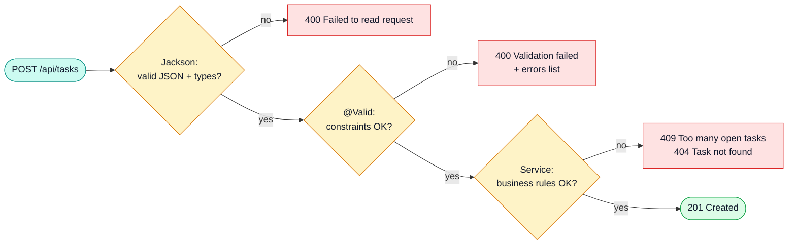
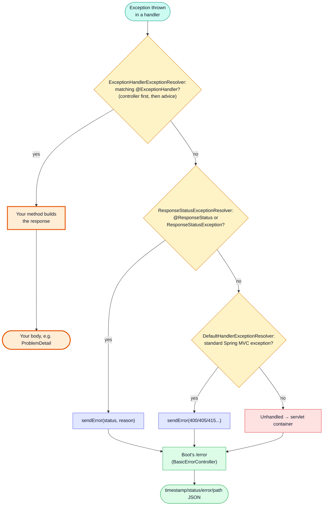
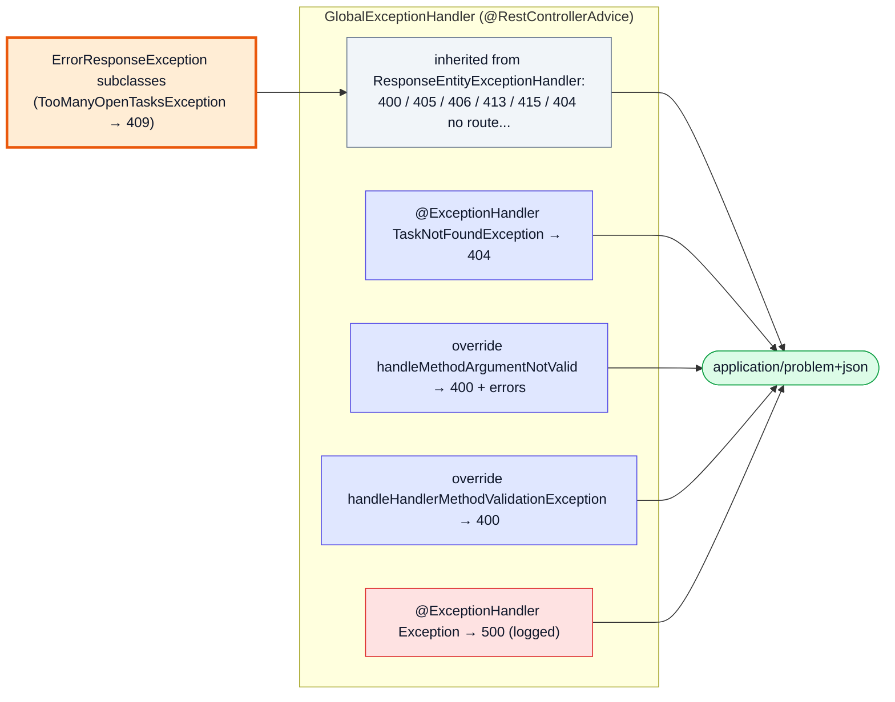

# Validation and Error Handling — Complete In-Depth Guide

**Spring Boot notes #6 of 18** · Priority 🔴 · Track: Spring Boot ([README](README.md))

In [file 05](spring_05_rest_controllers.md) the Task API accepted anything. A blank title, a due date in 2020 or `<script>` in a description all went straight in. Its errors also came in several shapes: Boot's `{"timestamp","status","error","path"}` JSON, empty bodies (406, 413) and text messages. This file fixes both problems:

| Problem in file 05 | Fix in this file |
|---|---|
| Bad data accepted | **Bean Validation**: `@NotBlank`, `@Size`, `@FutureOrPresent`… + `@Valid` |
| No rule for "no HTML in text" | A **custom constraint** `@NoHtml` |
| `GET /api/tasks/0` was just a 404 | Constraints on path variables: `@Min(1)` |
| Every error looks different | One **`@RestControllerAdvice`** that returns **RFC 9457 Problem Details** everywhere |
| Unexpected exceptions leak or look random | A catch-all handler: log the stack trace, return a safe 500 |

> [!NOTE]
> This topic isn't in Kunal's playlist, so there are no video timestamps. The reference playlist's exception-handling video maps here (see the [README](README.md#reference-playlist-where-each-video-is-covered)).
>
> **What was run:** the [Complete Example](#-complete-example-everything-together) is the **Task Tracker, stage 06** ([`examples/06-validation-errors/`](examples/06-validation-errors/)), Spring Boot 4.0.5 with Hibernate Validator 9.0.1 on JDK 21. Every response below comes from real requests: 19 in the main run and 2 in a limit run. JSON is shown pretty-printed by the client.

---

## Table of Contents

| # | Topic (anchor link) | Level |
|---|---|---|
| 0 | [Where Validation Belongs](#0-where-validation-belongs) | Basics |
| 1 | [Bean Validation: The Starter and the Built-in Constraints](#1-bean-validation-the-starter-and-the-built-in-constraints) | Core |
| 2 | [@Valid on Request Bodies](#2-valid-on-request-bodies) | Core |
| 3 | [Validating Path Variables and Query Parameters](#3-validating-path-variables-and-query-parameters) | Core |
| 4 | [Custom Constraints](#4-custom-constraints) | In depth |
| 5 | [Error Messages and messages.properties](#5-error-messages-and-messagesproperties) | Core |
| 6 | [Parse Errors Happen Before Validation](#6-parse-errors-happen-before-validation) | In depth |
| 7 | [How Spring MVC Handles Exceptions](#7-how-spring-mvc-handles-exceptions) | In depth |
| 8 | [@ExceptionHandler and @RestControllerAdvice](#8-exceptionhandler-and-restcontrolleradvice) | Core |
| 9 | [@ResponseStatus vs ResponseStatusException vs ErrorResponseException](#9-responsestatus-vs-responsestatusexception-vs-errorresponseexception) | Core |
| 10 | [Problem Details (RFC 9457) and ResponseEntityExceptionHandler](#10-problem-details-rfc-9457-and-responseentityexceptionhandler) | In depth |
| 11 | [Error-Handling Best Practices](#11-error-handling-best-practices) | Core |
| 12 | [Interview Questions](#12-interview-questions) | Interview |

---

## 0. Where Validation Belongs

**Never trust the client.** Browsers can be bypassed with curl, and a mobile app can be old or modified. Every rule that matters must be checked on the server.

| Layer | Checks | Example | Tool |
|---|---|---|---|
| JSON parsing | Is it valid JSON, with the right types? | `"priority":"URGENT"`, `{bad json` | Jackson ([Section 6](#6-parse-errors-happen-before-validation)) |
| Request DTO | Shape and format of each field | Title not blank, ≤ 60 chars | **Bean Validation** (`@NotBlank`, `@Size`…) |
| Service | Business rules that need state | "max 100 open tasks", "task exists" | Plain Java + domain exceptions |
| Database (file 08) | Last line of defence | `NOT NULL`, `UNIQUE`, foreign keys | Constraints in SQL |



---

## 1. Bean Validation: The Starter and the Built-in Constraints

**Jakarta Bean Validation** (formerly JSR 380, the `javax.validation` API) is a standard: you put constraint annotations on fields, and a validator checks them. **Hibernate Validator** is the reference implementation. Spring Boot wires it in when you add the starter:

```xml
<dependency>                            <!-- Jakarta Bean Validation + Hibernate Validator -->
    <groupId>org.springframework.boot</groupId>
    <artifactId>spring-boot-starter-validation</artifactId>
</dependency>
```

The real jar of this project contains `jakarta.validation-api-3.1.1.jar`, `hibernate-validator-9.0.1.Final.jar` and `tomcat-embed-el-11.0.20.jar` (Expression Language, used to build messages like `{max}`).

> [!WARNING]
> `spring-boot-starter-webmvc` does **not** include validation. Without the validation starter, `@Valid` and `@NotBlank` compile fine (if the API jar is on the classpath) but **nothing is checked**. Always add the starter.

| Constraint (`jakarta.validation.constraints`) | Valid when | `null` is… |
|---|---|---|
| `@NotNull` | Not null | invalid |
| `@NotEmpty` | Not null and length/size > 0 (`String`, collection, map, array) | invalid |
| `@NotBlank` | Not null and has at least one non-whitespace char (`String`) | invalid |
| `@Size(min, max)` | Length/size in range | valid |
| `@Min(n)` / `@Max(n)` | Number ≥ n / ≤ n | valid |
| `@Positive`, `@PositiveOrZero`, `@Negative`… | Sign | valid |
| `@DecimalMin("0.01")`, `@Digits(integer, fraction)` | Decimal rules (money) | valid |
| `@Email` | Looks like an e-mail | valid |
| `@Pattern(regexp = "...")` | Matches the regex | valid |
| `@Past`, `@PastOrPresent`, `@Future`, `@FutureOrPresent` | Date/time relative to now | valid |
| `@AssertTrue` / `@AssertFalse` | Boolean value | valid |

> [!IMPORTANT]
> Almost every constraint treats **`null` as valid**. `@Size(max = 60) String title` accepts a missing title, so combine it with `@NotBlank` or `@NotNull` when the field is required. The PATCH DTO uses this on purpose: `null` there means "don't change".

The real DTOs of this stage:

```java
package com.notes.tasks.dto;

import com.fasterxml.jackson.annotation.JsonInclude;
import com.fasterxml.jackson.annotation.JsonProperty;
import com.notes.tasks.model.Priority;
import com.notes.tasks.model.Task;
import com.notes.tasks.validation.NoHtml;
import jakarta.validation.constraints.FutureOrPresent;
import jakarta.validation.constraints.NotBlank;
import jakarta.validation.constraints.NotNull;
import jakarta.validation.constraints.Size;

import java.time.Instant;
import java.time.LocalDate;

/** All request/response shapes of the Task API, as immutable records. */
public final class TaskDtos {
    private TaskDtos() {}

    /** POST /api/tasks body. The constraints are checked when the controller parameter has @Valid. */
    public record CreateTaskRequest(
            @NotBlank(message = "{task.title.required}")
            @Size(max = 60, message = "{task.title.size}")
            @NoHtml
            String title,

            @Size(max = 500)
            @NoHtml
            String description,

            Priority priority,                       // optional: MEDIUM by default

            @FutureOrPresent(message = "must be today or later")
            LocalDate dueDate) {}

    /** PUT /api/tasks/{id} body: the WHOLE new state, so more fields are required. */
    public record ReplaceTaskRequest(
            @NotBlank @Size(max = 60) @NoHtml String title,
            @Size(max = 500) @NoHtml String description,
            @NotNull Priority priority,
            boolean done,
            LocalDate dueDate) {}

    /** PATCH /api/tasks/{id} body: null means "leave unchanged", so nothing is @NotNull. */
    public record PatchTaskRequest(
            @Size(min = 1, max = 60) @NoHtml String title,
            @Size(max = 500) @NoHtml String description,
            Priority priority,
            Boolean done,
            LocalDate dueDate) {}

    /** Version 1 response. */
    @JsonInclude(JsonInclude.Include.NON_NULL)           // omit null fields (e.g. no description)
    public record TaskResponse(long id, String title, String description, Priority priority,
                               boolean done, LocalDate dueDate, Instant createdAt) {
        public static TaskResponse from(Task t) {
            return new TaskResponse(t.getId(), t.getTitle(), t.getDescription(), t.getPriority(),
                    t.isDone(), t.getDueDate(), t.getCreatedAt());
        }
    }

    /** Version 2 response: "status" text instead of a boolean, renamed JSON field. */
    public record TaskResponseV2(long id, String title, String status, Priority priority,
                                 @JsonProperty("due") LocalDate dueDate) {
        public static TaskResponseV2 from(Task t) {
            return new TaskResponseV2(t.getId(), t.getTitle(), t.isDone() ? "DONE" : "OPEN",
                    t.getPriority(), t.getDueDate());
        }
    }

    public record AttachmentInfo(long taskId, String fileName, String contentType, long sizeBytes, int lines) {}
}
```

| Choice | Why |
|---|---|
| Constraints on **record components** | They apply to the generated fields and constructor parameters, and Hibernate Validator validates records |
| Create: `@NotBlank` title | Required |
| Replace (PUT): also `@NotNull priority` | PUT sends the whole state |
| Patch: `@Size(min = 1, max = 60)` without `@NotBlank` | `null` = unchanged is fine, but `""` is rejected |

---

## 2. @Valid on Request Bodies

Constraints do nothing until something triggers validation. In a controller that's **`@Valid`** (or Spring's `@Validated`) next to `@RequestBody`:

```java
public ResponseEntity<TaskResponse> create(@Valid @RequestBody CreateTaskRequest body,
```

What happens on invalid input:

1. Jackson builds the record.
2. The validator checks every constraint and collects **all** violations (not just the first).
3. Spring throws **`MethodArgumentNotValidException`** *before* your method runs.
4. An exception handler turns it into a response ([Section 10](#10-problem-details-rfc-9457-and-responseentityexceptionhandler)).

Real result (summarised here; the full JSON is in the [Complete Example](#-complete-example-everything-together)): one request with three problems returns all three.

```
> POST /api/tasks  {"title": "   ", "description": "<script>alert(1)</script>", "dueDate": "2020-01-01"}
< 400  [application/problem+json]
"title": "Validation failed", "detail": "3 field(s) are invalid",
"errors": [ description: must not contain HTML tags · dueDate: must be today or later · title: a task needs a title ]
```

| Feature | How |
|---|---|
| Validate a nested object | Put `@Valid` on the field: `@Valid Address address` |
| Validate list elements | `List<@Valid ItemRequest> items` or `List<@NotBlank String> tags` |
| Get errors yourself instead of an exception | Add a `BindingResult` parameter right after the `@Valid` one (more common in HTML form apps) |
| Validation groups | `@NotNull(groups = OnUpdate.class)` + `@Validated(OnUpdate.class)`. Separate DTOs per operation, as done here, are usually clearer |

> [!TIP]
> `@Valid` (Jakarta) and `@Validated` (Spring) both trigger validation on a parameter. Only `@Validated` accepts **groups**. On a **class**, `@Validated` turns on method validation for a service bean, via an AOP proxy (file 13).

---

## 3. Validating Path Variables and Query Parameters

Since Spring 6.1, Spring MVC validates constraint annotations on **`@PathVariable`, `@RequestParam` and `@RequestHeader`** parameters by itself. The class does **not** need `@Validated`, which older tutorials required.

```java
public TaskResponse getV1(@PathVariable @Min(1) long id) {
```

Real result:

```
> GET /api/tasks/0
< 400  [application/problem+json]
"detail": "Validation failure", "title": "Validation failed", "errors": ["id: must be greater than or equal to 1"]
```

| Parameter kind | Exception on failure | Handler hook in `ResponseEntityExceptionHandler` |
|---|---|---|
| `@Valid @RequestBody` | `MethodArgumentNotValidException` | `handleMethodArgumentNotValid` |
| `@Min`/`@Size`… on `@PathVariable`/`@RequestParam` | `HandlerMethodValidationException` | `handleHandlerMethodValidationException` |
| Wrong **type** (`/api/tasks/abc`) | `MethodArgumentTypeMismatchException` (before validation) | `handleTypeMismatch` → `"Failed to convert 'id' with value: 'abc'"` |

---

## 4. Custom Constraints

When no built-in constraint fits, write one: an annotation plus a `ConstraintValidator`.

```java
package com.notes.tasks.validation;

import jakarta.validation.Constraint;
import jakarta.validation.Payload;

import java.lang.annotation.ElementType;
import java.lang.annotation.Retention;
import java.lang.annotation.RetentionPolicy;
import java.lang.annotation.Target;

/** A custom constraint: the text must not contain HTML tags (a first defence against stored XSS, file 11). */
@Target({ElementType.FIELD, ElementType.PARAMETER, ElementType.RECORD_COMPONENT})
@Retention(RetentionPolicy.RUNTIME)
@Constraint(validatedBy = NoHtmlValidator.class)        // the class that does the check
public @interface NoHtml {
    String message() default "must not contain HTML tags";
    Class<?>[] groups() default {};                      // required by the spec
    Class<? extends Payload>[] payload() default {};     // required by the spec
}
```

```java
package com.notes.tasks.validation;

import jakarta.validation.ConstraintValidator;
import jakarta.validation.ConstraintValidatorContext;

import java.util.regex.Pattern;

public class NoHtmlValidator implements ConstraintValidator<NoHtml, String> {
    private static final Pattern TAG = Pattern.compile("<\\s*/?\\s*[a-zA-Z][^>]*>");

    @Override
    public boolean isValid(String value, ConstraintValidatorContext context) {
        return value == null || !TAG.matcher(value).find();   // null is "valid": combine with @NotBlank
    }
}
```

| Part | Rule |
|---|---|
| `@Constraint(validatedBy = ...)` | Links the annotation to its validator |
| `message`, `groups`, `payload` | **Required** by the spec; the build doesn't catch missing ones, the validator fails at runtime |
| `@Retention(RUNTIME)` | So the validator can find it by reflection (same as file 05's `@AuditLog`) |
| `ConstraintValidator<NoHtml, String>` | Annotation type + the type of value it checks |
| Return `true` for `null` | The convention, so `@NoHtml` stays combinable with `@NotNull`/`@NotBlank` |
| Validators are created by Spring | You can inject beans into a validator's constructor (e.g. a repository for "username not taken") |

> [!TIP]
> **Cross-field rules** (e.g. "`endDate` after `startDate`") use a **class-level** constraint: `@Target(TYPE)` on the annotation, put it on the record, and `ConstraintValidator<ValidRange, BookingRequest>` gets the whole object. Rules that need the database usually belong in the **service**, so the validator doesn't hide queries.

> [!CAUTION]
> `@NoHtml` is a first, simple defence. Real XSS protection means **escaping output** where HTML is rendered, plus a Content-Security-Policy (file 11). Never rely on a regex alone.

---

## 5. Error Messages and messages.properties

Every constraint has a default message (`must not be null`, `size must be between 1 and 60`). There are three ways to change it:

| Way | Example | Real output |
|---|---|---|
| Default | `@Size(min = 1, max = 60)` on PATCH title | `size must be between 1 and 60` |
| Inline text | `@FutureOrPresent(message = "must be today or later")` | `must be today or later` |
| Key in `{...}` | `@NotBlank(message = "{task.title.required}")` | `a task needs a title` |
| Key + attribute | `@Size(max = 60, message = "{task.title.size}")` | `title must be at most 60 characters` |

```properties
# Messages for {key} placeholders in constraint annotations (Boot's MessageSource reads this file)
task.title.required=a task needs a title
task.title.size=title must be at most {max} characters
```

Boot creates a `MessageSource` from `src/main/resources/messages.properties` and gives it to the validator, so `{task.title.size}` is looked up there and `{max}` is filled from the annotation. That was **tested**: the messages above came back in real responses. For other languages the same mechanism looks for `messages_<lang>.properties` based on the request locale (not run here).

---

## 6. Parse Errors Happen Before Validation

Jackson must build the object **before** any constraint can be checked. When the JSON can't become the record, you get **`HttpMessageNotReadableException`**, and none of your constraint messages appear.

| Body | Fails in | Real response |
|---|---|---|
| `{bad json` | Jackson | 400 `"detail": "Failed to read request"` |
| `"priority":"URGENT"` | Jackson (enum) | 400 (file 05 showed the full message) |
| PUT without `done` (a primitive `boolean`) | **Jackson** | 400 `Failed to read request`; in the DEBUG log: `Cannot map null into type boolean (set DeserializationFeature.FAIL_ON_NULL_FOR_PRIMITIVES to 'false' to allow)` |
| PUT without `priority` (an object) | Validation (`@NotNull`) | 400 `priority: must not be null` |

> [!IMPORTANT]
> **Jackson 3 fails on a missing primitive.** The PUT DTO's `boolean done` can't be omitted: Jackson 3 has `FAIL_ON_NULL_FOR_PRIMITIVES` on, so a missing `done` is a parse error, not `false`. Use a wrapper (`Boolean`) + `@NotNull` when you want a clear validation message, or a primitive when "required" is enough.

> [!TIP]
> "Failed to read request" is deliberately vague: Spring doesn't echo parser internals to clients. Run with `--logging.level.org.springframework.web=DEBUG` to see the real cause in the log, which is how the `boolean` problem above was found.

---

## 7. How Spring MVC Handles Exceptions

When a controller (or anything before it, like argument resolution) throws, the `DispatcherServlet` asks its **`HandlerExceptionResolver`s** in order. The first one that returns a result wins.



That's why file 05's errors looked the way they did: `@ResponseStatus` and `DefaultHandlerExceptionResolver` call `sendError`, and Boot's `/error` endpoint renders `{"timestamp","status","error","path"}`. In this stage the advice's `@ExceptionHandler` methods (including the ones inherited from `ResponseEntityExceptionHandler`) answer first, so every response is a ProblemDetail.

---

## 8. @ExceptionHandler and @RestControllerAdvice

`@ExceptionHandler(X.class)` marks a method that handles exception `X` (and subclasses).

| Where | Scope |
|---|---|
| Inside a controller | Only that controller's exceptions; checked **before** any advice |
| In a `@ControllerAdvice` class | All controllers (global) |
| `@RestControllerAdvice` | `@ControllerAdvice` + `@ResponseBody`: return values become the body |
| `@RestControllerAdvice(basePackages = "com.notes.tasks.web")` / `assignableTypes = ...` | Only some controllers |

The handler of this stage, in full:

```java
package com.notes.tasks.web;

import com.notes.tasks.service.TaskNotFoundException;
import jakarta.servlet.http.HttpServletRequest;
import org.slf4j.Logger;
import org.slf4j.LoggerFactory;
import org.springframework.http.HttpHeaders;
import org.springframework.http.HttpStatus;
import org.springframework.http.HttpStatusCode;
import org.springframework.http.ProblemDetail;
import org.springframework.http.ResponseEntity;
import org.springframework.validation.FieldError;
import org.springframework.web.bind.MethodArgumentNotValidException;
import org.springframework.web.bind.annotation.ExceptionHandler;
import org.springframework.web.bind.annotation.RestControllerAdvice;
import org.springframework.web.context.request.WebRequest;
import org.springframework.web.method.annotation.HandlerMethodValidationException;
import org.springframework.web.servlet.mvc.method.annotation.ResponseEntityExceptionHandler;

import java.net.URI;
import java.util.LinkedHashMap;
import java.util.List;
import java.util.Map;

/**
 * One place that turns exceptions into RFC 9457 "Problem Details" JSON for every controller.
 * Extending ResponseEntityExceptionHandler gives ProblemDetail responses for all of Spring MVC's
 * own exceptions (400 bad JSON, 405, 415, 404 no route, 413...) for free.
 */
@RestControllerAdvice
public class GlobalExceptionHandler extends ResponseEntityExceptionHandler {
    private static final Logger log = LoggerFactory.getLogger(GlobalExceptionHandler.class);

    // 1. Our domain exception -> 404
    @ExceptionHandler(TaskNotFoundException.class)
    public ProblemDetail handleNotFound(TaskNotFoundException ex) {
        ProblemDetail pd = ProblemDetail.forStatusAndDetail(HttpStatus.NOT_FOUND, ex.getMessage());
        pd.setType(URI.create("https://notes.example/problems/task-not-found"));
        pd.setTitle("Task not found");
        pd.setProperty("taskId", ex.getTaskId());
        return pd;
    }

    // 2. @Valid @RequestBody failed -> 400 with one entry per invalid field
    @Override
    protected ResponseEntity<Object> handleMethodArgumentNotValid(MethodArgumentNotValidException ex,
            HttpHeaders headers, HttpStatusCode status, WebRequest request) {
        ProblemDetail pd = ex.getBody();                         // Spring already built a 400 ProblemDetail
        pd.setTitle("Validation failed");
        pd.setDetail(ex.getErrorCount() + " field(s) are invalid");
        List<Map<String, Object>> errors = ex.getBindingResult().getFieldErrors().stream()
                .sorted((a, b) -> a.getField().compareTo(b.getField()))
                .map(GlobalExceptionHandler::toMap)
                .toList();
        pd.setProperty("errors", errors);
        return handleExceptionInternal(ex, pd, headers, status, request);
    }

    // 3. Constraint on a @PathVariable / @RequestParam failed (built-in method validation) -> 400
    @Override
    protected ResponseEntity<Object> handleHandlerMethodValidationException(HandlerMethodValidationException ex,
            HttpHeaders headers, HttpStatusCode status, WebRequest request) {
        ProblemDetail pd = ex.getBody();
        pd.setTitle("Validation failed");
        List<String> errors = ex.getParameterValidationResults().stream()
                .flatMap(r -> r.getResolvableErrors().stream()
                        .map(e -> r.getMethodParameter().getParameterName() + ": " + e.getDefaultMessage()))
                .toList();
        pd.setProperty("errors", errors);
        return handleExceptionInternal(ex, pd, headers, status, request);
    }

    // 4. Anything unexpected -> 500, WITHOUT leaking the internal message to the client
    @ExceptionHandler(Exception.class)
    public ProblemDetail handleUnexpected(Exception ex, HttpServletRequest req) {
        log.error("Unexpected error on {} {}", req.getMethod(), req.getRequestURI(), ex);
        ProblemDetail pd = ProblemDetail.forStatusAndDetail(HttpStatus.INTERNAL_SERVER_ERROR,
                "Something went wrong. It has been logged.");
        pd.setTitle("Internal error");
        return pd;
    }

    private static Map<String, Object> toMap(FieldError fe) {
        Map<String, Object> m = new LinkedHashMap<>();         // keeps this key order in the JSON
        m.put("field", fe.getField());
        m.put("message", fe.getDefaultMessage());
        m.put("rejected", fe.getRejectedValue());
        return m;
    }
}
```

| Rule | Detail |
|---|---|
| The most specific type wins | `TaskNotFoundException` beats `Exception`; the catch-all only gets what nothing else matches |
| Handler parameters | The exception, `HttpServletRequest`, `WebRequest`, `Locale`… injected by type |
| Return types | `ProblemDetail`, `ResponseEntity<...>`, any object, or `void` with `@ResponseStatus` |
| Several advices | Order them with `@Order`; the first matching one wins |
| Domain exceptions stay HTTP-free | `TaskNotFoundException` has no annotations; the web layer decides it means 404 |

```java
package com.notes.tasks.service;

/** A plain domain exception: no HTTP knowledge. The web layer's GlobalExceptionHandler maps it to 404. */
public class TaskNotFoundException extends RuntimeException {
    private final long taskId;

    public TaskNotFoundException(long taskId) {
        super("Task " + taskId + " does not exist");
        this.taskId = taskId;
    }

    public long getTaskId() { return taskId; }
}
```

Real responses:

```
> GET /api/tasks/42
< 404  [application/problem+json]
{"detail": "Task 42 does not exist", "instance": "/api/tasks/42", "status": 404,
 "title": "Task not found", "type": "https://notes.example/problems/task-not-found", "taskId": 42}

> GET /api/tasks/stats          (no tasks yet → done * 100 / 0)
< 500  [application/problem+json]
{"detail": "Something went wrong. It has been logged.", "instance": "/api/tasks/stats", "status": 500, "title": "Internal error"}
LOG ERROR ... GlobalExceptionHandler : Unexpected error on GET /api/tasks/stats
LOG java.lang.ArithmeticException: / by zero
```

The client sees a safe message. The developer sees the real exception and stack trace in the log.

---

## 9. @ResponseStatus vs ResponseStatusException vs ErrorResponseException

| Option | Code | Good for | Downside |
|---|---|---|---|
| `@ResponseStatus(NOT_FOUND)` on an exception class | file 05's `TaskNotFoundException` | Quick, fixed status | Couples a domain class to HTTP; body is Boot's generic error JSON |
| `throw new ResponseStatusException(CONFLICT, "msg")` | file 05's 409 | One-off errors without a new class | Thrown from services, it couples them to HTTP; hard to handle selectively |
| **Subclass `ErrorResponseException`** | `TooManyOpenTasksException` | Exception that **carries its own ProblemDetail**: Spring renders it, no handler needed | Still an HTTP-aware exception (fine in the web layer or an "API exceptions" package) |
| Domain exception + `@ExceptionHandler` | `TaskNotFoundException` | **Cleanest layering**: domain code knows nothing about HTTP | One handler method per exception |

```java
package com.notes.tasks.service;

import org.springframework.http.HttpStatus;
import org.springframework.http.ProblemDetail;
import org.springframework.web.ErrorResponseException;

import java.net.URI;

/**
 * An exception that carries its own ProblemDetail: Spring MVC renders ErrorResponseException
 * subclasses as RFC 9457 responses without any handler method.
 */
public class TooManyOpenTasksException extends ErrorResponseException {

    public TooManyOpenTasksException(int max) {
        super(HttpStatus.CONFLICT, problem(max), null);
    }

    private static ProblemDetail problem(int max) {
        ProblemDetail pd = ProblemDetail.forStatusAndDetail(HttpStatus.CONFLICT,
                "You already have " + max + " open tasks. Finish one first.");
        pd.setType(URI.create("https://notes.example/problems/too-many-open-tasks"));
        pd.setTitle("Too many open tasks");
        pd.setProperty("maxOpenTasks", max);
        return pd;
    }
}
```

Real result (started with `--tasks.max-open-tasks=1`, second POST):

```
< 409  [application/problem+json]
{"detail": "You already have 1 open tasks. Finish one first.", "instance": "/api/tasks", "status": 409,
 "title": "Too many open tasks", "type": "https://notes.example/problems/too-many-open-tasks", "maxOpenTasks": 1}
```

> [!NOTE]
> `ResponseStatusException` also extends `ErrorResponseException`. With a `ResponseEntityExceptionHandler` advice it's rendered as a ProblemDetail too, so its message goes into `detail`.

---

## 10. Problem Details (RFC 9457) and ResponseEntityExceptionHandler

**RFC 9457** (which replaced RFC 7807) is the standard JSON format for HTTP API errors, with media type **`application/problem+json`**. [File 02](spring_02_http_rest_basics.md) introduced it. Spring has the `ProblemDetail` class for it.

| Field | Meaning | Spring |
|---|---|---|
| `type` | URI identifying the **kind** of problem (docs can live there); default `about:blank` | `setType(URI)` |
| `title` | Short, human-readable summary of the type | `setTitle` |
| `status` | The HTTP status | set by `forStatus...` |
| `detail` | Explanation of **this** occurrence | `forStatusAndDetail(status, detail)` |
| `instance` | URI of this occurrence | Spring fills in the request path |
| Extensions | Any extra fields | `setProperty("taskId", 42)` → `"taskId": 42` at the top level |

**`ResponseEntityExceptionHandler`** is a base class with an `@ExceptionHandler` for ~20 standard Spring MVC exceptions. Extending it in your advice gives ProblemDetail responses for all of them, plus `protected` hooks to customise each. Real results from this stage, with no code of ours for these cases:

| Request | Status | `detail` |
|---|---|---|
| `GET /api/tasks/abc` | 400 | `Failed to convert 'id' with value: 'abc'` |
| `{bad json` | 400 | `Failed to read request` |
| `DELETE /api/tasks` | 405 + `Allow: GET, POST` | `Method 'DELETE' is not supported.` |
| `Content-Type: text/plain` | 415 | `Content-Type 'text/plain;charset=UTF-8' is not supported.` |
| `GET /nope` | 404 | `No static resource nope.` |
| 150 KB upload | 413 | `Maximum upload size exceeded` (file 05 got an **empty** 413 body) |
| `API-Version: 9` | 400 | `Invalid API version: '9.0.0'.` |

> [!TIP]
> No custom advice at all? Set **`spring.mvc.problemdetails.enabled: true`** (default `false`, checked in the Boot 4.0.5 metadata). Boot then registers a `ResponseEntityExceptionHandler` advice for you. Once you write your own advice that extends it, as here, you don't need the property.



---

## 11. Error-Handling Best Practices

| Do | Don't |
|---|---|
| One error format for the whole API (ProblemDetail) | Mix Boot's default JSON, empty bodies and plain text |
| Return **all** field errors at once | Make the user fix one field per request |
| Stable `type` URIs or error codes clients can switch on | Make clients parse `detail` text |
| Log 5xx with the stack trace at ERROR | Log expected 4xx at ERROR (noise); WARN or DEBUG is enough |
| Send a generic message for 5xx | Return `ex.getMessage()` or stack traces to clients (they leak SQL, paths, versions) |
| Keep domain exceptions free of HTTP | Throw `ResponseStatusException` from deep inside services |
| Validate at the edge (DTOs), enforce invariants in the service and the DB | Rely on only one layer |
| Use 400 for bad input, 404 for missing, 409 for state conflicts, 422 if your team prefers it for semantic errors | Return 200 with `{"success": false}` |

> [!WARNING]
> In file 05, `spring.web.error.include-message: always` exposed exception messages through Boot's error JSON. That's handy while learning but risky in production. This stage removed it: messages are now chosen deliberately per handler.

---

## 12. Interview Questions

| Question | Answer |
|---|---|
| How do you validate a request body in Spring Boot? | Add `spring-boot-starter-validation`, put constraints on the DTO, and annotate the parameter with `@Valid @RequestBody`. Failures throw `MethodArgumentNotValidException` → 400. |
| `@NotNull` vs `@NotEmpty` vs `@NotBlank`? | Not null / not null and not empty / not null and contains a non-whitespace character (strings only). |
| `@Valid` vs `@Validated`? | `@Valid` is Jakarta's and supports cascading to nested objects. `@Validated` is Spring's, supports groups, and on a class enables method validation through a proxy. |
| How do you validate a `@PathVariable`? | Put the constraint on the parameter (`@Min(1)`). Spring 6.1+ validates it built-in and throws `HandlerMethodValidationException`; older versions needed `@Validated` on the class (`ConstraintViolationException`). |
| How do you write a custom constraint? | An annotation with `@Constraint(validatedBy = ...)`, `message`/`groups`/`payload`, and a `ConstraintValidator<A, T>` implementation. |
| How do you validate across fields? | A class-level constraint whose validator receives the whole object. |
| What is `@ControllerAdvice`? | A component whose `@ExceptionHandler` (and `@InitBinder`/`@ModelAttribute`) methods apply to all or selected controllers. `@RestControllerAdvice` adds `@ResponseBody`. |
| Local vs global `@ExceptionHandler`, which wins? | The controller's own handler is checked first, then advices in order; within one, the closest exception type wins. |
| What is ProblemDetail? | Spring's model of RFC 9457 Problem Details: `type`, `title`, `status`, `detail`, `instance` + extension properties, served as `application/problem+json`. |
| What does `ResponseEntityExceptionHandler` give you? | Handlers for the standard Spring MVC exceptions that return ProblemDetail, with overridable `handleXxx` hooks. |
| `@ResponseStatus` vs `ResponseStatusException`? | The annotation fixes a status on an exception class; the exception is thrown ad hoc with a status and reason. Both go through `ResponseStatusExceptionResolver` unless an advice handles them. |
| How do you avoid leaking internals in errors? | A catch-all handler that logs the exception and returns a generic 500; never send stack traces or raw messages. |
| Why does a type error not reach validation? | Conversion and JSON parsing happen first; failures there are `MethodArgumentTypeMismatchException` / `HttpMessageNotReadableException`. |

---

## 🧩 Complete Example: Everything Together

**Task Tracker, stage 06.** It's stage 05 plus:

- the validation starter
- constraints on all request DTOs, with custom messages from `messages.properties`
- `@Min(1)` on the id path variable
- the custom `@NoHtml` constraint
- a domain `TaskNotFoundException` without HTTP annotations
- an `ErrorResponseException` subclass for the 409
- a `GlobalExceptionHandler` that makes **every** error a ProblemDetail
- a deliberately buggy `/api/tasks/stats` endpoint to show the safe 500

Source: [`examples/06-validation-errors/`](examples/06-validation-errors/)

```
06-validation-errors/
├── pom.xml                                  (+ spring-boot-starter-validation)
└── src/main/
    ├── java/com/notes/tasks/
    │   ├── dto/TaskDtos.java                (constraints)
    │   ├── validation/NoHtml.java, NoHtmlValidator.java
    │   ├── service/TaskService.java, TaskNotFoundException.java, TooManyOpenTasksException.java
    │   ├── web/GlobalExceptionHandler.java  (new)
    │   ├── web/TaskController.java          (@Valid, @Min, /stats)
    │   └── ... unchanged from file 05: model/, config/, filter, interceptor, HAL controller
    └── resources/
        ├── application.yml                  (spring.web.error.include-message removed)
        └── messages.properties              (new)
```

`TaskDtos`, `NoHtml`, `NoHtmlValidator`, `messages.properties`, `GlobalExceptionHandler`, `TaskNotFoundException` and `TooManyOpenTasksException` are shown in full above. The rest of the changes:

**`pom.xml`** (only the new dependency differs from file 05, plus version `0.6.0`):

```xml
<dependency>                            <!-- Jakarta Bean Validation + Hibernate Validator -->
    <groupId>org.springframework.boot</groupId>
    <artifactId>spring-boot-starter-validation</artifactId>
</dependency>
```

**`service/TaskService.java`**:

```java
package com.notes.tasks.service;

import com.notes.tasks.config.TaskTrackerProperties;
import com.notes.tasks.dto.TaskDtos.CreateTaskRequest;
import com.notes.tasks.dto.TaskDtos.PatchTaskRequest;
import com.notes.tasks.dto.TaskDtos.ReplaceTaskRequest;
import com.notes.tasks.model.Priority;
import com.notes.tasks.model.Task;
import org.springframework.stereotype.Service;

import java.time.Clock;
import java.time.Instant;
import java.util.List;
import java.util.Map;
import java.util.concurrent.ConcurrentSkipListMap;
import java.util.concurrent.atomic.AtomicLong;

/** Business logic. Stores tasks in memory for now; file 08 swaps this for PostgreSQL. */
@Service
public class TaskService {
    private final Map<Long, Task> tasks = new ConcurrentSkipListMap<>();
    private final AtomicLong ids = new AtomicLong(1);
    private final Clock clock;
    private final TaskTrackerProperties props;

    public TaskService(Clock clock, TaskTrackerProperties props) {
        this.clock = clock;
        this.props = props;
    }

    public List<Task> findAll(Boolean done, Priority priority) {
        return tasks.values().stream()
                .filter(t -> done == null || t.isDone() == done)
                .filter(t -> priority == null || t.getPriority() == priority)
                .toList();
    }

    public Task get(long id) {
        Task t = tasks.get(id);
        if (t == null) throw new TaskNotFoundException(id);
        return t;
    }

    public Task create(CreateTaskRequest req) {
        long open = tasks.values().stream().filter(t -> !t.isDone()).count();
        if (open >= props.maxOpenTasks()) {
            throw new TooManyOpenTasksException(props.maxOpenTasks());
        }
        Task t = Task.builder()
                .id(ids.getAndIncrement())
                .title(req.title())
                .description(req.description())
                .priority(req.priority() == null ? Priority.MEDIUM : req.priority())
                .dueDate(req.dueDate())
                .createdAt(Instant.now(clock))
                .internalNotes("created via API")
                .build();
        tasks.put(t.getId(), t);
        return t;
    }

    public Task replace(long id, ReplaceTaskRequest req) {
        Task t = get(id);
        t.setTitle(req.title());
        t.setDescription(req.description());
        t.setPriority(req.priority() == null ? Priority.MEDIUM : req.priority());
        t.setDone(req.done());
        t.setDueDate(req.dueDate());
        return t;
    }

    public Task patch(long id, PatchTaskRequest req) {
        Task t = get(id);
        if (req.title() != null) t.setTitle(req.title());
        if (req.description() != null) t.setDescription(req.description());
        if (req.priority() != null) t.setPriority(req.priority());
        if (req.done() != null) t.setDone(req.done());
        if (req.dueDate() != null) t.setDueDate(req.dueDate());
        return t;
    }

    /** Percentage of tasks that are done. BUG on purpose: divides by zero when there are no tasks. */
    public int percentDone() {
        long done = tasks.values().stream().filter(Task::isDone).count();
        return (int) (done * 100 / tasks.size());
    }

    public void delete(long id) {
        if (tasks.remove(id) == null) throw new TaskNotFoundException(id);
    }
}
```

**`web/TaskController.java`**:

```java
package com.notes.tasks.web;

import com.notes.tasks.dto.TaskDtos.AttachmentInfo;
import com.notes.tasks.dto.TaskDtos.CreateTaskRequest;
import com.notes.tasks.dto.TaskDtos.PatchTaskRequest;
import com.notes.tasks.dto.TaskDtos.ReplaceTaskRequest;
import com.notes.tasks.dto.TaskDtos.TaskResponse;
import com.notes.tasks.dto.TaskDtos.TaskResponseV2;
import com.notes.tasks.model.Priority;
import com.notes.tasks.model.Task;
import com.notes.tasks.service.TaskService;
import jakarta.validation.Valid;
import jakarta.validation.constraints.Min;
import org.springframework.http.MediaType;
import org.springframework.http.ResponseEntity;
import org.springframework.web.bind.annotation.DeleteMapping;
import org.springframework.web.bind.annotation.GetMapping;
import org.springframework.web.bind.annotation.PatchMapping;
import org.springframework.web.bind.annotation.PathVariable;
import org.springframework.web.bind.annotation.PostMapping;
import org.springframework.web.bind.annotation.PutMapping;
import org.springframework.web.bind.annotation.RequestBody;
import org.springframework.web.bind.annotation.RequestHeader;
import org.springframework.web.bind.annotation.RequestMapping;
import org.springframework.web.bind.annotation.RequestParam;
import org.springframework.web.bind.annotation.RequestPart;
import org.springframework.web.bind.annotation.RestController;
import org.springframework.web.multipart.MultipartFile;
import org.springframework.web.servlet.support.ServletUriComponentsBuilder;

import java.io.IOException;
import java.net.URI;
import java.nio.charset.StandardCharsets;
import java.util.List;
import java.util.Map;

@RestController                         // = @Controller + @ResponseBody on every method
@RequestMapping("/api/tasks")           // common prefix for every method below
public class TaskController {
    private final TaskService service;
    private final RequestInfo requestInfo;              // request-scoped bean (a proxy)

    public TaskController(TaskService service, RequestInfo requestInfo) {
        this.service = service;
        this.requestInfo = requestInfo;
    }

    // GET /api/tasks?done=false&priority=HIGH  (both optional)
    @GetMapping
    @AuditLog("list tasks")
    public List<TaskResponse> list(@RequestParam(required = false) Boolean done,
                                   @RequestParam(required = false) Priority priority) {
        return service.findAll(done, priority).stream().map(TaskResponse::from).toList();
    }

    // GET /api/tasks/7 with header "API-Version: 1" (or no header: 1 is the default)
    @GetMapping(path = "/{id}", version = "1")
    public TaskResponse getV1(@PathVariable @Min(1) long id) {
        return TaskResponse.from(service.get(id));
    }

    // GET /api/tasks/7 with header "API-Version: 2"
    @GetMapping(path = "/{id}", version = "2")
    public TaskResponseV2 getV2(@PathVariable @Min(1) long id) {
        return TaskResponseV2.from(service.get(id));
    }

    // POST /api/tasks  -> 201 Created + Location header + body
    @PostMapping
    @AuditLog("create task")
    public ResponseEntity<TaskResponse> create(@Valid @RequestBody CreateTaskRequest body,
                                               @RequestHeader(name = "X-Client", defaultValue = "unknown") String client) {
        Task created = service.create(body);
        URI location = ServletUriComponentsBuilder.fromCurrentRequest()
                .path("/{id}").buildAndExpand(created.getId()).toUri();
        return ResponseEntity.created(location)
                .header("X-Created-By", client)
                .header("X-Request-Number", String.valueOf(requestInfo.number()))
                .body(TaskResponse.from(created));
    }

    // GET /api/tasks/stats  -> {"percentDone": 50}; 500 when there are no tasks (deliberate bug)
    @GetMapping("/stats")
    public Map<String, Integer> stats() {
        return Map.of("percentDone", service.percentDone());
    }

    // PUT /api/tasks/7  -> replace everything
    @PutMapping("/{id}")
    public TaskResponse replace(@PathVariable long id, @Valid @RequestBody ReplaceTaskRequest body) {
        return TaskResponse.from(service.replace(id, body));
    }

    // PATCH /api/tasks/7  -> change only the fields sent
    @PatchMapping("/{id}")
    public TaskResponse patch(@PathVariable long id, @Valid @RequestBody PatchTaskRequest body) {
        return TaskResponse.from(service.patch(id, body));
    }

    // DELETE /api/tasks/7  -> 204 No Content
    @DeleteMapping("/{id}")
    @AuditLog("delete task")
    public ResponseEntity<Void> delete(@PathVariable long id) {
        service.delete(id);
        return ResponseEntity.noContent().build();
    }

    // POST /api/tasks/7/attachment  (multipart/form-data, part name "file")
    @PostMapping(path = "/{id}/attachment", consumes = MediaType.MULTIPART_FORM_DATA_VALUE)
    public AttachmentInfo upload(@PathVariable long id, @RequestPart("file") MultipartFile file) throws IOException {
        service.get(id);                                     // 404 if the task doesn't exist
        String text = new String(file.getBytes(), StandardCharsets.UTF_8);
        return new AttachmentInfo(id, file.getOriginalFilename(), file.getContentType(),
                file.getSize(), (int) text.lines().count());
    }
}
```

**`application.yml`**:

```yaml
spring:
  application:
    name: task-tracker
  main:
    banner-mode: off
  mvc:
    apiversion:
      use:
        header: API-Version        # read the version from this request header
      default: "1"                 # no header -> version 1
      supported: "1,2"
  servlet:
    multipart:
      max-file-size: 100KB         # default is 1MB; bigger uploads are rejected

server:
  port: 8080

tasks:
  max-open-tasks: 100
  fixed-clock: 2026-11-16T09:00:00Z   # predictable createdAt for the notes; remove for real time

logging:
  level:
    root: WARN
    com.notes: INFO
    org.springframework.boot.tomcat: INFO
```

### Run it

```bash
cd "Spring Boot Notes/examples/06-validation-errors"
./mvnw package
java -jar target/task-tracker-0.6.0.jar
```

```bash
curl -i -X POST localhost:8080/api/tasks -H "Content-Type: application/json" -d '{"title":"   ","dueDate":"2020-01-01"}'
curl -i localhost:8080/api/tasks/0
curl -i localhost:8080/api/tasks/42
```

(Run from Git Bash; for Windows PowerShell 5.1 JSON quoting, see [file 05](spring_05_rest_controllers.md#run-it).)

**Expected Output** (main run, 19 requests in order; filter/interceptor lines from file 05 are left out, the error log lines are kept):

```
> GET /api/tasks/stats
< 500  [application/problem+json]
{
  "detail": "Something went wrong. It has been logged.",
  "instance": "/api/tasks/stats",
  "status": 500,
  "title": "Internal error"
}
  LOG 2026-11-16T22:42:32.972+05:30 ERROR 10724 --- [task-tracker] [nio-8080-exec-1] c.n.tasks.web.GlobalExceptionHandler     : Unexpected error on GET /api/tasks/stats
  LOG java.lang.ArithmeticException: / by zero

> POST /api/tasks
  {"title": "Learn validation", "priority": "HIGH", "dueDate": "2026-12-01"}
< 201  Location: http://localhost:8080/api/tasks/1  [application/json]
{
  "id": 1,
  "title": "Learn validation",
  "priority": "HIGH",
  "done": false,
  "dueDate": "2026-12-01",
  "createdAt": "2026-11-16T09:00:00Z"
}

> POST /api/tasks
  {"title": "   ", "description": "<script>alert(1)</script>", "dueDate": "2020-01-01"}
< 400  [application/problem+json]
{
  "detail": "3 field(s) are invalid",
  "instance": "/api/tasks",
  "status": 400,
  "title": "Validation failed",
  "errors": [
    {
      "field": "description",
      "message": "must not contain HTML tags",
      "rejected": "<script>alert(1)</script>"
    },
    {
      "field": "dueDate",
      "message": "must be today or later",
      "rejected": "2020-01-01"
    },
    {
      "field": "title",
      "message": "a task needs a title",
      "rejected": "   "
    }
  ]
}

> POST /api/tasks
  {"title": "This title is far too long because it keeps going and going and going"}
< 400  [application/problem+json]
{
  "detail": "1 field(s) are invalid",
  "instance": "/api/tasks",
  "status": 400,
  "title": "Validation failed",
  "errors": [
    {
      "field": "title",
      "message": "title must be at most 60 characters",
      "rejected": "This title is far too long because it keeps going and going and going"
    }
  ]
}

> POST /api/tasks
  {}
< 400  [application/problem+json]
{
  "detail": "1 field(s) are invalid",
  "instance": "/api/tasks",
  "status": 400,
  "title": "Validation failed",
  "errors": [
    {
      "field": "title",
      "message": "a task needs a title",
      "rejected": null
    }
  ]
}

> PUT /api/tasks/1
  {"title": "Replaced", "done": false}
< 400  [application/problem+json]
{
  "detail": "1 field(s) are invalid",
  "instance": "/api/tasks/1",
  "status": 400,
  "title": "Validation failed",
  "errors": [
    {
      "field": "priority",
      "message": "must not be null",
      "rejected": null
    }
  ]
}

> PUT /api/tasks/1
  {"title": "Replaced", "priority": "LOW"}
< 400  [application/problem+json]
{
  "detail": "Failed to read request",
  "instance": "/api/tasks/1",
  "status": 400,
  "title": "Bad Request"
}

> PATCH /api/tasks/1
  {"title": ""}
< 400  [application/problem+json]
{
  "detail": "1 field(s) are invalid",
  "instance": "/api/tasks/1",
  "status": 400,
  "title": "Validation failed",
  "errors": [
    {
      "field": "title",
      "message": "size must be between 1 and 60",
      "rejected": ""
    }
  ]
}

> PATCH /api/tasks/1
  {"done": true}
< 200  [application/json]
{
  "id": 1,
  "title": "Learn validation",
  "priority": "HIGH",
  "done": true,
  "dueDate": "2026-12-01",
  "createdAt": "2026-11-16T09:00:00Z"
}

> GET /api/tasks/stats
< 200  [application/json]
{
  "percentDone": 100
}

> GET /api/tasks/0
< 400  [application/problem+json]
{
  "detail": "Validation failure",
  "instance": "/api/tasks/0",
  "status": 400,
  "title": "Validation failed",
  "errors": [
    "id: must be greater than or equal to 1"
  ]
}

> GET /api/tasks/42
< 404  [application/problem+json]
{
  "detail": "Task 42 does not exist",
  "instance": "/api/tasks/42",
  "status": 404,
  "title": "Task not found",
  "type": "https://notes.example/problems/task-not-found",
  "taskId": 42
}

> GET /api/tasks/abc
< 400  [application/problem+json]
{
  "detail": "Failed to convert 'id' with value: 'abc'",
  "instance": "/api/tasks/abc",
  "status": 400,
  "title": "Bad Request"
}

> POST /api/tasks
  {bad json
< 400  [application/problem+json]
{
  "detail": "Failed to read request",
  "instance": "/api/tasks",
  "status": 400,
  "title": "Bad Request"
}

> DELETE /api/tasks
< 405  Allow: GET, POST  [application/problem+json]
{
  "detail": "Method 'DELETE' is not supported.",
  "instance": "/api/tasks",
  "status": 405,
  "title": "Method Not Allowed"
}
  LOG 2026-11-16T22:42:37.910+05:30  WARN 10724 --- [task-tracker] [nio-8080-exec-5] o.s.web.servlet.PageNotFound             : Request method 'DELETE' is not supported

> POST /api/tasks  [Content-Type: text/plain]
  title=x
< 415  [application/problem+json]
{
  "detail": "Content-Type 'text/plain;charset=UTF-8' is not supported.",
  "instance": "/api/tasks",
  "status": 415,
  "title": "Unsupported Media Type"
}

> GET /nope
< 404  [application/problem+json]
{
  "detail": "No static resource nope.",
  "instance": "/nope",
  "status": 404,
  "title": "Not Found"
}

> POST /api/tasks/1/attachment
  (multipart file big.txt)
< 413  [application/problem+json]
{
  "detail": "Maximum upload size exceeded",
  "instance": "/api/tasks/1/attachment",
  "status": 413,
  "title": "Content Too Large"
}

> GET /api/tasks/1  [API-Version: 9]
< 400  [application/problem+json]
{
  "detail": "Invalid API version: '9.0.0'.",
  "instance": "/api/tasks/1",
  "status": 400,
  "title": "Bad Request"
}
```

**Expected Output** (limit run, `--tasks.max-open-tasks=1`):

```
> POST /api/tasks
  {"title": "one"}
< 201  [application/json]
{
  "id": 1,
  "title": "one",
  "priority": "MEDIUM",
  "done": false,
  "createdAt": "2026-11-16T09:00:00Z"
}

> POST /api/tasks
  {"title": "two"}
< 409  [application/problem+json]
{
  "detail": "You already have 1 open tasks. Finish one first.",
  "instance": "/api/tasks",
  "status": 409,
  "title": "Too many open tasks",
  "type": "https://notes.example/problems/too-many-open-tasks",
  "maxOpenTasks": 1
}
```

**Reading the output:**

| Output | Concept |
|---|---|
| First `/stats` → 500 with a safe `detail`, log has `ArithmeticException: / by zero` | Catch-all handler ([Section 8](#8-exceptionhandler-and-restcontrolleradvice)); later `/stats` → `percentDone: 100` once a task exists |
| 3 errors in one 400, sorted by field | `@Valid` collects all violations; the handler sorts and lists them |
| `a task needs a title`, `title must be at most 60 characters` | Messages from `messages.properties` with `{max}` filled in ([Section 5](#5-error-messages-and-messagesproperties)) |
| `{}` → only `title` error, `rejected: null` | `description`, `priority`, `dueDate` are optional (null is valid) |
| PUT `{"title","done"}` → `priority: must not be null` | `@NotNull` on the replace DTO |
| PUT `{"title","priority"}` → `Failed to read request` | Missing primitive `boolean` fails in **Jackson**, before validation ([Section 6](#6-parse-errors-happen-before-validation)) |
| PATCH `{"title":""}` → `size must be between 1 and 60`; PATCH `{"done":true}` → 200 | PATCH rules: null OK, empty not |
| `/api/tasks/0` → `id: must be greater than or equal to 1` | Built-in method validation ([Section 3](#3-validating-path-variables-and-query-parameters)) |
| 404 with `type`, `title`, `taskId` | Domain exception → ProblemDetail with an extension property |
| 405, 415, 404 no route, 413, bad version — all `application/problem+json` | Inherited `ResponseEntityExceptionHandler` ([Section 10](#10-problem-details-rfc-9457-and-responseentityexceptionhandler)) |
| Limit run: 409 with `maxOpenTasks: 1` | `ErrorResponseException` subclass, no handler method needed ([Section 9](#9-responsestatus-vs-responsestatusexception-vs-errorresponseexception)) |

---

## Quick Reference Cheat Sheet

| Concept | Key point |
|---|---|
| Starter | `spring-boot-starter-validation` (Hibernate Validator 9, Jakarta Validation 3.1) |
| Common constraints | `@NotNull`, `@NotBlank`, `@Size`, `@Min/@Max`, `@Email`, `@Pattern`, `@Past/@FutureOrPresent`, `@Positive` |
| `null` | Valid for almost every constraint; add `@NotNull`/`@NotBlank` for required fields |
| Body validation | `@Valid @RequestBody Dto d` → `MethodArgumentNotValidException` |
| Param validation | `@PathVariable @Min(1) long id` → `HandlerMethodValidationException` (Spring 6.1+, no `@Validated` needed) |
| Nested / lists | `@Valid` on the field; `List<@Valid X>` |
| Groups | `@Validated(OnUpdate.class)`; often simpler: one DTO per operation |
| Custom constraint | Annotation (`@Constraint`, `message`, `groups`, `payload`) + `ConstraintValidator<A,T>`; return true for null |
| Messages | `message = "{key}"` → `messages.properties`; `{max}` interpolation |
| Parse vs validate | JSON/type errors (`HttpMessageNotReadableException`) come first; Jackson 3 rejects a missing primitive |
| Resolver order | `@ExceptionHandler` → `@ResponseStatus`/`ResponseStatusException` → defaults → Boot `/error` |
| Global handler | `@RestControllerAdvice` + `@ExceptionHandler`; extend `ResponseEntityExceptionHandler` |
| Problem Details | `ProblemDetail.forStatusAndDetail(...)`, `setType/Title/Property`; `application/problem+json` |
| Self-describing exception | `extends ErrorResponseException` with a ProblemDetail |
| Quick global ProblemDetails | `spring.mvc.problemdetails.enabled: true` |
| Debug "Failed to read request" | `logging.level.org.springframework.web=DEBUG` |
| 5xx | Log at ERROR with the stack trace; generic message to the client |
