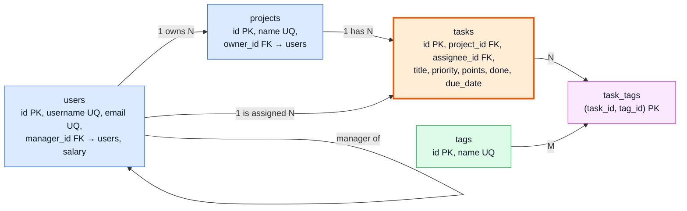
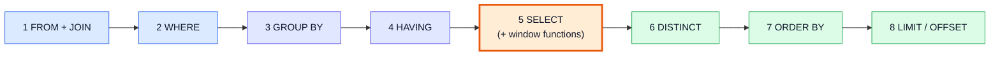
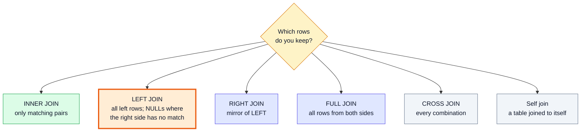
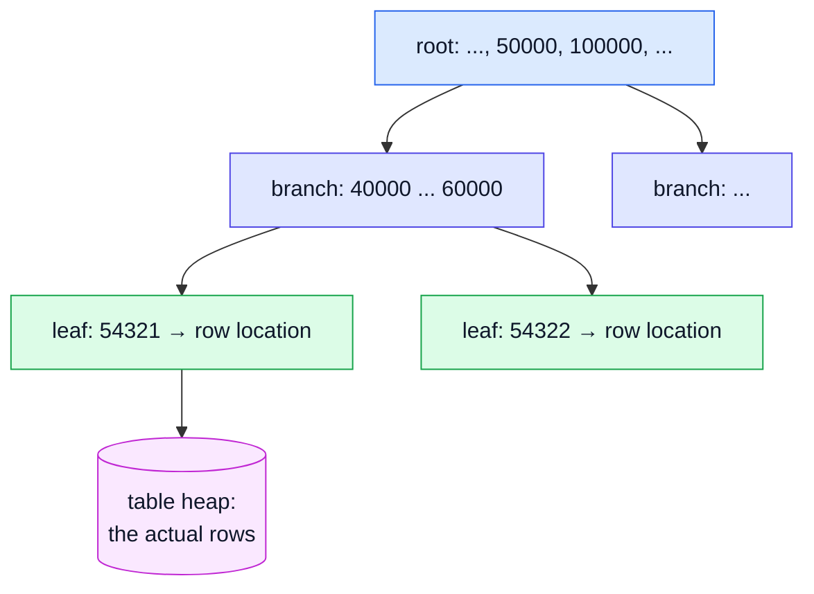

# SQL Essentials on PostgreSQL — Complete In-Depth Guide

**Spring Boot notes #7 of 18** · Priority 🔴 · Track: Spring Boot ([README](README.md))

Files 08 and 09 connect the Task Tracker to a database through JDBC and JPA. Those tools **generate and run SQL for you**, so when something is slow or wrong, you have to read and write SQL yourself. This file teaches the SQL a backend developer uses every day, on **PostgreSQL**, with a small schema of users, projects, tasks and tags.

| You want… | SQL feature |
|---|---|
| Store data safely | Tables, types, keys and constraints (DDL) |
| Change data | `INSERT`, `UPDATE`, `DELETE`, upsert (DML) |
| Ask questions | `SELECT`, `WHERE`, `JOIN`, `GROUP BY` |
| Rankings, running totals, "top N per group" | **Window functions** |
| Fast queries | **Indexes** + `EXPLAIN` |
| All-or-nothing changes | **Transactions** |

> [!NOTE]
> This topic isn't in Kunal's playlist, so there are no video timestamps.
>
> **What was run:** every SQL block followed by output was executed with `psql` against **PostgreSQL 18.3** on this machine, in the order shown. The database was first reset with [`examples/07-sql/schema.sql`](examples/07-sql/schema.sql). All outputs, including error messages and `EXPLAIN` plans, are real. Changes made in one block (an `INSERT`, a new index) are visible in the blocks after it. Everything lives in its own schema, `sqlnotes`, so it never touches the Task Tracker tables from file 08.

---

## Table of Contents

| # | Topic (anchor link) | Level |
|---|---|---|
| 0 | [The Relational Model and the Sample Schema](#0-the-relational-model-and-the-sample-schema) | Basics |
| 1 | [Connecting with psql](#1-connecting-with-psql) | Basics |
| 2 | [DDL: Tables, Types and Constraints](#2-ddl-tables-types-and-constraints) | Core |
| 3 | [DML: INSERT, UPDATE, DELETE, Upsert](#3-dml-insert-update-delete-upsert) | Core |
| 4 | [SELECT: Filtering, Sorting, NULL, CASE](#4-select-filtering-sorting-null-case) | Core |
| 5 | [Aggregates, GROUP BY and HAVING](#5-aggregates-group-by-and-having) | Core |
| 6 | [JOINs](#6-joins) | Core |
| 7 | [Subqueries, EXISTS and CTEs](#7-subqueries-exists-and-ctes) | In depth |
| 8 | [Set Operations: UNION, INTERSECT, EXCEPT](#8-set-operations-union-intersect-except) | Core |
| 9 | [Window Functions](#9-window-functions) | In depth |
| 10 | [Indexes and EXPLAIN](#10-indexes-and-explain) | In depth |
| 11 | [Transactions and ACID](#11-transactions-and-acid) | Core |
| 12 | [Normalization and Relationships](#12-normalization-and-relationships) | Core |
| 13 | [SQL from Java: Prepared Statements and SQL Injection](#13-sql-from-java-prepared-statements-and-sql-injection) | Core |
| 14 | [Interview Questions](#14-interview-questions) | Interview |

---

## 0. The Relational Model and the Sample Schema

A **relational database** stores data in **tables** (relations). A table has **columns** with fixed types, and **rows** (tuples). Rows are linked by **keys**:

| Term | Meaning | Example |
|---|---|---|
| Primary key (PK) | Uniquely identifies a row; never null | `tasks.id` |
| Foreign key (FK) | A column that must match a PK in another table | `tasks.project_id → projects.id` |
| Natural key | A real-world unique value | `users.email` |
| Surrogate key | A generated meaningless id | `id BIGINT GENERATED ALWAYS AS IDENTITY` |
| Composite key | A PK made of several columns | `task_tags (task_id, tag_id)` |



The sample data has deliberate gaps, so the outer joins later have something to show: user `dev` has no tasks, project `Archive` has no tasks, task `Set up CI` has no assignee, and tag `research` is unused.

---

## 1. Connecting with psql

`psql` is PostgreSQL's command-line client (on Windows: `C:\Program Files\PostgreSQL\18\bin\psql.exe`). Using the local practice user from the [README](README.md#database-setup-from-file-07-on):

```bash
"/c/Program Files/PostgreSQL/18/bin/psql" -h localhost -U springnotes -d springnotes
```

```bash
cd "Spring Boot Notes/examples/07-sql"
"/c/Program Files/PostgreSQL/18/bin/psql" -h localhost -U springnotes -d springnotes -f schema.sql
```

| psql command | Does |
|---|---|
| `\dt` / `\dt sqlnotes.*` | List tables |
| `\d tasks` | Describe a table: columns, indexes, constraints |
| `\di` | List indexes |
| `\x` | Toggle expanded (vertical) output |
| `\timing` | Show how long each query took |
| `\i file.sql` | Run a file |
| `\q` | Quit |
| `SET search_path TO sqlnotes;` | Use the `sqlnotes` schema without prefixing `sqlnotes.` |

> [!TIP]
> Any GUI works too: pgAdmin (installed with PostgreSQL), DBeaver, or IntelliJ's Database tool window. Use psql at least sometimes: it's what you get on a server.

---

## 2. DDL: Tables, Types and Constraints

**DDL** (Data Definition Language) creates and changes structure: `CREATE`, `ALTER`, `DROP`. The `tasks` table from `schema.sql`:

```sql
CREATE TABLE tasks (
    id          BIGINT GENERATED ALWAYS AS IDENTITY PRIMARY KEY,
    project_id  BIGINT NOT NULL REFERENCES projects (id) ON DELETE CASCADE,
    assignee_id BIGINT REFERENCES users (id) ON DELETE SET NULL,   -- may be unassigned
    title       VARCHAR(100) NOT NULL,
    priority    VARCHAR(6) NOT NULL DEFAULT 'MEDIUM' CHECK (priority IN ('LOW', 'MEDIUM', 'HIGH')),
    points      INT NOT NULL DEFAULT 1 CHECK (points BETWEEN 1 AND 13),
    done        BOOLEAN NOT NULL DEFAULT FALSE,
    due_date    DATE,
    created_at  TIMESTAMPTZ NOT NULL DEFAULT now()
);
```

| PostgreSQL type | Java type | Use for |
|---|---|---|
| `BIGINT` / `INT` / `SMALLINT` | `long` / `int` / `short` | Ids, counts |
| `NUMERIC(10,2)` | `BigDecimal` | **Money** (exact; never use `double`) |
| `VARCHAR(n)` / `TEXT` | `String` | Text; in Postgres they're equally fast, `n` is just a limit |
| `BOOLEAN` | `boolean` | Flags |
| `DATE` | `LocalDate` | Calendar dates |
| `TIMESTAMPTZ` | `Instant` / `OffsetDateTime` | Moments in time (stored as UTC) |
| `UUID` | `UUID` | Public ids |
| `JSONB` | `String` / mapped object | Semi-structured data |

| Constraint | Guarantees |
|---|---|
| `PRIMARY KEY` | Unique + not null (and creates an index) |
| `NOT NULL` | Value required |
| `UNIQUE` | No duplicates (creates an index) |
| `CHECK (...)` | Any boolean rule |
| `DEFAULT ...` | Value when the insert omits the column |
| `REFERENCES t(id)` | Foreign key: the value must exist in `t` |
| `ON DELETE CASCADE / SET NULL / RESTRICT` | What happens to children when the parent row is deleted |

The constraints are enforced by the database, even when the application has a bug:

```sql
INSERT INTO users (username, email, salary) VALUES ('asha', 'other@example.com', 50000);
INSERT INTO tasks (project_id, title, points) VALUES (1, 'Too big', 20);
INSERT INTO tasks (project_id, title) VALUES (99, 'No such project');
```

```
ERROR:  duplicate key value violates unique constraint "users_username_key"
DETAIL:  Key (username)=(asha) already exists.
ERROR:  new row for relation "tasks" violates check constraint "tasks_points_check"
DETAIL:  Failing row contains (12, 1, null, Too big, MEDIUM, 20, f, null, 2026-11-16 22:52:00.988025+05:30).
ERROR:  insert or update on table "tasks" violates foreign key constraint "tasks_project_id_fkey"
DETAIL:  Key (project_id)=(99) is not present in table "projects".
```

`ALTER` changes an existing table. In real projects these changes are written as **migrations** (Flyway, file 08), never typed by hand on production:

```sql
ALTER TABLE tasks ADD COLUMN description TEXT;
ALTER TABLE tasks ALTER COLUMN description SET DEFAULT '';
ALTER TABLE tasks DROP COLUMN description;
```

```
ALTER TABLE
ALTER TABLE
ALTER TABLE
```

> [!TIP]
> `GENERATED ALWAYS AS IDENTITY` is the modern standard way to auto-number ids. Older Postgres code uses `SERIAL`, which does the same job through a sequence with looser rules.

---

## 3. DML: INSERT, UPDATE, DELETE, Upsert

**DML** (Data Manipulation Language) changes rows. PostgreSQL's **`RETURNING`** gives back the changed rows, including generated ids, which is how JDBC gets the new id (file 08).

```sql
INSERT INTO tasks (project_id, assignee_id, title, points)
VALUES (2, 6, 'Write blog post', 2)
RETURNING id, title, priority, done;
```

```
 id |      title      | priority | done 
----+-----------------+----------+------
 14 | Write blog post | MEDIUM   | f
(1 row)

INSERT 0 1
```

The new id is **14**, not 12: the two failed inserts in [Section 2](#2-ddl-tables-types-and-constraints) already took 12 and 13. Identity/sequence values are never handed out twice, even after a failure or rollback, so **gaps in ids are normal**. Never use ids to count rows.

```sql
UPDATE tasks SET done = TRUE WHERE title = 'Write blog post' RETURNING id, done;
DELETE FROM tasks WHERE title = 'Write blog post';
```

```
 id | done 
----+------
 14 | t
(1 row)

UPDATE 1
DELETE 1
```

> [!CAUTION]
> `UPDATE tasks SET done = TRUE;` without a `WHERE` changes **every** row. Run the `WHERE` as a `SELECT` first, or work inside a transaction ([Section 11](#11-transactions-and-acid)) so you can `ROLLBACK`.

**Upsert** inserts, or updates when the row already exists, in one atomic statement:

```sql
INSERT INTO tags (name) VALUES ('urgent'), ('docs')
ON CONFLICT (name) DO NOTHING
RETURNING id, name;
```

```
 id | name 
----+------
  7 | docs
(1 row)

INSERT 0 1
```

Only `docs` was inserted; `urgent` already existed. `ON CONFLICT (name) DO UPDATE SET ... = EXCLUDED....` updates the existing row instead.

---

## 4. SELECT: Filtering, Sorting, NULL, CASE

```sql
SELECT id, title, priority, points, due_date
FROM tasks
WHERE NOT done
  AND priority IN ('HIGH', 'MEDIUM')
  AND title ILIKE '%e%'                -- case-insensitive pattern
ORDER BY due_date NULLS LAST, points DESC
LIMIT 4;
```

```
 id |      title       | priority | points |  due_date  
----+------------------+----------+--------+------------
  6 | New landing page | HIGH     |      8 | 2026-11-18
  9 | Login screen     | HIGH     |      5 | 2026-11-22
  4 | Write tests      | MEDIUM   |      5 | 2026-11-25
  8 | SEO audit        | MEDIUM   |      3 | 2026-12-05
(4 rows)
```

| Operator | Meaning |
|---|---|
| `=`, `<>` (or `!=`), `<`, `>=` | Comparison |
| `AND`, `OR`, `NOT` | Logic (`AND` binds tighter than `OR`: use parentheses) |
| `IN (...)`, `BETWEEN a AND b` | Set / inclusive range |
| `LIKE 'a%'` / `ILIKE` | Pattern (`%` = any chars, `_` = one char); `ILIKE` ignores case |
| `IS NULL`, `IS NOT NULL` | The **only** correct way to test for null |
| `LIMIT n OFFSET m` | Paging (file 09 shows why big offsets are slow) |

### 4.1 NULL is "unknown"

`NULL` means "no value / unknown". Comparisons with `NULL` give `NULL`, not true or false, so rows silently disappear:

```sql
SELECT count(*) AS eq_null      FROM tasks WHERE assignee_id = NULL;
SELECT count(*) AS is_null      FROM tasks WHERE assignee_id IS NULL;
SELECT count(*) AS not_ravi     FROM tasks WHERE assignee_id <> 2;
SELECT title, coalesce(due_date::text, 'no due date') AS due FROM tasks WHERE due_date IS NULL;
```

```
 eq_null 
---------
       0
(1 row)

 is_null 
---------
       1
(1 row)

 not_ravi 
----------
        7
(1 row)

       title        |     due     
--------------------+-------------
 Set up CI          | no due date
 Push notifications | no due date
(2 rows)
```

`assignee_id = NULL` found 0 rows. `assignee_id <> 2` found 7, not 8: the unassigned task isn't "not ravi", it's unknown. `coalesce(a, b)` returns the first non-null value.

### 4.2 CASE

```sql
SELECT title, points,
       CASE WHEN points >= 8 THEN 'large'
            WHEN points >= 3 THEN 'medium'
            ELSE 'small'
       END AS size
FROM tasks
WHERE project_id = 1
ORDER BY points DESC;
```

```
         title          | points |  size  
------------------------+--------+--------
 Write REST controllers |      8 | large
 Design the schema      |      5 | medium
 Write tests            |      5 | medium
 Add validation         |      3 | medium
 Set up CI              |      2 | small
(5 rows)
```

---

## 5. Aggregates, GROUP BY and HAVING

Aggregates collapse many rows into one value: `count`, `sum`, `avg`, `min`, `max`, `string_agg`, `bool_and`…

```sql
SELECT priority,
       count(*)                          AS tasks,
       count(*) FILTER (WHERE done)      AS done,
       sum(points)                       AS points,
       round(avg(points), 2)             AS avg_points,
       count(assignee_id)                AS assigned       -- count(column) skips NULLs
FROM tasks
GROUP BY priority
HAVING sum(points) > 10
ORDER BY points DESC;
```

```
 priority | tasks | done | points | avg_points | assigned 
----------+-------+------+--------+------------+----------
 HIGH     |     4 |    2 |     26 |       6.50 |        4
 MEDIUM   |     4 |    0 |     19 |       4.75 |        4
(2 rows)
```

| Clause | Filters | Can use aggregates? |
|---|---|---|
| `WHERE` | Rows, **before** grouping | No |
| `HAVING` | Groups, **after** grouping | Yes |

`LOW` was removed by `HAVING sum(points) > 10` (it has only 5 points).

**The logical order** in which a `SELECT` is evaluated explains most "column does not exist" errors. For example, you can't use a `SELECT` alias in `WHERE`, because `WHERE` runs first:



```sql
SELECT title, points * 2 AS double_points FROM tasks WHERE double_points > 10;
```

```
ERROR:  column "double_points" does not exist
LINE 1: ...tle, points * 2 AS double_points FROM tasks WHERE double_poi...
                                                             ^
```

> [!IMPORTANT]
> Every column in `SELECT` must either be inside an aggregate or listed in `GROUP BY`. One exception: grouping by a table's **primary key** lets you select its other columns (`GROUP BY p.id, p.name` in the Complete Example could even be `GROUP BY p.id`).

---

## 6. JOINs

A join combines rows of two tables on a condition, usually FK = PK.



**INNER JOIN.** The unassigned task `Set up CI` and user `dev` both disappear:

```sql
SELECT t.title, u.username
FROM tasks t
JOIN users u ON u.id = t.assignee_id        -- JOIN = INNER JOIN
WHERE t.project_id = 1
ORDER BY t.id;
```

```
         title          | username 
------------------------+----------
 Design the schema      | ravi
 Write REST controllers | ravi
 Add validation         | kabir
 Write tests            | zoya
(4 rows)
```

**LEFT JOIN** keeps every row from the left table:

```sql
SELECT t.title, coalesce(u.username, '(nobody)') AS assignee
FROM tasks t
LEFT JOIN users u ON u.id = t.assignee_id
WHERE t.project_id = 1
ORDER BY t.id;
```

```
         title          | assignee 
------------------------+----------
 Design the schema      | ravi
 Write REST controllers | ravi
 Add validation         | kabir
 Write tests            | zoya
 Set up CI              | (nobody)
(5 rows)
```

**Counting with LEFT JOIN** (users with zero tasks still appear):

```sql
SELECT u.username, count(t.id) AS tasks
FROM users u
LEFT JOIN tasks t ON t.assignee_id = u.id
GROUP BY u.id, u.username
ORDER BY tasks DESC, u.username;
```

```
 username | tasks 
----------+-------
 kabir    |     3
 ravi     |     3
 meera    |     2
 zoya     |     2
 asha     |     0
 dev      |     0
(6 rows)
```

> [!WARNING]
> Use `count(t.id)`, not `count(*)`, after a LEFT JOIN. `count(*)` counts the null-filled row too, so `dev` would show 1 task instead of 0.

**Filter placement in LEFT JOINs** is a classic bug:

```sql
-- condition in ON: still one row per user, only HIGH tasks are counted
SELECT u.username, count(t.id) AS high_tasks
FROM users u LEFT JOIN tasks t ON t.assignee_id = u.id AND t.priority = 'HIGH'
GROUP BY u.id, u.username ORDER BY u.id;

-- condition in WHERE: rows with NULL priority are removed -> it became an INNER JOIN
SELECT u.username, count(t.id) AS high_tasks
FROM users u LEFT JOIN tasks t ON t.assignee_id = u.id
WHERE t.priority = 'HIGH'
GROUP BY u.id, u.username ORDER BY u.id;
```

```
 username | high_tasks 
----------+------------
 asha     |          0
 ravi     |          2
 meera    |          1
 kabir    |          1
 zoya     |          0
 dev      |          0
(6 rows)

 username | high_tasks 
----------+------------
 ravi     |          2
 meera    |          1
 kabir    |          1
(3 rows)
```

**FULL JOIN, self join and many-to-many:**

```sql
-- FULL JOIN keeps unmatched rows from BOTH sides; every task has a project, so only Archive shows up
SELECT p.name, t.title
FROM projects p FULL JOIN tasks t ON t.project_id = p.id
WHERE t.id IS NULL OR p.id IS NULL;

-- self join: each user with their manager's name
SELECT e.username AS employee, m.username AS manager
FROM users e LEFT JOIN users m ON m.id = e.manager_id
ORDER BY e.id;

-- many-to-many through the join table
SELECT t.title, string_agg(g.name, ', ' ORDER BY g.name) AS tags
FROM tasks t
JOIN task_tags tt ON tt.task_id = t.id
JOIN tags g       ON g.id = tt.tag_id
GROUP BY t.id, t.title
ORDER BY t.id;
```

```
  name   | title 
---------+-------
 Archive | 
(1 row)

 employee | manager 
----------+---------
 asha     | 
 ravi     | asha
 meera    | asha
 kabir    | ravi
 zoya     | ravi
 dev      | meera
(6 rows)

         title          |       tags        
------------------------+-------------------
 Design the schema      | backend
 Write REST controllers | backend
 Add validation         | backend
 Write tests            | backend
 Set up CI              | devops
 New landing page       | frontend, urgent
 Fix footer links       | frontend
 Login screen           | frontend, urgent
 Push notifications     | backend, frontend
(9 rows)
```

---

## 7. Subqueries, EXISTS and CTEs

A **subquery** is a `SELECT` inside another statement.

```sql
-- scalar subquery: users paid more than the average
SELECT username, salary FROM users
WHERE salary > (SELECT avg(salary) FROM users)
ORDER BY salary DESC;

-- EXISTS: users who have at least one HIGH-priority task (stops at the first match)
SELECT username FROM users u
WHERE EXISTS (SELECT 1 FROM tasks t WHERE t.assignee_id = u.id AND t.priority = 'HIGH')
ORDER BY username;

-- correlated subquery: each project's biggest task (runs per outer row)
SELECT p.name, (SELECT max(points) FROM tasks t WHERE t.project_id = p.id) AS max_points
FROM projects p ORDER BY p.id;
```

```
 username |  salary   
----------+-----------
 asha     | 150000.00
 meera    | 105000.00
 ravi     |  95000.00
(3 rows)

 username 
----------
 kabir
 meera
 ravi
(3 rows)

     name     | max_points 
--------------+------------
 Task Tracker |          8
 Website      |          8
 Mobile App   |          8
 Archive      |           
(4 rows)
```

> [!CAUTION]
> **`NOT IN` with NULLs returns nothing.** `tasks.assignee_id` contains a NULL, so `x NOT IN (..., NULL)` is never true:
>
> Use `NOT EXISTS` for "rows without a match".

```sql
SELECT count(*) AS not_in_result
FROM users WHERE id NOT IN (SELECT assignee_id FROM tasks);

SELECT count(*) AS not_exists_result
FROM users u WHERE NOT EXISTS (SELECT 1 FROM tasks t WHERE t.assignee_id = u.id);
```

```
 not_in_result 
---------------
             0
(1 row)

 not_exists_result 
-------------------
                 2
(1 row)
```

`NOT IN` said 0 users have no tasks; `NOT EXISTS` correctly found 2 (`asha` and `dev`).

A **CTE** (Common Table Expression, `WITH name AS (...)`) names a subquery so a query reads top to bottom:

```sql
WITH open_points AS (
    SELECT assignee_id, sum(points) AS pts
    FROM tasks WHERE NOT done AND assignee_id IS NOT NULL
    GROUP BY assignee_id
)
SELECT u.username, op.pts
FROM open_points op JOIN users u ON u.id = op.assignee_id
WHERE op.pts >= 8
ORDER BY op.pts DESC, u.username;
```

```
 username | pts 
----------+-----
 kabir    |  16
 meera    |   8
 zoya     |   8
(3 rows)
```

`WITH RECURSIVE` walks hierarchies (org charts, folders, comment threads). It's used in the [Complete Example](#-complete-example-everything-together).

---

## 8. Set Operations: UNION, INTERSECT, EXCEPT

They combine the **results** of two queries with the same number and types of columns.

```sql
-- people who own a project OR have a HIGH task
SELECT u.username FROM users u JOIN projects p ON p.owner_id = u.id
UNION
SELECT u.username FROM users u JOIN tasks t ON t.assignee_id = u.id AND t.priority = 'HIGH'
ORDER BY 1;
```

```
 username 
----------
 asha
 kabir
 meera
 ravi
(4 rows)
```

| Operator | Result | Duplicates |
|---|---|---|
| `UNION` | In either | Removed (needs a sort/hash: slower) |
| `UNION ALL` | In either | Kept (faster; use it when you know there are none) |
| `INTERSECT` | In both | Removed |
| `EXCEPT` | In the first, not the second | Removed |

---

## 9. Window Functions

A **window function** computes a value over a set of rows related to the current row, but unlike `GROUP BY` it **keeps every row**. The syntax is `function() OVER (PARTITION BY ... ORDER BY ...)`.

```sql
SELECT u.username, u.salary,
       row_number() OVER (ORDER BY salary DESC) AS row_num,
       rank()       OVER (ORDER BY salary DESC) AS rnk,
       dense_rank() OVER (ORDER BY salary DESC) AS dense,
       round(avg(salary) OVER (), 0)            AS company_avg
FROM users u
ORDER BY salary DESC, username;
```

```
 username |  salary   | row_num | rnk | dense | company_avg 
----------+-----------+---------+-----+-------+-------------
 asha     | 150000.00 |       1 |   1 |     1 |       91667
 meera    | 105000.00 |       2 |   2 |     2 |       91667
 ravi     |  95000.00 |       3 |   3 |     3 |       91667
 kabir    |  70000.00 |       4 |   4 |     4 |       91667
 zoya     |  70000.00 |       5 |   4 |     4 |       91667
 dev      |  60000.00 |       6 |   6 |     5 |       91667
(6 rows)
```

`kabir` and `zoya` earn the same: `row_number` still gives them 4 and 5, `rank` gives both 4 and then skips to 6 for `dev`, and `dense_rank` gives both 4 and `dev` 5, with no gap. `avg(...) OVER ()` puts the company average on every row.

```sql
-- per project: running total of points by due date, and the previous task's due date
SELECT p.name AS project, t.title, t.due_date, t.points,
       sum(t.points) OVER (PARTITION BY t.project_id ORDER BY t.due_date) AS running_points,
       lag(t.due_date) OVER (PARTITION BY t.project_id ORDER BY t.due_date) AS previous_due
FROM tasks t JOIN projects p ON p.id = t.project_id
WHERE t.due_date IS NOT NULL
ORDER BY p.name, t.due_date;
```

```
   project    |         title          |  due_date  | points | running_points | previous_due 
--------------+------------------------+------------+--------+----------------+--------------
 Mobile App   | App store listing      | 2026-11-05 |      2 |              2 | 
 Mobile App   | Login screen           | 2026-11-22 |      5 |              7 | 2026-11-05
 Task Tracker | Design the schema      | 2026-11-01 |      5 |              5 | 
 Task Tracker | Write REST controllers | 2026-11-10 |      8 |             13 | 2026-11-01
 Task Tracker | Add validation         | 2026-11-20 |      3 |             16 | 2026-11-10
 Task Tracker | Write tests            | 2026-11-25 |      5 |             21 | 2026-11-20
 Website      | Fix footer links       | 2026-10-30 |      1 |              1 | 
 Website      | New landing page       | 2026-11-18 |      8 |              9 | 2026-10-30
 Website      | SEO audit              | 2026-12-05 |      3 |             12 | 2026-11-18
(9 rows)
```

| Function | Gives |
|---|---|
| `row_number()` | 1, 2, 3… unique per partition |
| `rank()` / `dense_rank()` | Ties share a rank; `rank` leaves gaps |
| `lag(col)` / `lead(col)` | Value from the previous / next row |
| `sum/avg/count(...) OVER (...)` | Running or partition totals |
| `ntile(4)` | Splits rows into 4 buckets (quartiles) |
| `first_value` / `last_value` | First/last value in the window frame |

> [!TIP]
> **Top-N per group** is the classic window-function interview question: `row_number() OVER (PARTITION BY group ORDER BY score DESC)` in a CTE, then `WHERE rn <= N` outside. You can't filter on a window function in the same query's `WHERE`, because `WHERE` runs before `SELECT` ([Section 5](#5-aggregates-group-by-and-having)). Query 3 of the Complete Example does exactly this.

---

## 10. Indexes and EXPLAIN

Without an index, finding rows means reading the **whole table** (a sequential scan). An **index** is a separate sorted structure, a **B-tree** by default, that maps column values to row locations, like a book's index.



A lookup walks from the root to a leaf in a few steps (O(log n)). To see the difference, make a table with 200,000 rows:

```sql
CREATE TABLE big_tasks AS
SELECT g AS id,
       'task ' || g AS title,
       (g % 500) + 1 AS assignee_id,
       (g % 7 = 0) AS done
FROM generate_series(1, 200000) AS g;
ANALYZE big_tasks;                      -- refresh the planner's statistics

EXPLAIN (ANALYZE, COSTS OFF, TIMING OFF, SUMMARY OFF, BUFFERS OFF)
SELECT * FROM big_tasks WHERE assignee_id = 42;
```

```
SELECT 200000
ANALYZE
                     QUERY PLAN                     
----------------------------------------------------
 Seq Scan on big_tasks (actual rows=400.00 loops=1)
   Filter: (assignee_id = 42)
   Rows Removed by Filter: 199600
(3 rows)
```

**Seq Scan**: Postgres read all 200,000 rows and threw away 199,600 to find 400.

```sql
CREATE INDEX idx_big_tasks_assignee ON big_tasks (assignee_id);

EXPLAIN (ANALYZE, COSTS OFF, TIMING OFF, SUMMARY OFF, BUFFERS OFF)
SELECT * FROM big_tasks WHERE assignee_id = 42;
```

```
CREATE INDEX
                                   QUERY PLAN                                   
--------------------------------------------------------------------------------
 Bitmap Heap Scan on big_tasks (actual rows=400.00 loops=1)
   Recheck Cond: (assignee_id = 42)
   Heap Blocks: exact=400
   ->  Bitmap Index Scan on idx_big_tasks_assignee (actual rows=400.00 loops=1)
         Index Cond: (assignee_id = 42)
         Index Searches: 1
(6 rows)
```

Now it's a **Bitmap Index Scan**: the index finds the 400 row locations, then only the pages holding them are read.

| Plan node | Meaning |
|---|---|
| `Seq Scan` | Read the whole table |
| `Index Scan` | Walk the index, fetch each row |
| `Index Only Scan` | All needed columns are in the index: no table access |
| `Bitmap Index Scan` + `Bitmap Heap Scan` | Collect row locations, then read pages in physical order (many matches) |
| `Nested Loop` / `Hash Join` / `Merge Join` | Join strategies |
| `Sort`, `HashAggregate` | Sorting / grouping |

**When an index is NOT used:**

```sql
-- 1. a function on the column hides it from a plain index
EXPLAIN (COSTS OFF) SELECT * FROM big_tasks WHERE assignee_id + 0 = 42;

-- 2. the condition matches most of the table: reading everything is cheaper
EXPLAIN (COSTS OFF) SELECT * FROM big_tasks WHERE assignee_id > 10;
```

```
                QUERY PLAN                
------------------------------------------
 Gather
   Workers Planned: 1
   ->  Parallel Seq Scan on big_tasks
         Filter: ((assignee_id + 0) = 42)
(4 rows)

          QUERY PLAN          
------------------------------
 Seq Scan on big_tasks
   Filter: (assignee_id > 10)
(2 rows)
```

**Composite indexes** are sorted by the first column, then the second. That's the **leftmost-prefix rule**: an index on `(a, b)` is built for queries on `a` or on `a AND b`. Watch what PostgreSQL 18 does with a query on `b` alone:

```sql
CREATE INDEX idx_big_done_assignee ON big_tasks (done, assignee_id);
DROP INDEX idx_big_tasks_assignee;

EXPLAIN (COSTS OFF) SELECT * FROM big_tasks WHERE done AND assignee_id = 42;   -- uses both columns
EXPLAIN (COSTS OFF) SELECT * FROM big_tasks WHERE assignee_id = 42;            -- leading column missing!
DROP TABLE big_tasks;
```

```
CREATE INDEX
DROP INDEX
                      QUERY PLAN                      
------------------------------------------------------
 Index Scan using idx_big_done_assignee on big_tasks
   Index Cond: ((done = true) AND (assignee_id = 42))
(2 rows)

                    QUERY PLAN                    
--------------------------------------------------
 Bitmap Heap Scan on big_tasks
   Recheck Cond: (assignee_id = 42)
   ->  Bitmap Index Scan on idx_big_done_assignee
         Index Cond: (assignee_id = 42)
(4 rows)

DROP TABLE
```

The second plan still used the index, although `assignee_id` is not its first column. **PostgreSQL 18 added B-tree "skip scan"**: because `done` has only two values, it can search the index once per value of the leading column (the `Index Searches` line in plans is new in 18 too). Older versions, and leading columns with many distinct values, fall back to a full scan here. So the rule still holds as advice: put the column you filter on most first. Don't count on skip scan.

| Index rule of thumb | Why |
|---|---|
| Index **foreign keys** you join or filter on | Postgres does **not** index FKs automatically (PKs and UNIQUE get indexes) |
| Index columns in frequent `WHERE`, `JOIN`, `ORDER BY` | That's where lookups happen |
| Most-used equality columns first, range columns last in composite indexes | Matches the leftmost-prefix rule |
| Don't index everything | Each index slows down every `INSERT`/`UPDATE`/`DELETE` and uses disk |
| Check with `EXPLAIN ANALYZE`, on realistic data | The planner's choice depends on table size and statistics |
| `UNIQUE` index = constraint + speed | `CREATE UNIQUE INDEX ... ON users (lower(email))` |
| Partial index for a hot subset | `CREATE INDEX ... ON tasks (due_date) WHERE NOT done` |

> [!NOTE]
> With PostgreSQL 18, `EXPLAIN ANALYZE` prints buffer counts by default. `BUFFERS OFF` above keeps the plans short.

---

## 11. Transactions and ACID

A **transaction** groups statements so they succeed or fail **as one**.

| Letter | Property | Meaning |
|---|---|---|
| **A** | Atomicity | All statements or none |
| **C** | Consistency | Constraints hold before and after |
| **I** | Isolation | Concurrent transactions don't see each other's half-done work (how much is the **isolation level**, file 09) |
| **D** | Durability | Once committed, it survives a crash (write-ahead log) |

```sql
BEGIN;
UPDATE tasks SET assignee_id = 6 WHERE project_id = 2;
SELECT title, assignee_id FROM tasks WHERE project_id = 2 ORDER BY id;
ROLLBACK;                                  -- undo everything since BEGIN
SELECT title, assignee_id FROM tasks WHERE project_id = 2 ORDER BY id;
```

```
BEGIN
UPDATE 3
      title       | assignee_id 
------------------+-------------
 New landing page |           6
 Fix footer links |           6
 SEO audit        |           6
(3 rows)

ROLLBACK
      title       | assignee_id 
------------------+-------------
 New landing page |           3
 Fix footer links |           3
 SEO audit        |           5
(3 rows)
```

When a statement fails inside a transaction, PostgreSQL marks the whole transaction failed, and everything until `ROLLBACK` is refused:

```sql
BEGIN;
INSERT INTO tags (name) VALUES ('ops');
INSERT INTO tags (name) VALUES ('ops');              -- duplicate -> error
SELECT count(*) FROM tags;                           -- refused
ROLLBACK;
SELECT count(*) AS tags_after_rollback FROM tags;     -- 'ops' was not kept
```

```
BEGIN
INSERT 0 1
ERROR:  duplicate key value violates unique constraint "tags_name_key"
DETAIL:  Key (name)=(ops) already exists.
ERROR:  current transaction is aborted, commands ignored until end of transaction block
ROLLBACK
 tags_after_rollback 
---------------------
                   6
(1 row)
```

> [!TIP]
> psql and JDBC run in **autocommit** mode by default: each statement is its own transaction. Spring's `@Transactional` (file 09) turns autocommit off, runs your method, then commits, or rolls back on an exception.

---

## 12. Normalization and Relationships

**Normalization** removes duplicated data so each fact is stored once and can't get out of sync.

| Normal form | Rule | Violation example | Fix |
|---|---|---|---|
| **1NF** | Atomic values, no repeating groups | `tasks.tags = 'backend,urgent'` | A `task_tags` table |
| **2NF** | 1NF + every non-key column depends on the **whole** key | `task_tags(task_id, tag_id, tag_name)`: `tag_name` depends only on `tag_id` | Keep `name` in `tags` |
| **3NF** | 2NF + no column depends on another **non-key** column | `tasks(project_id, project_owner)`: owner depends on project | Keep `owner_id` in `projects` |

| Relationship | Modelled as | Here |
|---|---|---|
| One-to-many | FK on the "many" side | `tasks.project_id → projects.id` |
| Many-to-many | Join table with two FKs | `task_tags` |
| One-to-one | FK with `UNIQUE` (or shared PK) | e.g. `user_profiles.user_id UNIQUE` |
| Hierarchy | FK to the same table | `users.manager_id → users.id` |

> [!NOTE]
> **Denormalization** (copying data on purpose, e.g. storing `open_task_count` on `projects`) trades consistency work for read speed. Do it only after measuring, and keep the copy updated in one place (a trigger or the service layer).

---

## 13. SQL from Java: Prepared Statements and SQL Injection

[Java gap #12](../Java%20Topics%20Not%20Covered%20Notes/java_gap_12_junit_maven_gradle_jdbc.md) introduced JDBC. The one rule that matters most: **never build SQL by concatenating user input.**

```java
// ❌ SQL injection: title = "x' OR '1'='1" returns every row; "x'; DROP TABLE tasks; --" is worse
String sql = "SELECT * FROM tasks WHERE title = '" + title + "'";

// ✅ prepared statement: the value is sent separately and can never become SQL
PreparedStatement ps = conn.prepareStatement("SELECT * FROM tasks WHERE title = ?");
ps.setString(1, title);
```

What the injected string does when it's pasted into SQL, shown here as SQL so you can watch it happen:

```sql
SELECT count(*) AS rows_returned FROM tasks WHERE title = 'x' OR '1'='1';
```

```
 rows_returned 
---------------
            11
(1 row)
```

Every task came back for a title that matches nothing. `JdbcTemplate`, JPA and Spring Data (files 08–09) all use prepared statements, so you're safe as long as you never build query strings from input yourself. File 11 covers this with the other web attacks.

---

## 14. Interview Questions

| Question | Answer |
|---|---|
| `WHERE` vs `HAVING`? | `WHERE` filters rows before grouping and can't use aggregates; `HAVING` filters groups after. |
| `INNER` vs `LEFT JOIN`? | Inner keeps only matches; left keeps all left rows, with NULLs for missing right rows. |
| `UNION` vs `UNION ALL`? | `UNION` removes duplicates (extra work); `UNION ALL` keeps them. |
| `DELETE` vs `TRUNCATE` vs `DROP`? | `DELETE` removes chosen rows (logged, can use `WHERE`); `TRUNCATE` empties a table fast; `DROP` removes the table itself. |
| Primary key vs unique key? | Both are unique and indexed. A table has one PK and it can't be null; it can have many unique constraints, which allow NULLs. |
| What is an index? Downsides? | A separate structure (B-tree) for fast lookups; costs disk space and slows writes. |
| Clustered vs non-clustered index? | Clustered = table stored in index order (SQL Server/MySQL InnoDB PK). Postgres tables are heaps; all its indexes are secondary (`CLUSTER` reorders once). |
| Why is my index not used? | Function on the column, low selectivity, wrong composite-column order, type mismatch, stale statistics, tiny table. |
| `count(*)` vs `count(col)`? | `count(*)` counts rows; `count(col)` counts non-null values. |
| Second-highest salary? | `SELECT DISTINCT salary FROM users ORDER BY salary DESC OFFSET 1 LIMIT 1`, or `dense_rank() = 2`. |
| Find duplicates? | `GROUP BY col HAVING count(*) > 1`. |
| `rank` vs `dense_rank` vs `row_number`? | Ties: same rank with gaps / same rank without gaps / always unique. |
| What is ACID? | Atomicity, Consistency, Isolation, Durability. |
| Why `NOT EXISTS` over `NOT IN`? | `NOT IN` returns no rows if the subquery yields a NULL. |
| What is normalization? 1NF/2NF/3NF? | Removing redundancy: atomic values / no partial-key dependency / no transitive dependency. |
| How do you prevent SQL injection? | Prepared statements with parameters; never concatenate input into SQL. |
| `CHAR` vs `VARCHAR` vs `TEXT` in Postgres? | `CHAR(n)` pads with spaces; `VARCHAR(n)` limits length; `TEXT` is unlimited. Same performance. |
| What does `EXPLAIN ANALYZE` do? | Runs the query and shows the real plan with actual row counts (and timing). |

---

## 🧩 Complete Example: Everything Together

**A team dashboard report** over the sample schema. It combines:

- `LEFT JOIN` + `GROUP BY` + `FILTER` + `CASE` for project progress
- `JOIN` + `HAVING` + `rank()` for workload
- a CTE with `row_number()` for top-1 per group
- a **recursive CTE** for the org chart
- anti-joins (`NOT EXISTS`, `LEFT JOIN ... IS NULL`) combined with `UNION ALL`

Source: [`examples/07-sql/`](examples/07-sql/). There are two files: `schema.sql` (tables + data) and `queries.sql` (the report).

**`schema.sql`**:

```sql
-- File 07: SQL essentials. Creates the "sqlnotes" schema with sample data.
-- Run:  psql -h localhost -U springnotes -d springnotes -f schema.sql
-- Safe to re-run: it drops and recreates only the sqlnotes schema.

DROP SCHEMA IF EXISTS sqlnotes CASCADE;
CREATE SCHEMA sqlnotes;
SET search_path TO sqlnotes;

CREATE TABLE users (
    id          BIGINT GENERATED ALWAYS AS IDENTITY PRIMARY KEY,
    username    VARCHAR(30)  NOT NULL UNIQUE,
    email       VARCHAR(100) NOT NULL UNIQUE,
    manager_id  BIGINT REFERENCES users (id),          -- self-reference: who you report to
    salary      NUMERIC(10, 2) NOT NULL CHECK (salary > 0),
    joined_on   DATE NOT NULL DEFAULT CURRENT_DATE
);

CREATE TABLE projects (
    id     BIGINT GENERATED ALWAYS AS IDENTITY PRIMARY KEY,
    name   VARCHAR(60) NOT NULL UNIQUE,
    owner_id BIGINT NOT NULL REFERENCES users (id)
);

CREATE TABLE tasks (
    id          BIGINT GENERATED ALWAYS AS IDENTITY PRIMARY KEY,
    project_id  BIGINT NOT NULL REFERENCES projects (id) ON DELETE CASCADE,
    assignee_id BIGINT REFERENCES users (id) ON DELETE SET NULL,   -- may be unassigned
    title       VARCHAR(100) NOT NULL,
    priority    VARCHAR(6) NOT NULL DEFAULT 'MEDIUM' CHECK (priority IN ('LOW', 'MEDIUM', 'HIGH')),
    points      INT NOT NULL DEFAULT 1 CHECK (points BETWEEN 1 AND 13),
    done        BOOLEAN NOT NULL DEFAULT FALSE,
    due_date    DATE,
    created_at  TIMESTAMPTZ NOT NULL DEFAULT now()
);

CREATE TABLE tags (
    id   BIGINT GENERATED ALWAYS AS IDENTITY PRIMARY KEY,
    name VARCHAR(30) NOT NULL UNIQUE
);

-- many-to-many: a task has many tags, a tag is on many tasks
CREATE TABLE task_tags (
    task_id BIGINT REFERENCES tasks (id) ON DELETE CASCADE,
    tag_id  BIGINT REFERENCES tags (id) ON DELETE CASCADE,
    PRIMARY KEY (task_id, tag_id)
);

INSERT INTO users (username, email, manager_id, salary, joined_on) VALUES
    ('asha',  'asha@example.com',  NULL, 150000, '2022-01-10'),   -- 1: the boss
    ('ravi',  'ravi@example.com',  1,    95000,  '2023-03-01'),   -- 2
    ('meera', 'meera@example.com', 1,    105000, '2023-06-15'),   -- 3
    ('kabir', 'kabir@example.com', 2,    70000,  '2024-02-01'),   -- 4
    ('zoya',  'zoya@example.com',  2,    70000,  '2024-08-20'),   -- 5
    ('dev',   'dev@example.com',   3,    60000,  '2025-01-05');   -- 6: has no tasks

INSERT INTO projects (name, owner_id) VALUES
    ('Task Tracker', 1), ('Website', 3), ('Mobile App', 2), ('Archive', 1);  -- Archive has no tasks

INSERT INTO tasks (project_id, assignee_id, title, priority, points, done, due_date) VALUES
    (1, 2, 'Design the schema',        'HIGH',   5, TRUE,  '2026-11-01'),
    (1, 2, 'Write REST controllers',   'HIGH',   8, TRUE,  '2026-11-10'),
    (1, 4, 'Add validation',           'MEDIUM', 3, FALSE, '2026-11-20'),
    (1, 5, 'Write tests',              'MEDIUM', 5, FALSE, '2026-11-25'),
    (1, NULL, 'Set up CI',             'LOW',    2, FALSE, NULL),
    (2, 3, 'New landing page',         'HIGH',   8, FALSE, '2026-11-18'),
    (2, 3, 'Fix footer links',         'LOW',    1, TRUE,  '2026-10-30'),
    (2, 5, 'SEO audit',                'MEDIUM', 3, FALSE, '2026-12-05'),
    (3, 4, 'Login screen',             'HIGH',   5, FALSE, '2026-11-22'),
    (3, 4, 'Push notifications',       'MEDIUM', 8, FALSE, NULL),
    (3, 2, 'App store listing',        'LOW',    2, TRUE,  '2026-11-05');

INSERT INTO tags (name) VALUES ('backend'), ('frontend'), ('urgent'), ('devops'), ('research');  -- research: unused

INSERT INTO task_tags (task_id, tag_id) VALUES
    (1, 1), (2, 1), (3, 1), (4, 1), (5, 4), (6, 2), (6, 3), (7, 2), (9, 2), (9, 3), (10, 1), (10, 2);
```

**`queries.sql`**:

```sql
-- File 07, Complete Example: a "team dashboard" report using most of the file's ideas.
-- Run after schema.sql:  psql -h localhost -U springnotes -d springnotes -f queries.sql
SET search_path TO sqlnotes;

\echo '== 1. Project progress (LEFT JOIN + GROUP BY + FILTER + CASE) =='
SELECT p.name                                         AS project,
       count(t.id)                                    AS tasks,
       count(t.id) FILTER (WHERE t.done)              AS done,
       coalesce(sum(t.points), 0)                     AS points,
       CASE WHEN count(t.id) = 0 THEN '-'
            ELSE round(100.0 * count(t.id) FILTER (WHERE t.done) / count(t.id)) || '%'
       END                                            AS progress
FROM projects p
LEFT JOIN tasks t ON t.project_id = p.id
GROUP BY p.id, p.name
ORDER BY p.id;

\echo '== 2. Open workload per person, busiest first (JOIN + HAVING + RANK) =='
SELECT u.username,
       count(*)                                  AS open_tasks,
       sum(t.points)                             AS open_points,
       rank() OVER (ORDER BY sum(t.points) DESC) AS busiest_rank
FROM users u
JOIN tasks t ON t.assignee_id = u.id AND NOT t.done
GROUP BY u.id, u.username
HAVING count(*) >= 1
ORDER BY busiest_rank, u.username;

\echo '== 3. The most urgent open task of each project (CTE + ROW_NUMBER, top-1 per group) =='
WITH ranked AS (
    SELECT t.*,
           row_number() OVER (PARTITION BY t.project_id
                              ORDER BY t.due_date NULLS LAST, t.points DESC) AS rn
    FROM tasks t
    WHERE NOT t.done
)
SELECT p.name AS project, r.title, r.due_date
FROM ranked r
JOIN projects p ON p.id = r.project_id
WHERE r.rn = 1
ORDER BY p.name;

\echo '== 4. Reporting chain under asha (recursive CTE) =='
WITH RECURSIVE chain AS (
    SELECT id, username, manager_id, 0 AS depth, ARRAY[username::text] AS path
    FROM users WHERE username = 'asha'
    UNION ALL
    SELECT u.id, u.username, u.manager_id, c.depth + 1, c.path || u.username::text
    FROM users u
    JOIN chain c ON u.manager_id = c.id
)
SELECT repeat('    ', depth) || username AS org_chart
FROM chain
ORDER BY path;                    -- sort by the path from the top: a tree

\echo '== 5. People with no open work and tags never used (anti-joins) =='
SELECT 'idle user' AS kind, u.username AS name
FROM users u
WHERE NOT EXISTS (SELECT 1 FROM tasks t WHERE t.assignee_id = u.id AND NOT t.done)
UNION ALL
SELECT 'unused tag', g.name
FROM tags g
LEFT JOIN task_tags tt ON tt.tag_id = g.id
WHERE tt.tag_id IS NULL
ORDER BY kind, name;
```

### Run it

```bash
cd "Spring Boot Notes/examples/07-sql"
"/c/Program Files/PostgreSQL/18/bin/psql" -h localhost -U springnotes -d springnotes -f schema.sql
"/c/Program Files/PostgreSQL/18/bin/psql" -h localhost -U springnotes -d springnotes -f queries.sql
```

**Expected Output** (`queries.sql` on a freshly loaded `schema.sql`):

```
SET
== 1. Project progress (LEFT JOIN + GROUP BY + FILTER + CASE) ==
   project    | tasks | done | points | progress 
--------------+-------+------+--------+----------
 Task Tracker |     5 |    2 |     23 | 40%
 Website      |     3 |    1 |     12 | 33%
 Mobile App   |     3 |    1 |     15 | 33%
 Archive      |     0 |    0 |      0 | -
(4 rows)

== 2. Open workload per person, busiest first (JOIN + HAVING + RANK) ==
 username | open_tasks | open_points | busiest_rank 
----------+------------+-------------+--------------
 kabir    |          3 |          16 |            1
 meera    |          1 |           8 |            2
 zoya     |          2 |           8 |            2
(3 rows)

== 3. The most urgent open task of each project (CTE + ROW_NUMBER, top-1 per group) ==
   project    |      title       |  due_date  
--------------+------------------+------------
 Mobile App   | Login screen     | 2026-11-22
 Task Tracker | Add validation   | 2026-11-20
 Website      | New landing page | 2026-11-18
(3 rows)

== 4. Reporting chain under asha (recursive CTE) ==
   org_chart   
---------------
 asha
     meera
         dev
     ravi
         kabir
         zoya
(6 rows)

== 5. People with no open work and tags never used (anti-joins) ==
    kind    |   name   
------------+----------
 idle user  | asha
 idle user  | dev
 idle user  | ravi
 unused tag | docs
 unused tag | research
(5 rows)
```

**Reading the output:**

| Output | Concept |
|---|---|
| `Archive | 0 | 0 | 0 | -` | LEFT JOIN keeps the project without tasks; `count(t.id)` = 0; `coalesce` turns the NULL sum into 0; `CASE` avoids dividing by zero |
| `40%`, `33%` | `count(*) FILTER (WHERE done)` = conditional counting |
| `meera` and `zoya` both rank 2 | `rank()` gives ties the same rank |
| One row per project in query 3 | `row_number() OVER (PARTITION BY project ...)` + `WHERE rn = 1` = top-1 per group |
| `Push notifications` not picked for Mobile App | `NULLS LAST` puts the task without a due date at the end |
| Indented org chart | Recursive CTE: anchor row `asha`, then repeatedly join children; `ORDER BY path` prints it as a tree |
| `idle user` asha, dev, ravi | `NOT EXISTS` anti-join (ravi's tasks are all done) |
| `unused tag | research` | `LEFT JOIN ... WHERE tt.tag_id IS NULL` anti-join |

---

## Quick Reference Cheat Sheet

| Concept | Key point |
|---|---|
| Connect | `psql -h localhost -U springnotes -d springnotes`; `\dt`, `\d table`, `\x`, `\timing` |
| Ids | `BIGINT GENERATED ALWAYS AS IDENTITY PRIMARY KEY` |
| Money | `NUMERIC(p,s)` ↔ `BigDecimal` |
| Time | `TIMESTAMPTZ` ↔ `Instant`; `DATE` ↔ `LocalDate` |
| Constraints | `NOT NULL`, `UNIQUE`, `CHECK`, `DEFAULT`, `REFERENCES ... ON DELETE` |
| Get generated ids | `INSERT ... RETURNING id` |
| Upsert | `INSERT ... ON CONFLICT (col) DO NOTHING / DO UPDATE SET x = EXCLUDED.x` |
| NULL | `IS NULL`; `= NULL` is never true; `coalesce(a, b)` |
| Logical order | FROM → WHERE → GROUP BY → HAVING → SELECT → DISTINCT → ORDER BY → LIMIT |
| Conditional count | `count(*) FILTER (WHERE cond)` |
| Joins | `JOIN` (matches), `LEFT JOIN` (keep left), `FULL JOIN`, self join, join table for N:M |
| LEFT JOIN traps | `count(right.id)`; right-side filters belong in `ON` |
| Anti-join | `NOT EXISTS` (not `NOT IN` when NULLs are possible) |
| CTE | `WITH x AS (...) SELECT ...`; `WITH RECURSIVE` for trees |
| Window | `fn() OVER (PARTITION BY ... ORDER BY ...)`; `row_number`, `rank`, `dense_rank`, `lag`, `lead`, running `sum` |
| Top-N per group | `row_number()` in a CTE, `WHERE rn <= N` outside |
| Index | `CREATE INDEX ... ON t (col)`; index FKs; leftmost-prefix rule for composites |
| Plans | `EXPLAIN` (estimated) / `EXPLAIN ANALYZE` (runs it) |
| Transactions | `BEGIN; ...; COMMIT;` / `ROLLBACK;`; a failed statement aborts the transaction |
| Normal forms | 1NF atomic, 2NF whole key, 3NF nothing but the key |
| Injection | Always `?` parameters (`PreparedStatement`), never string concatenation |
