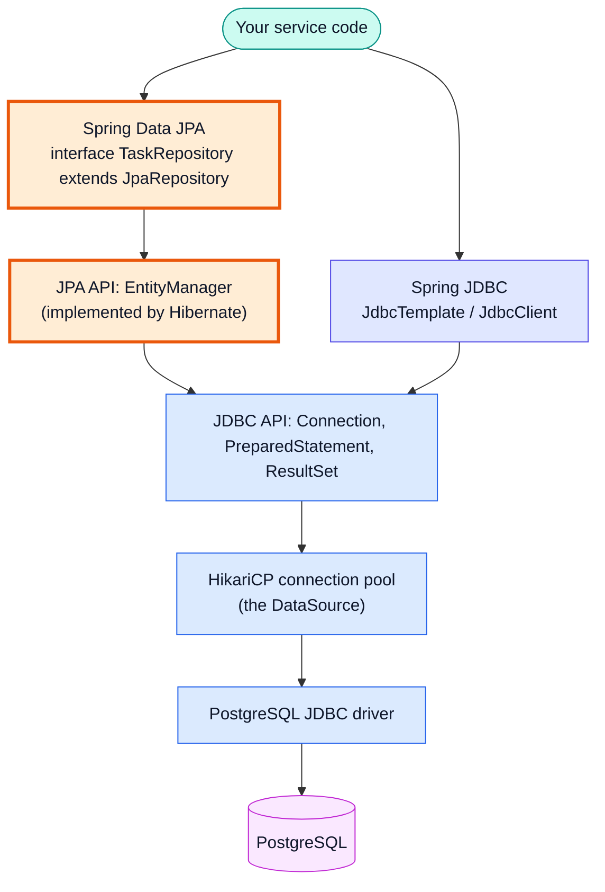
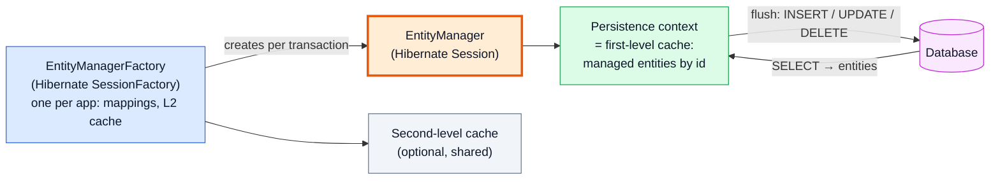
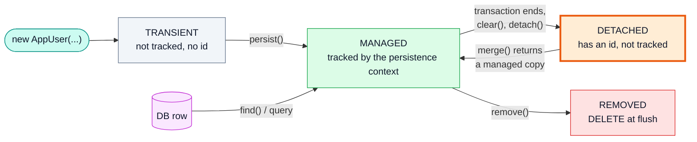
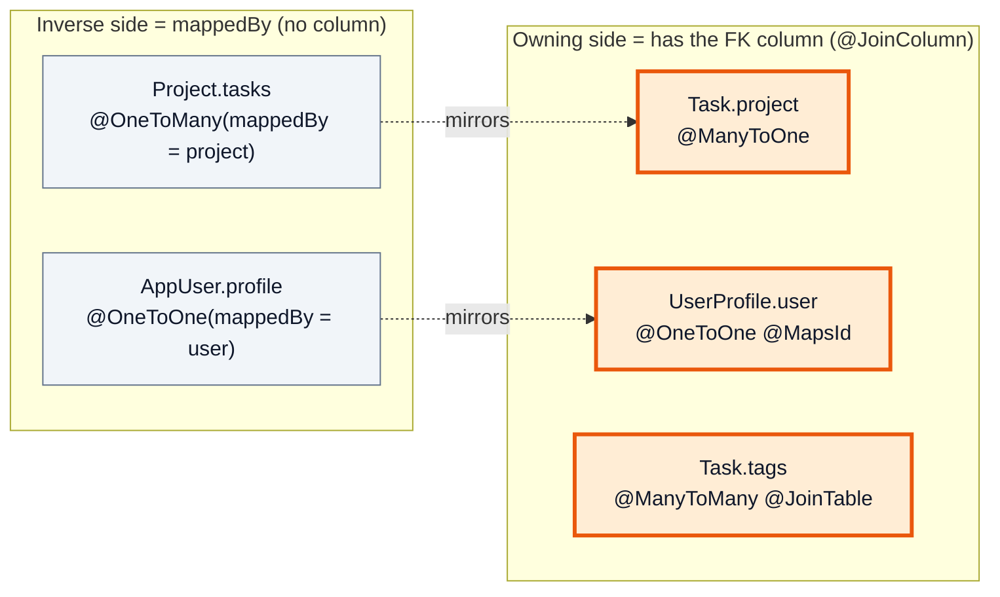
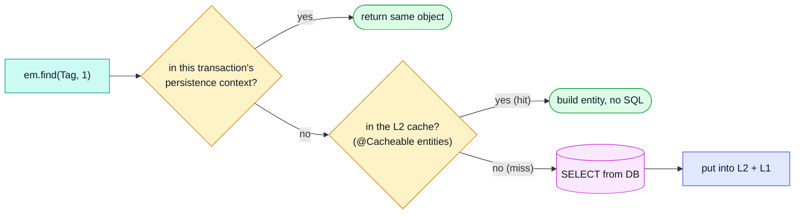

# Data Access I: Spring JDBC, JPA, Hibernate and Flyway — Complete In-Depth Guide

**Spring Boot notes #8 of 18** · Priority 🔴 · Track: Spring Boot ([README](README.md))

Until now the Task Tracker forgot everything on restart: tasks lived in a `Map`. This file moves it to **PostgreSQL** using the SQL from [file 07](spring_07_sql_essentials.md), in two ways: plain SQL with **Spring JDBC**, and objects with **JPA/Hibernate**. It covers:
- creating the schema with **Flyway**
- connection pooling with **HikariCP**
- entity mapping
- the entity lifecycle
- the first- and second-level caches
- every kind of relationship
- lazy loading

| You want… | Use |
|---|---|
| Versioned, repeatable schema changes | **Flyway** migrations (`V1__...sql`) |
| Reuse database connections | **HikariCP** (Boot's default pool) |
| Exact SQL: reports, bulk updates | **`JdbcTemplate` / `JdbcClient`** |
| Work with objects and relationships, no SQL for CRUD | **JPA** (implemented by **Hibernate**) |
| CRUD repositories without writing classes | **Spring Data JPA** (`JpaRepository`) |

> [!NOTE]
> This topic isn't in Kunal's playlist, so there are no video timestamps. The reference playlist's JdbcTemplate and JPA videos (parts 1–7) map here (see the [README](README.md#reference-playlist-where-each-video-is-covered)).
>
> **What was run:** [`examples/08-data-access/`](examples/08-data-access/) (Task Tracker 0.8.0) on Spring Boot 4.0.5, Hibernate 7.2.7, Flyway 11.14.1, HikariCP 7.0.2 and PostgreSQL 18.3. It was run twice on a freshly dropped `tracker` schema:
> - with `--spring.profiles.active=demo`, a runner that walks through the JPA concepts and prints the SQL Hibernate sends;
> - as an API with 11 HTTP requests.
>
> All SQL lines and responses below come from those runs. Log prefixes (timestamps, PIDs, threads) are shortened.

---

## Table of Contents

| # | Topic (anchor link) | Level |
|---|---|---|
| 0 | [Four Ways to Reach the Database](#0-four-ways-to-reach-the-database) | Basics |
| 1 | [Setup: Starters, DataSource and HikariCP](#1-setup-starters-datasource-and-hikaricp) | Core |
| 2 | [Schema Migrations with Flyway](#2-schema-migrations-with-flyway) | Core |
| 3 | [Spring JDBC: JdbcTemplate and JdbcClient](#3-spring-jdbc-jdbctemplate-and-jdbcclient) | Core |
| 4 | [JPA Architecture](#4-jpa-architecture) | Core |
| 5 | [Mapping Entities](#5-mapping-entities) | Core |
| 6 | [The Entity Lifecycle](#6-the-entity-lifecycle) | In depth |
| 7 | [Persistence Context: First-Level Cache, Dirty Checking, Flush](#7-persistence-context-first-level-cache-dirty-checking-flush) | In depth |
| 8 | [Relationships](#8-relationships) | In depth |
| 9 | [Fetching: Lazy, Eager and LazyInitializationException](#9-fetching-lazy-eager-and-lazyinitializationexception) | In depth |
| 10 | [Second-Level Cache](#10-second-level-cache) | In depth |
| 11 | [Spring Data JPA Repositories (First Look)](#11-spring-data-jpa-repositories-first-look) | Core |
| 12 | [Database Errors and Exception Translation](#12-database-errors-and-exception-translation) | Core |
| 13 | [Interview Questions](#13-interview-questions) | Interview |

---

## 0. Four Ways to Reach the Database



| Level | You write | Good for | Watch out for |
|---|---|---|---|
| Raw JDBC ([Java gap #12](../Java%20Topics%20Not%20Covered%20Notes/java_gap_12_junit_maven_gradle_jdbc.md)) | Connections, statements, `try`-with-resources, mapping | Learning | Lots of boilerplate, checked `SQLException` |
| **Spring JDBC** | SQL + a row mapper | Reports, bulk updates, tuned queries | You map rows by hand; no relationships |
| **JPA / Hibernate** | Annotated classes; Hibernate writes the SQL | CRUD on object graphs, change tracking | Hidden queries (N+1, file 09), lazy-loading errors |
| **Spring Data JPA** | Interfaces only | Standard CRUD, simple queries | Same as JPA: know what SQL it generates |

Real projects usually combine them: Spring Data JPA for the domain, and `JdbcTemplate`/`JdbcClient` for reports. This project does exactly that.

---

## 1. Setup: Starters, DataSource and HikariCP

```xml
<dependency>                            <!-- Spring Data JPA + Hibernate + JDBC + HikariCP -->
    <groupId>org.springframework.boot</groupId>
    <artifactId>spring-boot-starter-data-jpa</artifactId>
</dependency>
<dependency>                            <!-- runs src/main/resources/db/migration/V*.sql at startup -->
    <groupId>org.springframework.boot</groupId>
    <artifactId>spring-boot-starter-flyway</artifactId>
</dependency>
<dependency>                            <!-- Flyway's PostgreSQL support is a separate module -->
    <groupId>org.flywaydb</groupId>
    <artifactId>flyway-database-postgresql</artifactId>
</dependency>
<dependency>                            <!-- the JDBC driver: only needed at runtime -->
    <groupId>org.postgresql</groupId>
    <artifactId>postgresql</artifactId>
    <scope>runtime</scope>
</dependency>
```

| Dependency | Why it's needed |
|---|---|
| `spring-boot-starter-data-jpa` | Hibernate, Spring Data JPA, Spring JDBC (`JdbcTemplate`) and HikariCP |
| `spring-boot-starter-flyway` | Boot 4 puts each technology's auto-configuration in its own module; the Flyway starter brings it |
| `flyway-database-postgresql` | Since Flyway 10, each database's support is a separate jar; without it Flyway refuses PostgreSQL |
| `postgresql` (`runtime`) | The driver. Your code only uses the JDBC/JPA APIs, so it isn't needed to compile |

The connection settings, from `application.yml`:

```yaml
  datasource:
    url: jdbc:postgresql://localhost:5432/springnotes?currentSchema=tracker
    username: springnotes
    password: ${DB_PASSWORD:springnotes}   # env var wins; the default is the throwaway practice password
    hikari:
      maximum-pool-size: 5                # default 10
      pool-name: TrackerPool
```

**Why a connection pool?** Opening a database connection means a TCP connection, authentication and a server process, which takes milliseconds. A pool opens a few connections once and **lends** them to each request. When the request is done, the connection goes back to the pool instead of being closed. Real startup log:

```
INFO com.zaxxer.hikari.HikariDataSource : TrackerPool - Starting...
INFO com.zaxxer.hikari.pool.HikariPool : TrackerPool - Added connection org.postgresql.jdbc.PgConnection@...
INFO com.zaxxer.hikari.HikariDataSource : TrackerPool - Start completed.
```

| `spring.datasource.hikari.*` | Default | Meaning |
|---|---|---|
| `maximum-pool-size` | 10 | Max connections. More isn't faster: the database has limited CPUs |
| `minimum-idle` | same as max | Idle connections kept ready |
| `connection-timeout` | 30 s | How long a request waits for a free connection before failing |
| `idle-timeout` | 10 min | Close extra idle connections after this |
| `max-lifetime` | 30 min | Replace connections periodically (before the DB or a firewall drops them) |

> [!WARNING]
> **Pool exhaustion** is a classic production outage. When every connection is held, for example by a long transaction that calls a slow external API, new requests wait `connection-timeout` and then fail. Keep transactions short, and never do remote calls inside them.

> [!CAUTION]
> Never commit real passwords. `${DB_PASSWORD:springnotes}` reads the `DB_PASSWORD` environment variable and falls back to the throwaway practice value. Production supplies the real value (file 14).

---

## 2. Schema Migrations with Flyway

Who creates the tables? Hibernate *can* (`ddl-auto`), but in real projects the schema is managed by **migrations**: numbered SQL files kept in git and applied in order, exactly once, on every environment.

```
src/main/resources/db/migration/
├── V1__create_schema.sql
└── V2__seed_data.sql
```

| Naming rule | Example |
|---|---|
| `V<version>__<description>.sql` (two underscores) | `V1__create_schema.sql`, `V2_1__add_index.sql` |
| Versions are applied in order | 1, 2, 2.1, 3… |
| Repeatable migrations `R__name.sql` | Re-run whenever their checksum changes (views, functions) |

Real startup log on an empty database:

```
INFO org.flywaydb.core.FlywayExecutor : Database: jdbc:postgresql://localhost:5432/springnotes?currentSchema=tracker (PostgreSQL 18.3)
INFO o.f.core.internal.database.base.Schema : Creating schema "tracker" ...
INFO o.f.c.i.s.JdbcTableSchemaHistory : Creating Schema History table "tracker"."flyway_schema_history" ...
INFO o.f.core.internal.command.DbMigrate : Current version of schema "tracker": null
INFO o.f.core.internal.command.DbMigrate : Migrating schema "tracker" to version "1 - create schema"
INFO o.f.core.internal.command.DbMigrate : Migrating schema "tracker" to version "2 - seed data"
INFO o.f.core.internal.command.DbMigrate : Successfully applied 2 migrations to schema "tracker", now at version v2 (execution time 00:00.124s)
```

Flyway records each applied migration, with a **checksum**, in `flyway_schema_history`. On the next start it applies only new files.

> [!IMPORTANT]
> **Never edit a migration that has already run** anywhere. Flyway compares checksums and refuses to start when an applied file has changed. To change the schema, add `V3__...sql`.

| `spring.jpa.hibernate.ddl-auto` | Does | Use |
|---|---|---|
| `none` | Nothing | Production with migrations (Boot's default for non-embedded DBs) |
| **`validate`** | Checks entities match the tables; fails at startup if not | **With Flyway** (this project) |
| `update` | Adds missing tables/columns; never drops | Quick prototypes only: no history, can't rename |
| `create` / `create-drop` | Drops and recreates (on shutdown too for `create-drop`) | Tests, demos (default for embedded H2) |

Both migration files are shown in the [Complete Example](#-complete-example-everything-together).

---

## 3. Spring JDBC: JdbcTemplate and JdbcClient

Spring JDBC keeps you in SQL but removes the boilerplate: opening and closing connections, creating statements, looping over `ResultSet`, and translating `SQLException`. Boot auto-configures both `JdbcTemplate` and `JdbcClient` from the `DataSource`.

```java
package com.notes.tasks.jdbc;

import org.springframework.jdbc.core.JdbcTemplate;
import org.springframework.jdbc.core.RowMapper;
import org.springframework.jdbc.core.simple.JdbcClient;
import org.springframework.jdbc.support.GeneratedKeyHolder;
import org.springframework.jdbc.support.KeyHolder;
import org.springframework.stereotype.Repository;

import java.util.List;

/**
 * Plain SQL with Spring JDBC, no JPA: best for reports, bulk updates and queries that don't map to one entity.
 * Both beans are auto-configured by Boot from the DataSource.
 */
@Repository
public class ReportDao {
    private final JdbcTemplate jdbcTemplate;      // the classic API (since Spring 1)
    private final JdbcClient jdbcClient;          // the fluent API (since Spring 6.1)

    public ReportDao(JdbcTemplate jdbcTemplate, JdbcClient jdbcClient) {
        this.jdbcTemplate = jdbcTemplate;
        this.jdbcClient = jdbcClient;
    }

    public record ProjectSummary(long id, String name, String owner, int tasks, int done) {}

    private static final RowMapper<ProjectSummary> SUMMARY_MAPPER = (rs, rowNum) -> new ProjectSummary(
            rs.getLong("id"), rs.getString("name"), rs.getString("owner"),
            rs.getInt("tasks"), rs.getInt("done"));

    /** JdbcTemplate: SQL + RowMapper (one call per row) -> List. */
    public List<ProjectSummary> projectSummaries() {
        return jdbcTemplate.query("""
                SELECT p.id, p.name, u.username AS owner,
                       count(t.id) AS tasks,
                       count(t.id) FILTER (WHERE t.done) AS done
                FROM project p
                JOIN app_user u ON u.id = p.owner_id
                LEFT JOIN task t ON t.project_id = p.id
                GROUP BY p.id, p.name, u.username
                ORDER BY p.id
                """, SUMMARY_MAPPER);
    }

    /** JdbcTemplate: a single value, with a ? parameter (a prepared statement: no SQL injection). */
    public int openTasksOf(String username) {
        Integer n = jdbcTemplate.queryForObject("""
                SELECT count(*) FROM task t JOIN app_user u ON u.id = t.assignee_id
                WHERE u.username = ? AND NOT t.done
                """, Integer.class, username);
        return n == null ? 0 : n;
    }

    /** JdbcClient: named parameters and a record mapped automatically from column names. */
    public record TagUsage(String name, long uses) {}

    public List<TagUsage> tagUsage(int minUses) {
        return jdbcClient.sql("""
                        SELECT g.name, count(tt.task_id) AS uses
                        FROM tag g LEFT JOIN task_tag tt ON tt.tag_id = g.id
                        GROUP BY g.name HAVING count(tt.task_id) >= :min
                        ORDER BY uses DESC, g.name
                        """)
                .param("min", minUses)
                .query(TagUsage.class)
                .list();
    }

    /** JdbcTemplate update + KeyHolder: insert and get the generated id back. */
    public long insertTag(String name) {
        KeyHolder keys = new GeneratedKeyHolder();
        jdbcTemplate.update(con -> {
            var ps = con.prepareStatement("INSERT INTO tag (name) VALUES (?)", new String[] {"id"});
            ps.setString(1, name);
            return ps;
        }, keys);
        return keys.getKey().longValue();
    }
}
```

| API | Method | Returns |
|---|---|---|
| `JdbcTemplate` | `query(sql, RowMapper, args...)` | `List<T>`, one `mapRow` call per row |
| | `queryForObject(sql, Class, args...)` | A single value (must be exactly one row) |
| | `update(sql, args...)` | Rows affected (INSERT/UPDATE/DELETE) |
| | `update(PreparedStatementCreator, KeyHolder)` | + the generated key |
| | `batchUpdate(sql, List<Object[]>)` | Many rows in one round trip |
| `NamedParameterJdbcTemplate` | `query("... WHERE x = :x", Map.of("x", v), mapper)` | Named instead of `?` parameters |
| **`JdbcClient`** (Spring 6.1+) | `sql(...).param(...).query(Type.class).list()` / `.single()` / `.optional()` / `.update()` | Fluent; maps records by column name |

Real results from the API run:

```
> GET /api/reports/projects
[ {"id": 1, "name": "Task Tracker", "owner": "asha", "tasks": 3, "done": 2},
  {"id": 2, "name": "Website", "owner": "meera", "tasks": 1, "done": 0} ]

> GET /api/reports/tags            (JdbcClient, after a task tagged backend + testing was created)
[ {"name": "backend", "uses": 4}, {"name": "frontend", "uses": 1}, {"name": "testing", "uses": 1}, {"name": "urgent", "uses": 1} ]

> GET /api/reports/open-tasks/meera
{"username": "meera", "openTasks": 2}
```

> [!TIP]
> No `org.hibernate.SQL` lines appear for these requests, because Spring JDBC bypasses Hibernate entirely. To log its SQL, set `logging.level.org.springframework.jdbc.core=DEBUG`.

---

## 4. JPA Architecture

**JPA** (Jakarta Persistence) is a **specification**: interfaces and annotations in `jakarta.persistence`. **Hibernate** is the most used **implementation** (others: EclipseLink). Spring Boot uses Hibernate. **ORM** (Object-Relational Mapping) means mapping classes to tables and objects to rows.



| JPA | Hibernate name | Lifetime | Thread-safe? |
|---|---|---|---|
| `EntityManagerFactory` | `SessionFactory` | Whole application | Yes |
| `EntityManager` | `Session` | One unit of work (in Spring: one transaction) | **No** |
| Persistence context | — | Same as the `EntityManager` | — |

> [!NOTE]
> In Spring you inject `EntityManager` into a singleton, as `JpaDemo` does, and it's still safe: Spring injects a **shared proxy** that delegates to the `EntityManager` bound to the **current transaction's thread**. The same trick as the request-scoped bean in file 05.

---

## 5. Mapping Entities

```java
package com.notes.tasks.model;

import jakarta.persistence.Column;
import jakarta.persistence.Embedded;
import jakarta.persistence.Entity;
import jakarta.persistence.EnumType;
import jakarta.persistence.Enumerated;
import jakarta.persistence.FetchType;
import jakarta.persistence.GeneratedValue;
import jakarta.persistence.GenerationType;
import jakarta.persistence.Id;
import jakarta.persistence.JoinColumn;
import jakarta.persistence.JoinTable;
import jakarta.persistence.ManyToMany;
import jakarta.persistence.ManyToOne;
import lombok.Getter;
import lombok.NoArgsConstructor;
import lombok.Setter;

import java.time.LocalDate;
import java.util.LinkedHashSet;
import java.util.Set;

@Entity
@Getter @Setter
@NoArgsConstructor
public class Task {

    @Id
    @GeneratedValue(strategy = GenerationType.IDENTITY)
    private Long id;

    /** Owning side of Project.tasks: this table has the project_id FK. */
    @ManyToOne(fetch = FetchType.LAZY, optional = false)
    @JoinColumn(name = "project_id")
    private Project project;

    /** Unidirectional many-to-one: AppUser has no list of tasks. */
    @ManyToOne(fetch = FetchType.LAZY)
    @JoinColumn(name = "assignee_id")
    private AppUser assignee;

    @Column(nullable = false, length = 60)
    private String title;

    @Column(length = 500)
    private String description;

    @Enumerated(EnumType.STRING)              // store "HIGH", not the ordinal 2
    @Column(nullable = false, length = 6)
    private Priority priority = Priority.MEDIUM;

    private boolean done;

    private LocalDate dueDate;                // column name: due_date (camelCase -> snake_case)

    @Embedded
    private AuditInfo audit;

    @ManyToMany
    @JoinTable(name = "task_tag",
            joinColumns = @JoinColumn(name = "task_id"),
            inverseJoinColumns = @JoinColumn(name = "tag_id"))
    private Set<Tag> tags = new LinkedHashSet<>();

    public Task(String title, Priority priority, AuditInfo audit) {
        this.title = title;
        this.priority = priority;
        this.audit = audit;
    }
}
```

| Annotation | Meaning |
|---|---|
| `@Entity` | This class maps to a table (name = class name unless `@Table(name=...)`) |
| `@Table(name = "app_user")` | Explicit table name (`user` is reserved in PostgreSQL) |
| `@Id` | The primary key field |
| `@GeneratedValue(strategy = IDENTITY)` | Database generates it (`GENERATED ... AS IDENTITY`) |
| `@Column(nullable, length, unique, name)` | Column details; used by `ddl-auto` and `validate` |
| `@Enumerated(EnumType.STRING)` | Store `"HIGH"`. The default `ORDINAL` stores `2`, which breaks if you reorder the enum |
| `@Embeddable` / `@Embedded` | A value object whose columns live in the owner's table |
| `@Transient` | Not persisted |

**Naming:** Boot's default naming strategy turns `dueDate` into `due_date` and `AppUser` into `app_user`. That's why most fields need no `@Column(name=...)`.

| `GenerationType` | How | Notes |
|---|---|---|
| `IDENTITY` | DB auto-increment column | Simple. Hibernate must INSERT immediately to learn the id, which **disables JDBC insert batching** |
| `SEQUENCE` | `SELECT nextval(...)` (allocated in blocks) | Best for PostgreSQL at scale; allows batching |
| `UUID` | Generated in Java | Good public ids; bigger index |
| `AUTO` | Hibernate decides | Avoid: be explicit |

**The embeddable** (no table, no id; its columns `created_at`/`created_by` sit in `task`):

```java
package com.notes.tasks.model;

import jakarta.persistence.Column;
import jakarta.persistence.Embeddable;
import lombok.AllArgsConstructor;
import lombok.Getter;
import lombok.NoArgsConstructor;

import java.time.Instant;

/** A value object with no table or id of its own: its columns live in the owning entity's table. */
@Embeddable
@Getter
@NoArgsConstructor
@AllArgsConstructor
public class AuditInfo {

    @Column(name = "created_at", nullable = false)
    private Instant createdAt;

    @Column(name = "created_by", nullable = false, length = 30)
    private String createdBy;
}
```

> [!WARNING]
> **Lombok on entities:** use `@Getter`/`@Setter`, not `@Data` or `@ToString`/`@EqualsAndHashCode` on all fields. Those touch every field, including lazy relations: they trigger extra queries, `LazyInitializationException`, or infinite recursion between `Project.toString()` and `Task.toString()`. JPA also needs a **no-arg constructor** (`@NoArgsConstructor`), and entity classes must not be `final`, because Hibernate creates proxy subclasses.

---

## 6. The Entity Lifecycle



The demo's first step, with the real SQL:

```java
AppUser dev = new AppUser("dev", "dev@example.com");
say("transient: id=" + dev.getId());
tx.executeWithoutResult(s -> {
    em.persist(dev);                                     // IDENTITY: INSERT runs now to get the id
    say("managed:   id=" + dev.getId() + ", em.contains=" + em.contains(dev));
});
say("detached:  em.contains=" + tx.execute(s -> em.contains(dev)));
dev.setEmail("dev@new.example.com");                     // change while detached: nothing is sent
say("changed the detached object (no SQL)");
AppUser merged = tx.execute(s -> em.merge(dev));         // SELECT current state, then UPDATE at commit
say("merge returned a different instance: " + (merged != dev));
tx.executeWithoutResult(s -> em.remove(em.find(AppUser.class, dev.getId())));
```

```
=== 1. Entity lifecycle: transient -> managed -> detached -> merged -> removed
    transient: id=null
DEBUG SQL : insert into tracker.app_user (email,username) values (?,?)
    managed:   id=4, em.contains=true
    detached:  em.contains=false
    changed the detached object (no SQL)
DEBUG SQL : select au1_0.id,au1_0.email,p1_0.user_id,p1_0.bio,p1_0.github,au1_0.username from tracker.app_user au1_0 left join tracker.user_profile p1_0 on au1_0.id=p1_0.user_id where au1_0.id=?
DEBUG SQL : update tracker.app_user set email=?,username=? where id=?
    merge returned a different instance: true
DEBUG SQL : select au1_0.id,au1_0.email,au1_0.username from tracker.app_user au1_0 where au1_0.id=?
DEBUG SQL : select up1_0.user_id,up1_0.bio,up1_0.github from tracker.user_profile up1_0 where up1_0.user_id=?
DEBUG SQL : delete from tracker.app_user where id=?
    removed
```

| Observation | Explanation |
|---|---|
| `INSERT` right at `persist()` | With `IDENTITY`, the id only exists after the INSERT. Other strategies wait until flush |
| Changing the detached object sent nothing | Nobody tracks detached objects |
| `merge` → `SELECT` then `UPDATE` | `merge` loads the current row into the context, copies your object's state onto it, and returns **that managed copy**, not your object |
| Extra `user_profile` select | The inverse side of a one-to-one is loaded eagerly; see [Section 8.1](#81-one-to-one) |

---

## 7. Persistence Context: First-Level Cache, Dirty Checking, Flush

The **persistence context** is a map from `(entity type, id)` to the managed instance. It has three jobs:

| Job | Effect |
|---|---|
| **First-level cache** | `find(Task, 1)` twice in one transaction = **one** SELECT, and the **same** Java object |
| **Identity guarantee** | One row = one object per context, so `a == b` |
| **Dirty checking** | At flush, Hibernate compares each managed entity with a snapshot taken at load time and writes `UPDATE`s for the ones that changed. **No `save()` call needed** |

```
=== 2. First-level cache (persistence context): one per transaction
DEBUG SQL : select t1_0.id,t1_0.assignee_id,...,t1_0.title from tracker.task t1_0 where t1_0.id=?
    same instance within one transaction: true
DEBUG SQL : select t1_0.id,t1_0.assignee_id,...,t1_0.title from tracker.task t1_0 where t1_0.id=?
    new transaction loaded it again

=== 3. Dirty checking: change a managed entity, no save() call
DEBUG SQL : select t1_0.id,t1_0.assignee_id,...,t1_0.title from tracker.task t1_0 where t1_0.id=?
    title changed in memory; committing...
DEBUG SQL : update tracker.task set assignee_id=?,created_at=?,created_by=?,description=?,done=?,due_date=?,priority=?,project_id=?,title=? where id=?
    committed
```

(Long column lists shortened with `...`; the full lines are in the Complete Example output.)

| Detail | Explanation |
|---|---|
| The first-level cache can't be turned off and lives only as long as the transaction | Each transaction starts with an empty context |
| The `UPDATE` lists **all** columns, though only `title` changed | Hibernate's default: one prepared statement per entity, reused. `@DynamicUpdate` on the class writes only changed columns |
| The UPDATE came at **commit**, not at `setTitle` | **Flush** = write pending changes. Happens before commit, before a query that might read the changed data, or on `em.flush()` |

The service uses the same idea. `patch` never calls `save`:

```java
@Transactional
public TaskResponse patch(long id, PatchTaskRequest req) {
    Task t = find(id);                        // managed entity...
    if (req.title() != null) t.setTitle(req.title());
    if (req.done() != null) t.setDone(req.done());
    if (req.priority() != null) t.setPriority(req.priority());
    return TaskResponse.from(t);              // ...no save() call: dirty checking issues the UPDATE at commit
}
```

> [!WARNING]
> Dirty checking only happens inside a **read-write transaction**. `TaskService` is `@Transactional(readOnly = true)` at class level, so `patch` must override it with `@Transactional`. In a read-only transaction Hibernate skips the dirty check, and changes are silently lost.

---

## 8. Relationships



> [!IMPORTANT]
> **Only the owning side is written to the database.** If you add a task to `project.getTasks()` but forget `task.setProject(project)`, nothing is saved for that link. That's why `Project` has `addTask`/`removeTask` helpers that set **both** sides.

| Mapping | In this project | Table design | Default fetch |
|---|---|---|---|
| `@ManyToOne` | `Task.project`, `Task.assignee` | FK in `task` | **EAGER** (we set LAZY) |
| `@OneToMany(mappedBy)` | `Project.tasks` | Uses `task.project_id` | LAZY |
| `@OneToOne` | `UserProfile.user` / `AppUser.profile` | Shared PK `user_profile.user_id` | **EAGER** |
| `@ManyToMany` | `Task.tags` | Join table `task_tag` | LAZY |

**Uni- vs bidirectional:** `Task.assignee` is **unidirectional** (`AppUser` has no task list). `Project.tasks` ↔ `Task.project` is **bidirectional**. Only add the inverse side when you need to navigate that way.

### 8.1 One-to-one

```java
package com.notes.tasks.model;

import jakarta.persistence.Entity;
import jakarta.persistence.FetchType;
import jakarta.persistence.Id;
import jakarta.persistence.JoinColumn;
import jakarta.persistence.MapsId;
import jakarta.persistence.OneToOne;
import jakarta.persistence.Table;
import lombok.Getter;
import lombok.NoArgsConstructor;
import lombok.Setter;

/** One-to-one with a SHARED primary key: user_profile.user_id is both the PK and the FK. */
@Entity
@Table(name = "user_profile")
@Getter @Setter
@NoArgsConstructor
public class UserProfile {

    @Id
    private Long id;                          // copied from the user by @MapsId

    @MapsId                                   // "my id is the id of this association"
    @OneToOne(fetch = FetchType.LAZY)
    @JoinColumn(name = "user_id")             // owning side: this table holds the FK
    private AppUser user;

    private String bio;
    private String github;
}
```

`@MapsId` makes the profile's primary key **equal** to the user's id, so no separate id column is needed. On the inverse side, `AppUser.profile` is declared `LAZY`. Yet the real SQL **always** loads the profile together with the user: a `left join` in the merge, and a separate `select ... from user_profile` after each user load in the API run. Hibernate can't know whether a profile exists without querying, so it can't hand out a proxy (a stand-in object that loads later), and it fetches eagerly. Fixes are making the relation unidirectional from the owning side, or bytecode enhancement.

### 8.2 One-to-many / many-to-one

```java
package com.notes.tasks.model;

import jakarta.persistence.CascadeType;
import jakarta.persistence.Column;
import jakarta.persistence.Entity;
import jakarta.persistence.FetchType;
import jakarta.persistence.GeneratedValue;
import jakarta.persistence.GenerationType;
import jakarta.persistence.Id;
import jakarta.persistence.JoinColumn;
import jakarta.persistence.ManyToOne;
import jakarta.persistence.OneToMany;
import jakarta.persistence.OrderBy;
import lombok.Getter;
import lombok.NoArgsConstructor;
import lombok.Setter;

import java.util.ArrayList;
import java.util.List;

@Entity                                       // table name defaults to the class name: "project"
@Getter @Setter
@NoArgsConstructor
public class Project {

    @Id
    @GeneratedValue(strategy = GenerationType.IDENTITY)
    private Long id;

    @Column(nullable = false, unique = true, length = 60)
    private String name;

    @ManyToOne(fetch = FetchType.LAZY, optional = false)
    @JoinColumn(name = "owner_id")
    private AppUser owner;

    /** Bidirectional one-to-many. mappedBy = the field on Task that owns the FK. */
    @OneToMany(mappedBy = "project", cascade = CascadeType.ALL, orphanRemoval = true)
    @OrderBy("id")
    private List<Task> tasks = new ArrayList<>();

    /** Keep BOTH sides of the relationship in sync: always add through this method. */
    public void addTask(Task task) {
        tasks.add(task);
        task.setProject(this);
    }

    public void removeTask(Task task) {
        tasks.remove(task);
        task.setProject(null);
    }
}
```

| Option | Effect |
|---|---|
| `cascade = CascadeType.ALL` | `persist`, `merge`, `remove`… on the project also apply to its tasks |
| `orphanRemoval = true` | A task removed from the collection is **deleted** |
| `@OrderBy("id")` | `ORDER BY` when loading the collection |

Cascade and orphan removal, real:

```
=== 6. Cascade (persist through the parent) and orphan removal
DEBUG SQL : select p1_0.id,p1_0.name,p1_0.owner_id from tracker.project p1_0 where p1_0.id=?
DEBUG SQL : insert into tracker.task (assignee_id,created_at,created_by,description,done,due_date,priority,project_id,title) values (?,?,?,?,?,?,?,?,?)
    task saved through the project, id=5
...
    removed from project.tasks; committing...
DEBUG SQL : delete from tracker.task_tag where task_id=?
DEBUG SQL : delete from tracker.task where id=?
```

Hibernate first deleted the task's rows in the `task_tag` join table, then the task.

> [!CAUTION]
> `CascadeType.REMOVE`/`ALL` belongs on **parent → child** (project → tasks). Never put it on `@ManyToOne` (task → project) or `@ManyToMany`, or deleting one task could delete the whole project, or a tag shared by other tasks.

### 8.3 Many-to-many

`Task.tags` uses `@JoinTable(name = "task_tag", joinColumns = task_id, inverseJoinColumns = tag_id)`. Creating a task with tags (API run):

```
DEBUG SQL : select t1_0.id,t1_0.name from tracker.tag t1_0 where t1_0.name=?
DEBUG SQL : insert into tracker.tag (name) values (?)
DEBUG SQL : select t1_0.id,t1_0.name from tracker.tag t1_0 where t1_0.name=?
DEBUG SQL : insert into tracker.task (assignee_id,created_at,created_by,description,done,due_date,priority,project_id,title) values (?,?,?,?,?,?,?,?,?)
DEBUG SQL : insert into tracker.task_tag (task_id,tag_id) values (?,?)
DEBUG SQL : insert into tracker.task_tag (task_id,tag_id) values (?,?)
```

`testing` didn't exist, so it was inserted. `backend` was found. Then come the task and two join rows.

| Tip | Why |
|---|---|
| Use a `Set`, not a `List`, for `@ManyToMany` | With a `List`, Hibernate deletes **all** join rows and re-inserts them on any change ("bag" semantics) |
| Need extra columns on the link (e.g. `added_at`)? | Make the join table an entity (`TaskTag`) with two `@ManyToOne`s |

---

## 9. Fetching: Lazy, Eager and LazyInitializationException

**LAZY** means "load when first accessed". Hibernate puts a **proxy** or an uninitialized collection in the field, and the SELECT runs on first use. **EAGER** loads it immediately with the owner.

```
=== 5. Lazy loading
DEBUG SQL : select p1_0.id,p1_0.name,p1_0.owner_id from tracker.project p1_0 where p1_0.id=?
    loaded project 'Task Tracker' (tasks not loaded yet)
DEBUG SQL : select t1_0.project_id,t1_0.id,...,t1_0.title from tracker.task t1_0 where t1_0.project_id=? order by t1_0.id
    tasks: 3
DEBUG SQL : select p1_0.id,p1_0.name,p1_0.owner_id from tracker.project p1_0 where p1_0.id=?
    outside the transaction: LazyInitializationException
    Cannot lazily initialize collection of role 'com.notes.tasks.model.Project.tasks' with key '2' (no session)
```

**`LazyInitializationException`**: the transaction (and its persistence context) has ended, so there's nothing left to run the query with.

| Fix | How |
|---|---|
| **Map to DTOs inside the transaction** (this project) | `TaskResponse.from(t)` is called in `@Transactional` service methods |
| Fetch what you need in the query | `JOIN FETCH` or `@EntityGraph` (file 09); also fixes N+1 |
| ~~Make it EAGER~~ | Loads too much everywhere; causes N+1 elsewhere |
| ~~Open Session in View~~ | See below |

> [!WARNING]
> **`spring.jpa.open-in-view`** is `true` by default in Boot. It keeps the persistence context open for the whole web request, so lazy loading "works" in controllers and JSON serialization. It also holds a database connection for the entire request and hides N+1 queries. Boot logs a warning when you leave it unset. This project sets it to **`false`**.

The API run shows lazy loading's cost. `GET /api/projects/1/tasks` maps three tasks and sends **9** SELECTs: the project, the tasks, then one select for each task's tags (3), plus each distinct assignee and their profile (ravi once, since the persistence context already holds him for task 2, then meera). This is the **N+1 problem**, solved in file 09.

---

## 10. Second-Level Cache

The first-level cache dies with the transaction. The **second-level (L2) cache** belongs to the `EntityManagerFactory` and is **shared by all transactions**. It's off by default. Setting it up needs a cache provider (here JCache + Caffeine) and per-entity opt-in:

```yaml
    properties:
      hibernate:
        default_schema: tracker
        cache:
          use_second_level_cache: true
          region:
            factory_class: jcache
        javax:
          cache:
            provider: com.github.benmanes.caffeine.jcache.spi.CaffeineCachingProvider
            missing_cache_strategy: create
        generate_statistics: true         # lets the demo read cache hit/miss counters
```

```java
package com.notes.tasks.model;

import jakarta.persistence.Cacheable;
import jakarta.persistence.Column;
import jakarta.persistence.Entity;
import jakarta.persistence.GeneratedValue;
import jakarta.persistence.GenerationType;
import jakarta.persistence.Id;
import lombok.Getter;
import lombok.NoArgsConstructor;
import org.hibernate.annotations.Cache;
import org.hibernate.annotations.CacheConcurrencyStrategy;

/** Tags rarely change, so they live in the SECOND-level cache, shared by all sessions. */
@Entity
@Cacheable
@Cache(usage = CacheConcurrencyStrategy.READ_WRITE)
@Getter
@NoArgsConstructor
public class Tag {

    @Id
    @GeneratedValue(strategy = GenerationType.IDENTITY)
    private Long id;

    @Column(nullable = false, unique = true, length = 30)
    private String name;

    public Tag(String name) {
        this.name = name;
    }
}
```

```
=== 4. Second-level cache: shared across transactions (Tag is @Cacheable)
DEBUG SQL : select t1_0.id,t1_0.name from tracker.tag t1_0 where t1_0.id=?
    tx A: backend
    tx B: backend (no SQL above this line)
    L2 puts=1 hits=1 misses=1
```

Transaction A missed the cache, ran the SELECT and **put** the tag in the L2 cache. Transaction B **hit** the cache: no SQL.



| `CacheConcurrencyStrategy` | For |
|---|---|
| `READ_ONLY` | Data that never changes (fastest; updating throws) |
| `NONSTRICT_READ_WRITE` | Rarely updated; short stale windows are OK |
| `READ_WRITE` | Updated data that must stay consistent (soft locks) |
| `TRANSACTIONAL` | JTA/XA environments |

| L1 cache | L2 cache |
|---|---|
| Per `EntityManager` (transaction) | Per `EntityManagerFactory` (application) |
| Always on | Off by default; opt in per entity |
| No configuration | Needs a provider (Caffeine, Ehcache, Infinispan…) |
| Cleared at transaction end | Lives until evicted or expired |

> [!CAUTION]
> The L2 cache only knows about changes made **through Hibernate in this JVM**. A `JdbcTemplate` update, a manual SQL fix or a second app instance won't refresh it, so stale data is possible. Use it for reference data (tags, countries, settings). For multiple instances, use a distributed cache (Redis/Infinispan) or none. Application-level caching with `@Cacheable` methods comes in file 13.

---

## 11. Spring Data JPA Repositories (First Look)

```java
package com.notes.tasks.repo;

import com.notes.tasks.model.Tag;
import org.springframework.data.jpa.repository.JpaRepository;

import java.util.Optional;

public interface TagRepository extends JpaRepository<Tag, Long> {
    Optional<Tag> findByName(String name);    // derived query: Spring writes the JPQL from the name
}
```

At startup Spring Data creates a class implementing the interface (a proxy backed by `SimpleJpaRepository`).

| Inherited method | SQL |
|---|---|
| `findById(id)` | `select ... where id=?` → `Optional` |
| `findAll()` | `select ...` |
| `save(entity)` | **new** (id null) → `persist` (INSERT); otherwise → `merge` (SELECT + UPDATE) |
| `saveAll`, `deleteById`, `count`, `existsById` | As named |
| `flush()`, `saveAndFlush()` | Force the SQL now |

`findByName(String name)` is a **derived query**: Spring parses the method name and generates `select t from Tag t where t.name = ?1`. File 09 covers derived queries, `@Query`, JPQL, projections, pagination, Specifications and transactions in depth.

> [!TIP]
> All repository methods are already `@Transactional` (read-only for finders). But calling two repository methods from a non-transactional method means **two transactions** and two persistence contexts. Put `@Transactional` on the **service** method so the whole use case is one unit of work.

---

## 12. Database Errors and Exception Translation

Spring translates driver- and Hibernate-specific exceptions into its own **`DataAccessException`** hierarchy, so your code doesn't depend on PostgreSQL error codes. `@Repository` classes and Spring Data repositories get this translation automatically.

| Spring exception | Typical cause |
|---|---|
| `DataIntegrityViolationException` | `NOT NULL`, `UNIQUE`, FK, `CHECK` or length violation |
| `DuplicateKeyException` | A subclass for unique violations (from Spring JDBC) |
| `EmptyResultDataAccessException` | `queryForObject` found no row |
| `OptimisticLockingFailureException` | `@Version` conflict (file 09) |
| `CannotGetJdbcConnectionException` | DB down, wrong password, pool exhausted |

The API run created a task with a 45-character tag; the column is `VARCHAR(30)` and the DTO didn't validate tag length:

```
> POST /api/projects/1/tasks  {"title": "Bad tag", "tags": ["this-tag-name-is-much-too-long-for-the-column"]}
WARN org.hibernate.orm.jdbc.error : HHH000247: ErrorCode: 0, SQLState: 22001
WARN org.hibernate.orm.jdbc.error : ERROR: value too long for type character varying(30)
< 409  {"detail": "The data conflicts with existing data or a database rule", "title": "Conflict",
        "exception": "DataIntegrityViolationException", ...}
```

The whole transaction rolled back: the final report still shows 3 tasks in Task Tracker. This is [file 07](spring_07_sql_essentials.md#2-ddl-tables-types-and-constraints)'s point in action: constraints are enforced by the database, even when the application has a bug. The right fix is validating tag length in the DTO (`Set<@NotBlank @Size(max = 30) String> tags`) to get a clear 400.

---

## 13. Interview Questions

| Question | Answer |
|---|---|
| JPA vs Hibernate vs Spring Data JPA? | JPA is the spec; Hibernate implements it; Spring Data JPA generates repositories on top of JPA. |
| What is a persistence context? | The set of managed entities of one `EntityManager`; it's the first-level cache, guarantees one object per row, and does dirty checking. |
| Entity states? | Transient, managed, detached, removed. |
| `persist` vs `merge`? | `persist` makes the given new object managed. `merge` copies a detached object's state onto a managed instance (loading it if needed) and returns that instance. |
| What is dirty checking? | At flush Hibernate compares managed entities with their load-time snapshot and writes UPDATEs; no explicit save needed. |
| When does flush happen? | Before commit, before queries that could see pending changes (AUTO mode), or on `flush()`. |
| First- vs second-level cache? | L1: per transaction, always on. L2: per application, opt-in per entity, needs a provider. |
| Owning vs inverse side? | Owning side has the FK (`@JoinColumn`) and is what Hibernate writes; inverse side has `mappedBy` and is ignored for writes. |
| Default fetch types? | `@ManyToOne`/`@OneToOne` EAGER; `@OneToMany`/`@ManyToMany` LAZY. Make everything LAZY and fetch explicitly. |
| What causes `LazyInitializationException`? | Touching an unloaded lazy association after the persistence context closed. Fix by fetching in the query or mapping to DTOs inside the transaction. |
| What is Open Session in View? Why disable it? | Keeps the persistence context open for the whole request; it hides N+1 queries and holds DB connections longer. |
| `CascadeType.ALL` vs `orphanRemoval`? | Cascade propagates operations to children; orphan removal deletes children removed from the collection. |
| Why `Set` for `@ManyToMany`? | A `List` makes Hibernate delete and re-insert all join rows on change. |
| `IDENTITY` vs `SEQUENCE`? | IDENTITY uses auto-increment and prevents insert batching; SEQUENCE preallocates ids and allows batching. |
| `ddl-auto` options? | none, validate, update, create, create-drop. Production: migrations + `validate`/`none`. |
| Why Flyway? | Versioned, reviewed, repeatable schema changes applied identically to every environment. |
| `JdbcTemplate` vs JPA? | JdbcTemplate: explicit SQL, manual mapping, great for reports and bulk work. JPA: object mapping, change tracking, relationships. |
| What is HikariCP? | Boot's default JDBC connection pool; reuses connections; key settings are pool size and timeouts. |
| Why not `@Data` on entities? | Its `equals`/`hashCode`/`toString` touch lazy relations and can recurse. |

---

## 🧩 Complete Example: Everything Together

**Task Tracker, stage 08.** The API is backed by PostgreSQL:

- Flyway creates and seeds the `tracker` schema.
- Entities cover all four relationship types and an embeddable.
- Spring Data repositories serve the CRUD endpoints, and a Spring JDBC DAO serves the reports.
- An L2 cache holds tags.
- A `demo` profile walks through the JPA concepts.

The file 05/06 extras (filter, interceptor, HATEOAS, versioning, upload) were left out to keep the focus on data access. File 06's ProblemDetail handling is kept.

Source: [`examples/08-data-access/`](examples/08-data-access/)

```
08-data-access/
├── pom.xml
└── src/main/
    ├── java/com/notes/tasks/
    │   ├── TaskTrackerApplication.java        (+ fixed Clock bean)
    │   ├── model/   AppUser, UserProfile, Project, Task, Tag, AuditInfo, Priority
    │   ├── repo/    AppUserRepository, ProjectRepository, TaskRepository, TagRepository
    │   ├── jdbc/    ReportDao                  (JdbcTemplate + JdbcClient)
    │   ├── dto/     TaskDtos
    │   ├── service/ TaskService, NotFoundException
    │   ├── web/     TaskController, GlobalExceptionHandler
    │   └── demo/    JpaDemo                    (profile "demo")
    └── resources/
        ├── application.yml
        └── db/migration/ V1__create_schema.sql, V2__seed_data.sql
```

Files already shown above: `ReportDao`, `Task`, `AuditInfo`, `UserProfile`, `Project`, `Tag`, `TagRepository`. The rest:

**`pom.xml`**:

```xml
<?xml version="1.0" encoding="UTF-8"?>
<project xmlns="http://maven.apache.org/POM/4.0.0"
         xmlns:xsi="http://www.w3.org/2001/XMLSchema-instance"
         xsi:schemaLocation="http://maven.apache.org/POM/4.0.0 https://maven.apache.org/xsd/maven-4.0.0.xsd">
    <modelVersion>4.0.0</modelVersion>

    <parent>
        <groupId>org.springframework.boot</groupId>
        <artifactId>spring-boot-starter-parent</artifactId>
        <version>4.0.5</version>
        <relativePath/>
    </parent>

    <groupId>com.notes</groupId>
    <artifactId>task-tracker</artifactId>
    <version>0.8.0</version>
    <name>task-tracker</name>
    <description>Task Tracker, stage 08: data access with JDBC and JPA on PostgreSQL</description>

    <properties>
        <java.version>21</java.version>
    </properties>

    <dependencies>
        <dependency>
            <groupId>org.springframework.boot</groupId>
            <artifactId>spring-boot-starter-webmvc</artifactId>
        </dependency>
        <dependency>
            <groupId>org.springframework.boot</groupId>
            <artifactId>spring-boot-starter-validation</artifactId>
        </dependency>
        <dependency>                            <!-- Spring Data JPA + Hibernate + JDBC + HikariCP -->
            <groupId>org.springframework.boot</groupId>
            <artifactId>spring-boot-starter-data-jpa</artifactId>
        </dependency>
        <dependency>                            <!-- runs src/main/resources/db/migration/V*.sql at startup -->
            <groupId>org.springframework.boot</groupId>
            <artifactId>spring-boot-starter-flyway</artifactId>
        </dependency>
        <dependency>                            <!-- Flyway's PostgreSQL support is a separate module -->
            <groupId>org.flywaydb</groupId>
            <artifactId>flyway-database-postgresql</artifactId>
        </dependency>
        <dependency>                            <!-- the JDBC driver: only needed at runtime -->
            <groupId>org.postgresql</groupId>
            <artifactId>postgresql</artifactId>
            <scope>runtime</scope>
        </dependency>
        <dependency>                            <!-- second-level cache: Hibernate's JCache bridge... -->
            <groupId>org.hibernate.orm</groupId>
            <artifactId>hibernate-jcache</artifactId>
        </dependency>
        <dependency>                            <!-- ...and a JCache implementation (Caffeine) -->
            <groupId>com.github.ben-manes.caffeine</groupId>
            <artifactId>jcache</artifactId>
        </dependency>
        <dependency>
            <groupId>org.projectlombok</groupId>
            <artifactId>lombok</artifactId>
            <optional>true</optional>
        </dependency>
    </dependencies>

    <build>
        <plugins>
            <plugin>
                <groupId>org.apache.maven.plugins</groupId>
                <artifactId>maven-compiler-plugin</artifactId>
                <configuration>
                    <annotationProcessorPaths>
                        <path>
                            <groupId>org.projectlombok</groupId>
                            <artifactId>lombok</artifactId>
                        </path>
                    </annotationProcessorPaths>
                </configuration>
            </plugin>
            <plugin>
                <groupId>org.springframework.boot</groupId>
                <artifactId>spring-boot-maven-plugin</artifactId>
                <configuration>
                    <excludes>
                        <exclude>
                            <groupId>org.projectlombok</groupId>
                            <artifactId>lombok</artifactId>
                        </exclude>
                    </excludes>
                </configuration>
            </plugin>
        </plugins>
    </build>
</project>
```

**`application.yml`**:

```yaml
spring:
  application:
    name: task-tracker
  main:
    banner-mode: off
  datasource:
    url: jdbc:postgresql://localhost:5432/springnotes?currentSchema=tracker
    username: springnotes
    password: ${DB_PASSWORD:springnotes}   # env var wins; the default is the throwaway practice password
    hikari:
      maximum-pool-size: 5                # default 10
      pool-name: TrackerPool
  flyway:
    schemas: tracker                      # Flyway creates this schema and owns its history table
  jpa:
    open-in-view: false                   # no lazy loading during view rendering (see Section 9)
    hibernate:
      ddl-auto: validate                  # Flyway creates tables; Hibernate only checks they match
    properties:
      hibernate:
        default_schema: tracker
        cache:
          use_second_level_cache: true
          region:
            factory_class: jcache
        javax:
          cache:
            provider: com.github.benmanes.caffeine.jcache.spi.CaffeineCachingProvider
            missing_cache_strategy: create
        generate_statistics: true         # lets the demo read cache hit/miss counters

logging:
  level:
    root: WARN
    com.notes: INFO
    org.springframework.boot.tomcat: INFO
    com.zaxxer.hikari: INFO               # pool start/stop lines
    org.flywaydb: INFO                    # which migrations ran
    org.hibernate.SQL: DEBUG              # every SQL statement Hibernate sends
    org.hibernate.engine.internal.StatisticalLoggingSessionEventListener: WARN   # hide per-session metrics
```

**`V1__create_schema.sql`**:

```sql
-- V1: the Task Tracker tables. Flyway runs each V<n>__*.sql file once, in order, and records it.

CREATE TABLE app_user (
    id        BIGINT GENERATED BY DEFAULT AS IDENTITY PRIMARY KEY,
    username  VARCHAR(30)  NOT NULL UNIQUE,
    email     VARCHAR(100) NOT NULL UNIQUE
);

-- one-to-one: the profile's primary key IS the user's id (shared primary key)
CREATE TABLE user_profile (
    user_id   BIGINT PRIMARY KEY REFERENCES app_user (id) ON DELETE CASCADE,
    bio       VARCHAR(200),
    github    VARCHAR(50)
);

CREATE TABLE project (
    id        BIGINT GENERATED BY DEFAULT AS IDENTITY PRIMARY KEY,
    name      VARCHAR(60) NOT NULL UNIQUE,
    owner_id  BIGINT NOT NULL REFERENCES app_user (id)
);

CREATE TABLE task (
    id          BIGINT GENERATED BY DEFAULT AS IDENTITY PRIMARY KEY,
    project_id  BIGINT NOT NULL REFERENCES project (id) ON DELETE CASCADE,
    assignee_id BIGINT REFERENCES app_user (id) ON DELETE SET NULL,
    title       VARCHAR(60)  NOT NULL,
    description VARCHAR(500),
    priority    VARCHAR(6)   NOT NULL CHECK (priority IN ('LOW', 'MEDIUM', 'HIGH')),
    done        BOOLEAN      NOT NULL DEFAULT FALSE,
    due_date    DATE,
    created_at  TIMESTAMPTZ  NOT NULL,
    created_by  VARCHAR(30)  NOT NULL
);
CREATE INDEX idx_task_project  ON task (project_id);      -- FKs are not indexed automatically
CREATE INDEX idx_task_assignee ON task (assignee_id);

CREATE TABLE tag (
    id    BIGINT GENERATED BY DEFAULT AS IDENTITY PRIMARY KEY,
    name  VARCHAR(30) NOT NULL UNIQUE
);

-- many-to-many join table
CREATE TABLE task_tag (
    task_id BIGINT NOT NULL REFERENCES task (id) ON DELETE CASCADE,
    tag_id  BIGINT NOT NULL REFERENCES tag (id) ON DELETE CASCADE,
    PRIMARY KEY (task_id, tag_id)
);
```

**`V2__seed_data.sql`**:

```sql
-- V2: starting data, so the API has something to show.

INSERT INTO app_user (username, email) VALUES
    ('asha', 'asha@example.com'), ('ravi', 'ravi@example.com'), ('meera', 'meera@example.com');

INSERT INTO user_profile (user_id, bio, github) VALUES
    (1, 'Team lead', 'asha-codes'), (2, 'Backend developer', 'ravi-dev');      -- meera has no profile

INSERT INTO project (name, owner_id) VALUES ('Task Tracker', 1), ('Website', 3);

INSERT INTO tag (name) VALUES ('backend'), ('frontend'), ('urgent');

INSERT INTO task (project_id, assignee_id, title, priority, done, due_date, created_at, created_by) VALUES
    (1, 2, 'Design the schema',      'HIGH',   TRUE,  '2026-11-01', '2026-10-20T09:00:00Z', 'asha'),
    (1, 2, 'Write REST controllers', 'HIGH',   TRUE,  '2026-11-10', '2026-10-21T09:00:00Z', 'asha'),
    (1, 3, 'Add validation',         'MEDIUM', FALSE, '2026-11-20', '2026-10-22T09:00:00Z', 'asha'),
    (2, 3, 'New landing page',       'HIGH',   FALSE, '2026-11-18', '2026-10-23T09:00:00Z', 'meera');

INSERT INTO task_tag (task_id, tag_id) VALUES (1, 1), (2, 1), (3, 1), (3, 3), (4, 2);
```

**`model/AppUser.java`**:

```java
package com.notes.tasks.model;

import jakarta.persistence.CascadeType;
import jakarta.persistence.Column;
import jakarta.persistence.Entity;
import jakarta.persistence.FetchType;
import jakarta.persistence.GeneratedValue;
import jakarta.persistence.GenerationType;
import jakarta.persistence.Id;
import jakarta.persistence.OneToOne;
import jakarta.persistence.Table;
import lombok.Getter;
import lombok.NoArgsConstructor;
import lombok.Setter;

@Entity
@Table(name = "app_user")                     // "user" is a reserved word in PostgreSQL
@Getter @Setter
@NoArgsConstructor                            // JPA needs a no-arg constructor
public class AppUser {

    @Id
    @GeneratedValue(strategy = GenerationType.IDENTITY)    // the database generates the id
    private Long id;

    @Column(nullable = false, unique = true, length = 30)
    private String username;

    @Column(nullable = false, unique = true, length = 100)
    private String email;

    /** Inverse side of the one-to-one: the FK lives in user_profile. */
    @OneToOne(mappedBy = "user", cascade = CascadeType.ALL, fetch = FetchType.LAZY)
    private UserProfile profile;

    public AppUser(String username, String email) {
        this.username = username;
        this.email = email;
    }
}
```

**`repo/ProjectRepository.java`** (the other two are the same shape):

```java
package com.notes.tasks.repo;

import com.notes.tasks.model.Project;
import org.springframework.data.jpa.repository.JpaRepository;

/** JpaRepository<Entity, IdType> gives save, findById, findAll, deleteById, count... for free. */
public interface ProjectRepository extends JpaRepository<Project, Long> {
}
```

**`dto/TaskDtos.java`**:

```java
package com.notes.tasks.dto;

import com.fasterxml.jackson.annotation.JsonInclude;
import com.notes.tasks.model.Priority;
import com.notes.tasks.model.Tag;
import com.notes.tasks.model.Task;
import jakarta.validation.constraints.NotBlank;
import jakarta.validation.constraints.Size;

import java.time.Instant;
import java.time.LocalDate;
import java.util.List;
import java.util.Set;

public final class TaskDtos {
    private TaskDtos() {}

    public record CreateTaskRequest(
            @NotBlank @Size(max = 60) String title,
            @Size(max = 500) String description,
            Priority priority,
            Long assigneeId,
            LocalDate dueDate,
            Set<@NotBlank String> tags) {}

    public record PatchTaskRequest(@Size(min = 1, max = 60) String title, Boolean done, Priority priority) {}

    @JsonInclude(JsonInclude.Include.NON_NULL)
    public record TaskResponse(long id, String project, String title, String description, Priority priority,
                               boolean done, LocalDate dueDate, String assignee, List<String> tags,
                               Instant createdAt, String createdBy) {
        /** Must be called inside a transaction: it touches lazy associations. */
        public static TaskResponse from(Task t) {
            return new TaskResponse(t.getId(), t.getProject().getName(), t.getTitle(), t.getDescription(),
                    t.getPriority(), t.isDone(), t.getDueDate(),
                    t.getAssignee() == null ? null : t.getAssignee().getUsername(),
                    t.getTags().stream().map(Tag::getName).sorted().toList(),
                    t.getAudit().getCreatedAt(), t.getAudit().getCreatedBy());
        }
    }
}
```

**`service/TaskService.java`**:

```java
package com.notes.tasks.service;

import com.notes.tasks.dto.TaskDtos.CreateTaskRequest;
import com.notes.tasks.dto.TaskDtos.PatchTaskRequest;
import com.notes.tasks.dto.TaskDtos.TaskResponse;
import com.notes.tasks.model.AuditInfo;
import com.notes.tasks.model.Priority;
import com.notes.tasks.model.Project;
import com.notes.tasks.model.Tag;
import com.notes.tasks.model.Task;
import com.notes.tasks.repo.AppUserRepository;
import com.notes.tasks.repo.ProjectRepository;
import com.notes.tasks.repo.TagRepository;
import com.notes.tasks.repo.TaskRepository;
import org.springframework.stereotype.Service;
import org.springframework.transaction.annotation.Transactional;

import java.time.Clock;
import java.time.Instant;
import java.util.List;
import java.util.Set;

@Service
@Transactional(readOnly = true)               // default for all methods: read-only transactions
public class TaskService {
    private final ProjectRepository projects;
    private final TaskRepository tasks;
    private final TagRepository tags;
    private final AppUserRepository users;
    private final Clock clock;

    public TaskService(ProjectRepository projects, TaskRepository tasks, TagRepository tags,
                       AppUserRepository users, Clock clock) {
        this.projects = projects;
        this.tasks = tasks;
        this.tags = tags;
        this.users = users;
        this.clock = clock;
    }

    public List<TaskResponse> tasksOfProject(long projectId) {
        Project p = projects.findById(projectId).orElseThrow(() -> new NotFoundException("Project", projectId));
        return p.getTasks().stream().map(TaskResponse::from).toList();    // lazy list loaded here
    }

    public TaskResponse get(long id) {
        return TaskResponse.from(find(id));
    }

    @Transactional                            // read-write: overrides the class default
    public TaskResponse create(long projectId, CreateTaskRequest req) {
        Project p = projects.findById(projectId).orElseThrow(() -> new NotFoundException("Project", projectId));
        Task t = new Task(req.title(), req.priority() == null ? Priority.MEDIUM : req.priority(),
                new AuditInfo(Instant.now(clock), p.getOwner().getUsername()));
        t.setDescription(req.description());
        t.setDueDate(req.dueDate());
        if (req.assigneeId() != null) {
            t.setAssignee(users.findById(req.assigneeId())
                    .orElseThrow(() -> new NotFoundException("User", req.assigneeId())));
        }
        for (String name : req.tags() == null ? Set.<String>of() : req.tags()) {
            t.getTags().add(tags.findByName(name).orElseGet(() -> tags.save(new Tag(name))));
        }
        p.addTask(t);                             // cascade = ALL on Project.tasks persists the task
        tasks.flush();                            // send the INSERT now so the generated id is known
        return TaskResponse.from(t);
    }

    @Transactional
    public TaskResponse patch(long id, PatchTaskRequest req) {
        Task t = find(id);                        // managed entity...
        if (req.title() != null) t.setTitle(req.title());
        if (req.done() != null) t.setDone(req.done());
        if (req.priority() != null) t.setPriority(req.priority());
        return TaskResponse.from(t);              // ...no save() call: dirty checking issues the UPDATE at commit
    }

    @Transactional
    public void delete(long id) {
        Task t = find(id);
        t.getProject().removeTask(t);             // orphanRemoval = true deletes the row
    }

    private Task find(long id) {
        return tasks.findById(id).orElseThrow(() -> new NotFoundException("Task", id));
    }
}
```

**`web/TaskController.java`**:

```java
package com.notes.tasks.web;

import com.notes.tasks.dto.TaskDtos.CreateTaskRequest;
import com.notes.tasks.dto.TaskDtos.PatchTaskRequest;
import com.notes.tasks.dto.TaskDtos.TaskResponse;
import com.notes.tasks.jdbc.ReportDao;
import com.notes.tasks.jdbc.ReportDao.ProjectSummary;
import com.notes.tasks.jdbc.ReportDao.TagUsage;
import com.notes.tasks.service.TaskService;
import jakarta.validation.Valid;
import org.springframework.http.ResponseEntity;
import org.springframework.web.bind.annotation.DeleteMapping;
import org.springframework.web.bind.annotation.GetMapping;
import org.springframework.web.bind.annotation.PatchMapping;
import org.springframework.web.bind.annotation.PathVariable;
import org.springframework.web.bind.annotation.PostMapping;
import org.springframework.web.bind.annotation.RequestBody;
import org.springframework.web.bind.annotation.RequestMapping;
import org.springframework.web.bind.annotation.RequestParam;
import org.springframework.web.bind.annotation.RestController;
import org.springframework.web.servlet.support.ServletUriComponentsBuilder;

import java.util.List;
import java.util.Map;

@RestController
@RequestMapping("/api")
public class TaskController {
    private final TaskService service;
    private final ReportDao reports;

    public TaskController(TaskService service, ReportDao reports) {
        this.service = service;
        this.reports = reports;
    }

    @GetMapping("/projects/{id}/tasks")
    public List<TaskResponse> tasksOfProject(@PathVariable long id) {
        return service.tasksOfProject(id);
    }

    @PostMapping("/projects/{id}/tasks")
    public ResponseEntity<TaskResponse> create(@PathVariable long id, @Valid @RequestBody CreateTaskRequest body) {
        TaskResponse created = service.create(id, body);
        var location = ServletUriComponentsBuilder.fromCurrentContextPath()
                .path("/api/tasks/{id}").buildAndExpand(created.id()).toUri();
        return ResponseEntity.created(location).body(created);
    }

    @GetMapping("/tasks/{id}")
    public TaskResponse get(@PathVariable long id) {
        return service.get(id);
    }

    @PatchMapping("/tasks/{id}")
    public TaskResponse patch(@PathVariable long id, @Valid @RequestBody PatchTaskRequest body) {
        return service.patch(id, body);
    }

    @DeleteMapping("/tasks/{id}")
    public ResponseEntity<Void> delete(@PathVariable long id) {
        service.delete(id);
        return ResponseEntity.noContent().build();
    }

    // ---- reports straight from SQL (Spring JDBC) ----

    @GetMapping("/reports/projects")
    public List<ProjectSummary> projectSummaries() {
        return reports.projectSummaries();
    }

    @GetMapping("/reports/tags")
    public List<TagUsage> tagUsage(@RequestParam(defaultValue = "1") int minUses) {
        return reports.tagUsage(minUses);
    }

    @GetMapping("/reports/open-tasks/{username}")
    public Map<String, Object> openTasks(@PathVariable String username) {
        return Map.of("username", username, "openTasks", reports.openTasksOf(username));
    }
}
```

**`web/GlobalExceptionHandler.java`**:

```java
package com.notes.tasks.web;

import com.notes.tasks.service.NotFoundException;
import org.springframework.dao.DataIntegrityViolationException;
import org.springframework.http.HttpStatus;
import org.springframework.http.ProblemDetail;
import org.springframework.web.bind.annotation.ExceptionHandler;
import org.springframework.web.bind.annotation.RestControllerAdvice;
import org.springframework.web.servlet.mvc.method.annotation.ResponseEntityExceptionHandler;

/** File 06's approach, trimmed: every error is a ProblemDetail. */
@RestControllerAdvice
public class GlobalExceptionHandler extends ResponseEntityExceptionHandler {

    @ExceptionHandler(NotFoundException.class)
    public ProblemDetail notFound(NotFoundException ex) {
        return ProblemDetail.forStatusAndDetail(HttpStatus.NOT_FOUND, ex.getMessage());
    }

    /** A database constraint (UNIQUE, FK, CHECK) rejected the write. */
    @ExceptionHandler(DataIntegrityViolationException.class)
    public ProblemDetail conflict(DataIntegrityViolationException ex) {
        ProblemDetail pd = ProblemDetail.forStatusAndDetail(HttpStatus.CONFLICT,
                "The data conflicts with existing data or a database rule");
        pd.setProperty("exception", ex.getClass().getSimpleName());
        return pd;
    }
}
```

**`demo/JpaDemo.java`**:

```java
package com.notes.tasks.demo;

import com.notes.tasks.model.AppUser;
import com.notes.tasks.model.AuditInfo;
import com.notes.tasks.model.Priority;
import com.notes.tasks.model.Project;
import com.notes.tasks.model.Tag;
import com.notes.tasks.model.Task;
import jakarta.persistence.EntityManager;
import jakarta.persistence.EntityManagerFactory;
import org.hibernate.LazyInitializationException;
import org.hibernate.SessionFactory;
import org.hibernate.stat.Statistics;
import org.springframework.boot.ApplicationArguments;
import org.springframework.boot.ApplicationRunner;
import org.springframework.context.annotation.Profile;
import org.springframework.stereotype.Component;
import org.springframework.transaction.support.TransactionTemplate;

import java.time.Instant;

/**
 * Runs only with --spring.profiles.active=demo. Each step prints a header; the SQL that Hibernate
 * sends appears as "org.hibernate.SQL" log lines between the headers.
 * TransactionTemplate = a transaction in code (file 09 compares it with @Transactional).
 */
@Component
@Profile("demo")
public class JpaDemo implements ApplicationRunner {
    private final EntityManager em;             // a shared proxy: talks to the current transaction's context
    private final TransactionTemplate tx;
    private final Statistics stats;

    public JpaDemo(EntityManager em, TransactionTemplate tx, EntityManagerFactory emf) {
        this.em = em;
        this.tx = tx;
        this.stats = emf.unwrap(SessionFactory.class).getStatistics();
    }

    private static void step(String s) { System.out.println("\n=== " + s); }
    private static void say(String s)  { System.out.println("    " + s); }

    @Override
    public void run(ApplicationArguments args) {
        lifecycle();
        firstLevelCache();
        dirtyChecking();
        secondLevelCache();
        lazyLoading();
        cascadeAndOrphanRemoval();
        System.out.println("\n=== demo finished");
    }

    void lifecycle() {
        step("1. Entity lifecycle: transient -> managed -> detached -> merged -> removed");
        AppUser dev = new AppUser("dev", "dev@example.com");
        say("transient: id=" + dev.getId());
        tx.executeWithoutResult(s -> {
            em.persist(dev);                                     // IDENTITY: INSERT runs now to get the id
            say("managed:   id=" + dev.getId() + ", em.contains=" + em.contains(dev));
        });
        say("detached:  em.contains=" + tx.execute(s -> em.contains(dev)));
        dev.setEmail("dev@new.example.com");                     // change while detached: nothing is sent
        say("changed the detached object (no SQL)");
        AppUser merged = tx.execute(s -> em.merge(dev));         // SELECT current state, then UPDATE at commit
        say("merge returned a different instance: " + (merged != dev));
        tx.executeWithoutResult(s -> em.remove(em.find(AppUser.class, dev.getId())));
        say("removed");
    }

    void firstLevelCache() {
        step("2. First-level cache (persistence context): one per transaction");
        tx.executeWithoutResult(s -> {
            Task a = em.find(Task.class, 1L);
            Task b = em.find(Task.class, 1L);                    // no second SELECT
            say("same instance within one transaction: " + (a == b));
        });
        tx.executeWithoutResult(s -> {
            em.find(Task.class, 1L);                             // new transaction -> new context -> SELECT again
            say("new transaction loaded it again");
        });
    }

    void dirtyChecking() {
        step("3. Dirty checking: change a managed entity, no save() call");
        tx.executeWithoutResult(s -> {
            Task t = em.find(Task.class, 3L);
            t.setTitle("Add validation (Bean Validation)");
            say("title changed in memory; committing...");
        });                                                      // UPDATE is sent at commit (flush)
        say("committed");
    }

    void secondLevelCache() {
        step("4. Second-level cache: shared across transactions (Tag is @Cacheable)");
        stats.clear();
        tx.executeWithoutResult(s -> say("tx A: " + em.find(Tag.class, 1L).getName()));
        tx.executeWithoutResult(s -> say("tx B: " + em.find(Tag.class, 1L).getName() + " (no SQL above this line)"));
        say("L2 puts=" + stats.getSecondLevelCachePutCount()
                + " hits=" + stats.getSecondLevelCacheHitCount()
                + " misses=" + stats.getSecondLevelCacheMissCount());
    }

    void lazyLoading() {
        step("5. Lazy loading");
        tx.executeWithoutResult(s -> {
            Project p = em.find(Project.class, 1L);
            say("loaded project '" + p.getName() + "' (tasks not loaded yet)");
            say("tasks: " + p.getTasks().size());                // SELECT of the tasks happens here
        });
        Project detached = tx.execute(s -> em.find(Project.class, 2L));
        try {
            detached.getTasks().size();                          // no transaction, no session
        } catch (LazyInitializationException e) {
            say("outside the transaction: " + e.getClass().getSimpleName());
            say(e.getMessage());
        }
    }

    void cascadeAndOrphanRemoval() {
        step("6. Cascade (persist through the parent) and orphan removal");
        Long newId = tx.execute(s -> {
            Project p = em.find(Project.class, 2L);
            Task t = new Task("Write the footer", Priority.LOW, new AuditInfo(Instant.parse("2026-11-16T09:00:00Z"), "meera"));
            p.addTask(t);                                        // no em.persist(t): cascade does it
            em.flush();
            say("task saved through the project, id=" + t.getId());
            return t.getId();
        });
        tx.executeWithoutResult(s -> {
            Project p = em.find(Project.class, 2L);
            p.removeTask(em.find(Task.class, newId));            // removed from the list -> orphan -> DELETE
            say("removed from project.tasks; committing...");
        });
    }
}
```

### Run it

```bash
cd "Spring Boot Notes/examples/08-data-access"
./mvnw package
java -jar target/task-tracker-0.8.0.jar --spring.profiles.active=demo     # the JPA walkthrough (then Ctrl+C)
java -jar target/task-tracker-0.8.0.jar                                   # the API on port 8080
```

Flyway applies the migrations once. The demo and the API change data, so to start again from the seed data, drop the schema and restart:

```bash
"/c/Program Files/PostgreSQL/18/bin/psql" -h localhost -U springnotes -d springnotes -c "DROP SCHEMA tracker CASCADE"
```

**Expected Output 1** (demo profile, fresh schema):

```
INFO com.notes.tasks.TaskTrackerApplication : Starting TaskTrackerApplication v0.8.0 using Java 21 with PID 12596 (...)
INFO com.notes.tasks.TaskTrackerApplication : The following 1 profile is active: "demo"
INFO o.s.boot.tomcat.TomcatWebServer : Tomcat initialized with port 0 (http)
INFO com.zaxxer.hikari.HikariDataSource : TrackerPool - Starting...
INFO com.zaxxer.hikari.pool.HikariPool : TrackerPool - Added connection org.postgresql.jdbc.PgConnection@701c223a
INFO com.zaxxer.hikari.HikariDataSource : TrackerPool - Start completed.
INFO org.flywaydb.core.FlywayExecutor : Database: jdbc:postgresql://localhost:5432/springnotes?currentSchema=tracker (PostgreSQL 18.3)
INFO o.f.core.internal.database.base.Schema : Creating schema "tracker" ...
INFO o.f.c.i.s.JdbcTableSchemaHistory : Creating Schema History table "tracker"."flyway_schema_history" ...
INFO o.f.core.internal.command.DbMigrate : Current version of schema "tracker": null
INFO o.f.core.internal.command.DbMigrate : Migrating schema "tracker" to version "1 - create schema"
INFO o.f.core.internal.command.DbMigrate : Migrating schema "tracker" to version "2 - seed data"
INFO o.f.core.internal.command.DbMigrate : Successfully applied 2 migrations to schema "tracker", now at version v2 (execution time 00:00.124s)
INFO o.s.boot.tomcat.TomcatWebServer : Tomcat started on port 52364 (http) with context path '/'
INFO com.notes.tasks.TaskTrackerApplication : Started TaskTrackerApplication in 10.496 seconds (process running for 11.397)

=== 1. Entity lifecycle: transient -> managed -> detached -> merged -> removed
    transient: id=null
DEBUG SQL : insert into tracker.app_user (email,username) values (?,?)
    managed:   id=4, em.contains=true
    detached:  em.contains=false
    changed the detached object (no SQL)
DEBUG SQL : select au1_0.id,au1_0.email,p1_0.user_id,p1_0.bio,p1_0.github,au1_0.username from tracker.app_user au1_0 left join tracker.user_profile p1_0 on au1_0.id=p1_0.user_id where au1_0.id=?
DEBUG SQL : update tracker.app_user set email=?,username=? where id=?
    merge returned a different instance: true
DEBUG SQL : select au1_0.id,au1_0.email,au1_0.username from tracker.app_user au1_0 where au1_0.id=?
DEBUG SQL : select up1_0.user_id,up1_0.bio,up1_0.github from tracker.user_profile up1_0 where up1_0.user_id=?
DEBUG SQL : delete from tracker.app_user where id=?
    removed

=== 2. First-level cache (persistence context): one per transaction
DEBUG SQL : select t1_0.id,t1_0.assignee_id,t1_0.created_at,t1_0.created_by,t1_0.description,t1_0.done,t1_0.due_date,t1_0.priority,t1_0.project_id,t1_0.title from tracker.task t1_0 where t1_0.id=?
    same instance within one transaction: true
DEBUG SQL : select t1_0.id,t1_0.assignee_id,t1_0.created_at,t1_0.created_by,t1_0.description,t1_0.done,t1_0.due_date,t1_0.priority,t1_0.project_id,t1_0.title from tracker.task t1_0 where t1_0.id=?
    new transaction loaded it again

=== 3. Dirty checking: change a managed entity, no save() call
DEBUG SQL : select t1_0.id,t1_0.assignee_id,t1_0.created_at,t1_0.created_by,t1_0.description,t1_0.done,t1_0.due_date,t1_0.priority,t1_0.project_id,t1_0.title from tracker.task t1_0 where t1_0.id=?
    title changed in memory; committing...
DEBUG SQL : update tracker.task set assignee_id=?,created_at=?,created_by=?,description=?,done=?,due_date=?,priority=?,project_id=?,title=? where id=?
    committed

=== 4. Second-level cache: shared across transactions (Tag is @Cacheable)
DEBUG SQL : select t1_0.id,t1_0.name from tracker.tag t1_0 where t1_0.id=?
    tx A: backend
    tx B: backend (no SQL above this line)
    L2 puts=1 hits=1 misses=1

=== 5. Lazy loading
DEBUG SQL : select p1_0.id,p1_0.name,p1_0.owner_id from tracker.project p1_0 where p1_0.id=?
    loaded project 'Task Tracker' (tasks not loaded yet)
DEBUG SQL : select t1_0.project_id,t1_0.id,t1_0.assignee_id,t1_0.created_at,t1_0.created_by,t1_0.description,t1_0.done,t1_0.due_date,t1_0.priority,t1_0.title from tracker.task t1_0 where t1_0.project_id=? order by t1_0.id
    tasks: 3
DEBUG SQL : select p1_0.id,p1_0.name,p1_0.owner_id from tracker.project p1_0 where p1_0.id=?
    outside the transaction: LazyInitializationException
    Cannot lazily initialize collection of role 'com.notes.tasks.model.Project.tasks' with key '2' (no session)

=== 6. Cascade (persist through the parent) and orphan removal
DEBUG SQL : select p1_0.id,p1_0.name,p1_0.owner_id from tracker.project p1_0 where p1_0.id=?
DEBUG SQL : insert into tracker.task (assignee_id,created_at,created_by,description,done,due_date,priority,project_id,title) values (?,?,?,?,?,?,?,?,?)
    task saved through the project, id=5
DEBUG SQL : select p1_0.id,p1_0.name,p1_0.owner_id from tracker.project p1_0 where p1_0.id=?
DEBUG SQL : select t1_0.id,t1_0.assignee_id,t1_0.created_at,t1_0.created_by,t1_0.description,t1_0.done,t1_0.due_date,t1_0.priority,t1_0.project_id,t1_0.title from tracker.task t1_0 where t1_0.id=?
DEBUG SQL : select t1_0.project_id,t1_0.id,t1_0.assignee_id,t1_0.created_at,t1_0.created_by,t1_0.description,t1_0.done,t1_0.due_date,t1_0.priority,t1_0.title from tracker.task t1_0 where t1_0.project_id=? order by t1_0.id
    removed from project.tasks; committing...
DEBUG SQL : delete from tracker.task_tag where task_id=?
DEBUG SQL : delete from tracker.task where id=?

=== demo finished
----- requests -----
```

**Expected Output 2** (API run, fresh schema, 11 requests; `LOG` lines are the SQL each request caused):

```
> GET /api/reports/projects
< 200  [application/json]
[
  {
    "id": 1,
    "name": "Task Tracker",
    "owner": "asha",
    "tasks": 3,
    "done": 2
  },
  {
    "id": 2,
    "name": "Website",
    "owner": "meera",
    "tasks": 1,
    "done": 0
  }
]

> GET /api/projects/1/tasks
< 200  [application/json]
[
  {
    "id": 1,
    "project": "Task Tracker",
    "title": "Design the schema",
    "priority": "HIGH",
    "done": true,
    "dueDate": "2026-11-01",
    "assignee": "ravi",
    "tags": [
      "backend"
    ],
    "createdAt": "2026-10-20T09:00:00Z",
    "createdBy": "asha"
  },
  {
    "id": 2,
    "project": "Task Tracker",
    "title": "Write REST controllers",
    "priority": "HIGH",
    "done": true,
    "dueDate": "2026-11-10",
    "assignee": "ravi",
    "tags": [
      "backend"
    ],
    "createdAt": "2026-10-21T09:00:00Z",
    "createdBy": "asha"
  },
  {
    "id": 3,
    "project": "Task Tracker",
    "title": "Add validation",
    "priority": "MEDIUM",
    "done": false,
    "dueDate": "2026-11-20",
    "assignee": "meera",
    "tags": [
      "backend",
      "urgent"
    ],
    "createdAt": "2026-10-22T09:00:00Z",
    "createdBy": "asha"
  }
]
  LOG DEBUG SQL : select p1_0.id,p1_0.name,p1_0.owner_id from tracker.project p1_0 where p1_0.id=?
  LOG DEBUG SQL : select t1_0.project_id,t1_0.id,t1_0.assignee_id,t1_0.created_at,t1_0.created_by,t1_0.description,t1_0.done,t1_0.due_date,t1_0.priority,t1_0.title from tracker.task t1_0 where t1_0.project_id=? order by t1_0.id
  LOG DEBUG SQL : select au1_0.id,au1_0.email,au1_0.username from tracker.app_user au1_0 where au1_0.id=?
  LOG DEBUG SQL : select up1_0.user_id,up1_0.bio,up1_0.github from tracker.user_profile up1_0 where up1_0.user_id=?
  LOG DEBUG SQL : select t1_0.task_id,t1_1.id,t1_1.name from tracker.task_tag t1_0 join tracker.tag t1_1 on t1_1.id=t1_0.tag_id where t1_0.task_id=?
  LOG DEBUG SQL : select t1_0.task_id,t1_1.id,t1_1.name from tracker.task_tag t1_0 join tracker.tag t1_1 on t1_1.id=t1_0.tag_id where t1_0.task_id=?
  LOG DEBUG SQL : select au1_0.id,au1_0.email,au1_0.username from tracker.app_user au1_0 where au1_0.id=?
  LOG DEBUG SQL : select up1_0.user_id,up1_0.bio,up1_0.github from tracker.user_profile up1_0 where up1_0.user_id=?
  LOG DEBUG SQL : select t1_0.task_id,t1_1.id,t1_1.name from tracker.task_tag t1_0 join tracker.tag t1_1 on t1_1.id=t1_0.tag_id where t1_0.task_id=?

> POST /api/projects/1/tasks
  {"title": "Write repository tests", "priority": "HIGH", "assigneeId": 3, "dueDate": "2026-12-01", "tags": ["backend", "testing"]}
< 201  Location: http://localhost:8080/api/tasks/5  [application/json]
{
  "id": 5,
  "project": "Task Tracker",
  "title": "Write repository tests",
  "priority": "HIGH",
  "done": false,
  "dueDate": "2026-12-01",
  "assignee": "meera",
  "tags": [
    "backend",
    "testing"
  ],
  "createdAt": "2026-11-16T09:00:00Z",
  "createdBy": "asha"
}
  LOG DEBUG SQL : select p1_0.id,p1_0.name,p1_0.owner_id from tracker.project p1_0 where p1_0.id=?
  LOG DEBUG SQL : select au1_0.id,au1_0.email,au1_0.username from tracker.app_user au1_0 where au1_0.id=?
  LOG DEBUG SQL : select up1_0.user_id,up1_0.bio,up1_0.github from tracker.user_profile up1_0 where up1_0.user_id=?
  LOG DEBUG SQL : select au1_0.id,au1_0.email,au1_0.username from tracker.app_user au1_0 where au1_0.id=?
  LOG DEBUG SQL : select up1_0.user_id,up1_0.bio,up1_0.github from tracker.user_profile up1_0 where up1_0.user_id=?
  LOG DEBUG SQL : select t1_0.id,t1_0.name from tracker.tag t1_0 where t1_0.name=?
  LOG DEBUG SQL : insert into tracker.tag (name) values (?)
  LOG DEBUG SQL : select t1_0.id,t1_0.name from tracker.tag t1_0 where t1_0.name=?
  LOG DEBUG SQL : insert into tracker.task (assignee_id,created_at,created_by,description,done,due_date,priority,project_id,title) values (?,?,?,?,?,?,?,?,?)
  LOG DEBUG SQL : insert into tracker.task_tag (task_id,tag_id) values (?,?)
  LOG DEBUG SQL : insert into tracker.task_tag (task_id,tag_id) values (?,?)

> PATCH /api/tasks/5
  {"done": true}
< 200  [application/json]
{
  "id": 5,
  "project": "Task Tracker",
  "title": "Write repository tests",
  "priority": "HIGH",
  "done": true,
  "dueDate": "2026-12-01",
  "assignee": "meera",
  "tags": [
    "backend",
    "testing"
  ],
  "createdAt": "2026-11-16T09:00:00Z",
  "createdBy": "asha"
}
  LOG DEBUG SQL : select t1_0.id,t1_0.assignee_id,t1_0.created_at,t1_0.created_by,t1_0.description,t1_0.done,t1_0.due_date,t1_0.priority,t1_0.project_id,t1_0.title from tracker.task t1_0 where t1_0.id=?
  LOG DEBUG SQL : select p1_0.id,p1_0.name,p1_0.owner_id from tracker.project p1_0 where p1_0.id=?
  LOG DEBUG SQL : select au1_0.id,au1_0.email,au1_0.username from tracker.app_user au1_0 where au1_0.id=?
  LOG DEBUG SQL : select up1_0.user_id,up1_0.bio,up1_0.github from tracker.user_profile up1_0 where up1_0.user_id=?
  LOG DEBUG SQL : select t1_0.task_id,t1_1.id,t1_1.name from tracker.task_tag t1_0 join tracker.tag t1_1 on t1_1.id=t1_0.tag_id where t1_0.task_id=?
  LOG DEBUG SQL : update tracker.task set assignee_id=?,created_at=?,created_by=?,description=?,done=?,due_date=?,priority=?,project_id=?,title=? where id=?

> GET /api/reports/tags
< 200  [application/json]
[
  {
    "name": "backend",
    "uses": 4
  },
  {
    "name": "frontend",
    "uses": 1
  },
  {
    "name": "testing",
    "uses": 1
  },
  {
    "name": "urgent",
    "uses": 1
  }
]

> GET /api/reports/open-tasks/meera
< 200  [application/json]
{
  "username": "meera",
  "openTasks": 2
}

> POST /api/projects/99/tasks
  {"title": "Lost task"}
< 404  [application/problem+json]
{
  "detail": "Project 99 does not exist",
  "instance": "/api/projects/99/tasks",
  "status": 404,
  "title": "Not Found"
}
  LOG DEBUG SQL : select p1_0.id,p1_0.name,p1_0.owner_id from tracker.project p1_0 where p1_0.id=?

> POST /api/projects/1/tasks
  {"title": "Bad tag", "tags": ["this-tag-name-is-much-too-long-for-the-column"]}
< 409  [application/problem+json]
{
  "detail": "The data conflicts with existing data or a database rule",
  "instance": "/api/projects/1/tasks",
  "status": 409,
  "title": "Conflict",
  "exception": "DataIntegrityViolationException"
}
  LOG DEBUG SQL : select p1_0.id,p1_0.name,p1_0.owner_id from tracker.project p1_0 where p1_0.id=?
  LOG DEBUG SQL : select au1_0.id,au1_0.email,au1_0.username from tracker.app_user au1_0 where au1_0.id=?
  LOG DEBUG SQL : select up1_0.user_id,up1_0.bio,up1_0.github from tracker.user_profile up1_0 where up1_0.user_id=?
  LOG DEBUG SQL : select t1_0.id,t1_0.name from tracker.tag t1_0 where t1_0.name=?
  LOG DEBUG SQL : insert into tracker.tag (name) values (?)
  LOG WARN org.hibernate.orm.jdbc.error : HHH000247: ErrorCode: 0, SQLState: 22001
  LOG WARN org.hibernate.orm.jdbc.error : ERROR: value too long for type character varying(30)

> DELETE /api/tasks/5
< 204  []
  LOG DEBUG SQL : select t1_0.id,t1_0.assignee_id,t1_0.created_at,t1_0.created_by,t1_0.description,t1_0.done,t1_0.due_date,t1_0.priority,t1_0.project_id,t1_0.title from tracker.task t1_0 where t1_0.id=?
  LOG DEBUG SQL : select p1_0.id,p1_0.name,p1_0.owner_id from tracker.project p1_0 where p1_0.id=?
  LOG DEBUG SQL : select t1_0.project_id,t1_0.id,t1_0.assignee_id,t1_0.created_at,t1_0.created_by,t1_0.description,t1_0.done,t1_0.due_date,t1_0.priority,t1_0.title from tracker.task t1_0 where t1_0.project_id=? order by t1_0.id
  LOG DEBUG SQL : delete from tracker.task_tag where task_id=?
  LOG DEBUG SQL : delete from tracker.task where id=?

> GET /api/tasks/5
< 404  [application/problem+json]
{
  "detail": "Task 5 does not exist",
  "instance": "/api/tasks/5",
  "status": 404,
  "title": "Not Found"
}
  LOG DEBUG SQL : select t1_0.id,t1_0.assignee_id,t1_0.created_at,t1_0.created_by,t1_0.description,t1_0.done,t1_0.due_date,t1_0.priority,t1_0.project_id,t1_0.title from tracker.task t1_0 where t1_0.id=?

> GET /api/reports/projects
< 200  [application/json]
[
  {
    "id": 1,
    "name": "Task Tracker",
    "owner": "asha",
    "tasks": 3,
    "done": 2
  },
  {
    "id": 2,
    "name": "Website",
    "owner": "meera",
    "tasks": 1,
    "done": 0
  }
]
```

**Reading the output:**

| Output | Concept |
|---|---|
| `Successfully applied 2 migrations ... now at version v2` | Flyway on an empty schema ([Section 2](#2-schema-migrations-with-flyway)) |
| `TrackerPool - Start completed.` | HikariCP with our pool name ([Section 1](#1-setup-starters-datasource-and-hikaricp)) |
| Demo steps 1–6 | Lifecycle, L1 cache, dirty checking, L2 cache, lazy loading, cascade/orphan removal (Sections 6–10) |
| Reports: no `LOG` lines | Spring JDBC doesn't go through Hibernate ([Section 3](#3-spring-jdbc-jdbctemplate-and-jdbcclient)) |
| `GET /projects/1/tasks`: 9 SELECTs for 3 tasks | Lazy associations loaded one by one: N+1, fixed in file 09 |
| `select ... from user_profile` after every user | Inverse `@OneToOne` can't be lazy ([Section 8.1](#81-one-to-one)) |
| POST: tag lookup, tag insert, task insert, 2 `task_tag` inserts | Many-to-many + cascade from `project.addTask` ([Section 8](#8-relationships)) |
| PATCH: only an `update` at the end | Dirty checking, no `save()` ([Section 7](#7-persistence-context-first-level-cache-dirty-checking-flush)) |
| Too-long tag → 409 + rollback | DB constraint → `DataIntegrityViolationException` ([Section 12](#12-database-errors-and-exception-translation)) |
| DELETE: `task_tag` rows, then the task | `orphanRemoval` via `project.removeTask` |

---

## Quick Reference Cheat Sheet

| Concept | Key point |
|---|---|
| Starters | `spring-boot-starter-data-jpa`, `spring-boot-starter-flyway` + `flyway-database-postgresql`, `postgresql` (runtime) |
| DataSource | `spring.datasource.url/username/password`; password from an env var |
| Pool | HikariCP; `spring.datasource.hikari.maximum-pool-size` (default 10); keep transactions short |
| Migrations | `db/migration/V1__desc.sql`; never edit applied ones; `ddl-auto: validate` |
| Spring JDBC | `JdbcTemplate.query(sql, rowMapper, args)`, `queryForObject`, `update`, `KeyHolder`; `JdbcClient.sql().param().query(T.class).list()` |
| JPA objects | `EntityManagerFactory` (app) → `EntityManager` (transaction) → persistence context |
| Entity basics | `@Entity`, `@Id`, `@GeneratedValue(IDENTITY)`, `@Column`, `@Enumerated(STRING)`, `@Embeddable` |
| Lifecycle | transient → `persist` → managed → (tx end) detached → `merge` → managed → `remove` |
| L1 cache | Per transaction; same object for same id; can't disable |
| Dirty checking | Change managed entities in a read-write transaction; UPDATE at flush |
| Relationships | Owning side has `@JoinColumn`; inverse has `mappedBy`; sync both sides with helpers |
| Fetching | Make all associations LAZY; fetch explicitly; map DTOs inside the transaction |
| OSIV | `spring.jpa.open-in-view: false` |
| Cascade | Parent → children only; `orphanRemoval` deletes removed children |
| Many-to-many | `Set` + `@JoinTable`; entity for links with extra columns |
| L2 cache | `hibernate-jcache` + provider; `@Cacheable` + `@Cache(usage = ...)`; reference data only |
| Repositories | `interface X extends JpaRepository<E, ID>`; `save` = persist or merge |
| Errors | `DataAccessException` hierarchy; `DataIntegrityViolationException` for constraints |
| SQL logging | `logging.level.org.hibernate.SQL: DEBUG` (+ `org.hibernate.orm.jdbc.bind: TRACE` for values) |
