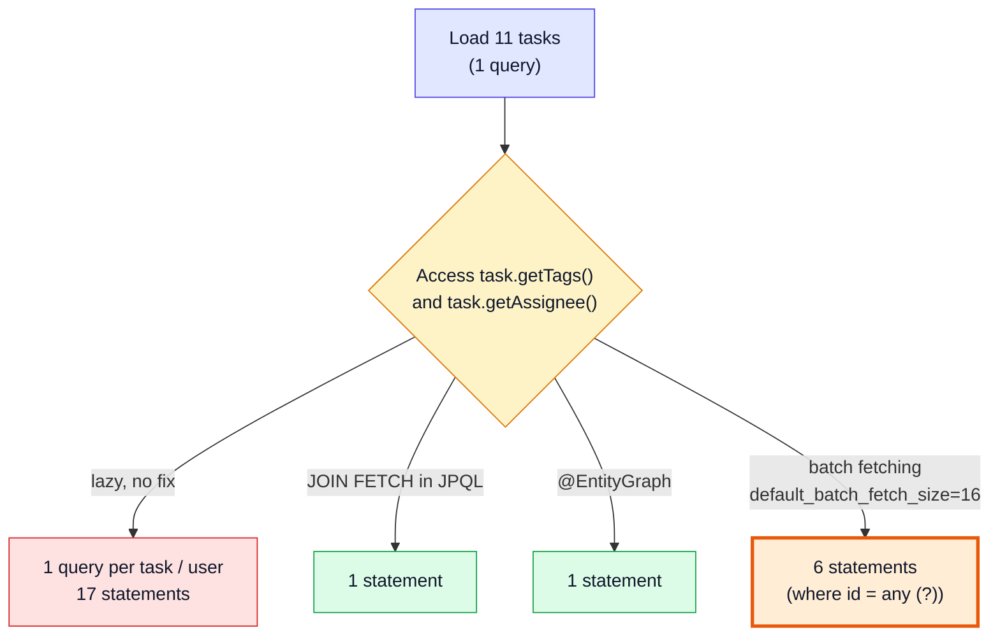
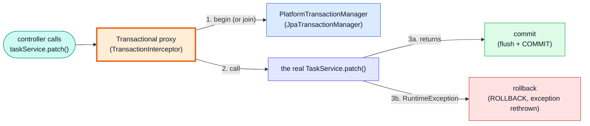
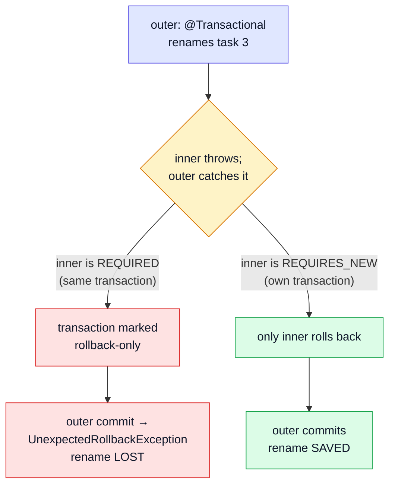

# Data Access II: Queries, N+1, Paging, Specifications and Transactions — Complete In-Depth Guide

**Spring Boot notes #9 of 18** · Priority 🔴 · Track: Spring Boot ([README](README.md))

[File 08](spring_08_data_access_jdbc_jpa.md) mapped the Task Tracker to PostgreSQL and left two problems: `GET /api/projects/1/tasks` sent **9 SELECTs for 3 tasks** (N+1), and every query was `findById`. This file covers:

**Queries**
- derived queries
- JPQL and native SQL
- projections
- the N+1 fixes
- paging and sorting
- Specifications and the Criteria API
- bulk updates

**`@Transactional` in depth**
- propagation
- rollback rules
- proxy pitfalls
- isolation levels
- optimistic and pessimistic locking

| You want… | Use |
|---|---|
| A simple filter on one or two fields | **Derived query** `findByProjectIdAndDoneFalse(...)` |
| A join, an aggregate, any non-trivial query | **`@Query` JPQL** |
| Database-specific SQL (window functions, `JSONB`, CTEs) | **`@Query(nativeQuery = true)`** |
| Only some columns | **Projection**: interface or record |
| Optional filters chosen at runtime (search screens) | **Specifications** (Criteria API underneath) |
| Load lists with their associations | **`JOIN FETCH`**, **`@EntityGraph`** or batch fetching |
| Big result sets | **`Pageable`** → `Page` / `Slice` |
| Several writes that succeed or fail together | **`@Transactional`** on the service method |
| Stop lost updates | **`@Version`** (optimistic) or **`SELECT ... FOR UPDATE`** (pessimistic) |

> [!NOTE]
> This topic isn't in Kunal's playlist, so there are no video timestamps. The reference playlist's `@Transactional` videos (parts 1–3) and JPA parts 8–10 map here (see the [README](README.md#reference-playlist-where-each-video-is-covered)).
>
> **What was run:** [`examples/09-queries-transactions/`](examples/09-queries-transactions/) (Task Tracker 0.9.0) on Spring Boot 4.0.5, Spring Data JPA 4.0, Hibernate 7.2.7 and PostgreSQL 18.3, using its own schema `tracker09` so file 08's example keeps working. Each run started on a freshly dropped schema:
> 1. the `demo` profile: 11 steps covering queries and transactions;
> 2. step 1 again with batch fetching switched on;
> 3. the API, with 13 HTTP requests.
>
> Every SQL line, statement count and exception below comes from those runs. Log prefixes are shortened, and long column lists are cut with `...`.

---

## Table of Contents

| # | Topic (anchor link) | Level |
|---|---|---|
| 0 | [The Data: Migration V3](#0-the-data-migration-v3) | Basics |
| 1 | [Derived Queries](#1-derived-queries) | Core |
| 2 | [JPQL and Native Queries](#2-jpql-and-native-queries) | Core |
| 3 | [Projections](#3-projections) | Core |
| 4 | [The N+1 Problem and Its Fixes](#4-the-n1-problem-and-its-fixes) | In depth |
| 5 | [Paging and Sorting](#5-paging-and-sorting) | Core |
| 6 | [Specifications and the Criteria API](#6-specifications-and-the-criteria-api) | In depth |
| 7 | [Bulk Updates with @Modifying](#7-bulk-updates-with-modifying) | In depth |
| 8 | [How @Transactional Works](#8-how-transactional-works) | Core |
| 9 | [Propagation](#9-propagation) | In depth |
| 10 | [Rollback Rules](#10-rollback-rules) | In depth |
| 11 | [Proxy Pitfalls and readOnly](#11-proxy-pitfalls-and-readonly) | In depth |
| 12 | [Isolation Levels](#12-isolation-levels) | In depth |
| 13 | [Locking: Optimistic and Pessimistic](#13-locking-optimistic-and-pessimistic) | In depth |
| 14 | [Interview Questions](#14-interview-questions) | Interview |

---

## 0. The Data: Migration V3

File 08's rule: **never edit an applied migration**. Changes go in a new file:

```sql
-- V3: optimistic locking, an activity log, and more tasks so paging has something to page.

ALTER TABLE task ADD COLUMN version BIGINT NOT NULL DEFAULT 0;     -- @Version counter

CREATE TABLE activity_log (
    id         BIGINT GENERATED BY DEFAULT AS IDENTITY PRIMARY KEY,
    message    VARCHAR(200) NOT NULL,
    created_at TIMESTAMPTZ  NOT NULL
);

-- 8 backlog tasks in project 1 (ids 5-12): due 2026-11-11 .. 2026-11-18, the first two done
INSERT INTO task (project_id, assignee_id, title, priority, done, due_date, created_at, created_by)
SELECT 1,
       CASE WHEN n % 3 = 0 THEN NULL WHEN n % 2 = 0 THEN 2 ELSE 3 END,   -- ravi, meera or nobody
       'Backlog item ' || n,
       (ARRAY['LOW', 'MEDIUM', 'HIGH'])[n % 3 + 1],
       n <= 2,
       DATE '2026-11-10' + n,
       TIMESTAMPTZ '2026-10-24T09:00:00Z' + n * INTERVAL '1 day',
       'asha'
FROM generate_series(1, 8) AS n;

INSERT INTO task_tag (task_id, tag_id)
SELECT id, 1 FROM task WHERE title IN ('Backlog item 2', 'Backlog item 5');      -- tag them "backend"
```

| Tasks after V3 | |
|---|---|
| Project 1 "Task Tracker" | ids 1–3 (file 08) + 5–12 (backlog) = **11 tasks** |
| Project 2 "Website" | id 4 |
| Open and overdue on 2026-11-16 (the app's fixed clock) | 7, 8, 9 (due 13th, 14th, 15th) |

---

## 1. Derived Queries

Spring Data reads the method **name** and writes the query: `find…By`, then property names joined with `And`/`Or`, plus keywords.

```java
List<Task> findByProjectIdAndDoneFalseOrderByDueDateAsc(long projectId);

long countByAssigneeUsernameAndDoneFalse(String username);

boolean existsByProjectIdAndTitleIgnoreCase(long projectId, String title);

List<Task> findTop3ByDoneFalseOrderByDueDateAscIdAsc();
```

The real SQL and results (demo step 2):

```
DEBUG SQL : select ... from tracker09.task t1_0 where t1_0.project_id=? and t1_0.done=false order by t1_0.due_date
    open in project 1 by due date: [7, 8, 9, 10, 11, 12, 3]
DEBUG SQL : select count(t1_0.id) from tracker09.task t1_0 left join tracker09.app_user a1_0 on a1_0.id=t1_0.assignee_id where a1_0.username=? and t1_0.done=false
    meera's open tasks: 4
DEBUG SQL : select t1_0.id from tracker09.task t1_0 where t1_0.project_id=? and upper(t1_0.title)=upper(?) fetch first ? rows only
    'add VALIDATION' exists: true
```

| Part | Example | Becomes |
|---|---|---|
| Subject | `find`, `read`, `get`, `query`, `stream`, `count`, `exists`, `delete` | What is returned |
| Limiting | `First`, `Top3`, `Distinct` | `fetch first 3 rows only` |
| Nested property | `AssigneeUsername` = `assignee.username` | A join (`left join app_user`) |
| Comparison | `Between`, `LessThan`, `GreaterThanEqual`, `After`, `Before` | `<`, `>=`, `between` |
| Text | `Like`, `StartingWith`, `Containing`, `IgnoreCase` | `like`, `upper(...)` |
| Null / boolean | `IsNull`, `IsNotNull`, `True`, `False` | `is null`, `= false` |
| Collections | `In`, `NotIn` | `in (...)` |
| Ordering | `OrderByDueDateAscIdAsc` | `order by ...` |

| Return type | Meaning |
|---|---|
| `List<T>` / `Stream<T>` | All matches |
| `Optional<T>` / `T` | At most one (more → `IncorrectResultSizeDataAccessException`) |
| `Page<T>` / `Slice<T>` | With a `Pageable` parameter ([Section 5](#5-paging-and-sorting)) |
| `long` / `boolean` | `count…` / `exists…` |

> [!TIP]
> Derived names are checked at **startup**: a typo like `findByTitel` fails fast with "No property 'titel' found". When a name gets longer than the query, switch to `@Query`.

---

## 2. JPQL and Native Queries

**JPQL** looks like SQL but uses **entity and field names** (`Task`, `t.project.id`), not tables and columns. Hibernate translates it to SQL for the configured database.

```java
@Query("""
        select t from Task t
        where t.project.id = :projectId and lower(t.title) like lower(concat('%', :text, '%'))
        order by t.id""")
List<Task> searchInProject(@Param("projectId") long projectId, @Param("text") String text);
```

```
    JPQL like '%item 1%': [Backlog item 1]
```

A **native query** is plain SQL, passed through unchanged:

```java
@Query(value = """
        SELECT t.* FROM task t
        JOIN task_tag tt ON tt.task_id = t.id
        JOIN tag g ON g.id = tt.tag_id
        WHERE g.name = :tag
        ORDER BY t.id""", nativeQuery = true)
List<Task> findByTagNative(@Param("tag") String tag);
```

```
DEBUG SQL : SELECT t.* FROM task t
JOIN task_tag tt ON tt.task_id = t.id
JOIN tag g ON g.id = tt.tag_id
WHERE g.name = ?
ORDER BY t.id
    native SQL, tag backend: [1, 2, 3, 6, 9]
```

The SQL appears **exactly as written**: no `tracker09.` prefix. It works because the JDBC URL sets `currentSchema=tracker09`.

| | JPQL `@Query` | Native `@Query(nativeQuery = true)` |
|---|---|---|
| Names | Entities and fields | Tables and columns |
| Portable across databases | Yes | No |
| Can return entities | Yes | Yes (all columns needed) |
| Database features (window functions, `JSONB`, `ON CONFLICT`) | Partly (Hibernate 6+ supports many functions) | Everything |
| Checked at startup | Yes (syntax and names) | No: errors at first call |
| Use for | Most custom queries | Reports and tuned SQL (or `JdbcClient`, file 08) |

> [!CAUTION]
> Never build a query by concatenating user input (`"... where title = '" + text + "'"`). That's **SQL injection**. Named parameters (`:text`) are sent separately from the SQL and are always safe.

---

## 3. Projections

Loading full entities just to show two columns wastes memory and makes Hibernate track every object. **Projections** select only what you need.

**Interface projection**: Spring Data implements the getters.

```java
interface TitleOnly {
    Long getId();
    String getTitle();
}

List<TitleOnly> findByAssigneeUsernameOrderById(String username);
```

```
DEBUG SQL : select t1_0.id,t1_0.title from tracker09.task t1_0 left join tracker09.app_user a1_0 on a1_0.id=t1_0.assignee_id where a1_0.username=? order by t1_0.id
    ravi's titles (interface projection): [Design the schema, Write REST controllers, Backlog item 2, Backlog item 4, Backlog item 8]
```

Only `id` and `title` were selected.

**DTO projection** with a JPQL **constructor expression**:

```java
package com.notes.tasks.dto;

import com.notes.tasks.model.Priority;

import java.time.LocalDate;

/** Filled directly by a JPQL "select new ..." query: no entity is loaded. */
public record TaskSummary(long id, String title, Priority priority, LocalDate dueDate, String assignee) {}
```

```java
@Query("""
        select new com.notes.tasks.dto.TaskSummary(t.id, t.title, t.priority, t.dueDate, a.username)
        from Task t left join t.assignee a
        where t.done = false
        order by t.dueDate, t.id""")
List<TaskSummary> openSummaries();
```

```
DEBUG SQL : select t1_0.id,t1_0.title,t1_0.priority,t1_0.due_date,a1_0.username from tracker09.task t1_0 left join tracker09.app_user a1_0 on a1_0.id=t1_0.assignee_id where t1_0.done=false order by t1_0.due_date,t1_0.id
    first open summary (DTO projection): TaskSummary[id=7, title=Backlog item 3, priority=LOW, dueDate=2026-11-13, assignee=null]
```

| Projection | Pros | Cons |
|---|---|---|
| Entity | Can be changed and saved; relationships | Loads every column; tracked by the persistence context |
| Interface | Least code; works with derived queries | A proxy per row |
| Record / class DTO (`select new`) | Plain immutable objects; perfect for API responses | Fully qualified class name inside the JPQL string |

> [!TIP]
> `left join t.assignee a` keeps unassigned tasks: task 7 has `assignee=null`. `t.assignee.username` would make an **inner** join and silently drop them.

---

## 4. The N+1 Problem and Its Fixes

**N+1**: one query loads N parents, then **one more query per parent** loads each lazy association. Demo step 1 loads project 1's 11 tasks and reads each task's assignee and tags:

```
=== 1. N+1 and three fixes (project 1 has 11 tasks)
DEBUG SQL : select p1_0.id,p1_0.name,p1_0.owner_id from tracker09.project p1_0 where p1_0.id=?
DEBUG SQL : select t1_0.project_id,t1_0.id,...,t1_0.version from tracker09.task t1_0 where t1_0.project_id=? order by t1_0.id
DEBUG SQL : select au1_0.id,au1_0.email,au1_0.username from tracker09.app_user au1_0 where au1_0.id=?
DEBUG SQL : select up1_0.user_id,up1_0.bio,up1_0.github from tracker09.user_profile up1_0 where up1_0.user_id=?
DEBUG SQL : select t1_0.task_id,t1_1.id,t1_1.name from tracker09.task_tag t1_0 join tracker09.tag t1_1 on t1_1.id=t1_0.tag_id where t1_0.task_id=?
...                         (11 tag selects and 2 user + profile pairs in total)
    lazy loading:  17 statements
```

17 statements: 1 project + 1 task list + 11 tag selects (one per task) + 2 users × (user + profile). With 1,000 tasks it would be over 1,000 round trips. The code looks innocent: `task.getTags()`.



**Fix 1: `JOIN FETCH`** loads the associations in the same SQL:

```java
@Query("""
        select distinct t from Task t
        join fetch t.project
        left join fetch t.assignee a
        left join fetch a.profile
        left join fetch t.tags
        where t.project.id = :projectId
        order by t.id""")
List<Task> findWithDetailsByProjectId(@Param("projectId") long projectId);
```

**Fix 2: `@EntityGraph`** does the same without writing JPQL, on a derived query:

```java
@EntityGraph(attributePaths = {"project", "assignee", "assignee.profile", "tags"})
List<Task> findByProjectIdOrderById(long projectId);
```

```
DEBUG SQL : select distinct t1_0.id,a1_0.id,a1_0.email,p1_0.user_id,p1_0.bio,p1_0.github,a1_0.username,...
    JOIN FETCH:    1 statement(s)
DEBUG SQL : select t1_0.id,a1_0.id,a1_0.email,p1_0.user_id,p1_0.bio,p1_0.github,a1_0.username,...
    @EntityGraph:  1 statement(s)
```

`a.profile` is fetched too. File 08 showed that the inverse `@OneToOne` profile is **always** loaded, so leaving it out would add one query per distinct user.

**Fix 3: batch fetching.** One setting: `spring.jpa.properties.hibernate.default_batch_fetch_size=16` (or `@BatchSize` on an association). Hibernate still loads lazily, but for up to 16 waiting entities at once. The same step 1, run with that setting:

```
=== 1. N+1 and three fixes (project 1 has 11 tasks)
DEBUG SQL : select p1_0.id,p1_0.name,p1_0.owner_id from tracker09.project p1_0 where p1_0.id=?
DEBUG SQL : select t1_0.project_id,t1_0.id,t1_0.assignee_id,t1_0.created_at,t1_0.created_by,t1_0.description,t1_0.done,t1_0.due_date,t1_0.priority,t1_0.title,t1_0.version from tracker09.task t1_0 where t1_0.project_id=? order by t1_0.id
DEBUG SQL : select au1_0.id,au1_0.email,au1_0.username from tracker09.app_user au1_0 where au1_0.id = any (?)
DEBUG SQL : select up1_0.user_id,up1_0.bio,up1_0.github from tracker09.user_profile up1_0 where up1_0.user_id = any (?)
DEBUG SQL : select up1_0.user_id,up1_0.bio,up1_0.github from tracker09.user_profile up1_0 where up1_0.user_id=?
DEBUG SQL : select t1_0.task_id,t1_1.id,t1_1.name from tracker09.task_tag t1_0 join tracker09.tag t1_1 on t1_1.id=t1_0.tag_id where t1_0.task_id = any (?)
    lazy loading:  6 statements
```

17 → 6 statements, with no change to the queries. The remaining single profile select comes from the inverse one-to-one again.

| Fix | Statements here | Best for | Watch out |
|---|---|---|---|
| None (lazy) | 17 | — | Grows with the data |
| `JOIN FETCH` | **1** | A specific use case needing specific data | Joining 2+ collections multiplies rows (cartesian product); **can't page in SQL** ([Section 5](#5-paging-and-sorting)) |
| `@EntityGraph` | **1** | Same, on derived/inherited methods | Same limits as fetch join |
| Batch fetching | 6 | A safe global default | Still more than one query |
| DTO projection | 1 | Read-only screens | No entities to modify |

> [!IMPORTANT]
> **Find N+1 by looking at the SQL log** in development (`logging.level.org.hibernate.SQL: DEBUG`), or count statements in tests (file 10). Its symptom is one request producing a run of identical SELECTs that differ only in the `?` value.

---

## 5. Paging and Sorting

A `Pageable` parameter (page number, page size, sort) turns any query into a paged one.

```java
Page<Task> findByPriority(Priority priority, Pageable pageable);     // runs a count query too

Slice<Task> findByDone(boolean done, Pageable pageable);             // no count query: fetches size + 1 rows
```

```
DEBUG SQL : select ... from tracker09.task t1_0 where t1_0.priority=? order by t1_0.id fetch first ? rows only
DEBUG SQL : select count(*) from tracker09.task t1_0 where t1_0.priority=?
    Page: content=[3, 5] totalElements=4 totalPages=2
DEBUG SQL : select ... from tracker09.task t1_0 where t1_0.done=? order by t1_0.due_date,t1_0.id fetch first ? rows only
    Slice: content=[7, 8, 9] hasNext=true
```

| | `Page<T>` | `Slice<T>` | `List<T>` + `Pageable` |
|---|---|---|---|
| Extra count query | Yes | No (asks for one extra row to know `hasNext`) | No |
| Knows total pages | Yes | No | No |
| Use for | Numbered pagination UI | "Load more" / infinite scroll | Simple limits |

In a controller, Spring builds the `Pageable` from `?page=0&size=5&sort=dueDate,desc`:

```java
@GetMapping("/tasks")
public PageResponse<TaskResponse> search(@RequestParam(required = false) Boolean done,
                                         @RequestParam(required = false) Priority priority,
                                         @RequestParam(required = false) String assignee,
                                         @RequestParam(required = false) String tag,
                                         @RequestParam(required = false)
                                         @DateTimeFormat(iso = DateTimeFormat.ISO.DATE) LocalDate dueBefore,
                                         Pageable pageable) {      // built from page, size, sort
    return service.search(done, priority, assignee, tag, dueBefore, pageable);
}
```

```yaml
  data:
    web:
      pageable:
        default-page-size: 5              # ?page=0&size=5 when the client sends nothing
        max-page-size: 50                 # ?size=10000 is capped at 50
```

The real API run, `GET /api/tasks?size=1000&sort=id,desc&done=true`, answered with `"size": 50`.

**Three paging rules learned from the run:**

| Rule | Why |
|---|---|
| **Always add a unique tie-breaker** to the sort (`Sort.by("id")`) | Many tasks share a `dueDate`. Without a unique last column, the database may order ties differently per query, and the same row can appear on page 0 *and* page 1 |
| **Don't page a collection `JOIN FETCH`** | Hibernate can't put `LIMIT` on a query that returns several rows per task. It loads **everything** and pages in memory (warning below) |
| **Return your own page DTO**, not `Page`/`PageImpl` | `PageImpl`'s JSON is an implementation detail (Spring Data warns about serializing it). `PageResponse` below is stable; `@EnableSpringDataWebSupport(pageSerializationMode = VIA_DTO)` is the built-in alternative |

The collection-fetch warning, real (demo step 3):

```
WARN org.hibernate.orm.query : HHH90003004: firstResult/maxResults specified with collection fetch; applying in memory
```

The SQL after it has **no** `fetch first` clause. With a million tasks, this loads a million rows to return three.

**The fix used by the API:** page with **to-one** fetches only (safe to `LIMIT`), then load the page's tags in **one** extra query:

```java
/** Filters (Specifications) + paging + sorting; three queries per page whatever the page size. */
public PageResponse<TaskResponse> search(Boolean done, Priority priority, String assignee, String tag,
                                         LocalDate dueBefore, Pageable pageable) {
    Pageable stable = PageRequest.of(pageable.getPageNumber(), pageable.getPageSize(),
            pageable.getSort().and(Sort.by("id")));                 // id breaks ties: pages never overlap
    Page<Task> page = tasks.findAll(TaskSpecs.matching(done, priority, assignee, tag, dueBefore), stable);
    if (page.hasContent()) {
        tasks.fetchTags(page.map(Task::getId).getContent());          // tags for the whole page in one query
    }
    return PageResponse.of(page.map(TaskResponse::from));
}
```

```java
/** Specifications + paging, with the to-one associations fetched by an entity graph. */
@Override
@EntityGraph(attributePaths = {"project", "assignee", "assignee.profile"})
Page<Task> findAll(Specification<Task> spec, Pageable pageable);

/** Loads the tags of tasks that are already in the persistence context: one query for the whole page. */
@Query("select distinct t from Task t left join fetch t.tags where t.id in :ids")
List<Task> fetchTags(@Param("ids") Collection<Long> ids);
```

`fetchTags` returns the **same** task objects (persistence-context identity, file 08), now with `tags` initialized. `GET /api/tasks?size=3&sort=dueDate` sends exactly three statements: page, count, tags.

> [!TIP]
> When the first page already holds every match, Spring Data **skips the count query**: it knows the total. In the run, `?done=true` (4 matches, page size 50) sent no `count`.

---

## 6. Specifications and the Criteria API

A search screen has optional filters, and each combination needs a different `WHERE`. Writing a method per combination doesn't scale, and concatenating JPQL strings is unsafe and error-prone. The **Criteria API** builds queries as Java objects. A Spring Data **Specification** is one reusable piece of a `WHERE` clause:

```java
// the interface, from Spring Data
Predicate toPredicate(Root<T> root, CriteriaQuery<?> query, CriteriaBuilder cb);
```

| Criteria object | Means |
|---|---|
| `CriteriaBuilder cb` | Factory for predicates (`equal`, `lessThan`, `like`, `and`…) and orderings |
| `CriteriaQuery<T> query` | The query being built (`distinct`, `orderBy`, `groupBy`) |
| `Root<Task> root` | The `FROM Task` alias; `root.get("done")` is a path |
| `root.join("tags")` | A `JOIN` |

The raw Criteria API (demo step 4):

```java
CriteriaBuilder cb = em.getCriteriaBuilder();             // the same thing written by hand
CriteriaQuery<Task> q = cb.createQuery(Task.class);
Root<Task> t = q.from(Task.class);
q.select(t)
 .where(cb.equal(t.get("priority"), Priority.HIGH), cb.isFalse(t.get("done")))
 .orderBy(cb.asc(t.get("id")));
```

```
DEBUG SQL : select ... from tracker09.task t1_0 where t1_0.priority=? and not(t1_0.done) order by t1_0.id
    Criteria: HIGH and not done: [4, 9, 12]
```

The Specifications the API's search uses:

```java
package com.notes.tasks.repo;

import com.notes.tasks.model.AppUser;
import com.notes.tasks.model.Priority;
import com.notes.tasks.model.Tag;
import com.notes.tasks.model.Task;
import jakarta.persistence.criteria.Join;
import jakarta.persistence.criteria.JoinType;
import org.springframework.data.jpa.domain.Specification;

import java.time.LocalDate;
import java.util.ArrayList;
import java.util.List;

/** Reusable WHERE-clause pieces. Each one is a Criteria API predicate. */
public final class TaskSpecs {
    private TaskSpecs() {}

    public static Specification<Task> isDone(boolean done) {
        return (root, query, cb) -> cb.equal(root.get("done"), done);
    }

    public static Specification<Task> hasPriority(Priority priority) {
        return (root, query, cb) -> cb.equal(root.get("priority"), priority);
    }

    public static Specification<Task> assignedTo(String username) {
        return (root, query, cb) -> {
            Join<Task, AppUser> a = root.join("assignee", JoinType.INNER);
            return cb.equal(a.get("username"), username);
        };
    }

    public static Specification<Task> hasTag(String tagName) {
        return (root, query, cb) -> {
            Join<Task, Tag> tag = root.join("tags", JoinType.INNER);
            query.distinct(true);                       // a task with the tag twice can't appear twice
            return cb.equal(tag.get("name"), tagName);
        };
    }

    public static Specification<Task> dueBefore(LocalDate date) {
        return (root, query, cb) -> cb.lessThan(root.get("dueDate"), date);
    }

    /** Only the filters the client actually sent; no filters = all tasks. */
    public static Specification<Task> matching(Boolean done, Priority priority, String assignee,
                                               String tag, LocalDate dueBefore) {
        List<Specification<Task>> specs = new ArrayList<>();
        if (done != null) specs.add(isDone(done));
        if (priority != null) specs.add(hasPriority(priority));
        if (assignee != null) specs.add(assignedTo(assignee));
        if (tag != null) specs.add(hasTag(tag));
        if (dueBefore != null) specs.add(dueBefore(dueBefore));
        return Specification.allOf(specs);
    }
}
```

The repository just adds `JpaSpecificationExecutor<Task>`, which provides `findAll(spec)`, `findAll(spec, pageable)`, `findAll(spec, sort)`, `count(spec)` and `exists(spec)`. Specs combine with `and`/`or`/`not`:

```java
List<Task> open = tasks.findAll(TaskSpecs.isDone(false).and(TaskSpecs.hasTag("backend")), Sort.by("id"));
```

```
DEBUG SQL : select distinct ... from tracker09.task t1_0 join tracker09.task_tag t2_0 on t1_0.id=t2_0.task_id join tracker09.tag t2_1 on t2_1.id=t2_0.tag_id where t1_0.done=? and t2_1.name=? order by t1_0.id
    open AND tag=backend: [3, 9]
```

API run: `GET /api/tasks?tag=backend&priority=HIGH` and `?done=false&assignee=meera` are the same endpoint with different specs.

> [!NOTE]
> `root.get("done")` uses strings, so a typo fails at **runtime**. Hibernate's annotation processor can generate a **static metamodel** (`Task_.done`) for compile-time checked names. **Querydsl** and **jOOQ** are popular type-safe alternatives.

---

## 7. Bulk Updates with @Modifying

To change many rows, loading each entity and relying on dirty checking means N SELECTs and N UPDATEs. A JPQL **bulk update** is one statement:

```java
@Modifying(flushAutomatically = true, clearAutomatically = true)
@Query("update Task t set t.done = true where t.done = false and t.dueDate < :today")
int completeOverdue(@Param("today") LocalDate today);
```

API run, `POST /api/tasks/complete-overdue`:

```
DEBUG SQL : update tracker09.task t1_0 set done=true where t1_0.done=false and t1_0.due_date<?
DEBUG SQL : insert into tracker09.activity_log (created_at,message) values (?,?)
{"completed": 3}
```

**The catch:** a bulk update goes straight to the database. It **bypasses the persistence context**, so managed entities become stale. Demo step 5:

```
=== 5. Bulk update vs the persistence context
DEBUG SQL : select ... from tracker09.task t1_0 where t1_0.id=?
DEBUG SQL : update tracker09.task t1_0 set done=true where t1_0.id=7
    bulk update changed 1 row; managed entity still says done=false
DEBUG SQL : select ... from tracker09.task t1_0 where t1_0.id=?
    after refresh: done=true, version=0 (bulk updates skip @Version)
```

| `@Modifying` option | Does |
|---|---|
| (required) | Tells Spring Data the `@Query` is an UPDATE/DELETE (`executeUpdate()` instead of `getResultList()`) |
| `flushAutomatically = true` | Flush pending changes **before** the bulk statement, so they aren't overwritten |
| `clearAutomatically = true` | Clear the persistence context **after**, so later reads reload fresh data |

> [!WARNING]
> Bulk updates also skip `@Version` (the version stayed 0), entity lifecycle callbacks and cascades. Use them for batch jobs and maintenance, and know they're invisible to optimistic locking.

---

## 8. How @Transactional Works

A **transaction** is a group of statements that all commit or all roll back (ACID, file 07). In Spring you mark a method, and a **proxy** (file 03) wraps every call:



The transaction is bound to the **thread**. Every repository, `EntityManager` and `JdbcTemplate` call on that thread uses the same connection and persistence context. That's why file 08's `JdbcTemplate` and JPA could share one transaction.

| `@Transactional` attribute | Default | Meaning |
|---|---|---|
| `propagation` | `REQUIRED` | What to do when a transaction already exists ([Section 9](#9-propagation)) |
| `isolation` | `DEFAULT` (the database's: READ COMMITTED on PostgreSQL) | [Section 12](#12-isolation-levels) |
| `readOnly` | `false` | Hint: no flush/dirty checking; read-only JDBC connection |
| `timeout` | none | Seconds before the transaction is rolled back |
| `rollbackFor` / `noRollbackFor` | Unchecked → rollback | [Section 10](#10-rollback-rules) |

**Declarative vs programmatic:**

| Declarative: `@Transactional` | Programmatic: `TransactionTemplate` |
|---|---|
| An annotation on a method/class | `tx.execute(status -> { ... })` |
| The boundary is the whole method | Any block, any size |
| Proxy rules apply (Section 11) | No proxy: works anywhere, even in the same class |
| Most service code | Loops that commit per batch, threads, demos (this file's demo uses it) |

```java
TransactionTemplate reader = new TransactionTemplate(txManager);
reader.setIsolationLevel(level);
reader.executeWithoutResult(status -> { ...; status.setRollbackOnly(); });   // roll back without an exception
```

---

## 9. Propagation

**Propagation** decides what happens when a transactional method is called **while a transaction is already running**.

| Propagation | Transaction exists | No transaction |
|---|---|---|
| **`REQUIRED`** (default) | Join it | Start one |
| **`REQUIRES_NEW`** | **Suspend** it, start a new one (separate connection, separate commit) | Start one |
| `SUPPORTS` | Join it | Run without |
| `NOT_SUPPORTED` | Suspend it, run without | Run without |
| `MANDATORY` | Join it | **Throw** `IllegalTransactionStateException` |
| `NEVER` | **Throw** | Run without |
| `NESTED` | Savepoint inside it (JDBC only; not with JPA's flush model) | Start one |

The demo's `OuterSteps` and `InnerSteps` are two beans, so calls go through proxies. Each outer method renames task 3 first:

```java
@Transactional
public void catchJoinedFailure() {
    rename("renamed by catchJoinedFailure");
    try {
        inner.failJoined();                       // the exception marks the SHARED transaction rollback-only
    } catch (IllegalStateException e) {
        System.out.println("    caught: " + e.getMessage() + " (outer carries on and tries to commit)");
    }
}
```

```
=== 6. Propagation
    caught: inner step failed (outer carries on and tries to commit)
    REQUIRED inner fails, outer catches: UnexpectedRollbackException: Transaction silently rolled back because it has been marked as rollback-only
    task 3 title in the database: 'Add validation'
    caught: inner step failed
DEBUG SQL : update tracker09.task set assignee_id=?,...,title=?,version=? where id=? and version=?
    REQUIRES_NEW inner fails, outer catches: returned normally
    task 3 title in the database: 'renamed by catchNewTransactionFailure'
DEBUG SQL : insert into tracker09.activity_log (created_at,message) values (?,?)
    outer logs (REQUIRES_NEW) then fails: IllegalStateException: outer failed after logging
    task 3 title in the database: 'renamed by catchNewTransactionFailure'
    activity_log rows: 0 -> 1 (the log survived the rollback)
    MANDATORY without a transaction: IllegalTransactionStateException: No existing transaction found for transaction marked with propagation 'mandatory'
```



| Case | What happened |
|---|---|
| REQUIRED inner fails | There's **one** transaction. The inner proxy saw the exception leave a transactional method and marked it **rollback-only**. Catching the exception doesn't undo that, so the outer commit became a rollback and threw `UnexpectedRollbackException` |
| REQUIRES_NEW inner fails | The inner transaction was separate; only it rolled back. The outer commit kept the rename |
| Log with REQUIRES_NEW, then outer fails | The log row was **committed immediately** in its own transaction; the outer rename rolled back. This is the classic **audit log** pattern (`ActivityService.record`) |

> [!WARNING]
> `REQUIRES_NEW` holds **two connections** at once (the suspended one and the new one). If many requests do this together, a small pool can deadlock waiting for itself. Use it for short side effects (audit, outbox), not by habit.

---

## 10. Rollback Rules

By default Spring rolls back on **unchecked** exceptions (`RuntimeException`, `Error`) and **commits** on **checked** exceptions. This follows the old EJB convention: checked exceptions were "expected business outcomes".

```
=== 7. Rollback rules
DEBUG SQL : update tracker09.task set ... where id=? and version=?
    checked exception, default rules: Exception: checked exception
    task 3 title in the database: 'renamed by failWithCheckedException'
    checked exception, rollbackFor = Exception.class: Exception: checked exception
    task 3 title in the database: 'renamed by failWithCheckedException'
```

The method threw, **and** its change was committed (UPDATE sent, title changed). With `rollbackFor = Exception.class`, the same code rolled back: no UPDATE, and the title still shows the previous value.

| Exception thrown | Default | Change with |
|---|---|---|
| `RuntimeException` and subclasses | Rollback | `noRollbackFor = X.class` |
| `Error` | Rollback | — |
| Checked `Exception` (e.g. `IOException`) | **Commit** | `rollbackFor = Exception.class` |
| Exception caught inside the method | Nothing (the proxy never sees it) | Rethrow, or `TransactionAspectSupport.currentTransactionStatus().setRollbackOnly()` |

> [!TIP]
> Many teams make every business exception a `RuntimeException` (as `NotFoundException` is) so the default rule always applies.

---

## 11. Proxy Pitfalls and readOnly

```
=== 8. Proxy pitfalls and readOnly
    public @Transactional through the proxy: active=true
    package-private @Transactional through the proxy: active=true
    self-invocation (this.publicTransactional()): active=false
    rename inside readOnly = true: returned normally
    task 3 title in the database: 'renamed by failWithCheckedException'
```

| Pitfall | Result here | Explanation |
|---|---|---|
| **Self-invocation** | `active=false` | `selfInvocation()` calls `this.publicTransactional()`. `this` is the real object, not the proxy, so no interceptor runs and **no transaction** starts. Fix: call through another bean, inject self lazily, or use `TransactionTemplate` |
| Non-public methods | `active=true` | Since Spring 6.0, class-based (CGLIB) proxies also apply `@Transactional` to `protected` and package-private methods. `private` methods can never be intercepted |
| `final` methods / classes | — | CGLIB can't override them, so no transaction |
| Changes in **`readOnly = true`** | Returned normally, **change lost** | Hibernate skips dirty checking and flush in read-only transactions. No error, no UPDATE: the title didn't change. (This confirms [file 08 §7](spring_08_data_access_jdbc_jpa.md#7-persistence-context-first-level-cache-dirty-checking-flush)'s warning) |
| `@Transactional` on a controller calling a slow API | — | Holds a connection the whole time (file 08's pool exhaustion) |

> [!IMPORTANT]
> `readOnly = true` is worth putting on query methods: Hibernate skips the dirty-check snapshot (less memory), and the JDBC connection is marked read-only. `TaskService` sets it at class level and overrides writes with `@Transactional`.

---

## 12. Isolation Levels

**Isolation** decides what one transaction sees of others running at the same time.

| Anomaly | What happens |
|---|---|
| **Dirty read** | Reading another transaction's **uncommitted** change |
| **Non-repeatable read** | Reading the same row twice gives different values, because someone committed in between |
| **Phantom read** | Re-running a query returns new rows that someone inserted |
| **Lost update** | Two transactions read, both write; the first write is overwritten |

| Level | Dirty read | Non-repeatable read | Phantom | In PostgreSQL |
|---|---|---|---|---|
| READ UNCOMMITTED | possible (SQL standard) | possible | possible | Behaves as READ COMMITTED: **never** dirty reads |
| **READ COMMITTED** | no | **possible** | possible | **The default.** Each statement sees data committed before it started |
| **REPEATABLE READ** | no | **no** | no in PostgreSQL | A **snapshot** taken at the first statement; updating a row changed by others → **serialization error** |
| SERIALIZABLE | no | no | no | As if run one by one; may abort with serialization errors (retry) |

Demo step 11. T1 reads task 3's title, T2 changes and commits it, then T1 reads again and updates the same row (two threads coordinated with latches; reads go through SQL so the first-level cache doesn't hide the change):

```
=== 11. Isolation levels (PostgreSQL)
    READ COMMITTED: T1 reads 'renamed by failWithCheckedException'
    READ COMMITTED: T2 committed; T1 reads again 'changed by T2'
    READ COMMITTED: T1 updated the same row
    READ COMMITTED: final title 'changed by T1'
    REPEATABLE READ: T1 reads 'changed by T1'
    REPEATABLE READ: T2 committed; T1 reads again 'changed by T1'
    REPEATABLE READ: T1's update failed: CannotAcquireLockException SQLState 40001
        ERROR: could not serialize access due to concurrent update
    REPEATABLE READ: final title 'changed by T2'
```

| Level | Second read | T1's update |
|---|---|---|
| READ COMMITTED | **Changed** (non-repeatable read) | Succeeded and **overwrote T2's change**: a lost update |
| REPEATABLE READ | **Same** as the first (snapshot) | **Refused** with SQLState `40001`; Spring translated it to `CannotAcquireLockException`; T2's value survived |

```java
@Transactional(isolation = Isolation.REPEATABLE_READ)
public void transfer(...) { ... }        // be ready to retry on a serialization failure
```

> [!TIP]
> Most apps keep READ COMMITTED and prevent lost updates with **locking** (next section), which is cheaper and more explicit than raising the isolation level everywhere.

---

## 13. Locking: Optimistic and Pessimistic

### 13.1 Optimistic locking: `@Version`

Assume conflicts are rare, and detect them at write time:

```java
/** Optimistic locking: Hibernate adds "and version=?" to every UPDATE and increments it. */
@Version
private long version;
```

```
=== 9. Optimistic locking (@Version)
    all three loaded version 0
DEBUG SQL : update tracker09.task set ...,title=?,version=? where id=? and version=?
    alice saved; version is now 1
    bob: OptimisticLockException
         Row was already updated or deleted by another transaction for entity [com.notes.tasks.model.Task with id '4']
    carol (via repository): ObjectOptimisticLockingFailureException
```

Three users loaded task 4 at version 0. Alice saved first (`where version=0` matched, and the version became 1). Bob and Carol's copies still said 0, so Hibernate refused them.

| Who | Exception | Why it differs |
|---|---|---|
| Bob: `em.merge` directly | `jakarta.persistence.OptimisticLockException` | Plain JPA call: no Spring translation |
| Carol: `taskRepository.save` | `ObjectOptimisticLockingFailureException` (a Spring `OptimisticLockingFailureException`) | Repositories translate exceptions (file 08 §12) |

**Over HTTP**, the client sends back the `version` it read. A stale one gets a `409`:

```java
@Transactional
public TaskResponse patch(long id, PatchTaskRequest req) {
    Task t = find(id);
    if (req.version() != null && req.version() != t.getVersion()) {
        // the client edited an old copy: someone else changed the task since they read it
        throw new ObjectOptimisticLockingFailureException(Task.class, id);
    }
    if (req.title() != null) t.setTitle(req.title());
    if (req.done() != null) t.setDone(req.done());
    if (req.priority() != null) t.setPriority(req.priority());
    tasks.flush();                            // UPDATE ... where id=? and version=?  (version + 1)
    return TaskResponse.from(t);
}
```

API run: `PATCH /api/tasks/3 {"done":true,"version":0}` → `200` with `"version": 1`. Repeating it with `"version":0` → `409 "The task was changed by someone else; reload it and try again"`. (The same idea as HTTP `ETag` + `If-Match`.)

### 13.2 Pessimistic locking: `SELECT ... FOR UPDATE`

Assume conflicts are likely, and **lock the row** while you work:

```java
@Lock(LockModeType.PESSIMISTIC_WRITE)
@Query("select t from Task t where t.id = :id")
Optional<Task> findByIdForUpdate(@Param("id") long id);
```

```
=== 10. Pessimistic locking (SELECT ... FOR UPDATE)
DEBUG SQL : select ... from tracker09.task t1_0 where t1_0.id=? for no key update of t1_0
    T1 locked task 3
    T2 asks for the same lock
DEBUG SQL : select ... from tracker09.task t1_0 where t1_0.id=? for no key update of t1_0
    T1 commits
    T2 got the lock
```

On PostgreSQL, Hibernate implements `PESSIMISTIC_WRITE` as **`FOR NO KEY UPDATE`**: an exclusive row lock that still lets other transactions insert rows referencing it by foreign key. T2's SELECT **waited in the database** until T1 committed.

| | Optimistic (`@Version`) | Pessimistic (`FOR UPDATE`) |
|---|---|---|
| Conflict handling | Detect at write; caller retries or shows 409 | Prevent: others wait |
| Cost | One extra column | Locks, waiting, possible **deadlocks** |
| Works across HTTP requests | **Yes** (version travels with the client) | No: a lock lives only inside one transaction |
| Use for | Most web edits | Short, high-contention updates (stock counts, seat booking, balances) |

| `LockModeType` | SQL on PostgreSQL |
|---|---|
| `PESSIMISTIC_WRITE` | `for no key update` (measured above) |
| `PESSIMISTIC_READ` | A shared lock (others can read-lock, not write) |
| `OPTIMISTIC_FORCE_INCREMENT` | Bumps `version` even without changes |

> [!CAUTION]
> Always set a lock timeout for pessimistic locks in production (e.g. `@QueryHints(@QueryHint(name = "jakarta.persistence.lock.timeout", value = "3000"))`). Lock rows in a consistent order (e.g. by id) to avoid deadlocks.

---

## 14. Interview Questions

| Question | Answer |
|---|---|
| What is a derived query? | A repository method whose name Spring Data parses into a query (`findByTitleContainingIgnoreCase`). |
| JPQL vs native query? | JPQL uses entity/field names and is portable and checked at startup; native SQL uses tables/columns and allows database features. |
| What is the N+1 problem? | One query for N rows plus one query per row for a lazy association. |
| How do you fix N+1? | `JOIN FETCH`, `@EntityGraph`, batch fetching (`default_batch_fetch_size`/`@BatchSize`) or DTO projections. |
| Why can't you page a collection fetch join? | The SQL returns several rows per parent, so `LIMIT` would cut a parent's children; Hibernate pages in memory instead (HHH90003004). |
| `Page` vs `Slice`? | `Page` runs a count query and knows the total; `Slice` fetches one extra row to know if there's a next page. |
| What is a Specification? | A reusable Criteria API predicate; combine with `and`/`or` and run with `JpaSpecificationExecutor`. |
| What does `@Modifying` do, and its risks? | Marks an update/delete query; it bypasses the persistence context, `@Version` and callbacks, so clear the context afterwards. |
| How does `@Transactional` work? | A proxy begins/joins a transaction through the `PlatformTransactionManager`, calls the method, then commits or rolls back. |
| `REQUIRED` vs `REQUIRES_NEW`? | REQUIRED joins the existing transaction; REQUIRES_NEW suspends it and runs in its own, committing independently. |
| What is `UnexpectedRollbackException`? | The outer commit failed because an inner `REQUIRED` call marked the shared transaction rollback-only. |
| Does a checked exception roll back? | Not by default; use `rollbackFor`. |
| Why doesn't `@Transactional` work on self-calls? | The call bypasses the proxy; no interceptor runs. |
| What does `readOnly = true` do? | No flush or dirty checking in Hibernate, a read-only connection; changes are silently dropped. |
| Isolation levels and anomalies? | READ UNCOMMITTED → dirty reads; READ COMMITTED → non-repeatable reads; REPEATABLE READ → (phantoms in the standard); SERIALIZABLE → none. |
| PostgreSQL's default isolation? | READ COMMITTED; REPEATABLE READ is snapshot isolation and fails conflicting updates with SQLState 40001. |
| Optimistic vs pessimistic locking? | Optimistic: `@Version` detects conflicts at write time. Pessimistic: `SELECT ... FOR UPDATE` blocks others. |
| How do you handle optimistic lock failures in an API? | Return 409 and let the client reload, or retry the transaction automatically for background jobs. |

---

## 🧩 Complete Example: Everything Together

**Task Tracker, stage 09.** File 08's project gains:
- migration V3 (version column, activity log, backlog tasks);
- a repository with every query style;
- Specifications behind a paged, sortable search endpoint;
- a fetch-join task list (2 statements instead of 9);
- a bulk "complete overdue" endpoint with a `REQUIRES_NEW` audit log;
- optimistic locking over HTTP;
- a `demo` profile for the transaction experiments.

Source: [`examples/09-queries-transactions/`](examples/09-queries-transactions/)

```
09-queries-transactions/
├── pom.xml                                     (0.9.0; same dependencies as 08)
└── src/main/
    ├── java/com/notes/tasks/
    │   ├── model/   + ActivityLog; Task gets @Version
    │   ├── repo/    TaskRepository (all query styles), TaskSpecs, + ActivityLogRepository
    │   ├── dto/     TaskDtos (+ version, PageResponse), TaskSummary
    │   ├── service/ TaskService, ActivityService (REQUIRES_NEW)
    │   ├── web/     TaskController (+ search, open-summaries, complete-overdue, activity), GlobalExceptionHandler
    │   └── demo/    QueryTxDemo, OuterSteps, InnerSteps     (profile "demo")
    └── resources/
        ├── application.yml                     (schema tracker09, paging defaults)
        └── db/migration/ V1, V2 (from 08), V3__version_activity_backlog.sql
```

Unchanged from 08: `ReportDao`, `AppUser`, `UserProfile`, `Project`, `Tag`, `AuditInfo`, `Priority` and the other repositories. Already shown above: V3, `TaskSummary`, `TaskSpecs`.

**`application.yml`**:

```yaml
spring:
  application:
    name: task-tracker
  main:
    banner-mode: off
  datasource:
    url: jdbc:postgresql://localhost:5432/springnotes?currentSchema=tracker09
    username: springnotes
    password: ${DB_PASSWORD:springnotes}   # env var wins; the default is the throwaway practice password
    hikari:
      maximum-pool-size: 5                # default 10
      pool-name: Tracker09Pool
  flyway:
    schemas: tracker09                    # Flyway creates this schema and owns its history table
  data:
    web:
      pageable:
        default-page-size: 5              # ?page=0&size=5 when the client sends nothing
        max-page-size: 50                 # ?size=10000 is capped at 50
  jpa:
    open-in-view: false                   # no lazy loading during view rendering (file 08, Section 9)
    hibernate:
      ddl-auto: validate                  # Flyway creates tables; Hibernate only checks they match
    properties:
      hibernate:
        default_schema: tracker09
        cache:
          use_second_level_cache: true
          region:
            factory_class: jcache
        javax:
          cache:
            provider: com.github.benmanes.caffeine.jcache.spi.CaffeineCachingProvider
            missing_cache_strategy: create
        generate_statistics: true         # lets the demo count SQL statements

logging:
  level:
    root: WARN
    com.notes: INFO
    org.springframework.boot.tomcat: INFO
    com.zaxxer.hikari: INFO               # pool start/stop lines
    org.flywaydb: INFO                    # which migrations ran
    org.hibernate.SQL: DEBUG              # every SQL statement Hibernate sends
    org.hibernate.engine.internal.StatisticalLoggingSessionEventListener: WARN   # hide per-session metrics
```

**`repo/TaskRepository.java`**:

```java
package com.notes.tasks.repo;

import com.notes.tasks.dto.TaskSummary;
import com.notes.tasks.model.Priority;
import com.notes.tasks.model.Task;
import jakarta.persistence.LockModeType;
import org.springframework.data.domain.Page;
import org.springframework.data.domain.Pageable;
import org.springframework.data.domain.Slice;
import org.springframework.data.jpa.domain.Specification;
import org.springframework.data.jpa.repository.EntityGraph;
import org.springframework.data.jpa.repository.JpaRepository;
import org.springframework.data.jpa.repository.JpaSpecificationExecutor;
import org.springframework.data.jpa.repository.Lock;
import org.springframework.data.jpa.repository.Modifying;
import org.springframework.data.jpa.repository.Query;
import org.springframework.data.repository.query.Param;

import java.time.LocalDate;
import java.util.Collection;
import java.util.List;
import java.util.Optional;

public interface TaskRepository extends JpaRepository<Task, Long>, JpaSpecificationExecutor<Task> {

    // ---- 1. Derived queries: Spring Data builds the JPQL from the method name ----

    List<Task> findByProjectIdAndDoneFalseOrderByDueDateAsc(long projectId);

    long countByAssigneeUsernameAndDoneFalse(String username);

    boolean existsByProjectIdAndTitleIgnoreCase(long projectId, String title);

    List<Task> findTop3ByDoneFalseOrderByDueDateAscIdAsc();

    Page<Task> findByPriority(Priority priority, Pageable pageable);     // runs a count query too

    Slice<Task> findByDone(boolean done, Pageable pageable);             // no count query: fetches size + 1 rows

    // ---- 2. Projections: read only some columns ----

    /** Interface projection: Spring Data implements the getters. */
    interface TitleOnly {
        Long getId();
        String getTitle();
    }

    List<TitleOnly> findByAssigneeUsernameOrderById(String username);

    /** DTO projection with a JPQL constructor expression. */
    @Query("""
            select new com.notes.tasks.dto.TaskSummary(t.id, t.title, t.priority, t.dueDate, a.username)
            from Task t left join t.assignee a
            where t.done = false
            order by t.dueDate, t.id""")
    List<TaskSummary> openSummaries();

    // ---- 3. JPQL and native SQL ----

    @Query("""
            select t from Task t
            where t.project.id = :projectId and lower(t.title) like lower(concat('%', :text, '%'))
            order by t.id""")
    List<Task> searchInProject(@Param("projectId") long projectId, @Param("text") String text);

    @Query(value = """
            SELECT t.* FROM task t
            JOIN task_tag tt ON tt.task_id = t.id
            JOIN tag g ON g.id = tt.tag_id
            WHERE g.name = :tag
            ORDER BY t.id""", nativeQuery = true)
    List<Task> findByTagNative(@Param("tag") String tag);

    // ---- 4. Fixing N+1: fetch the associations in the same query ----

    @Query("""
            select distinct t from Task t
            join fetch t.project
            left join fetch t.assignee a
            left join fetch a.profile
            left join fetch t.tags
            where t.project.id = :projectId
            order by t.id""")
    List<Task> findWithDetailsByProjectId(@Param("projectId") long projectId);

    @EntityGraph(attributePaths = {"project", "assignee", "assignee.profile", "tags"})
    List<Task> findByProjectIdOrderById(long projectId);

    /** Specifications + paging, with the to-one associations fetched by an entity graph. */
    @Override
    @EntityGraph(attributePaths = {"project", "assignee", "assignee.profile"})
    Page<Task> findAll(Specification<Task> spec, Pageable pageable);

    /** Loads the tags of tasks that are already in the persistence context: one query for the whole page. */
    @Query("select distinct t from Task t left join fetch t.tags where t.id in :ids")
    List<Task> fetchTags(@Param("ids") Collection<Long> ids);

    /** Paging + a collection fetch join: Hibernate has to page in memory (see the warning in the notes). */
    @Query(value = "select t from Task t left join fetch t.tags",
           countQuery = "select count(t) from Task t")
    Page<Task> findAllWithTags(Pageable pageable);

    // ---- 5. Bulk update and locking ----

    @Modifying(flushAutomatically = true, clearAutomatically = true)
    @Query("update Task t set t.done = true where t.done = false and t.dueDate < :today")
    int completeOverdue(@Param("today") LocalDate today);

    @Lock(LockModeType.PESSIMISTIC_WRITE)
    @Query("select t from Task t where t.id = :id")
    Optional<Task> findByIdForUpdate(@Param("id") long id);
}
```

**`model/ActivityLog.java`**:

```java
package com.notes.tasks.model;

import jakarta.persistence.Column;
import jakarta.persistence.Entity;
import jakarta.persistence.GeneratedValue;
import jakarta.persistence.GenerationType;
import jakarta.persistence.Id;
import lombok.Getter;
import lombok.NoArgsConstructor;

import java.time.Instant;

/** An audit trail row. Written in its own transaction (REQUIRES_NEW), so it survives rollbacks. */
@Entity
@Getter
@NoArgsConstructor
public class ActivityLog {

    @Id
    @GeneratedValue(strategy = GenerationType.IDENTITY)
    private Long id;

    @Column(nullable = false, length = 200)
    private String message;

    @Column(nullable = false)
    private Instant createdAt;

    public ActivityLog(String message, Instant createdAt) {
        this.message = message;
        this.createdAt = createdAt;
    }
}
```

**`dto/TaskDtos.java`**:

```java
package com.notes.tasks.dto;

import com.fasterxml.jackson.annotation.JsonInclude;
import com.notes.tasks.model.Priority;
import com.notes.tasks.model.Tag;
import com.notes.tasks.model.Task;
import jakarta.validation.constraints.NotBlank;
import jakarta.validation.constraints.Size;
import org.springframework.data.domain.Page;

import java.time.Instant;
import java.time.LocalDate;
import java.util.List;
import java.util.Set;

public final class TaskDtos {
    private TaskDtos() {}

    public record CreateTaskRequest(
            @NotBlank @Size(max = 60) String title,
            @Size(max = 500) String description,
            Priority priority,
            Long assigneeId,
            LocalDate dueDate,
            Set<@NotBlank @Size(max = 30) String> tags) {}      // file 08's 409 is now a 400

    /** version = the version the client last saw; a stale one gets 409 (optimistic locking). */
    public record PatchTaskRequest(@Size(min = 1, max = 60) String title, Boolean done, Priority priority,
                                   Long version) {}

    @JsonInclude(JsonInclude.Include.NON_NULL)
    public record TaskResponse(long id, String project, String title, String description, Priority priority,
                               boolean done, LocalDate dueDate, String assignee, List<String> tags,
                               Instant createdAt, String createdBy, long version) {
        /** Must be called inside a transaction: it touches lazy associations. */
        public static TaskResponse from(Task t) {
            return new TaskResponse(t.getId(), t.getProject().getName(), t.getTitle(), t.getDescription(),
                    t.getPriority(), t.isDone(), t.getDueDate(),
                    t.getAssignee() == null ? null : t.getAssignee().getUsername(),
                    t.getTags().stream().map(Tag::getName).sorted().toList(),
                    t.getAudit().getCreatedAt(), t.getAudit().getCreatedBy(), t.getVersion());
        }
    }

    /** Our own page shape: stable JSON, unlike serializing Spring's PageImpl directly. */
    public record PageResponse<T>(List<T> content, int page, int size, long totalElements, int totalPages) {
        public static <T> PageResponse<T> of(Page<T> p) {
            return new PageResponse<>(p.getContent(), p.getNumber(), p.getSize(), p.getTotalElements(), p.getTotalPages());
        }
    }
}
```

**`service/ActivityService.java`**:

```java
package com.notes.tasks.service;

import com.notes.tasks.model.ActivityLog;
import com.notes.tasks.repo.ActivityLogRepository;
import org.springframework.stereotype.Service;
import org.springframework.transaction.annotation.Propagation;
import org.springframework.transaction.annotation.Transactional;

import java.time.Clock;
import java.time.Instant;

@Service
public class ActivityService {
    private final ActivityLogRepository logs;
    private final Clock clock;

    public ActivityService(ActivityLogRepository logs, Clock clock) {
        this.logs = logs;
        this.clock = clock;
    }

    /**
     * REQUIRES_NEW: the caller's transaction is suspended and this runs in a NEW one that commits
     * on return. The log row is kept even if the caller rolls back afterwards.
     */
    @Transactional(propagation = Propagation.REQUIRES_NEW)
    public void record(String message) {
        logs.save(new ActivityLog(message, Instant.now(clock)));
    }
}
```

**`service/TaskService.java`**:

```java
package com.notes.tasks.service;

import com.notes.tasks.dto.TaskDtos.CreateTaskRequest;
import com.notes.tasks.dto.TaskDtos.PageResponse;
import com.notes.tasks.dto.TaskDtos.PatchTaskRequest;
import com.notes.tasks.dto.TaskDtos.TaskResponse;
import com.notes.tasks.dto.TaskSummary;
import com.notes.tasks.model.AuditInfo;
import com.notes.tasks.model.Priority;
import com.notes.tasks.model.Project;
import com.notes.tasks.model.Tag;
import com.notes.tasks.model.Task;
import com.notes.tasks.repo.AppUserRepository;
import com.notes.tasks.repo.ProjectRepository;
import com.notes.tasks.repo.TagRepository;
import com.notes.tasks.repo.TaskRepository;
import com.notes.tasks.repo.TaskSpecs;
import org.springframework.data.domain.Page;
import org.springframework.data.domain.PageRequest;
import org.springframework.data.domain.Pageable;
import org.springframework.data.domain.Sort;
import org.springframework.orm.ObjectOptimisticLockingFailureException;
import org.springframework.stereotype.Service;
import org.springframework.transaction.annotation.Transactional;

import java.time.Clock;
import java.time.Instant;
import java.time.LocalDate;
import java.util.List;
import java.util.Set;

@Service
@Transactional(readOnly = true)
public class TaskService {
    private final ProjectRepository projects;
    private final TaskRepository tasks;
    private final TagRepository tags;
    private final AppUserRepository users;
    private final ActivityService activity;
    private final Clock clock;

    public TaskService(ProjectRepository projects, TaskRepository tasks, TagRepository tags,
                       AppUserRepository users, ActivityService activity, Clock clock) {
        this.projects = projects;
        this.tasks = tasks;
        this.tags = tags;
        this.users = users;
        this.activity = activity;
        this.clock = clock;
    }

    /** File 08 sent 9 SELECTs here (N+1); one fetch-join query now loads everything. */
    public List<TaskResponse> tasksOfProject(long projectId) {
        if (!projects.existsById(projectId)) throw new NotFoundException("Project", projectId);
        return tasks.findWithDetailsByProjectId(projectId).stream().map(TaskResponse::from).toList();
    }

    /** Filters (Specifications) + paging + sorting; three queries per page whatever the page size. */
    public PageResponse<TaskResponse> search(Boolean done, Priority priority, String assignee, String tag,
                                             LocalDate dueBefore, Pageable pageable) {
        Pageable stable = PageRequest.of(pageable.getPageNumber(), pageable.getPageSize(),
                pageable.getSort().and(Sort.by("id")));                 // id breaks ties: pages never overlap
        Page<Task> page = tasks.findAll(TaskSpecs.matching(done, priority, assignee, tag, dueBefore), stable);
        if (page.hasContent()) {
            tasks.fetchTags(page.map(Task::getId).getContent());          // tags for the whole page in one query
        }
        return PageResponse.of(page.map(TaskResponse::from));
    }

    public List<TaskSummary> openSummaries() {
        return tasks.openSummaries();
    }

    public TaskResponse get(long id) {
        return TaskResponse.from(find(id));
    }

    @Transactional
    public TaskResponse create(long projectId, CreateTaskRequest req) {
        Project p = projects.findById(projectId).orElseThrow(() -> new NotFoundException("Project", projectId));
        Task t = new Task(req.title(), req.priority() == null ? Priority.MEDIUM : req.priority(),
                new AuditInfo(Instant.now(clock), p.getOwner().getUsername()));
        t.setDescription(req.description());
        t.setDueDate(req.dueDate());
        if (req.assigneeId() != null) {
            t.setAssignee(users.findById(req.assigneeId())
                    .orElseThrow(() -> new NotFoundException("User", req.assigneeId())));
        }
        for (String name : req.tags() == null ? Set.<String>of() : req.tags()) {
            t.getTags().add(tags.findByName(name).orElseGet(() -> tags.save(new Tag(name))));
        }
        p.addTask(t);
        tasks.flush();
        return TaskResponse.from(t);
    }

    @Transactional
    public TaskResponse patch(long id, PatchTaskRequest req) {
        Task t = find(id);
        if (req.version() != null && req.version() != t.getVersion()) {
            // the client edited an old copy: someone else changed the task since they read it
            throw new ObjectOptimisticLockingFailureException(Task.class, id);
        }
        if (req.title() != null) t.setTitle(req.title());
        if (req.done() != null) t.setDone(req.done());
        if (req.priority() != null) t.setPriority(req.priority());
        tasks.flush();                            // UPDATE ... where id=? and version=?  (version + 1)
        return TaskResponse.from(t);
    }

    /** Bulk JPQL update: one UPDATE statement, no entities loaded, @Version not touched. */
    @Transactional
    public int completeOverdue() {
        int n = tasks.completeOverdue(LocalDate.now(clock));
        activity.record("completed " + n + " overdue tasks");
        return n;
    }

    @Transactional
    public void delete(long id) {
        Task t = find(id);
        t.getProject().removeTask(t);
    }

    private Task find(long id) {
        return tasks.findById(id).orElseThrow(() -> new NotFoundException("Task", id));
    }
}
```

**`web/TaskController.java`**:

```java
package com.notes.tasks.web;

import com.notes.tasks.dto.TaskDtos.CreateTaskRequest;
import com.notes.tasks.dto.TaskDtos.PageResponse;
import com.notes.tasks.dto.TaskDtos.PatchTaskRequest;
import com.notes.tasks.dto.TaskDtos.TaskResponse;
import com.notes.tasks.dto.TaskSummary;
import com.notes.tasks.jdbc.ReportDao;
import com.notes.tasks.jdbc.ReportDao.ProjectSummary;
import com.notes.tasks.jdbc.ReportDao.TagUsage;
import com.notes.tasks.model.ActivityLog;
import com.notes.tasks.model.Priority;
import com.notes.tasks.repo.ActivityLogRepository;
import com.notes.tasks.service.TaskService;
import jakarta.validation.Valid;
import org.springframework.data.domain.Pageable;
import org.springframework.format.annotation.DateTimeFormat;
import org.springframework.http.ResponseEntity;
import org.springframework.web.bind.annotation.DeleteMapping;
import org.springframework.web.bind.annotation.GetMapping;
import org.springframework.web.bind.annotation.PatchMapping;
import org.springframework.web.bind.annotation.PathVariable;
import org.springframework.web.bind.annotation.PostMapping;
import org.springframework.web.bind.annotation.RequestBody;
import org.springframework.web.bind.annotation.RequestMapping;
import org.springframework.web.bind.annotation.RequestParam;
import org.springframework.web.bind.annotation.RestController;
import org.springframework.web.servlet.support.ServletUriComponentsBuilder;

import java.time.LocalDate;
import java.util.List;
import java.util.Map;

@RestController
@RequestMapping("/api")
public class TaskController {
    private final TaskService service;
    private final ReportDao reports;
    private final ActivityLogRepository activity;

    public TaskController(TaskService service, ReportDao reports, ActivityLogRepository activity) {
        this.service = service;
        this.reports = reports;
        this.activity = activity;
    }

    /** GET /api/tasks?done=false&assignee=meera&page=0&size=5&sort=dueDate,desc  (all filters optional) */
    @GetMapping("/tasks")
    public PageResponse<TaskResponse> search(@RequestParam(required = false) Boolean done,
                                             @RequestParam(required = false) Priority priority,
                                             @RequestParam(required = false) String assignee,
                                             @RequestParam(required = false) String tag,
                                             @RequestParam(required = false)
                                             @DateTimeFormat(iso = DateTimeFormat.ISO.DATE) LocalDate dueBefore,
                                             Pageable pageable) {      // built from page, size, sort
        return service.search(done, priority, assignee, tag, dueBefore, pageable);
    }

    @GetMapping("/tasks/open-summaries")
    public List<TaskSummary> openSummaries() {
        return service.openSummaries();
    }

    @PostMapping("/tasks/complete-overdue")
    public Map<String, Integer> completeOverdue() {
        return Map.of("completed", service.completeOverdue());
    }

    @GetMapping("/activity")
    public List<ActivityLog> activity() {
        return activity.findAllByOrderById();
    }

    @GetMapping("/projects/{id}/tasks")
    public List<TaskResponse> tasksOfProject(@PathVariable long id) {
        return service.tasksOfProject(id);
    }

    @PostMapping("/projects/{id}/tasks")
    public ResponseEntity<TaskResponse> create(@PathVariable long id, @Valid @RequestBody CreateTaskRequest body) {
        TaskResponse created = service.create(id, body);
        var location = ServletUriComponentsBuilder.fromCurrentContextPath()
                .path("/api/tasks/{id}").buildAndExpand(created.id()).toUri();
        return ResponseEntity.created(location).body(created);
    }

    @GetMapping("/tasks/{id}")
    public TaskResponse get(@PathVariable long id) {
        return service.get(id);
    }

    @PatchMapping("/tasks/{id}")
    public TaskResponse patch(@PathVariable long id, @Valid @RequestBody PatchTaskRequest body) {
        return service.patch(id, body);
    }

    @DeleteMapping("/tasks/{id}")
    public ResponseEntity<Void> delete(@PathVariable long id) {
        service.delete(id);
        return ResponseEntity.noContent().build();
    }

    // ---- reports straight from SQL (Spring JDBC) ----

    @GetMapping("/reports/projects")
    public List<ProjectSummary> projectSummaries() {
        return reports.projectSummaries();
    }

    @GetMapping("/reports/tags")
    public List<TagUsage> tagUsage(@RequestParam(defaultValue = "1") int minUses) {
        return reports.tagUsage(minUses);
    }

    @GetMapping("/reports/open-tasks/{username}")
    public Map<String, Object> openTasks(@PathVariable String username) {
        return Map.of("username", username, "openTasks", reports.openTasksOf(username));
    }
}
```

**`web/GlobalExceptionHandler.java`**:

```java
package com.notes.tasks.web;

import com.notes.tasks.service.NotFoundException;
import org.springframework.dao.DataIntegrityViolationException;
import org.springframework.dao.OptimisticLockingFailureException;
import org.springframework.data.core.PropertyReferenceException;
import org.springframework.http.HttpStatus;
import org.springframework.http.ProblemDetail;
import org.springframework.web.bind.annotation.ExceptionHandler;
import org.springframework.web.bind.annotation.RestControllerAdvice;
import org.springframework.web.servlet.mvc.method.annotation.ResponseEntityExceptionHandler;

/** File 06's approach, trimmed: every error is a ProblemDetail. */
@RestControllerAdvice
public class GlobalExceptionHandler extends ResponseEntityExceptionHandler {

    @ExceptionHandler(NotFoundException.class)
    public ProblemDetail notFound(NotFoundException ex) {
        return ProblemDetail.forStatusAndDetail(HttpStatus.NOT_FOUND, ex.getMessage());
    }

    /** A database constraint (UNIQUE, FK, CHECK) rejected the write. */
    @ExceptionHandler(DataIntegrityViolationException.class)
    public ProblemDetail conflict(DataIntegrityViolationException ex) {
        ProblemDetail pd = ProblemDetail.forStatusAndDetail(HttpStatus.CONFLICT,
                "The data conflicts with existing data or a database rule");
        pd.setProperty("exception", ex.getClass().getSimpleName());
        return pd;
    }

    /** Someone else updated the row since the client read it (@Version mismatch). */
    @ExceptionHandler(OptimisticLockingFailureException.class)
    public ProblemDetail staleVersion(OptimisticLockingFailureException ex) {
        return ProblemDetail.forStatusAndDetail(HttpStatus.CONFLICT,
                "The task was changed by someone else; reload it and try again");
    }

    /** ?sort=nonsense: the property doesn't exist on Task. */
    @ExceptionHandler(PropertyReferenceException.class)
    public ProblemDetail badSort(PropertyReferenceException ex) {
        return ProblemDetail.forStatusAndDetail(HttpStatus.BAD_REQUEST, ex.getMessage());
    }
}
```

**`demo/InnerSteps.java`**:

```java
package com.notes.tasks.demo;

import org.springframework.context.annotation.Profile;
import org.springframework.stereotype.Component;
import org.springframework.transaction.annotation.Propagation;
import org.springframework.transaction.annotation.Transactional;

/** A separate bean, so calls from OuterSteps go through the transactional proxy. */
@Component
@Profile("demo")
public class InnerSteps {

    @Transactional                                    // REQUIRED (default): joins the caller's transaction
    public void failJoined() {
        throw new IllegalStateException("inner step failed");
    }

    @Transactional(propagation = Propagation.REQUIRES_NEW)    // its own transaction
    public void failInNewTransaction() {
        throw new IllegalStateException("inner step failed");
    }

    @Transactional(propagation = Propagation.MANDATORY)       // must be called inside a transaction
    public void needsTransaction() {
    }
}
```

**`demo/OuterSteps.java`**:

```java
package com.notes.tasks.demo;

import com.notes.tasks.repo.TaskRepository;
import com.notes.tasks.service.ActivityService;
import org.springframework.context.annotation.Profile;
import org.springframework.stereotype.Component;
import org.springframework.transaction.annotation.Transactional;
import org.springframework.transaction.support.TransactionSynchronizationManager;

/** Transaction behaviours for the demo. Every method renames task 3, then something happens. */
@Component
@Profile("demo")
public class OuterSteps {
    private final TaskRepository tasks;
    private final InnerSteps inner;
    private final ActivityService activity;

    public OuterSteps(TaskRepository tasks, InnerSteps inner, ActivityService activity) {
        this.tasks = tasks;
        this.inner = inner;
        this.activity = activity;
    }

    private void rename(String title) {
        tasks.findById(3L).orElseThrow().setTitle(title);
    }

    @Transactional
    public void catchJoinedFailure() {
        rename("renamed by catchJoinedFailure");
        try {
            inner.failJoined();                       // the exception marks the SHARED transaction rollback-only
        } catch (IllegalStateException e) {
            System.out.println("    caught: " + e.getMessage() + " (outer carries on and tries to commit)");
        }
    }

    @Transactional
    public void catchNewTransactionFailure() {
        rename("renamed by catchNewTransactionFailure");
        try {
            inner.failInNewTransaction();             // only the inner transaction rolls back
        } catch (IllegalStateException e) {
            System.out.println("    caught: " + e.getMessage());
        }
    }

    @Transactional
    public void logThenFail() {
        rename("renamed by logThenFail");
        activity.record("logThenFail was here");      // REQUIRES_NEW: committed immediately
        throw new IllegalStateException("outer failed after logging");
    }

    @Transactional
    public void failWithCheckedException() throws Exception {
        rename("renamed by failWithCheckedException");
        throw new Exception("checked exception");     // default rule: checked exceptions do NOT roll back
    }

    @Transactional(rollbackFor = Exception.class)
    public void failWithCheckedExceptionRollbackFor() throws Exception {
        rename("renamed by failWithCheckedExceptionRollbackFor");
        throw new Exception("checked exception");
    }

    @Transactional(readOnly = true)
    public void renameInReadOnly() {
        rename("renamed in a read-only transaction");
    }

    @Transactional
    public boolean publicTransactional() {
        return TransactionSynchronizationManager.isActualTransactionActive();
    }

    @Transactional
    boolean packagePrivateTransactional() {
        return TransactionSynchronizationManager.isActualTransactionActive();
    }

    /** Not transactional itself: calls a @Transactional method on "this", bypassing the proxy. */
    public boolean selfInvocation() {
        return publicTransactional();
    }

    public void callMandatoryWithoutTransaction() {
        inner.needsTransaction();
    }
}
```

**`demo/QueryTxDemo.java`**:

```java
package com.notes.tasks.demo;

import com.notes.tasks.model.Priority;
import com.notes.tasks.model.Project;
import com.notes.tasks.model.Task;
import com.notes.tasks.repo.ActivityLogRepository;
import com.notes.tasks.repo.TaskRepository;
import com.notes.tasks.repo.TaskSpecs;
import jakarta.persistence.EntityManager;
import jakarta.persistence.EntityManagerFactory;
import jakarta.persistence.criteria.CriteriaBuilder;
import jakarta.persistence.criteria.CriteriaQuery;
import jakarta.persistence.criteria.Root;
import org.hibernate.SessionFactory;
import org.hibernate.stat.Statistics;
import org.springframework.boot.ApplicationArguments;
import org.springframework.boot.ApplicationRunner;
import org.springframework.context.annotation.Profile;
import org.springframework.data.domain.Page;
import org.springframework.data.domain.PageRequest;
import org.springframework.data.domain.Slice;
import org.springframework.data.domain.Sort;
import org.springframework.jdbc.core.JdbcTemplate;
import org.springframework.stereotype.Component;
import org.springframework.transaction.PlatformTransactionManager;
import org.springframework.transaction.TransactionDefinition;
import org.springframework.transaction.support.TransactionTemplate;

import java.sql.SQLException;
import java.util.List;
import java.util.concurrent.CountDownLatch;
import java.util.concurrent.TimeUnit;

/** Runs only with --spring.profiles.active=demo. SQL appears as "SQL :" log lines between the steps. */
@Component
@Profile("demo")
public class QueryTxDemo implements ApplicationRunner {
    private final EntityManager em;
    private final TaskRepository tasks;
    private final ActivityLogRepository logs;
    private final OuterSteps outer;
    private final JdbcTemplate jdbc;
    private final PlatformTransactionManager txManager;
    private final TransactionTemplate tx;
    private final Statistics stats;

    public QueryTxDemo(EntityManager em, TaskRepository tasks, ActivityLogRepository logs, OuterSteps outer,
                       JdbcTemplate jdbc, PlatformTransactionManager txManager, EntityManagerFactory emf) {
        this.em = em;
        this.tasks = tasks;
        this.logs = logs;
        this.outer = outer;
        this.jdbc = jdbc;
        this.txManager = txManager;
        this.tx = new TransactionTemplate(txManager);
        this.stats = emf.unwrap(SessionFactory.class).getStatistics();
    }

    private static void step(String s) { System.out.println("\n=== " + s); }
    private static void say(String s)  { System.out.println("    " + s); }

    @Override
    public void run(ApplicationArguments args) throws Exception {
        nPlusOne();
        derivedAndProjections();
        paging();
        specificationsAndCriteria();
        bulkUpdate();
        propagation();
        rollbackRules();
        proxyPitfalls();
        optimisticLocking();
        pessimisticLocking();
        isolation();
        System.out.println("\n=== demo finished");
    }

    // ---------------------------------------------------------------- queries

    private long countStatements(Runnable work) {
        stats.clear();
        tx.executeWithoutResult(s -> work.run());
        return stats.getPrepareStatementCount();
    }

    private static String describe(List<Task> list) {
        return list.stream().map(t -> t.getTitle() + "/" + (t.getAssignee() == null ? "-" : t.getAssignee().getUsername())
                + "/" + t.getTags().size()).toList().toString();
    }

    void nPlusOne() {
        step("1. N+1 and three fixes (project 1 has 11 tasks)");
        long naive = countStatements(() -> {
            Project p = em.find(Project.class, 1L);
            describe(p.getTasks());                      // touches assignee and tags of every task
        });
        say("lazy loading:  " + naive + " statements");
        long join = countStatements(() -> describe(tasks.findWithDetailsByProjectId(1L)));
        say("JOIN FETCH:    " + join + " statement(s)");
        long graph = countStatements(() -> describe(tasks.findByProjectIdOrderById(1L)));
        say("@EntityGraph:  " + graph + " statement(s)");
    }

    void derivedAndProjections() {
        step("2. Derived queries and projections");
        tx.executeWithoutResult(s -> {
            say("open in project 1 by due date: " + tasks.findByProjectIdAndDoneFalseOrderByDueDateAsc(1L)
                    .stream().map(Task::getId).toList());
            say("meera's open tasks: " + tasks.countByAssigneeUsernameAndDoneFalse("meera"));
            say("'add VALIDATION' exists: " + tasks.existsByProjectIdAndTitleIgnoreCase(1L, "add VALIDATION"));
            say("top 3 due soonest: " + tasks.findTop3ByDoneFalseOrderByDueDateAscIdAsc()
                    .stream().map(t -> t.getId() + "@" + t.getDueDate()).toList());
            say("ravi's titles (interface projection): " + tasks.findByAssigneeUsernameOrderById("ravi")
                    .stream().map(TaskRepository.TitleOnly::getTitle).toList());
            say("first open summary (DTO projection): " + tasks.openSummaries().getFirst());
            say("JPQL like '%item 1%': " + tasks.searchInProject(1L, "item 1").stream().map(Task::getTitle).toList());
            say("native SQL, tag backend: " + tasks.findByTagNative("backend").stream().map(Task::getId).toList());
        });
    }

    void paging() {
        step("3. Paging and sorting");
        tx.executeWithoutResult(s -> {
            Page<Task> page = tasks.findByPriority(Priority.MEDIUM, PageRequest.of(0, 2, Sort.by("id")));
            say("Page: content=" + page.getContent().stream().map(Task::getId).toList()
                    + " totalElements=" + page.getTotalElements() + " totalPages=" + page.getTotalPages());
            Slice<Task> slice = tasks.findByDone(false, PageRequest.of(0, 3, Sort.by("dueDate", "id")));
            say("Slice: content=" + slice.getContent().stream().map(Task::getId).toList()
                    + " hasNext=" + slice.hasNext());
            Page<Task> withTags = tasks.findAllWithTags(PageRequest.of(0, 3, Sort.by("id")));
            say("collection fetch + paging: content=" + withTags.getContent().stream().map(Task::getId).toList());
        });
    }

    void specificationsAndCriteria() {
        step("4. Specifications and the Criteria API");
        tx.executeWithoutResult(s -> {
            List<Task> open = tasks.findAll(TaskSpecs.isDone(false).and(TaskSpecs.hasTag("backend")), Sort.by("id"));
            say("open AND tag=backend: " + open.stream().map(Task::getId).toList());

            CriteriaBuilder cb = em.getCriteriaBuilder();             // the same thing written by hand
            CriteriaQuery<Task> q = cb.createQuery(Task.class);
            Root<Task> t = q.from(Task.class);
            q.select(t)
             .where(cb.equal(t.get("priority"), Priority.HIGH), cb.isFalse(t.get("done")))
             .orderBy(cb.asc(t.get("id")));
            say("Criteria: HIGH and not done: " + em.createQuery(q).getResultList().stream().map(Task::getId).toList());
        });
    }

    void bulkUpdate() {
        step("5. Bulk update vs the persistence context");
        tx.executeWithoutResult(s -> {
            Task t = em.find(Task.class, 7L);                          // Backlog item 3: open, due 2026-11-13
            int n = em.createQuery("update Task t set t.done = true where t.id = 7").executeUpdate();
            say("bulk update changed " + n + " row; managed entity still says done=" + t.isDone());
            em.refresh(t);
            say("after refresh: done=" + t.isDone() + ", version=" + t.getVersion() + " (bulk updates skip @Version)");
            s.setRollbackOnly();                                       // keep the data for later steps
        });
    }

    // ---------------------------------------------------------------- transactions

    private String title3() {
        return jdbc.queryForObject("select title from task where id = 3", String.class);
    }

    private void attempt(String label, ThrowingRunnable r) {
        try {
            r.run();
            say(label + ": returned normally");
        } catch (Exception e) {
            say(label + ": " + e.getClass().getSimpleName() + ": " + e.getMessage());
        }
        say("task 3 title in the database: '" + title3() + "'");
    }

    interface ThrowingRunnable { void run() throws Exception; }

    void propagation() {
        step("6. Propagation");
        attempt("REQUIRED inner fails, outer catches", outer::catchJoinedFailure);
        attempt("REQUIRES_NEW inner fails, outer catches", outer::catchNewTransactionFailure);
        long before = logs.count();
        attempt("outer logs (REQUIRES_NEW) then fails", outer::logThenFail);
        say("activity_log rows: " + before + " -> " + logs.count() + " (the log survived the rollback)");
        attempt("MANDATORY without a transaction", outer::callMandatoryWithoutTransaction);
    }

    void rollbackRules() {
        step("7. Rollback rules");
        attempt("checked exception, default rules", outer::failWithCheckedException);
        attempt("checked exception, rollbackFor = Exception.class", outer::failWithCheckedExceptionRollbackFor);
    }

    void proxyPitfalls() {
        step("8. Proxy pitfalls and readOnly");
        say("public @Transactional through the proxy: active=" + outer.publicTransactional());
        say("package-private @Transactional through the proxy: active=" + outer.packagePrivateTransactional());
        say("self-invocation (this.publicTransactional()): active=" + outer.selfInvocation());
        attempt("rename inside readOnly = true", outer::renameInReadOnly);
    }

    void optimisticLocking() {
        step("9. Optimistic locking (@Version)");
        Task alice = tx.execute(s -> em.find(Task.class, 4L));      // two users load the same task...
        Task bob = tx.execute(s -> em.find(Task.class, 4L));
        Task carol = tx.execute(s -> em.find(Task.class, 4L));
        say("all three loaded version " + alice.getVersion());
        alice.setTitle("New landing page (alice)");
        tx.executeWithoutResult(s -> em.merge(alice));               // ...alice saves first
        say("alice saved; version is now " + jdbc.queryForObject("select version from task where id = 4", Long.class));
        bob.setTitle("New landing page (bob)");
        try {
            tx.executeWithoutResult(s -> em.merge(bob));             // bob's copy still has version 0
        } catch (Exception e) {
            say("bob: " + e.getClass().getSimpleName());
            say("     " + e.getMessage());
        }
        carol.setTitle("New landing page (carol)");
        try {
            tasks.save(carol);                                       // the same merge, through a repository
        } catch (Exception e) {
            say("carol (via repository): " + e.getClass().getSimpleName());
        }
    }

    void pessimisticLocking() throws InterruptedException {
        step("10. Pessimistic locking (SELECT ... FOR UPDATE)");
        CountDownLatch t1HasLock = new CountDownLatch(1);
        CountDownLatch t2Asking = new CountDownLatch(1);
        Thread t1 = new Thread(() -> tx.executeWithoutResult(s -> {
            tasks.findByIdForUpdate(3L);
            say("T1 locked task 3");
            t1HasLock.countDown();
            await(t2Asking);
            pause(500);                                               // T2 is now blocked in the database
            say("T1 commits");
        }));
        Thread t2 = new Thread(() -> {
            await(t1HasLock);
            tx.executeWithoutResult(s -> {
                say("T2 asks for the same lock");
                t2Asking.countDown();
                tasks.findByIdForUpdate(3L);                          // waits until T1 commits
                say("T2 got the lock");
            });
        });
        t1.start(); t2.start(); t1.join(); t2.join();
    }

    void isolation() throws InterruptedException {
        step("11. Isolation levels (PostgreSQL)");
        for (int level : new int[]{TransactionDefinition.ISOLATION_READ_COMMITTED,
                                   TransactionDefinition.ISOLATION_REPEATABLE_READ}) {
            TransactionTemplate reader = new TransactionTemplate(txManager);
            reader.setIsolationLevel(level);
            String name = level == TransactionDefinition.ISOLATION_READ_COMMITTED ? "READ COMMITTED" : "REPEATABLE READ";
            CountDownLatch firstRead = new CountDownLatch(1);
            CountDownLatch otherCommitted = new CountDownLatch(1);
            Thread writer = new Thread(() -> {
                await(firstRead);
                tx.executeWithoutResult(s -> jdbc.update("update task set title = ? where id = 3", "changed by T2"));
                otherCommitted.countDown();
            });
            writer.start();
            try {
                reader.executeWithoutResult(s -> {
                    say(name + ": T1 reads '" + title3() + "'");
                    firstRead.countDown();
                    await(otherCommitted);
                    say(name + ": T2 committed; T1 reads again '" + title3() + "'");
                    jdbc.update("update task set title = ? where id = 3", "changed by T1");
                    say(name + ": T1 updated the same row");
                });
            } catch (Exception e) {
                Throwable root = e;
                while (root.getCause() != null) root = root.getCause();
                String state = root instanceof SQLException sql ? " SQLState " + sql.getSQLState() : "";
                say(name + ": T1's update failed: " + e.getClass().getSimpleName() + state);
                say("    " + root.getMessage().lines().findFirst().orElse(""));
            }
            writer.join();
            say(name + ": final title '" + title3() + "'");
        }
    }

    private static void await(CountDownLatch latch) {
        try { latch.await(10, TimeUnit.SECONDS); } catch (InterruptedException e) { throw new IllegalStateException(e); }
    }

    private static void pause(long ms) {
        try { Thread.sleep(ms); } catch (InterruptedException e) { throw new IllegalStateException(e); }
    }
}
```

### Run it

```bash
cd "Spring Boot Notes/examples/09-queries-transactions"
./mvnw package
java -jar target/task-tracker-0.9.0.jar --spring.profiles.active=demo      # the 11 demo steps (then Ctrl+C)
java -jar target/task-tracker-0.9.0.jar --spring.profiles.active=demo --spring.jpa.properties.hibernate.default_batch_fetch_size=16
java -jar target/task-tracker-0.9.0.jar                                    # the API on port 8080
```

Each run changes data. To start again from the seed data:

```bash
"/c/Program Files/PostgreSQL/18/bin/psql" -h localhost -U springnotes -d springnotes -c "DROP SCHEMA tracker09 CASCADE"
```

**Expected Output 1** (demo profile, fresh schema):

```
INFO com.notes.tasks.TaskTrackerApplication : Starting TaskTrackerApplication v0.9.0 using Java 21 with PID 14784 (...)
INFO com.notes.tasks.TaskTrackerApplication : The following 1 profile is active: "demo"
INFO o.s.boot.tomcat.TomcatWebServer : Tomcat initialized with port 0 (http)
INFO com.zaxxer.hikari.HikariDataSource : Tracker09Pool - Starting...
INFO com.zaxxer.hikari.pool.HikariPool : Tracker09Pool - Added connection org.postgresql.jdbc.PgConnection@6060146b
INFO com.zaxxer.hikari.HikariDataSource : Tracker09Pool - Start completed.
INFO org.flywaydb.core.FlywayExecutor : Database: jdbc:postgresql://localhost:5432/springnotes?currentSchema=tracker09 (PostgreSQL 18.3)
INFO o.f.core.internal.database.base.Schema : Creating schema "tracker09" ...
INFO o.f.c.i.s.JdbcTableSchemaHistory : Creating Schema History table "tracker09"."flyway_schema_history" ...
INFO o.f.core.internal.command.DbMigrate : Current version of schema "tracker09": null
INFO o.f.core.internal.command.DbMigrate : Migrating schema "tracker09" to version "1 - create schema"
INFO o.f.core.internal.command.DbMigrate : Migrating schema "tracker09" to version "2 - seed data"
INFO o.f.core.internal.command.DbMigrate : Migrating schema "tracker09" to version "3 - version activity backlog"
INFO o.f.core.internal.command.DbMigrate : Successfully applied 3 migrations to schema "tracker09", now at version v3 (execution time 00:00.124s)
INFO o.s.boot.tomcat.TomcatWebServer : Tomcat started on port 52455 (http) with context path '/'
INFO com.notes.tasks.TaskTrackerApplication : Started TaskTrackerApplication in 12.131 seconds (process running for 13.14)

=== 1. N+1 and three fixes (project 1 has 11 tasks)
DEBUG SQL : select p1_0.id,p1_0.name,p1_0.owner_id from tracker09.project p1_0 where p1_0.id=?
DEBUG SQL : select t1_0.project_id,t1_0.id,t1_0.assignee_id,t1_0.created_at,t1_0.created_by,t1_0.description,t1_0.done,t1_0.due_date,t1_0.priority,t1_0.title,t1_0.version from tracker09.task t1_0 where t1_0.project_id=? order by t1_0.id
DEBUG SQL : select au1_0.id,au1_0.email,au1_0.username from tracker09.app_user au1_0 where au1_0.id=?
DEBUG SQL : select up1_0.user_id,up1_0.bio,up1_0.github from tracker09.user_profile up1_0 where up1_0.user_id=?
DEBUG SQL : select t1_0.task_id,t1_1.id,t1_1.name from tracker09.task_tag t1_0 join tracker09.tag t1_1 on t1_1.id=t1_0.tag_id where t1_0.task_id=?
DEBUG SQL : select t1_0.task_id,t1_1.id,t1_1.name from tracker09.task_tag t1_0 join tracker09.tag t1_1 on t1_1.id=t1_0.tag_id where t1_0.task_id=?
DEBUG SQL : select au1_0.id,au1_0.email,au1_0.username from tracker09.app_user au1_0 where au1_0.id=?
DEBUG SQL : select up1_0.user_id,up1_0.bio,up1_0.github from tracker09.user_profile up1_0 where up1_0.user_id=?
DEBUG SQL : select t1_0.task_id,t1_1.id,t1_1.name from tracker09.task_tag t1_0 join tracker09.tag t1_1 on t1_1.id=t1_0.tag_id where t1_0.task_id=?
DEBUG SQL : select t1_0.task_id,t1_1.id,t1_1.name from tracker09.task_tag t1_0 join tracker09.tag t1_1 on t1_1.id=t1_0.tag_id where t1_0.task_id=?
DEBUG SQL : select t1_0.task_id,t1_1.id,t1_1.name from tracker09.task_tag t1_0 join tracker09.tag t1_1 on t1_1.id=t1_0.tag_id where t1_0.task_id=?
DEBUG SQL : select t1_0.task_id,t1_1.id,t1_1.name from tracker09.task_tag t1_0 join tracker09.tag t1_1 on t1_1.id=t1_0.tag_id where t1_0.task_id=?
DEBUG SQL : select t1_0.task_id,t1_1.id,t1_1.name from tracker09.task_tag t1_0 join tracker09.tag t1_1 on t1_1.id=t1_0.tag_id where t1_0.task_id=?
DEBUG SQL : select t1_0.task_id,t1_1.id,t1_1.name from tracker09.task_tag t1_0 join tracker09.tag t1_1 on t1_1.id=t1_0.tag_id where t1_0.task_id=?
DEBUG SQL : select t1_0.task_id,t1_1.id,t1_1.name from tracker09.task_tag t1_0 join tracker09.tag t1_1 on t1_1.id=t1_0.tag_id where t1_0.task_id=?
DEBUG SQL : select t1_0.task_id,t1_1.id,t1_1.name from tracker09.task_tag t1_0 join tracker09.tag t1_1 on t1_1.id=t1_0.tag_id where t1_0.task_id=?
DEBUG SQL : select t1_0.task_id,t1_1.id,t1_1.name from tracker09.task_tag t1_0 join tracker09.tag t1_1 on t1_1.id=t1_0.tag_id where t1_0.task_id=?
    lazy loading:  17 statements
DEBUG SQL : select distinct t1_0.id,a1_0.id,a1_0.email,p2_0.user_id,p2_0.bio,p2_0.github,a1_0.username,t1_0.created_at,t1_0.created_by,t1_0.description,t1_0.done,t1_0.due_date,t1_0.priority,t1_0.project_id,p1_0.id,p1_0.name,p1_0.owner_id,t2_0.task_id,t2_1.id,t2_1.name,t1_0.title,t1_0.version from tracker09.task t1_0 join tracker09.project p1_0 on p1_0.id=t1_0.project_id left join tracker09.app_user a1_0 on a1_0.id=t1_0.assignee_id left join tracker09.user_profile p2_0 on a1_0.id=p2_0.user_id left join tracker09.task_tag t2_0 on t1_0.id=t2_0.task_id left join tracker09.tag t2_1 on t2_1.id=t2_0.tag_id where p1_0.id=? order by t1_0.id
    JOIN FETCH:    1 statement(s)
DEBUG SQL : select t1_0.id,a1_0.id,a1_0.email,p1_0.user_id,p1_0.bio,p1_0.github,a1_0.username,t1_0.created_at,t1_0.created_by,t1_0.description,t1_0.done,t1_0.due_date,t1_0.priority,t1_0.project_id,p2_0.id,p2_0.name,p2_0.owner_id,t2_0.task_id,t2_1.id,t2_1.name,t1_0.title,t1_0.version from tracker09.task t1_0 left join tracker09.app_user a1_0 on a1_0.id=t1_0.assignee_id left join tracker09.user_profile p1_0 on a1_0.id=p1_0.user_id join tracker09.project p2_0 on p2_0.id=t1_0.project_id left join tracker09.task_tag t2_0 on t1_0.id=t2_0.task_id left join tracker09.tag t2_1 on t2_1.id=t2_0.tag_id where t1_0.project_id=? order by t1_0.id
    @EntityGraph:  1 statement(s)

=== 2. Derived queries and projections
DEBUG SQL : select t1_0.id,t1_0.assignee_id,t1_0.created_at,t1_0.created_by,t1_0.description,t1_0.done,t1_0.due_date,t1_0.priority,t1_0.project_id,t1_0.title,t1_0.version from tracker09.task t1_0 where t1_0.project_id=? and t1_0.done=false order by t1_0.due_date
    open in project 1 by due date: [7, 8, 9, 10, 11, 12, 3]
DEBUG SQL : select count(t1_0.id) from tracker09.task t1_0 left join tracker09.app_user a1_0 on a1_0.id=t1_0.assignee_id where a1_0.username=? and t1_0.done=false
    meera's open tasks: 4
DEBUG SQL : select t1_0.id from tracker09.task t1_0 where t1_0.project_id=? and upper(t1_0.title)=upper(?) fetch first ? rows only
    'add VALIDATION' exists: true
DEBUG SQL : select t1_0.id,t1_0.assignee_id,t1_0.created_at,t1_0.created_by,t1_0.description,t1_0.done,t1_0.due_date,t1_0.priority,t1_0.project_id,t1_0.title,t1_0.version from tracker09.task t1_0 where t1_0.done=false order by t1_0.due_date,t1_0.id fetch first ? rows only
    top 3 due soonest: [7@2026-11-13, 8@2026-11-14, 9@2026-11-15]
DEBUG SQL : select t1_0.id,t1_0.title from tracker09.task t1_0 left join tracker09.app_user a1_0 on a1_0.id=t1_0.assignee_id where a1_0.username=? order by t1_0.id
    ravi's titles (interface projection): [Design the schema, Write REST controllers, Backlog item 2, Backlog item 4, Backlog item 8]
DEBUG SQL : select t1_0.id,t1_0.title,t1_0.priority,t1_0.due_date,a1_0.username from tracker09.task t1_0 left join tracker09.app_user a1_0 on a1_0.id=t1_0.assignee_id where t1_0.done=false order by t1_0.due_date,t1_0.id
    first open summary (DTO projection): TaskSummary[id=7, title=Backlog item 3, priority=LOW, dueDate=2026-11-13, assignee=null]
DEBUG SQL : select t1_0.id,t1_0.assignee_id,t1_0.created_at,t1_0.created_by,t1_0.description,t1_0.done,t1_0.due_date,t1_0.priority,t1_0.project_id,t1_0.title,t1_0.version from tracker09.task t1_0 where t1_0.project_id=? and lower(t1_0.title) like lower(('%'||?||'%')) escape '' order by t1_0.id
    JPQL like '%item 1%': [Backlog item 1]
DEBUG SQL : SELECT t.* FROM task t
JOIN task_tag tt ON tt.task_id = t.id
JOIN tag g ON g.id = tt.tag_id
WHERE g.name = ?
ORDER BY t.id
    native SQL, tag backend: [1, 2, 3, 6, 9]

=== 3. Paging and sorting
DEBUG SQL : select t1_0.id,t1_0.assignee_id,t1_0.created_at,t1_0.created_by,t1_0.description,t1_0.done,t1_0.due_date,t1_0.priority,t1_0.project_id,t1_0.title,t1_0.version from tracker09.task t1_0 where t1_0.priority=? order by t1_0.id fetch first ? rows only
DEBUG SQL : select count(*) from tracker09.task t1_0 where t1_0.priority=?
    Page: content=[3, 5] totalElements=4 totalPages=2
DEBUG SQL : select t1_0.id,t1_0.assignee_id,t1_0.created_at,t1_0.created_by,t1_0.description,t1_0.done,t1_0.due_date,t1_0.priority,t1_0.project_id,t1_0.title,t1_0.version from tracker09.task t1_0 where t1_0.done=? order by t1_0.due_date,t1_0.id fetch first ? rows only
    Slice: content=[7, 8, 9] hasNext=true
WARN org.hibernate.orm.query : HHH90003004: firstResult/maxResults specified with collection fetch; applying in memory
DEBUG SQL : select t1_0.id,t1_0.assignee_id,t1_0.created_at,t1_0.created_by,t1_0.description,t1_0.done,t1_0.due_date,t1_0.priority,t1_0.project_id,t2_0.task_id,t2_1.id,t2_1.name,t1_0.title,t1_0.version from tracker09.task t1_0 left join tracker09.task_tag t2_0 on t1_0.id=t2_0.task_id left join tracker09.tag t2_1 on t2_1.id=t2_0.tag_id order by t1_0.id
DEBUG SQL : select count(t1_0.id) from tracker09.task t1_0
    collection fetch + paging: content=[1, 2, 3]

=== 4. Specifications and the Criteria API
DEBUG SQL : select distinct t1_0.id,t1_0.assignee_id,t1_0.created_at,t1_0.created_by,t1_0.description,t1_0.done,t1_0.due_date,t1_0.priority,t1_0.project_id,t1_0.title,t1_0.version from tracker09.task t1_0 join tracker09.task_tag t2_0 on t1_0.id=t2_0.task_id join tracker09.tag t2_1 on t2_1.id=t2_0.tag_id where t1_0.done=? and t2_1.name=? order by t1_0.id
    open AND tag=backend: [3, 9]
DEBUG SQL : select t1_0.id,t1_0.assignee_id,t1_0.created_at,t1_0.created_by,t1_0.description,t1_0.done,t1_0.due_date,t1_0.priority,t1_0.project_id,t1_0.title,t1_0.version from tracker09.task t1_0 where t1_0.priority=? and not(t1_0.done) order by t1_0.id
    Criteria: HIGH and not done: [4, 9, 12]

=== 5. Bulk update vs the persistence context
DEBUG SQL : select t1_0.id,t1_0.assignee_id,t1_0.created_at,t1_0.created_by,t1_0.description,t1_0.done,t1_0.due_date,t1_0.priority,t1_0.project_id,t1_0.title,t1_0.version from tracker09.task t1_0 where t1_0.id=?
DEBUG SQL : update tracker09.task t1_0 set done=true where t1_0.id=7
    bulk update changed 1 row; managed entity still says done=false
DEBUG SQL : select t1_0.id,t1_0.assignee_id,t1_0.created_at,t1_0.created_by,t1_0.description,t1_0.done,t1_0.due_date,t1_0.priority,t1_0.project_id,t1_0.title,t1_0.version from tracker09.task t1_0 where t1_0.id=?
    after refresh: done=true, version=0 (bulk updates skip @Version)

=== 6. Propagation
DEBUG SQL : select t1_0.id,t1_0.assignee_id,t1_0.created_at,t1_0.created_by,t1_0.description,t1_0.done,t1_0.due_date,t1_0.priority,t1_0.project_id,t1_0.title,t1_0.version from tracker09.task t1_0 where t1_0.id=?
    caught: inner step failed (outer carries on and tries to commit)
    REQUIRED inner fails, outer catches: UnexpectedRollbackException: Transaction silently rolled back because it has been marked as rollback-only
    task 3 title in the database: 'Add validation'
DEBUG SQL : select t1_0.id,t1_0.assignee_id,t1_0.created_at,t1_0.created_by,t1_0.description,t1_0.done,t1_0.due_date,t1_0.priority,t1_0.project_id,t1_0.title,t1_0.version from tracker09.task t1_0 where t1_0.id=?
    caught: inner step failed
DEBUG SQL : update tracker09.task set assignee_id=?,created_at=?,created_by=?,description=?,done=?,due_date=?,priority=?,project_id=?,title=?,version=? where id=? and version=?
    REQUIRES_NEW inner fails, outer catches: returned normally
    task 3 title in the database: 'renamed by catchNewTransactionFailure'
DEBUG SQL : select count(*) from tracker09.activity_log al1_0
DEBUG SQL : select t1_0.id,t1_0.assignee_id,t1_0.created_at,t1_0.created_by,t1_0.description,t1_0.done,t1_0.due_date,t1_0.priority,t1_0.project_id,t1_0.title,t1_0.version from tracker09.task t1_0 where t1_0.id=?
DEBUG SQL : insert into tracker09.activity_log (created_at,message) values (?,?)
    outer logs (REQUIRES_NEW) then fails: IllegalStateException: outer failed after logging
    task 3 title in the database: 'renamed by catchNewTransactionFailure'
DEBUG SQL : select count(*) from tracker09.activity_log al1_0
    activity_log rows: 0 -> 1 (the log survived the rollback)
    MANDATORY without a transaction: IllegalTransactionStateException: No existing transaction found for transaction marked with propagation 'mandatory'
    task 3 title in the database: 'renamed by catchNewTransactionFailure'

=== 7. Rollback rules
DEBUG SQL : select t1_0.id,t1_0.assignee_id,t1_0.created_at,t1_0.created_by,t1_0.description,t1_0.done,t1_0.due_date,t1_0.priority,t1_0.project_id,t1_0.title,t1_0.version from tracker09.task t1_0 where t1_0.id=?
DEBUG SQL : update tracker09.task set assignee_id=?,created_at=?,created_by=?,description=?,done=?,due_date=?,priority=?,project_id=?,title=?,version=? where id=? and version=?
    checked exception, default rules: Exception: checked exception
    task 3 title in the database: 'renamed by failWithCheckedException'
DEBUG SQL : select t1_0.id,t1_0.assignee_id,t1_0.created_at,t1_0.created_by,t1_0.description,t1_0.done,t1_0.due_date,t1_0.priority,t1_0.project_id,t1_0.title,t1_0.version from tracker09.task t1_0 where t1_0.id=?
    checked exception, rollbackFor = Exception.class: Exception: checked exception
    task 3 title in the database: 'renamed by failWithCheckedException'

=== 8. Proxy pitfalls and readOnly
    public @Transactional through the proxy: active=true
    package-private @Transactional through the proxy: active=true
    self-invocation (this.publicTransactional()): active=false
DEBUG SQL : select t1_0.id,t1_0.assignee_id,t1_0.created_at,t1_0.created_by,t1_0.description,t1_0.done,t1_0.due_date,t1_0.priority,t1_0.project_id,t1_0.title,t1_0.version from tracker09.task t1_0 where t1_0.id=?
    rename inside readOnly = true: returned normally
    task 3 title in the database: 'renamed by failWithCheckedException'

=== 9. Optimistic locking (@Version)
DEBUG SQL : select t1_0.id,t1_0.assignee_id,t1_0.created_at,t1_0.created_by,t1_0.description,t1_0.done,t1_0.due_date,t1_0.priority,t1_0.project_id,t1_0.title,t1_0.version from tracker09.task t1_0 where t1_0.id=?
DEBUG SQL : select t1_0.id,t1_0.assignee_id,t1_0.created_at,t1_0.created_by,t1_0.description,t1_0.done,t1_0.due_date,t1_0.priority,t1_0.project_id,t1_0.title,t1_0.version from tracker09.task t1_0 where t1_0.id=?
DEBUG SQL : select t1_0.id,t1_0.assignee_id,t1_0.created_at,t1_0.created_by,t1_0.description,t1_0.done,t1_0.due_date,t1_0.priority,t1_0.project_id,t1_0.title,t1_0.version from tracker09.task t1_0 where t1_0.id=?
    all three loaded version 0
DEBUG SQL : select t1_0.id,t1_0.assignee_id,t1_0.created_at,t1_0.created_by,t1_0.description,t1_0.done,t1_0.due_date,t1_0.priority,t1_0.project_id,t1_0.title,t1_0.version from tracker09.task t1_0 where t1_0.id=?
DEBUG SQL : update tracker09.task set assignee_id=?,created_at=?,created_by=?,description=?,done=?,due_date=?,priority=?,project_id=?,title=?,version=? where id=? and version=?
    alice saved; version is now 1
DEBUG SQL : select t1_0.id,t1_0.assignee_id,t1_0.created_at,t1_0.created_by,t1_0.description,t1_0.done,t1_0.due_date,t1_0.priority,t1_0.project_id,t1_0.title,t1_0.version from tracker09.task t1_0 where t1_0.id=?
    bob: OptimisticLockException
         Row was already updated or deleted by another transaction for entity [com.notes.tasks.model.Task with id '4']
DEBUG SQL : select t1_0.id,t1_0.assignee_id,t1_0.created_at,t1_0.created_by,t1_0.description,t1_0.done,t1_0.due_date,t1_0.priority,t1_0.project_id,t1_0.title,t1_0.version from tracker09.task t1_0 where t1_0.id=?
    carol (via repository): ObjectOptimisticLockingFailureException

=== 10. Pessimistic locking (SELECT ... FOR UPDATE)
DEBUG SQL : select t1_0.id,t1_0.assignee_id,t1_0.created_at,t1_0.created_by,t1_0.description,t1_0.done,t1_0.due_date,t1_0.priority,t1_0.project_id,t1_0.title,t1_0.version from tracker09.task t1_0 where t1_0.id=? for no key update of t1_0
    T1 locked task 3
    T2 asks for the same lock
DEBUG SQL : select t1_0.id,t1_0.assignee_id,t1_0.created_at,t1_0.created_by,t1_0.description,t1_0.done,t1_0.due_date,t1_0.priority,t1_0.project_id,t1_0.title,t1_0.version from tracker09.task t1_0 where t1_0.id=? for no key update of t1_0
    T1 commits
    T2 got the lock

=== 11. Isolation levels (PostgreSQL)
    READ COMMITTED: T1 reads 'renamed by failWithCheckedException'
    READ COMMITTED: T2 committed; T1 reads again 'changed by T2'
    READ COMMITTED: T1 updated the same row
    READ COMMITTED: final title 'changed by T1'
    REPEATABLE READ: T1 reads 'changed by T1'
    REPEATABLE READ: T2 committed; T1 reads again 'changed by T1'
    REPEATABLE READ: T1's update failed: CannotAcquireLockException SQLState 40001
        ERROR: could not serialize access due to concurrent update
    REPEATABLE READ: final title 'changed by T2'

=== demo finished
----- requests -----
```

**Expected Output 2** (API run, fresh schema, 13 requests; `LOG` lines are the SQL each request caused):

```
> GET /api/projects/1/tasks
< 200  [application/json]
[
  {
    "id": 1,
    "project": "Task Tracker",
    "title": "Design the schema",
    "priority": "HIGH",
    "done": true,
    "dueDate": "2026-11-01",
    "assignee": "ravi",
    "tags": [
      "backend"
    ],
    "createdAt": "2026-10-20T09:00:00Z",
    "createdBy": "asha",
    "version": 0
  },
  {
    "id": 2,
    "project": "Task Tracker",
    "title": "Write REST controllers",
    "priority": "HIGH",
    "done": true,
    "dueDate": "2026-11-10",
    "assignee": "ravi",
    "tags": [
      "backend"
    ],
    "createdAt": "2026-10-21T09:00:00Z",
    "createdBy": "asha",
    "version": 0
  },
  {
    "id": 3,
    "project": "Task Tracker",
    "title": "Add validation",
    "priority": "MEDIUM",
    "done": false,
    "dueDate": "2026-11-20",
    "assignee": "meera",
    "tags": [
      "backend",
      "urgent"
    ],
    "createdAt": "2026-10-22T09:00:00Z",
    "createdBy": "asha",
    "version": 0
  },
  {
    "id": 5,
    "project": "Task Tracker",
    "title": "Backlog item 1",
    "priority": "MEDIUM",
    "done": true,
    "dueDate": "2026-11-11",
    "assignee": "meera",
    "tags": [],
    "createdAt": "2026-10-25T09:00:00Z",
    "createdBy": "asha",
    "version": 0
  },
  {
    "id": 6,
    "project": "Task Tracker",
    "title": "Backlog item 2",
    "priority": "HIGH",
    "done": true,
    "dueDate": "2026-11-12",
    "assignee": "ravi",
    "tags": [
      "backend"
    ],
    "createdAt": "2026-10-26T09:00:00Z",
    "createdBy": "asha",
    "version": 0
  },
  {
    "id": 7,
    "project": "Task Tracker",
    "title": "Backlog item 3",
    "priority": "LOW",
    "done": false,
    "dueDate": "2026-11-13",
    "tags": [],
    "createdAt": "2026-10-27T09:00:00Z",
    "createdBy": "asha",
    "version": 0
  },
  {
    "id": 8,
    "project": "Task Tracker",
    "title": "Backlog item 4",
    "priority": "MEDIUM",
    "done": false,
    "dueDate": "2026-11-14",
    "assignee": "ravi",
    "tags": [],
    "createdAt": "2026-10-28T09:00:00Z",
    "createdBy": "asha",
    "version": 0
  },
  {
    "id": 9,
    "project": "Task Tracker",
    "title": "Backlog item 5",
    "priority": "HIGH",
    "done": false,
    "dueDate": "2026-11-15",
    "assignee": "meera",
    "tags": [
      "backend"
    ],
    "createdAt": "2026-10-29T09:00:00Z",
    "createdBy": "asha",
    "version": 0
  },
  {
    "id": 10,
    "project": "Task Tracker",
    "title": "Backlog item 6",
    "priority": "LOW",
    "done": false,
    "dueDate": "2026-11-16",
    "tags": [],
    "createdAt": "2026-10-30T09:00:00Z",
    "createdBy": "asha",
    "version": 0
  },
  {
    "id": 11,
    "project": "Task Tracker",
    "title": "Backlog item 7",
    "priority": "MEDIUM",
    "done": false,
    "dueDate": "2026-11-17",
    "assignee": "meera",
    "tags": [],
    "createdAt": "2026-10-31T09:00:00Z",
    "createdBy": "asha",
    "version": 0
  },
  {
    "id": 12,
    "project": "Task Tracker",
    "title": "Backlog item 8",
    "priority": "HIGH",
    "done": false,
    "dueDate": "2026-11-18",
    "assignee": "ravi",
    "tags": [],
    "createdAt": "2026-11-01T09:00:00Z",
    "createdBy": "asha",
    "version": 0
  }
]
  LOG DEBUG SQL : select count(*) from tracker09.project p1_0 where p1_0.id=?
  LOG DEBUG SQL : select distinct t1_0.id,a1_0.id,a1_0.email,p2_0.user_id,p2_0.bio,p2_0.github,a1_0.username,t1_0.created_at,t1_0.created_by,t1_0.description,t1_0.done,t1_0.due_date,t1_0.priority,t1_0.project_id,p1_0.id,p1_0.name,p1_0.owner_id,t2_0.task_id,t2_1.id,t2_1.name,t1_0.title,t1_0.version from tracker09.task t1_0 join tracker09.project p1_0 on p1_0.id=t1_0.project_id left join tracker09.app_user a1_0 on a1_0.id=t1_0.assignee_id left join tracker09.user_profile p2_0 on a1_0.id=p2_0.user_id left join tracker09.task_tag t2_0 on t1_0.id=t2_0.task_id left join tracker09.tag t2_1 on t2_1.id=t2_0.tag_id where p1_0.id=? order by t1_0.id

> GET /api/tasks?size=3&sort=dueDate
< 200  [application/json]
{
  "content": [
    {
      "id": 1,
      "project": "Task Tracker",
      "title": "Design the schema",
      "priority": "HIGH",
      "done": true,
      "dueDate": "2026-11-01",
      "assignee": "ravi",
      "tags": [
        "backend"
      ],
      "createdAt": "2026-10-20T09:00:00Z",
      "createdBy": "asha",
      "version": 0
    },
    {
      "id": 2,
      "project": "Task Tracker",
      "title": "Write REST controllers",
      "priority": "HIGH",
      "done": true,
      "dueDate": "2026-11-10",
      "assignee": "ravi",
      "tags": [
        "backend"
      ],
      "createdAt": "2026-10-21T09:00:00Z",
      "createdBy": "asha",
      "version": 0
    },
    {
      "id": 5,
      "project": "Task Tracker",
      "title": "Backlog item 1",
      "priority": "MEDIUM",
      "done": true,
      "dueDate": "2026-11-11",
      "assignee": "meera",
      "tags": [],
      "createdAt": "2026-10-25T09:00:00Z",
      "createdBy": "asha",
      "version": 0
    }
  ],
  "page": 0,
  "size": 3,
  "totalElements": 12,
  "totalPages": 4
}
  LOG DEBUG SQL : select t1_0.id,a1_0.id,a1_0.email,p1_0.user_id,p1_0.bio,p1_0.github,a1_0.username,t1_0.created_at,t1_0.created_by,t1_0.description,t1_0.done,t1_0.due_date,t1_0.priority,t1_0.project_id,p2_0.id,p2_0.name,p2_0.owner_id,t1_0.title,t1_0.version from tracker09.task t1_0 left join tracker09.app_user a1_0 on a1_0.id=t1_0.assignee_id left join tracker09.user_profile p1_0 on a1_0.id=p1_0.user_id join tracker09.project p2_0 on p2_0.id=t1_0.project_id order by t1_0.due_date,t1_0.id offset ? rows fetch first ? rows only
  LOG DEBUG SQL : select count(t1_0.id) from tracker09.task t1_0
  LOG DEBUG SQL : select distinct t1_0.id,t1_0.assignee_id,t1_0.created_at,t1_0.created_by,t1_0.description,t1_0.done,t1_0.due_date,t1_0.priority,t1_0.project_id,t2_0.task_id,t2_1.id,t2_1.name,t1_0.title,t1_0.version from tracker09.task t1_0 left join tracker09.task_tag t2_0 on t1_0.id=t2_0.task_id left join tracker09.tag t2_1 on t2_1.id=t2_0.tag_id where t1_0.id in (?,?,?)

> GET /api/tasks?size=3&sort=dueDate&page=1
< 200  [application/json]
{
  "content": [
    {
      "id": 6,
      "project": "Task Tracker",
      "title": "Backlog item 2",
      "priority": "HIGH",
      "done": true,
      "dueDate": "2026-11-12",
      "assignee": "ravi",
      "tags": [
        "backend"
      ],
      "createdAt": "2026-10-26T09:00:00Z",
      "createdBy": "asha",
      "version": 0
    },
    {
      "id": 7,
      "project": "Task Tracker",
      "title": "Backlog item 3",
      "priority": "LOW",
      "done": false,
      "dueDate": "2026-11-13",
      "tags": [],
      "createdAt": "2026-10-27T09:00:00Z",
      "createdBy": "asha",
      "version": 0
    },
    {
      "id": 8,
      "project": "Task Tracker",
      "title": "Backlog item 4",
      "priority": "MEDIUM",
      "done": false,
      "dueDate": "2026-11-14",
      "assignee": "ravi",
      "tags": [],
      "createdAt": "2026-10-28T09:00:00Z",
      "createdBy": "asha",
      "version": 0
    }
  ],
  "page": 1,
  "size": 3,
  "totalElements": 12,
  "totalPages": 4
}
  LOG DEBUG SQL : select t1_0.id,a1_0.id,a1_0.email,p1_0.user_id,p1_0.bio,p1_0.github,a1_0.username,t1_0.created_at,t1_0.created_by,t1_0.description,t1_0.done,t1_0.due_date,t1_0.priority,t1_0.project_id,p2_0.id,p2_0.name,p2_0.owner_id,t1_0.title,t1_0.version from tracker09.task t1_0 left join tracker09.app_user a1_0 on a1_0.id=t1_0.assignee_id left join tracker09.user_profile p1_0 on a1_0.id=p1_0.user_id join tracker09.project p2_0 on p2_0.id=t1_0.project_id order by t1_0.due_date,t1_0.id offset ? rows fetch first ? rows only
  LOG DEBUG SQL : select count(t1_0.id) from tracker09.task t1_0
  LOG DEBUG SQL : select distinct t1_0.id,t1_0.assignee_id,t1_0.created_at,t1_0.created_by,t1_0.description,t1_0.done,t1_0.due_date,t1_0.priority,t1_0.project_id,t2_0.task_id,t2_1.id,t2_1.name,t1_0.title,t1_0.version from tracker09.task t1_0 left join tracker09.task_tag t2_0 on t1_0.id=t2_0.task_id left join tracker09.tag t2_1 on t2_1.id=t2_0.tag_id where t1_0.id in (?,?,?)

> GET /api/tasks?done=false&assignee=meera
< 200  [application/json]
{
  "content": [
    {
      "id": 3,
      "project": "Task Tracker",
      "title": "Add validation",
      "priority": "MEDIUM",
      "done": false,
      "dueDate": "2026-11-20",
      "assignee": "meera",
      "tags": [
        "backend",
        "urgent"
      ],
      "createdAt": "2026-10-22T09:00:00Z",
      "createdBy": "asha",
      "version": 0
    },
    {
      "id": 4,
      "project": "Website",
      "title": "New landing page",
      "priority": "HIGH",
      "done": false,
      "dueDate": "2026-11-18",
      "assignee": "meera",
      "tags": [
        "frontend"
      ],
      "createdAt": "2026-10-23T09:00:00Z",
      "createdBy": "meera",
      "version": 0
    },
    {
      "id": 9,
      "project": "Task Tracker",
      "title": "Backlog item 5",
      "priority": "HIGH",
      "done": false,
      "dueDate": "2026-11-15",
      "assignee": "meera",
      "tags": [
        "backend"
      ],
      "createdAt": "2026-10-29T09:00:00Z",
      "createdBy": "asha",
      "version": 0
    },
    {
      "id": 11,
      "project": "Task Tracker",
      "title": "Backlog item 7",
      "priority": "MEDIUM",
      "done": false,
      "dueDate": "2026-11-17",
      "assignee": "meera",
      "tags": [],
      "createdAt": "2026-10-31T09:00:00Z",
      "createdBy": "asha",
      "version": 0
    }
  ],
  "page": 0,
  "size": 5,
  "totalElements": 4,
  "totalPages": 1
}
  LOG DEBUG SQL : select t1_0.id,a2_0.id,a2_0.email,p1_0.user_id,p1_0.bio,p1_0.github,a2_0.username,t1_0.created_at,t1_0.created_by,t1_0.description,t1_0.done,t1_0.due_date,t1_0.priority,t1_0.project_id,p2_0.id,p2_0.name,p2_0.owner_id,t1_0.title,t1_0.version from tracker09.task t1_0 join tracker09.app_user a1_0 on a1_0.id=t1_0.assignee_id left join tracker09.app_user a2_0 on a2_0.id=t1_0.assignee_id left join tracker09.user_profile p1_0 on a2_0.id=p1_0.user_id join tracker09.project p2_0 on p2_0.id=t1_0.project_id where t1_0.done=? and a1_0.username=? order by t1_0.id offset ? rows fetch first ? rows only
  LOG DEBUG SQL : select distinct t1_0.id,t1_0.assignee_id,t1_0.created_at,t1_0.created_by,t1_0.description,t1_0.done,t1_0.due_date,t1_0.priority,t1_0.project_id,t2_0.task_id,t2_1.id,t2_1.name,t1_0.title,t1_0.version from tracker09.task t1_0 left join tracker09.task_tag t2_0 on t1_0.id=t2_0.task_id left join tracker09.tag t2_1 on t2_1.id=t2_0.tag_id where t1_0.id in (?,?,?,?)

> GET /api/tasks?tag=backend&priority=HIGH
< 200  [application/json]
{
  "content": [
    {
      "id": 1,
      "project": "Task Tracker",
      "title": "Design the schema",
      "priority": "HIGH",
      "done": true,
      "dueDate": "2026-11-01",
      "assignee": "ravi",
      "tags": [
        "backend"
      ],
      "createdAt": "2026-10-20T09:00:00Z",
      "createdBy": "asha",
      "version": 0
    },
    {
      "id": 2,
      "project": "Task Tracker",
      "title": "Write REST controllers",
      "priority": "HIGH",
      "done": true,
      "dueDate": "2026-11-10",
      "assignee": "ravi",
      "tags": [
        "backend"
      ],
      "createdAt": "2026-10-21T09:00:00Z",
      "createdBy": "asha",
      "version": 0
    },
    {
      "id": 6,
      "project": "Task Tracker",
      "title": "Backlog item 2",
      "priority": "HIGH",
      "done": true,
      "dueDate": "2026-11-12",
      "assignee": "ravi",
      "tags": [
        "backend"
      ],
      "createdAt": "2026-10-26T09:00:00Z",
      "createdBy": "asha",
      "version": 0
    },
    {
      "id": 9,
      "project": "Task Tracker",
      "title": "Backlog item 5",
      "priority": "HIGH",
      "done": false,
      "dueDate": "2026-11-15",
      "assignee": "meera",
      "tags": [
        "backend"
      ],
      "createdAt": "2026-10-29T09:00:00Z",
      "createdBy": "asha",
      "version": 0
    }
  ],
  "page": 0,
  "size": 5,
  "totalElements": 4,
  "totalPages": 1
}
  LOG DEBUG SQL : select distinct t1_0.id,a1_0.id,a1_0.email,p1_0.user_id,p1_0.bio,p1_0.github,a1_0.username,t1_0.created_at,t1_0.created_by,t1_0.description,t1_0.done,t1_0.due_date,t1_0.priority,t1_0.project_id,p2_0.id,p2_0.name,p2_0.owner_id,t1_0.title,t1_0.version from tracker09.task t1_0 join tracker09.task_tag t2_0 on t1_0.id=t2_0.task_id join tracker09.tag t2_1 on t2_1.id=t2_0.tag_id left join tracker09.app_user a1_0 on a1_0.id=t1_0.assignee_id left join tracker09.user_profile p1_0 on a1_0.id=p1_0.user_id join tracker09.project p2_0 on p2_0.id=t1_0.project_id where t1_0.priority=? and t2_1.name=? order by t1_0.id offset ? rows fetch first ? rows only
  LOG DEBUG SQL : select distinct t1_0.id,t1_0.assignee_id,t1_0.created_at,t1_0.created_by,t1_0.description,t1_0.done,t1_0.due_date,t1_0.priority,t1_0.project_id,t2_0.task_id,t2_1.id,t2_1.name,t1_0.title,t1_0.version from tracker09.task t1_0 left join tracker09.task_tag t2_0 on t1_0.id=t2_0.task_id left join tracker09.tag t2_1 on t2_1.id=t2_0.tag_id where t1_0.id in (?,?,?,?)

> GET /api/tasks?size=1000&sort=id,desc&done=true
< 200  [application/json]
{
  "content": [
    {
      "id": 6,
      "project": "Task Tracker",
      "title": "Backlog item 2",
      "priority": "HIGH",
      "done": true,
      "dueDate": "2026-11-12",
      "assignee": "ravi",
      "tags": [
        "backend"
      ],
      "createdAt": "2026-10-26T09:00:00Z",
      "createdBy": "asha",
      "version": 0
    },
    {
      "id": 5,
      "project": "Task Tracker",
      "title": "Backlog item 1",
      "priority": "MEDIUM",
      "done": true,
      "dueDate": "2026-11-11",
      "assignee": "meera",
      "tags": [],
      "createdAt": "2026-10-25T09:00:00Z",
      "createdBy": "asha",
      "version": 0
    },
    {
      "id": 2,
      "project": "Task Tracker",
      "title": "Write REST controllers",
      "priority": "HIGH",
      "done": true,
      "dueDate": "2026-11-10",
      "assignee": "ravi",
      "tags": [
        "backend"
      ],
      "createdAt": "2026-10-21T09:00:00Z",
      "createdBy": "asha",
      "version": 0
    },
    {
      "id": 1,
      "project": "Task Tracker",
      "title": "Design the schema",
      "priority": "HIGH",
      "done": true,
      "dueDate": "2026-11-01",
      "assignee": "ravi",
      "tags": [
        "backend"
      ],
      "createdAt": "2026-10-20T09:00:00Z",
      "createdBy": "asha",
      "version": 0
    }
  ],
  "page": 0,
  "size": 50,
  "totalElements": 4,
  "totalPages": 1
}
  LOG DEBUG SQL : select t1_0.id,a1_0.id,a1_0.email,p1_0.user_id,p1_0.bio,p1_0.github,a1_0.username,t1_0.created_at,t1_0.created_by,t1_0.description,t1_0.done,t1_0.due_date,t1_0.priority,t1_0.project_id,p2_0.id,p2_0.name,p2_0.owner_id,t1_0.title,t1_0.version from tracker09.task t1_0 left join tracker09.app_user a1_0 on a1_0.id=t1_0.assignee_id left join tracker09.user_profile p1_0 on a1_0.id=p1_0.user_id join tracker09.project p2_0 on p2_0.id=t1_0.project_id where t1_0.done=? order by t1_0.id desc,t1_0.id offset ? rows fetch first ? rows only
  LOG DEBUG SQL : select distinct t1_0.id,t1_0.assignee_id,t1_0.created_at,t1_0.created_by,t1_0.description,t1_0.done,t1_0.due_date,t1_0.priority,t1_0.project_id,t2_0.task_id,t2_1.id,t2_1.name,t1_0.title,t1_0.version from tracker09.task t1_0 left join tracker09.task_tag t2_0 on t1_0.id=t2_0.task_id left join tracker09.tag t2_1 on t2_1.id=t2_0.tag_id where t1_0.id in (?,?,?,?)

> GET /api/tasks?sort=bogus
< 400  [application/problem+json]
{
  "detail": "No property 'bogus' found for type 'Task'",
  "instance": "/api/tasks",
  "status": 400,
  "title": "Bad Request"
}

> GET /api/tasks/open-summaries
< 200  [application/json]
[
  {
    "id": 7,
    "title": "Backlog item 3",
    "priority": "LOW",
    "dueDate": "2026-11-13",
    "assignee": null
  },
  {
    "id": 8,
    "title": "Backlog item 4",
    "priority": "MEDIUM",
    "dueDate": "2026-11-14",
    "assignee": "ravi"
  },
  {
    "id": 9,
    "title": "Backlog item 5",
    "priority": "HIGH",
    "dueDate": "2026-11-15",
    "assignee": "meera"
  },
  {
    "id": 10,
    "title": "Backlog item 6",
    "priority": "LOW",
    "dueDate": "2026-11-16",
    "assignee": null
  },
  {
    "id": 11,
    "title": "Backlog item 7",
    "priority": "MEDIUM",
    "dueDate": "2026-11-17",
    "assignee": "meera"
  },
  {
    "id": 4,
    "title": "New landing page",
    "priority": "HIGH",
    "dueDate": "2026-11-18",
    "assignee": "meera"
  },
  {
    "id": 12,
    "title": "Backlog item 8",
    "priority": "HIGH",
    "dueDate": "2026-11-18",
    "assignee": "ravi"
  },
  {
    "id": 3,
    "title": "Add validation",
    "priority": "MEDIUM",
    "dueDate": "2026-11-20",
    "assignee": "meera"
  }
]
  LOG DEBUG SQL : select t1_0.id,t1_0.title,t1_0.priority,t1_0.due_date,a1_0.username from tracker09.task t1_0 left join tracker09.app_user a1_0 on a1_0.id=t1_0.assignee_id where t1_0.done=false order by t1_0.due_date,t1_0.id

> POST /api/tasks/complete-overdue
< 200  [application/json]
{
  "completed": 3
}
  LOG DEBUG SQL : update tracker09.task t1_0 set done=true where t1_0.done=false and t1_0.due_date<?
  LOG DEBUG SQL : insert into tracker09.activity_log (created_at,message) values (?,?)

> GET /api/activity
< 200  [application/json]
[
  {
    "message": "completed 3 overdue tasks",
    "createdAt": "2026-11-16T09:00:00Z",
    "id": 1
  }
]
  LOG DEBUG SQL : select al1_0.id,al1_0.created_at,al1_0.message from tracker09.activity_log al1_0 order by al1_0.id

> PATCH /api/tasks/3
  {"done": true, "version": 0}
< 200  [application/json]
{
  "id": 3,
  "project": "Task Tracker",
  "title": "Add validation",
  "priority": "MEDIUM",
  "done": true,
  "dueDate": "2026-11-20",
  "assignee": "meera",
  "tags": [
    "backend",
    "urgent"
  ],
  "createdAt": "2026-10-22T09:00:00Z",
  "createdBy": "asha",
  "version": 1
}
  LOG DEBUG SQL : select t1_0.id,t1_0.assignee_id,t1_0.created_at,t1_0.created_by,t1_0.description,t1_0.done,t1_0.due_date,t1_0.priority,t1_0.project_id,t1_0.title,t1_0.version from tracker09.task t1_0 where t1_0.id=?
  LOG DEBUG SQL : update tracker09.task set assignee_id=?,created_at=?,created_by=?,description=?,done=?,due_date=?,priority=?,project_id=?,title=?,version=? where id=? and version=?
  LOG DEBUG SQL : select p1_0.id,p1_0.name,p1_0.owner_id from tracker09.project p1_0 where p1_0.id=?
  LOG DEBUG SQL : select au1_0.id,au1_0.email,au1_0.username from tracker09.app_user au1_0 where au1_0.id=?
  LOG DEBUG SQL : select up1_0.user_id,up1_0.bio,up1_0.github from tracker09.user_profile up1_0 where up1_0.user_id=?
  LOG DEBUG SQL : select t1_0.task_id,t1_1.id,t1_1.name from tracker09.task_tag t1_0 join tracker09.tag t1_1 on t1_1.id=t1_0.tag_id where t1_0.task_id=?

> PATCH /api/tasks/3
  {"title": "Stale edit", "version": 0}
< 409  [application/problem+json]
{
  "detail": "The task was changed by someone else; reload it and try again",
  "instance": "/api/tasks/3",
  "status": 409,
  "title": "Conflict"
}
  LOG DEBUG SQL : select t1_0.id,t1_0.assignee_id,t1_0.created_at,t1_0.created_by,t1_0.description,t1_0.done,t1_0.due_date,t1_0.priority,t1_0.project_id,t1_0.title,t1_0.version from tracker09.task t1_0 where t1_0.id=?

> POST /api/projects/1/tasks
  {"title": "Bad tag", "tags": ["this-tag-name-is-much-too-long-for-the-column"]}
< 400  [application/problem+json]
{
  "detail": "Invalid request content.",
  "instance": "/api/projects/1/tasks",
  "status": 400,
  "title": "Bad Request"
}
```

**Reading the output:**

| Output | Concept |
|---|---|
| `Successfully applied 3 migrations ... now at version v3` | V1, V2 from 08 + the new V3 ([Section 0](#0-the-data-migration-v3)) |
| Demo step 1: 17 → 1 → 1 statements | N+1 and fetch join / entity graph ([Section 4](#4-the-n1-problem-and-its-fixes)) |
| `GET /api/projects/1/tasks`: `count` + one `select distinct` | Existence check + fetch join: 2 statements for 11 tasks (file 08: 9 for 3) |
| `GET /api/tasks?size=3&sort=dueDate`: page, `count`, tags | Paging with the two-step tag fetch; `totalElements: 12, totalPages: 4` ([Section 5](#5-paging-and-sorting)) |
| Page 1 continues at the next due dates, with no overlap | `id` tie-breaker added to every sort |
| `?size=1000` → `"size": 50`; no count query | `max-page-size`; count skipped when one page holds everything |
| `?sort=bogus` → 400 "No property 'bogus' found for type 'Task'" | `PropertyReferenceException` handler |
| `?tag=backend&priority=HIGH`, `?done=false&assignee=meera` | Specifications combined at runtime ([Section 6](#6-specifications-and-the-criteria-api)) |
| `open-summaries`: one narrow SELECT | DTO projection ([Section 3](#3-projections)) |
| `complete-overdue` → `{"completed": 3}`, then the activity row | Bulk update ([Section 7](#7-bulk-updates-with-modifying)) + `REQUIRES_NEW` log ([Section 9](#9-propagation)) |
| `PATCH` with version 0 → `version: 1`; again → 409 | Optimistic locking over HTTP ([Section 13](#13-locking-optimistic-and-pessimistic)) |
| Too-long tag → 400 (was 409 in file 08) | `@Size(max = 30)` on the tag names: validated before the database sees it |
| Demo steps 6–11 | Propagation, rollback rules, proxies, readOnly, locking, isolation (Sections 9–13) |

---

## Quick Reference Cheat Sheet

| Concept | Key point |
|---|---|
| Derived query | `findBy<Prop>[And/Or<Prop>][OrderBy<Prop>Asc]`; `countBy`, `existsBy`, `Top3`, `IgnoreCase` |
| JPQL | `@Query("select t from Task t where t.x = :x")` + `@Param("x")` |
| Native | `@Query(value = "SELECT ...", nativeQuery = true)`; not portable, not checked at startup |
| Projections | Interface with getters, or `select new pkg.Record(...)` |
| N+1 | Watch the SQL log; fix with `join fetch`, `@EntityGraph(attributePaths = ...)`, `hibernate.default_batch_fetch_size` |
| Paging | `Pageable` param; `Page` (count) vs `Slice` (no count); sort with an `id` tie-breaker; `spring.data.web.pageable.max-page-size` |
| Collection fetch + paging | HHH90003004 = in-memory paging; page ids/to-ones first, then fetch collections |
| Specifications | `(root, query, cb) -> predicate`; `JpaSpecificationExecutor`; `Specification.allOf(list)`, `.and()`, `.or()` |
| Bulk update | `@Modifying(flushAutomatically = true, clearAutomatically = true)`; skips `@Version` |
| `@Transactional` | Proxy → transaction manager; on the service layer; one per use case |
| Propagation | REQUIRED joins; REQUIRES_NEW suspends + new; MANDATORY needs one; inner REQUIRED failure → `UnexpectedRollbackException` |
| Rollback | Unchecked → rollback; checked → commit unless `rollbackFor` |
| Proxy pitfalls | No self-invocation; not `private`/`final`; package-private OK in Spring 6+ |
| readOnly | No dirty checking: modifications silently dropped |
| Isolation (PostgreSQL) | Default READ COMMITTED; REPEATABLE READ = snapshot, conflicts → 40001 (`CannotAcquireLockException`) |
| Optimistic lock | `@Version`; `where version=?`; `ObjectOptimisticLockingFailureException` → 409 |
| Pessimistic lock | `@Lock(PESSIMISTIC_WRITE)` → `for no key update` on PostgreSQL; set a lock timeout |
| Programmatic | `TransactionTemplate.execute(status -> ...)`; `status.setRollbackOnly()` |
