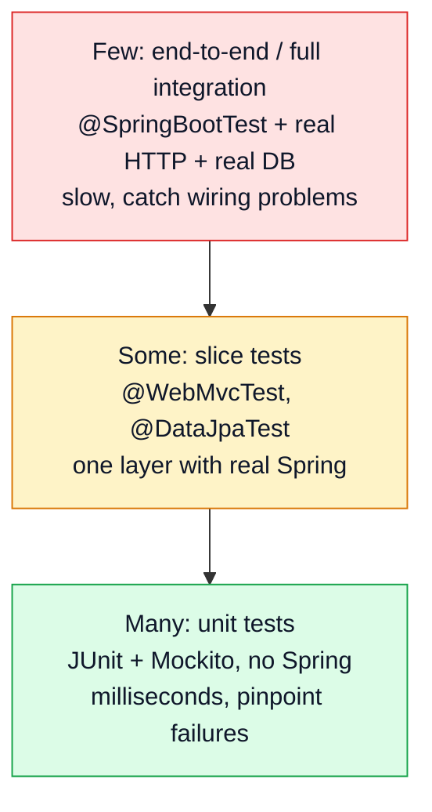
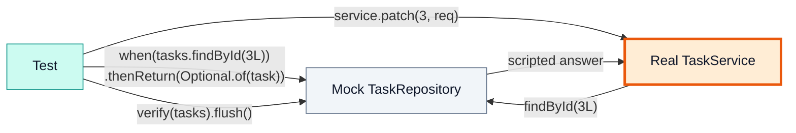
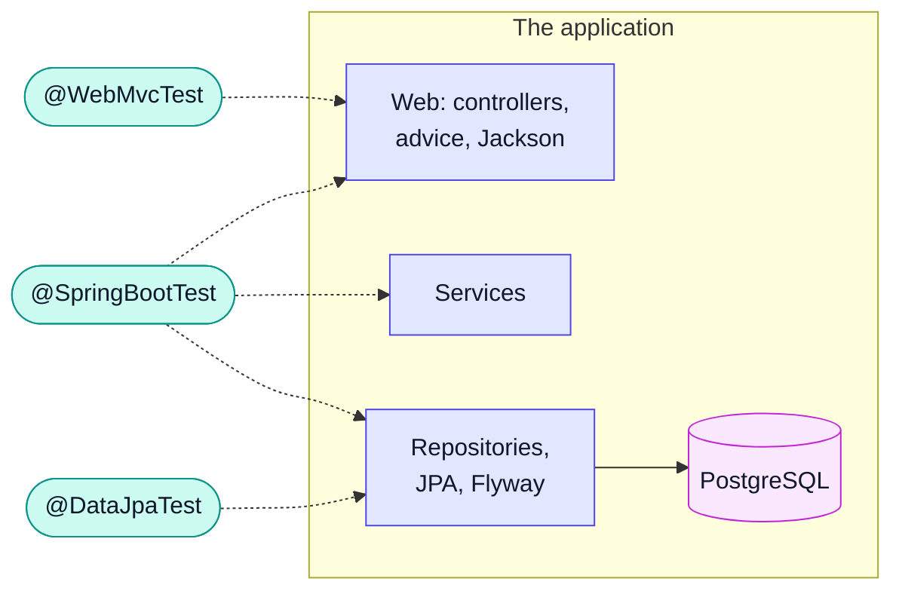

# Testing Spring Boot Apps: JUnit 5, Mockito, Slices and Testcontainers — Complete In-Depth Guide

**Spring Boot notes #10 of 18** · Priority 🔴 · Track: Spring Boot ([README](README.md))

Every earlier file checked the Task Tracker by **running it and reading the output**. That doesn't scale, and nobody re-reads 600 lines of output after each change. This file writes **automated tests** for every layer:
- a **unit test** of the service, using Mockito mocks;
- a **web slice** (`@WebMvcTest`) for the controller and error handling;
- a **JPA slice** (`@DataJpaTest`) against real PostgreSQL, including a test that fails if file 09's N+1 fix is undone;
- a **full integration test** over real HTTP (`@SpringBootTest` + `RestTestClient`);
- a **Testcontainers** test.

[Java gap #12](../Java%20Topics%20Not%20Covered%20Notes/java_gap_12_junit_maven_gradle_jdbc.md) covered JUnit basics in plain Java. Here the subject is Spring.

| You want to test… | Use | Starts Spring? | Database? | Speed |
|---|---|---|---|---|
| Business logic in one class | **JUnit 5 + Mockito** | No | No | ms |
| Controllers: URLs, JSON, validation, status codes | **`@WebMvcTest`** + `MockMvcTester` | Web beans only | No | ~1 s |
| Repositories, queries, mappings, migrations | **`@DataJpaTest`** | JPA beans only | Yes | seconds |
| The whole app wired together | **`@SpringBootTest`** (+ a real port) | Everything | Yes | seconds |
| …against a disposable real database | + **Testcontainers** | | In Docker | +container start |

> [!NOTE]
> This topic isn't in Kunal's playlist, so there are no video timestamps.
>
> **What was run:** [`examples/10-testing/`](examples/10-testing/) (Task Tracker 0.10.0, file 09's app with its demo removed). `./mvnw test` ran on Spring Boot 4.0.5, JUnit 5 (JUnit Jupiter), Mockito, AssertJ and Testcontainers 2.0.4, with PostgreSQL 18.3 in a separate schema `tracker10_test`.
> - Result: **21 tests: 20 passed, 1 skipped.** The Testcontainers test needs Docker, which isn't installed here, so it skipped itself. It is **not run** in these notes.
> - Section 7.4 has a second real run, made on a scratch copy with the fetch join deliberately removed, to show a test catching the N+1 regression.

---

## Table of Contents

| # | Topic (anchor link) | Level |
|---|---|---|
| 0 | [The Test Pyramid](#0-the-test-pyramid) | Basics |
| 1 | [Dependencies and Layout](#1-dependencies-and-layout) | Core |
| 2 | [JUnit 5 and AssertJ Essentials](#2-junit-5-and-assertj-essentials) | Core |
| 3 | [Mockito](#3-mockito) | Core |
| 4 | [Unit Testing the Service](#4-unit-testing-the-service) | Core |
| 5 | [Spring Test Slices](#5-spring-test-slices) | Core |
| 6 | [Web Slice: @WebMvcTest](#6-web-slice-webmvctest) | In depth |
| 7 | [JPA Slice: @DataJpaTest](#7-jpa-slice-datajpatest) | In depth |
| 8 | [Full Integration: @SpringBootTest](#8-full-integration-springboottest) | In depth |
| 9 | [Testcontainers](#9-testcontainers) | In depth |
| 10 | [Context Caching, Test Config and Speed](#10-context-caching-test-config-and-speed) | In depth |
| 11 | [Running Tests with Maven](#11-running-tests-with-maven) | Core |
| 12 | [Interview Questions](#12-interview-questions) | Interview |

---

## 0. The Test Pyramid



| Level | Here | Catches | Misses |
|---|---|---|---|
| Unit | `TaskServiceTest` (4 tests) | Logic errors (version check, clock use) | Wrong SQL, wrong URL, missing bean |
| Web slice | `TaskControllerTest` (6) | Wrong status codes, JSON shape, validation, parameter binding | Database behaviour |
| JPA slice | `TaskRepositoryTest` (8) | Wrong queries, broken mappings/migrations, N+1 regressions | HTTP layer |
| Integration | `TaskApiIntegrationTest` (2) | Wiring, configuration, the full request path | Exact cause (many layers involved) |

> [!TIP]
> A good test is **fast, isolated, repeatable and self-checking**. It names a behaviour ("patch with a stale version is rejected"), not a method ("testPatch2").

---

## 1. Dependencies and Layout

Boot 4 splits test support per technology, matching its main starters:

```xml
<!-- ===== test dependencies (scope test: not in the jar) ===== -->
<dependency>                            <!-- JUnit 5, AssertJ, Mockito, MockMvc, RestTestClient, @WebMvcTest -->
    <groupId>org.springframework.boot</groupId>
    <artifactId>spring-boot-starter-webmvc-test</artifactId>
    <scope>test</scope>
</dependency>
<dependency>                            <!-- @DataJpaTest, TestEntityManager -->
    <groupId>org.springframework.boot</groupId>
    <artifactId>spring-boot-starter-data-jpa-test</artifactId>
    <scope>test</scope>
</dependency>
<dependency>                            <!-- @ServiceConnection for Testcontainers -->
    <groupId>org.springframework.boot</groupId>
    <artifactId>spring-boot-testcontainers</artifactId>
    <scope>test</scope>
</dependency>
```

| Starter (`test` scope) | Brings |
|---|---|
| `spring-boot-starter-test` (inside the others) | JUnit Jupiter, AssertJ, Mockito (+ `mockito-junit-jupiter`), Hamcrest, JSONassert, JsonPath, Awaitility, XMLUnit, Spring Test |
| `spring-boot-starter-webmvc-test` | + `@WebMvcTest`, `MockMvc`/`MockMvcTester`, `RestTestClient`, `TestRestTemplate` |
| `spring-boot-starter-data-jpa-test` | + `@DataJpaTest`, `TestEntityManager` |
| `spring-boot-testcontainers` + `org.testcontainers:testcontainers-postgresql` | `@ServiceConnection` + the PostgreSQL container |

| Boot 3 | Boot 4 |
|---|---|
| `spring-boot-starter-test` for everything | Per-technology `...-test` starters |
| `@MockBean`, `@SpyBean` (Boot) | **Removed**: use `@MockitoBean`, `@MockitoSpyBean` (Spring Framework 6.2+) |
| `org.springframework.boot.test.autoconfigure.web.servlet.WebMvcTest` | `org.springframework.boot.webmvc.test.autoconfigure.WebMvcTest` |
| `org.springframework.boot.test.autoconfigure.orm.jpa.DataJpaTest` | `org.springframework.boot.data.jpa.test.autoconfigure.DataJpaTest` |
| `TestRestTemplate` auto-available | `@AutoConfigureRestTestClient` / `@AutoConfigureTestRestTemplate`; **`RestTestClient`** is new in Spring 7 |
| Testcontainers 1.x (`org.testcontainers:postgresql`) | Testcontainers 2.x (`testcontainers-postgresql`, class `org.testcontainers.postgresql.PostgreSQLContainer`) |

**Layout:** tests mirror the main packages, so a test can see package-private members:

```
src/test/
├── java/com/notes/tasks/
│   ├── TaskApiIntegrationTest.java
│   ├── service/TaskServiceTest.java
│   ├── web/TaskControllerTest.java
│   └── repo/TaskRepositoryTest.java, TaskRepositoryContainerTest.java
└── resources/application-test.yml        (profile "test": schema tracker10_test)
```

```yaml
# Profile "test": tests use their own schema, so running them never touches the app's data.
spring:
  datasource:
    url: jdbc:postgresql://localhost:5432/springnotes?currentSchema=tracker10_test
  flyway:
    schemas: tracker10_test
  jpa:
    properties:
      hibernate:
        default_schema: tracker10_test

logging:
  level:
    org.hibernate.SQL: WARN               # keep test output short: tests count statements instead
    com.zaxxer.hikari: WARN
    org.flywaydb: WARN
    org.springframework.boot.tomcat: WARN
```

> [!IMPORTANT]
> Tests that touch a database must **never use the application's data**. Here the `test` profile points at its own schema, `tracker10_test`, which Flyway creates and fills from the same migrations.

---

## 2. JUnit 5 and AssertJ Essentials

| JUnit 5 (Jupiter) | Meaning |
|---|---|
| `@Test` | A test method (package-private is fine) |
| `@BeforeEach` / `@AfterEach` | Run before/after **every** test: fresh state each time |
| `@BeforeAll` / `@AfterAll` | Once per class (`static`) |
| `@DisplayName("...")` | A readable name in reports |
| `@ParameterizedTest` + `@CsvSource` / `@ValueSource` / `@MethodSource` | One test, many inputs |
| `@Nested` | Group tests in inner classes |
| `@Disabled`, `@Tag("slow")` | Skip; filter by tag |
| `Assumptions.assumeTrue(...)` | **Skip** (not fail) when a precondition is missing |
| `@ExtendWith(...)` | Plug in extensions (Mockito, Spring, Testcontainers) |

JUnit creates a **new instance of the test class for every test method**, so fields can't leak state between tests.

A parameterized test from `TaskRepositoryTest`:

```java
@ParameterizedTest(name = "done={0}, assignee={1} -> {2} tasks")
@CsvSource(nullValues = "-", value = {
        "false, meera, 4",
        "true,  ravi,  3",
        "-,     ravi,  5",
        "false, -,     8"})
void specificationsCombineOptionalFilters(Boolean done, String assignee, int expected) {
    assertThat(tasks.findAll(TaskSpecs.matching(done, null, assignee, null, null))).hasSize(expected);
}
```

Four rows become four tests. With the other four test methods, that's why the run says `Tests run: 8` for this class.

**AssertJ** has fluent assertions with readable failure messages:

| Assertion | Example |
|---|---|
| Equality | `assertThat(r.priority()).isEqualTo(Priority.HIGH)` |
| Booleans / nulls | `isTrue()`, `isNotNull()` |
| Collections | `containsExactly(7L, 8L, ...)`, `hasSize(11)`, `extracting(Task::getId)` |
| Exceptions | `assertThatThrownBy(() -> ...).isInstanceOf(X.class).hasMessage("...")` |
| Strings | `startsWith`, `contains`, `matches(regex)` |

> [!TIP]
> Prefer AssertJ's `assertThat` over JUnit's `assertEquals(expected, actual)`. The argument order can't be swapped by mistake, and collection failures show exactly which element differs.

---

## 3. Mockito

A **mock** is a fake object whose answers you script. It lets you test one class without its dependencies (database, network, clock).



| Mockito | Meaning |
|---|---|
| `@ExtendWith(MockitoExtension.class)` + `@Mock X x` | Create mocks (and check for unused stubs: "strict stubs") |
| `when(x.call(args)).thenReturn(v)` / `.thenThrow(e)` | Script an answer |
| `any()`, `eq(v)`, `isNull()` | Argument matchers. If one argument uses a matcher, **all** must |
| `verify(x).call(args)` | Check it was called (once by default) |
| `verify(x, never()).call()`, `times(2)` | Check call counts |
| `verifyNoInteractions(x)` | Check the mock was never touched |
| `ArgumentCaptor.forClass(T.class)` | Capture the argument passed, then assert on it |
| `@Spy` / `spy(obj)` | A real object with some methods stubbed |
| `@InjectMocks` | Build the class under test from the mocks (we use the constructor directly instead) |

Unmocked methods return defaults: `null`, `0`, `false`, empty collections, `Optional.empty()`.

> [!WARNING]
> Mock what you **own and control** (repositories, other services), not value objects or the JDK. Too many mocks means the test checks the mocks, not the code. Then a slice or integration test fits better.

---

## 4. Unit Testing the Service

```java
package com.notes.tasks.service;

import com.notes.tasks.dto.TaskDtos.PatchTaskRequest;
import com.notes.tasks.dto.TaskDtos.TaskResponse;
import com.notes.tasks.model.AuditInfo;
import com.notes.tasks.model.Priority;
import com.notes.tasks.model.Project;
import com.notes.tasks.model.Task;
import com.notes.tasks.repo.AppUserRepository;
import com.notes.tasks.repo.ProjectRepository;
import com.notes.tasks.repo.TagRepository;
import com.notes.tasks.repo.TaskRepository;
import org.junit.jupiter.api.BeforeEach;
import org.junit.jupiter.api.DisplayName;
import org.junit.jupiter.api.Test;
import org.junit.jupiter.api.extension.ExtendWith;
import org.mockito.Mock;
import org.mockito.junit.jupiter.MockitoExtension;
import org.springframework.orm.ObjectOptimisticLockingFailureException;

import java.time.Clock;
import java.time.Instant;
import java.time.LocalDate;
import java.time.ZoneOffset;
import java.util.Optional;

import static org.assertj.core.api.Assertions.assertThat;
import static org.assertj.core.api.Assertions.assertThatThrownBy;
import static org.mockito.ArgumentMatchers.any;
import static org.mockito.Mockito.never;
import static org.mockito.Mockito.verify;
import static org.mockito.Mockito.when;

/** A plain unit test: no Spring context, no database. Collaborators are Mockito mocks. */
@ExtendWith(MockitoExtension.class)
class TaskServiceTest {

    @Mock ProjectRepository projects;
    @Mock TaskRepository tasks;
    @Mock TagRepository tags;
    @Mock AppUserRepository users;
    @Mock ActivityService activity;

    final Clock clock = Clock.fixed(Instant.parse("2026-11-16T09:00:00Z"), ZoneOffset.UTC);
    TaskService service;
    Task task;

    @BeforeEach
    void setUp() {
        service = new TaskService(projects, tasks, tags, users, activity, clock);   // constructor injection pays off
        Project project = new Project();
        project.setName("Task Tracker");
        task = new Task("Add validation", Priority.MEDIUM, new AuditInfo(Instant.parse("2026-10-22T09:00:00Z"), "asha"));
        task.setId(3L);
        project.addTask(task);
    }

    @Test
    @DisplayName("patch changes only the fields that were sent")
    void patchAppliesChanges() {
        when(tasks.findById(3L)).thenReturn(Optional.of(task));

        TaskResponse r = service.patch(3L, new PatchTaskRequest(null, true, Priority.HIGH, 0L));

        assertThat(r.done()).isTrue();
        assertThat(r.priority()).isEqualTo(Priority.HIGH);
        assertThat(r.title()).isEqualTo("Add validation");            // untouched
        verify(tasks).flush();
    }

    @Test
    @DisplayName("patch with a stale version is rejected and changes nothing")
    void patchRejectsStaleVersion() {
        task.setVersion(2);
        when(tasks.findById(3L)).thenReturn(Optional.of(task));

        assertThatThrownBy(() -> service.patch(3L, new PatchTaskRequest("New title", null, null, 1L)))
                .isInstanceOf(ObjectOptimisticLockingFailureException.class);
        assertThat(task.getTitle()).isEqualTo("Add validation");
        verify(tasks, never()).flush();
    }

    @Test
    void getUnknownTaskThrowsNotFound() {
        when(tasks.findById(99L)).thenReturn(Optional.empty());

        assertThatThrownBy(() -> service.get(99L))
                .isInstanceOf(NotFoundException.class)
                .hasMessage("Task 99 does not exist");
    }

    @Test
    void completeOverdueUsesTheClockAndLogsActivity() {
        when(tasks.completeOverdue(any())).thenReturn(3);

        assertThat(service.completeOverdue()).isEqualTo(3);
        verify(tasks).completeOverdue(LocalDate.of(2026, 11, 16));     // "today" comes from the fixed clock
        verify(activity).record("completed 3 overdue tasks");
    }
}
```

| Test | Technique |
|---|---|
| `patchAppliesChanges` | Stub `findById`, call, assert the response, `verify(tasks).flush()` |
| `patchRejectsStaleVersion` | `assertThatThrownBy` + `verify(..., never())`: the guard stops **before** any change |
| `getUnknownTaskThrowsNotFound` | Exception type **and** message |
| `completeOverdueUsesTheClockAndLogsActivity` | A fixed `Clock`, so "today" is known; `verify` exact arguments |

This test needs no Spring and no database, and runs in about a second (`Time elapsed: 1.014 s`, mostly Mockito start-up). Two earlier design choices pay off here:
- **constructor injection** (file 03): `new TaskService(mocks...)` needs no reflection;
- the **injected `Clock`** (file 08): time-dependent logic is testable.

---

## 5. Spring Test Slices

A **slice** starts Spring with only the auto-configuration and beans for **one layer**. It's faster than the whole app, and it's still real Spring (real Jackson, real validation, real Hibernate).

| Annotation | Loads | Not loaded | Typical extras |
|---|---|---|---|
| `@WebMvcTest(X.class)` | Controller X, `@ControllerAdvice`, converters, filters, validation, Jackson | Services, repositories, DataSource | `@MockitoBean` for the controller's dependencies |
| `@DataJpaTest` | Entities, repositories, `EntityManager`, DataSource, Flyway | Web layer, services | `TestEntityManager`; **each test rolled back** |
| `@JdbcTest` | `JdbcTemplate`, `JdbcClient`, DataSource | JPA, web | For DAO tests like `ReportDao` |
| `@JsonTest` | Jackson + `JacksonTester` | Everything else | DTO serialization |
| `@RestClientTest` | `RestClient.Builder` + a mock server | Everything else | Testing HTTP clients (file 13) |
| `@SpringBootTest` | **Everything** | — | Optionally a real server port |



---

## 6. Web Slice: @WebMvcTest

```java
package com.notes.tasks.web;

import com.notes.tasks.dto.TaskDtos.PageResponse;
import com.notes.tasks.dto.TaskDtos.TaskResponse;
import com.notes.tasks.jdbc.ReportDao;
import com.notes.tasks.model.Priority;
import com.notes.tasks.repo.ActivityLogRepository;
import com.notes.tasks.service.NotFoundException;
import com.notes.tasks.service.TaskService;
import com.notes.tasks.model.Task;
import org.junit.jupiter.api.Test;
import org.mockito.ArgumentCaptor;
import org.springframework.beans.factory.annotation.Autowired;
import org.springframework.boot.webmvc.test.autoconfigure.WebMvcTest;
import org.springframework.data.domain.Pageable;
import org.springframework.data.domain.Sort;
import org.springframework.http.MediaType;
import org.springframework.orm.ObjectOptimisticLockingFailureException;
import org.springframework.test.context.bean.override.mockito.MockitoBean;
import org.springframework.test.web.servlet.MockMvc;
import org.springframework.test.web.servlet.assertj.MockMvcTester;

import java.time.Instant;
import java.time.LocalDate;
import java.util.List;

import static org.assertj.core.api.Assertions.assertThat;
import static org.mockito.ArgumentMatchers.any;
import static org.mockito.ArgumentMatchers.eq;
import static org.mockito.ArgumentMatchers.isNull;
import static org.mockito.Mockito.verify;
import static org.mockito.Mockito.verifyNoInteractions;
import static org.mockito.Mockito.when;
import static org.springframework.test.web.servlet.request.MockMvcRequestBuilders.get;
import static org.springframework.test.web.servlet.result.MockMvcResultMatchers.jsonPath;
import static org.springframework.test.web.servlet.result.MockMvcResultMatchers.status;

/**
 * A web slice: only MVC beans (this controller, the @RestControllerAdvice, Jackson, validation).
 * No database, no services: TaskService is a Mockito mock registered as a bean.
 */
@WebMvcTest(TaskController.class)
class TaskControllerTest {

    @Autowired MockMvcTester mvc;              // AssertJ-style MockMvc (Spring 6.2+)
    @Autowired MockMvc classicMvc;             // the classic perform/andExpect style

    @MockitoBean TaskService service;
    @MockitoBean ReportDao reports;
    @MockitoBean ActivityLogRepository activity;

    static final TaskResponse TASK_3 = new TaskResponse(3, "Task Tracker", "Add validation", null, Priority.MEDIUM,
            false, LocalDate.of(2026, 11, 20), "meera", List.of("backend", "urgent"),
            Instant.parse("2026-10-22T09:00:00Z"), "asha", 0);

    @Test
    void getReturnsTheTaskAsJson() {
        when(service.get(3L)).thenReturn(TASK_3);

        assertThat(mvc.get().uri("/api/tasks/3"))
                .hasStatusOk()
                .hasContentType(MediaType.APPLICATION_JSON)
                .bodyJson()
                .hasPathSatisfying("$.title", v -> v.assertThat().isEqualTo("Add validation"))
                .hasPathSatisfying("$.tags", v -> v.assertThat().asArray().containsExactly("backend", "urgent"))
                .doesNotHavePath("$.description");                  // null fields are left out (NON_NULL)
    }

    @Test
    void sameTestInTheClassicStyle() throws Exception {
        when(service.get(3L)).thenReturn(TASK_3);

        classicMvc.perform(get("/api/tasks/3"))
                .andExpect(status().isOk())
                .andExpect(jsonPath("$.title").value("Add validation"))
                .andExpect(jsonPath("$.tags.length()").value(2));
    }

    @Test
    void unknownTaskIs404ProblemDetail() {
        when(service.get(99L)).thenThrow(new NotFoundException("Task", 99));

        assertThat(mvc.get().uri("/api/tasks/99"))
                .hasStatus(404)
                .hasContentType(MediaType.APPLICATION_PROBLEM_JSON)
                .bodyJson()
                .hasPathSatisfying("$.detail", v -> v.assertThat().isEqualTo("Task 99 does not exist"));
    }

    @Test
    void invalidBodyIs400AndTheServiceIsNeverCalled() {
        assertThat(mvc.post().uri("/api/projects/1/tasks")
                .contentType(MediaType.APPLICATION_JSON)
                .content("""
                        {"title": "", "tags": ["this-tag-name-is-much-too-long-for-the-column"]}"""))
                .hasStatus(400);
        verifyNoInteractions(service);
    }

    @Test
    void staleVersionIs409() {
        when(service.patch(eq(3L), any())).thenThrow(new ObjectOptimisticLockingFailureException(Task.class, 3L));

        assertThat(mvc.patch().uri("/api/tasks/3")
                .contentType(MediaType.APPLICATION_JSON)
                .content("""
                        {"title": "Stale edit", "version": 0}"""))
                .hasStatus(409)
                .bodyJson()
                .hasPathSatisfying("$.title", v -> v.assertThat().isEqualTo("Conflict"));
    }

    @Test
    void queryParametersBecomeFiltersAndPageable() {
        when(service.search(any(), any(), any(), any(), any(), any()))
                .thenReturn(new PageResponse<>(List.of(), 1, 2, 0, 0));

        assertThat(mvc.get().uri("/api/tasks?done=false&assignee=meera&page=1&size=2&sort=dueDate,desc"))
                .hasStatusOk();

        ArgumentCaptor<Pageable> pageable = ArgumentCaptor.forClass(Pageable.class);
        verify(service).search(eq(false), isNull(), eq("meera"), isNull(), isNull(), pageable.capture());
        assertThat(pageable.getValue().getPageNumber()).isEqualTo(1);
        assertThat(pageable.getValue().getPageSize()).isEqualTo(2);
        assertThat(pageable.getValue().getSort()).isEqualTo(Sort.by(Sort.Direction.DESC, "dueDate"));
    }
}
```

| Piece | Role |
|---|---|
| `@WebMvcTest(TaskController.class)` | Only this controller (plus advice, Jackson, validation), not all controllers |
| `@MockitoBean TaskService service` | Puts a Mockito mock **into the Spring context** in place of the real bean. Every constructor dependency of the controller needs one |
| `MockMvcTester` | Sends requests through the real `DispatcherServlet` **without a server or network**; AssertJ-style assertions |
| `MockMvc` | The classic API: `perform(get(...)).andExpect(status().isOk())` |
| `bodyJson().hasPathSatisfying("$.title", ...)` / `jsonPath("$.title")` | JsonPath assertions on the body |

What these 6 tests prove:

| Test | Proves |
|---|---|
| `getReturnsTheTaskAsJson` | Status, content type, JSON fields, and that `null` fields are omitted (`@JsonInclude(NON_NULL)`) |
| `unknownTaskIs404ProblemDetail` | `GlobalExceptionHandler` turns `NotFoundException` into `application/problem+json` 404 |
| `invalidBodyIs400AndTheServiceIsNeverCalled` | Bean Validation runs **before** the service (`verifyNoInteractions`) |
| `staleVersionIs409` | Optimistic-lock exception → 409 |
| `queryParametersBecomeFiltersAndPageable` | `?page=1&size=2&sort=dueDate,desc` binds to the right `Pageable` (captured with `ArgumentCaptor`) |

> [!NOTE]
> `@MockitoBean` replaced Boot's `@MockBean`, which was deprecated in Boot 3.4 and **removed in Boot 4**. It lives in Spring Framework (`org.springframework.test.context.bean.override.mockito`), so it works in any Spring test.

---

## 7. JPA Slice: @DataJpaTest

```java
package com.notes.tasks.repo;

import com.notes.tasks.model.Priority;
import com.notes.tasks.model.Task;
import jakarta.persistence.EntityManagerFactory;
import org.hibernate.SessionFactory;
import org.hibernate.stat.Statistics;
import org.junit.jupiter.api.BeforeEach;
import org.junit.jupiter.api.Test;
import org.junit.jupiter.params.ParameterizedTest;
import org.junit.jupiter.params.provider.CsvSource;
import org.springframework.beans.factory.annotation.Autowired;
import org.springframework.boot.data.jpa.test.autoconfigure.DataJpaTest;
import org.springframework.boot.jdbc.test.autoconfigure.AutoConfigureTestDatabase;
import org.springframework.boot.jpa.test.autoconfigure.TestEntityManager;
import org.springframework.data.domain.Sort;
import org.springframework.test.context.ActiveProfiles;

import java.time.LocalDate;
import java.util.List;

import static org.assertj.core.api.Assertions.assertThat;

/**
 * A JPA slice: entities, repositories, Flyway and a DataSource; no web layer, no services.
 * Runs against the local PostgreSQL (schema tracker10_test), not an in-memory database.
 * Every test runs in a transaction that is ROLLED BACK at the end, so tests can't affect each other.
 */
@DataJpaTest
@AutoConfigureTestDatabase(replace = AutoConfigureTestDatabase.Replace.NONE)   // keep our PostgreSQL
@ActiveProfiles("test")
class TaskRepositoryTest {

    @Autowired TaskRepository tasks;
    @Autowired TestEntityManager em;
    @Autowired EntityManagerFactory emf;
    Statistics stats;

    @BeforeEach
    void setUp() {
        stats = emf.unwrap(SessionFactory.class).getStatistics();
    }

    @Test
    void derivedQueryFindsOpenTasksByDueDate() {
        List<Long> ids = tasks.findByProjectIdAndDoneFalseOrderByDueDateAsc(1L).stream().map(Task::getId).toList();
        assertThat(ids).containsExactly(7L, 8L, 9L, 10L, 11L, 12L, 3L);
    }

    @ParameterizedTest(name = "done={0}, assignee={1} -> {2} tasks")
    @CsvSource(nullValues = "-", value = {
            "false, meera, 4",
            "true,  ravi,  3",
            "-,     ravi,  5",
            "false, -,     8"})
    void specificationsCombineOptionalFilters(Boolean done, String assignee, int expected) {
        assertThat(tasks.findAll(TaskSpecs.matching(done, null, assignee, null, null))).hasSize(expected);
    }

    @Test
    void fetchJoinLoadsAProjectsTasksInOneStatement() {
        stats.clear();
        List<Task> list = tasks.findWithDetailsByProjectId(1L);
        list.forEach(t -> t.getTags().size());                       // touching the tags must not query again
        assertThat(list).hasSize(11);
        assertThat(stats.getPrepareStatementCount()).isEqualTo(1);   // an N+1 regression would fail here
    }

    @Test
    void bulkUpdateCompletesOverdueTasks() {
        int changed = tasks.completeOverdue(LocalDate.of(2026, 11, 16));
        assertThat(changed).isEqualTo(3);
        assertThat(tasks.findAll(TaskSpecs.isDone(false), Sort.by("id"))).extracting(Task::getId)
                .containsExactly(3L, 4L, 10L, 11L, 12L);
    }                                                                // rolled back: the next test sees 8 open tasks again

    @Test
    void versionIncrementsOnEveryUpdate() {
        Task t = tasks.findById(4L).orElseThrow();
        long before = t.getVersion();
        t.setPriority(Priority.LOW);
        em.flush();                                                  // force the UPDATE now
        assertThat(t.getVersion()).isEqualTo(before + 1);
    }
}
```

### 7.1 The real database, not an embedded one

By default `@DataJpaTest` **replaces** your DataSource with an embedded database (H2, HSQLDB, Derby). None is on the classpath here. Removing the `replace = NONE` line in a scratch copy made all 8 tests error with:

```
Caused by: java.lang.IllegalStateException: Failed to replace DataSource with an embedded database for tests. If you want an embedded database please put a supported one on the classpath or tune the replace attribute of @AutoConfigureTestDatabase.
```

And H2 would behave differently from PostgreSQL anyway: different SQL, no `FOR NO KEY UPDATE`, no `TIMESTAMPTZ`. Two lines keep PostgreSQL:

```java
@AutoConfigureTestDatabase(replace = AutoConfigureTestDatabase.Replace.NONE)   // keep our PostgreSQL
@ActiveProfiles("test")
```

### 7.2 Every test is rolled back

`@DataJpaTest` is `@Transactional`: each test runs in a transaction that is **rolled back** at the end. `bulkUpdateCompletesOverdueTasks` marks 3 tasks done, yet `derivedQueryFindsOpenTasksByDueDate` still finds all 8 open tasks, in whatever order the tests run.

| Consequence | Watch out |
|---|---|
| Tests can't affect each other | Fast and repeatable |
| Nothing is ever committed | Commit-time behaviour (deferred constraints, `REQUIRES_NEW`) isn't tested |
| Changes may stay in the persistence context | Call `em.flush()` to force the SQL, as `versionIncrementsOnEveryUpdate` does, or a constraint violation may never reach the database |

### 7.3 `show-sql` is on

`@DataJpaTest` sets `spring.jpa.show-sql=true` (attribute `showSql`), so every statement prints as `Hibernate: select ...` in the run output.

### 7.4 A test that guards against N+1

```java
@Test
void fetchJoinLoadsAProjectsTasksInOneStatement() {
    stats.clear();
    List<Task> list = tasks.findWithDetailsByProjectId(1L);
    list.forEach(t -> t.getTags().size());                       // touching the tags must not query again
    assertThat(list).hasSize(11);
    assertThat(stats.getPrepareStatementCount()).isEqualTo(1);   // an N+1 regression would fail here
}
```

To see it work, `left join fetch t.tags` was **deleted** from the query in a scratch copy of the project, and only this class was run:

```
[INFO] -------------------------------------------------------
[INFO]  T E S T S
[INFO] -------------------------------------------------------
[INFO] Running com.notes.tasks.repo.TaskRepositoryTest
INFO org.springframework.test.context.support.AnnotationConfigContextLoaderUtils -- Could not detect default configuration classes for test class [com.notes.tasks.repo.TaskRepositoryTest]: ...
INFO org.springframework.boot.test.context.SpringBootTestContextBootstrapper -- Found @SpringBootConfiguration com.notes.tasks.TaskTrackerApplication for test class com.notes.tasks.repo.TaskRepositoryTest
INFO org.springframework.test.context.support.AnnotationConfigContextLoaderUtils -- Could not detect default configuration classes for test class [com.notes.tasks.repo.TaskRepositoryTest]: ...
INFO org.springframework.boot.test.context.SpringBootTestContextBootstrapper -- Found @SpringBootConfiguration com.notes.tasks.TaskTrackerApplication for test class com.notes.tasks.repo.TaskRepositoryTest
2026-11-16T23:25:13.601+05:30 INFO c.notes.tasks.repo.TaskRepositoryTest : Starting TaskRepositoryTest using Java 21 with PID 4140
2026-11-16T23:25:13.603+05:30 INFO c.notes.tasks.repo.TaskRepositoryTest : The following 1 profile is active: "test"
2026-11-16T23:25:22.288+05:30 INFO c.notes.tasks.repo.TaskRepositoryTest : Started TaskRepositoryTest in 9.404 seconds (process running for 11.582)
Hibernate: select t1_0.id,t1_0.assignee_id,t1_0.created_at,t1_0.created_by,t1_0.description,t1_0.done,t1_0.due_date,t1_0 ...
Hibernate: update tracker10_test.task set assignee_id=?,created_at=?,created_by=?,description=?,done=?,due_date=?,priori ...
Hibernate: ...                (one line per SQL statement: @DataJpaTest turns on show-sql)
[ERROR] Tests run: 8, Failures: 1, Errors: 0, Skipped: 0, Time elapsed: 11.53 s <<< FAILURE! -- in com.notes.tasks.repo.TaskRepositoryTest
[ERROR] com.notes.tasks.repo.TaskRepositoryTest.fetchJoinLoadsAProjectsTasksInOneStatement -- Time elapsed: 0.104 s <<< FAILURE!
org.opentest4j.AssertionFailedError:

expected: 1L
 but was: 12L

[INFO]
[INFO] Results:
[INFO]
[ERROR] Failures:
[ERROR]   TaskRepositoryTest.fetchJoinLoadsAProjectsTasksInOneStatement:66
expected: 1L
 but was: 12L
[INFO]
[ERROR] Tests run: 8, Failures: 1, Errors: 0, Skipped: 0
[INFO]
[INFO] ------------------------------------------------------------------------
[INFO] BUILD FAILURE
[INFO] ------------------------------------------------------------------------
[INFO] Total time:  25.786 s
[INFO] Finished at: 2026-11-16T23:25:23+05:30
```

`12` = 1 query + 11 lazy tag loads: the N+1 is back, and the build fails instead of production slowing down. The failure names the test and the line (`:66`).

---

## 8. Full Integration: @SpringBootTest

```java
package com.notes.tasks;

import com.notes.tasks.dto.TaskDtos.TaskResponse;
import org.junit.jupiter.api.Test;
import org.springframework.beans.factory.annotation.Autowired;
import org.springframework.boot.resttestclient.autoconfigure.AutoConfigureRestTestClient;
import org.springframework.boot.test.context.SpringBootTest;
import org.springframework.http.HttpStatus;
import org.springframework.http.MediaType;
import org.springframework.test.context.ActiveProfiles;
import org.springframework.test.web.servlet.client.RestTestClient;

import static org.assertj.core.api.Assertions.assertThat;

/**
 * The whole application on a random port, real HTTP, real PostgreSQL (schema tracker10_test).
 * Nothing is rolled back here (the server commits), so the test cleans up after itself.
 */
@SpringBootTest(webEnvironment = SpringBootTest.WebEnvironment.RANDOM_PORT)
@AutoConfigureRestTestClient
@ActiveProfiles("test")
class TaskApiIntegrationTest {

    @Autowired RestTestClient client;

    @Test
    void createReadDeleteRoundTrip() {
        TaskResponse created = client.post().uri("/api/projects/2/tasks")
                .contentType(MediaType.APPLICATION_JSON)
                .body("""
                        {"title": "Write integration tests", "priority": "HIGH", "tags": ["testing"]}""")
                .exchange()
                .expectStatus().isCreated()
                .expectHeader().valueMatches("Location", ".*/api/tasks/\\d+")
                .expectBody(TaskResponse.class)
                .returnResult().getResponseBody();

        assertThat(created).isNotNull();
        assertThat(created.project()).isEqualTo("Website");
        assertThat(created.tags()).containsExactly("testing");
        assertThat(created.createdBy()).isEqualTo("meera");         // the project owner

        client.get().uri("/api/tasks/{id}", created.id())
                .exchange()
                .expectStatus().isOk()
                .expectBody().jsonPath("$.title").isEqualTo("Write integration tests");

        client.delete().uri("/api/tasks/{id}", created.id()).exchange().expectStatus().isNoContent();
        client.get().uri("/api/tasks/{id}", created.id()).exchange().expectStatus().isEqualTo(HttpStatus.NOT_FOUND);
    }

    @Test
    void searchPagesThroughTheBacklog() {
        client.get().uri("/api/tasks?size=4&sort=dueDate")
                .exchange()
                .expectStatus().isOk()
                .expectBody()
                .jsonPath("$.content.length()").isEqualTo(4)
                .jsonPath("$.totalElements").isEqualTo(12)
                .jsonPath("$.totalPages").isEqualTo(3)
                .jsonPath("$.content[0].title").isEqualTo("Design the schema");
    }
}
```

| `webEnvironment` | Server | Use |
|---|---|---|
| `MOCK` (default) | None; MockMvc against the full context (`@AutoConfigureMockMvc`) | Full context, no network |
| **`RANDOM_PORT`** | Real Tomcat on a free port | Real HTTP: filters, serialization, error pages |
| `DEFINED_PORT` | Real Tomcat on `server.port` | Rarely: port clashes |
| `NONE` | No web at all | Batch/CLI apps |

**`RestTestClient`** (new in Spring Framework 7) is a fluent client bound to the random port: `exchange()`, `expectStatus()`, `expectHeader()`, `expectBody(...)`. `TestRestTemplate` still exists (`@AutoConfigureTestRestTemplate`).

> [!WARNING]
> With a real server, the request runs on **another thread** in its own transaction, which **commits**. A `@Transactional` on the test method would **not** roll it back. So `createReadDeleteRoundTrip` deletes what it created, and `searchPagesThroughTheBacklog` can rely on exactly 12 tasks. Other options: `@Sql` scripts to reset data, or a fresh container per test class.

---

## 9. Testcontainers

**Testcontainers** starts real services (PostgreSQL, Kafka, Redis…) in throwaway Docker containers for the duration of the tests: no local install, identical on every machine and in CI.

```java
package com.notes.tasks.repo;

import org.junit.jupiter.api.Test;
import org.springframework.beans.factory.annotation.Autowired;
import org.springframework.boot.data.jpa.test.autoconfigure.DataJpaTest;
import org.springframework.boot.jdbc.test.autoconfigure.AutoConfigureTestDatabase;
import org.springframework.boot.testcontainers.service.connection.ServiceConnection;
import org.testcontainers.junit.jupiter.Container;
import org.testcontainers.junit.jupiter.Testcontainers;
import org.testcontainers.postgresql.PostgreSQLContainer;

import static org.assertj.core.api.Assertions.assertThat;

/**
 * The same kind of test against a throwaway PostgreSQL in Docker: no local database needed,
 * identical on every machine and in CI. Skipped (not failed) when Docker isn't available.
 */
@DataJpaTest
@AutoConfigureTestDatabase(replace = AutoConfigureTestDatabase.Replace.NONE)
@Testcontainers(disabledWithoutDocker = true)
class TaskRepositoryContainerTest {

    @Container
    @ServiceConnection                     // Boot points spring.datasource.* at the container
    static PostgreSQLContainer postgres = new PostgreSQLContainer("postgres:18");

    @Autowired TaskRepository tasks;

    @Test
    void migrationsRunInTheContainer() {
        assertThat(tasks.count()).isEqualTo(12);
    }
}
```

| Piece | Role |
|---|---|
| `@Testcontainers(disabledWithoutDocker = true)` | Starts/stops `@Container` fields; **skips** the class when Docker is missing |
| `@Container static` | One container for the whole class (an instance field = one per test) |
| `@ServiceConnection` | Boot reads the container's host, port, user and password and configures `spring.datasource.*`: no `@DynamicPropertySource` needed |

The real run on this machine (no Docker):

```
ERROR org.testcontainers.dockerclient.DockerClientProviderStrategy -- Could not find a valid Docker environment. Please check configuration. Attempted configurations were:
[INFO] Running com.notes.tasks.repo.TaskRepositoryContainerTest
[WARNING] Tests run: 1, Failures: 0, Errors: 0, Skipped: 1, Time elapsed: 0.016 s -- in com.notes.tasks.repo.TaskRepositoryContainerTest
```

> [!CAUTION]
> **Not run here:** the container test body never executed, because Docker isn't installed. With Docker it would pull `postgres:18`, run the three Flyway migrations in it and assert 12 tasks. File 14 (deployment) covers Docker.

**Development with containers:** Boot can also start containers when you **run** the app from a test-classpath main class (`SpringApplication.from(TaskTrackerApplication::main).with(ContainersConfig.class).run(args)`), so a new developer needs only Docker, not a local PostgreSQL.

---

## 10. Context Caching, Test Config and Speed

Starting a Spring context takes seconds. The Spring TestContext framework **caches** contexts and reuses one for every test class with the **same configuration**: the same slice, `@MockitoBean`s, profiles and properties. The run shows three contexts: JPA slice (~10.5 s), full app (~4.5 s) and web slice (~0.75 s), all in one JVM (`PID 11268`).

| To keep tests fast | Why |
|---|---|
| Prefer unit tests and slices | Smaller contexts |
| Reuse the same set of `@MockitoBean`s / profiles across classes | Each different combination = a new context |
| Avoid `@DirtiesContext` | It throws the cached context away |
| Don't start containers per test | `static` containers, or one shared across classes |

| Test configuration tool | Use |
|---|---|
| `@ActiveProfiles("test")` + `application-test.yml` | Test-only properties (this project) |
| `@TestPropertySource(properties = "x=y")` | One-off properties for a class |
| `@DynamicPropertySource` | Properties known only at runtime (e.g. a container's port) |
| `@TestConfiguration` | Extra/replacement beans for tests (e.g. a fixed `Clock`) |
| `@Sql("/reset.sql")` | Run SQL before/after a test |
| `@MockitoSpyBean` | Wrap a real bean to verify calls on it |

---

## 11. Running Tests with Maven

```bash
./mvnw test                                                   # all tests (Surefire)
./mvnw test -Dtest=TaskRepositoryTest                         # one class
./mvnw test -Dtest='TaskControllerTest#staleVersionIs409'     # one method
./mvnw package -DskipTests                                    # build without running tests
```

The build has two test-related plugins:

```xml
<plugin>                            <!-- sets ${org.mockito:mockito-core:jar} to the jar's path -->
    <groupId>org.apache.maven.plugins</groupId>
    <artifactId>maven-dependency-plugin</artifactId>
    <executions>
        <execution>
            <goals>
                <goal>properties</goal>
            </goals>
        </execution>
    </executions>
</plugin>
<plugin>                            <!-- runs the tests in "mvn test" -->
    <groupId>org.apache.maven.plugins</groupId>
    <artifactId>maven-surefire-plugin</artifactId>
    <configuration>
        <!-- load Mockito as a Java agent instead of letting it self-attach (JDK 21+ warns about that) -->
        <argLine>@{argLine} -javaagent:${org.mockito:mockito-core:jar} -Xshare:off</argLine>
    </configuration>
</plugin>
```

Without the agent line, the first run printed "Mockito is currently self-attaching to enable the inline-mock-maker. This will no longer work in future releases of the JDK", followed by a block of `WARNING:` lines starting with `A Java agent has been loaded dynamically`. With it, they're gone. Future JDKs will block self-attaching, so this setting will become required.

| Plugin | Phase | Runs | Naming convention |
|---|---|---|---|
| **Surefire** | `test` | Unit and slice tests | `*Test`, `*Tests`, `Test*` |
| **Failsafe** (optional) | `integration-test`, `verify` | Slow integration tests, after packaging | `*IT` |
| JaCoCo (optional) | `test` + `report` | Code coverage report in `target/site/jacoco` | — |

> [!TIP]
> When a test fails, Surefire writes the details to `target/surefire-reports/`: one `.txt` and one `.xml` per class, with every test's name and time. CI servers read the XML.

---

## 12. Interview Questions

| Question | Answer |
|---|---|
| Unit vs integration test? | A unit test checks one class in isolation (mocks for dependencies); an integration test checks several real parts working together. |
| What is a test slice? | A Spring test that loads only one layer's beans and auto-configuration (`@WebMvcTest`, `@DataJpaTest`). |
| `@WebMvcTest` vs `@SpringBootTest`? | Web slice with mocked dependencies and no server vs the full context, optionally with a real server. |
| `@MockitoBean` vs `@Mock`? | `@Mock` is a plain Mockito mock; `@MockitoBean` also registers it in the Spring context, replacing the bean. |
| What replaced `@MockBean` in Boot 4? | `@MockitoBean` / `@MockitoSpyBean` from Spring Framework. |
| Does `@DataJpaTest` roll back? | Yes, each test runs in a rolled-back transaction. |
| Why use the real database instead of H2? | H2's SQL and features differ; tests can pass on H2 and fail in production. Use Testcontainers or a dedicated schema. |
| Why doesn't `@Transactional` roll back a `RANDOM_PORT` test? | The server handles the request on another thread with its own transaction, which commits. |
| What is MockMvc? | A way to call controllers through the real `DispatcherServlet` without starting a server. |
| What does `@ServiceConnection` do? | Configures connection properties (e.g. `spring.datasource.*`) from a Testcontainers container automatically. |
| How do you test time-dependent code? | Inject a `Clock` and use `Clock.fixed(...)` in tests. |
| How do you catch N+1 regressions? | Count statements in a repository test (Hibernate `Statistics`) and assert the expected number. |
| What is context caching? | Spring reuses an application context across test classes with identical configuration; `@DirtiesContext` and differing mocks break it. |
| `when().thenReturn()` vs `verify()`? | Stubbing (scripting answers) vs checking interactions happened. |
| Surefire vs Failsafe? | Surefire runs tests in `test`; Failsafe runs integration tests in `integration-test`/`verify`, after packaging. |

---

## 🧩 Complete Example: Everything Together

**Task Tracker, stage 10:** the file 09 app with 21 tests across four layers, plus a Testcontainers test. The main code is file 09's without the `demo` package (schema `tracker10`).

Source: [`examples/10-testing/`](examples/10-testing/)

```
10-testing/
├── pom.xml                         (0.10.0; + test starters, Testcontainers, Mockito agent)
└── src/
    ├── main/...                    (file 09's app, minus demo/)
    └── test/
        ├── java/com/notes/tasks/
        │   ├── TaskApiIntegrationTest.java          2 tests   @SpringBootTest(RANDOM_PORT) + RestTestClient
        │   ├── service/TaskServiceTest.java         4 tests   JUnit + Mockito, no Spring
        │   ├── web/TaskControllerTest.java          6 tests   @WebMvcTest + MockMvcTester / MockMvc
        │   └── repo/TaskRepositoryTest.java         8 tests   @DataJpaTest on PostgreSQL (4 parameterized)
        │       repo/TaskRepositoryContainerTest.java 1 test   Testcontainers (skipped without Docker)
        └── resources/application-test.yml
```

All test classes and `application-test.yml` are shown in full above. The whole `pom.xml`:

```xml
<?xml version="1.0" encoding="UTF-8"?>
<project xmlns="http://maven.apache.org/POM/4.0.0"
         xmlns:xsi="http://www.w3.org/2001/XMLSchema-instance"
         xsi:schemaLocation="http://maven.apache.org/POM/4.0.0 https://maven.apache.org/xsd/maven-4.0.0.xsd">
    <modelVersion>4.0.0</modelVersion>

    <parent>
        <groupId>org.springframework.boot</groupId>
        <artifactId>spring-boot-starter-parent</artifactId>
        <version>4.0.5</version>
        <relativePath/>
    </parent>

    <groupId>com.notes</groupId>
    <artifactId>task-tracker</artifactId>
    <version>0.10.0</version>
    <name>task-tracker</name>
    <description>Task Tracker, stage 10: tests for every layer</description>

    <properties>
        <argLine></argLine>                     <!-- empty default so @{argLine} always resolves -->
        <java.version>21</java.version>
    </properties>

    <dependencies>
        <dependency>
            <groupId>org.springframework.boot</groupId>
            <artifactId>spring-boot-starter-webmvc</artifactId>
        </dependency>
        <dependency>
            <groupId>org.springframework.boot</groupId>
            <artifactId>spring-boot-starter-validation</artifactId>
        </dependency>
        <dependency>                            <!-- Spring Data JPA + Hibernate + JDBC + HikariCP -->
            <groupId>org.springframework.boot</groupId>
            <artifactId>spring-boot-starter-data-jpa</artifactId>
        </dependency>
        <dependency>                            <!-- runs src/main/resources/db/migration/V*.sql at startup -->
            <groupId>org.springframework.boot</groupId>
            <artifactId>spring-boot-starter-flyway</artifactId>
        </dependency>
        <dependency>                            <!-- Flyway's PostgreSQL support is a separate module -->
            <groupId>org.flywaydb</groupId>
            <artifactId>flyway-database-postgresql</artifactId>
        </dependency>
        <dependency>                            <!-- the JDBC driver: only needed at runtime -->
            <groupId>org.postgresql</groupId>
            <artifactId>postgresql</artifactId>
            <scope>runtime</scope>
        </dependency>
        <dependency>                            <!-- second-level cache: Hibernate's JCache bridge... -->
            <groupId>org.hibernate.orm</groupId>
            <artifactId>hibernate-jcache</artifactId>
        </dependency>
        <dependency>                            <!-- ...and a JCache implementation (Caffeine) -->
            <groupId>com.github.ben-manes.caffeine</groupId>
            <artifactId>jcache</artifactId>
        </dependency>
        <!-- ===== test dependencies (scope test: not in the jar) ===== -->
        <dependency>                            <!-- JUnit 5, AssertJ, Mockito, MockMvc, RestTestClient, @WebMvcTest -->
            <groupId>org.springframework.boot</groupId>
            <artifactId>spring-boot-starter-webmvc-test</artifactId>
            <scope>test</scope>
        </dependency>
        <dependency>                            <!-- @DataJpaTest, TestEntityManager -->
            <groupId>org.springframework.boot</groupId>
            <artifactId>spring-boot-starter-data-jpa-test</artifactId>
            <scope>test</scope>
        </dependency>
        <dependency>                            <!-- @ServiceConnection for Testcontainers -->
            <groupId>org.springframework.boot</groupId>
            <artifactId>spring-boot-testcontainers</artifactId>
            <scope>test</scope>
        </dependency>
        <dependency>
            <groupId>org.testcontainers</groupId>
            <artifactId>testcontainers-postgresql</artifactId>
            <scope>test</scope>
        </dependency>
        <dependency>
            <groupId>org.testcontainers</groupId>
            <artifactId>testcontainers-junit-jupiter</artifactId>
            <scope>test</scope>
        </dependency>
        <dependency>
            <groupId>org.projectlombok</groupId>
            <artifactId>lombok</artifactId>
            <optional>true</optional>
        </dependency>
    </dependencies>

    <build>
        <plugins>
            <plugin>
                <groupId>org.apache.maven.plugins</groupId>
                <artifactId>maven-compiler-plugin</artifactId>
                <configuration>
                    <annotationProcessorPaths>
                        <path>
                            <groupId>org.projectlombok</groupId>
                            <artifactId>lombok</artifactId>
                        </path>
                    </annotationProcessorPaths>
                </configuration>
            </plugin>
            <plugin>                            <!-- sets ${org.mockito:mockito-core:jar} to the jar's path -->
                <groupId>org.apache.maven.plugins</groupId>
                <artifactId>maven-dependency-plugin</artifactId>
                <executions>
                    <execution>
                        <goals>
                            <goal>properties</goal>
                        </goals>
                    </execution>
                </executions>
            </plugin>
            <plugin>                            <!-- runs the tests in "mvn test" -->
                <groupId>org.apache.maven.plugins</groupId>
                <artifactId>maven-surefire-plugin</artifactId>
                <configuration>
                    <!-- load Mockito as a Java agent instead of letting it self-attach (JDK 21+ warns about that) -->
                    <argLine>@{argLine} -javaagent:${org.mockito:mockito-core:jar} -Xshare:off</argLine>
                </configuration>
            </plugin>
            <plugin>
                <groupId>org.springframework.boot</groupId>
                <artifactId>spring-boot-maven-plugin</artifactId>
                <configuration>
                    <excludes>
                        <exclude>
                            <groupId>org.projectlombok</groupId>
                            <artifactId>lombok</artifactId>
                        </exclude>
                    </excludes>
                </configuration>
            </plugin>
        </plugins>
    </build>
</project>
```

### Run it

```bash
cd "Spring Boot Notes/examples/10-testing"
./mvnw test
```

The first run creates the `tracker10_test` schema. Tests either roll back or clean up after themselves, so every later run starts from the same data. To recreate the schema from scratch:

```bash
"/c/Program Files/PostgreSQL/18/bin/psql" -h localhost -U springnotes -d springnotes -c "DROP SCHEMA tracker10_test CASCADE"
```

**Expected Output** (`./mvnw test`, the test section; build lines before it and most `Hibernate:` lines left out):

```
[INFO] -------------------------------------------------------
[INFO]  T E S T S
[INFO] -------------------------------------------------------
INFO org.testcontainers.DockerClientFactory -- Testcontainers version: 2.0.4
INFO org.testcontainers.dockerclient.DockerMachineClientProviderStrategy -- docker-machine executable was not found on PATH ([...])
ERROR org.testcontainers.dockerclient.DockerClientProviderStrategy -- Could not find a valid Docker environment. Please check configuration. Attempted configurations were:
As no valid configuration was found, execution cannot continue.
See https://java.testcontainers.org/on_failure.html for more details.
[INFO] Running com.notes.tasks.repo.TaskRepositoryContainerTest
[WARNING] Tests run: 1, Failures: 0, Errors: 0, Skipped: 1, Time elapsed: 0.016 s -- in com.notes.tasks.repo.TaskRepositoryContainerTest
[INFO] Running com.notes.tasks.repo.TaskRepositoryTest
INFO org.springframework.test.context.support.AnnotationConfigContextLoaderUtils -- Could not detect default configuration classes for test class [com.notes.tasks.repo.TaskRepositoryTest]: ...
INFO org.springframework.boot.test.context.SpringBootTestContextBootstrapper -- Found @SpringBootConfiguration com.notes.tasks.TaskTrackerApplication for test class com.notes.tasks.repo.TaskRepositoryTest
INFO org.springframework.test.context.support.AnnotationConfigContextLoaderUtils -- Could not detect default configuration classes for test class [com.notes.tasks.repo.TaskRepositoryTest]: ...
INFO org.springframework.boot.test.context.SpringBootTestContextBootstrapper -- Found @SpringBootConfiguration com.notes.tasks.TaskTrackerApplication for test class com.notes.tasks.repo.TaskRepositoryTest
2026-11-16T23:24:20.922+05:30 INFO c.notes.tasks.repo.TaskRepositoryTest : Starting TaskRepositoryTest using Java 21 with PID 11268
2026-11-16T23:24:20.924+05:30 INFO c.notes.tasks.repo.TaskRepositoryTest : The following 1 profile is active: "test"
2026-11-16T23:24:30.776+05:30 INFO c.notes.tasks.repo.TaskRepositoryTest : Started TaskRepositoryTest in 10.546 seconds (process running for 14.275)
Hibernate: select t1_0.id,t1_0.assignee_id,t1_0.created_at,t1_0.created_by,t1_0.description,t1_0.done,t1_0.due_date,t1_0 ...
Hibernate: update tracker10_test.task set assignee_id=?,created_at=?,created_by=?,description=?,done=?,due_date=?,priori ...
Hibernate: ...                (one line per SQL statement: @DataJpaTest turns on show-sql)
[INFO] Tests run: 8, Failures: 0, Errors: 0, Skipped: 0, Time elapsed: 12.79 s -- in com.notes.tasks.repo.TaskRepositoryTest
[INFO] Running com.notes.tasks.service.TaskServiceTest
[INFO] Tests run: 4, Failures: 0, Errors: 0, Skipped: 0, Time elapsed: 1.014 s -- in com.notes.tasks.service.TaskServiceTest
[INFO] Running com.notes.tasks.TaskApiIntegrationTest
2026-11-16T23:24:33.498+05:30 INFO com.notes.tasks.TaskApiIntegrationTest : Starting TaskApiIntegrationTest using Java 21 with PID 11268
2026-11-16T23:24:33.499+05:30 INFO com.notes.tasks.TaskApiIntegrationTest : The following 1 profile is active: "test"
2026-11-16T23:24:37.877+05:30 INFO com.notes.tasks.TaskApiIntegrationTest : Started TaskApiIntegrationTest in 4.536 seconds (process running for 21.377)
[INFO] Tests run: 2, Failures: 0, Errors: 0, Skipped: 0, Time elapsed: 6.200 s -- in com.notes.tasks.TaskApiIntegrationTest
[INFO] Running com.notes.tasks.web.TaskControllerTest
2026-11-16T23:24:39.624+05:30 INFO com.notes.tasks.web.TaskControllerTest : Starting TaskControllerTest using Java 21 with PID 11268
2026-11-16T23:24:39.626+05:30 INFO com.notes.tasks.web.TaskControllerTest : No active profile set, falling back to 1 default profile: "default"
2026-11-16T23:24:40.329+05:30 INFO com.notes.tasks.web.TaskControllerTest : Started TaskControllerTest in 0.754 seconds (process running for 23.829)
[INFO] Tests run: 6, Failures: 0, Errors: 0, Skipped: 0, Time elapsed: 1.214 s -- in com.notes.tasks.web.TaskControllerTest
[INFO]
[INFO] Results:
[INFO]
[INFO] Tests run: 21, Failures: 0, Errors: 0, Skipped: 1
[INFO]
[INFO] ------------------------------------------------------------------------
[INFO] BUILD SUCCESS
[INFO] ------------------------------------------------------------------------
[INFO] Total time:  30.030 s
[INFO] Finished at: 2026-11-16T23:24:41+05:30
```

**Reading the output:**

| Output | Meaning |
|---|---|
| `Could not find a valid Docker environment` then `Skipped: 1` | Testcontainers found no Docker; `disabledWithoutDocker = true` skipped the class instead of failing ([Section 9](#9-testcontainers)) |
| `Found @SpringBootConfiguration com.notes.tasks.TaskTrackerApplication` | Slices search upward from the test's package for the main class ([Section 5](#5-spring-test-slices)) |
| `The following 1 profile is active: "test"` | `@ActiveProfiles("test")` → schema `tracker10_test` ([Section 1](#1-dependencies-and-layout)) |
| `Hibernate: select ...` lines | `@DataJpaTest`'s `show-sql` ([Section 7.3](#73-show-sql-is-on)) |
| `TaskRepositoryTest`: `Tests run: 8` | 4 plain tests + 4 parameterized rows ([Section 2](#2-junit-5-and-assertj-essentials)) |
| `TaskServiceTest`: no "Starting ..." line | Plain unit test: no Spring context ([Section 4](#4-unit-testing-the-service)) |
| `TaskControllerTest`: `No active profile set`, started in 0.754 s | Web slice: no profile needed, no database ([Section 6](#6-web-slice-webmvctest)) |
| Same `PID 11268` throughout | All test classes share one JVM; Spring caches contexts ([Section 10](#10-context-caching-test-config-and-speed)) |
| `Tests run: 21, Failures: 0, Errors: 0, Skipped: 1` / `BUILD SUCCESS` | Everything passed except the skipped container test |
| No Mockito / Java agent warnings | The `-javaagent` argLine ([Section 11](#11-running-tests-with-maven)) |

---

## Quick Reference Cheat Sheet

| Concept | Key point |
|---|---|
| Starters (Boot 4) | `spring-boot-starter-webmvc-test`, `spring-boot-starter-data-jpa-test`, `spring-boot-testcontainers`, all `<scope>test</scope>` |
| JUnit 5 | `@Test`, `@BeforeEach`, `@DisplayName`, `@ParameterizedTest` + `@CsvSource`, `@Nested`, assumptions |
| AssertJ | `assertThat(x).isEqualTo(...)`, `containsExactly`, `assertThatThrownBy(...).isInstanceOf(...)` |
| Mockito | `@ExtendWith(MockitoExtension.class)`, `@Mock`, `when().thenReturn()`, `verify()`, `never()`, `ArgumentCaptor` |
| Spring mocks | `@MockitoBean` / `@MockitoSpyBean` (not `@MockBean`) |
| Web slice | `@WebMvcTest(Controller.class)` + `MockMvcTester` (`mvc.get().uri(...)`, `hasStatus`, `bodyJson()`) |
| JPA slice | `@DataJpaTest` + `@AutoConfigureTestDatabase(replace = NONE)`; rolled back; `flush()` to force SQL |
| N+1 guard | Hibernate `Statistics.getPrepareStatementCount()` in a repository test |
| Full app | `@SpringBootTest(webEnvironment = RANDOM_PORT)` + `@AutoConfigureRestTestClient` + `RestTestClient`; commits, so clean up |
| Testcontainers | `@Testcontainers(disabledWithoutDocker = true)`, `@Container @ServiceConnection static PostgreSQLContainer` |
| Test data isolation | Separate schema/profile; rollback; `@Sql`; never the app's real data |
| Speed | Context caching: same config = reused context; avoid `@DirtiesContext` |
| Time | Inject `Clock`; `Clock.fixed(...)` in tests |
| Maven | `./mvnw test`, `-Dtest=Class#method`, `-DskipTests`; Surefire `*Test`, Failsafe `*IT` |
| Mockito on JDK 21+ | Surefire `argLine` with `-javaagent:${org.mockito:mockito-core:jar}` |
