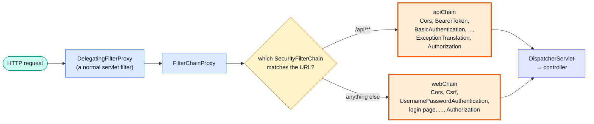
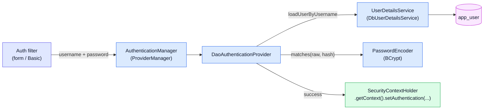
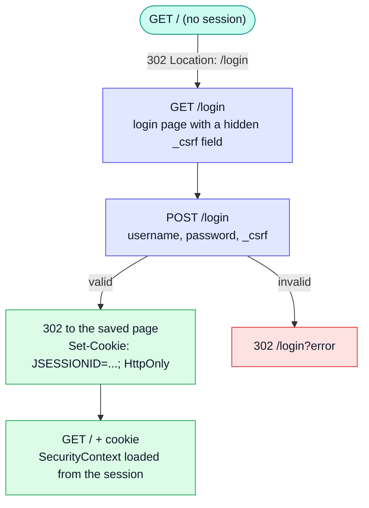
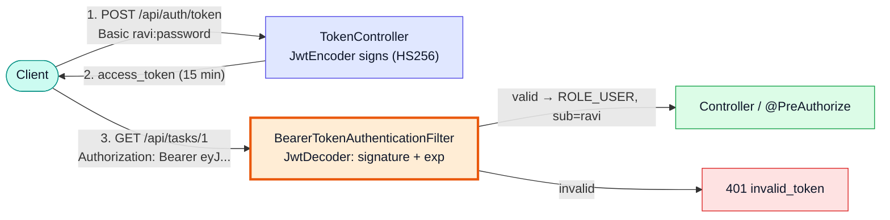
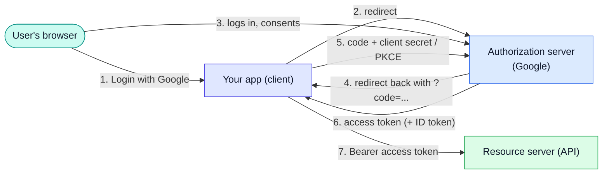

# Spring Security: Attacks, Filter Chain, Login, JWT, OAuth2 and Method Security — Complete In-Depth Guide

**Spring Boot notes #11 of 18** · Priority 🔴 · Track: Spring Boot ([README](README.md))

Until now **anyone** could call every endpoint of the Task Tracker. This file locks it down with **Spring Security 7**.

**Attacks covered**
- CSRF
- XSS
- SQL injection
- what CORS really is

**Users and passwords**
- stored in the database
- hashed with BCrypt

**Two ways to log in**
- **form login with a session cookie**, for browsers (stateful)
- **JWT bearer tokens**, for the API (stateless)

**Authorization and the rest**
- URL rules and **method security** (`@PreAuthorize`, `@PostAuthorize`)
- OAuth2 / OpenID Connect
- security headers
- testing security

| You want… | Use |
|---|---|
| Know **who** is calling | **Authentication**: form login, HTTP Basic, JWT, OAuth2 |
| Decide **what** they may do | **Authorization**: `requestMatchers(...).hasRole(...)`, `@PreAuthorize` |
| Store passwords | **`PasswordEncoder`** (BCrypt), never plain text |
| Browser app with server-side pages | Form login + session + **CSRF tokens** |
| SPA / mobile / service-to-service API | **Bearer tokens** (JWT), stateless, CSRF off |
| "Log in with Google/GitHub", central identity | **OAuth2 / OIDC** (`oauth2Login`, resource server with `issuer-uri`) |
| Let a frontend on another origin call the API | **CORS** configuration |

> [!NOTE]
> This topic isn't in Kunal's playlist, so there are no video timestamps. The reference playlist's security videos (attacks, security parts 1–4, JWT, OAuth2, method security) map here (see the [README](README.md#reference-playlist-where-each-video-is-covered)).
>
> **What was run:** [`examples/11-security/`](examples/11-security/) (Task Tracker 0.11.0, schema `tracker11`) on Spring Boot 4.0.5 / Spring Security 7.0.4 / PostgreSQL 18.3:
> - a 22-request scenario through a cookie-aware HTTP client (browser login, CSRF, tokens, roles, a tampered token, CORS);
> - a `demo` profile (password hashing, SQL injection);
> - `./mvnw package` with 8 tests.
>
> **Not run:** OAuth2 login with an external provider (Google, GitHub, Keycloak): it needs a registered client and an internet identity provider ([Section 9](#9-oauth2-and-openid-connect)).
>
> The example's passwords (`asha-secret`, `ravi-secret`, `meera-secret`) are throwaway practice values for a local database. Tokens and session ids change on every run.

---

## Table of Contents

| # | Topic (anchor link) | Level |
|---|---|---|
| 0 | [Authentication, Authorization, 401 and 403](#0-authentication-authorization-401-and-403) | Basics |
| 1 | [Common Attacks: CSRF, XSS, SQL Injection, and CORS](#1-common-attacks-csrf-xss-sql-injection-and-cors) | Core |
| 2 | [Architecture: The Filter Chain](#2-architecture-the-filter-chain) | In depth |
| 3 | [Configuring Security: Two Filter Chains](#3-configuring-security-two-filter-chains) | Core |
| 4 | [Users: In Memory and in the Database](#4-users-in-memory-and-in-the-database) | Core |
| 5 | [Passwords: Hashing with BCrypt](#5-passwords-hashing-with-bcrypt) | Core |
| 6 | [Form Login and Sessions (Stateful)](#6-form-login-and-sessions-stateful) | Core |
| 7 | [HTTP Basic (Stateless)](#7-http-basic-stateless) | Core |
| 8 | [JWT: Issuing and Validating Tokens](#8-jwt-issuing-and-validating-tokens) | In depth |
| 9 | [OAuth2 and OpenID Connect](#9-oauth2-and-openid-connect) | In depth |
| 10 | [Authorization: URL Rules and Method Security](#10-authorization-url-rules-and-method-security) | In depth |
| 11 | [CORS and Security Headers](#11-cors-and-security-headers) | Core |
| 12 | [Testing Security](#12-testing-security) | Core |
| 13 | [Interview Questions](#13-interview-questions) | Interview |

---

## 0. Authentication, Authorization, 401 and 403

| Term | Question | Fails with |
|---|---|---|
| **Authentication** | **Who are you?** (prove it: password, token, certificate) | **401 Unauthorized** (really "unauthenticated") + `WWW-Authenticate` header |
| **Authorization** | **What may you do?** (roles, ownership) | **403 Forbidden**: we know who you are, and the answer is no |
| Principal | The authenticated user (`authentication.getName()` → `"ravi"`) | |
| Authority / role | A permission string; a **role** is an authority with prefix `ROLE_` (`ROLE_ADMIN`) | |

From the run:

```
# API without a token
> GET /api/tasks/1
< 401  WWW-Authenticate: Basic realm="Realm"  [application/json]
...
# ravi reads meera's task (@PostAuthorize)
> GET /api/tasks/3  [Bearer ravi]
< 403  []
```

---

## 1. Common Attacks: CSRF, XSS, SQL Injection, and CORS

### 1.1 CSRF (Cross-Site Request Forgery)

You're logged in to `tracker.example` (the browser holds its **session cookie**). You visit `evil.example`, which contains a hidden form that POSTs to `tracker.example/notes`. **The browser attaches the cookie automatically**, so the request arrives authenticated, and you never clicked anything.

**Defence: a CSRF token.** The server puts a random token in its own pages (a hidden form field). `evil.example` can't read it, because the browser's same-origin policy prevents that, so its forged POST arrives without the token and is rejected:

```
# CSRF: a POST without the token is rejected
> POST /notes
  form: text=hello
< 403  []

# With the token (and an XSS attempt in the text)
> POST /notes
  form: text=<script>alert(1)</script>&_csrf=<csrf token>
< 200  [text/plain;charset=UTF-8]
saved for ravi: &lt;script&gt;alert(1)&lt;/script&gt;
```

| CSRF needed? | Why |
|---|---|
| **Yes**: cookie/session authentication (browser apps) | The browser sends cookies automatically |
| **No**: `Authorization: Bearer` tokens | A browser never adds that header by itself; the attacker's page can't set it for your site |

Spring Security turns CSRF protection **on by default** for every unsafe method (POST, PUT, PATCH, DELETE). The API chain switches it off on purpose (Section 3). `SameSite=Lax` cookies (most browsers' default) are a second layer.

### 1.2 XSS (Cross-Site Scripting)

The attacker stores `<script>...</script>` (a task title, a comment), and your page shows it to other users **as HTML**. The script then runs inside your site, with your user's session.

| Defence | In this project |
|---|---|
| **Escape output** for its context (HTML, attribute, JS, URL) | `HtmlUtils.htmlEscape(text)`: the run returned `&lt;script&gt;...` |
| Templating engines escape by default (Thymeleaf `th:text`) | — |
| **Content-Security-Policy** header limits where scripts may come from | `default-src 'self'` (Section 11) |
| `HttpOnly` cookies: scripts can't read the session cookie | `JSESSIONID=...; HttpOnly` |
| JSON APIs with `Content-Type: application/json` + `X-Content-Type-Options: nosniff` | Browsers won't run JSON as HTML/JS |

### 1.3 SQL injection

The demo concatenates user input into SQL, then does it properly:

```java
String input = "nobody' OR '1'='1";                 // what an attacker types into a search box
String unsafeSql = "select username from app_user where username = '" + input + "'";
System.out.println("    built SQL: " + unsafeSql);
List<String> leaked = jdbc.queryForList(unsafeSql, String.class);                 // NEVER do this
System.out.println("    concatenated: " + leaked + "  <- every user");
List<String> safe = jdbc.queryForList("select username from app_user where username = ?", String.class, input);
```

```
=== 2. SQL injection
    built SQL: select username from app_user where username = 'nobody' OR '1'='1'
    concatenated: [asha, ravi, meera]  <- every user
    parameterized: []  <- the input is just a strange name
```

The quote in the input **ended the string literal**, and `OR '1'='1'` became SQL. With a `?` parameter, the value travels separately from the SQL text and can never become code. JPA's `:name` parameters, Spring Data derived queries and `JdbcClient.param(...)` (files 08–09) are all parameterized. String-concatenated SQL or JPQL never is.

### 1.4 CORS (not an attack: a browser rule)

Browsers block a page on `http://localhost:5173` (e.g. a React dev server) from reading responses from `http://localhost:8080`: a different **origin** (scheme + host + port). **CORS** is how the *server* tells the browser "this other origin is allowed". For non-simple requests, the browser first sends an `OPTIONS` **preflight**:

```
# CORS preflight from the allowed origin
> OPTIONS /api/tasks  [Origin: http://localhost:5173]  [Access-Control-Request-Method: GET]  [Access-Control-Request-Headers: authorization]
< 200  Access-Control-Allow-Origin: http://localhost:5173  Access-Control-Allow-Methods: GET,POST,PATCH,DELETE  Access-Control-Allow-Headers: authorization  Access-Control-Max-Age: 3600  []

# CORS preflight from another origin
> OPTIONS /api/tasks  [Origin: http://evil.example]  [Access-Control-Request-Method: GET]
< 403  []
Invalid CORS request
```

> [!IMPORTANT]
> CORS **relaxes** the browser's protection. It doesn't protect your API: `curl` and servers ignore it completely. Never use `allowedOrigins("*")` together with credentials, and list the exact origins of your frontends.

---

## 2. Architecture: The Filter Chain

Spring Security is a set of **servlet filters** that run **before** the `DispatcherServlet` (file 05's filters vs interceptors):



The real startup log lists every filter of both chains, in order:

```
DEBUG o.s.s.web.DefaultSecurityFilterChain : Will secure Or [PathPattern [/api/**]] with filters: DisableEncodeUrlFilter, WebAsyncManagerIntegrationFilter, SecurityContextHolderFilter, HeaderWriterFilter, CorsFilter, LogoutFilter, OAuth2ProtectedResourceMetadataFilter, BearerTokenAuthenticationFilter, BasicAuthenticationFilter, AuthenticationFilter, RequestCacheAwareFilter, SecurityContextHolderAwareRequestFilter, AnonymousAuthenticationFilter, SessionManagementFilter, ExceptionTranslationFilter, AuthorizationFilter
DEBUG o.s.s.web.DefaultSecurityFilterChain : Will secure any request with filters: DisableEncodeUrlFilter, WebAsyncManagerIntegrationFilter, SecurityContextHolderFilter, HeaderWriterFilter, CorsFilter, CsrfFilter, LogoutFilter, UsernamePasswordAuthenticationFilter, DefaultResourcesFilter, DefaultLoginPageGeneratingFilter, DefaultLogoutPageGeneratingFilter, RequestCacheAwareFilter, SecurityContextHolderAwareRequestFilter, AnonymousAuthenticationFilter, ExceptionTranslationFilter, AuthorizationFilter
```

| Filter | Job |
|---|---|
| `SecurityContextHolderFilter` | Loads the `SecurityContext` (from the session, if any) for this request; clears it afterwards |
| `HeaderWriterFilter` | Adds security headers (Section 11) |
| `CorsFilter` | Answers preflights, adds `Access-Control-*` headers |
| `CsrfFilter` | Rejects unsafe requests without a valid token (web chain only) |
| `UsernamePasswordAuthenticationFilter` | Handles `POST /login` form submissions |
| `BearerTokenAuthenticationFilter` | Reads `Authorization: Bearer ...`, validates the JWT |
| `BasicAuthenticationFilter` | Reads `Authorization: Basic base64(user:pass)` |
| `AnonymousAuthenticationFilter` | No one authenticated? Put an "anonymous" authentication in the context |
| **`ExceptionTranslationFilter`** | Turns `AuthenticationException` → **401** (via an entry point) and `AccessDeniedException` → **403** |
| **`AuthorizationFilter`** | Checks the URL rules (`authorizeHttpRequests`) |

Authentication itself, when a login is checked:



The **`SecurityContextHolder`** is thread-bound, like a transaction (file 09). Anything on the request thread can ask who is calling:

```java
/** Who is calling? Spring Security keeps it in a thread-bound SecurityContext. */
private static String currentUsername() {
    return SecurityContextHolder.getContext().getAuthentication().getName();
}
```

`TaskService.create` uses it, so `createdBy` is the real caller, not the project owner as in files 08–10.

---

## 3. Configuring Security: Two Filter Chains

Adding `spring-boot-starter-security` alone locks **everything**: every URL needs login, Boot creates a user named `user` with a random password printed at startup, and you get a login page plus HTTP Basic. Real apps declare their own `SecurityFilterChain` beans, as here:

```java
package com.notes.tasks.security;

import com.nimbusds.jose.jwk.source.ImmutableSecret;
import org.springframework.beans.factory.annotation.Value;
import org.springframework.context.annotation.Bean;
import org.springframework.context.annotation.Configuration;
import org.springframework.core.annotation.Order;
import org.springframework.http.HttpMethod;
import org.springframework.security.config.Customizer;
import org.springframework.security.config.annotation.method.configuration.EnableMethodSecurity;
import org.springframework.security.config.annotation.web.builders.HttpSecurity;
import org.springframework.security.config.http.SessionCreationPolicy;
import org.springframework.security.crypto.factory.PasswordEncoderFactories;
import org.springframework.security.crypto.password.PasswordEncoder;
import org.springframework.security.oauth2.jose.jws.MacAlgorithm;
import org.springframework.security.oauth2.jwt.JwtDecoder;
import org.springframework.security.oauth2.jwt.JwtEncoder;
import org.springframework.security.oauth2.jwt.NimbusJwtDecoder;
import org.springframework.security.oauth2.jwt.NimbusJwtEncoder;
import org.springframework.security.oauth2.server.resource.authentication.JwtAuthenticationConverter;
import org.springframework.security.oauth2.server.resource.authentication.JwtGrantedAuthoritiesConverter;
import org.springframework.security.web.SecurityFilterChain;
import org.springframework.web.cors.CorsConfiguration;
import org.springframework.web.cors.CorsConfigurationSource;
import org.springframework.web.cors.UrlBasedCorsConfigurationSource;

import javax.crypto.SecretKey;
import javax.crypto.spec.SecretKeySpec;
import java.nio.charset.StandardCharsets;
import java.util.List;

@Configuration
@EnableMethodSecurity                                  // turns on @PreAuthorize / @PostAuthorize
public class SecurityConfig {

    /**
     * Chain 1: the JSON API. Stateless: no session, no CSRF token; every request carries a JWT
     * ("Authorization: Bearer ..."). The token endpoint alone accepts HTTP Basic (username + password).
     */
    @Bean
    @Order(1)
    SecurityFilterChain apiChain(HttpSecurity http) throws Exception {
        http
            .securityMatcher("/api/**")                // this chain only handles /api/** requests
            .authorizeHttpRequests(auth -> auth
                .requestMatchers(HttpMethod.POST, "/api/auth/token").authenticated()   // via Basic, below
                .requestMatchers(HttpMethod.GET, "/api/reports/**").hasRole("ADMIN")
                .anyRequest().authenticated())
            .httpBasic(Customizer.withDefaults())      // only used to obtain a token
            .oauth2ResourceServer(rs -> rs.jwt(jwt -> jwt.jwtAuthenticationConverter(rolesFromToken())))
            .sessionManagement(s -> s.sessionCreationPolicy(SessionCreationPolicy.STATELESS))
            .csrf(csrf -> csrf.disable())              // safe here: no cookies are used for authentication
            .cors(Customizer.withDefaults());          // uses the CorsConfigurationSource bean below
        return http.build();
    }

    /** Chain 2: everything else, for browsers. Form login, an HTTP session (cookie), CSRF protection on. */
    @Bean
    @Order(2)
    SecurityFilterChain webChain(HttpSecurity http) throws Exception {
        http
            .authorizeHttpRequests(auth -> auth
                .requestMatchers("/login", "/error").permitAll()
                .anyRequest().authenticated())
            .formLogin(Customizer.withDefaults())      // Spring's built-in login page at /login
            .logout(Customizer.withDefaults())
            .headers(h -> h.contentSecurityPolicy(csp -> csp.policyDirectives("default-src 'self'")));
        return http.build();
    }

    /** Stores "{bcrypt}$2a$10$...": the prefix names the algorithm, so it can be upgraded later. */
    @Bean
    PasswordEncoder passwordEncoder() {
        return PasswordEncoderFactories.createDelegatingPasswordEncoder();
    }

    // ---- JWT: one shared secret (HMAC-SHA256) both signs and verifies ----

    @Bean
    SecretKey jwtKey(@Value("${app.jwt.secret}") String secret) {
        return new SecretKeySpec(secret.getBytes(StandardCharsets.UTF_8), "HmacSHA256");
    }

    @Bean
    JwtEncoder jwtEncoder(SecretKey jwtKey) {
        return new NimbusJwtEncoder(new ImmutableSecret<>(jwtKey));
    }

    @Bean
    JwtDecoder jwtDecoder(SecretKey jwtKey) {
        return NimbusJwtDecoder.withSecretKey(jwtKey).macAlgorithm(MacAlgorithm.HS256).build();
    }

    /** Our tokens carry "roles": ["ADMIN"]; turn them into ROLE_ADMIN authorities. */
    private JwtAuthenticationConverter rolesFromToken() {
        JwtGrantedAuthoritiesConverter roles = new JwtGrantedAuthoritiesConverter();
        roles.setAuthoritiesClaimName("roles");
        roles.setAuthorityPrefix("ROLE_");
        JwtAuthenticationConverter converter = new JwtAuthenticationConverter();
        converter.setJwtGrantedAuthoritiesConverter(roles);
        return converter;
    }

    /** CORS: which OTHER origins (sites) may call the API from a browser. */
    @Bean
    CorsConfigurationSource corsConfigurationSource() {
        CorsConfiguration cors = new CorsConfiguration();
        cors.setAllowedOrigins(List.of("http://localhost:5173"));          // e.g. a React dev server
        cors.setAllowedMethods(List.of("GET", "POST", "PATCH", "DELETE"));
        cors.setAllowedHeaders(List.of("Authorization", "Content-Type"));
        cors.setMaxAge(3600L);                                             // browsers cache the preflight 1 h
        UrlBasedCorsConfigurationSource source = new UrlBasedCorsConfigurationSource();
        source.registerCorsConfiguration("/api/**", cors);
        return source;
    }
}
```

| Design choice | Why |
|---|---|
| **Two chains**, `@Order(1)` API first | `securityMatcher("/api/**")` claims API URLs; the second chain gets everything else. First match wins |
| API: `STATELESS`, CSRF off, JWT | No session, no cookie, so no CSRF risk; every request proves itself |
| Web: form login, session, CSRF on | The classic browser setup |
| `@EnableMethodSecurity` | Turns on `@PreAuthorize` / `@PostAuthorize` (Section 10) |
| `requestMatchers(...)` order | Rules are checked **top to bottom**: specific rules before `anyRequest()` |

> [!NOTE]
> Why did the API's 401 say `WWW-Authenticate: Basic realm="Realm"` rather than `Bearer`? This chain enables **both** HTTP Basic (only needed for the token endpoint) and bearer tokens, and the Basic entry point answered. A token-only API would answer `Bearer`, as the tampered-token request in Section 8 shows. Either way, the status is 401.

---

## 4. Users: In Memory and in the Database

**In memory** is for demos and tests (not used in this project):

```java
@Bean
UserDetailsService users(PasswordEncoder encoder) {
    return new InMemoryUserDetailsManager(
        User.withUsername("ravi").password(encoder.encode("ravi-secret")).roles("USER").build(),
        User.withUsername("asha").password(encoder.encode("asha-secret")).roles("ADMIN").build());
}
```

**From the database** means implementing one method, `loadUserByUsername`:

```java
package com.notes.tasks.security;

import com.notes.tasks.model.AppUser;
import com.notes.tasks.repo.AppUserRepository;
import org.springframework.security.core.userdetails.User;
import org.springframework.security.core.userdetails.UserDetails;
import org.springframework.security.core.userdetails.UserDetailsService;
import org.springframework.security.core.userdetails.UsernameNotFoundException;
import org.springframework.stereotype.Service;
import org.springframework.transaction.annotation.Transactional;

/** Tells Spring Security how to load a user by username: from the app_user table. */
@Service
public class DbUserDetailsService implements UserDetailsService {
    private final AppUserRepository users;

    public DbUserDetailsService(AppUserRepository users) {
        this.users = users;
    }

    @Override
    @Transactional(readOnly = true)
    public UserDetails loadUserByUsername(String username) {
        AppUser u = users.findByUsername(username)
                .orElseThrow(() -> new UsernameNotFoundException("No user " + username));
        return User.withUsername(u.getUsername())
                .password(u.getPasswordHash())          // the BCrypt hash; Spring compares, we never decode
                .roles(u.getRole())                     // "ADMIN" becomes the authority "ROLE_ADMIN"
                .build();
    }
}
```

The credentials come from a new migration (file 08: never edit V1–V3):

```sql
-- V4: login credentials and a role for each user.
-- Passwords are stored as BCrypt hashes only, with the {bcrypt} prefix that DelegatingPasswordEncoder needs.
-- The plain values are throwaway practice passwords for this local example: asha / asha-secret (ADMIN), ravi / ravi-secret, meera / meera-secret.

ALTER TABLE app_user
    ADD COLUMN password_hash VARCHAR(100),
    ADD COLUMN role          VARCHAR(10) NOT NULL DEFAULT 'USER' CHECK (role IN ('USER', 'ADMIN'));

UPDATE app_user SET role = 'ADMIN',
       password_hash = '{bcrypt}$2a$10$gvDTKNbZdV6x7T3cH0QtGODLrpDUk.v7BqoUAQ5PJu5rH0f2ERu2i' WHERE username = 'asha';
UPDATE app_user SET password_hash = '{bcrypt}$2a$10$uuFYiHY.928g53eX15PHwuRz5S/zBkDRAUl1K077DOFTvPIr55gdm' WHERE username = 'ravi';
UPDATE app_user SET password_hash = '{bcrypt}$2a$10$Mvgx72DEgVlfeJtbSyZ36uCwJ4dxZm.nQI1/uQzGFQXhfc3OcLx7a' WHERE username = 'meera';

ALTER TABLE app_user ALTER COLUMN password_hash SET NOT NULL;
```

Spring Security finds the `UserDetailsService` and `PasswordEncoder` beans and builds the `DaoAuthenticationProvider` from them. `UsernameNotFoundException` and a wrong password both end as the **same** 401, so attackers can't probe which usernames exist.

> [!CAUTION]
> While writing this file, V4 was changed **after** it had already run on the test schema. The next test run failed at startup with Flyway's `Validate failed: Migrations have failed validation` / `Migration checksum mismatch for migration version 4`. That's file 08's rule in action: on a shared database you'd add a V5 instead (here the throwaway test schema was dropped).

---

## 5. Passwords: Hashing with BCrypt

Never store passwords, and never encrypt them (encryption can be undone). Store a **slow, salted, one-way hash**.

```
=== 1. Password hashing (DelegatingPasswordEncoder -> BCrypt)
    hash 1: {bcrypt}$2a$10$fewvCWuc/9SBFPKdqOoXo.xRDWvpeCHENu9YEr7KMM33FdQSOnF.W
    hash 2: {bcrypt}$2a$10$H6ZwAQUaeMHcQiUY/6Cn5eiaxh4UxD8i5xtkWvXz8UWSeq.3H1S46
    same password, same hash? false (random salt)
    matches("ravi-secret", hash 1): true
    matches("wrong", hash 1):       false
```

(The hashes differ on every run: that's the random salt.)

| Part of `{bcrypt}$2a$10$fewv...` | Meaning |
|---|---|
| `{bcrypt}` | `DelegatingPasswordEncoder`'s **id**: which algorithm made it |
| `$2a$` | BCrypt version |
| `10$` | **Cost**: 2¹⁰ rounds. Slow on purpose, so guessing billions of passwords is impractical |
| next 22 chars | The random **salt**: identical passwords get different hashes, which defeats precomputed tables |
| rest | The hash |

`PasswordEncoderFactories.createDelegatingPasswordEncoder()` encodes with BCrypt today. Because the id is stored, you can switch to `{argon2}` later and old hashes keep working (re-hash at next login).

**The prefix is required.** The first login attempt in this project failed with a 500, because V4 initially stored bare `$2a$...` hashes. The demo reproduces the error:

```
    stored in app_user: {bcrypt}$2a$10$uuFYiHY.928g53eX15PHwuRz5S/zBkDRAUl1K077DOFTvPIr55gdm -> matches: true
    without the prefix: IllegalArgumentException: Given that there is no default password encoder configured, each password must have a password encoding prefix. Please either prefix this password with '{noop}' or set a default password encoder in `DelegatingPasswordEncoder`.
```

| Encoder | Use |
|---|---|
| `DelegatingPasswordEncoder` (BCrypt by default) | **Default choice** |
| `BCryptPasswordEncoder`, `Argon2PasswordEncoder`, `SCryptPasswordEncoder`, `Pbkdf2PasswordEncoder` | Adaptive hashes, if you want one fixed algorithm |
| `{noop}` / `NoOpPasswordEncoder` | Plain text: tests and demos only |
| MD5, SHA-256 alone | **Never**: fast, so easy to brute-force |

---

## 6. Form Login and Sessions (Stateful)



Real run:

```
# Browser, not logged in
> GET /
< 302  Location: http://localhost:8080/login  []

# Log in with the form (a session cookie comes back)
> POST /login
  form: username=ravi&password=***&_csrf=<csrf token>
< 302  Location: http://localhost:8080/?continue  Set-Cookie: JSESSIONID=666FC4940E98C9A0FEEBC8BAD3ED83CF; Path=/; HttpOnly  []
```

| Detail | Explanation |
|---|---|
| `GET /` → `302 /login` | `ExceptionTranslationFilter` saved the request and the entry point redirected to the login page |
| The login page has a `_csrf` field | Even the login form is protected (against "login CSRF") |
| A **new** `JSESSIONID` after login | **Session fixation** protection: the session id changes when you log in |
| `?continue` | The saved request (`/`) is resumed |
| The page after login shows a fresh `_csrf` | The token is rotated at login; old tokens stop working |

The home page renders the token into its own form:

```java
package com.notes.tasks.web;

import org.springframework.security.core.Authentication;
import org.springframework.security.web.csrf.CsrfToken;
import org.springframework.web.bind.annotation.GetMapping;
import org.springframework.web.bind.annotation.PostMapping;
import org.springframework.web.bind.annotation.RequestParam;
import org.springframework.web.bind.annotation.RestController;
import org.springframework.web.util.HtmlUtils;

/** A tiny browser page, to show session login and CSRF protection. */
@RestController
public class WebController {

    @GetMapping(value = "/", produces = "text/html")
    public String home(Authentication auth, CsrfToken csrf) {
        return """
                <p>Hello, %s</p>
                <form method="post" action="/notes">
                  <input name="text">
                  <input type="hidden" name="%s" value="%s">
                  <button>Save note</button>
                </form>""".formatted(HtmlUtils.htmlEscape(auth.getName()), csrf.getParameterName(), csrf.getToken());
    }

    @PostMapping(value = "/notes", produces = "text/plain")
    public String saveNote(@RequestParam String text, Authentication auth) {
        return "saved for " + auth.getName() + ": " + HtmlUtils.htmlEscape(text);   // escape: no XSS
    }
}
```

**Stateful:** the server stores the `SecurityContext` in the HTTP session (memory by default). With several app instances you need sticky sessions or a shared session store (Spring Session + Redis/JDBC).

---

## 7. HTTP Basic (Stateless)

Every request sends `Authorization: Basic base64(username:password)`. It's simple, but the password travels **on every request**, so it's **only acceptable over HTTPS**. Base64 is encoding, not encryption.

Here Basic is used for one thing: exchanging a username and password for a token.

```
# Get a token: wrong password
> POST /api/auth/token  [Basic ravi:***]
< 401  WWW-Authenticate: Basic realm="Realm"  [application/json]
```

---

## 8. JWT: Issuing and Validating Tokens

A **JWT** (JSON Web Token, RFC 7519) is three base64url parts: `header.payload.signature`.

```
# Get a token: ravi (USER)
> POST /api/auth/token  [Basic ravi:***]
< 200  [application/json]
{
  "token_type": "Bearer",
  "expires_in": 900,
  "access_token": "eyJhbGciOiJIUzI1NiJ9.eyJ...
}
  decoded header:  {"alg":"HS256"}
```

The decoded payload (from the full output):

| Claim | Value | Meaning |
|---|---|---|
| `iss` | `task-tracker` | Issuer |
| `sub` | `ravi` | Subject: who |
| `iat` / `exp` | Unix seconds, 900 apart | Issued at / expires: 15 minutes |
| `roles` | `["USER"]` | Our custom claim |

> [!WARNING]
> The payload is **signed, not encrypted**: anyone holding the token can read it. Never put secrets in a JWT. The **signature** proves the server issued it and that nobody changed it.

**Issuing:**

```java
package com.notes.tasks.security;

import org.springframework.security.core.Authentication;
import org.springframework.security.core.GrantedAuthority;
import org.springframework.security.oauth2.jose.jws.MacAlgorithm;
import org.springframework.security.oauth2.jwt.JwsHeader;
import org.springframework.security.oauth2.jwt.JwtClaimsSet;
import org.springframework.security.oauth2.jwt.JwtEncoder;
import org.springframework.security.oauth2.jwt.JwtEncoderParameters;
import org.springframework.web.bind.annotation.PostMapping;
import org.springframework.web.bind.annotation.RestController;

import java.time.Duration;
import java.time.Instant;
import java.util.List;
import java.util.Map;

/** POST /api/auth/token with HTTP Basic credentials -> a signed JWT valid for 15 minutes. */
@RestController
public class TokenController {
    private static final Duration LIFETIME = Duration.ofMinutes(15);
    private final JwtEncoder encoder;

    public TokenController(JwtEncoder encoder) {
        this.encoder = encoder;
    }

    @PostMapping("/api/auth/token")
    public Map<String, Object> token(Authentication auth) {          // already authenticated by HTTP Basic
        Instant now = Instant.now();                                 // real time: decoders check exp against it
        List<String> roles = auth.getAuthorities().stream()
                .map(GrantedAuthority::getAuthority)
                .filter(a -> a.startsWith("ROLE_"))                  // skip e.g. FACTOR_PASSWORD (Security 7)
                .map(a -> a.substring("ROLE_".length()))
                .toList();
        JwtClaimsSet claims = JwtClaimsSet.builder()
                .issuer("task-tracker")
                .subject(auth.getName())                             // who
                .issuedAt(now)
                .expiresAt(now.plus(LIFETIME))                       // until when
                .claim("roles", roles)                               // what they may do
                .build();
        JwsHeader header = JwsHeader.with(MacAlgorithm.HS256).build();
        String token = encoder.encode(JwtEncoderParameters.from(header, claims)).getTokenValue();
        return Map.of("access_token", token, "token_type", "Bearer", "expires_in", LIFETIME.toSeconds());
    }
}
```

> [!NOTE]
> The `filter(a -> a.startsWith("ROLE_"))` line comes from a real surprise. Without it, the token contained `"roles":["USER","R_PASSWORD"]`. Spring Security 7 adds a **`FACTOR_PASSWORD`** authority after a password login: it records which authentication **factor** was used, for the new multi-factor support. Stripping five characters from it gave `R_PASSWORD`. Lesson: don't assume every authority is a role.

**Validating:** `oauth2ResourceServer(rs -> rs.jwt(...))` adds the `BearerTokenAuthenticationFilter`. For each request it checks the signature with the `JwtDecoder` and checks `exp`. Then it maps the claims to authorities: the `rolesFromToken()` converter turns `"roles": ["ADMIN"]` into `ROLE_ADMIN`.

```
# A tampered token (one character changed)
> GET /api/tasks/1  [Bearer ravi + tampered]
< 401  WWW-Authenticate: Bearer error="invalid_token", error_description="An error occurred while attempting to decode the Jwt: Signed JWT rejected: Invalid signature", error_uri="https://tools.ietf.org/html/rfc6750#section-3.1",  []
```



| | Session + cookie | JWT bearer token |
|---|---|---|
| State on the server | Session store | **None** (the token is self-contained) |
| Scaling to many instances | Sticky sessions / shared store | Any instance can validate |
| Logout / revocation | Delete the session: immediate | **Hard**: a token stays valid until `exp`. Keep lifetimes short, use refresh tokens, or a deny-list |
| CSRF | Needed | Not needed (header, not cookie) |
| Where clients keep it | Cookie (`HttpOnly`) | Memory / secure storage (`localStorage` is readable by XSS) |
| Best for | Server-rendered web apps | SPAs, mobile apps, service-to-service |

| Signing | Key | Use |
|---|---|---|
| **HS256** (HMAC) | One shared secret signs and verifies | One app issues and checks its own tokens (this project) |
| **RS256 / ES256** | Private key signs; public key (JWKS) verifies | An auth server issues, many services verify: the OAuth2 setup |

> [!CAUTION]
> `app.jwt.secret` has a development default in `application.yml`. In production it **must** come from an environment variable or secret store (file 14), be at least 32 random bytes, and never be committed.

---

## 9. OAuth2 and OpenID Connect

**OAuth2** is a framework for **delegated authorization**: a client app gets an **access token** from an **authorization server** to call a **resource server** on a user's behalf, without ever seeing the user's password. **OpenID Connect (OIDC)** adds **authentication** on top: an **ID token** (a JWT) that says who logged in.

| Role | Example |
|---|---|
| Resource owner | The user |
| Client | Your web app / SPA / mobile app |
| Authorization server | Google, GitHub, Keycloak, Okta, Spring Authorization Server |
| Resource server | Your API, which validates access tokens (this project's API chain is one) |

| Grant (flow) | Who uses it |
|---|---|
| **Authorization code + PKCE** | Web apps, SPAs and mobile apps where a user logs in (redirect to the provider's login page) |
| **Client credentials** | Service-to-service, no user |
| Refresh token | Get a new access token without logging in again |
| ~~Implicit~~, ~~password~~ | Deprecated in OAuth 2.1 |



**In Spring** (not run: these need a registered client and a real provider):

```yaml
# "Login with GitHub" for a web app: spring-boot-starter-security-oauth2-client
spring:
  security:
    oauth2:
      client:
        registration:
          github:
            client-id: ${GITHUB_CLIENT_ID}
            client-secret: ${GITHUB_CLIENT_SECRET}
```

```java
http.oauth2Login(Customizer.withDefaults());       // replaces formLogin: redirects to the provider
```

```yaml
# An API that accepts tokens from an external authorization server (e.g. Keycloak)
spring:
  security:
    oauth2:
      resourceserver:
        jwt:
          issuer-uri: https://auth.example.com/realms/tasks   # Boot fetches the public keys (JWKS) from here
```

With `issuer-uri`, Boot builds the `JwtDecoder` itself (RS256 public keys), and you don't write a `TokenController`: the authorization server issues the tokens. Spring also provides **Spring Authorization Server** (`spring-boot-starter-security-oauth2-authorization-server`) to run your own.

---

## 10. Authorization: URL Rules and Method Security

**URL rules** are coarse-grained, in the filter chain:

```java
.authorizeHttpRequests(auth -> auth
    .requestMatchers(HttpMethod.POST, "/api/auth/token").authenticated()   // via Basic, below
    .requestMatchers(HttpMethod.GET, "/api/reports/**").hasRole("ADMIN")
    .anyRequest().authenticated())
```

**Method security** is fine-grained, on service methods, with SpEL (Spring Expression Language) expressions:

```java
/** Checked AFTER the method runs: users may only read tasks assigned to them; admins read all. */
@PostAuthorize("hasRole('ADMIN') or returnObject.assignee() == authentication.name")
public TaskResponse get(long id) {
```

```java
/** Checked BEFORE the method runs: admins, or the task's assignee. */
@PreAuthorize("hasRole('ADMIN') or @taskSecurity.isAssignee(#id, authentication)")
@Transactional
public TaskResponse patch(long id, PatchTaskRequest req) {
```

```java
package com.notes.tasks.security;

import com.notes.tasks.repo.TaskRepository;
import org.springframework.security.core.Authentication;
import org.springframework.stereotype.Component;
import org.springframework.transaction.annotation.Transactional;

/** Used from @PreAuthorize expressions as @taskSecurity.isAssignee(#id, authentication). */
@Component("taskSecurity")
public class TaskSecurity {
    private final TaskRepository tasks;

    public TaskSecurity(TaskRepository tasks) {
        this.tasks = tasks;
    }

    @Transactional(readOnly = true)
    public boolean isAssignee(long taskId, Authentication auth) {
        return tasks.findById(taskId)
                .map(t -> t.getAssignee() != null && t.getAssignee().getUsername().equals(auth.getName()))
                .orElse(true);                         // let the service answer 404 for unknown ids
    }
}
```

The results:

| Request | Who | Rule | Result |
|---|---|---|---|
| `GET /api/tasks/1` (assignee ravi) | ravi | `@PostAuthorize` | **200** |
| `GET /api/tasks/3` (assignee meera) | ravi | `@PostAuthorize` | **403** |
| `PATCH /api/tasks/1` | ravi | `@PreAuthorize` + `@taskSecurity` | **200** |
| `PATCH /api/tasks/3` | ravi | same | **403** |
| `POST /api/tasks/complete-overdue` | ravi | `@PreAuthorize("hasRole('ADMIN')")` | **403** |
| `GET /api/reports/projects` | ravi | URL rule `hasRole("ADMIN")` | **403** |
| the same three admin requests | asha | — | **200** (`{"completed": 3}`, task 3, the report) |

| Expression | Meaning |
|---|---|
| `hasRole('ADMIN')` | Has authority `ROLE_ADMIN` |
| `hasAuthority('SCOPE_read')` | Has exactly this authority |
| `hasAnyRole('ADMIN', 'MANAGER')` | Any of them |
| `authentication.name`, `principal` | The current user |
| `#id` | A method parameter (needs `-parameters`, which Boot's build sets) |
| `returnObject` | The return value (`@PostAuthorize` only) |
| `@taskSecurity.isAssignee(...)` | Call any bean: complex rules in plain Java |

| `@PreAuthorize` | `@PostAuthorize` |
|---|---|
| Before the call: the method **never runs** if denied | After the call: the method **runs**, then the result is checked |
| Use for writes and most checks | Only for reads where the decision needs the result; never for methods with side effects |

> [!TIP]
> Method security uses **proxies**, like `@Transactional` (file 09 §11): self-invocation skips it. URL rules protect the entry points; method rules protect the business operations, even when called from a scheduler or another service.

---

## 11. CORS and Security Headers

The CORS configuration is the `CorsConfigurationSource` bean in `SecurityConfig` (Section 3), used by `.cors(Customizer.withDefaults())`. It answered the preflights in [Section 1.4](#14-cors-not-an-attack-a-browser-rule).

Spring Security adds protective **headers** to every response. The real `GET /`:

```
< 200  Content-Security-Policy: default-src 'self'  X-Frame-Options: DENY  X-Content-Type-Options: nosniff  Cache-Control: no-cache, no-store, max-age=0, must-revalidate  [text/html;charset=UTF-8]
```

| Header | Protects against |
|---|---|
| `Content-Security-Policy: default-src 'self'` | XSS: scripts, styles and images only from our own origin (configured in `webChain`) |
| `X-Frame-Options: DENY` | **Clickjacking**: our pages can't be put in an invisible `<iframe>` on another site |
| `X-Content-Type-Options: nosniff` | Browsers guessing content types (running JSON or text as script) |
| `Cache-Control: no-cache, no-store, ...` | Authenticated pages left in shared caches |
| `Strict-Transport-Security` | Downgrade to HTTP (sent only over HTTPS, so not in this HTTP run) |

---

## 12. Testing Security

`spring-boot-starter-security-test` adds fake users and tokens for MockMvc, so tests need no passwords or real tokens:

```java
package com.notes.tasks.security;

import org.junit.jupiter.api.Test;
import org.springframework.beans.factory.annotation.Autowired;
import org.springframework.boot.test.context.SpringBootTest;
import org.springframework.boot.webmvc.test.autoconfigure.AutoConfigureMockMvc;
import org.springframework.http.MediaType;
import org.springframework.security.test.context.support.WithMockUser;
import org.springframework.test.context.ActiveProfiles;
import org.springframework.test.web.servlet.assertj.MockMvcTester;

import static org.assertj.core.api.Assertions.assertThat;
import static org.springframework.security.test.web.servlet.request.SecurityMockMvcRequestPostProcessors.csrf;
import static org.springframework.security.test.web.servlet.request.SecurityMockMvcRequestPostProcessors.jwt;

/** The real filter chains and method security, with fake users: no passwords or tokens needed. */
@SpringBootTest
@AutoConfigureMockMvc
@ActiveProfiles("test")
class SecurityRulesTest {

    @Autowired MockMvcTester mvc;

    @Test
    void apiWithoutTokenIs401() {
        assertThat(mvc.get().uri("/api/tasks")).hasStatus(401);
    }

    @Test
    void userCanReadOwnTaskButNotOthers() {
        assertThat(mvc.get().uri("/api/tasks/1").with(jwt().jwt(j -> j.subject("ravi")))).hasStatusOk();
        assertThat(mvc.get().uri("/api/tasks/3").with(jwt().jwt(j -> j.subject("ravi")))).hasStatus(403);
    }

    @Test
    void onlyAdminsMayRunBulkJobs() {
        assertThat(mvc.post().uri("/api/tasks/complete-overdue").with(jwt().jwt(j -> j.subject("ravi"))))
                .hasStatus(403);
    }

    @Test
    @WithMockUser(username = "ravi")
    void browserPostWithoutCsrfTokenIs403() {
        assertThat(mvc.post().uri("/notes").param("text", "hi")).hasStatus(403);
        assertThat(mvc.post().uri("/notes").param("text", "hi").with(csrf()))
                .hasStatusOk()
                .hasContentTypeCompatibleWith(MediaType.TEXT_PLAIN)
                .bodyText().isEqualTo("saved for ravi: hi");
    }
}
```

| Helper | Gives the request |
|---|---|
| `@WithMockUser(username = "ravi", roles = "ADMIN")` | A logged-in user for the whole test |
| `.with(jwt().jwt(j -> j.subject("ravi")))` | A validated JWT authentication, no signing needed |
| `.with(csrf())` | A valid CSRF token |
| `.with(user("ravi").roles("USER"))` | A user, per request |

`./mvnw package` ran these 4 tests plus file 10's 4 service tests: `Tests run: 8, Failures: 0, Errors: 0, Skipped: 0`, `BUILD SUCCESS`.

---

## 13. Interview Questions

| Question | Answer |
|---|---|
| Authentication vs authorization? | Who you are vs what you may do; failures are 401 vs 403. |
| How does Spring Security plug into a request? | Servlet filters: `DelegatingFilterProxy` → `FilterChainProxy` → the first matching `SecurityFilterChain`. |
| What does `ExceptionTranslationFilter` do? | Converts authentication failures to 401 (entry point) and access-denied to 403. |
| Role vs authority? | An authority is any permission string; a role is an authority prefixed `ROLE_`; `hasRole('X')` checks `ROLE_X`. |
| What is `UserDetailsService`? | Loads a user (username, password hash, authorities) by username for authentication. |
| How should passwords be stored? | A slow salted hash (BCrypt/Argon2) via `DelegatingPasswordEncoder` with an `{id}` prefix. |
| What is CSRF and how is it prevented? | A forged cross-site request riding the victim's cookies; prevented with a per-session token the attacker can't read (and SameSite cookies). |
| Why disable CSRF for a JWT API? | Tokens are sent in a header the browser never adds automatically, so forged requests aren't authenticated. |
| What is XSS? | Injected script running in your pages; prevent with output escaping, CSP and HttpOnly cookies. |
| How do you prevent SQL injection? | Parameterized queries (`?`, `:name`); never concatenate input into SQL/JPQL. |
| What is CORS? | A browser mechanism letting a server allow specific other origins; it doesn't secure the API itself. |
| Session vs JWT? | Session: state on the server, easy logout, needs CSRF. JWT: stateless, scales easily, hard to revoke before expiry. |
| What's inside a JWT? | Header, payload (claims like `sub`, `exp`, `iat`), signature; base64url-encoded, signed but not encrypted. |
| HS256 vs RS256? | Shared secret vs private/public key pair; RS256 lets many services verify without being able to issue. |
| OAuth2 vs OIDC? | OAuth2 delegates authorization (access tokens); OIDC adds authentication (ID token, user info). |
| Which OAuth2 flow for a SPA? | Authorization code with PKCE. |
| `@PreAuthorize` vs `@PostAuthorize`? | Before the call (method may not run) vs after (checks the return value). |
| What is session fixation? | Reusing a session id set before login; Spring changes the session id at login. |

---

## 🧩 Complete Example: Everything Together

**Task Tracker, stage 11.** File 10's app, secured:
- users and BCrypt hashes in the database (V4);
- a stateless JWT-protected API chain (tokens from `POST /api/auth/token` with Basic);
- a browser chain with form login, sessions and CSRF;
- ownership and admin rules with method security;
- CORS for `http://localhost:5173`;
- a `demo` profile for hashing and SQL injection.

Source: [`examples/11-security/`](examples/11-security/)

```
11-security/
├── pom.xml                              (0.11.0; + security, oauth2-resource-server, security-test)
└── src/
    ├── main/java/com/notes/tasks/
    │   ├── security/ SecurityConfig, DbUserDetailsService, TokenController, TaskSecurity
    │   ├── web/      TaskController, GlobalExceptionHandler, + WebController (browser page)
    │   ├── service/  TaskService (+ @PreAuthorize / @PostAuthorize, createdBy = caller)
    │   ├── model/    AppUser (+ passwordHash, role), ...
    │   └── demo/     SecurityDemo                     (profile "demo")
    ├── main/resources/
    │   ├── application.yml                  (schema tracker11, app.jwt.secret, security logging)
    │   └── db/migration/ V1–V3 (from 09), V4__user_credentials.sql
    └── test/java/.../security/SecurityRulesTest.java  (+ file 10's TaskServiceTest)
```

Already shown above: `SecurityConfig`, `DbUserDetailsService`, `TokenController`, `TaskSecurity`, `WebController`, V4, `SecurityRulesTest`. The rest of what changed:

**`pom.xml`** (dependencies):

```xml
<dependency>                            <!-- the filter chain, authentication, authorization, CSRF, headers -->
    <groupId>org.springframework.boot</groupId>
    <artifactId>spring-boot-starter-security</artifactId>
</dependency>
<dependency>                            <!-- JWT: JwtEncoder/JwtDecoder (Nimbus) + Bearer token authentication -->
    <groupId>org.springframework.boot</groupId>
    <artifactId>spring-boot-starter-security-oauth2-resource-server</artifactId>
</dependency>
```

```xml
<dependency>                            <!-- @WithMockUser, jwt(), csrf() for MockMvc -->
    <groupId>org.springframework.boot</groupId>
    <artifactId>spring-boot-starter-security-test</artifactId>
    <scope>test</scope>
</dependency>
```

**`application.yml`**:

```yaml
spring:
  application:
    name: task-tracker
  main:
    banner-mode: off
  datasource:
    url: jdbc:postgresql://localhost:5432/springnotes?currentSchema=tracker11
    username: springnotes
    password: ${DB_PASSWORD:springnotes}   # env var wins; the default is the throwaway practice password
    hikari:
      maximum-pool-size: 5                # default 10
      pool-name: Tracker11Pool
  flyway:
    schemas: tracker11                    # Flyway creates this schema and owns its history table
  data:
    web:
      pageable:
        default-page-size: 5              # ?page=0&size=5 when the client sends nothing
        max-page-size: 50                 # ?size=10000 is capped at 50
  jpa:
    open-in-view: false                   # no lazy loading during view rendering (file 08, Section 9)
    hibernate:
      ddl-auto: validate                  # Flyway creates tables; Hibernate only checks they match
    properties:
      hibernate:
        default_schema: tracker11
        cache:
          use_second_level_cache: true
          region:
            factory_class: jcache
        javax:
          cache:
            provider: com.github.benmanes.caffeine.jcache.spi.CaffeineCachingProvider
            missing_cache_strategy: create
        generate_statistics: true         # lets tests count SQL statements

app:
  jwt:
    secret: ${JWT_SECRET:dev-only-secret-change-me-at-least-32-bytes}   # HS256 needs >= 32 bytes

logging:
  level:
    root: WARN
    com.notes: INFO
    org.springframework.boot.tomcat: INFO
    com.zaxxer.hikari: INFO               # pool start/stop lines
    org.flywaydb: INFO                    # which migrations ran
    org.hibernate.SQL: WARN               # file 11 is about security: SQL logging off
    org.springframework.security.web.DefaultSecurityFilterChain: DEBUG   # lists each chain's filters at startup
    org.springframework.security.web.FilterChainProxy: DEBUG             # "Securing GET /..." per request
    org.hibernate.engine.internal.StatisticalLoggingSessionEventListener: WARN   # hide per-session metrics
```

**`model/AppUser.java`**:

```java
package com.notes.tasks.model;

import jakarta.persistence.CascadeType;
import jakarta.persistence.Column;
import jakarta.persistence.Entity;
import jakarta.persistence.FetchType;
import jakarta.persistence.GeneratedValue;
import jakarta.persistence.GenerationType;
import jakarta.persistence.Id;
import jakarta.persistence.OneToOne;
import jakarta.persistence.Table;
import lombok.Getter;
import lombok.NoArgsConstructor;
import lombok.Setter;

@Entity
@Table(name = "app_user")                     // "user" is a reserved word in PostgreSQL
@Getter @Setter
@NoArgsConstructor                            // JPA needs a no-arg constructor
public class AppUser {

    @Id
    @GeneratedValue(strategy = GenerationType.IDENTITY)    // the database generates the id
    private Long id;

    @Column(nullable = false, unique = true, length = 30)
    private String username;

    @Column(nullable = false, unique = true, length = 100)
    private String email;

    /** BCrypt hash, never the password itself. */
    @Column(nullable = false, length = 100)
    private String passwordHash;

    @Column(nullable = false, length = 10)
    private String role = "USER";

    /** Inverse side of the one-to-one: the FK lives in user_profile. */
    @OneToOne(mappedBy = "user", cascade = CascadeType.ALL, fetch = FetchType.LAZY)
    private UserProfile profile;

    public AppUser(String username, String email) {
        this.username = username;
        this.email = email;
    }
}
```

**`repo/AppUserRepository.java`**:

```java
package com.notes.tasks.repo;

import com.notes.tasks.model.AppUser;
import org.springframework.data.jpa.repository.JpaRepository;

import java.util.Optional;

public interface AppUserRepository extends JpaRepository<AppUser, Long> {
    Optional<AppUser> findByUsername(String username);
}
```

**`service/TaskService.java`**:

```java
package com.notes.tasks.service;

import com.notes.tasks.dto.TaskDtos.CreateTaskRequest;
import com.notes.tasks.dto.TaskDtos.PageResponse;
import com.notes.tasks.dto.TaskDtos.PatchTaskRequest;
import com.notes.tasks.dto.TaskDtos.TaskResponse;
import com.notes.tasks.dto.TaskSummary;
import com.notes.tasks.model.AuditInfo;
import com.notes.tasks.model.Priority;
import com.notes.tasks.model.Project;
import com.notes.tasks.model.Tag;
import com.notes.tasks.model.Task;
import com.notes.tasks.repo.AppUserRepository;
import com.notes.tasks.repo.ProjectRepository;
import com.notes.tasks.repo.TagRepository;
import com.notes.tasks.repo.TaskRepository;
import com.notes.tasks.repo.TaskSpecs;
import org.springframework.data.domain.Page;
import org.springframework.data.domain.PageRequest;
import org.springframework.data.domain.Pageable;
import org.springframework.data.domain.Sort;
import org.springframework.orm.ObjectOptimisticLockingFailureException;
import org.springframework.security.access.prepost.PostAuthorize;
import org.springframework.security.access.prepost.PreAuthorize;
import org.springframework.security.core.context.SecurityContextHolder;
import org.springframework.stereotype.Service;
import org.springframework.transaction.annotation.Transactional;

import java.time.Clock;
import java.time.Instant;
import java.time.LocalDate;
import java.util.List;
import java.util.Set;

@Service
@Transactional(readOnly = true)
public class TaskService {
    private final ProjectRepository projects;
    private final TaskRepository tasks;
    private final TagRepository tags;
    private final AppUserRepository users;
    private final ActivityService activity;
    private final Clock clock;

    public TaskService(ProjectRepository projects, TaskRepository tasks, TagRepository tags,
                       AppUserRepository users, ActivityService activity, Clock clock) {
        this.projects = projects;
        this.tasks = tasks;
        this.tags = tags;
        this.users = users;
        this.activity = activity;
        this.clock = clock;
    }

    /** File 08 sent 9 SELECTs here (N+1); one fetch-join query now loads everything. */
    public List<TaskResponse> tasksOfProject(long projectId) {
        if (!projects.existsById(projectId)) throw new NotFoundException("Project", projectId);
        return tasks.findWithDetailsByProjectId(projectId).stream().map(TaskResponse::from).toList();
    }

    /** Filters (Specifications) + paging + sorting; three queries per page whatever the page size. */
    public PageResponse<TaskResponse> search(Boolean done, Priority priority, String assignee, String tag,
                                             LocalDate dueBefore, Pageable pageable) {
        Pageable stable = PageRequest.of(pageable.getPageNumber(), pageable.getPageSize(),
                pageable.getSort().and(Sort.by("id")));                 // id breaks ties: pages never overlap
        Page<Task> page = tasks.findAll(TaskSpecs.matching(done, priority, assignee, tag, dueBefore), stable);
        if (page.hasContent()) {
            tasks.fetchTags(page.map(Task::getId).getContent());          // tags for the whole page in one query
        }
        return PageResponse.of(page.map(TaskResponse::from));
    }

    public List<TaskSummary> openSummaries() {
        return tasks.openSummaries();
    }

    /** Checked AFTER the method runs: users may only read tasks assigned to them; admins read all. */
    @PostAuthorize("hasRole('ADMIN') or returnObject.assignee() == authentication.name")
    public TaskResponse get(long id) {
        return TaskResponse.from(find(id));
    }

    @Transactional
    public TaskResponse create(long projectId, CreateTaskRequest req) {
        Project p = projects.findById(projectId).orElseThrow(() -> new NotFoundException("Project", projectId));
        Task t = new Task(req.title(), req.priority() == null ? Priority.MEDIUM : req.priority(),
                new AuditInfo(Instant.now(clock), currentUsername()));
        t.setDescription(req.description());
        t.setDueDate(req.dueDate());
        if (req.assigneeId() != null) {
            t.setAssignee(users.findById(req.assigneeId())
                    .orElseThrow(() -> new NotFoundException("User", req.assigneeId())));
        }
        for (String name : req.tags() == null ? Set.<String>of() : req.tags()) {
            t.getTags().add(tags.findByName(name).orElseGet(() -> tags.save(new Tag(name))));
        }
        p.addTask(t);
        tasks.flush();
        return TaskResponse.from(t);
    }

    /** Checked BEFORE the method runs: admins, or the task's assignee. */
    @PreAuthorize("hasRole('ADMIN') or @taskSecurity.isAssignee(#id, authentication)")
    @Transactional
    public TaskResponse patch(long id, PatchTaskRequest req) {
        Task t = find(id);
        if (req.version() != null && req.version() != t.getVersion()) {
            // the client edited an old copy: someone else changed the task since they read it
            throw new ObjectOptimisticLockingFailureException(Task.class, id);
        }
        if (req.title() != null) t.setTitle(req.title());
        if (req.done() != null) t.setDone(req.done());
        if (req.priority() != null) t.setPriority(req.priority());
        tasks.flush();                            // UPDATE ... where id=? and version=?  (version + 1)
        return TaskResponse.from(t);
    }

    /** Bulk JPQL update: one UPDATE statement, no entities loaded, @Version not touched. */
    @PreAuthorize("hasRole('ADMIN')")
    @Transactional
    public int completeOverdue() {
        int n = tasks.completeOverdue(LocalDate.now(clock));
        activity.record("completed " + n + " overdue tasks");
        return n;
    }

    @PreAuthorize("hasRole('ADMIN')")
    @Transactional
    public void delete(long id) {
        Task t = find(id);
        t.getProject().removeTask(t);
    }

    /** Who is calling? Spring Security keeps it in a thread-bound SecurityContext. */
    private static String currentUsername() {
        return SecurityContextHolder.getContext().getAuthentication().getName();
    }

    private Task find(long id) {
        return tasks.findById(id).orElseThrow(() -> new NotFoundException("Task", id));
    }
}
```

**`demo/SecurityDemo.java`**:

```java
package com.notes.tasks.demo;

import org.springframework.boot.ApplicationArguments;
import org.springframework.boot.ApplicationRunner;
import org.springframework.context.annotation.Profile;
import org.springframework.jdbc.core.JdbcTemplate;
import org.springframework.security.crypto.password.PasswordEncoder;
import org.springframework.stereotype.Component;

import java.util.List;

/** Runs only with --spring.profiles.active=demo: password hashing and SQL injection, side by side. */
@Component
@Profile("demo")
public class SecurityDemo implements ApplicationRunner {
    private final PasswordEncoder encoder;
    private final JdbcTemplate jdbc;

    public SecurityDemo(PasswordEncoder encoder, JdbcTemplate jdbc) {
        this.encoder = encoder;
        this.jdbc = jdbc;
    }

    @Override
    public void run(ApplicationArguments args) {
        System.out.println("\n=== 1. Password hashing (DelegatingPasswordEncoder -> BCrypt)");
        String h1 = encoder.encode("ravi-secret");
        String h2 = encoder.encode("ravi-secret");
        System.out.println("    hash 1: " + h1);
        System.out.println("    hash 2: " + h2);
        System.out.println("    same password, same hash? " + h1.equals(h2) + " (random salt)");
        System.out.println("    matches(\"ravi-secret\", hash 1): " + encoder.matches("ravi-secret", h1));
        System.out.println("    matches(\"wrong\", hash 1):       " + encoder.matches("wrong", h1));
        String stored = jdbc.queryForObject("select password_hash from app_user where username = 'ravi'", String.class);
        System.out.println("    stored in app_user: " + stored + " -> matches: " + encoder.matches("ravi-secret", stored));
        try {
            encoder.matches("ravi-secret", stored.substring("{bcrypt}".length()));   // a hash without the prefix
        } catch (IllegalArgumentException e) {
            System.out.println("    without the prefix: " + e.getClass().getSimpleName() + ": " + e.getMessage());
        }

        System.out.println("\n=== 2. SQL injection");
        String input = "nobody' OR '1'='1";                 // what an attacker types into a search box
        String unsafeSql = "select username from app_user where username = '" + input + "'";
        System.out.println("    built SQL: " + unsafeSql);
        List<String> leaked = jdbc.queryForList(unsafeSql, String.class);                 // NEVER do this
        System.out.println("    concatenated: " + leaked + "  <- every user");
        List<String> safe = jdbc.queryForList("select username from app_user where username = ?", String.class, input);
        System.out.println("    parameterized: " + safe + "  <- the input is just a strange name");
        System.out.println("\n=== demo finished");
    }
}
```

### Run it

```bash
cd "Spring Boot Notes/examples/11-security"
./mvnw package                                                         # builds + runs the 8 tests
java -jar target/task-tracker-0.11.0.jar                               # http://localhost:8080 (log in as ravi)
java -jar target/task-tracker-0.11.0.jar --spring.profiles.active=demo # hashing + SQL injection demo
```

Try the API with curl:

```bash
TOKEN=$(curl -s -u ravi:ravi-secret -X POST localhost:8080/api/auth/token | sed 's/.*"access_token":"\([^"]*\)".*/\1/')
curl -H "Authorization: Bearer $TOKEN" localhost:8080/api/tasks/1
```

**Expected Output 1** (`demo` profile, fresh schema):

```
INFO com.notes.tasks.TaskTrackerApplication : Starting TaskTrackerApplication v0.11.0 using Java 21 with PID 2348 (...)
INFO com.notes.tasks.TaskTrackerApplication : The following 1 profile is active: "demo"
INFO o.s.boot.tomcat.TomcatWebServer : Tomcat initialized with port 0 (http)
INFO com.zaxxer.hikari.HikariDataSource : Tracker11Pool - Starting...
INFO com.zaxxer.hikari.pool.HikariPool : Tracker11Pool - Added connection org.postgresql.jdbc.PgConnection@7996d0d4
INFO com.zaxxer.hikari.HikariDataSource : Tracker11Pool - Start completed.
INFO org.flywaydb.core.FlywayExecutor : Database: jdbc:postgresql://localhost:5432/springnotes?currentSchema=tracker11 (PostgreSQL 18.3)
INFO o.f.core.internal.database.base.Schema : Creating schema "tracker11" ...
INFO o.f.c.i.s.JdbcTableSchemaHistory : Creating Schema History table "tracker11"."flyway_schema_history" ...
INFO o.f.core.internal.command.DbMigrate : Current version of schema "tracker11": null
INFO o.f.core.internal.command.DbMigrate : Migrating schema "tracker11" to version "1 - create schema"
INFO o.f.core.internal.command.DbMigrate : Migrating schema "tracker11" to version "2 - seed data"
INFO o.f.core.internal.command.DbMigrate : Migrating schema "tracker11" to version "3 - version activity backlog"
INFO o.f.core.internal.command.DbMigrate : Migrating schema "tracker11" to version "4 - user credentials"
INFO o.f.core.internal.command.DbMigrate : Successfully applied 4 migrations to schema "tracker11", now at version v4 (execution time 00:00.137s)
DEBUG o.s.s.web.DefaultSecurityFilterChain : Will secure Or [PathPattern [/api/**]] with filters: DisableEncodeUrlFilter, WebAsyncManagerIntegrationFilter, SecurityContextHolderFilter, HeaderWriterFilter, CorsFilter, LogoutFilter, OAuth2ProtectedResourceMetadataFilter, BearerTokenAuthenticationFilter, BasicAuthenticationFilter, AuthenticationFilter, RequestCacheAwareFilter, SecurityContextHolderAwareRequestFilter, AnonymousAuthenticationFilter, SessionManagementFilter, ExceptionTranslationFilter, AuthorizationFilter
DEBUG o.s.s.web.DefaultSecurityFilterChain : Will secure any request with filters: DisableEncodeUrlFilter, WebAsyncManagerIntegrationFilter, SecurityContextHolderFilter, HeaderWriterFilter, CorsFilter, CsrfFilter, LogoutFilter, UsernamePasswordAuthenticationFilter, DefaultResourcesFilter, DefaultLoginPageGeneratingFilter, DefaultLogoutPageGeneratingFilter, RequestCacheAwareFilter, SecurityContextHolderAwareRequestFilter, AnonymousAuthenticationFilter, ExceptionTranslationFilter, AuthorizationFilter
INFO o.s.boot.tomcat.TomcatWebServer : Tomcat started on port 59952 (http) with context path '/'
INFO com.notes.tasks.TaskTrackerApplication : Started TaskTrackerApplication in 13.394 seconds (process running for 14.464)

=== 1. Password hashing (DelegatingPasswordEncoder -> BCrypt)
    hash 1: {bcrypt}$2a$10$fewvCWuc/9SBFPKdqOoXo.xRDWvpeCHENu9YEr7KMM33FdQSOnF.W
    hash 2: {bcrypt}$2a$10$H6ZwAQUaeMHcQiUY/6Cn5eiaxh4UxD8i5xtkWvXz8UWSeq.3H1S46
    same password, same hash? false (random salt)
    matches("ravi-secret", hash 1): true
    matches("wrong", hash 1):       false
    stored in app_user: {bcrypt}$2a$10$uuFYiHY.928g53eX15PHwuRz5S/zBkDRAUl1K077DOFTvPIr55gdm -> matches: true
    without the prefix: IllegalArgumentException: Given that there is no default password encoder configured, each password must have a password encoding prefix. Please either prefix this password with '{noop}' or set a default password encoder in `DelegatingPasswordEncoder`.

=== 2. SQL injection
    built SQL: select username from app_user where username = 'nobody' OR '1'='1'
    concatenated: [asha, ravi, meera]  <- every user
    parameterized: []  <- the input is just a strange name

=== demo finished
----- requests -----
```

**Expected Output 2** (the 22-request scenario, fresh schema; a cookie jar keeps the session between requests; `LOG` lines show which chain handled each request; tokens are shortened):

```
# Browser, not logged in
> GET /
< 302  Location: http://localhost:8080/login  []
  LOG DEBUG o.s.security.web.FilterChainProxy : Securing GET /

> GET /login
< 200  [text/html;charset=UTF-8]
  LOG DEBUG o.s.security.web.FilterChainProxy : Securing GET /login

# Log in with the form (a session cookie comes back)
> POST /login
  form: username=ravi&password=***&_csrf=<csrf token>
< 302  Location: http://localhost:8080/?continue  Set-Cookie: JSESSIONID=666FC4940E98C9A0FEEBC8BAD3ED83CF; Path=/; HttpOnly  []
  LOG DEBUG o.s.security.web.FilterChainProxy : Securing POST /login

> GET /
< 200  Content-Security-Policy: default-src 'self'  X-Frame-Options: DENY  X-Content-Type-Options: nosniff  Cache-Control: no-cache, no-store, max-age=0, must-revalidate  [text/html;charset=UTF-8]
<p>Hello, ravi</p>
<form method="post" action="/notes">
  <input name="text">
  <input type="hidden" name="_csrf" value="<csrf token>">
  <button>Save note</button>
</form>
  LOG DEBUG o.s.security.web.FilterChainProxy : Securing GET /
  LOG DEBUG o.s.security.web.FilterChainProxy : Secured GET /

# CSRF: a POST without the token is rejected
> POST /notes
  form: text=hello
< 403  []
  LOG DEBUG o.s.security.web.FilterChainProxy : Securing POST /notes
  LOG DEBUG o.s.security.web.FilterChainProxy : Securing GET /error
  LOG DEBUG o.s.security.web.FilterChainProxy : Secured GET /error

# With the token (and an XSS attempt in the text)
> POST /notes
  form: text=<script>alert(1)</script>&_csrf=<csrf token>
< 200  [text/plain;charset=UTF-8]
saved for ravi: &lt;script&gt;alert(1)&lt;/script&gt;
  LOG DEBUG o.s.security.web.FilterChainProxy : Securing POST /notes
  LOG DEBUG o.s.security.web.FilterChainProxy : Secured POST /notes

# API without a token
> GET /api/tasks/1
< 401  WWW-Authenticate: Basic realm="Realm"  [application/json]
{
  "timestamp": "2026-11-16T20:55:35.594Z",
  "status": 401,
  "error": "Unauthorized",
  "path": "/api/tasks/1"
}
  LOG DEBUG o.s.security.web.FilterChainProxy : Securing GET /api/tasks/1
  LOG DEBUG o.s.security.web.FilterChainProxy : Securing GET /error
  LOG DEBUG o.s.security.web.FilterChainProxy : Secured GET /error

# Get a token: wrong password
> POST /api/auth/token  [Basic ravi:***]
< 401  WWW-Authenticate: Basic realm="Realm"  [application/json]
{
  "timestamp": "2026-11-16T20:55:36.019Z",
  "status": 401,
  "error": "Unauthorized",
  "path": "/api/auth/token"
}
  LOG DEBUG o.s.security.web.FilterChainProxy : Securing POST /api/auth/token
  LOG DEBUG o.s.security.web.FilterChainProxy : Securing GET /error
  LOG DEBUG o.s.security.web.FilterChainProxy : Secured GET /error

# Get a token: ravi (USER)
> POST /api/auth/token  [Basic ravi:***]
< 200  [application/json]
{
  "token_type": "Bearer",
  "expires_in": 900,
  "access_token": "eyJhbGciOiJIUzI1NiJ9.eyJ...nmkSYY"
}
  decoded header:  {"alg":"HS256"}
  decoded payload: {"iss":"task-tracker","sub":"ravi","exp":1794863436,"iat":1794862536,"roles":["USER"]}
  LOG DEBUG o.s.security.web.FilterChainProxy : Securing POST /api/auth/token
  LOG DEBUG o.s.security.web.FilterChainProxy : Secured POST /api/auth/token

# ravi reads his own task
> GET /api/tasks/1  [Bearer ravi]
< 200  [application/json]
{
  "id": 1,
  "project": "Task Tracker",
  "title": "Design the schema",
  "priority": "HIGH",
  "done": true,
  "dueDa ...
  LOG DEBUG o.s.security.web.FilterChainProxy : Securing GET /api/tasks/1
  LOG DEBUG o.s.security.web.FilterChainProxy : Secured GET /api/tasks/1

# ravi reads meera's task (@PostAuthorize)
> GET /api/tasks/3  [Bearer ravi]
< 403  []
  LOG DEBUG o.s.security.web.FilterChainProxy : Securing GET /api/tasks/3
  LOG DEBUG o.s.security.web.FilterChainProxy : Secured GET /api/tasks/3

# ravi edits his own task (@PreAuthorize + @taskSecurity)
> PATCH /api/tasks/1  [Bearer ravi]
  {"title": "Design the schema (v2)"}
< 200  [application/json]
{
  "id": 1,
  "project": "Task Tracker",
  "title": "Design the schema (v2)",
  "priority": "HIGH",
  "done": true,
  " ...
  LOG DEBUG o.s.security.web.FilterChainProxy : Securing PATCH /api/tasks/1
  LOG DEBUG o.s.security.web.FilterChainProxy : Secured PATCH /api/tasks/1

# ravi edits meera's task
> PATCH /api/tasks/3  [Bearer ravi]
  {"title": "Hijacked"}
< 403  []
  LOG DEBUG o.s.security.web.FilterChainProxy : Securing PATCH /api/tasks/3
  LOG DEBUG o.s.security.web.FilterChainProxy : Secured PATCH /api/tasks/3

# ravi runs an admin job (@PreAuthorize hasRole ADMIN)
> POST /api/tasks/complete-overdue  [Bearer ravi]
< 403  []
  LOG DEBUG o.s.security.web.FilterChainProxy : Securing POST /api/tasks/complete-overdue
  LOG DEBUG o.s.security.web.FilterChainProxy : Secured POST /api/tasks/complete-overdue

# ravi opens reports (URL rule hasRole ADMIN)
> GET /api/reports/projects  [Bearer ravi]
< 403  []
  LOG DEBUG o.s.security.web.FilterChainProxy : Securing GET /api/reports/projects

# Get a token: asha (ADMIN)
> POST /api/auth/token  [Basic asha:***]
< 200  [application/json]
{
  "token_type": "Bearer",
  "expires_in": 900,
  "access_token": "eyJhbGciOiJIUzI1NiJ9.eyJ...9imqm4"
}
  decoded header:  {"alg":"HS256"}
  decoded payload: {"iss":"task-tracker","sub":"asha","exp":1794863439,"iat":1794862539,"roles":["ADMIN"]}
  LOG DEBUG o.s.security.web.FilterChainProxy : Securing POST /api/auth/token
  LOG DEBUG o.s.security.web.FilterChainProxy : Secured POST /api/auth/token

> POST /api/tasks/complete-overdue  [Bearer asha]
< 200  [application/json]
{
  "completed": 3
}
  LOG DEBUG o.s.security.web.FilterChainProxy : Securing POST /api/tasks/complete-overdue
  LOG DEBUG o.s.security.web.FilterChainProxy : Secured POST /api/tasks/complete-overdue

> GET /api/tasks/3  [Bearer asha]
< 200  [application/json]
{
  "id": 3,
  "project": "Task Tracker",
  "title": "Add validation",
  "priority": "MEDIUM",
  "done": false,
  "dueDa ...
  LOG DEBUG o.s.security.web.FilterChainProxy : Securing GET /api/tasks/3
  LOG DEBUG o.s.security.web.FilterChainProxy : Secured GET /api/tasks/3

> GET /api/reports/projects  [Bearer asha]
< 200  [application/json]
[
  {
    "id": 1,
    "name": "Task Tracker",
    "owner": "asha",
    "tasks": 11,
    "done": 7
  },
  {
    "id": 2,
    "name": "Website",
    "owner": "me ...
  LOG DEBUG o.s.security.web.FilterChainProxy : Securing GET /api/reports/projects
  LOG DEBUG o.s.security.web.FilterChainProxy : Secured GET /api/reports/projects

# A tampered token (one character changed)
> GET /api/tasks/1  [Bearer ravi + tampered]
< 401  WWW-Authenticate: Bearer error="invalid_token", error_description="An error occurred while attempting to decode the Jwt: Signed JWT rejected: Invalid signature", error_uri="https://tools.ietf.org/html/rfc6750#section-3.1", resource_metadata="http://localhost:8080/.well-known/oauth-protected-resource"  []
  LOG DEBUG o.s.security.web.FilterChainProxy : Securing GET /api/tasks/1

# CORS preflight from the allowed origin
> OPTIONS /api/tasks  [Origin: http://localhost:5173]  [Access-Control-Request-Method: GET]  [Access-Control-Request-Headers: authorization]
< 200  Access-Control-Allow-Origin: http://localhost:5173  Access-Control-Allow-Methods: GET,POST,PATCH,DELETE  Access-Control-Allow-Headers: authorization  Access-Control-Max-Age: 3600  []
  LOG DEBUG o.s.security.web.FilterChainProxy : Securing OPTIONS /api/tasks

# CORS preflight from another origin
> OPTIONS /api/tasks  [Origin: http://evil.example]  [Access-Control-Request-Method: GET]
< 403  []
Invalid CORS request
  LOG DEBUG o.s.security.web.FilterChainProxy : Securing OPTIONS /api/tasks
```

**Reading the output:**

| Output | Concept |
|---|---|
| `Successfully applied 4 migrations ... v4` | V4 adds credentials ([Section 4](#4-users-in-memory-and-in-the-database)) |
| Two `Will secure ...` lines | Two filter chains with their filters ([Section 2](#2-architecture-the-filter-chain)) |
| `GET /` → 302 `/login`; `POST /login` → 302 + new `JSESSIONID; HttpOnly` | Form login, session fixation protection ([Section 6](#6-form-login-and-sessions-stateful)) |
| `POST /notes` without `_csrf` → 403; with it → 200, escaped text | CSRF and XSS defences ([Section 1](#1-common-attacks-csrf-xss-sql-injection-and-cors)) |
| `Securing GET /error` after a 401/403 | The error page is dispatched through the chain too |
| API without token / wrong password → 401 `WWW-Authenticate: Basic` | Authentication failures ([Section 3](#3-configuring-security-two-filter-chains)) |
| Token payload `"roles":["USER"]`, `exp - iat = 900` | Issuing a JWT ([Section 8](#8-jwt-issuing-and-validating-tokens)) |
| ravi: own task 200, meera's task 403, admin job 403, reports 403 | Method security and URL rules ([Section 10](#10-authorization-url-rules-and-method-security)) |
| asha (ADMIN): `{"completed": 3}`, task 3, report 200 | Roles from the token's `roles` claim |
| Tampered token → 401 `invalid_token ... Invalid signature` | Signature check |
| Preflight: allowed origin 200 with `Access-Control-*`; other origin 403 `Invalid CORS request` | CORS ([Section 11](#11-cors-and-security-headers)) |

---

## Quick Reference Cheat Sheet

| Concept | Key point |
|---|---|
| Starters | `spring-boot-starter-security`; `...-oauth2-resource-server` (JWT); `...-oauth2-client` (login with a provider); `...-security-test` |
| Default with no config | Everything secured, user `user`, random password in the log |
| Filter chain | `@Bean SecurityFilterChain`, several with `@Order` + `securityMatcher`; first match wins |
| 401 / 403 | Not authenticated / not allowed; `ExceptionTranslationFilter` |
| Users | `UserDetailsService.loadUserByUsername`; `User.withUsername(..).password(hash).roles(..)` |
| Passwords | `PasswordEncoderFactories.createDelegatingPasswordEncoder()`; store `{bcrypt}$2a$10$...`; prefix required |
| Form login | `.formLogin()`; session cookie `JSESSIONID` (`HttpOnly`); new id at login |
| CSRF | On by default; needed for cookie auth; off for stateless token APIs |
| Basic | `.httpBasic()`; HTTPS only |
| JWT issue | `JwtEncoder` + `JwtClaimsSet` (`sub`, `iat`, `exp`, custom claims) |
| JWT validate | `.oauth2ResourceServer(rs -> rs.jwt(...))` + `JwtDecoder`; `JwtAuthenticationConverter` maps claims to authorities |
| Stateless | `sessionCreationPolicy(STATELESS)` |
| OAuth2/OIDC | Authorization code + PKCE for users; client credentials for services; `issuer-uri` for resource servers |
| URL rules | `authorizeHttpRequests(a -> a.requestMatchers(...).hasRole(...).anyRequest().authenticated())` |
| Method security | `@EnableMethodSecurity`; `@PreAuthorize("hasRole('ADMIN') or @bean.check(#id, authentication)")`; `@PostAuthorize("returnObject...")` |
| Current user | `SecurityContextHolder.getContext().getAuthentication()` or an `Authentication` parameter |
| Security 7 surprise | `FACTOR_PASSWORD` authority after password login: filter for `ROLE_` |
| CORS | `CorsConfigurationSource` bean + `.cors()`; exact origins |
| Headers | CSP, `X-Frame-Options: DENY`, `nosniff`, no-cache, HSTS on HTTPS |
| Injection | Always parameters (`?`, `:name`), never string concatenation |
| Tests | `@WithMockUser`, `jwt()`, `csrf()`, `user()` with MockMvc |
