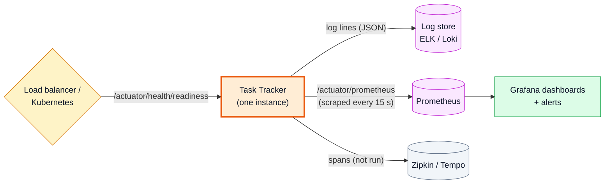
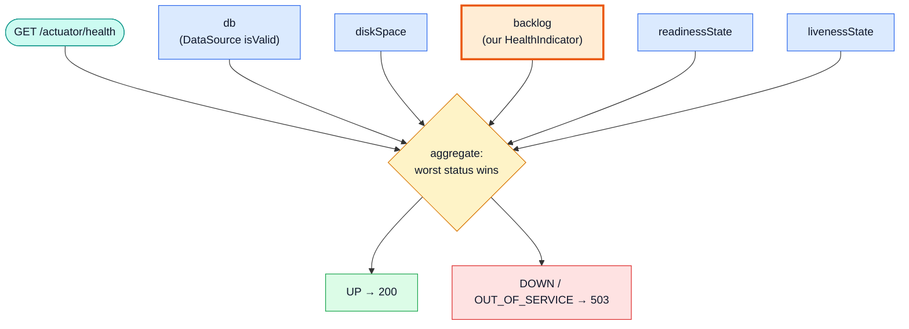
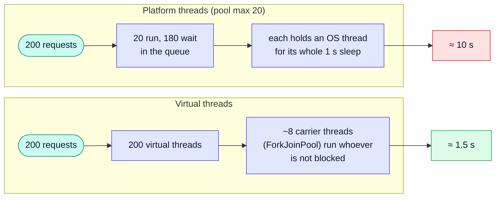
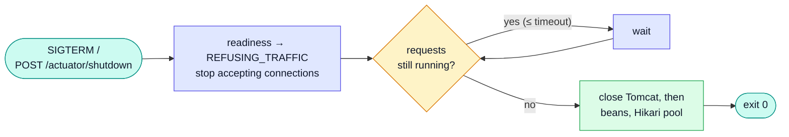

# Production Features: Logging, Actuator, Metrics, OpenAPI, Virtual Threads — Complete In-Depth Guide

**Spring Boot notes #12 of 18** · Priority 🔴 · Track: Spring Boot ([README](README.md))

An app that works on your laptop isn't ready for production. In production nobody watches the console, and you still have to answer five questions:

1. **What happened?** That's **logging**: useful messages, request ids, JSON logs for log tools.
2. **Is it alive and ready?** That's **health checks** for load balancers and Kubernetes.
3. **How is it doing?** That's **metrics**: request rates, latencies, pool usage, business counters.
4. **How do I call it?** That's **API documentation** (OpenAPI / Swagger UI).
5. **Does it scale and stop cleanly?** That's **virtual threads** and **graceful shutdown**.

Spring Boot answers most of these with **Actuator** and **Micrometer**, plus springdoc for OpenAPI.

| You want… | Use |
|---|---|
| Log a message | SLF4J `Logger` + `log.info("... {}", value)` |
| Change log levels | `logging.level.*`; at runtime: `POST /actuator/loggers/{name}` |
| Follow one request through the log | **MDC** + a request id filter (`%X{requestId}`) |
| Logs a machine can parse | `logging.structured.format.console: ecs` (or `logstash`, `gelf`) |
| Liveness / readiness for Kubernetes | `/actuator/health/liveness`, `/actuator/health/readiness` |
| A custom health check | A `HealthIndicator` bean |
| Count / time things | Micrometer `Counter`, `Timer`, `Gauge` via `MeterRegistry` |
| Metrics for Prometheus / Grafana | `micrometer-registry-prometheus` → `/actuator/prometheus` |
| An API description + test page | springdoc → `/v3/api-docs`, `/swagger-ui.html` |
| Many concurrent blocking requests | `spring.threads.virtual.enabled: true` |
| Stop without dropping requests | `server.shutdown: graceful` (the default) |

> [!NOTE]
> This topic isn't in Kunal's playlist, so there are no video timestamps. Reference playlist video 43 (*Actuator in depth*) maps here; see the [README](README.md#reference-playlist-where-each-video-is-covered).
>
> **What was run:** [`examples/12-production/`](examples/12-production/) (Task Tracker 0.12.0, schema `tracker12`) on Spring Boot 4.0.5, Micrometer 1.16.4, springdoc 3.0.3, PostgreSQL 18.3 and JDK 21:
> - a 24-request scenario (Actuator, metrics, loggers, the custom endpoint, OpenAPI);
> - the `env` endpoint with three masking settings;
> - a JSON-logging run;
> - four concurrent load runs (platform vs virtual threads);
> - a graceful-shutdown run;
> - Swagger UI opened in a browser;
> - `./mvnw package` with 12 tests.
>
> **Not run:** Prometheus/Grafana servers, distributed tracing with Zipkin/OpenTelemetry (no collector installed; see [Section 14](#14-tracing-concepts)), and a separate management port.

---

## Table of Contents

| # | Topic (anchor link) | Level |
|---|---|---|
| 0 | [Observability: Logs, Metrics, Traces](#0-observability-logs-metrics-traces) | Basics |
| 1 | [Logging with SLF4J and Logback](#1-logging-with-slf4j-and-logback) | Core |
| 2 | [Configuring Logs: Levels, Patterns, Files](#2-configuring-logs-levels-patterns-files) | Core |
| 3 | [MDC: A Request Id on Every Line](#3-mdc-a-request-id-on-every-line) | In depth |
| 4 | [Structured (JSON) Logs](#4-structured-json-logs) | Core |
| 5 | [Actuator: Endpoints, Exposure and Security](#5-actuator-endpoints-exposure-and-security) | Core |
| 6 | [Health: Indicators, Groups and Kubernetes Probes](#6-health-indicators-groups-and-kubernetes-probes) | In depth |
| 7 | [Info](#7-info) | Core |
| 8 | [Metrics with Micrometer](#8-metrics-with-micrometer) | In depth |
| 9 | [Loggers, Env and Secrets](#9-loggers-env-and-secrets) | In depth |
| 10 | [Writing a Custom Endpoint](#10-writing-a-custom-endpoint) | Core |
| 11 | [OpenAPI and Swagger UI (springdoc)](#11-openapi-and-swagger-ui-springdoc) | Core |
| 12 | [Virtual Threads](#12-virtual-threads) | In depth |
| 13 | [Graceful Shutdown](#13-graceful-shutdown) | Core |
| 14 | [Tracing (Concepts)](#14-tracing-concepts) | Core |
| 15 | [Interview Questions](#15-interview-questions) | Interview |

---

## 0. Observability: Logs, Metrics, Traces

| Pillar | Answers | Shape | Spring Boot piece | Typical tools |
|---|---|---|---|---|
| **Logs** | What happened, in detail? | Text/JSON events | SLF4J + Logback | ELK / OpenSearch, Loki, Splunk |
| **Metrics** | How much, how fast, how often? | Numbers over time | Micrometer + Actuator | Prometheus + Grafana, Datadog |
| **Traces** | Where did *this* request spend its time, across services? | Spans with ids | Micrometer Tracing | Zipkin, Jaeger, Tempo |
| Health | Should traffic go to this instance? | UP / DOWN | Actuator health | Load balancer, Kubernetes |



---

## 1. Logging with SLF4J and Logback

**SLF4J** is the logging **API** your code calls. **Logback** is the default **implementation** Boot ships (via `spring-boot-starter-logging`, part of every starter). Code depends only on SLF4J, so the backend can be swapped (e.g. for Log4j2) without code changes.

```java
private static final Logger log = LoggerFactory.getLogger(TaskService.class);   // one per class
```

```java
log.debug("search done={} priority={} assignee={} tag={} dueBefore={} page={}",   // {} placeholders:
        done, priority, assignee, tag, dueBefore, pageable);                    // no string built if DEBUG is off
```

```java
log.info("Created task {} '{}' in project {}", t.getId(), t.getTitle(), projectId);
```

| Level | Use for | In this project |
|---|---|---|
| `ERROR` | Something failed and needs a human (with the exception: `log.error("...", ex)`) | — |
| `WARN` | Unusual but handled; the client's mistake; risky operations | 404s, bulk-complete |
| `INFO` | Important business events, startup/shutdown | "Created task" |
| `DEBUG` | Details for developers when diagnosing | search filters |
| `TRACE` | Very fine-grained (e.g. Hibernate parameter binding) | — |

| Do | Don't |
|---|---|
| `log.info("Created {}", id)`: parameters | `log.info("Created " + id)`: builds the string even when the level is off |
| Pass the exception as the **last** argument: `log.error("Payment failed for {}", id, ex)` | `log.error(ex.getMessage())`: loses the stack trace |
| Log ids, counts, states | Log passwords, tokens, full card numbers, personal data |
| Log once, where you handle the error | Log and rethrow at every layer (the same error 5 times) |
| Lombok `@Slf4j` (generates the field) | `System.out.println` (no level, no format, no control) |

---

## 2. Configuring Logs: Levels, Patterns, Files

```yaml
logging:
  pattern:
    correlation: "[%X{requestId:-}] "     # Boot puts this into its default pattern: the MDC request id
  level:
    root: WARN
    com.notes: INFO
```

Boot's default console line, from the run:

```
2026-11-17T02:59:56.790+05:30  INFO 13644 --- [task-tracker] [omcat-handler-8] [0717ebf5] com.notes.tasks.service.TaskService      : Created task 13 'Write the runbook' in project 1
```

| Part | Meaning |
|---|---|
| `2026-11-17T02:59:56.790+05:30` | Timestamp |
| `INFO` | Level |
| `13644` | Process id |
| `[task-tracker]` | `spring.application.name` |
| `[omcat-handler-8]` | Thread name, cut to 15 characters (`tomcat-handler-8`, a virtual thread: [Section 12](#12-virtual-threads)) |
| `[0717ebf5]` | **Correlation**: our `logging.pattern.correlation`, the MDC request id ([Section 3](#3-mdc-a-request-id-on-every-line)) |
| `com.notes.tasks.service.TaskService` | Logger name (abbreviated if long: `c.n.tasks.web...`) |

| Property | Effect |
|---|---|
| `logging.level.<package>: DEBUG` | Level for a package (and its children); `root` for everything |
| `logging.group.<name>: pkg1, pkg2` + `logging.level.<name>` | Set several packages at once (Boot predefines `web` and `sql`) |
| `logging.file.name: target/logs/task-tracker.log` | Also write to a file |
| `logging.logback.rollingpolicy.max-file-size` / `max-history` | Rotate files (default 10 MB, 7 days) |
| `logging.pattern.console` / `logging.pattern.file` | Replace the whole pattern |
| `logging.structured.format.console` / `.file` | JSON instead of a pattern ([Section 4](#4-structured-json-logs)) |
| `src/main/resources/logback-spring.xml` | Full Logback config, with `<springProfile name="prod">` sections (not used here) |

The JSON run below also wrote a file; the file keeps the **text** pattern (and shows full thread names):

```
2026-11-17T03:00:22.885+05:30  WARN 12512 --- [task-tracker] [tomcat-handler-1] [demo-json] c.n.tasks.web.GlobalExceptionHandler     : 404: Task 999 does not exist
```

---

## 3. MDC: A Request Id on Every Line

With hundreds of concurrent requests, log lines interleave. The **MDC** (Mapped Diagnostic Context) is a thread-bound map. Values put there are added to **every** log line written on that thread, so filtering by one id gives one request's story.

```java
package com.notes.tasks.ops;

import jakarta.servlet.FilterChain;
import jakarta.servlet.ServletException;
import jakarta.servlet.http.HttpServletRequest;
import jakarta.servlet.http.HttpServletResponse;
import org.slf4j.MDC;
import org.springframework.core.Ordered;
import org.springframework.core.annotation.Order;
import org.springframework.stereotype.Component;
import org.springframework.web.filter.OncePerRequestFilter;

import java.io.IOException;
import java.util.UUID;

/**
 * Gives every request an id, puts it in the MDC so EVERY log line of that request shows it,
 * and returns it in the X-Request-Id response header (a client can quote it in a bug report).
 */
@Component
@Order(Ordered.HIGHEST_PRECEDENCE)              // before Spring Security, so even 401/403 lines get an id
public class RequestIdFilter extends OncePerRequestFilter {
    public static final String HEADER = "X-Request-Id";

    @Override
    protected void doFilterInternal(HttpServletRequest req, HttpServletResponse res, FilterChain chain)
            throws ServletException, IOException {
        String id = req.getHeader(HEADER);                       // reuse the caller's id (e.g. from a gateway)
        if (id == null || !id.matches("[\\w-]{1,36}")) {         // ...but never log arbitrary client input
            id = UUID.randomUUID().toString().substring(0, 8);
        }
        MDC.put("requestId", id);
        res.setHeader(HEADER, id);
        try {
            chain.doFilter(req, res);
        } finally {
            MDC.remove("requestId");                             // threads are reused: always clean up
        }
    }
}
```

```
# A 404 with our own request id
> GET /api/tasks/999  [Bearer ravi]  [X-Request-Id: demo-404]
< 404  X-Request-Id: demo-404  [application/problem+json]
```

```
  LOG 2026-11-17T02:59:56.265+05:30  WARN 13644 --- [task-tracker] [omcat-handler-7] [demo-404] c.n.tasks.web.GlobalExceptionHandler     : 404: Task 999 does not exist
```

| Detail | Why |
|---|---|
| Reuse the incoming `X-Request-Id` | A gateway or the calling service already chose one: one id across services |
| Validate it (`[\w-]{1,36}`) | Otherwise a client could inject fake log lines (`\n`) into your logs |
| `finally { MDC.remove(...) }` | Threads are reused (pools); a stale id would leak into the next request |
| `@Order(HIGHEST_PRECEDENCE)` | Runs before Spring Security, so 401/403 lines get the id too |

> [!TIP]
> With Micrometer Tracing on the classpath, Boot puts `traceId` and `spanId` into the MDC for you, and its default correlation pattern prints them. That gives the same idea across services ([Section 14](#14-tracing-concepts)). The hand-written filter shows what happens underneath.

---

## 4. Structured (JSON) Logs

Log tools (ELK, Loki, Datadog) can search and aggregate fields, but only if they don't have to parse free text. Boot 3.4+ writes JSON with **one property**, no extra library:

```bash
java -jar target/task-tracker-0.12.0.jar --logging.structured.format.console=ecs --logging.file.name=target/logs/task-tracker.log
```

```
  LOG {"@timestamp":"2026-11-16T21:30:22.885170300Z","log":{"level":"WARN","logger":"com.notes.tasks.web.GlobalExceptionHandler"},"process":{"pid":12512,"thread":{"name":"tomcat-handler-1"}},"service":{"name":"task-tracker","version":"0.12.0","node":{}},"message":"404: Task 999 does not exist","requestId":"demo-json","ecs":{"version":"8.11"}}
```

| Format | For |
|---|---|
| `ecs` | Elastic Common Schema (Elasticsearch / Kibana) |
| `logstash` | Logstash JSON |
| `gelf` | Graylog |

Notice that the MDC `requestId` became a JSON **field**, so "show everything for `demo-json`" is a simple query. The timestamp is in UTC (`Z`), unlike the console pattern's local time. Common practice: JSON in production (a profile or an environment variable), the readable pattern locally.

---

## 5. Actuator: Endpoints, Exposure and Security

`spring-boot-starter-actuator` adds operational endpoints under `/actuator`. By default only **`health`** is exposed over HTTP; you choose the rest:

```yaml
management:
  endpoints:
    web:
      exposure:
        include: health, info, metrics, prometheus, loggers, env, configprops, mappings, conditions, beans, shutdown, maintenance
```

```
2026-11-17T02:59:52.216+05:30  INFO 13644 --- [task-tracker] [           main] [] o.s.b.a.e.web.EndpointLinksResolver      : Exposing 12 endpoints beneath base path '/actuator'
```

| Endpoint | Shows / does |
|---|---|
| `health` | UP/DOWN + components ([Section 6](#6-health-indicators-groups-and-kubernetes-probes)) |
| `info` | Build, git, Java, OS, custom info ([Section 7](#7-info)) |
| `metrics`, `prometheus` | Micrometer metrics ([Section 8](#8-metrics-with-micrometer)) |
| `loggers` | Read and **change** log levels at runtime |
| `env`, `configprops` | Configuration values and where each came from |
| `beans`, `conditions`, `mappings` | All beans; the auto-configuration report (file 04); all request mappings |
| `threaddump`, `heapdump` | Diagnose hangs / memory (a heap dump contains **all data in memory**: guard it) |
| `shutdown` | Stops the app (off by default) |
| `scheduledtasks`, `caches`, `flyway`, `sbom`, … | Available when the feature is present |

> [!CAUTION]
> `env`, `configprops`, `heapdump`, `loggers` and `shutdown` are an attacker's dream. Expose only what you need, and **secure** the rest. Boot with Spring Security secures all endpoints except `health` by default; once you write your own `SecurityFilterChain` (as here), the rules are yours.

This project adds a third filter chain to file 11's two, checked **first**:

```java
    @Bean
    @Order(0)
    SecurityFilterChain actuatorChain(HttpSecurity http) throws Exception {
        http
            .securityMatcher(EndpointRequest.toAnyEndpoint())       // /actuator/** (follows base-path changes)
            .authorizeHttpRequests(auth -> auth
                .requestMatchers(EndpointRequest.to("health", "info")).permitAll()
                .anyRequest().hasRole("ADMIN"))
            .httpBasic(Customizer.withDefaults())
            .sessionManagement(s -> s.sessionCreationPolicy(SessionCreationPolicy.STATELESS))
            .csrf(csrf -> csrf.disable());
        return http.build();
    }
```

| Request | Result |
|---|---|
| `GET /actuator` without credentials | **401** `WWW-Authenticate: Basic` |
| `GET /actuator/metrics` as ravi (USER) | **403** |
| `GET /actuator/health`, `/info` anonymous | **200** |
| Everything as asha (ADMIN) | **200** |

> [!NOTE]
> Boot 4 moved `EndpointRequest` to `org.springframework.boot.security.autoconfigure.actuate.web.servlet` (module `spring-boot-security`). Without this chain, `/actuator/**` would fall into file 11's **web** chain: form-login redirects and **CSRF**, so `POST /actuator/loggers` would fail with 403.

Other options: `management.server.port: 8081` serves Actuator on a separate port that only the internal network can reach (not run), and `management.endpoints.web.base-path` changes `/actuator`.

---

## 6. Health: Indicators, Groups and Kubernetes Probes

`/actuator/health` combines **health indicators**. Boot adds them for what it finds: `db` (a DataSource), `diskSpace`, `ping`, `ssl`, Redis, Kafka, and so on. The overall status is the **worst** component status.



**Details for whom?** `show-details: when-authorized` + `roles: ADMIN`. Anonymous callers get the summary only:

```
# Health, anonymous
> GET /actuator/health
< 200  [application/json]
{
  "groups": [
    "liveness",
    "readiness"
  ],
  "status": "UP"
}
```

asha gets every component: `backlog` (`openTasks`, `overdueTasks`), `db`, `diskSpace`, `livenessState`, `ping`, `readinessState`, `ssl` (see the full output).

**A custom indicator:**

```java
package com.notes.tasks.ops;

import com.notes.tasks.repo.TaskRepository;
import org.springframework.boot.health.contributor.AbstractHealthIndicator;
import org.springframework.boot.health.contributor.Health;
import org.springframework.stereotype.Component;

import java.time.Clock;
import java.time.LocalDate;

/**
 * A custom health check. The bean name minus "HealthIndicator" is its name in /actuator/health: "backlog".
 * AbstractHealthIndicator turns an exception (e.g. the database is down) into DOWN for us.
 */
@Component
public class BacklogHealthIndicator extends AbstractHealthIndicator {
    private final TaskRepository tasks;
    private final Clock clock;

    public BacklogHealthIndicator(TaskRepository tasks, Clock clock) {
        this.tasks = tasks;
        this.clock = clock;
    }

    @Override
    protected void doHealthCheck(Health.Builder builder) {
        long open = tasks.countByDoneFalse();
        long overdue = tasks.countByDoneFalseAndDueDateBefore(LocalDate.now(clock));
        builder.up()
               .withDetail("openTasks", open)
               .withDetail("overdueTasks", overdue);
    }
}
```

> [!NOTE]
> Boot 4 moved health classes into the `spring-boot-health` module: `org.springframework.boot.health.contributor.HealthIndicator` / `Health` / `AbstractHealthIndicator` (Boot 3: `org.springframework.boot.actuate.health`).

### Liveness vs readiness

| Probe | Question | If it fails, Kubernetes… | Should include |
|---|---|---|---|
| **Liveness** `/actuator/health/liveness` | Is the process stuck beyond repair? | **Restarts** the container | Almost nothing (`livenessState`). Never the database: a DB outage would restart every pod for nothing |
| **Readiness** `/actuator/health/readiness` | Can it take traffic **now**? | **Stops sending** traffic (no restart) | `readinessState` + must-have dependencies (here `db`) |

```yaml
management:
  endpoint:
    health:
      show-details: when-authorized       # anonymous callers see only {"status":"UP"}
      roles: ADMIN
      probes:
        enabled: true                     # /actuator/health/liveness and /readiness (always on in Kubernetes)
      group:
        readiness:
          include: readinessState, db     # not ready if the database is unreachable
```

Readiness is also **controlled by the app**: during startup it's `REFUSING_TRAFFIC` until all runners finish, and during shutdown it goes back. Section 10's custom endpoint flips it by hand.

---

## 7. Info

`/actuator/info` collects **info contributors**:

| Source | How to enable | In the run |
|---|---|---|
| `info.*` properties | `management.info.env.enabled: true` | `app.name`, `app.owner` |
| `META-INF/build-info.properties` | `build-info` goal of `spring-boot-maven-plugin` | `build.version: 0.12.0`, `build.time` |
| `git.properties` | `git-commit-id-maven-plugin` (not used) | — |
| Java / OS / process | `management.info.java.enabled`, `.os.enabled`, `.process.enabled` | JVM version, `Windows 11` |
| Your own | An `InfoContributor` bean | — |

```xml
<executions>
    <execution>
        <goals>
            <goal>build-info</goal>  <!-- writes META-INF/build-info.properties for /actuator/info -->
        </goals>
    </execution>
</executions>
```

"Which version is running on server 3?" is answered by `/actuator/info`.

---

## 8. Metrics with Micrometer

**Micrometer** is to metrics what SLF4J is to logging: one API, many backends (Prometheus, Datadog, CloudWatch, …). Boot auto-instruments a lot: JVM memory and GC, threads, CPU, HikariCP pools, Tomcat, **every HTTP request** (`http.server.requests`), Spring Data repositories, caches, logback events.

| Meter | Goes | Example |
|---|---|---|
| **Counter** | Only up | Tasks created, errors |
| **Gauge** | Up and down (sampled when read) | Open tasks, queue size, pool connections |
| **Timer** | Counts **and** times events (count, total, max; optional percentiles/histograms) | Request duration, `tasks.search` |
| DistributionSummary | Like a timer for non-time values | Payload sizes |

```java
package com.notes.tasks.ops;

import com.notes.tasks.model.Priority;
import io.micrometer.core.instrument.Counter;
import io.micrometer.core.instrument.MeterRegistry;
import io.micrometer.core.instrument.Timer;
import org.springframework.stereotype.Component;

import java.util.function.Supplier;

/** Business metrics with Micrometer: they show up in /actuator/metrics and /actuator/prometheus. */
@Component
public class TaskMetrics {
    private final MeterRegistry registry;
    private final Timer searchTimer;

    public TaskMetrics(MeterRegistry registry) {
        this.registry = registry;
        this.searchTimer = Timer.builder("tasks.search")
                .description("Time spent in TaskService.search")
                .register(registry);
    }

    /** A counter only goes up. One time series per tag value: priority=LOW|MEDIUM|HIGH. */
    public void taskCreated(Priority priority) {
        Counter.builder("tasks.created")
                .description("Tasks created through the API")
                .tag("priority", priority.name())                // keep tag values few (no ids, no usernames)
                .register(registry)                              // returns the existing counter after the first call
                .increment();
    }

    public <T> T timeSearch(Supplier<T> search) {
        return searchTimer.record(search);
    }
}
```

```java
package com.notes.tasks.ops;

import com.notes.tasks.repo.TaskRepository;
import io.micrometer.core.instrument.Gauge;
import io.micrometer.core.instrument.MeterRegistry;
import io.micrometer.core.instrument.binder.MeterBinder;
import org.springframework.stereotype.Component;

/** A gauge is a value that goes up AND down; Micrometer reads it each time metrics are requested. */
@Component
public class OpenTasksGauge implements MeterBinder {
    private final TaskRepository tasks;

    public OpenTasksGauge(TaskRepository tasks) {
        this.tasks = tasks;
    }

    @Override
    public void bindTo(MeterRegistry registry) {                 // Boot calls this for every MeterBinder bean
        Gauge.builder("tasks.open", tasks, TaskRepository::countByDoneFalse)
                .description("Tasks not done yet")
                .register(registry);
    }
}
```

**Reading a metric:**

```
# Our counter
> GET /actuator/metrics/tasks.created  [Basic asha:***]
```

returns `"statistic": "COUNT", "value": 1.0` with `availableTags` `priority: [HIGH]`. Drill down with `?tag=`: `http.server.requests?tag=uri:/api/tasks/{id}` showed 1 request, `status 404`, `outcome CLIENT_ERROR`. The `uri` tag is the **pattern** (`{id}`), not `/api/tasks/999`; otherwise every id would create a new time series.

> [!WARNING]
> **Cardinality.** Every distinct combination of tag values is a separate time series stored by the monitoring system. Tag with small fixed sets (priority, status, outcome), never with user ids, emails, task ids or free text.

### Prometheus

`micrometer-registry-prometheus` adds `/actuator/prometheus` in the text format Prometheus **scrapes** (pulls) periodically:

```
# TYPE tasks_total counter
tasks_total{priority="HIGH"} 1.0
# TYPE tasks_open gauge
tasks_open 9.0
```

> [!IMPORTANT]
> A real surprise: our counter is called `tasks.created`, but Prometheus shows **`tasks_total`**. Names are converted (`.` → `_`, counters get `_total`, timers `_seconds`), and in the Prometheus/OpenMetrics format **`_created` is a reserved suffix** (the series that holds a counter's creation time). So the client library dropped it. Choose names that don't end in `created`, `total`, `count`, `sum`, `bucket` or `info` (e.g. `tasks.submitted`). In `/actuator/metrics`, the name stays `tasks.created`.

`management.observations.key-values.application: task-tracker` added the `application="task-tracker"` tag to `http_server_requests_seconds_count`. A Grafana dashboard then plots e.g. `rate(http_server_requests_seconds_count[5m])` per URI (Prometheus and Grafana not run here).

---

## 9. Loggers, Env and Secrets

### Change a log level without restarting

```
# Switch it to DEBUG at runtime (no restart)
> POST /actuator/loggers/com.notes.tasks.service  [Basic asha:***]
  {"configuredLevel": "DEBUG"}
< 204  []
```

The very next search logged its DEBUG line:

```
  LOG 2026-11-17T03:00:00.873+05:30 DEBUG 13644 --- [task-tracker] [mcat-handler-17] [6e055651] com.notes.tasks.service.TaskService      : search done=null priority=null assignee=ravi tag=null dueBefore=null page=Page request [number: 0, size 2, sort: UNSORTED]
```

This is the production debugging move: turn on DEBUG for one package, reproduce, turn it back (`{"configuredLevel": null}`). The change is per instance and lost on restart.

### `env` and `configprops`: who can see secrets?

`/actuator/env/{name}` shows a property's value and **where it came from** (`application.yml`, an env var, a command-line arg). Values are controlled by `show-values`: `never` (the default), `when-authorized` or `always`. The same three requests ran with three settings:

```
===== mask-on ()
----- requests -----
# env: the database password
> GET /actuator/env/spring.datasource.password  [Basic asha:***]
< 200  [application/json]
  "property": {
    "value": "******"
  (2 of 43 lines shown)

# env: the JWT signing secret
> GET /actuator/env/app.jwt.secret  [Basic asha:***]
< 200  [application/json]
  "property": {
    "value": "******"
  (2 of 43 lines shown)

# env: a harmless value
> GET /actuator/env/info.app.owner  [Basic asha:***]
< 200  [application/json]
  "property": {
    "value": "platform-team"
  (2 of 43 lines shown)

===== mask-off (--app.actuator.mask-secrets=false)
----- requests -----
# env: the database password
> GET /actuator/env/spring.datasource.password  [Basic asha:***]
< 200  [application/json]
  "property": {
    "value": "springnotes"
  (2 of 46 lines shown)

# env: the JWT signing secret
> GET /actuator/env/app.jwt.secret  [Basic asha:***]
< 200  [application/json]
  "property": {
    "value": "dev-only-secret-change-me-at-least-32-bytes"
  (2 of 46 lines shown)

# env: a harmless value
> GET /actuator/env/info.app.owner  [Basic asha:***]
< 200  [application/json]
  "property": {
    "value": "platform-team"
  (2 of 46 lines shown)

===== never (--management.endpoint.env.show-values=never)
----- requests -----
# env: the database password
> GET /actuator/env/spring.datasource.password  [Basic asha:***]
< 200  [application/json]
  "property": {
    "value": "******"
  (2 of 46 lines shown)

# env: the JWT signing secret
> GET /actuator/env/app.jwt.secret  [Basic asha:***]
< 200  [application/json]
  "property": {
    "value": "******"
  (2 of 46 lines shown)

# env: a harmless value
> GET /actuator/env/info.app.owner  [Basic asha:***]
< 200  [application/json]
  "property": {
    "value": "******"
  (2 of 46 lines shown)
```

| Setting | Password and JWT secret | Harmless value |
|---|---|---|
| `when-authorized` + our `SanitizingFunction` (the project's setup) | `******` | shown to ADMIN |
| `when-authorized`, **no** function (`--app.actuator.mask-secrets=false`) | **shown in clear** | shown |
| `never` (Boot's default) | `******` | `******` |

> [!CAUTION]
> Since Boot 3.0, showing values means **all** values, including `spring.datasource.password`. Boot no longer masks keys like `password` automatically. Either keep `never`, or add a `SanitizingFunction`:

```java
package com.notes.tasks.ops;

import org.springframework.boot.actuate.endpoint.SanitizingFunction;
import org.springframework.boot.autoconfigure.condition.ConditionalOnProperty;
import org.springframework.context.annotation.Bean;
import org.springframework.context.annotation.Configuration;

import java.util.regex.Pattern;

@Configuration
public class ActuatorConfig {
    private static final Pattern SENSITIVE = Pattern.compile("(?i).*(password|secret|token|credential).*");

    /**
     * /actuator/env and /actuator/configprops show values to admins (show-values: when-authorized).
     * This function still masks anything whose KEY looks sensitive. Switch it off with
     * --app.actuator.mask-secrets=false to see what Boot does on its own.
     */
    @Bean
    @ConditionalOnProperty(name = "app.actuator.mask-secrets", havingValue = "true", matchIfMissing = true)
    SanitizingFunction maskSecrets() {
        return data -> SENSITIVE.matcher(data.getKey()).matches() ? data.withSanitizedValue() : data;
    }
}
```

---

## 10. Writing a Custom Endpoint

`@Endpoint(id = ...)` + `@ReadOperation` (GET), `@WriteOperation` (POST), `@DeleteOperation` (DELETE). Parameters come from the JSON body or query. The endpoint is technology-neutral: the same class is exposed over HTTP and JMX.

```java
package com.notes.tasks.ops;

import org.springframework.boot.actuate.endpoint.annotation.Endpoint;
import org.springframework.boot.actuate.endpoint.annotation.ReadOperation;
import org.springframework.boot.actuate.endpoint.annotation.WriteOperation;
import org.springframework.boot.availability.ApplicationAvailability;
import org.springframework.boot.availability.AvailabilityChangeEvent;
import org.springframework.boot.availability.ReadinessState;
import org.springframework.context.ApplicationEventPublisher;
import org.springframework.stereotype.Component;

import java.util.Map;

/**
 * A custom Actuator endpoint at /actuator/maintenance.
 * GET shows the readiness state; POST {"enabled": true} takes the instance out of the load balancer
 * (readiness probe -> 503) without stopping it, e.g. before a deployment drains it.
 */
@Component
@Endpoint(id = "maintenance")
public class MaintenanceEndpoint {
    private final ApplicationEventPublisher events;
    private final ApplicationAvailability availability;

    public MaintenanceEndpoint(ApplicationEventPublisher events, ApplicationAvailability availability) {
        this.events = events;
        this.availability = availability;
    }

    @ReadOperation                                          // GET /actuator/maintenance
    public Map<String, Object> status() {
        return Map.of("readiness", availability.getReadinessState());
    }

    @WriteOperation                                         // POST /actuator/maintenance  {"enabled": true}
    public Map<String, Object> set(boolean enabled) {
        AvailabilityChangeEvent.publish(events, this,
                enabled ? ReadinessState.REFUSING_TRAFFIC : ReadinessState.ACCEPTING_TRAFFIC);
        return status();
    }
}
```

```
# Custom endpoint: take the instance out of rotation
> POST /actuator/maintenance  [Basic asha:***]
  {"enabled": true}
< 200  [application/json]
{
  "readiness": "REFUSING_TRAFFIC"
}

# Readiness now fails; liveness is still fine
> GET /actuator/health/readiness
< 503  [application/json]
{
  "status": "OUT_OF_SERVICE"
}
```

The load balancer stops sending traffic (503), Kubernetes does **not** restart the pod (liveness stayed `UP`), and `{"enabled": false}` brings it back. The endpoint must also be listed in `exposure.include`, and our actuator chain makes it ADMIN-only.

---

## 11. OpenAPI and Swagger UI (springdoc)

**OpenAPI** (formerly Swagger) is a standard JSON/YAML description of a REST API: paths, parameters, bodies, responses, security. **springdoc-openapi** generates it from your controllers at runtime:

| URL | Gives |
|---|---|
| `/v3/api-docs` | The OpenAPI 3.1 JSON (import into Postman, generate clients with OpenAPI Generator) |
| `/swagger-ui.html` | An interactive page to read and **try** the API |

```xml
<dependency>                            <!-- OpenAPI 3 document at /v3/api-docs + Swagger UI (not managed by Boot) -->
    <groupId>org.springdoc</groupId>
    <artifactId>springdoc-openapi-starter-webmvc-ui</artifactId>
    <version>3.0.3</version>            <!-- the 3.0.x line is built against Boot 4.0.x -->
</dependency>
```

> [!WARNING]
> springdoc isn't a Spring project, so Boot doesn't manage its version. **springdoc 2.x is for Boot 3; Boot 4 needs 3.x.** Check `./mvnw dependency:tree` after adding it; here it pulled only Boot 4.0.5 / Spring 7.0.6 artifacts.

Annotations add what code can't say:

```java
@Operation(summary = "Get one task", description = "Users may read tasks assigned to them; admins read all.")
@ApiResponse(responseCode = "200", description = "The task")
@ApiResponse(responseCode = "403", description = "The task is assigned to someone else")
@ApiResponse(responseCode = "404", description = "No task with this id")
@GetMapping("/tasks/{id}")
public TaskResponse get(@Parameter(description = "Task id", example = "1") @PathVariable long id) {
```

The `OpenAPI` bean adds the title and declares the **bearer** scheme, so Swagger UI shows an *Authorize* button for the JWT from file 11:

```java
package com.notes.tasks.ops;

import io.swagger.v3.oas.models.Components;
import io.swagger.v3.oas.models.OpenAPI;
import io.swagger.v3.oas.models.info.Info;
import io.swagger.v3.oas.models.security.SecurityRequirement;
import io.swagger.v3.oas.models.security.SecurityScheme;
import org.springframework.context.annotation.Bean;
import org.springframework.context.annotation.Configuration;

/** springdoc builds the OpenAPI document from the controllers; this bean adds the title and the auth scheme. */
@Configuration
public class OpenApiConfig {

    @Bean
    OpenAPI taskTrackerApi() {
        return new OpenAPI()
                .info(new Info().title("Task Tracker API").version("0.12.0")
                        .description("Projects, tasks and reports. Get a token from POST /api/auth/token (HTTP Basic)."))
                .components(new Components().addSecuritySchemes("bearer",
                        new SecurityScheme().type(SecurityScheme.Type.HTTP).scheme("bearer").bearerFormat("JWT")))
                .addSecurityItem(new SecurityRequirement().addList("bearer"));   // every operation needs it
    }
}
```

From the run (`/v3/api-docs`, a few lines): `"openapi": "3.1.0"`, `"title": "Task Tracker API"`, paths such as `"/api/tasks/{id}"` with `"summary": "Get one task"`, and the `"bearer"` scheme.

**In a browser**, Swagger UI at `http://localhost:8080/swagger-ui.html` rendered the *Tasks* group and the *Authorize* button. The console also showed two errors caused by file 11's strict `Content-Security-Policy: default-src 'self'`:

> Applying inline style violates the following Content Security Policy directive 'default-src 'self''

The same happened for `data:image/svg+xml` icons. The page works, but some styling and icons are blocked. The options: a relaxed policy only for `/swagger-ui/**` (e.g. `style-src 'self' 'unsafe-inline'; img-src 'self' data:`), or disable the docs in production:

```
WARN ... o.s.core.events.SpringDocAppInitializer  : SpringDoc /v3/api-docs endpoint is enabled by default. To disable it in production, set the property 'springdoc.api-docs.enabled=false'
```

(springdoc printed that warning at startup.) The docs URLs are `permitAll` in the web chain; whether a production API should publish its docs is a decision for your team.

---

## 12. Virtual Threads

The classic servlet model is **one thread per request**. A **platform** thread is an OS thread: ~1 MB stack, expensive, so Tomcat uses a pool (default max **200**). If requests mostly **wait** (database, HTTP calls), the pool runs out while CPUs sit idle.

A **virtual thread** (Java 21, JEP 444) is a cheap thread managed by the JVM. When it blocks on I/O or `sleep`, the JVM **unmounts** it from its carrier (a small `ForkJoinPool` of platform threads, one per core), and the carrier runs another virtual thread. Millions are possible.



In Boot it's one property (Java 21+). It switches Tomcat's request threads, `@Async`/task executors and schedulers (file 13) to virtual threads:

```yaml
spring:
  threads:
    virtual:
      enabled: true                       # Tomcat (and @Async, schedulers) run requests on virtual threads
```

```
# Which thread served this request?
> GET /api/ops/slow?ms=10  [Bearer ravi]
```

returned `"thread": "VirtualThread[#75,tomcat-handler-23]/runnable@ForkJoinPool-1-worker-1"` and `"virtual": true`.

**Measured:** 200 (or 50) requests fired at once from a Python thread pool, with the endpoints from `LoadController`:

```
args: --spring.threads.virtual.enabled=false --server.tomcat.threads.max=20 --logging.level.root=ERROR --logging.level.com.notes=ERROR
GET /api/ops/slow?ms=1000 x 200 at once -> 200 x 200 in 10.22 s
virtual threads: [False], distinct request threads: 20
example: Thread[#40,http-nio-8080-exec-1,5,main]

args: --server.tomcat.threads.max=20 --logging.level.root=ERROR --logging.level.com.notes=ERROR
GET /api/ops/slow?ms=1000 x 200 at once -> 200 x 200 in 1.52 s
virtual threads: [True], distinct request threads: 200
example: VirtualThread[#53,tomcat-handler-2]/runnable@ForkJoinPool-1-worker-8

args: --spring.threads.virtual.enabled=false --server.tomcat.threads.max=20 --logging.level.root=ERROR --logging.level.com.notes=ERROR
GET /api/ops/slow-db?ms=1000 x 50 at once -> 50 x 200 in 10.13 s
virtual threads: [False], distinct request threads: 20
example: Thread[#42,http-nio-8080-exec-3,5,main]

args: --server.tomcat.threads.max=20 --logging.level.root=ERROR --logging.level.com.notes=ERROR
GET /api/ops/slow-db?ms=1000 x 50 at once -> 50 x 200 in 10.12 s
virtual threads: [True], distinct request threads: 50
example: VirtualThread[#53,tomcat-handler-2]/runnable@ForkJoinPool-1-worker-7
```

| Endpoint | Platform (max 20 threads) | Virtual | Why |
|---|---|---|---|
| `/api/ops/slow` (sleep 1 s) × 200 | **10.22 s**: 20 at a time, 10 rounds | **1.52 s**: all 200 at once | Waiting no longer holds a thread |
| `/api/ops/slow-db` (`pg_sleep(1)`) × 50 | **10.13 s** | **10.12 s**: no gain | Hikari has **5** connections: 50 / 5 = 10 rounds |

A thread dump (`jcmd <pid> Thread.dump_to_file`) taken during the virtual-thread DB run showed it: 5 virtual threads were inside PostgreSQL's `QueryExecutorImpl.execute`, and the rest were parked in Hikari's `ConcurrentBag.borrow`, waiting for a connection. **Virtual threads remove the thread limit, not other limits**: connection pools, database capacity, rate limits of the services you call.

| Good fit | Poor fit / caveats |
|---|---|
| Many concurrent requests that **wait** on I/O | CPU-heavy work (more threads don't add cores) |
| Calling slow HTTP services, blocking JDBC | A small resource behind it (pool, semaphore) is still the limit |
| Simple blocking code instead of reactive code | JDK 21–23: blocking inside `synchronized` **pins** the carrier (fixed in JDK 24, JEP 491); prefer `ReentrantLock` on 21 |
| | `ThreadLocal`-heavy code: one copy per virtual thread, and there may be millions |
| | Don't pool virtual threads; create one per task |

---

## 13. Graceful Shutdown

When an instance is stopped (deploy, scale down), `server.shutdown: graceful` (the default since Boot 3.4) makes Tomcat **stop accepting** new connections, **wait** for running requests (at most `spring.lifecycle.timeout-per-shutdown-phase`, default 30 s; 20 s here), and then close everything.



The run: a 4-second request was started, and 1 second later `/actuator/shutdown` was called:

```
> GET /api/ops/slow?ms=4000 started (takes 4 s)
> POST /actuator/shutdown (1 s later) -> 200 {"message":"Shutting down, bye..."}
> GET /actuator/health during shutdown -> ERR URLError: <urlopen error [WinError 10061] No connection could be made because th
< slow request finished: 200 after 4.1 s, virtual=True
process exit code: 0
----- app log after the shutdown request -----
2026-11-17T02:51:59.781+05:30  WARN 9004 --- [task-tracker] [           main] [] o.s.core.events.SpringDocAppInitializer  : SpringDoc /v3/api-docs endpoint is enabled by default. To disable it in production, set the property 'springdoc.api-docs.enabled=false'
2026-11-17T02:51:59.782+05:30  WARN 9004 --- [task-tracker] [           main] [] o.s.core.events.SpringDocAppInitializer  : SpringDoc /swagger-ui.html endpoint is enabled by default. To disable it in production, set the property 'springdoc.swagger-ui.enabled=false'
2026-11-17T02:52:02.613+05:30  INFO 9004 --- [task-tracker] [       Thread-1] [] o.s.boot.tomcat.GracefulShutdown         : Commencing graceful shutdown. Waiting for active requests to complete
2026-11-17T02:52:05.104+05:30  INFO 9004 --- [task-tracker] [tomcat-shutdown] [] o.s.boot.tomcat.GracefulShutdown         : Graceful shutdown complete
2026-11-17T02:52:05.113+05:30  INFO 9004 --- [task-tracker] [       Thread-1] [] com.zaxxer.hikari.HikariDataSource       : Tracker12Pool - Shutdown initiated...
2026-11-17T02:52:05.116+05:30  INFO 9004 --- [task-tracker] [       Thread-1] [] com.zaxxer.hikari.HikariDataSource       : Tracker12Pool - Shutdown completed.
```

| What happened | Meaning |
|---|---|
| `POST /actuator/shutdown` → `Shutting down, bye...` | Shutdown started at 02:52:02.6 |
| `GET /actuator/health` → connection refused | New connections were no longer accepted |
| The slow request still returned **200 after 4.1 s** | It was allowed to finish |
| `Graceful shutdown complete` at 02:52:05.1 | Right when the request ended; then the pool closed; exit code 0 |

> [!NOTE]
> The first attempt returned **415 Unsupported Media Type**. The Python client sent an empty POST with `Content-Type: application/x-www-form-urlencoded`, and Actuator write operations accept only JSON. With `Content-Type: application/json` it worked. `curl -X POST` without a body sends no content type and works.

In Kubernetes, SIGTERM triggers the same flow. Readiness flips to refusing first, so the load balancer stops routing before the app exits.

---

## 14. Tracing (Concepts)

In a system of several services, one user request becomes a chain of calls. **Distributed tracing** gives the whole chain one **trace id**. Each step is a **span** (with its own span id, parent, start and duration), and the ids travel in HTTP headers (W3C `traceparent`).

| Piece | Spring Boot 4 |
|---|---|
| API | Micrometer **Observation** / Tracing (the same instrumentation that produces `http.server.requests`) |
| Bridge | `micrometer-tracing-bridge-otel` (OpenTelemetry) or `-brave` |
| Export | OTLP exporter / Zipkin reporter |
| Logs | `traceId` / `spanId` added to the MDC and to Boot's default correlation pattern automatically |
| Sampling | `management.tracing.sampling.probability: 0.1` (10 % of requests) |

Not run here: there's only one service, and no collector (Zipkin, Jaeger, Tempo) is installed. File 17 (microservices) returns to tracing. This file's `X-Request-Id` + MDC is the hand-made version of the same idea.

---

## 15. Interview Questions

| Question | Answer |
|---|---|
| SLF4J vs Logback? | SLF4J is the logging API (facade); Logback is Boot's default implementation. |
| Why `log.info("x {}", v)` instead of concatenation? | The message is only built if the level is enabled; the exception can be passed as the last argument. |
| What is MDC? | A thread-bound map whose values are added to every log line, e.g. a request or trace id. |
| How do you get JSON logs in Boot? | `logging.structured.format.console=ecs` (or `logstash`, `gelf`), Boot 3.4+. |
| What is Spring Boot Actuator? | Production endpoints: health, info, metrics, loggers, env, thread dumps, etc. |
| Which Actuator endpoints are exposed by default over HTTP? | Only `health`; others via `management.endpoints.web.exposure.include`. |
| How do you secure Actuator? | A security chain matching `EndpointRequest.toAnyEndpoint()`; public health/info, ADMIN for the rest; optionally a separate management port. |
| Liveness vs readiness? | Liveness: restart if stuck (keep it minimal). Readiness: send traffic or not (include critical dependencies). |
| How do you write a custom health check? | A `HealthIndicator` bean (or extend `AbstractHealthIndicator`); its name is the bean name without the suffix. |
| What is Micrometer? | A vendor-neutral metrics facade (Counter, Gauge, Timer) with registries for Prometheus, Datadog, etc. |
| Counter vs Gauge vs Timer? | Only up / a current value that goes up and down / count + duration of events. |
| What is high cardinality and why is it bad? | Tags with many distinct values (user ids) create a time series each, overloading the monitoring system. |
| Does Actuator mask passwords in `/env`? | Values are hidden by default (`show-values: never`); once shown, everything is shown unless you add a `SanitizingFunction`. |
| How do you change a log level in production without restart? | `POST /actuator/loggers/{logger}` with `{"configuredLevel":"DEBUG"}`. |
| What is OpenAPI / springdoc? | A standard API description; springdoc generates it from Spring MVC controllers and serves Swagger UI. |
| What are virtual threads and when do they help? | Cheap JVM-managed threads that unmount while blocked; they help I/O-bound concurrency, not CPU-bound work or pool limits. |
| How do you enable virtual threads in Boot? | `spring.threads.virtual.enabled=true` (Java 21+). |
| What is pinning? | A virtual thread blocked inside `synchronized` (JDK 21–23) or native code holds its carrier thread. |
| What is graceful shutdown? | Stop accepting new requests, let running ones finish within a timeout, then stop. |
| Trace vs span? | A trace is one end-to-end request; spans are its timed steps, linked by parent ids. |

---

## 🧩 Complete Example: Everything Together

**Task Tracker, stage 12.** File 11's secured app made production-ready:
- **logging:** request ids in the MDC, JSON logs on demand;
- **Actuator:** secured by its own filter chain; health with details for admins, a custom `backlog` indicator and probes; info with build data;
- **metrics:** custom metrics and the Prometheus endpoint;
- **operations:** runtime log levels, secret masking in `env`, a custom `maintenance` endpoint;
- **API docs:** OpenAPI with a bearer scheme;
- **runtime:** virtual threads and graceful shutdown.

Source: [`examples/12-production/`](examples/12-production/)

```
12-production/
├── pom.xml                              (0.12.0; + actuator, micrometer-registry-prometheus, springdoc 3.0.3, build-info)
└── src/
    ├── main/java/com/notes/tasks/
    │   ├── ops/      RequestIdFilter, TaskMetrics, OpenTasksGauge, BacklogHealthIndicator,
    │   │             MaintenanceEndpoint, ActuatorConfig, OpenApiConfig, LoadController
    │   ├── security/ SecurityConfig (+ actuatorChain, docs permitted), ...
    │   ├── service/  TaskService (+ logging, metrics)
    │   └── web/      TaskController (+ OpenAPI annotations), GlobalExceptionHandler (+ WARN log)
    ├── main/resources/application.yml   (schema tracker12, management.*, logging, virtual threads)
    └── test/java/.../ops/ActuatorTest.java  (+ file 11's tests)
```

Already shown above: `RequestIdFilter`, `TaskMetrics`, `OpenTasksGauge`, `BacklogHealthIndicator`, `MaintenanceEndpoint`, `ActuatorConfig`, `OpenApiConfig`. The rest:

**`pom.xml`** (new dependencies):

```xml
<dependency>                            <!-- /actuator/health, /info, /metrics, /loggers, ... + Micrometer -->
    <groupId>org.springframework.boot</groupId>
    <artifactId>spring-boot-starter-actuator</artifactId>
</dependency>
<dependency>                            <!-- adds /actuator/prometheus (metrics in Prometheus text format) -->
    <groupId>io.micrometer</groupId>
    <artifactId>micrometer-registry-prometheus</artifactId>
</dependency>
```

**`application.yml`**:

```yaml
spring:
  application:
    name: task-tracker
  main:
    banner-mode: off
  threads:
    virtual:
      enabled: true                       # Tomcat (and @Async, schedulers) run requests on virtual threads
  lifecycle:
    timeout-per-shutdown-phase: 20s       # graceful shutdown waits at most this long for running requests
  datasource:
    url: jdbc:postgresql://localhost:5432/springnotes?currentSchema=tracker12
    username: springnotes
    password: ${DB_PASSWORD:springnotes}   # env var wins; the default is the throwaway practice password
    hikari:
      maximum-pool-size: 5                # default 10
      pool-name: Tracker12Pool
  flyway:
    schemas: tracker12                    # Flyway creates this schema and owns its history table
  data:
    web:
      pageable:
        default-page-size: 5
        max-page-size: 50
  jpa:
    open-in-view: false
    hibernate:
      ddl-auto: validate
    properties:
      hibernate:
        default_schema: tracker12
        cache:
          use_second_level_cache: true
          region:
            factory_class: jcache
        javax:
          cache:
            provider: com.github.benmanes.caffeine.jcache.spi.CaffeineCachingProvider
            missing_cache_strategy: create

server:
  shutdown: graceful                      # stop accepting, finish running requests, then stop (the default)

management:
  endpoints:
    web:
      exposure:
        include: health, info, metrics, prometheus, loggers, env, configprops, mappings, conditions, beans, shutdown, maintenance
  endpoint:
    health:
      show-details: when-authorized       # anonymous callers see only {"status":"UP"}
      roles: ADMIN
      probes:
        enabled: true                     # /actuator/health/liveness and /readiness (always on in Kubernetes)
      group:
        readiness:
          include: readinessState, db     # not ready if the database is unreachable
    env:
      show-values: when-authorized        # default "never": every value is ******
      roles: ADMIN
    configprops:
      show-values: when-authorized
      roles: ADMIN
    shutdown:
      access: unrestricted                # off by default; POST /actuator/shutdown stops the app
  info:
    env:
      enabled: true                       # publish the info.* properties below
    java:
      enabled: true
    os:
      enabled: true
  observations:
    key-values:
      application: task-tracker           # extra tag on every observation-based metric (e.g. http.server.requests)

info:
  app:
    name: Task Tracker
    description: Spring Boot notes, stage 12
    owner: platform-team

app:
  jwt:
    secret: ${JWT_SECRET:dev-only-secret-change-me-at-least-32-bytes}

logging:
  pattern:
    correlation: "[%X{requestId:-}] "     # Boot puts this into its default pattern: the MDC request id
  level:
    root: WARN
    com.notes: INFO
    org.springframework.boot.tomcat: INFO
    com.zaxxer.hikari: INFO
    org.flywaydb: INFO
    org.springframework.boot.actuate.endpoint.web.EndpointLinksResolver: INFO   # "Exposing N endpoints"
    org.hibernate.engine.internal.StatisticalLoggingSessionEventListener: WARN
```

**`ops/LoadController.java`**:

```java
package com.notes.tasks.ops;

import org.springframework.jdbc.core.JdbcTemplate;
import org.springframework.web.bind.annotation.GetMapping;
import org.springframework.web.bind.annotation.RequestParam;
import org.springframework.web.bind.annotation.RestController;

import java.util.Map;

/** Endpoints that only WAIT, to compare platform threads and virtual threads under load. */
@RestController
public class LoadController {
    private final JdbcTemplate jdbc;

    public LoadController(JdbcTemplate jdbc) {
        this.jdbc = jdbc;
    }

    /** Blocks the request thread like a slow remote call would (no database, no locks). */
    @GetMapping("/api/ops/slow")
    public Map<String, Object> slow(@RequestParam(defaultValue = "1000") long ms) throws InterruptedException {
        Thread.sleep(ms);
        return describe(Thread.currentThread());
    }

    /** Blocks inside the DATABASE instead: every request needs one of the pool's few connections. */
    @GetMapping("/api/ops/slow-db")
    public Map<String, Object> slowDb(@RequestParam(defaultValue = "1000") long ms) {
        jdbc.queryForObject("select pg_sleep(?)", Object.class, ms / 1000.0);
        return describe(Thread.currentThread());
    }

    private static Map<String, Object> describe(Thread t) {
        return Map.of("thread", t.toString(), "virtual", t.isVirtual());
    }
}
```

**`service/TaskService.java`**:

```java
package com.notes.tasks.service;

import com.notes.tasks.dto.TaskDtos.CreateTaskRequest;
import com.notes.tasks.dto.TaskDtos.PageResponse;
import com.notes.tasks.dto.TaskDtos.PatchTaskRequest;
import com.notes.tasks.dto.TaskDtos.TaskResponse;
import com.notes.tasks.dto.TaskSummary;
import com.notes.tasks.model.AuditInfo;
import com.notes.tasks.model.Priority;
import com.notes.tasks.model.Project;
import com.notes.tasks.model.Tag;
import com.notes.tasks.model.Task;
import com.notes.tasks.ops.TaskMetrics;
import com.notes.tasks.repo.AppUserRepository;
import com.notes.tasks.repo.ProjectRepository;
import com.notes.tasks.repo.TagRepository;
import com.notes.tasks.repo.TaskRepository;
import com.notes.tasks.repo.TaskSpecs;
import org.slf4j.Logger;
import org.slf4j.LoggerFactory;
import org.springframework.data.domain.Page;
import org.springframework.data.domain.PageRequest;
import org.springframework.data.domain.Pageable;
import org.springframework.data.domain.Sort;
import org.springframework.orm.ObjectOptimisticLockingFailureException;
import org.springframework.security.access.prepost.PostAuthorize;
import org.springframework.security.access.prepost.PreAuthorize;
import org.springframework.security.core.context.SecurityContextHolder;
import org.springframework.stereotype.Service;
import org.springframework.transaction.annotation.Transactional;

import java.time.Clock;
import java.time.Instant;
import java.time.LocalDate;
import java.util.List;
import java.util.Set;

@Service
@Transactional(readOnly = true)
public class TaskService {
    private static final Logger log = LoggerFactory.getLogger(TaskService.class);   // one per class
    private final ProjectRepository projects;
    private final TaskRepository tasks;
    private final TagRepository tags;
    private final AppUserRepository users;
    private final ActivityService activity;
    private final Clock clock;
    private final TaskMetrics metrics;

    public TaskService(ProjectRepository projects, TaskRepository tasks, TagRepository tags,
                       AppUserRepository users, ActivityService activity, Clock clock, TaskMetrics metrics) {
        this.projects = projects;
        this.tasks = tasks;
        this.tags = tags;
        this.users = users;
        this.activity = activity;
        this.clock = clock;
        this.metrics = metrics;
    }

    /** File 08 sent 9 SELECTs here (N+1); one fetch-join query now loads everything. */
    public List<TaskResponse> tasksOfProject(long projectId) {
        if (!projects.existsById(projectId)) throw new NotFoundException("Project", projectId);
        return tasks.findWithDetailsByProjectId(projectId).stream().map(TaskResponse::from).toList();
    }

    /** Filters (Specifications) + paging + sorting; three queries per page whatever the page size. */
    public PageResponse<TaskResponse> search(Boolean done, Priority priority, String assignee, String tag,
                                             LocalDate dueBefore, Pageable pageable) {
        log.debug("search done={} priority={} assignee={} tag={} dueBefore={} page={}",   // {} placeholders:
                done, priority, assignee, tag, dueBefore, pageable);                    // no string built if DEBUG is off
        return metrics.timeSearch(() -> doSearch(done, priority, assignee, tag, dueBefore, pageable));
    }

    private PageResponse<TaskResponse> doSearch(Boolean done, Priority priority, String assignee, String tag,
                                                LocalDate dueBefore, Pageable pageable) {
        Pageable stable = PageRequest.of(pageable.getPageNumber(), pageable.getPageSize(),
                pageable.getSort().and(Sort.by("id")));                 // id breaks ties: pages never overlap
        Page<Task> page = tasks.findAll(TaskSpecs.matching(done, priority, assignee, tag, dueBefore), stable);
        if (page.hasContent()) {
            tasks.fetchTags(page.map(Task::getId).getContent());          // tags for the whole page in one query
        }
        return PageResponse.of(page.map(TaskResponse::from));
    }

    public List<TaskSummary> openSummaries() {
        return tasks.openSummaries();
    }

    /** Checked AFTER the method runs: users may only read tasks assigned to them; admins read all. */
    @PostAuthorize("hasRole('ADMIN') or returnObject.assignee() == authentication.name")
    public TaskResponse get(long id) {
        return TaskResponse.from(find(id));
    }

    @Transactional
    public TaskResponse create(long projectId, CreateTaskRequest req) {
        Project p = projects.findById(projectId).orElseThrow(() -> new NotFoundException("Project", projectId));
        Task t = new Task(req.title(), req.priority() == null ? Priority.MEDIUM : req.priority(),
                new AuditInfo(Instant.now(clock), currentUsername()));
        t.setDescription(req.description());
        t.setDueDate(req.dueDate());
        if (req.assigneeId() != null) {
            t.setAssignee(users.findById(req.assigneeId())
                    .orElseThrow(() -> new NotFoundException("User", req.assigneeId())));
        }
        for (String name : req.tags() == null ? Set.<String>of() : req.tags()) {
            t.getTags().add(tags.findByName(name).orElseGet(() -> tags.save(new Tag(name))));
        }
        p.addTask(t);
        tasks.flush();
        metrics.taskCreated(t.getPriority());
        log.info("Created task {} '{}' in project {}", t.getId(), t.getTitle(), projectId);
        return TaskResponse.from(t);
    }

    /** Checked BEFORE the method runs: admins, or the task's assignee. */
    @PreAuthorize("hasRole('ADMIN') or @taskSecurity.isAssignee(#id, authentication)")
    @Transactional
    public TaskResponse patch(long id, PatchTaskRequest req) {
        Task t = find(id);
        if (req.version() != null && req.version() != t.getVersion()) {
            // the client edited an old copy: someone else changed the task since they read it
            throw new ObjectOptimisticLockingFailureException(Task.class, id);
        }
        if (req.title() != null) t.setTitle(req.title());
        if (req.done() != null) t.setDone(req.done());
        if (req.priority() != null) t.setPriority(req.priority());
        tasks.flush();                            // UPDATE ... where id=? and version=?  (version + 1)
        return TaskResponse.from(t);
    }

    /** Bulk JPQL update: one UPDATE statement, no entities loaded, @Version not touched. */
    @PreAuthorize("hasRole('ADMIN')")
    @Transactional
    public int completeOverdue() {
        int n = tasks.completeOverdue(LocalDate.now(clock));
        log.warn("Bulk-completed {} overdue tasks", n);
        activity.record("completed " + n + " overdue tasks");
        return n;
    }

    @PreAuthorize("hasRole('ADMIN')")
    @Transactional
    public void delete(long id) {
        Task t = find(id);
        t.getProject().removeTask(t);
    }

    /** Who is calling? Spring Security keeps it in a thread-bound SecurityContext. */
    private static String currentUsername() {
        return SecurityContextHolder.getContext().getAuthentication().getName();
    }

    private Task find(long id) {
        return tasks.findById(id).orElseThrow(() -> new NotFoundException("Task", id));
    }
}
```

**`security/SecurityConfig.java`**:

```java
package com.notes.tasks.security;

import com.nimbusds.jose.jwk.source.ImmutableSecret;
import org.springframework.beans.factory.annotation.Value;
import org.springframework.boot.security.autoconfigure.actuate.web.servlet.EndpointRequest;
import org.springframework.context.annotation.Bean;
import org.springframework.context.annotation.Configuration;
import org.springframework.core.annotation.Order;
import org.springframework.http.HttpMethod;
import org.springframework.security.config.Customizer;
import org.springframework.security.config.annotation.method.configuration.EnableMethodSecurity;
import org.springframework.security.config.annotation.web.builders.HttpSecurity;
import org.springframework.security.config.http.SessionCreationPolicy;
import org.springframework.security.crypto.factory.PasswordEncoderFactories;
import org.springframework.security.crypto.password.PasswordEncoder;
import org.springframework.security.oauth2.jose.jws.MacAlgorithm;
import org.springframework.security.oauth2.jwt.JwtDecoder;
import org.springframework.security.oauth2.jwt.JwtEncoder;
import org.springframework.security.oauth2.jwt.NimbusJwtDecoder;
import org.springframework.security.oauth2.jwt.NimbusJwtEncoder;
import org.springframework.security.oauth2.server.resource.authentication.JwtAuthenticationConverter;
import org.springframework.security.oauth2.server.resource.authentication.JwtGrantedAuthoritiesConverter;
import org.springframework.security.web.SecurityFilterChain;
import org.springframework.web.cors.CorsConfiguration;
import org.springframework.web.cors.CorsConfigurationSource;
import org.springframework.web.cors.UrlBasedCorsConfigurationSource;

import javax.crypto.SecretKey;
import javax.crypto.spec.SecretKeySpec;
import java.nio.charset.StandardCharsets;
import java.util.List;

@Configuration
@EnableMethodSecurity                                  // turns on @PreAuthorize / @PostAuthorize
public class SecurityConfig {

    /**
     * Chain 0: Actuator. health and info are public (for load balancers and probes); every other
     * endpoint (metrics, env, loggers, shutdown...) needs an ADMIN. Stateless HTTP Basic, no CSRF token,
     * so scripts and monitoring tools can call it.
     */
    @Bean
    @Order(0)
    SecurityFilterChain actuatorChain(HttpSecurity http) throws Exception {
        http
            .securityMatcher(EndpointRequest.toAnyEndpoint())       // /actuator/** (follows base-path changes)
            .authorizeHttpRequests(auth -> auth
                .requestMatchers(EndpointRequest.to("health", "info")).permitAll()
                .anyRequest().hasRole("ADMIN"))
            .httpBasic(Customizer.withDefaults())
            .sessionManagement(s -> s.sessionCreationPolicy(SessionCreationPolicy.STATELESS))
            .csrf(csrf -> csrf.disable());
        return http.build();
    }

    /**
     * Chain 1: the JSON API. Stateless: no session, no CSRF token; every request carries a JWT
     * ("Authorization: Bearer ..."). The token endpoint alone accepts HTTP Basic (username + password).
     */
    @Bean
    @Order(1)
    SecurityFilterChain apiChain(HttpSecurity http) throws Exception {
        http
            .securityMatcher("/api/**")                // this chain only handles /api/** requests
            .authorizeHttpRequests(auth -> auth
                .requestMatchers(HttpMethod.POST, "/api/auth/token").authenticated()   // via Basic, below
                .requestMatchers(HttpMethod.GET, "/api/reports/**").hasRole("ADMIN")
                .anyRequest().authenticated())
            .httpBasic(Customizer.withDefaults())      // only used to obtain a token
            .oauth2ResourceServer(rs -> rs.jwt(jwt -> jwt.jwtAuthenticationConverter(rolesFromToken())))
            .sessionManagement(s -> s.sessionCreationPolicy(SessionCreationPolicy.STATELESS))
            .csrf(csrf -> csrf.disable())              // safe here: no cookies are used for authentication
            .cors(Customizer.withDefaults());          // uses the CorsConfigurationSource bean below
        return http.build();
    }

    /** Chain 2: everything else, for browsers. Form login, an HTTP session (cookie), CSRF protection on. */
    @Bean
    @Order(2)
    SecurityFilterChain webChain(HttpSecurity http) throws Exception {
        http
            .authorizeHttpRequests(auth -> auth
                .requestMatchers("/login", "/error").permitAll()
                .requestMatchers("/v3/api-docs/**", "/swagger-ui/**", "/swagger-ui.html").permitAll()   // API docs
                .anyRequest().authenticated())
            .formLogin(Customizer.withDefaults())      // Spring's built-in login page at /login
            .logout(Customizer.withDefaults())
            .headers(h -> h.contentSecurityPolicy(csp -> csp.policyDirectives("default-src 'self'")));
        return http.build();
    }

    /** Stores "{bcrypt}$2a$10$...": the prefix names the algorithm, so it can be upgraded later. */
    @Bean
    PasswordEncoder passwordEncoder() {
        return PasswordEncoderFactories.createDelegatingPasswordEncoder();
    }

    // ---- JWT: one shared secret (HMAC-SHA256) both signs and verifies ----

    @Bean
    SecretKey jwtKey(@Value("${app.jwt.secret}") String secret) {
        return new SecretKeySpec(secret.getBytes(StandardCharsets.UTF_8), "HmacSHA256");
    }

    @Bean
    JwtEncoder jwtEncoder(SecretKey jwtKey) {
        return new NimbusJwtEncoder(new ImmutableSecret<>(jwtKey));
    }

    @Bean
    JwtDecoder jwtDecoder(SecretKey jwtKey) {
        return NimbusJwtDecoder.withSecretKey(jwtKey).macAlgorithm(MacAlgorithm.HS256).build();
    }

    /** Our tokens carry "roles": ["ADMIN"]; turn them into ROLE_ADMIN authorities. */
    private JwtAuthenticationConverter rolesFromToken() {
        JwtGrantedAuthoritiesConverter roles = new JwtGrantedAuthoritiesConverter();
        roles.setAuthoritiesClaimName("roles");
        roles.setAuthorityPrefix("ROLE_");
        JwtAuthenticationConverter converter = new JwtAuthenticationConverter();
        converter.setJwtGrantedAuthoritiesConverter(roles);
        return converter;
    }

    /** CORS: which OTHER origins (sites) may call the API from a browser. */
    @Bean
    CorsConfigurationSource corsConfigurationSource() {
        CorsConfiguration cors = new CorsConfiguration();
        cors.setAllowedOrigins(List.of("http://localhost:5173"));          // e.g. a React dev server
        cors.setAllowedMethods(List.of("GET", "POST", "PATCH", "DELETE"));
        cors.setAllowedHeaders(List.of("Authorization", "Content-Type"));
        cors.setMaxAge(3600L);                                             // browsers cache the preflight 1 h
        UrlBasedCorsConfigurationSource source = new UrlBasedCorsConfigurationSource();
        source.registerCorsConfiguration("/api/**", cors);
        return source;
    }
}
```

**`test/.../ops/ActuatorTest.java`**:

```java
package com.notes.tasks.ops;

import org.junit.jupiter.api.Test;
import org.springframework.beans.factory.annotation.Autowired;
import org.springframework.boot.test.context.SpringBootTest;
import org.springframework.boot.webmvc.test.autoconfigure.AutoConfigureMockMvc;
import org.springframework.security.test.context.support.WithMockUser;
import org.springframework.test.context.ActiveProfiles;
import org.springframework.test.web.servlet.assertj.MockMvcTester;

import static org.assertj.core.api.Assertions.assertThat;

@SpringBootTest
@AutoConfigureMockMvc
@ActiveProfiles("test")
class ActuatorTest {
    @Autowired MockMvcTester mvc;

    @Test
    void healthIsPublicButHidesDetails() {
        assertThat(mvc.get().uri("/actuator/health")).hasStatusOk()
                .bodyJson().doesNotHavePath("$.components");     // details only for ADMIN
    }

    @Test
    void metricsNeedAuthentication() {
        assertThat(mvc.get().uri("/actuator/metrics")).hasStatus(401);
    }

    @Test
    @WithMockUser(username = "ravi", roles = "USER")
    void metricsAreForAdminsOnly() {
        assertThat(mvc.get().uri("/actuator/metrics")).hasStatus(403);
    }

    @Test
    @WithMockUser(username = "asha", roles = "ADMIN")
    void adminSeesHealthDetailsAndCustomIndicator() {
        assertThat(mvc.get().uri("/actuator/health")).hasStatusOk()
                .bodyJson().extractingPath("$.components.backlog.status").isEqualTo("UP");
    }
}
```

### Run it

```bash
cd "Spring Boot Notes/examples/12-production"
./mvnw package                                         # builds + runs 12 tests
java -jar target/task-tracker-0.12.0.jar               # http://localhost:8080/swagger-ui.html
curl localhost:8080/actuator/health
curl -u asha:asha-secret localhost:8080/actuator/metrics/http.server.requests
curl -u asha:asha-secret -X POST -H "Content-Type: application/json" -d '{"configuredLevel":"DEBUG"}' localhost:8080/actuator/loggers/com.notes.tasks.service
java -jar target/task-tracker-0.12.0.jar --logging.structured.format.console=ecs   # JSON logs
```

`./mvnw package` result: `Tests run: 12, Failures: 0, Errors: 0, Skipped: 0`, `BUILD SUCCESS` (`ActuatorTest` 4, `SecurityRulesTest` 4, `TaskServiceTest` 4).

**Expected Output 1** (the 24-request scenario on a fresh `tracker12` schema; startup lines omitted; `LOG` lines show what the app logged for each request):

```
# Actuator index without credentials
> GET /actuator
< 401  WWW-Authenticate: Basic realm="Realm"  [application/json]
{
  "timestamp": "2026-11-16T21:29:53.112Z",
  "status": 401,
  "error": "Unauthorized",
  "path": "/actuator"
}

# Actuator index as asha (ADMIN): the exposed endpoints
> GET /actuator  [Basic asha:***]
< 200  [application/json]
    "self": {
    "maintenance": {
    "beans": {
    "conditions": {
    "shutdown": {
    "configprops": {
    "configprops-prefix": {
    "env": {
    "env-toMatch": {
    "info": {
    "loggers": {
    "loggers-name": {
    "mappings": {
    "prometheus": {
    "health-path": {
    "health": {
    "metrics-requiredMetricName": {
    "metrics": {
  (18 of 76 lines shown)

# Health, anonymous
> GET /actuator/health
< 200  [application/json]
{
  "groups": [
    "liveness",
    "readiness"
  ],
  "status": "UP"
}

# Health as ADMIN: every component with details
> GET /actuator/health  [Basic asha:***]
< 200  [application/json]
{
  "components": {
    "backlog": {
      "details": {
        "openTasks": 8,
        "overdueTasks": 3
      },
      "status": "UP"
    },
    "db": {
      "details": {
        "database": "PostgreSQL",
        "validationQuery": "isValid()"
      },
      "status": "UP"
    },
    "diskSpace": {
      "details": {
        "total": 248894246912,
        "free": 96776814592,
        "threshold": 10485760,
        "path": "C:\\Users\\sarth\\OneDrive\\Desktop\\Java_Notes_Kunal_DSA_PlayList\\Spring Boot Notes\\examples\\12-production\\.",
        "exists": true
      },
      "status": "UP"
    },
    "livenessState": {
      "status": "UP"
    },
    "ping": {
      "status": "UP"
    },
    "readinessState": {
      "status": "UP"
    },
    "ssl": {
      "details": {
        "expiringChains": [],
        "invalidChains": [],
        "validChains": []
      },
      "status": "UP"
    }
  },
  "groups": [
    "liveness",
    "readiness"
  ],
  "status": "UP"
}

# Readiness probe
> GET /actuator/health/readiness
< 200  [application/json]
{
  "status": "UP"
}

# Info (public)
> GET /actuator/info
< 200  [application/json]
{
  "app": {
    "name": "Task Tracker",
    "description": "Spring Boot notes, stage 12",
    "owner": "platform-team"
  },
  "build": {
    "artifact": "task-tracker",
    "name": "task-tracker",
    "time": "2026-11-16T21:10:18.840Z",
    "version": "0.12.0",
    "group": "com.notes"
  },
  "java": {
    "jvm": {
      "name": "Java HotSpot(TM) 64-Bit Server VM",
      "vendor": "Oracle Corporation",
      "version": "21+35-LTS-2513"
    },
    "runtime": {
      "name": "Java(TM) SE Runtime Environment",
      "version": "21+35-LTS-2513"
    },
    "vendor": {
      "name": "Oracle Corporation"
    },
    "version": "21"
  },
  "os": {
    "arch": "amd64",
    "name": "Windows 11",
    "version": "10.0"
  }
}

# Token for ravi
> POST /api/auth/token  [Basic ravi:***]
< 200  [application/json]

# A 404 with our own request id
> GET /api/tasks/999  [Bearer ravi]  [X-Request-Id: demo-404]
< 404  X-Request-Id: demo-404  [application/problem+json]
{
  "detail": "Task 999 does not exist",
  "instance": "/api/tasks/999",
  "status": 404,
  "title": "Not Found"
}
  LOG 2026-11-17T02:59:56.265+05:30  WARN 13644 --- [task-tracker] [omcat-handler-7] [demo-404] c.n.tasks.web.GlobalExceptionHandler     : 404: Task 999 does not exist

# Create a task (no request id sent: one is generated)
> POST /api/projects/1/tasks  [Bearer ravi]
  {"title": "Write the runbook", "priority": "HIGH"}
< 201  X-Request-Id: 0717ebf5  [application/json]
  LOG 2026-11-17T02:59:56.790+05:30  INFO 13644 --- [task-tracker] [omcat-handler-8] [0717ebf5] com.notes.tasks.service.TaskService      : Created task 13 'Write the runbook' in project 1

# Metrics as ravi (not ADMIN)
> GET /actuator/metrics  [Basic ravi:***]
< 403  [application/json]
{
  "timestamp": "2026-11-16T21:29:57.230Z",
  "status": 403,
  "error": "Forbidden",
  "path": "/actuator/metrics"
}

# Metric names (a few of them)
> GET /actuator/metrics  [Basic asha:***]
< 200  [application/json]
    "hikaricp.connections.active",
    "http.server.requests",
    "jvm.memory.used",
    "jvm.threads.live",
    "tasks.created",
    "tasks.open",
    "tasks.search",
  (7 of 114 lines shown)

# Our counter
> GET /actuator/metrics/tasks.created  [Basic asha:***]
< 200  [application/json]
{
  "availableTags": [
    {
      "tag": "priority",
      "values": [
        "HIGH"
      ]
    }
  ],
  "description": "Tasks created through the API",
  "measurements": [
    {
      "statistic": "COUNT",
      "value": 1.0
    }
  ],
  "name": "tasks.created"
}

# Our gauge
> GET /actuator/metrics/tasks.open  [Basic asha:***]
< 200  [application/json]
{
  "availableTags": [],
  "description": "Tasks not done yet",
  "measurements": [
    {
      "statistic": "VALUE",
      "value": 9.0
    }
  ],
  "name": "tasks.open"
}

# Built-in HTTP timer, one URI pattern
> GET /actuator/metrics/http.server.requests?tag=uri:/api/tasks/%7Bid%7D  [Basic asha:***]
< 200  [application/json]
{
  "availableTags": [
    {
      "tag": "exception",
      "values": [
        "none"
      ]
    },
    {
      "tag": "method",
      "values": [
        "GET"
      ]
    },
    {
      "tag": "application",
      "values": [
        "task-tracker"
      ]
    },
    {
      "tag": "error",
      "values": [
        "none"
      ]
    },
    {
      "tag": "outcome",
      "values": [
        "CLIENT_ERROR"
      ]
    },
    {
      "tag": "status",
      "values": [
        "404"
      ]
    }
  ],
  "baseUnit": "seconds",
  "measurements": [
    {
      "statistic": "COUNT",
      "value": 1.0
    },
    {
      "statistic": "TOTAL_TIME",
      "value": 0.0609437
    },
    {
      "statistic": "MAX",
      "value": 0.0609437
    }
  ],
  "name": "http.server.requests"
}

# Prometheus format (a few lines)
> GET /actuator/prometheus  [Basic asha:***]
< 200  [text/plain;version=0.0.4;charset=utf-8]
hikaricp_connections_active{pool="Tracker12Pool"} 0.0
http_server_requests_seconds_count{application="task-tracker",error="none",exception="none",method="GET",outcome="CLIENT_ERROR",status="404",uri="/api/tasks/{id}"} 1
# TYPE tasks_total counter
tasks_total{priority="HIGH"} 1.0
# TYPE tasks_open gauge
tasks_open 9.0
# TYPE tasks_search_seconds summary
tasks_search_seconds_count 0
tasks_search_seconds_sum 0.0
# TYPE tasks_search_seconds_max gauge
tasks_search_seconds_max 0.0
  (11 of 508 lines shown)

# Logger level of the service package
> GET /actuator/loggers/com.notes.tasks.service  [Basic asha:***]
< 200  [application/json]
{
  "effectiveLevel": "INFO"
}

# Switch it to DEBUG at runtime (no restart)
> POST /actuator/loggers/com.notes.tasks.service  [Basic asha:***]
  {"configuredLevel": "DEBUG"}
< 204  []

# A search now logs its DEBUG line
> GET /api/tasks?assignee=ravi&size=2  [Bearer ravi]
< 200  [application/json]
  LOG 2026-11-17T03:00:00.873+05:30 DEBUG 13644 --- [task-tracker] [mcat-handler-17] [6e055651] com.notes.tasks.service.TaskService      : search done=null priority=null assignee=ravi tag=null dueBefore=null page=Page request [number: 0, size 2, sort: UNSORTED]

# Custom endpoint: take the instance out of rotation
> POST /actuator/maintenance  [Basic asha:***]
  {"enabled": true}
< 200  [application/json]
{
  "readiness": "REFUSING_TRAFFIC"
}

# Readiness now fails; liveness is still fine
> GET /actuator/health/readiness
< 503  [application/json]
{
  "status": "OUT_OF_SERVICE"
}

> GET /actuator/health/liveness
< 200  [application/json]
{
  "status": "UP"
}

# Back into rotation
> POST /actuator/maintenance  [Basic asha:***]
  {"enabled": false}
< 200  [application/json]
{
  "readiness": "ACCEPTING_TRAFFIC"
}

# OpenAPI document (public; a few lines)
> GET /v3/api-docs
< 200  [application/json]
  "openapi": "3.1.0",
    "title": "Task Tracker API",
      "bearer": []
    "/notes": {
    "/api/tasks/complete-overdue": {
    "/api/projects/{id}/tasks": {
        "summary": "Create a task in a project",
    "/api/auth/token": {
    "/api/tasks/{id}": {
        "summary": "Get one task",
    "/api/tasks": {
    "/api/tasks/open-summaries": {
    "/api/reports/tags": {
    "/api/reports/projects": {
    "/api/reports/open-tasks/{username}": {
    "/api/ops/slow": {
    "/api/ops/slow-db": {
    "/api/activity": {
    "/": {
      "bearer": {
        "scheme": "bearer",
  (21 of 871 lines shown)

# Which thread served this request?
> GET /api/ops/slow?ms=10  [Bearer ravi]
< 200  [application/json]
{
  "thread": "VirtualThread[#75,tomcat-handler-23]/runnable@ForkJoinPool-1-worker-1",
  "virtual": true
}
```

**Expected Output 2** (JSON logs, run right after Output 1, so the new task is number 14):

```
# Token for ravi
> POST /api/auth/token  [Basic ravi:***]
< 200  [application/json]

# A 404 with our own request id
> GET /api/tasks/999  [Bearer ravi]  [X-Request-Id: demo-json]
< 404  [application/problem+json]
  LOG {"@timestamp":"2026-11-16T21:30:22.885170300Z","log":{"level":"WARN","logger":"com.notes.tasks.web.GlobalExceptionHandler"},"process":{"pid":12512,"thread":{"name":"tomcat-handler-1"}},"service":{"name":"task-tracker","version":"0.12.0","node":{}},"message":"404: Task 999 does not exist","requestId":"demo-json","ecs":{"version":"8.11"}}

# Create a task
> POST /api/projects/1/tasks  [Bearer ravi]  [X-Request-Id: demo-json-2]
  {"title": "Ship JSON logs", "priority": "LOW"}
< 201  [application/json]
  LOG {"@timestamp":"2026-11-16T21:30:23.482615200Z","log":{"level":"INFO","logger":"com.notes.tasks.service.TaskService"},"process":{"pid":12512,"thread":{"name":"tomcat-handler-2"}},"service":{"name":"task-tracker","version":"0.12.0","node":{}},"message":"Created task 14 'Ship JSON logs' in project 1","requestId":"demo-json-2","ecs":{"version":"8.11"}}
```

The same run's log file (`target/logs/task-tracker.log`, text pattern), lines for the requests:

```
2026-11-17T03:00:21.275+05:30  INFO 12512 --- [task-tracker] [main] [] com.notes.tasks.TaskTrackerApplication   : Started TaskTrackerApplication in 15.907 seconds (process running for 16.974)
2026-11-17T03:00:22.885+05:30  WARN 12512 --- [task-tracker] [tomcat-handler-1] [demo-json] c.n.tasks.web.GlobalExceptionHandler     : 404: Task 999 does not exist
2026-11-17T03:00:23.482+05:30  INFO 12512 --- [task-tracker] [tomcat-handler-2] [demo-json-2] com.notes.tasks.service.TaskService      : Created task 14 'Ship JSON logs' in project 1
```

**Reading the output:**

| Output | Concept |
|---|---|
| `Exposing 12 endpoints beneath base path '/actuator'` | Exposure list ([Section 5](#5-actuator-endpoints-exposure-and-security)) |
| `GET /actuator` → 401; ravi → 403 on metrics; health/info → 200 | The actuator security chain |
| Anonymous health `{"status":"UP"}` vs admin's components incl. `backlog` | `show-details: when-authorized`, custom indicator ([Section 6](#6-health-indicators-groups-and-kubernetes-probes)) |
| `info.build.version: 0.12.0` | `build-info` goal ([Section 7](#7-info)) |
| `X-Request-Id: demo-404` echoed; `[demo-404]` in the log line | MDC filter ([Section 3](#3-mdc-a-request-id-on-every-line)) |
| `tasks.created` COUNT 1, `tasks.open` 9, `http.server.requests` with `uri=/api/tasks/{id}` | Custom and built-in metrics ([Section 8](#8-metrics-with-micrometer)) |
| `tasks_total{priority="HIGH"}` | Prometheus naming: `_created` is reserved |
| `POST /actuator/loggers/...` → 204, then a `DEBUG` line | Runtime log levels ([Section 9](#9-loggers-env-and-secrets)) |
| `maintenance` → `REFUSING_TRAFFIC`, readiness 503, liveness 200 | Custom endpoint + availability ([Section 10](#10-writing-a-custom-endpoint)) |
| `/v3/api-docs` paths, summaries, `bearer` scheme | springdoc ([Section 11](#11-openapi-and-swagger-ui-springdoc)) |
| `VirtualThread[...tomcat-handler-23]`, `"virtual": true` | Virtual threads ([Section 12](#12-virtual-threads)) |
| JSON lines with `"requestId":"demo-json"` | Structured logs ([Section 4](#4-structured-json-logs)) |

---

## Quick Reference Cheat Sheet

| Concept | Key point |
|---|---|
| Logger | `LoggerFactory.getLogger(X.class)` / `@Slf4j`; `{}` placeholders; exception last |
| Levels | `logging.level.<pkg>`; groups `logging.group.*`; runtime via `/actuator/loggers` |
| File logs | `logging.file.name`; rotation `logging.logback.rollingpolicy.*` |
| MDC | `MDC.put/remove` in a filter; `logging.pattern.correlation: "[%X{requestId:-}] "` |
| JSON logs | `logging.structured.format.console: ecs\|logstash\|gelf` |
| Actuator starter | `spring-boot-starter-actuator`; only `health` exposed by default |
| Exposure | `management.endpoints.web.exposure.include: ...` |
| Security | Chain with `EndpointRequest.toAnyEndpoint()` (Boot 4: `org.springframework.boot.security.autoconfigure.actuate.web.servlet`) |
| Health details | `management.endpoint.health.show-details: when-authorized` + `roles` |
| Probes | `.../health/liveness` (restart), `.../health/readiness` (traffic); `group.readiness.include` |
| Custom health | `AbstractHealthIndicator` in `org.springframework.boot.health.contributor` (Boot 4) |
| Info | `management.info.env/java/os.enabled`; `build-info` goal; `InfoContributor` |
| Metrics | `MeterRegistry`; `Counter`, `Gauge` (`MeterBinder`), `Timer`; low-cardinality tags |
| Prometheus | `micrometer-registry-prometheus` → `/actuator/prometheus`; names get `_total`/`_seconds`; avoid `*.created` |
| Common tags | `management.observations.key-values.*` (observation metrics), `management.metrics.tags.*` |
| env / configprops | `show-values: never` default; once shown, add a `SanitizingFunction` |
| Custom endpoint | `@Endpoint(id)` + `@ReadOperation` / `@WriteOperation`; expose + secure it |
| Shutdown endpoint | `management.endpoint.shutdown.access: unrestricted`; POST with JSON content type |
| OpenAPI | springdoc **3.x** for Boot 4; `/v3/api-docs`, `/swagger-ui.html`; `@Operation`, `@ApiResponse`, `@Tag` |
| Virtual threads | `spring.threads.virtual.enabled: true`; helps waiting, not pools/CPU; pinning on JDK 21–23 |
| Graceful shutdown | `server.shutdown: graceful` (default); `spring.lifecycle.timeout-per-shutdown-phase` |
| Tracing | Micrometer Tracing + OTel/Brave bridge; `traceId`/`spanId` in MDC |
