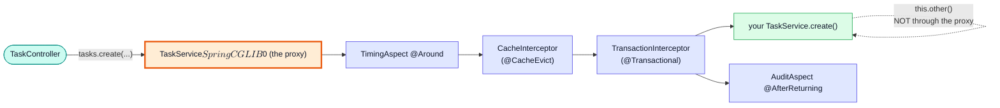
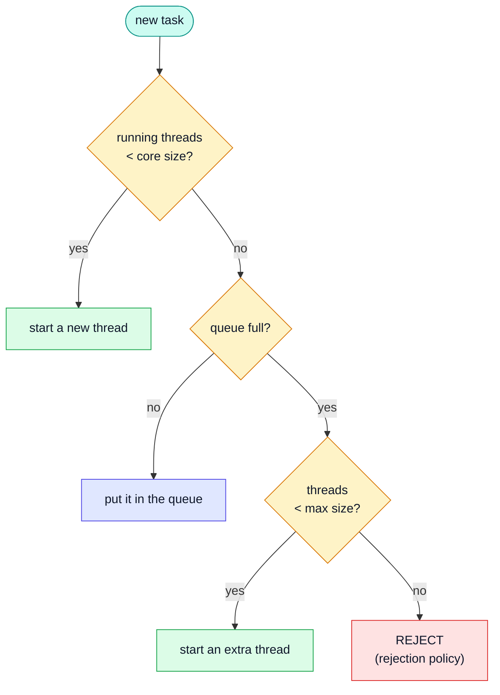
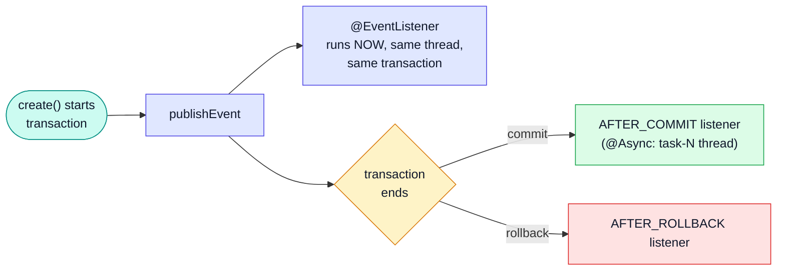
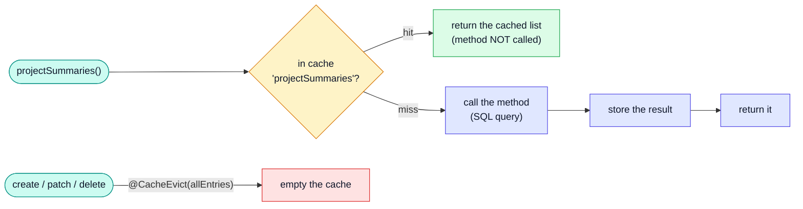

# Advanced Spring: AOP, @Async, Scheduling, Events, Caching, RestClient and Rate Limiting — Complete In-Depth Guide

**Spring Boot notes #13 of 18** · Priority 🟡 · Track: Spring Boot ([README](README.md))

The Task Tracker works, is secured (file 11) and observable (file 12). This file adds the tools for the **next layer**:

**Run code…**
- **…around many methods** without touching them: **AOP**.
- **…on other threads**: **`@Async`** and thread pools.
- **…on a timer**: **`@Scheduled`**.

**Decouple and speed up**
- **Decouple** parts of the app: **application events**.
- **Avoid repeated work**: **caching**.

**Talk to the outside, and protect yourself from it**
- **Call other services**: **`RestClient`** and HTTP interfaces.
- **Protect the API** from floods: **rate limiting**.

| You want… | Use |
|---|---|
| Logging, timing, auditing, security around many methods | `@Aspect` with `@Around` / `@AfterReturning` |
| Run a slow method without making the caller wait | `@Async` returning `CompletableFuture` |
| Control how many background jobs run | `ThreadPoolTaskExecutor` (core, queue, max, rejection) |
| Run something every N minutes / at 09:00 | `@Scheduled(fixedRate=…)` / `@Scheduled(cron=…)` |
| "When a task is created, also do X" without coupling | `ApplicationEventPublisher` + `@EventListener` |
| …but only if the transaction committed | `@TransactionalEventListener(phase = AFTER_COMMIT)` |
| Don't recompute the same expensive result | `@Cacheable` + Caffeine (one instance) or Redis (shared) |
| Call another HTTP API | `RestClient` (fluent) or an `@HttpExchange` interface |
| Limit requests per user | A token-bucket filter → `429 Too Many Requests` |

> [!NOTE]
> This topic isn't in Kunal's playlist, so there are no video timestamps. The reference playlist's AOP and `@Async` / `ThreadPoolExecutor` videos map here; see the [README](README.md#reference-playlist-where-each-video-is-covered).
>
> **What was run:** [`examples/13-advanced/`](examples/13-advanced/) (Task Tracker 0.13.0, schema `tracker13`) on Spring Boot 4.0.5 / Spring Framework 7.0.6 / Caffeine / PostgreSQL 18.3:
> - a `demo` profile covering all six topics, with an in-JVM stub HTTP service standing in for "another team's API";
> - a 15-request HTTP scenario (caching, audit, Actuator, rate limiting);
> - two configuration experiments (cache manager, default executor);
> - `./mvnw package` with 15 tests.
>
> **Not run:** Redis (not installed; the Redis setup is shown as configuration only) and ShedLock / distributed rate limiting (they need a shared store).

---

## Table of Contents

| # | Topic (anchor link) | Level |
|---|---|---|
| 0 | [Proxies: The Mechanism Behind Everything Here](#0-proxies-the-mechanism-behind-everything-here) | Basics |
| 1 | [AOP Concepts](#1-aop-concepts) | Core |
| 2 | [Writing Aspects](#2-writing-aspects) | In depth |
| 3 | [@Async and Thread Pools](#3-async-and-thread-pools) | In depth |
| 4 | [Scheduling](#4-scheduling) | Core |
| 5 | [Application Events](#5-application-events) | In depth |
| 6 | [Caching](#6-caching) | In depth |
| 7 | [Calling Other Services: RestClient and HTTP Interfaces](#7-calling-other-services-restclient-and-http-interfaces) | Core |
| 8 | [Rate Limiting](#8-rate-limiting) | Core |
| 9 | [Interview Questions](#9-interview-questions) | Interview |

---

## 0. Proxies: The Mechanism Behind Everything Here

`@Transactional` (file 09), `@PreAuthorize` (file 11), and this file's `@Async`, `@Cacheable` and custom aspects all work the **same way**. Spring doesn't inject your bean; it injects a **proxy**, a generated subclass that runs extra code before and after delegating to your object.

```
=== 1. AOP: proxies, @Around timing, @Audited
    TaskService bean is a proxy: true (TaskService$$SpringCGLIB$$0)
```



The interceptor order in the diagram is only an illustration. Unless aspects declare `@Order`, Spring doesn't guarantee it.

| Consequence | Why |
|---|---|
| **Self-invocation skips everything** | `this.method()` calls the real object, not the proxy ([Section 2.3](#23-the-self-invocation-trap-measured)) |
| Only **public** methods called from **outside** are reliably advised | Private methods can't be overridden; package-private works for CGLIB since Spring 6 |
| `final` classes / methods can't be proxied by CGLIB | A subclass can't override them |
| Order matters when several apply | Use `@Order` on aspects; `@EnableTransactionManagement(order=…)` etc. |

**JDK dynamic proxy vs CGLIB:** a JDK proxy implements the bean's interfaces; CGLIB subclasses the class. Spring Boot uses **CGLIB by default** (`spring.aop.proxy-target-class=true`), so injecting the concrete class always works. That's why the name ends in `$$SpringCGLIB$$0`.

---

## 1. AOP Concepts

**Aspect-Oriented Programming** keeps **cross-cutting concerns** out of business code: logging, timing, auditing, security, transactions, retries. Without AOP, every service method would repeat the same boilerplate.

| Term | Meaning | Here |
|---|---|---|
| **Aspect** | A class holding cross-cutting logic | `TimingAspect`, `AuditAspect` |
| **Join point** | A point where advice *can* run; in Spring AOP always a **method execution** | `TaskService.create(..)` |
| **Pointcut** | An expression choosing join points | `within(com.notes.tasks.service..*)` |
| **Advice** | The code to run, and when | `@Around`, `@AfterReturning` |
| **Weaving** | Linking aspects into code | Spring: at runtime, with proxies |
| **Target** | The real object behind the proxy | your `TaskService` |

| Advice | Runs | Can… |
|---|---|---|
| `@Before` | Before the method | Inspect args; throw to stop the call |
| `@AfterReturning` | After a normal return | Read the result (`returning = "r"`) |
| `@AfterThrowing` | After an exception | Read the exception (`throwing = "ex"`); it still propagates |
| `@After` | After either (like `finally`) | Clean up |
| **`@Around`** | Instead of the method | Call `pjp.proceed()` (or not), change args/result, time it, retry, catch |

| Pointcut designator | Matches | Example |
|---|---|---|
| `execution(...)` | Method signatures | `execution(public * com.notes..service.*.*(..))` |
| `within(...)` | All methods of types in a package/class | `within(com.notes.tasks.service..*)` |
| `@annotation(...)` | Methods carrying an annotation | `@annotation(audited)` (binds it to a parameter) |
| `@within(...)` | Types carrying an annotation | `@within(org.springframework.stereotype.Service)` |
| `bean(...)` | Spring bean names (Spring-only) | `bean(*Service)` |
| `args(...)`, `this`, `target` | Argument / proxy / target types | `args(long, ..)` |
| `&&`, `\|\|`, `!` | Combine | `serviceLayer() && execution(public * *(..))` |

In `execution(public * com.notes..service.*.*(..))`: `*` is any return type, `..` in a package is any sub-packages, `.*.*` is any class and any method, and `(..)` is any arguments.

**Spring AOP vs AspectJ:** Spring AOP uses proxies, intercepts method executions on Spring beans only, and needs no special compiler. Full **AspectJ** weaves bytecode (at compile or load time) and can intercept field access, constructors, private methods and self-calls. Spring uses AspectJ's **annotations and pointcut language** but not its weaver.

> [!NOTE]
> **Boot 4 renamed the starter:** `spring-boot-starter-aop` has no 4.x release; use **`spring-boot-starter-aspectj`** (it brings `aspectjweaver` for the annotations and pointcut parser).

---

## 2. Writing Aspects

### 2.1 `@Around`: timing every service method

```java
package com.notes.tasks.aop;

import org.aspectj.lang.ProceedingJoinPoint;
import org.aspectj.lang.annotation.Around;
import org.aspectj.lang.annotation.Aspect;
import org.aspectj.lang.annotation.Pointcut;
import org.slf4j.Logger;
import org.slf4j.LoggerFactory;
import org.springframework.beans.factory.annotation.Value;
import org.springframework.stereotype.Component;

/** Cross-cutting concern #2: time every public method of the service layer; warn about slow ones. */
@Aspect
@Component
public class TimingAspect {
    private static final Logger log = LoggerFactory.getLogger(TimingAspect.class);
    private final long slowMs;

    public TimingAspect(@Value("${app.slow-call-ms:200}") long slowMs) {
        this.slowMs = slowMs;
    }

    /** A named, reusable pointcut: any type in the service package (and sub-packages). */
    @Pointcut("within(com.notes.tasks.service..*)")
    void serviceLayer() {}

    @Around("serviceLayer() && execution(public * *(..))")
    public Object time(ProceedingJoinPoint pjp) throws Throwable {
        long start = System.nanoTime();
        try {
            return pjp.proceed();                                   // call the real method
        } finally {                                                 // also when it throws
            long ms = (System.nanoTime() - start) / 1_000_000;
            if (ms >= slowMs) log.warn("SLOW {} took {} ms", pjp.getSignature().toShortString(), ms);
            else log.debug("{} took {} ms", pjp.getSignature().toShortString(), ms);
        }
    }
}
```

```
2026-11-17T03:20:12.154+05:30  WARN 14096 --- [task-tracker] [           main] [] com.notes.tasks.aop.TimingAspect         : SLOW TaskService.get(..) took 206 ms
```

The first call was slow (cold JIT, first query); later calls took a few ms (`TaskService.create(..) took 3 ms`). The service code itself contains no timing code.

### 2.2 A custom annotation + `@AfterReturning`: an audit trail

```java
package com.notes.tasks.aop;

import java.lang.annotation.ElementType;
import java.lang.annotation.Retention;
import java.lang.annotation.RetentionPolicy;
import java.lang.annotation.Target;

/** Marks a method whose successful calls are written to the activity log by AuditAspect. */
@Target(ElementType.METHOD)
@Retention(RetentionPolicy.RUNTIME)          // must survive to runtime: the aspect reads it via reflection
public @interface Audited {
    String value();                          // the action name, e.g. "create task"
}
```

```java
package com.notes.tasks.aop;

import com.notes.tasks.service.ActivityService;
import org.aspectj.lang.JoinPoint;
import org.aspectj.lang.annotation.AfterReturning;
import org.aspectj.lang.annotation.AfterThrowing;
import org.aspectj.lang.annotation.Aspect;
import org.slf4j.Logger;
import org.slf4j.LoggerFactory;
import org.springframework.security.core.Authentication;
import org.springframework.security.core.context.SecurityContextHolder;
import org.springframework.stereotype.Component;

/** Cross-cutting concern #1: an audit trail for every method annotated with @Audited. */
@Aspect
@Component
public class AuditAspect {
    private static final Logger log = LoggerFactory.getLogger(AuditAspect.class);
    private final ActivityService activity;

    public AuditAspect(ActivityService activity) {
        this.activity = activity;
    }

    /** Runs only when the method RETURNED normally. "audited" binds the annotation instance. */
    @AfterReturning("@annotation(audited)")
    public void success(JoinPoint jp, Audited audited) {
        activity.record(audited.value() + " by " + caller() + " via " + jp.getSignature().toShortString());
    }

    /** Runs only when the method THREW. The exception still propagates to the caller. */
    @AfterThrowing(pointcut = "@annotation(audited)", throwing = "ex")
    public void failure(Audited audited, Exception ex) {
        log.warn("audit: '{}' by {} failed: {}", audited.value(), caller(), ex.getMessage());
    }

    private static String caller() {
        Authentication auth = SecurityContextHolder.getContext().getAuthentication();
        return auth == null ? "system" : auth.getName();
    }
}
```

`TaskService.create` and `delete` carry `@Audited("create task")` / `@Audited("delete task")`. From the HTTP run:

```
# The audit trail
> GET /api/activity  [Bearer asha]
```

returned `"message": "create task by asha via TaskService.create(..)"`.

### 2.3 The self-invocation trap, measured

```java
package com.notes.tasks.service;

import com.notes.tasks.aop.Audited;
import org.springframework.stereotype.Service;

/** Shows the proxy rule: advice runs only for calls that come through the proxy. */
@Service
public class ExportService {

    @Audited("export project")
    public String exportProject(long projectId) {
        return "project-" + projectId + ".csv";
    }

    /** Calls exportProject on "this" (the real object), not on the proxy: NO audit entries. */
    public int exportAll() {
        exportProject(1);
        exportProject(2);
        return 2;
    }
}
```

```
    exportProject(3) directly -> audit rows added: 1
    exportAll() (self-invocation x2) -> audit rows added: 0
```

Fixes: move the method to another bean (cleanest), inject the bean into itself lazily (`@Lazy` self-injection), or use AspectJ weaving.

> [!WARNING]
> **An audit row survived a rollback.** In the events demo ([Section 5](#5-application-events)), a task was created inside a transaction that was then rolled back: the task was never saved, yet the audit row `create task by asha` was written. `ActivityService.record` runs in `REQUIRES_NEW` (file 09), so it commits independently of the caller. That's right for *"someone tried"* logs. For *"this happened"*, record inside the same transaction, or from an `AFTER_COMMIT` listener.

---

## 3. @Async and Thread Pools

`@EnableAsync` + `@Async` on a public method of a bean: the proxy hands the call to an **executor** and returns immediately.

| Return type | Caller gets |
|---|---|
| `void` | Nothing; exceptions go to an `AsyncUncaughtExceptionHandler` |
| `CompletableFuture<T>` | A future to `join()`, combine (`allOf`) or chain (`thenApply`) |
| `Future<T>` | An old-style future (prefer `CompletableFuture`) |

```java
package com.notes.tasks.async;

import org.slf4j.Logger;
import org.slf4j.LoggerFactory;
import org.springframework.scheduling.annotation.Async;
import org.springframework.stereotype.Service;

import java.util.concurrent.CompletableFuture;

@Service
public class ReportJobs {
    private static final Logger log = LoggerFactory.getLogger(ReportJobs.class);

    /** Runs on the "report-" pool; the caller gets a CompletableFuture immediately. */
    @Async("reportExecutor")
    public CompletableFuture<String> buildReport(String name, long millis) {
        sleep(millis);                                            // pretend to crunch numbers
        return CompletableFuture.completedFuture(name + " built on " + Thread.currentThread().getName());
    }

    /** No executor named: Spring picks the default one. Fire-and-forget (void). */
    @Async
    public void sendDigest(String recipient) {
        log.info("digest for '{}' on {}", recipient, Thread.currentThread());
        if (recipient.isBlank()) throw new IllegalArgumentException("no recipient");
    }

    private static void sleep(long millis) {
        try {
            Thread.sleep(millis);
        } catch (InterruptedException e) {
            Thread.currentThread().interrupt();
        }
    }
}
```

```
=== 4. @Async with a bounded ThreadPoolTaskExecutor
    3 calls returned after 1 ms (futures, not results)
    all done after 1018 ms: [weekly built on report-1, monthly built on report-2, yearly built on report-1]
```

Three 500 ms jobs on a pool of **2 core threads**: two ran in parallel, the third waited for a free thread, so the total was ~1 s rather than 1.5 s (sequential) or 0.5 s (unlimited).

### 3.1 How a `ThreadPoolExecutor` grows



> [!IMPORTANT]
> The queue fills **before** extra threads start. With an unbounded queue (`ThreadPoolTaskExecutor`'s default capacity is `Integer.MAX_VALUE`), `maxPoolSize` is **never used**, and the queue can grow until memory runs out. Always bound it.

```java
package com.notes.tasks.async;

import org.springframework.context.annotation.Bean;
import org.springframework.context.annotation.Configuration;
import org.springframework.scheduling.annotation.EnableAsync;
import org.springframework.scheduling.annotation.EnableScheduling;
import org.springframework.scheduling.concurrent.ThreadPoolTaskExecutor;

import java.util.concurrent.ThreadPoolExecutor;

@Configuration
@EnableAsync                                   // @Async methods run on an executor, through a proxy
@EnableScheduling                              // @Scheduled methods run on the task scheduler
public class AsyncConfig {

    /**
     * A bounded pool for slow report jobs, separate from request handling.
     * How a ThreadPoolExecutor grows: core threads first, then the QUEUE fills, then up to max threads,
     * then the rejection policy. Here: 2 core + 2 queued + 2 extra = 6 jobs at once; the 7th is rejected.
     */
    @Bean
    ThreadPoolTaskExecutor reportExecutor() {
        ThreadPoolTaskExecutor ex = new ThreadPoolTaskExecutor();
        ex.setCorePoolSize(2);
        ex.setMaxPoolSize(4);
        ex.setQueueCapacity(2);
        ex.setThreadNamePrefix("report-");
        ex.setRejectedExecutionHandler(new ThreadPoolExecutor.AbortPolicy());   // throw when full
        ex.setWaitForTasksToCompleteOnShutdown(true);       // graceful: finish running jobs on shutdown...
        ex.setAwaitTerminationSeconds(10);                  // ...but wait at most 10 s
        return ex;                                          // Spring calls initialize() for us
    }
}
```

Eight one-second jobs, submitted at once:

```
    -- submit 8 one-second jobs to a pool of core 2 / queue 2 / max 4:
    job 1 accepted: threads=2 queued=1
    job 2 accepted: threads=2 queued=1
    job 3 accepted: threads=2 queued=1
    job 4 accepted: threads=2 queued=2
    job 5 accepted: threads=3 queued=2
    job 6 accepted: threads=4 queued=2
    job 7 REJECTED (TaskRejectedException)
    job 8 REJECTED (TaskRejectedException)
```

Jobs 1–3: the two core threads already existed (from the reports), so each job went into the queue and an idle core thread took it. That's why `queued` shows 1 for a moment. Job 4 filled the queue (2), jobs 5–6 started extra threads 3 and 4, and job 7 found everything full: rejected.

| Rejection policy | When full |
|---|---|
| `AbortPolicy` (default) | Throw `RejectedExecutionException` (Spring: `TaskRejectedException`) |
| `CallerRunsPolicy` | Run it on the **caller's** thread: natural back-pressure |
| `DiscardPolicy` / `DiscardOldestPolicy` | Silently drop the new / the oldest task |

### 3.2 Which executor runs a plain `@Async`? (a real surprise)

Boot auto-configures an `applicationTaskExecutor`; with virtual threads on it is a `SimpleAsyncTaskExecutor` making virtual threads named `task-N`. **But** with the default `spring.task.execution.mode: auto`, it **backs off as soon as you define any `Executor` bean**, like `reportExecutor`. Spring then found no unique default, and plain `@Async` fell back to a new **platform** thread per call:

```
2026-11-17T03:17:42.519+05:30  INFO 5392 --- [task-tracker] [cTaskExecutor-1] [] c.notes.tasks.events.TaskEventListeners  : [after commit] notify watchers about 'Plan the retro' (on Thread[#47,SimpleAsyncTaskExecutor-1,5,main])
2026-11-17T03:17:43.161+05:30  INFO 5392 --- [task-tracker] [cTaskExecutor-2] [] c.notes.tasks.events.TaskEventListeners  : [after commit] notify watchers about 'Update the roadmap' (on Thread[#56,SimpleAsyncTaskExecutor-2,5,main])
2026-11-17T03:17:46.321+05:30  INFO 5392 --- [task-tracker] [cTaskExecutor-4] [] com.notes.tasks.async.ReportJobs         : digest for '' on Thread[#65,SimpleAsyncTaskExecutor-4,5,main]
2026-11-17T03:17:46.321+05:30  INFO 5392 --- [task-tracker] [cTaskExecutor-3] [] com.notes.tasks.async.ReportJobs         : digest for 'team' on Thread[#64,SimpleAsyncTaskExecutor-3,5,main]
2026-11-17T03:17:46.322+05:30 ERROR 5392 --- [task-tracker] [cTaskExecutor-4] [] c.notes.tasks.async.AsyncErrorHandling   : @Async sendDigest failed: no recipient
```

With `spring.task.execution.mode: force` (the project's setting), Boot keeps its executor and plain `@Async` runs on virtual threads:

```
2026-11-17T03:20:16.232+05:30  INFO 14096 --- [task-tracker] [         task-3] [] com.notes.tasks.async.ReportJobs         : digest for 'team' on VirtualThread[#64,task-3]/runnable@ForkJoinPool-1-worker-3
```

> [!CAUTION]
> A second surprise while switching to `force`: startup failed with `Illegal factory instance for factory method 'reportExecutor'; instance: ...ApplicationTaskExecutorAsyncConfigurer`. In `force` mode Boot **wraps** your `AsyncConfigurer` bean, so that the default executor is its own while your exception handler is kept. The first version had `implements AsyncConfigurer` on the same `@Configuration` class that declared `@Bean reportExecutor()`, and the wrapper replaced that configuration object. Keep the `AsyncConfigurer` in its own class:

```java
package com.notes.tasks.async;

import org.slf4j.Logger;
import org.slf4j.LoggerFactory;
import org.springframework.aop.interceptor.AsyncUncaughtExceptionHandler;
import org.springframework.scheduling.annotation.AsyncConfigurer;
import org.springframework.stereotype.Component;

/**
 * Exceptions from void @Async methods have no caller to reach: they end up here.
 * Kept in its own class ON PURPOSE: with spring.task.execution.mode=force, Boot wraps the AsyncConfigurer
 * bean (to default to its applicationTaskExecutor). A @Configuration with @Bean methods must not be that bean.
 */
@Component
public class AsyncErrorHandling implements AsyncConfigurer {
    private static final Logger log = LoggerFactory.getLogger(AsyncErrorHandling.class);

    @Override
    public AsyncUncaughtExceptionHandler getAsyncUncaughtExceptionHandler() {
        return (ex, method, params) ->
                log.error("@Async {} failed: {}", method.getName(), ex.getMessage());
    }
}
```

```
2026-11-17T03:20:16.234+05:30 ERROR 14096 --- [task-tracker] [         task-4] [] c.notes.tasks.async.AsyncErrorHandling   : @Async sendDigest failed: no recipient
```

| `@Async` rule | Detail |
|---|---|
| Needs the proxy | Public method, called from another bean; self-calls run synchronously |
| `SecurityContext`, MDC, transactions | Thread-bound, so they **don't** follow to the new thread (use a `TaskDecorator`; a transaction must start inside the async method) |
| Choose the executor | `@Async("reportExecutor")`; separate pools isolate slow jobs from each other |
| Shutdown | `setWaitForTasksToCompleteOnShutdown(true)` + `setAwaitTerminationSeconds` |
| Virtual threads | Good for waiting jobs; a thread pool still makes sense when you want to **limit** concurrency (or use a `Semaphore`) |

---

## 4. Scheduling

`@EnableScheduling` + `@Scheduled` on a no-argument bean method:

```java
package com.notes.tasks.async;

import com.notes.tasks.repo.TaskRepository;
import org.slf4j.Logger;
import org.slf4j.LoggerFactory;
import org.springframework.scheduling.annotation.Scheduled;
import org.springframework.stereotype.Component;

import java.time.Clock;
import java.time.LocalDate;

@Component
public class OverdueReminder {
    private static final Logger log = LoggerFactory.getLogger(OverdueReminder.class);
    private final TaskRepository tasks;
    private final Clock clock;

    public OverdueReminder(TaskRepository tasks, Clock clock) {
        this.tasks = tasks;
        this.clock = clock;
    }

    /** Every app.reminder.rate (an ISO-8601 duration), counted from the START of the previous run. */
    @Scheduled(fixedRateString = "${app.reminder.rate:PT1H}", initialDelayString = "${app.reminder.rate:PT1H}")
    public void remindOverdue() {
        long overdue = tasks.countByDoneFalseAndDueDateBefore(LocalDate.now(clock));
        log.info("reminder: {} overdue tasks (on {})", overdue, Thread.currentThread());
    }

    /** Cron: second minute hour day-of-month month day-of-week. 09:00 on weekdays, India time. */
    @Scheduled(cron = "0 0 9 * * MON-FRI", zone = "Asia/Kolkata")
    public void morningDigest() {
        log.info("morning digest");
    }
}
```

```
2026-11-17T03:20:12.924+05:30  INFO 14096 --- [task-tracker] [   scheduling-2] [] com.notes.tasks.async.OverdueReminder    : reminder: 3 overdue tasks (on VirtualThread[#49,scheduling-2]/runnable@ForkJoinPool-1-worker-2)
```

| Attribute | Meaning |
|---|---|
| `fixedRate` | Start every N, counted from the previous **start** |
| `fixedDelay` | Wait N after the previous run **ended** (never overlaps) |
| `initialDelay` | Wait before the first run |
| `cron = "0 0 9 * * MON-FRI"` | 6 fields: second minute hour day-of-month month day-of-week |
| `zone = "Asia/Kolkata"` | Time zone of the cron (default: the server's) |
| `…String` variants | Read from properties: `"${app.reminder.rate:PT1H}"` (ISO-8601 durations like `PT1S`) |

| Gotcha | Explanation |
|---|---|
| One scheduler thread by default (`spring.task.scheduling.pool.size: 1`) | A slow job delays all others. Here, with virtual threads, each run got its own `scheduling-N` virtual thread |
| Exceptions | Logged, and the schedule continues |
| **Several instances = several runs** | Three app instances run the job three times. Use **ShedLock** (a lock row in the DB) or a single dedicated worker (not run here) |
| Long jobs | Prefer `fixedDelay`, or hand off to `@Async` |

`GET /actuator/scheduledtasks` lists them:

```
      "expression": "0 0 9 * * MON-FRI",
        "target": "com.notes.tasks.async.OverdueReminder.morningDigest"
      "initialDelay": 3600000,
      "interval": 3600000,
        "target": "com.notes.tasks.async.OverdueReminder.remindOverdue"
```

---

## 5. Application Events

Events let one component announce *"this happened"* without knowing who reacts. `TaskService` publishes; listeners in other packages react. This is the observer pattern, provided by the `ApplicationContext`.

```java
package com.notes.tasks.events;

/** An application event is any object. A record keeps it immutable and small (ids, not entities). */
public record TaskCreatedEvent(long taskId, String title, String createdBy) {}
```

```java
events.publishEvent(new TaskCreatedEvent(t.getId(), t.getTitle(), currentUsername()));
```

```java
package com.notes.tasks.events;

import org.slf4j.Logger;
import org.slf4j.LoggerFactory;
import org.springframework.context.event.EventListener;
import org.springframework.scheduling.annotation.Async;
import org.springframework.stereotype.Component;
import org.springframework.transaction.event.TransactionPhase;
import org.springframework.transaction.event.TransactionalEventListener;
import org.springframework.transaction.support.TransactionSynchronizationManager;

/** The publisher (TaskService) doesn't know these listeners exist: loose coupling. */
@Component
public class TaskEventListeners {
    private static final Logger log = LoggerFactory.getLogger(TaskEventListeners.class);

    /** Plain listener: runs IMMEDIATELY, on the publisher's thread, inside its transaction. */
    @EventListener
    public void onCreated(TaskCreatedEvent e) {
        log.info("[sync] task {} created; in a transaction: {}", e.taskId(),
                TransactionSynchronizationManager.isActualTransactionActive());
    }

    /** Runs only after the transaction COMMITTED (the task really exists), here on another thread. */
    @Async
    @TransactionalEventListener(phase = TransactionPhase.AFTER_COMMIT)
    public void notifyAfterCommit(TaskCreatedEvent e) {
        log.info("[after commit] notify watchers about '{}' (on {})", e.title(), Thread.currentThread());
    }

    @TransactionalEventListener(phase = TransactionPhase.AFTER_ROLLBACK)
    public void onRollback(TaskCreatedEvent e) {
        log.info("[after rollback] task {} was never saved: no notification", e.taskId());
    }
}
```

```
=== 2. Events: @EventListener vs @TransactionalEventListener
    -- create a task (commits):
2026-11-17T03:20:12.423+05:30  INFO 14096 --- [task-tracker] [           main] [] com.notes.tasks.service.TaskService      : Created task 13 'Plan the retro' in project 1
2026-11-17T03:20:12.425+05:30  INFO 14096 --- [task-tracker] [           main] [] c.notes.tasks.events.TaskEventListeners  : [sync] task 13 created; in a transaction: true
```

```
2026-11-17T03:20:12.433+05:30  INFO 14096 --- [task-tracker] [         task-1] [] c.notes.tasks.events.TaskEventListeners  : [after commit] notify watchers about 'Plan the retro' (on VirtualThread[#47,task-1]/runnable@ForkJoinPool-1-worker-1)
    -- create a task inside a transaction that is rolled back:
```

```
2026-11-17T03:20:12.745+05:30  INFO 14096 --- [task-tracker] [           main] [] c.notes.tasks.events.TaskEventListeners  : [after rollback] task 14 was never saved: no notification
```



| Listener | Runs | Use for |
|---|---|---|
| `@EventListener` | Immediately, synchronously, **inside** the publisher's transaction; an exception fails the publisher | Validation, updating related data atomically |
| `@TransactionalEventListener` (default `AFTER_COMMIT`) | Only if the transaction **committed** | Emails, notifications, cache updates, messages to other systems |
| `… (phase = AFTER_ROLLBACK / AFTER_COMPLETION / BEFORE_COMMIT)` | On rollback / either / just before commit | Compensation, cleanup |
| `+ @Async` | On another thread | Slow side effects that shouldn't delay the response |
| `@Order` | Listener order | |
| `@EventListener(condition = "#e.title.startsWith('Urgent')")` | Only when the SpEL condition is true | |

> [!WARNING]
> Events live **in memory**. If the app crashes after the commit but before the `AFTER_COMMIT` listener sends its email, the email is lost. For guaranteed delivery, write an "outbox" row in the **same transaction** and let a scheduler or messaging relay send it (Spring Modulith's event publication registry does this; file 16 covers messaging).

---

## 6. Caching

The **cache abstraction**: annotate methods, and Spring checks the cache before calling them (cache-aside).



| Annotation | Effect |
|---|---|
| `@EnableCaching` | Turns the interceptors on |
| `@Cacheable("name")` | Return the cached value if present; otherwise call and store |
| `@Cacheable(cacheNames = "openTasks", key = "#username")` | Explicit key (SpEL); the default key is built from all arguments |
| `condition = "#id > 0"` / `unless = "#result == null"` | Cache only sometimes |
| `@CachePut` | Always call **and** update the cache |
| `@CacheEvict(allEntries = true)` / `key = "#id"` | Remove entries (after the method by default; `beforeInvocation = true` to do it first) |
| `@Caching(...)`, `@CacheConfig(cacheNames=…)` | Combine several / class-level defaults |

```java
@Cacheable("projectSummaries")
public List<ProjectSummary> projectSummaries() {
    log.info("cache miss: loading project summaries from the database");
```

```java
@Cacheable(cacheNames = "openTasks", key = "#username")          // one entry per username
public int openTasksOf(String username) {
```

```java
@Audited("create task")
@CacheEvict(cacheNames = {"projectSummaries", "openTasks"}, allEntries = true)   // counts changed
@Transactional
public TaskResponse create(long projectId, CreateTaskRequest req) {
```

From the demo:

```
    CacheManager: CaffeineCacheManager [openTasks, projectSummaries]
2026-11-17T03:20:13.061+05:30  INFO 14096 --- [task-tracker] [           main] [] com.notes.tasks.jdbc.ReportDao           : cache miss: loading project summaries from the database
    projectSummaries() call 1: 2 projects
    projectSummaries() call 2: 2 projects
    projectSummaries() call 3: 2 projects
```

…and after a create (eviction), one more miss: `CacheStats{hitCount=2, missCount=2, ...}`.

### 6.1 Which cache provider? (a real failure)

Boot picks a `CacheManager` by checking providers **in order**: Generic, **JCache**, Hazelcast, Couchbase, Infinispan, Redis, **Caffeine**, Cache2k, Simple. File 08 put `hibernate-jcache` + Caffeine's JCache module on the classpath for Hibernate's second-level cache. So Boot chose **JCache**, which had no caches defined, and the first `@CacheEvict` crashed:

```
java.lang.IllegalArgumentException: Cannot find cache named 'projectSummaries' for Builder[public com.notes.tasks.dto.TaskDtos$TaskResponse com.notes.tasks.service.TaskService.create(long,com.notes.tasks.dto.TaskDtos$CreateTaskRequest)] caches=[projectSummaries, openTasks] | key='' | keyGenerator='' | cacheManager='' | cacheResolver='' | condition='',true,false
```

`/actuator/beans` confirmed the choice:

```
# Which CacheManager did Boot create?
> GET /actuator/beans  [Basic asha:***]
< 200  [application/json]
        "cacheManager": {
            "jCacheCacheManager"
          "type": "org.springframework.cache.jcache.JCacheCacheManager"
        "jCacheCacheManager": {
            "cacheManager",
  (5 of 4728 lines shown)

# Caches it knows
> GET /actuator/caches  [Basic asha:***]
< 200  [application/json]
{
  "cacheManagers": {}
}
```

The fix is to say what you want:

```yaml
  cache:
    type: caffeine                        # explicit: hibernate-jcache is on the classpath, and Boot
                                          # would otherwise pick JCache (with no caches defined)
    cache-names: projectSummaries, openTasks
    caffeine:
      spec: maximumSize=500,expireAfterWrite=10m,recordStats   # bounded + expiring + hit/miss stats
```

`recordStats` also feeds Micrometer: `/actuator/metrics/cache.gets?tag=cache:projectSummaries` shows `result` = `hit` / `miss`.

### 6.2 Local vs distributed: Caffeine vs Redis

| | Caffeine (this project) | Redis |
|---|---|---|
| Where | In the JVM's heap | A separate server |
| Speed | Nanoseconds | ~0.5 ms network round trip |
| Shared between instances | **No**: each instance has its own copy; evictions on one don't reach the others | **Yes** |
| Survives restart | No | Yes (optionally persisted) |
| Values | Java objects (by reference!) | Serialized (JSON / JDK) |

Redis with Spring Boot (**not run**, no Redis server here):

```xml
<dependency>
    <groupId>org.springframework.boot</groupId>
    <artifactId>spring-boot-starter-data-redis</artifactId>
</dependency>
```

```yaml
spring:
  cache:
    type: redis
    redis:
      time-to-live: 10m
  data:
    redis:
      host: localhost
      port: 6379
```

Cached values must then be serializable (configure a JSON serializer via `RedisCacheConfiguration`), and every instance sees the same cache.

| Caching pitfall | Advice |
|---|---|
| **Stale data** | Always pair `@Cacheable` with `@CacheEvict`/`@CachePut` on writes, plus a TTL as a safety net |
| Eviction vs commit | `@CacheEvict` runs when the method returns, which may be **before** the transaction commits; another request can re-cache old data in between. Short TTLs or `TransactionAwareCacheManagerProxy` help |
| Caching mutable objects (Caffeine) | Callers get the **same** instance; changing it changes the cache. Cache immutable records |
| Self-invocation | Same proxy rule: `this.cachedMethod()` is never cached |
| Unbounded caches | Always set `maximumSize` / TTL |
| Caching per user data | Include the user in the key, or you leak data between users |

---

## 7. Calling Other Services: RestClient and HTTP Interfaces

| Client | Style | Status |
|---|---|---|
| `RestTemplate` | Synchronous, template methods (`getForObject`) | Maintenance mode; still works |
| **`RestClient`** (Spring 6.1+) | Synchronous, **fluent** | Recommended for blocking apps (with virtual threads, the natural choice) |
| `WebClient` | Reactive, non-blocking | For WebFlux / reactive apps |
| **HTTP interfaces** (`@HttpExchange`) | Declarative: write an interface, Spring implements it | Built on `RestClient` or `WebClient` |

Boot 4 auto-configures a `RestClient.Builder` (Jackson converters, observations) through the new **`spring-boot-starter-restclient`**.

```java
package com.notes.tasks.client;

import org.springframework.beans.factory.annotation.Value;
import org.springframework.core.ParameterizedTypeReference;
import org.springframework.http.HttpStatusCode;
import org.springframework.http.client.SimpleClientHttpRequestFactory;
import org.springframework.stereotype.Component;
import org.springframework.web.client.RestClient;

import java.time.Duration;
import java.time.LocalDate;
import java.util.List;

/** Calls another HTTP service (a public-holiday API) with RestClient: fluent, synchronous. */
@Component
public class HolidayClient {
    public record Holiday(LocalDate date, String name) {}

    private final RestClient http;

    public HolidayClient(RestClient.Builder builder,                    // Boot's builder: Jackson, observations
                         @Value("${app.holidays.base-url}") String baseUrl) {
        SimpleClientHttpRequestFactory factory = new SimpleClientHttpRequestFactory();
        factory.setConnectTimeout(Duration.ofSeconds(1));               // never wait forever on another service
        factory.setReadTimeout(Duration.ofSeconds(1));
        this.http = builder
                .baseUrl(baseUrl)
                .requestFactory(factory)
                .defaultHeader("Accept", "application/json")
                .build();
    }

    public List<Holiday> holidays(int year) {
        return http.get()
                .uri("/holidays/{year}", year)                           // URI template, value encoded for us
                .retrieve()
                .onStatus(HttpStatusCode::is5xxServerError, (req, res) -> {
                    throw new HolidayServiceException("holiday service answered " + res.getStatusCode());
                })
                .body(new ParameterizedTypeReference<List<Holiday>>() {}); // JSON array -> List<Holiday>
    }

    public static class HolidayServiceException extends RuntimeException {
        public HolidayServiceException(String message) {
            super(message);
        }
    }
}
```

**The HTTP interface** for the same API:

```java
package com.notes.tasks.client;

import com.notes.tasks.client.HolidayClient.Holiday;
import org.springframework.web.bind.annotation.PathVariable;
import org.springframework.web.service.annotation.GetExchange;
import org.springframework.web.service.annotation.HttpExchange;

import java.util.List;

/** HTTP interface: declare the remote API as a Java interface; Spring generates the implementation. */
@HttpExchange("/holidays")
public interface HolidayApi {

    @GetExchange("/{year}")
    List<Holiday> holidays(@PathVariable int year);
}
```

```java
package com.notes.tasks.client;

import org.springframework.beans.factory.annotation.Value;
import org.springframework.context.annotation.Bean;
import org.springframework.context.annotation.Configuration;
import org.springframework.web.client.RestClient;
import org.springframework.web.client.support.RestClientAdapter;
import org.springframework.web.service.invoker.HttpServiceProxyFactory;

@Configuration
public class ClientConfig {

    /** Turns the HolidayApi interface into a working client backed by a RestClient. */
    @Bean
    HolidayApi holidayApi(RestClient.Builder builder, @Value("${app.holidays.base-url}") String baseUrl) {
        RestClient client = builder.baseUrl(baseUrl).build();
        return HttpServiceProxyFactory.builderFor(RestClientAdapter.create(client))
                .build()
                .createClient(HolidayApi.class);
    }
}
```

Against a stub "holiday service" (a JDK `HttpServer` started by the demo on port 8089):

```
=== 6. RestClient and an HTTP interface against a stub service
    RestClient 2026: [Holiday[date=2026-01-26, name=Republic Day], Holiday[date=2026-08-15, name=Independence Day]]
    HTTP interface 2026: [Holiday[date=2026-01-26, name=Republic Day], Holiday[date=2026-08-15, name=Independence Day]]
    1999 -> HolidayServiceException: holiday service answered 503 SERVICE_UNAVAILABLE
    2030 -> ResourceAccessException: I/O error on GET request for "http://localhost:8089/holidays/2030": Read timed out
```

| Situation | What happens | Lesson |
|---|---|---|
| 200 + JSON array | Converted to `List<Holiday>` | `ParameterizedTypeReference` for generic types |
| 503 | Our `onStatus` handler → `HolidayServiceException` | Without it: `HttpServerErrorException`; 4xx → `HttpClientErrorException` |
| Server takes 3 s | `ResourceAccessException ... Read timed out` after 1 s | **Always set timeouts**; the defaults can wait a very long time |

Next steps (not run): retries with backoff and circuit breakers (Spring Retry, Resilience4j). File 17 covers service-to-service calls.

---

## 8. Rate Limiting

A rate limiter protects the API (and the database behind it) from one client sending too much: bugs, scrapers, brute-force attempts. The **token bucket** is the common algorithm. Each client has a bucket of `capacity` tokens; a request takes one; tokens refill at a steady rate. It allows short bursts but limits the average.

```java
package com.notes.tasks.ratelimit;

import jakarta.servlet.FilterChain;
import jakarta.servlet.ServletException;
import jakarta.servlet.http.HttpServletRequest;
import jakarta.servlet.http.HttpServletResponse;
import org.springframework.beans.factory.annotation.Value;
import org.springframework.security.core.Authentication;
import org.springframework.security.core.context.SecurityContextHolder;
import org.springframework.stereotype.Component;
import org.springframework.web.filter.OncePerRequestFilter;

import java.io.IOException;
import java.util.Map;
import java.util.concurrent.ConcurrentHashMap;

/**
 * Token-bucket rate limiting per caller for /api/**. Each caller has a bucket of `capacity` tokens;
 * a request takes one; tokens come back at `refillPerSecond`. Empty bucket -> 429 Too Many Requests.
 * Registered without @Order, so it runs AFTER Spring Security's filter: the caller is already known.
 * In-memory: limits are per instance. Several instances need a shared store (Redis, Bucket4j).
 */
@Component
public class RateLimitFilter extends OncePerRequestFilter {
    private final int capacity;
    private final double refillPerSecond;
    private final Map<String, TokenBucket> buckets = new ConcurrentHashMap<>();

    public RateLimitFilter(@Value("${app.rate-limit.capacity:20}") int capacity,
                           @Value("${app.rate-limit.refill-per-second:5}") double refillPerSecond) {
        this.capacity = capacity;
        this.refillPerSecond = refillPerSecond;
    }

    @Override
    protected boolean shouldNotFilter(HttpServletRequest request) {
        return !request.getRequestURI().startsWith("/api/");
    }

    @Override
    protected void doFilterInternal(HttpServletRequest req, HttpServletResponse res, FilterChain chain)
            throws ServletException, IOException {
        Authentication auth = SecurityContextHolder.getContext().getAuthentication();
        String key = auth != null && auth.isAuthenticated() ? "user:" + auth.getName() : "ip:" + req.getRemoteAddr();
        TokenBucket bucket = buckets.computeIfAbsent(key, k -> new TokenBucket(capacity, refillPerSecond));
        long waitSeconds = bucket.tryTake();
        res.setHeader("X-RateLimit-Limit", String.valueOf(capacity));
        if (waitSeconds == 0) {
            res.setHeader("X-RateLimit-Remaining", String.valueOf(bucket.available()));
            chain.doFilter(req, res);
            return;
        }
        res.setStatus(429);
        res.setHeader("X-RateLimit-Remaining", "0");
        res.setHeader("Retry-After", String.valueOf(waitSeconds));        // seconds until a token is back
        res.setContentType("application/problem+json");
        res.setCharacterEncoding("UTF-8");                                 // the servlet default is ISO-8859-1
        res.getWriter().write("{\"title\":\"Too Many Requests\",\"status\":429,"
                + "\"detail\":\"Rate limit of " + capacity + " requests exceeded; retry in " + waitSeconds + " s\"}");
    }

    /** Thread-safe bucket; tokens are refilled lazily from the elapsed time. */
    static final class TokenBucket {
        private final int capacity;
        private final double refillPerNano;
        private double tokens;
        private long last = System.nanoTime();

        TokenBucket(int capacity, double refillPerSecond) {
            this.capacity = capacity;
            this.refillPerNano = refillPerSecond / 1_000_000_000.0;
            this.tokens = capacity;                                      // start full
        }

        /** 0 = allowed; otherwise the whole seconds to wait for the next token. */
        synchronized long tryTake() {
            long now = System.nanoTime();
            tokens = Math.min(capacity, tokens + (now - last) * refillPerNano);
            last = now;
            if (tokens >= 1) {
                tokens -= 1;
                return 0;
            }
            return (long) Math.ceil((1 - tokens) / refillPerNano / 1_000_000_000.0);
        }

        synchronized int available() {
            return (int) tokens;
        }
    }
}
```

```yaml
app:
  rate-limit:
    capacity: 5                           # burst of 5 requests per caller...
    refill-per-second: 0.5                # ...then one more every 2 s
```

ravi's burst (the token request used one token first):

```
> GET /api/tasks/1  [Bearer ravi]
< 200  X-RateLimit-Remaining: 0  [application/json]

> GET /api/tasks/1  [Bearer ravi]
< 429  X-RateLimit-Remaining: 0  Retry-After: 1  [application/problem+json;charset=UTF-8]
```

The very next request by asha succeeded: buckets are **per caller**.

| Design choice | Why |
|---|---|
| Filter **after** Spring Security (no `@Order`) | The caller's name is known, so the limit is per user, not per IP |
| `429` + `Retry-After` + `X-RateLimit-*` headers | Standard signals; well-behaved clients back off |
| `setCharacterEncoding("UTF-8")` | The first run answered `charset=ISO-8859-1`, the servlet default for a hand-written response |
| In-memory map | Per instance only. N instances → N× the limit. Use Redis (Bucket4j) or limit at the gateway / load balancer |

| Tool | Where |
|---|---|
| Hand-written filter (here) | Learning, a single instance |
| **Bucket4j** (+ Redis/JCache) | Library; distributed buckets |
| **Resilience4j** `RateLimiter` | Protecting **outgoing** calls too; with retry and circuit breaker |
| API gateway (Spring Cloud Gateway, NGINX, cloud) | Before traffic reaches the app (file 17) |

---

## 9. Interview Questions

| Question | Answer |
|---|---|
| What is AOP? | Separating cross-cutting concerns (logging, security, transactions) into aspects applied via pointcuts instead of repeating code. |
| Aspect, advice, pointcut, join point? | Class with the logic / the code and when it runs / the expression selecting where / a method execution where advice can run. |
| Types of advice? | `@Before`, `@AfterReturning`, `@AfterThrowing`, `@After`, `@Around`. |
| How does Spring implement AOP? | Runtime proxies: CGLIB subclasses (Boot default) or JDK interface proxies. |
| Why doesn't `@Transactional`/`@Async`/`@Cacheable` work on a self-call? | The call doesn't go through the proxy. |
| Spring AOP vs AspectJ? | Proxies, method executions on beans only vs bytecode weaving of almost any join point. |
| How does `@Async` work and what can it return? | A proxy submits the call to an executor; `void`, `CompletableFuture`, `Future`. |
| How does a ThreadPoolExecutor decide to create threads? | Core threads → queue → extra threads up to max → rejection. |
| What happens to exceptions in `@Async void` methods? | They go to the `AsyncUncaughtExceptionHandler`. |
| Does the SecurityContext/transaction propagate to `@Async`? | No; they're thread-bound (use a `TaskDecorator` / start a new transaction). |
| `fixedRate` vs `fixedDelay`? | Measured from the previous start vs from the previous end. |
| How do you avoid duplicate scheduled runs on several instances? | A distributed lock (ShedLock) or a single worker. |
| `@EventListener` vs `@TransactionalEventListener`? | Immediate, inside the transaction vs after commit (or another phase). |
| `@Cacheable` vs `@CachePut` vs `@CacheEvict`? | Skip the call on a hit / always call and update / remove. |
| Local cache vs distributed cache? | In-process, fastest, per instance vs shared server, consistent across instances, network cost. |
| How do you pick the cache provider in Boot? | `spring.cache.type`; otherwise the first detected provider wins. |
| `RestTemplate` vs `RestClient` vs `WebClient`? | Old template / modern fluent blocking / reactive non-blocking. |
| What is an HTTP interface? | A Java interface annotated with `@HttpExchange`, implemented by Spring via a proxy. |
| Why set timeouts on HTTP clients? | A slow dependency would otherwise hold your threads/connections and cascade failures. |
| Token bucket? | Tokens refill at a rate; each request takes one; allows bursts up to capacity, then 429. |

---

## 🧩 Complete Example: Everything Together

**Task Tracker, stage 13.** File 12's app plus:
- **AOP:** a timing aspect, and an `@Audited` audit aspect on create/delete;
- **background work:** a bounded `reportExecutor` and `@Async` jobs, an `@Scheduled` overdue reminder;
- **events:** `TaskCreatedEvent` with sync, after-commit (async) and after-rollback listeners;
- **caching:** Caffeine on the report queries, evicted on writes;
- **outgoing calls:** a holiday-service client (`RestClient` + HTTP interface);
- **rate limiting:** a per-user token bucket on `/api/**`.

Source: [`examples/13-advanced/`](examples/13-advanced/)

```
13-advanced/
├── pom.xml                              (0.13.0; + starter-aspectj, starter-cache, caffeine, starter-restclient)
└── src/
    ├── main/java/com/notes/tasks/
    │   ├── aop/       Audited, AuditAspect, TimingAspect
    │   ├── async/     AsyncConfig (reportExecutor), AsyncErrorHandling, ReportJobs, OverdueReminder
    │   ├── events/    TaskCreatedEvent, TaskEventListeners
    │   ├── client/    HolidayClient (RestClient), HolidayApi (@HttpExchange), ClientConfig
    │   ├── ratelimit/ RateLimitFilter (+ TokenBucket)
    │   ├── ops/       CacheConfig (@EnableCaching), ... (from file 12)
    │   ├── service/   TaskService (+ @Audited, @CacheEvict, publishEvent), ExportService
    │   ├── jdbc/      ReportDao (+ @Cacheable)
    │   └── demo/      AdvancedDemo                       (profile "demo")
    ├── main/resources/ application.yml (tracker13, cache, task mode, rate limit), application-demo.yml
    └── test/java/.../ AdvancedFeaturesTest, ratelimit/TokenBucketTest (+ files 10–12's tests)
```

Shown above: the aspects, `ExportService`, `ReportJobs`, `AsyncConfig`, `AsyncErrorHandling`, `OverdueReminder`, the event classes, the client classes and `RateLimitFilter`. The rest:

**`pom.xml`** (new dependencies):

```xml
<dependency>                            <!-- AOP: @Aspect + AspectJ weaver (Boot 3 name: spring-boot-starter-aop) -->
    <groupId>org.springframework.boot</groupId>
    <artifactId>spring-boot-starter-aspectj</artifactId>
</dependency>
<dependency>                            <!-- Spring's cache abstraction: @Cacheable, CacheManager -->
    <groupId>org.springframework.boot</groupId>
    <artifactId>spring-boot-starter-cache</artifactId>
</dependency>
<dependency>                            <!-- the cache itself: in-memory, per instance -->
    <groupId>com.github.ben-manes.caffeine</groupId>
    <artifactId>caffeine</artifactId>
</dependency>
<dependency>                            <!-- RestClient.Builder auto-configuration (Boot 4 module) -->
    <groupId>org.springframework.boot</groupId>
    <artifactId>spring-boot-starter-restclient</artifactId>
</dependency>
```

**`application.yml`**:

```yaml
spring:
  application:
    name: task-tracker
  main:
    banner-mode: off
  threads:
    virtual:
      enabled: true                       # Tomcat (and @Async, schedulers) run requests on virtual threads
  task:
    execution:
      mode: force                         # keep Boot's applicationTaskExecutor for plain @Async, even though
                                          # we define our own executor bean (default "auto" backs off)
  lifecycle:
    timeout-per-shutdown-phase: 20s       # graceful shutdown waits at most this long for running requests
  cache:
    type: caffeine                        # explicit: hibernate-jcache is on the classpath, and Boot
                                          # would otherwise pick JCache (with no caches defined)
    cache-names: projectSummaries, openTasks
    caffeine:
      spec: maximumSize=500,expireAfterWrite=10m,recordStats   # bounded + expiring + hit/miss stats
  datasource:
    url: jdbc:postgresql://localhost:5432/springnotes?currentSchema=tracker13
    username: springnotes
    password: ${DB_PASSWORD:springnotes}   # env var wins; the default is the throwaway practice password
    hikari:
      maximum-pool-size: 5                # default 10
      pool-name: Tracker13Pool
  flyway:
    schemas: tracker13                    # Flyway creates this schema and owns its history table
  data:
    web:
      pageable:
        default-page-size: 5
        max-page-size: 50
  jpa:
    open-in-view: false
    hibernate:
      ddl-auto: validate
    properties:
      hibernate:
        default_schema: tracker13
        cache:
          use_second_level_cache: true
          region:
            factory_class: jcache
        javax:
          cache:
            provider: com.github.benmanes.caffeine.jcache.spi.CaffeineCachingProvider
            missing_cache_strategy: create

server:
  shutdown: graceful                      # stop accepting, finish running requests, then stop (the default)

management:
  endpoints:
    web:
      exposure:
        include: health, info, metrics, prometheus, loggers, env, configprops, mappings, conditions, beans, shutdown, maintenance, caches, scheduledtasks
  endpoint:
    health:
      show-details: when-authorized       # anonymous callers see only {"status":"UP"}
      roles: ADMIN
      probes:
        enabled: true                     # /actuator/health/liveness and /readiness (always on in Kubernetes)
      group:
        readiness:
          include: readinessState, db     # not ready if the database is unreachable
    env:
      show-values: when-authorized        # default "never": every value is ******
      roles: ADMIN
    configprops:
      show-values: when-authorized
      roles: ADMIN
    shutdown:
      access: unrestricted                # off by default; POST /actuator/shutdown stops the app
  info:
    env:
      enabled: true                       # publish the info.* properties below
    java:
      enabled: true
    os:
      enabled: true
  observations:
    key-values:
      application: task-tracker           # extra tag on every observation-based metric (e.g. http.server.requests)

info:
  app:
    name: Task Tracker
    description: Spring Boot notes, stage 13
    owner: platform-team

app:
  holidays:
    base-url: http://localhost:8089       # another team's service (a stub in the demo)
  rate-limit:
    capacity: 5                           # burst of 5 requests per caller...
    refill-per-second: 0.5                # ...then one more every 2 s
  jwt:
    secret: ${JWT_SECRET:dev-only-secret-change-me-at-least-32-bytes}

logging:
  pattern:
    correlation: "[%X{requestId:-}] "     # Boot puts this into its default pattern: the MDC request id
  level:
    root: WARN
    com.notes: INFO
    org.springframework.boot.tomcat: INFO
    com.zaxxer.hikari: INFO
    org.flywaydb: INFO
    org.springframework.boot.actuate.endpoint.web.EndpointLinksResolver: INFO   # "Exposing N endpoints"
    org.hibernate.engine.internal.StatisticalLoggingSessionEventListener: WARN
```

**`application-demo.yml`**:

```yaml
# Profile "demo": AdvancedDemo runs; make the scheduled job and the timing aspect visible.
app:
  reminder:
    rate: PT1S                            # every second instead of every hour

logging:
  level:
    com.notes.tasks.aop: DEBUG            # TimingAspect logs every service call
```

**`ops/CacheConfig.java`**:

```java
package com.notes.tasks.ops;

import org.springframework.cache.annotation.EnableCaching;
import org.springframework.context.annotation.Configuration;

/** Turns on @Cacheable / @CachePut / @CacheEvict. Boot then auto-configures a CacheManager. */
@Configuration
@EnableCaching
public class CacheConfig {
}
```

**`service/TaskService.java`**:

```java
package com.notes.tasks.service;

import com.notes.tasks.aop.Audited;
import com.notes.tasks.dto.TaskDtos.CreateTaskRequest;
import com.notes.tasks.dto.TaskDtos.PageResponse;
import com.notes.tasks.dto.TaskDtos.PatchTaskRequest;
import com.notes.tasks.dto.TaskDtos.TaskResponse;
import com.notes.tasks.dto.TaskSummary;
import com.notes.tasks.events.TaskCreatedEvent;
import com.notes.tasks.model.AuditInfo;
import com.notes.tasks.model.Priority;
import com.notes.tasks.model.Project;
import com.notes.tasks.model.Tag;
import com.notes.tasks.model.Task;
import com.notes.tasks.ops.TaskMetrics;
import com.notes.tasks.repo.AppUserRepository;
import com.notes.tasks.repo.ProjectRepository;
import com.notes.tasks.repo.TagRepository;
import com.notes.tasks.repo.TaskRepository;
import com.notes.tasks.repo.TaskSpecs;
import org.slf4j.Logger;
import org.slf4j.LoggerFactory;
import org.springframework.cache.annotation.CacheEvict;
import org.springframework.context.ApplicationEventPublisher;
import org.springframework.data.domain.Page;
import org.springframework.data.domain.PageRequest;
import org.springframework.data.domain.Pageable;
import org.springframework.data.domain.Sort;
import org.springframework.orm.ObjectOptimisticLockingFailureException;
import org.springframework.security.access.prepost.PostAuthorize;
import org.springframework.security.access.prepost.PreAuthorize;
import org.springframework.security.core.context.SecurityContextHolder;
import org.springframework.stereotype.Service;
import org.springframework.transaction.annotation.Transactional;

import java.time.Clock;
import java.time.Instant;
import java.time.LocalDate;
import java.util.List;
import java.util.Set;

@Service
@Transactional(readOnly = true)
public class TaskService {
    private static final Logger log = LoggerFactory.getLogger(TaskService.class);   // one per class
    private final ProjectRepository projects;
    private final TaskRepository tasks;
    private final TagRepository tags;
    private final AppUserRepository users;
    private final ActivityService activity;
    private final Clock clock;
    private final TaskMetrics metrics;
    private final ApplicationEventPublisher events;

    public TaskService(ProjectRepository projects, TaskRepository tasks, TagRepository tags,
                       AppUserRepository users, ActivityService activity, Clock clock, TaskMetrics metrics,
                       ApplicationEventPublisher events) {
        this.projects = projects;
        this.tasks = tasks;
        this.tags = tags;
        this.users = users;
        this.activity = activity;
        this.clock = clock;
        this.metrics = metrics;
        this.events = events;
    }

    /** File 08 sent 9 SELECTs here (N+1); one fetch-join query now loads everything. */
    public List<TaskResponse> tasksOfProject(long projectId) {
        if (!projects.existsById(projectId)) throw new NotFoundException("Project", projectId);
        return tasks.findWithDetailsByProjectId(projectId).stream().map(TaskResponse::from).toList();
    }

    /** Filters (Specifications) + paging + sorting; three queries per page whatever the page size. */
    public PageResponse<TaskResponse> search(Boolean done, Priority priority, String assignee, String tag,
                                             LocalDate dueBefore, Pageable pageable) {
        log.debug("search done={} priority={} assignee={} tag={} dueBefore={} page={}",   // {} placeholders:
                done, priority, assignee, tag, dueBefore, pageable);                    // no string built if DEBUG is off
        return metrics.timeSearch(() -> doSearch(done, priority, assignee, tag, dueBefore, pageable));
    }

    private PageResponse<TaskResponse> doSearch(Boolean done, Priority priority, String assignee, String tag,
                                                LocalDate dueBefore, Pageable pageable) {
        Pageable stable = PageRequest.of(pageable.getPageNumber(), pageable.getPageSize(),
                pageable.getSort().and(Sort.by("id")));                 // id breaks ties: pages never overlap
        Page<Task> page = tasks.findAll(TaskSpecs.matching(done, priority, assignee, tag, dueBefore), stable);
        if (page.hasContent()) {
            tasks.fetchTags(page.map(Task::getId).getContent());          // tags for the whole page in one query
        }
        return PageResponse.of(page.map(TaskResponse::from));
    }

    public List<TaskSummary> openSummaries() {
        return tasks.openSummaries();
    }

    /** Checked AFTER the method runs: users may only read tasks assigned to them; admins read all. */
    @PostAuthorize("hasRole('ADMIN') or returnObject.assignee() == authentication.name")
    public TaskResponse get(long id) {
        return TaskResponse.from(find(id));
    }

    @Audited("create task")
    @CacheEvict(cacheNames = {"projectSummaries", "openTasks"}, allEntries = true)   // counts changed
    @Transactional
    public TaskResponse create(long projectId, CreateTaskRequest req) {
        Project p = projects.findById(projectId).orElseThrow(() -> new NotFoundException("Project", projectId));
        Task t = new Task(req.title(), req.priority() == null ? Priority.MEDIUM : req.priority(),
                new AuditInfo(Instant.now(clock), currentUsername()));
        t.setDescription(req.description());
        t.setDueDate(req.dueDate());
        if (req.assigneeId() != null) {
            t.setAssignee(users.findById(req.assigneeId())
                    .orElseThrow(() -> new NotFoundException("User", req.assigneeId())));
        }
        for (String name : req.tags() == null ? Set.<String>of() : req.tags()) {
            t.getTags().add(tags.findByName(name).orElseGet(() -> tags.save(new Tag(name))));
        }
        p.addTask(t);
        tasks.flush();
        metrics.taskCreated(t.getPriority());
        log.info("Created task {} '{}' in project {}", t.getId(), t.getTitle(), projectId);
        events.publishEvent(new TaskCreatedEvent(t.getId(), t.getTitle(), currentUsername()));
        return TaskResponse.from(t);
    }

    /** Checked BEFORE the method runs: admins, or the task's assignee. */
    @PreAuthorize("hasRole('ADMIN') or @taskSecurity.isAssignee(#id, authentication)")
    @CacheEvict(cacheNames = {"projectSummaries", "openTasks"}, allEntries = true)
    @Transactional
    public TaskResponse patch(long id, PatchTaskRequest req) {
        Task t = find(id);
        if (req.version() != null && req.version() != t.getVersion()) {
            // the client edited an old copy: someone else changed the task since they read it
            throw new ObjectOptimisticLockingFailureException(Task.class, id);
        }
        if (req.title() != null) t.setTitle(req.title());
        if (req.done() != null) t.setDone(req.done());
        if (req.priority() != null) t.setPriority(req.priority());
        tasks.flush();                            // UPDATE ... where id=? and version=?  (version + 1)
        return TaskResponse.from(t);
    }

    /** Bulk JPQL update: one UPDATE statement, no entities loaded, @Version not touched. */
    @PreAuthorize("hasRole('ADMIN')")
    @CacheEvict(cacheNames = {"projectSummaries", "openTasks"}, allEntries = true)
    @Transactional
    public int completeOverdue() {
        int n = tasks.completeOverdue(LocalDate.now(clock));
        log.warn("Bulk-completed {} overdue tasks", n);
        activity.record("completed " + n + " overdue tasks");
        return n;
    }

    @Audited("delete task")
    @PreAuthorize("hasRole('ADMIN')")
    @CacheEvict(cacheNames = {"projectSummaries", "openTasks"}, allEntries = true)
    @Transactional
    public void delete(long id) {
        Task t = find(id);
        t.getProject().removeTask(t);
    }

    /** Who is calling? Spring Security keeps it in a thread-bound SecurityContext. */
    private static String currentUsername() {
        return SecurityContextHolder.getContext().getAuthentication().getName();
    }

    private Task find(long id) {
        return tasks.findById(id).orElseThrow(() -> new NotFoundException("Task", id));
    }
}
```

**`demo/AdvancedDemo.java`**:

```java
package com.notes.tasks.demo;

import com.notes.tasks.async.ReportJobs;
import com.notes.tasks.client.HolidayApi;
import com.notes.tasks.client.HolidayClient;
import com.notes.tasks.dto.TaskDtos.CreateTaskRequest;
import com.notes.tasks.jdbc.ReportDao;
import com.notes.tasks.model.Priority;
import com.notes.tasks.repo.ActivityLogRepository;
import com.notes.tasks.service.ExportService;
import com.notes.tasks.service.TaskService;
import com.sun.net.httpserver.HttpServer;
import org.springframework.aop.support.AopUtils;
import org.springframework.boot.ApplicationArguments;
import org.springframework.boot.ApplicationRunner;
import org.springframework.cache.CacheManager;
import org.springframework.context.annotation.Profile;
import org.springframework.core.task.TaskRejectedException;
import org.springframework.scheduling.concurrent.ThreadPoolTaskExecutor;
import org.springframework.security.authentication.UsernamePasswordAuthenticationToken;
import org.springframework.security.core.authority.SimpleGrantedAuthority;
import org.springframework.security.core.context.SecurityContextHolder;
import org.springframework.stereotype.Component;
import org.springframework.transaction.PlatformTransactionManager;
import org.springframework.transaction.support.TransactionTemplate;

import java.net.InetSocketAddress;
import java.nio.charset.StandardCharsets;
import java.util.List;
import java.util.concurrent.CompletableFuture;

/** Runs only with --spring.profiles.active=demo: AOP, events, caching, @Async, scheduling, RestClient. */
@Component
@Profile("demo")
public class AdvancedDemo implements ApplicationRunner {
    private final TaskService tasks;
    private final ExportService export;
    private final ActivityLogRepository activity;
    private final ReportDao reports;
    private final CacheManager caches;
    private final ReportJobs jobs;
    private final ThreadPoolTaskExecutor reportExecutor;
    private final TransactionTemplate tx;
    private final HolidayClient holidayClient;
    private final HolidayApi holidayApi;

    public AdvancedDemo(TaskService tasks, ExportService export, ActivityLogRepository activity, ReportDao reports,
                        CacheManager caches, ReportJobs jobs, ThreadPoolTaskExecutor reportExecutor,
                        PlatformTransactionManager txManager, HolidayClient holidayClient, HolidayApi holidayApi) {
        this.tasks = tasks;
        this.export = export;
        this.activity = activity;
        this.reports = reports;
        this.caches = caches;
        this.jobs = jobs;
        this.reportExecutor = reportExecutor;
        this.tx = new TransactionTemplate(txManager);
        this.holidayClient = holidayClient;
        this.holidayApi = holidayApi;
    }

    @Override
    public void run(ApplicationArguments args) throws Exception {
        // the services read the caller from the SecurityContext: act as asha (ADMIN)
        SecurityContextHolder.getContext().setAuthentication(UsernamePasswordAuthenticationToken.authenticated(
                "asha", null, List.of(new SimpleGrantedAuthority("ROLE_ADMIN"))));

        section("1. AOP: proxies, @Around timing, @Audited");
        System.out.println("    TaskService bean is a proxy: " + AopUtils.isAopProxy(tasks)
                + " (" + tasks.getClass().getSimpleName() + ")");
        tasks.get(1);                                               // TimingAspect logs at DEBUG
        long before = activity.count();
        export.exportProject(3);                                    // through the proxy: audited
        System.out.println("    exportProject(3) directly -> audit rows added: " + (activity.count() - before));
        before = activity.count();
        export.exportAll();                                         // calls this.exportProject twice
        System.out.println("    exportAll() (self-invocation x2) -> audit rows added: " + (activity.count() - before));
        tasks.tasksOfProject(1);
        activity.findAllByOrderById().stream().skip(activity.count() - 1)
                .forEach(a -> System.out.println("    last audit row: " + a.getMessage()));

        section("2. Events: @EventListener vs @TransactionalEventListener");
        System.out.println("    -- create a task (commits):");
        tasks.create(1, new CreateTaskRequest("Plan the retro", null, Priority.LOW, null, null, null));
        Thread.sleep(300);                                          // the after-commit listener is @Async
        System.out.println("    -- create a task inside a transaction that is rolled back:");
        tx.executeWithoutResult(status -> {
            tasks.create(1, new CreateTaskRequest("Never saved", null, Priority.LOW, null, null, null));
            status.setRollbackOnly();
        });
        Thread.sleep(300);

        section("3. Caching with @Cacheable / @CacheEvict");
        System.out.println("    CacheManager: " + caches.getClass().getSimpleName() + " " + caches.getCacheNames());
        for (int i = 1; i <= 3; i++) {
            System.out.println("    projectSummaries() call " + i + ": " + reports.projectSummaries().size() + " projects");
        }
        System.out.println("    openTasksOf(ravi) = " + reports.openTasksOf("ravi") + ", again = " + reports.openTasksOf("ravi")
                + ", openTasksOf(meera) = " + reports.openTasksOf("meera"));
        tasks.create(2, new CreateTaskRequest("Update the roadmap", null, Priority.MEDIUM, null, null, null));
        System.out.println("    after create (cache evicted): " + reports.projectSummaries().size() + " projects");
        Object nativeCache = caches.getCache("projectSummaries").getNativeCache();
        if (nativeCache instanceof com.github.benmanes.caffeine.cache.Cache<?, ?> c) {
            System.out.println("    Caffeine stats: " + c.stats());
        }

        section("4. @Async with a bounded ThreadPoolTaskExecutor");
        long t0 = System.nanoTime();
        CompletableFuture<String> a = jobs.buildReport("weekly", 500);
        CompletableFuture<String> b = jobs.buildReport("monthly", 500);
        CompletableFuture<String> c = jobs.buildReport("yearly", 500);
        System.out.println("    3 calls returned after " + ms(t0) + " ms (futures, not results)");
        CompletableFuture.allOf(a, b, c).join();
        System.out.println("    all done after " + ms(t0) + " ms: " + List.of(a.join(), b.join(), c.join()));
        System.out.println("    -- submit 8 one-second jobs to a pool of core 2 / queue 2 / max 4:");
        for (int i = 1; i <= 8; i++) {
            int n = i;
            try {
                reportExecutor.execute(() -> sleep(1000));
                var pool = reportExecutor.getThreadPoolExecutor();
                System.out.println("    job " + n + " accepted: threads=" + pool.getPoolSize() + " queued=" + pool.getQueue().size());
            } catch (TaskRejectedException e) {
                System.out.println("    job " + n + " REJECTED (" + e.getClass().getSimpleName() + ")");
            }
        }
        sleep(2100);
        System.out.println("    -- default executor for @Async without a name:");
        jobs.sendDigest("team");
        jobs.sendDigest("");                                        // throws inside the async method
        sleep(300);

        section("5. @Scheduled (app.reminder.rate=PT1S in this profile)");
        sleep(2200);                                                // let the reminder fire a couple of times

        section("6. RestClient and an HTTP interface against a stub service");
        HttpServer stub = startStub();
        try {
            System.out.println("    RestClient 2026: " + holidayClient.holidays(2026));
            System.out.println("    HTTP interface 2026: " + holidayApi.holidays(2026));
            try {
                holidayClient.holidays(1999);
            } catch (RuntimeException e) {
                System.out.println("    1999 -> " + e.getClass().getSimpleName() + ": " + e.getMessage());
            }
            try {
                holidayClient.holidays(2030);
            } catch (RuntimeException e) {
                System.out.println("    2030 -> " + e.getClass().getSimpleName() + ": " + e.getMessage());
            }
        } finally {
            stub.stop(0);
        }
        System.out.println("\n=== demo finished");
        SecurityContextHolder.clearContext();
    }

    /** A tiny stand-in for another team's service, on the port app.holidays.base-url points to. */
    private static HttpServer startStub() throws Exception {
        HttpServer server = HttpServer.create(new InetSocketAddress("localhost", 8089), 0);
        server.createContext("/holidays/", ex -> {
            String year = ex.getRequestURI().getPath().substring("/holidays/".length());
            byte[] body;
            int status = 200;
            switch (year) {
                case "1999" -> { status = 503; body = "{\"error\":\"maintenance\"}".getBytes(StandardCharsets.UTF_8); }
                case "2030" -> { sleep(3000); body = "[]".getBytes(StandardCharsets.UTF_8); }       // too slow
                default -> body = ("[{\"date\":\"" + year + "-01-26\",\"name\":\"Republic Day\"},"
                        + "{\"date\":\"" + year + "-08-15\",\"name\":\"Independence Day\"}]").getBytes(StandardCharsets.UTF_8);
            }
            ex.getResponseHeaders().add("Content-Type", "application/json");
            ex.sendResponseHeaders(status, body.length);
            ex.getResponseBody().write(body);
            ex.close();
        });
        server.start();
        return server;
    }

    private static void section(String title) {
        System.out.println("\n=== " + title);
    }

    private static long ms(long start) {
        return (System.nanoTime() - start) / 1_000_000;
    }

    private static void sleep(long millis) {
        try {
            Thread.sleep(millis);
        } catch (InterruptedException e) {
            Thread.currentThread().interrupt();
        }
    }
}
```

**`test/.../AdvancedFeaturesTest.java`** and **`TokenBucketTest.java`**:

```java
package com.notes.tasks;

import com.github.benmanes.caffeine.cache.Cache;
import com.notes.tasks.jdbc.ReportDao;
import com.notes.tasks.repo.ActivityLogRepository;
import com.notes.tasks.service.ExportService;
import org.junit.jupiter.api.Test;
import org.springframework.beans.factory.annotation.Autowired;
import org.springframework.boot.test.context.SpringBootTest;
import org.springframework.cache.CacheManager;
import org.springframework.test.context.ActiveProfiles;

import static org.assertj.core.api.Assertions.assertThat;

@SpringBootTest
@ActiveProfiles("test")
class AdvancedFeaturesTest {
    @Autowired ReportDao reports;
    @Autowired CacheManager caches;
    @Autowired ExportService export;
    @Autowired ActivityLogRepository activity;

    @Test
    void secondCallIsServedFromTheCache() {
        caches.getCache("openTasks").clear();
        Cache<?, ?> nativeCache = (Cache<?, ?>) caches.getCache("openTasks").getNativeCache();
        long hitsBefore = nativeCache.stats().hitCount();

        int first = reports.openTasksOf("meera");
        int second = reports.openTasksOf("meera");

        assertThat(second).isEqualTo(first);
        assertThat(nativeCache.stats().hitCount() - hitsBefore).isEqualTo(1);
    }

    @Test
    void auditRunsThroughTheProxyButNotOnSelfInvocation() {
        long before = activity.count();
        export.exportProject(7);
        assertThat(activity.count()).isEqualTo(before + 1);    // advised

        export.exportAll();                                     // calls this.exportProject() twice
        assertThat(activity.count()).isEqualTo(before + 1);    // not advised
    }
}
```

```java
package com.notes.tasks.ratelimit;

import org.junit.jupiter.api.Test;

import static org.assertj.core.api.Assertions.assertThat;

/** A plain unit test: no Spring needed for the algorithm itself. */
class TokenBucketTest {

    @Test
    void allowsABurstUpToCapacityThenAsksToWait() {
        RateLimitFilter.TokenBucket bucket = new RateLimitFilter.TokenBucket(3, 0.5);   // 1 token per 2 s
        assertThat(bucket.tryTake()).isZero();
        assertThat(bucket.tryTake()).isZero();
        assertThat(bucket.tryTake()).isZero();
        assertThat(bucket.tryTake()).isBetween(1L, 2L);       // empty: wait about 2 s for the next token
    }
}
```

### Run it

```bash
cd "Spring Boot Notes/examples/13-advanced"
./mvnw package                                                         # builds + runs 15 tests
java -jar target/task-tracker-0.13.0.jar --spring.profiles.active=demo # the six-part demo
java -jar target/task-tracker-0.13.0.jar                               # the API with caching + rate limits
```

`./mvnw package` result: `Tests run: 15, Failures: 0, Errors: 0, Skipped: 0`, `BUILD SUCCESS`.

**Expected Output 1** (`demo` profile, fresh `tracker13` schema; the reminder runs every second, so its lines appear between the sections):

```
2026-11-17T03:19:54.261+05:30  INFO 14096 --- [task-tracker] [           main] [] com.notes.tasks.TaskTrackerApplication   : Starting TaskTrackerApplication v0.13.0 using Java 21 with PID 14096 (...)
2026-11-17T03:19:54.273+05:30  INFO 14096 --- [task-tracker] [           main] [] com.notes.tasks.TaskTrackerApplication   : The following 1 profile is active: "demo"
2026-11-17T03:19:59.891+05:30  INFO 14096 --- [task-tracker] [           main] [] o.s.boot.tomcat.TomcatWebServer          : Tomcat initialized with port 8080 (http)
2026-11-17T03:20:01.167+05:30  INFO 14096 --- [task-tracker] [           main] [] com.zaxxer.hikari.HikariDataSource       : Tracker13Pool - Starting...
2026-11-17T03:20:01.554+05:30  INFO 14096 --- [task-tracker] [           main] [] com.zaxxer.hikari.pool.HikariPool        : Tracker13Pool - Added connection org.postgresql.jdbc.PgConnection@72d16d6
2026-11-17T03:20:01.557+05:30  INFO 14096 --- [task-tracker] [           main] [] com.zaxxer.hikari.HikariDataSource       : Tracker13Pool - Start completed.
2026-11-17T03:20:01.623+05:30  INFO 14096 --- [task-tracker] [           main] [] org.flywaydb.core.FlywayExecutor         : Database: jdbc:postgresql://localhost:5432/springnotes?currentSchema=tracker13 (PostgreSQL 18.3)
2026-11-17T03:20:01.689+05:30  INFO 14096 --- [task-tracker] [           main] [] o.f.core.internal.database.base.Schema   : Creating schema "tracker13" ...
2026-11-17T03:20:01.705+05:30  INFO 14096 --- [task-tracker] [           main] [] o.f.c.i.s.JdbcTableSchemaHistory         : Creating Schema History table "tracker13"."flyway_schema_history" ...
2026-11-17T03:20:01.888+05:30  INFO 14096 --- [task-tracker] [           main] [] o.f.core.internal.command.DbMigrate      : Current version of schema "tracker13": null
2026-11-17T03:20:01.901+05:30  INFO 14096 --- [task-tracker] [           main] [] o.f.core.internal.command.DbMigrate      : Migrating schema "tracker13" to version "1 - create schema"
2026-11-17T03:20:02.014+05:30  INFO 14096 --- [task-tracker] [           main] [] o.f.core.internal.command.DbMigrate      : Migrating schema "tracker13" to version "2 - seed data"
2026-11-17T03:20:02.063+05:30  INFO 14096 --- [task-tracker] [           main] [] o.f.core.internal.command.DbMigrate      : Migrating schema "tracker13" to version "3 - version activity backlog"
2026-11-17T03:20:02.105+05:30  INFO 14096 --- [task-tracker] [           main] [] o.f.core.internal.command.DbMigrate      : Migrating schema "tracker13" to version "4 - user credentials"
2026-11-17T03:20:02.150+05:30  INFO 14096 --- [task-tracker] [           main] [] o.f.core.internal.command.DbMigrate      : Successfully applied 4 migrations to schema "tracker13", now at version v4 (execution time 00:00.160s)
2026-11-17T03:20:11.755+05:30  INFO 14096 --- [task-tracker] [           main] [] o.s.b.a.e.web.EndpointLinksResolver      : Exposing 14 endpoints beneath base path '/actuator'
2026-11-17T03:20:11.868+05:30  INFO 14096 --- [task-tracker] [           main] [] o.s.boot.tomcat.TomcatWebServer          : Tomcat started on port 8080 (http) with context path '/'
2026-11-17T03:20:11.895+05:30  INFO 14096 --- [task-tracker] [           main] [] com.notes.tasks.TaskTrackerApplication   : Started TaskTrackerApplication in 18.543 seconds (process running for 19.61)

=== 1. AOP: proxies, @Around timing, @Audited
    TaskService bean is a proxy: true (TaskService$$SpringCGLIB$$0)
2026-11-17T03:20:12.154+05:30  WARN 14096 --- [task-tracker] [           main] [] com.notes.tasks.aop.TimingAspect         : SLOW TaskService.get(..) took 206 ms
2026-11-17T03:20:12.230+05:30 DEBUG 14096 --- [task-tracker] [           main] [] com.notes.tasks.aop.TimingAspect         : ExportService.exportProject(..) took 0 ms
2026-11-17T03:20:12.268+05:30 DEBUG 14096 --- [task-tracker] [           main] [] com.notes.tasks.aop.TimingAspect         : ActivityService.record(..) took 35 ms
    exportProject(3) directly -> audit rows added: 1
2026-11-17T03:20:12.277+05:30 DEBUG 14096 --- [task-tracker] [           main] [] com.notes.tasks.aop.TimingAspect         : ExportService.exportAll() took 0 ms
    exportAll() (self-invocation x2) -> audit rows added: 0
2026-11-17T03:20:12.336+05:30 DEBUG 14096 --- [task-tracker] [           main] [] com.notes.tasks.aop.TimingAspect         : TaskService.tasksOfProject(..) took 54 ms
    last audit row: export project by asha via ExportService.exportProject(..)

=== 2. Events: @EventListener vs @TransactionalEventListener
    -- create a task (commits):
2026-11-17T03:20:12.423+05:30  INFO 14096 --- [task-tracker] [           main] [] com.notes.tasks.service.TaskService      : Created task 13 'Plan the retro' in project 1
2026-11-17T03:20:12.425+05:30  INFO 14096 --- [task-tracker] [           main] [] c.notes.tasks.events.TaskEventListeners  : [sync] task 13 created; in a transaction: true
2026-11-17T03:20:12.425+05:30 DEBUG 14096 --- [task-tracker] [           main] [] com.notes.tasks.aop.TimingAspect         : TaskService.create(..) took 29 ms
2026-11-17T03:20:12.429+05:30 DEBUG 14096 --- [task-tracker] [           main] [] com.notes.tasks.aop.TimingAspect         : ActivityService.record(..) took 2 ms
2026-11-17T03:20:12.433+05:30  INFO 14096 --- [task-tracker] [         task-1] [] c.notes.tasks.events.TaskEventListeners  : [after commit] notify watchers about 'Plan the retro' (on VirtualThread[#47,task-1]/runnable@ForkJoinPool-1-worker-1)
    -- create a task inside a transaction that is rolled back:
2026-11-17T03:20:12.739+05:30  INFO 14096 --- [task-tracker] [           main] [] com.notes.tasks.service.TaskService      : Created task 14 'Never saved' in project 1
2026-11-17T03:20:12.739+05:30  INFO 14096 --- [task-tracker] [           main] [] c.notes.tasks.events.TaskEventListeners  : [sync] task 14 created; in a transaction: true
2026-11-17T03:20:12.739+05:30 DEBUG 14096 --- [task-tracker] [           main] [] com.notes.tasks.aop.TimingAspect         : TaskService.create(..) took 3 ms
2026-11-17T03:20:12.742+05:30 DEBUG 14096 --- [task-tracker] [           main] [] com.notes.tasks.aop.TimingAspect         : ActivityService.record(..) took 1 ms
2026-11-17T03:20:12.745+05:30  INFO 14096 --- [task-tracker] [           main] [] c.notes.tasks.events.TaskEventListeners  : [after rollback] task 14 was never saved: no notification
2026-11-17T03:20:12.924+05:30  INFO 14096 --- [task-tracker] [   scheduling-2] [] com.notes.tasks.async.OverdueReminder    : reminder: 3 overdue tasks (on VirtualThread[#49,scheduling-2]/runnable@ForkJoinPool-1-worker-2)

=== 3. Caching with @Cacheable / @CacheEvict
    CacheManager: CaffeineCacheManager [openTasks, projectSummaries]
2026-11-17T03:20:13.061+05:30  INFO 14096 --- [task-tracker] [           main] [] com.notes.tasks.jdbc.ReportDao           : cache miss: loading project summaries from the database
    projectSummaries() call 1: 2 projects
    projectSummaries() call 2: 2 projects
    projectSummaries() call 3: 2 projects
2026-11-17T03:20:13.067+05:30  INFO 14096 --- [task-tracker] [           main] [] com.notes.tasks.jdbc.ReportDao           : cache miss: counting open tasks of ravi
2026-11-17T03:20:13.072+05:30  INFO 14096 --- [task-tracker] [           main] [] com.notes.tasks.jdbc.ReportDao           : cache miss: counting open tasks of meera
    openTasksOf(ravi) = 2, again = 2, openTasksOf(meera) = 4
2026-11-17T03:20:13.087+05:30  INFO 14096 --- [task-tracker] [           main] [] com.notes.tasks.service.TaskService      : Created task 15 'Update the roadmap' in project 2
2026-11-17T03:20:13.087+05:30  INFO 14096 --- [task-tracker] [           main] [] c.notes.tasks.events.TaskEventListeners  : [sync] task 15 created; in a transaction: true
2026-11-17T03:20:13.087+05:30 DEBUG 14096 --- [task-tracker] [           main] [] com.notes.tasks.aop.TimingAspect         : TaskService.create(..) took 7 ms
2026-11-17T03:20:13.089+05:30 DEBUG 14096 --- [task-tracker] [           main] [] com.notes.tasks.aop.TimingAspect         : ActivityService.record(..) took 1 ms
2026-11-17T03:20:13.090+05:30  INFO 14096 --- [task-tracker] [         task-2] [] c.notes.tasks.events.TaskEventListeners  : [after commit] notify watchers about 'Update the roadmap' (on VirtualThread[#56,task-2]/runnable@ForkJoinPool-1-worker-2)
2026-11-17T03:20:13.095+05:30  INFO 14096 --- [task-tracker] [           main] [] com.notes.tasks.jdbc.ReportDao           : cache miss: loading project summaries from the database
    after create (cache evicted): 2 projects
    Caffeine stats: CacheStats{hitCount=2, missCount=2, loadSuccessCount=0, loadFailureCount=0, totalLoadTime=0, evictionCount=0, evictionWeight=0}

=== 4. @Async with a bounded ThreadPoolTaskExecutor
    3 calls returned after 1 ms (futures, not results)
2026-11-17T03:20:13.898+05:30  INFO 14096 --- [task-tracker] [   scheduling-3] [] com.notes.tasks.async.OverdueReminder    : reminder: 3 overdue tasks (on VirtualThread[#59,scheduling-3]/runnable@ForkJoinPool-1-worker-2)
    all done after 1018 ms: [weekly built on report-1, monthly built on report-2, yearly built on report-1]
    -- submit 8 one-second jobs to a pool of core 2 / queue 2 / max 4:
    job 1 accepted: threads=2 queued=1
    job 2 accepted: threads=2 queued=1
    job 3 accepted: threads=2 queued=1
    job 4 accepted: threads=2 queued=2
    job 5 accepted: threads=3 queued=2
    job 6 accepted: threads=4 queued=2
    job 7 REJECTED (TaskRejectedException)
    job 8 REJECTED (TaskRejectedException)
2026-11-17T03:20:14.904+05:30  INFO 14096 --- [task-tracker] [   scheduling-4] [] com.notes.tasks.async.OverdueReminder    : reminder: 3 overdue tasks (on VirtualThread[#62,scheduling-4]/runnable@ForkJoinPool-1-worker-3)
2026-11-17T03:20:15.904+05:30  INFO 14096 --- [task-tracker] [   scheduling-5] [] com.notes.tasks.async.OverdueReminder    : reminder: 3 overdue tasks (on VirtualThread[#63,scheduling-5]/runnable@ForkJoinPool-1-worker-3)
    -- default executor for @Async without a name:
2026-11-17T03:20:16.232+05:30  INFO 14096 --- [task-tracker] [         task-3] [] com.notes.tasks.async.ReportJobs         : digest for 'team' on VirtualThread[#64,task-3]/runnable@ForkJoinPool-1-worker-3
2026-11-17T03:20:16.233+05:30  INFO 14096 --- [task-tracker] [         task-4] [] com.notes.tasks.async.ReportJobs         : digest for '' on VirtualThread[#65,task-4]/runnable@ForkJoinPool-1-worker-2
2026-11-17T03:20:16.234+05:30 ERROR 14096 --- [task-tracker] [         task-4] [] c.notes.tasks.async.AsyncErrorHandling   : @Async sendDigest failed: no recipient

=== 5. @Scheduled (app.reminder.rate=PT1S in this profile)
2026-11-17T03:20:16.902+05:30  INFO 14096 --- [task-tracker] [   scheduling-6] [] com.notes.tasks.async.OverdueReminder    : reminder: 3 overdue tasks (on VirtualThread[#66,scheduling-6]/runnable@ForkJoinPool-1-worker-2)
2026-11-17T03:20:17.900+05:30  INFO 14096 --- [task-tracker] [   scheduling-7] [] com.notes.tasks.async.OverdueReminder    : reminder: 3 overdue tasks (on VirtualThread[#67,scheduling-7]/runnable@ForkJoinPool-1-worker-1)

=== 6. RestClient and an HTTP interface against a stub service
    RestClient 2026: [Holiday[date=2026-01-26, name=Republic Day], Holiday[date=2026-08-15, name=Independence Day]]
2026-11-17T03:20:18.897+05:30  INFO 14096 --- [task-tracker] [   scheduling-8] [] com.notes.tasks.async.OverdueReminder    : reminder: 3 overdue tasks (on VirtualThread[#71,scheduling-8]/runnable@ForkJoinPool-1-worker-2)
    HTTP interface 2026: [Holiday[date=2026-01-26, name=Republic Day], Holiday[date=2026-08-15, name=Independence Day]]
    1999 -> HolidayServiceException: holiday service answered 503 SERVICE_UNAVAILABLE
2026-11-17T03:20:19.903+05:30  INFO 14096 --- [task-tracker] [   scheduling-9] [] com.notes.tasks.async.OverdueReminder    : reminder: 3 overdue tasks (on VirtualThread[#78,scheduling-9]/runnable@ForkJoinPool-1-worker-2)
    2030 -> ResourceAccessException: I/O error on GET request for "http://localhost:8089/holidays/2030": Read timed out
2026-11-17T03:20:20.908+05:30  INFO 14096 --- [task-tracker] [  scheduling-10] [] com.notes.tasks.async.OverdueReminder    : reminder: 3 overdue tasks (on VirtualThread[#79,scheduling-10]/runnable@ForkJoinPool-1-worker-2)
2026-11-17T03:20:21.907+05:30  INFO 14096 --- [task-tracker] [  scheduling-11] [] com.notes.tasks.async.OverdueReminder    : reminder: 3 overdue tasks (on VirtualThread[#80,scheduling-11]/runnable@ForkJoinPool-1-worker-1)

=== demo finished
2026-11-17T03:20:21.962+05:30  WARN 14096 --- [task-tracker] [           main] [] o.s.core.events.SpringDocAppInitializer  : SpringDoc /v3/api-docs endpoint is enabled by default. To disable it in production, set the property 'springdoc.api-docs.enabled=false'
2026-11-17T03:20:21.963+05:30  WARN 14096 --- [task-tracker] [           main] [] o.s.core.events.SpringDocAppInitializer  : SpringDoc /swagger-ui.html endpoint is enabled by default. To disable it in production, set the property 'springdoc.swagger-ui.enabled=false'
----- requests -----
```

**Expected Output 2** (the HTTP scenario, fresh schema; startup omitted):

```
# Token for asha (ADMIN)
> POST /api/auth/token  [Basic asha:***]
< 200  X-RateLimit-Limit: 5  X-RateLimit-Remaining: 4  [application/json]

# Report, first call (cache miss)
> GET /api/reports/projects  [Bearer asha]
< 200  X-RateLimit-Remaining: 3  [application/json]
[
  {
    "id": 1,
    "name": "Task Tracker",
    "owner": "asha",
    "tasks": 11,
    "done": 4
  },
  {
    "id": 2,
    "name": "Website",
    "owner": "meera",
    "tasks": 1,
    "done": 0
  }
]
  LOG 2026-11-17T03:19:46.243+05:30  INFO 2660 --- [task-tracker] [omcat-handler-1] [1535d9d5] com.notes.tasks.jdbc.ReportDao           : cache miss: loading project summaries from the database

# Report, second call (cache hit: no SQL, no log line)
> GET /api/reports/projects  [Bearer asha]
< 200  X-RateLimit-Remaining: 2  [application/json]

# Create a task (audited; evicts the report cache; publishes an event)
> POST /api/projects/1/tasks  [Bearer asha]
  {"title": "Review the budget", "priority": "MEDIUM"}
< 201  X-RateLimit-Remaining: 1  [application/json]
  LOG 2026-11-17T03:19:47.284+05:30  INFO 2660 --- [task-tracker] [omcat-handler-3] [6d983dd1] com.notes.tasks.service.TaskService      : Created task 13 'Review the budget' in project 1
  LOG 2026-11-17T03:19:47.286+05:30  INFO 2660 --- [task-tracker] [omcat-handler-3] [6d983dd1] c.notes.tasks.events.TaskEventListeners  : [sync] task 13 created; in a transaction: true
  LOG 2026-11-17T03:19:47.298+05:30  INFO 2660 --- [task-tracker] [         task-1] [] c.notes.tasks.events.TaskEventListeners  : [after commit] notify watchers about 'Review the budget' (on VirtualThread[#59,task-1]/runnable@ForkJoinPool-1-worker-3)

# The audit trail
> GET /api/activity  [Bearer asha]
< 200  X-RateLimit-Remaining: 0  [application/json]
[
  {
    "message": "create task by asha via TaskService.create(..)",
    "createdAt": "2026-11-16T09:00:00Z",
    "id": 1
  }
]

# Cache statistics as metrics
> GET /actuator/metrics/cache.gets?tag=cache:projectSummaries  [Basic asha:***]
< 200  [application/json]
      "tag": "result",
        "hit",
        "miss"
      "tag": "cache.manager",
      "tag": "name",
      "statistic": "COUNT",
      "value": 2.0
  (7 of 31 lines shown)

# Caches known to the CacheManager
> GET /actuator/caches  [Basic asha:***]
< 200  [application/json]
{
  "cacheManagers": {
    "cacheManager": {
      "caches": {
        "openTasks": {
          "target": "com.github.benmanes.caffeine.cache.BoundedLocalCache$BoundedLocalManualCache"
        },
        "projectSummaries": {
          "target": "com.github.benmanes.caffeine.cache.BoundedLocalCache$BoundedLocalManualCache"
        }
      }
    }
  }
}

# Scheduled tasks
> GET /actuator/scheduledtasks  [Basic asha:***]
< 200  [application/json]
      "expression": "0 0 9 * * MON-FRI",
        "target": "com.notes.tasks.async.OverdueReminder.morningDigest"
      "initialDelay": 3600000,
      "interval": 3600000,
        "target": "com.notes.tasks.async.OverdueReminder.remindOverdue"
  (5 of 27 lines shown)

# Token for ravi
> POST /api/auth/token  [Basic ravi:***]
< 200  X-RateLimit-Remaining: 4  [application/json]

# ravi: a burst of requests (bucket of 5, refills 1 every 2 s)
> GET /api/tasks/1  [Bearer ravi]
< 200  X-RateLimit-Remaining: 3  [application/json]

> GET /api/tasks/1  [Bearer ravi]
< 200  X-RateLimit-Remaining: 2  [application/json]

> GET /api/tasks/1  [Bearer ravi]
< 200  X-RateLimit-Remaining: 1  [application/json]

> GET /api/tasks/1  [Bearer ravi]
< 200  X-RateLimit-Remaining: 0  [application/json]

> GET /api/tasks/1  [Bearer ravi]
< 429  X-RateLimit-Remaining: 0  Retry-After: 1  [application/problem+json;charset=UTF-8]
{
  "title": "Too Many Requests",
  "status": 429,
  "detail": "Rate limit of 5 requests exceeded; retry in 1 s"
}

# asha has her own bucket
> GET /api/tasks/1  [Bearer asha]
< 200  X-RateLimit-Remaining: 1  [application/json]
```

**Reading the output:**

| Output | Concept |
|---|---|
| `TaskService$$SpringCGLIB$$0` | The proxy ([Section 0](#0-proxies-the-mechanism-behind-everything-here)) |
| `SLOW TaskService.get(..) took 206 ms`, DEBUG timings | `@Around` aspect ([Section 2](#2-writing-aspects)) |
| `audit rows added: 1` vs `0` | Self-invocation skips the proxy |
| `[sync] ... in a transaction: true`, `[after commit]` on `task-1`, `[after rollback]` | Event listeners and phases ([Section 5](#5-application-events)) |
| One `cache miss` for three calls; `hitCount=2, missCount=2` | `@Cacheable` / `@CacheEvict` ([Section 6](#6-caching)) |
| `3 calls returned after 1 ms`, `all done after 1018 ms` on `report-1/2` | `@Async` + `CompletableFuture` ([Section 3](#3-async-and-thread-pools)) |
| Jobs 1–6 accepted, 7–8 `REJECTED` | Core → queue → max → reject |
| `digest ... on VirtualThread[...task-3]`, `@Async sendDigest failed` | Default executor (`mode: force`), async error handler |
| `reminder: 3 overdue tasks` every second on `scheduling-N` | `@Scheduled` ([Section 4](#4-scheduling)) |
| Holidays list; 503 → our exception; `Read timed out` | `RestClient`, HTTP interface, timeouts ([Section 7](#7-calling-other-services-restclient-and-http-interfaces)) |
| HTTP: report miss once, then hit; audit row; `cache.gets` hit/miss | Caching and AOP through the API |
| `X-RateLimit-Remaining` 4…0, then `429 ... Retry-After: 1`; asha still 200 | Per-user token bucket ([Section 8](#8-rate-limiting)) |

---

## Quick Reference Cheat Sheet

| Concept | Key point |
|---|---|
| Proxies | All annotations here work through proxies: no self-invocation, public methods, not `final` |
| AOP starter | Boot 4: `spring-boot-starter-aspectj` |
| Aspect | `@Aspect @Component`; `@Pointcut`; `@Around(ProceedingJoinPoint)` must call `proceed()` |
| Pointcuts | `execution(..)`, `within(..)`, `@annotation(x)`, `bean(..)`; combine with `&&` |
| Advice order | `@Order` on aspects |
| `@Async` | `@EnableAsync`; `CompletableFuture<T>`; `@Async("executorName")` |
| Thread pool | core → queue → max → reject; always bound the queue; `CallerRunsPolicy` for back-pressure |
| Default executor | Defining any `Executor` bean makes Boot's back off unless `spring.task.execution.mode: force` |
| Async errors | `AsyncConfigurer.getAsyncUncaughtExceptionHandler()` in its own class |
| Scheduling | `@EnableScheduling`; `fixedRate`/`fixedDelay`/`cron`+`zone`; ShedLock for many instances |
| Events | `publishEvent(obj)`; `@EventListener` (sync, in tx); `@TransactionalEventListener(AFTER_COMMIT)`; add `@Async` for slow work |
| Caching | `@EnableCaching`; `@Cacheable(key=)`, `@CachePut`, `@CacheEvict(allEntries)`; TTL + max size |
| Provider | `spring.cache.type` explicitly (JCache wins detection if present); Caffeine local, Redis shared |
| Cache stats | `recordStats` in the Caffeine spec → `cache.gets` metric |
| RestClient | `RestClient.Builder` (Boot 4: `spring-boot-starter-restclient`); `.retrieve().onStatus(...).body(...)`; timeouts |
| HTTP interface | `@HttpExchange` + `@GetExchange`; `HttpServiceProxyFactory.builderFor(RestClientAdapter.create(client))` |
| Rate limiting | Token bucket per caller; `429` + `Retry-After`; distributed: Bucket4j + Redis or the gateway |
