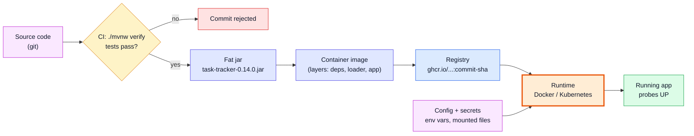
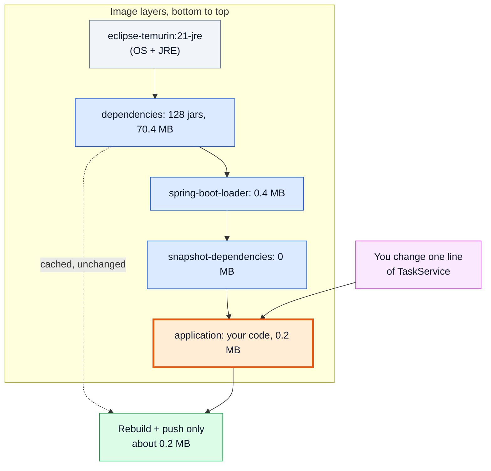
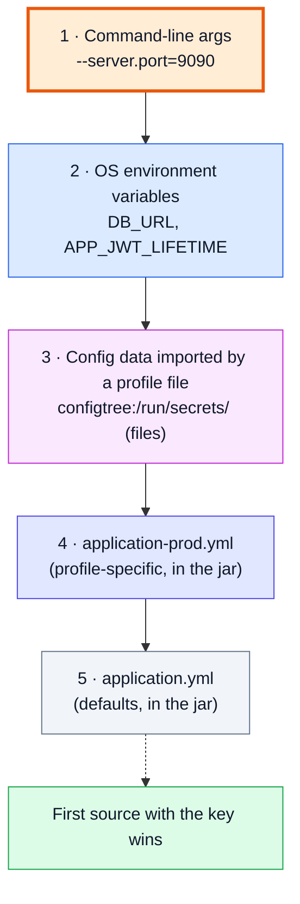
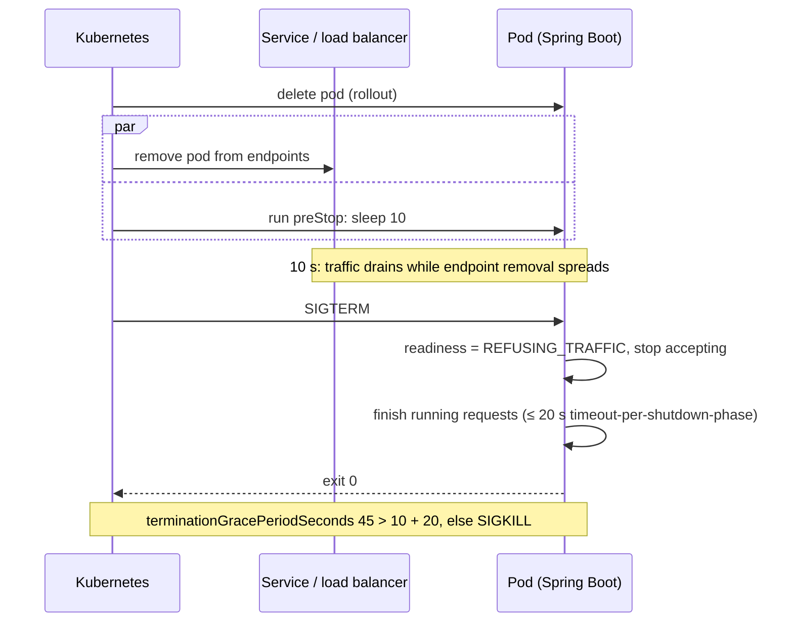

# Deployment: Fat Jars, Layers, CDS, Production Config, Secrets, Docker, Kubernetes and CI — Complete In-Depth Guide

**Spring Boot notes #14 of 18** · Priority 🔴 · Track: Spring Boot ([README](README.md))

Files 04–13 built the Task Tracker and ran it with `java -jar` on a laptop. This file is about the step after "it works on my machine": **getting the same artifact running somewhere else, safely**.

**Package it**
- What `./mvnw package` produces: the **fat jar**, and what is inside it.
- **Layers**: splitting the jar so container images rebuild fast.
- **Startup time**: extracted jars and **CDS** (Class Data Sharing), measured.

**Configure it for production**
- A **`prod` profile** with no development defaults.
- **Secrets** from environment variables and from files (**config trees**).
- **Fail fast** when configuration is missing or weak, and how the failures really look.

**Ship and run it**
- **Docker**: a multi-stage, layered `Dockerfile` and `compose.yaml`.
- **Kubernetes**: probes, graceful shutdown, resources.
- **CI**: a GitHub Actions workflow that tests, then builds the image.

| You want… | Use |
|---|---|
| One file that runs anywhere Java 21 runs | The fat jar from `spring-boot-maven-plugin` (`java -jar app.jar`) |
| Fast image rebuilds when only your code changed | `java -Djarmode=tools -jar app.jar extract --layers`, one `COPY` per layer |
| Faster startup without changing code | Run the extracted jar + a CDS archive (`-XX:SharedArchiveFile`) |
| Different settings per environment | Profiles (`application-prod.yml`) + environment variables |
| Secrets that never sit in git or in `env` output | Files mounted by Docker/Kubernetes + `spring.config.import: configtree:` |
| The app to refuse bad configuration at startup | `@ConfigurationProperties` + `@Validated` |
| The orchestrator to know when the app is up / ready | `/actuator/health/liveness` and `/readiness` probes |
| Every commit tested, every main commit packaged | A CI workflow: `./mvnw verify`, then `docker build` + push |

> [!NOTE]
> This topic isn't in Kunal's playlist, so there are no video timestamps (see the [README](README.md#reference-playlist-where-each-video-is-covered)).
>
> **What was run:** [`examples/14-deployment/`](examples/14-deployment/) (Task Tracker 0.14.0, schema `tracker14`) on Spring Boot 4.0.5 / JDK 21 / PostgreSQL 18.3, on a Windows laptop:
> - the fat jar taken apart, `jarmode=tools` `list-layers` and `extract`;
> - startup timing: fat jar, extracted jar, extracted jar + CDS (and a CDS coverage check);
> - the `prod` profile started 9 times: no variables, each of 5 variables missing in turn, a weak secret, secrets from files, and an origin check;
> - SnakeYAML parsing of every YAML file; `./mvnw package` with 18 tests.
>
> **Not run:** Docker, Kubernetes and GitHub Actions are not installed here. The `Dockerfile`, `compose.yaml`, `deploy/k8s.yaml` and `deploy/ci.yml` are complete and were checked by parsing, not executed. Buildpacks and GraalVM native images are described only.

---

## Table of Contents

| # | Topic (anchor link) | Level |
|---|---|---|
| 0 | [From `mvn package` to a Running Service](#0-from-mvn-package-to-a-running-service) | Basics |
| 1 | [The Fat Jar: What's Inside](#1-the-fat-jar-whats-inside) | Core |
| 2 | [Layers and `jarmode=tools`](#2-layers-and-jarmodetools) | Core |
| 3 | [Startup Time: Extracted Jars and CDS](#3-startup-time-extracted-jars-and-cds) | In depth |
| 4 | [Configuration in Production](#4-configuration-in-production) | Core |
| 5 | [Secrets: Environment Variables vs Config Trees](#5-secrets-environment-variables-vs-config-trees) | In depth |
| 6 | [Fail Fast: Missing and Weak Configuration](#6-fail-fast-missing-and-weak-configuration) | In depth |
| 7 | [Docker](#7-docker) | Core |
| 8 | [Kubernetes: Probes, Shutdown, Resources](#8-kubernetes-probes-shutdown-resources) | Core |
| 9 | [CI/CD with GitHub Actions](#9-cicd-with-github-actions) | Core |
| 10 | [Other Options: Buildpacks, Native Images, Platforms](#10-other-options-buildpacks-native-images-platforms) | Overview |
| 11 | [Interview Questions](#11-interview-questions) | Interview |

---

## 0. From `mvn package` to a Running Service



Two rules hold the whole picture together:

1. **Build once, run anywhere.** The same jar (and the same image) goes to test, staging and production. Nothing is rebuilt per environment.
2. **Configuration comes from outside.** What differs between environments (database URL, passwords, keys, URLs of other services) is supplied at run time, never baked into the artifact. This is factor III of the [Twelve-Factor App](https://12factor.net/config).

---

## 1. The Fat Jar: What's Inside

`spring-boot-maven-plugin` (in every example's `pom.xml` since file 04) repackages the normal jar into an **executable fat jar**: your classes **plus every dependency jar, unchanged, nested inside**, plus a small launcher.

Taking the 0.14.0 jar apart (a Python script reading it as a zip):

```
=== 1. The fat jar: 74,200,960 bytes (70.8 MiB)
       2 files  BOOT-INF/
      71 files  BOOT-INF/classes/
     128 files  BOOT-INF/lib/
       2 files  META-INF/
       2 files  META-INF/maven/
       1 files  META-INF/services/
      98 files  org/springframework/boot/loader/

--- META-INF/MANIFEST.MF (main lines)
    Build-Jdk-Spec: 21
    Main-Class: org.springframework.boot.loader.launch.JarLauncher
    Start-Class: com.notes.tasks.TaskTrackerApplication
    Spring-Boot-Version: 4.0.5
    Spring-Boot-Classes: BOOT-INF/classes/
    Spring-Boot-Lib: BOOT-INF/lib/
    Spring-Boot-Classpath-Index: BOOT-INF/classpath.idx
    Spring-Boot-Layers-Index: BOOT-INF/layers.idx

--- BOOT-INF/layers.idx
    - "dependencies":
      - "BOOT-INF/lib/"
    - "spring-boot-loader":
      - "org/"
    - "snapshot-dependencies":
    - "application":
      - "BOOT-INF/classes/"
      - "BOOT-INF/classpath.idx"
      - "BOOT-INF/layers.idx"
      - "META-INF/"

--- a few of the 128 dependency jars in BOOT-INF/lib/
    BOOT-INF/lib/flyway-database-postgresql-11.14.1.jar  (46 KB)
    BOOT-INF/lib/hibernate-core-7.2.7.Final.jar  (14075 KB)
    BOOT-INF/lib/postgresql-42.7.10.jar  (1110 KB)
    BOOT-INF/lib/spring-boot-4.0.5.jar  (1339 KB)
    BOOT-INF/lib/spring-core-7.0.6.jar  (1984 KB)
    BOOT-INF/lib/tomcat-embed-core-11.0.20.jar  (3507 KB)
```

| Part | What it is |
|---|---|
| `BOOT-INF/classes/` | Your compiled code and `application*.yml` (71 files) |
| `BOOT-INF/lib/` | The 128 dependency jars, **as jars** (nested, not unpacked) |
| `org/springframework/boot/loader/` | The launcher (98 classes): knows how to read jars inside a jar |
| `Main-Class: ...JarLauncher` | What `java -jar` starts: the launcher, not your class |
| `Start-Class: ...TaskTrackerApplication` | What the launcher starts after building the class path |
| `classpath.idx` / `layers.idx` | Class-path order / which files belong to which layer (Section 2) |

> [!IMPORTANT]
> Plain Java can't load classes from a jar nested inside another jar. That is the only reason the launcher exists. It opens `BOOT-INF/lib/*.jar` in place (no unzipping) and creates a class loader over them. The cost is a little extra work at startup (Section 3).

The size is almost all dependencies: Hibernate alone is 14 MB, and your own code is about 0.2 MB. That ratio matters for container images.

---

## 2. Layers and `jarmode=tools`

A container image is a stack of **layers**. When you rebuild, every layer from the first changed one upwards is rebuilt and pushed again. If the image held the fat jar as one file, changing one line of code would push 74 MB again.

The jar knows its own layers (`layers.idx` above), and it carries a **tools mode** to split itself:

```
$ "C:/Program Files/Java/jdk-21/bin/java.exe" -Djarmode=tools -jar target/task-tracker-0.14.0.jar list-layers
dependencies
spring-boot-loader
snapshot-dependencies
application

$ "C:/Program Files/Java/jdk-21/bin/java.exe" -Djarmode=tools -jar target/task-tracker-0.14.0.jar extract --layers --launcher --destination target/extracted

    target/extracted/application/    78 files     0.2 MB
    target/extracted/dependencies/   128 files    70.4 MB
    target/extracted/snapshot-dependencies/     0 files     0.0 MB
    target/extracted/spring-boot-loader/    98 files     0.4 MB
```

| Layer | Changes when… | Size here |
|---|---|---|
| `dependencies` | You change a version in `pom.xml` | 70.4 MB |
| `spring-boot-loader` | You upgrade Spring Boot | 0.4 MB |
| `snapshot-dependencies` | A `-SNAPSHOT` dependency changes (none here) | 0 |
| `application` | **Every code change** | 0.2 MB |



`extract` has two shapes, and they are run differently:

| Command | Result | Start with |
|---|---|---|
| `extract --destination app` | `app/task-tracker-0.14.0.jar` (manifest `Class-Path: lib/...`) + `app/lib/*.jar` | `java -jar app/task-tracker-0.14.0.jar` |
| `extract --layers --destination L` | The same files, but split into `L/<layer>/` folders: `dependencies/lib/`, `application/task-tracker-0.14.0.jar` | Copy all layer folders into **one** folder (the `Dockerfile` does this), then `java -jar task-tracker-0.14.0.jar` |
| `extract --layers --launcher --destination L` | Layer folders holding the **unpacked** fat-jar layout (`BOOT-INF/`, `org/`) | One merged folder, then `java org.springframework.boot.loader.launch.JarLauncher` |

> [!WARNING]
> A layer folder alone does not run. On this run, `java -jar target/extracted/task-tracker-0.14.0.jar` (after `--layers --launcher`) failed with `Error: Unable to access jarfile`: that layout has no jar at the top. Layers are meant to be stacked by `COPY` lines in a `Dockerfile`, not started from where they were extracted.

---

## 3. Startup Time: Extracted Jars and CDS

Startup time matters for scaling out quickly, for rolling deployments and for how fast a crashed instance comes back.

### 3.1 First measurement

Three ways of starting the same app, 3 runs each. `process running for` is the time from JVM start to "Started":

```
=== Startup time, 3 runs each (same laptop, same database, schema already migrated)

A. java -jar target/task-tracker-0.14.0.jar                (fat jar, nested jars)
    started in 17.79 s   (process running for 18.88 s)
    started in 19.23 s   (process running for 20.31 s)
    started in 20.94 s   (process running for 22.09 s)
    best: 18.88 s

B. java -jar target/app/task-tracker-0.14.0.jar            (extracted)
    started in 16.99 s   (process running for 17.99 s)
    started in 18.37 s   (process running for 18.90 s)
    started in 16.87 s   (process running for 17.44 s)
    best: 17.44 s

C. java -cp "target/app/task-tracker-0.14.0.jar;target/app/lib/*" com.notes.tasks.TaskTrackerApplication
    started in 16.89 s   (process running for 17.53 s)
    started in 17.01 s   (process running for 17.65 s)
    started in 16.26 s   (process running for 16.92 s)
    best: 16.92 s

=== CDS: a training run (-XX:ArchiveClassesAtExit + -Dspring.context.exit=onRefresh), then reuse the archive
    training run exit code 0 after 148 s -> target/app-jar.jsa 14 MB
    training run exit code 0 after 249 s -> target/app-cp.jsa 14 MB
    -jar  + archive: 21913 classes loaded, 3472 of them from a CDS archive (16%)
    -cp   + archive: 21927 classes loaded, 3471 of them from a CDS archive (16%)

D. java -XX:SharedArchiveFile=target/app-jar.jsa -jar target/app/task-tracker-0.14.0.jar
    started in 11.69 s   (process running for 12.09 s)
    started in 11.74 s   (process running for 12.12 s)
    started in 12.30 s   (process running for 12.69 s)
    best: 12.09 s

E. java -XX:SharedArchiveFile=target/app-cp.jsa -cp "target/app/...;target/app/lib/*" com.notes...
    started in 12.99 s   (process running for 13.49 s)
    started in 11.65 s   (process running for 12.12 s)
    started in 11.67 s   (process running for 12.16 s)
    best: 12.12 s
```

> [!NOTE]
> **Context for the numbers:** about 17 s is slow for a Spring Boot app. This one starts Hibernate, Flyway, Security, Actuator with 14 endpoints, caching and springdoc on a busy Windows laptop. Compare **within** one table, not across machines.

What it shows:

- **Extracted (B, C) beat the fat jar (A) by 1.5–2 s** (best 17.44 s and 16.92 s vs 18.88 s). Reading plain jars on disk is cheaper than opening jars nested in a jar.
- **CDS** (D, E) started faster again. But the coverage line says only **16% of classes came from the archive**, and the training runs took 148–249 s. Something was wrong, so the next step was to look at *why*, not to trust the 12 s.

### 3.2 What CDS is

**Class Data Sharing:** the JVM normally reads, parses and verifies about 22,000 class files at every start. A **CDS archive** stores them already parsed. The next start maps the archive into memory and skips that work.

```bash
# 1. Training run: start, refresh the context, exit, write the archive
java -XX:ArchiveClassesAtExit=app.jsa -Dspring.context.exit=onRefresh -jar task-tracker-0.14.0.jar
# 2. Every later start uses it
java -XX:SharedArchiveFile=app.jsa -jar task-tracker-0.14.0.jar
```

`-Dspring.context.exit=onRefresh` is a Spring Framework flag: start the context (creating all the beans loads all the classes), then exit cleanly instead of serving requests.

### 3.3 Why only 16%? A controlled run

The training run's warnings said `Skipping ...: Unsupported location` for 15,845 classes: CDS refused them. The same extracted app was copied to a folder **without spaces in its path** (the notes folder is `Spring Boot Notes`), and both start styles were trained again:

```
=== CDS in a folder without spaces in its path
cd app && java -jar task-tracker-0.14.0.jar
    training 92 s, archive 124 MB, 21052 of 21945 classes from the archive (96%)
java -cp "app/task-tracker-0.14.0.jar;app/lib/*" com.notes.tasks.TaskTrackerApplication
    training 96 s, archive 124 MB, 21058 of 21947 classes from the archive (96%)

=== Startup ("process running for"), 3 runs each, alternating, same folder
    -cp, no archive         : 14.49 s, 14.82 s, 15.07 s   best 14.49 s
    -cp + archive (cp.jsa)  : 8.53 s, 8.76 s, 8.65 s   best 8.53 s
```

| Started as | Folder | Classes from archive |
|---|---|---|
| `java -jar target/app/task-tracker-0.14.0.jar` (from the project folder) | path with spaces | 16% |
| `java -cp "target/app/...;target/app/lib/*" ...` (from the project folder) | path with spaces | 16% |
| `java -jar app/task-tracker-0.14.0.jar` (from the parent folder) | no spaces | 16% (an earlier try) |
| `cd app && java -jar task-tracker-0.14.0.jar` | no spaces | **96%** |
| `cd target/app && java -jar task-tracker-0.14.0.jar` | the project folder (spaces, OneDrive) | 16% |
| `cd app && java -jar task-tracker-0.14.0.jar` | a folder named `cds space` (spaces, not OneDrive) | 16% |
| `java -cp "app/task-tracker-0.14.0.jar;app/lib/*" ...` | no spaces | **96%** |

The last two rows (a later check, same start form as the 96% row) separate the causes: **a space in the path is enough to lose the library classes**, with or without OneDrive:

```
project folder (spaces, OneDrive): training 226 s, archive 14 MB, 3472 of 21916 classes from the archive (16%)
folder 'cds space' (spaces, not OneDrive): training 164 s, archive 14 MB, 3472 of 21927 classes from the archive (16%)
```

With the full archive, startup went from **14.5 s to 8.5 s (−41%)**, measured alternately in the same folder.

> [!IMPORTANT]
> **Lessons from this run (JDK 21, Windows):**
> - **Run the jar from its own folder** (`WORKDIR` + `java -jar app.jar`). That is exactly what the `Dockerfile` in Section 7 does, and what the Spring Boot docs show.
> - **Keep spaces out of the path.** Here the libraries were skipped (`Unsupported location`) whenever the folder path contained a space. Container paths like `/app` don't have this problem.
> - **Train and run with the same command and class path**: the archive is only valid for the class path it was built with.
> - **Verify, don't assume:** `-Xlog:class+load=info:file=cl.txt`, then count lines containing `shared objects file`. A CDS archive that silently covers 16% looks like it works.
> - **The training run needs what startup needs.** Here the context refresh connects to PostgreSQL (Hikari and Flyway run). In a `docker build` there's usually no database, so the training step either runs in an environment with one or disables those beans for training.

Further options, not run here: JDK 24+ replaces this with **AOT cache** (`-XX:AOTCache`, JEP 483) that also stores linked classes; **Spring AOT** (`process-aot`) precomputes bean definitions; **GraalVM native images** (Section 10) start in well under a second.

---

## 4. Configuration in Production

The jar is the same everywhere. Everything else comes from **property sources**, and Spring Boot checks them in a fixed order: the first source that has a key wins.



(Simplified: the full list has about 15 entries, including test properties, `SPRING_APPLICATION_JSON` and Java system properties `-D`. Imported config data ranks above the file that imports it. Section 5 shows this order in a real `/actuator/env` response.)

### 4.1 The `prod` profile

`application.yml` keeps development-friendly defaults (`${DB_PASSWORD:springnotes}`). `application-prod.yml` overrides everything that must differ, **with no defaults**:

```yaml
# Profile "prod". Rule: nothing secret lives in this file, and nothing falls back to a development default.
spring:
  config:
    import: optional:configtree:${SECRETS_DIR:/run/secrets}/   # every FILE in that folder becomes a property:
                                                              # file name = key, file content = value
  datasource:
    url: ${DB_URL}                        # no default. If unset, the binder keeps the text "${DB_URL}" and
                                          # startup fails later: 'url' must start with "jdbc" (see the notes)
    username: ${DB_USERNAME}
    password: ${DB_PASSWORD}              # a secrets file named spring.datasource.password wins over this line

app:
  jwt:
    secret: ${JWT_SECRET}                 # same: a secrets file named app.jwt.secret wins
  holidays:
    base-url: ${HOLIDAYS_URL}

logging:
  structured:
    format:
      console: ecs                        # JSON lines for the log platform (file 12)

management:
  endpoints:
    web:
      exposure:
        include: health, info, prometheus # only what the platform needs: probes, build info, scraping
  endpoint:
    shutdown:
      access: none                        # the orchestrator stops the app with SIGTERM, not over HTTP
    env:
      show-values: never                  # no secrets through /actuator/env, even if someone exposes it
    configprops:
      show-values: never

springdoc:
  api-docs:
    enabled: false                        # no public API description in production
  swagger-ui:
    enabled: false
```

Activate it with `SPRING_PROFILES_ACTIVE=prod` (the `Dockerfile` sets it) or `--spring.profiles.active=prod`.

### 4.2 Relaxed binding: environment variable names

Environment variables can't contain dots or dashes, so Boot maps them: **uppercase, `.` → `_`, drop `-`**.

| Property | Environment variable |
|---|---|
| `app.jwt.lifetime` | `APP_JWT_LIFETIME` |
| `spring.datasource.url` | `SPRING_DATASOURCE_URL` |
| `management.endpoints.web.exposure.include` | `MANAGEMENT_ENDPOINTS_WEB_EXPOSURE_INCLUDE` |
| `app.rate-limit.refill-per-second` | `APP_RATELIMIT_REFILLPERSECOND` |

Run C in Section 5 sets `APP_JWT_LIFETIME=PT5M`, and the token endpoint answers `expires_in=300`. No YAML mentions that variable.

Two ways to feed a value from the environment, and they behave differently:
- **`${DB_URL}` placeholder in YAML**: you choose the variable name. Readable, and documents what the app needs.
- **Relaxed binding (`SPRING_DATASOURCE_URL`)**: overrides any property with no YAML change. Handy for one-off overrides, but easy to set by accident.

### 4.3 Validated configuration

`app.jwt.*` used to be read with `@Value`. Now it's a validated record:

```java
package com.notes.tasks.security;

import jakarta.validation.constraints.NotBlank;
import jakarta.validation.constraints.Size;
import org.springframework.boot.context.properties.ConfigurationProperties;
import org.springframework.validation.annotation.Validated;

import java.time.Duration;

/**
 * app.jwt.* bound and VALIDATED at startup: a missing or weak secret stops the app before it takes traffic
 * (fail fast), instead of failing on the first login.
 */
@Validated
@ConfigurationProperties(prefix = "app.jwt")
public record JwtProperties(
        @NotBlank
        @Size(min = 32, message = "must be at least 32 characters (HS256 needs a 256-bit key)")
        String secret,
        Duration lifetime) {

    public JwtProperties {
        if (lifetime == null) lifetime = Duration.ofMinutes(15);   // default when not configured
    }
}
```

```java
@Configuration
@EnableMethodSecurity                                  // turns on @PreAuthorize / @PostAuthorize
@EnableConfigurationProperties(JwtProperties.class)    // binds + validates app.jwt.* (JwtProperties)
public class SecurityConfig {
    // ...
    @Bean
    SecretKey jwtKey(JwtProperties jwt) {                   // validated app.jwt.* (see JwtProperties)
        return new SecretKeySpec(jwt.secret().getBytes(StandardCharsets.UTF_8), "HmacSHA256");
    }
```

`TokenController` takes `JwtProperties` too and uses `jwt.lifetime()` in place of a hard-coded 15 minutes.

---

## 5. Secrets: Environment Variables vs Config Trees

Environment variables are the classic way to pass secrets, but they leak easily:
- `docker inspect` and `kubectl describe pod` show them;
- child processes inherit them;
- crash reporters and `/proc/<pid>/environ` can expose them.

Docker and Kubernetes therefore prefer to **mount secrets as files** (`/run/secrets/<name>`). Spring Boot reads such a folder with a **config tree**:

```yaml
spring:
  config:
    import: optional:configtree:${SECRETS_DIR:/run/secrets}/
```

**Every file in the folder becomes a property: file name = key, content = value.** A file named `app.jwt.secret` is the property `app.jwt.secret`. `optional:` means "no folder is fine" (local runs).

**Run C:** both secrets as files, everything else from environment variables. `DB_PASSWORD` and `JWT_SECRET` are **not set**, and the app starts on a fresh schema:

```
$ ls target/secrets          (one file per property; file content = value, ending in a newline)
    app.jwt.secret  (40 bytes)
    spring.datasource.password  (12 bytes)
$ env: SPRING_PROFILES_ACTIVE=prod SECRETS_DIR=target/secrets DB_URL=... DB_USERNAME=springnotes HOLIDAYS_URL=... APP_JWT_LIFETIME=PT5M      (no DB_PASSWORD, no JWT_SECRET)

=== C. secrets from files (configtree), the rest from environment variables
    18 log lines until "Started". The raw first line (JSON, cut at 300 characters):
    {"@timestamp":"2026-11-16T22:35:47.253218Z","log":{"level":"INFO","logger":"com.notes.tasks.TaskTrackerApplication"},"process":{"pid":8840,"thread":{"name":"main"}},"service":{"name":"task-tracker","version":"0.14.0","node":{}},"message":"Starting TaskTrackerApplication v0.14.0 using Java 21 with PI ...
    The same lines, made readable:
      INFO  TaskTrackerApplication : Starting TaskTrackerApplication v0.14.0 using Java 21 with PID 8840 (...\Spring B
      INFO  TaskTrackerApplication : The following 1 profile is active: "prod"
      INFO  DbMigrate : Migrating schema "tracker14" to version "1 - create schema"
      INFO  DbMigrate : Migrating schema "tracker14" to version "2 - seed data"
      INFO  DbMigrate : Migrating schema "tracker14" to version "3 - version activity backlog"
      INFO  DbMigrate : Migrating schema "tracker14" to version "4 - user credentials"
      INFO  DbMigrate : Successfully applied 4 migrations to schema "tracker14", now at version v4 (execution time 00:00.124s)
      INFO  EndpointLinksResolver : Exposing 3 endpoints beneath base path '/actuator'
      INFO  TaskTrackerApplication : Started TaskTrackerApplication in 16.97 seconds (process running for 18.092)

$ GET /actuator/health
    200  {"groups":["liveness","readiness"],"status":"UP"}
$ GET /actuator/health/readiness
    200  {"status":"UP"}
$ GET /actuator/info
    200  {"app":{"name":"Task Tracker","description":"Spring Boot notes, stage 14","owner":"platform-team"},"build":{"artifact":"task-tracker","name":"task-tra
$ GET /actuator/prometheus
    401  {"timestamp":"2026-11-16T22:36:03.915Z","status":401,"error":"Unauthorized","path":"/actuator/prometheus"}
$ GET /actuator/env   (as ADMIN asha)
    302    Location: http://localhost:8095/login
$ GET /v3/api-docs
    404  {"detail":"No static resource v3/api-docs.","instance":"/v3/api-docs","status":404,"title":"Not Found"}
$ POST /api/auth/token   (as ravi)
    200  token_type=Bearer expires_in=300
$ GET /api/tasks?size=2   (Bearer token signed with the secret from the file)
    200  {"content":[{"id":1,"project":"Task Tracker","title":"Design the schema","priority":"HIGH","done":true,"dueDate":"2026-1...
```

| Line | Meaning |
|---|---|
| `app.jwt.secret (40 bytes)` = 39 characters + newline | Files written by `echo` end in a newline; the config tree **trims it** (the database login worked) |
| `"@timestamp":...,"log":{"level":"INFO"...` | `logging.structured.format.console: ecs`: one JSON object per line, ready for a log platform (file 12) |
| `Exposing 3 endpoints` | Only `health, info, prometheus` in prod |
| `"groups":["liveness","readiness"]` | The probe groups for Kubernetes (Section 8) |
| `/actuator/prometheus` → `401` | Scraping needs the ADMIN credentials (file 12's actuator chain) |
| `/actuator/env` as ADMIN → `302 /login` | Not exposed, so it isn't an Actuator path at all; the browser chain sends you to the login page |
| `/v3/api-docs` → `404` | springdoc disabled in prod |
| `expires_in=300` | `APP_JWT_LIFETIME=PT5M` through relaxed binding |
| `GET /api/tasks` → `200` with the token | Signing and verifying used the secret from the file |

**Where did each value come from?** Run D: the same, plus `env` exposed for this check only:

```
$ the same as C, plus MANAGEMENT_ENDPOINTS_WEB_EXPOSURE_INCLUDE=health,env   (only for this check)
=== D. where did each value come from?
$ GET /actuator/env/app.jwt.secret   (as ADMIN) -> 200
    winning value: ******   from: Config tree '...\14-deployment\target\secrets'
      Config tree '...\Spring Boot Not ******
      Config resource 'class path resource [application-prod.yml]' via location 'optional:classp ******
      Config resource 'class path resource [application.yml]' via location 'optional:classpath:/ ******
$ GET /actuator/env/spring.datasource.password   (as ADMIN) -> 200
    winning value: ******   from: Config tree '...\14-deployment\target\secrets'
      Config tree '...\Spring Boot Not ******
      Config resource 'class path resource [application-prod.yml]' via location 'optional:classp ******
      Config resource 'class path resource [application.yml]' via location 'optional:classpath:/ ******
$ GET /actuator/env/app.jwt.lifetime   (as ADMIN) -> 200
    winning value: ******   from: systemEnvironment
      systemEnvironment                                                                          ******
$ GET /actuator/env/spring.datasource.url   (as ADMIN) -> 200
    winning value: ******   from: Config resource 'class path resource [application-prod.yml]' via location 'optional:classpath:/'
      Config resource 'class path resource [application-prod.yml]' via location 'optional:classp ******
      Config resource 'class path resource [application.yml]' via location 'optional:classpath:/ ******
```

- **The config tree beats `application-prod.yml`, and `application-prod.yml` beats `application.yml`.** That is why the `${JWT_SECRET}` line in the yml never needed a value: a higher source already had the key, so the placeholder was never resolved.
- `app.jwt.lifetime` exists only in `systemEnvironment` (the relaxed `APP_JWT_LIFETIME`).
- **Every value is `******`**, even for an ADMIN, because the prod profile sets `show-values: never`. File 12 showed that `when-authorized` prints secrets in clear.

> [!TIP]
> **Where real secrets come from:**
> - **Kubernetes:** a `Secret`, created with `kubectl create secret` or from a vault, never committed.
> - **External stores:** HashiCorp Vault, AWS Secrets Manager, Azure Key Vault or GCP Secret Manager, usually synced into Kubernetes Secrets, or read directly with Spring Cloud Vault / AWS integrations.
> - **Local dev:** an untracked `secrets/` folder (`.gitignore`d and `.dockerignore`d).

---

## 6. Fail Fast: Missing and Weak Configuration

**Fail fast:** a misconfigured instance should die at startup, where the deployment notices, not serve traffic and fail on the first login.

**Run A:** `prod` with no variables at all:

```
=== A. --spring.profiles.active=prod with NO environment variables
    exit code 1
    ERROR SpringApplication : Application run failed
      error.type: org.springframework.beans.factory.BeanCreationException
      error.message: Error creating bean with name 'entityManagerFactory' defined in class path resource [org/springframework/boot/hibernate/autoconfigure/HibernateJpaConfiguration.class]: Failed to initialize dependency 'flyway' of LoadTimeWeaverAware bean 'entityManagerFactory': Error creating bean with name 'flyway' defined in class path resource [org/springframework/boot/flyway/autoconfigure/FlywayAutoConfiguratio
      root cause: Caused by: java.lang.IllegalArgumentException: 'url' must start with "jdbc"
```

**Run A1:** everything set except **one** variable, five starts:

```
=== A1. prod, everything set EXCEPT DB_URL
    exit code 1
    ERROR SpringApplication : Application run failed
      error.type: org.springframework.beans.factory.BeanCreationException
      error.message: Error creating bean with name 'entityManagerFactory' defined in class path resource [org/springframework/boot/hibernate/autoconfigure/HibernateJpaConfiguration.class]: Failed to initialize dependency 'flyway' of LoadTimeWeaverAware bean 'entityManagerFactory': Error creating bean with name 'flyway' defined in class path resource [org/springframework/boot/flyway/autoconfigure/FlywayAutoConfiguratio
      root cause: Caused by: java.lang.IllegalArgumentException: 'url' must start with "jdbc"

=== A1. prod, everything set EXCEPT DB_USERNAME
    exit code 1
    ERROR SpringApplication : Application run failed
      error.type: org.springframework.beans.factory.BeanCreationException
      error.message: Error creating bean with name 'entityManagerFactory' defined in class path resource [org/springframework/boot/hibernate/autoconfigure/HibernateJpaConfiguration.class]: Failed to initialize dependency 'flywayInitializer' of LoadTimeWeaverAware bean 'entityManagerFactory': Error creating bean with name 'flywayInitializer' defined in class path resource [org/springframework/boot/flyway/autoconfigure/
      root cause: Caused by: org.postgresql.util.PSQLException: FATAL: password authentication failed for user "${DB_USERNAME}"

=== A1. prod, everything set EXCEPT DB_PASSWORD
    exit code 1
    ERROR SpringApplication : Application run failed
      error.type: org.springframework.beans.factory.BeanCreationException
      error.message: Error creating bean with name 'entityManagerFactory' defined in class path resource [org/springframework/boot/hibernate/autoconfigure/HibernateJpaConfiguration.class]: Failed to initialize dependency 'flywayInitializer' of LoadTimeWeaverAware bean 'entityManagerFactory': Error creating bean with name 'flywayInitializer' defined in class path resource [org/springframework/boot/flyway/autoconfigure/
      root cause: Caused by: org.postgresql.util.PSQLException: FATAL: password authentication failed for user "springnotes"

=== A1. prod, everything set EXCEPT JWT_SECRET
    exit code 1
    ERROR LoggingFailureAnalysisReporter :

    ***************************

    APPLICATION FAILED TO START

    ***************************

    Description:

    Binding to target com.notes.tasks.security.JwtProperties failed:

        Property: app.jwt.secret

        Value: "${JWT_SECRET}"

        Origin: class path resource [application-prod.yml] from task-tracker-0.14.0.jar - 14:13

        Reason: must be at least 32 characters (HS256 needs a 256-bit key)

    Action:

    Update your application's configuration

=== A1. prod, everything set EXCEPT HOLIDAYS_URL
    exit code 1
    ERROR SpringApplication : Application run failed
      error.type: org.springframework.beans.factory.BeanCreationException
      error.message: Error creating bean with name 'holidayClient' defined in URL [jar:nested:/.../14-deployment/target/task-tracker-0.14.0.jar/!BOOT-INF/classes/!/com/notes/tasks/client/HolidayClient.class]: Unexpected exception during bean creation
      root cause: Caused by: org.springframework.util.PlaceholderResolutionException: Could not resolve placeholder 'HOLIDAYS_URL' in value "${HOLIDAYS_URL}" <-- "${app.holidays.base-url}"
```

**Every run stopped the app (exit code 1), but the messages are not what the yml suggests:**

| Missing | Error seen | Why |
|---|---|---|
| `DB_URL` | `'url' must start with "jdbc"` | The binder **keeps the unresolved text `${DB_URL}`** as the value; Flyway rejects it later |
| `DB_USERNAME` | `password authentication failed for user "${DB_USERNAME}"` | Same: the literal text was sent to PostgreSQL as a user name |
| `DB_PASSWORD` | `password authentication failed for user "springnotes"` | Same; indistinguishable from a wrong password |
| `JWT_SECRET` | `Value: "${JWT_SECRET}"` … `must be at least 32 characters` | Literal text again, caught only because `@Size` exists |
| `HOLIDAYS_URL` | `Could not resolve placeholder 'HOLIDAYS_URL'` | `HolidayClient` reads it with **`@Value`**, which resolves strictly |

> [!WARNING]
> **`@ConfigurationProperties` binding does not fail on an unresolvable `${...}`.** It binds the placeholder text itself, and the error appears later, somewhere else. `@Value` fails immediately with a clear message. The defence is **validation on the properties class** (`@NotBlank`, `@Size`, `@Pattern`, or a check such as "must not start with `${`"). That is what turned `JWT_SECRET` into a clean `APPLICATION FAILED TO START` report.

**Run B:** a weak secret:

```
=== B. everything set, but JWT_SECRET=too-short (9 characters)
    exit code 1
    ERROR LoggingFailureAnalysisReporter :

    ***************************

    APPLICATION FAILED TO START

    ***************************

    Description:

    Binding to target com.notes.tasks.security.JwtProperties failed:

        Property: app.jwt.secret

        Value: "too-short"

        Origin: class path resource [application-prod.yml] from task-tracker-0.14.0.jar - 14:13

        Reason: must be at least 32 characters (HS256 needs a 256-bit key)

    Action:

    Update your application's configuration
```

> [!CAUTION]
> **The failure report prints the rejected value: `Value: "too-short"`.** For a real secret that is merely too short (31 characters of a real key), the secret ends up in your logs and your log platform. Rotate any secret that has appeared in such a report. Also note `Origin: application-prod.yml - 14:13`: the origin is where the placeholder was written, not the environment variable that supplied the value.

The test (no web server, no database), using `ApplicationContextRunner`:

```java
package com.notes.tasks.security;

import org.junit.jupiter.api.Test;
import org.springframework.boot.autoconfigure.AutoConfigurations;
import org.springframework.boot.context.properties.EnableConfigurationProperties;
import org.springframework.boot.test.context.runner.ApplicationContextRunner;
import org.springframework.boot.validation.autoconfigure.ValidationAutoConfiguration;
import org.springframework.context.annotation.Configuration;

import java.time.Duration;

import static org.assertj.core.api.Assertions.assertThat;

/** Binding + validation of app.jwt.* without starting the web app or touching the database. */
class JwtPropertiesTest {

    @Configuration
    @EnableConfigurationProperties(JwtProperties.class)
    static class Config { }

    private final ApplicationContextRunner runner = new ApplicationContextRunner()
            .withConfiguration(AutoConfigurations.of(ValidationAutoConfiguration.class))
            .withUserConfiguration(Config.class);

    @Test
    void bindsTheSecretAndDefaultsTheLifetime() {
        runner.withPropertyValues("app.jwt.secret=0123456789abcdef0123456789abcdef")
              .run(ctx -> {
                  JwtProperties jwt = ctx.getBean(JwtProperties.class);
                  assertThat(jwt.lifetime()).isEqualTo(Duration.ofMinutes(15));
              });
    }

    @Test
    void aConfiguredLifetimeOverridesTheDefault() {
        runner.withPropertyValues("app.jwt.secret=0123456789abcdef0123456789abcdef", "app.jwt.lifetime=PT5M")
              .run(ctx -> assertThat(ctx.getBean(JwtProperties.class).lifetime()).isEqualTo(Duration.ofMinutes(5)));
    }

    @Test
    void aShortSecretStopsTheContext() {
        runner.withPropertyValues("app.jwt.secret=too-short")
              .run(ctx -> assertThat(ctx).hasFailed()
                      .getFailure().rootCause().hasMessageContaining("at least 32 characters"));
    }
}
```

---

## 7. Docker

> [!NOTE]
> Not run: Docker isn't installed on this machine. The files are complete; the jar layout they rely on (`extract --layers`: `dependencies/lib/` and `application/task-tracker-0.14.0.jar`) was checked on this machine.

### 7.1 A multi-stage, layered `Dockerfile`

```dockerfile
# syntax=docker/dockerfile:1
# Multi-stage build: a JDK image builds the jar; a smaller JRE image runs it.

# ---------- stage 1: build the fat jar, then split it into layers ----------
FROM eclipse-temurin:21-jdk AS build
WORKDIR /src
COPY .mvn/ .mvn/
COPY mvnw pom.xml ./
# A Windows checkout (core.autocrlf=true) can turn mvnw into CRLF and drop its exec bit: repair both.
RUN sed -i 's/\r$//' mvnw && chmod +x mvnw \
 && ./mvnw -q -B dependency:go-offline                        # cached until pom.xml changes
COPY src/ src/
RUN ./mvnw -q -B -DskipTests package \
 && java -Djarmode=tools -jar target/task-tracker-0.14.0.jar extract --layers --destination /layers
#    /layers/dependencies/lib/*.jar   /layers/application/task-tracker-0.14.0.jar   (+ 2 empty layers here)

# ---------- stage 2: the runtime image ----------
FROM eclipse-temurin:21-jre
RUN useradd --system --uid 10001 --no-create-home app        # never run as root
WORKDIR /app
# Least-changing layer first: a code-only change rebuilds and pushes just the last (small) layer.
COPY --from=build /layers/dependencies/          ./
COPY --from=build /layers/spring-boot-loader/    ./
COPY --from=build /layers/snapshot-dependencies/ ./
COPY --from=build /layers/application/           ./
USER 10001
EXPOSE 8080
# Size the heap from the container's memory limit, not the host's RAM.
ENV JAVA_TOOL_OPTIONS="-XX:MaxRAMPercentage=75" \
    SPRING_PROFILES_ACTIVE=prod
# Exec form: java is PID 1 and receives SIGTERM directly, so graceful shutdown runs.
# Started from WORKDIR as "java -jar <jar>": the form whose classes a CDS archive can cover (see the notes).
ENTRYPOINT ["java", "-jar", "task-tracker-0.14.0.jar"]
```

| Line | Why |
|---|---|
| Two `FROM`s (multi-stage) | The JDK, Maven and sources stay in the build stage; the final image only has the JRE + app |
| `dependency:go-offline` before `COPY src/` | Docker caches that layer; dependencies download again only when `pom.xml` changes |
| `sed` + `chmod` on `mvnw` | A Windows checkout with `core.autocrlf=true` produces CRLF line endings, and the script fails with `/bin/sh^M: bad interpreter` |
| Four `COPY` lines, least-changing first | The layer caching from Section 2 |
| `USER 10001` | A process breaking out of the app isn't root in the container |
| `MaxRAMPercentage=75` | The JVM sizes its heap from the container's memory limit (Java 10+ is container-aware); leave room for metaspace, threads, buffers |
| Exec-form `ENTRYPOINT [...]` | Java is PID 1 and gets `SIGTERM` directly. The shell form `ENTRYPOINT java -jar ...` puts `/bin/sh` in between, which doesn't forward signals: no graceful shutdown |
| `java -jar` from `WORKDIR` | The start form CDS can cover (Section 3.3) |

```text
target/
secrets/
.idea/
*.iml
.git
```

Without `.dockerignore`, `COPY` and the build context would include `target/` (hundreds of MB here, with extracted copies and CDS archives) and the local `secrets/` folder.

### 7.2 `compose.yaml`: app + database on one machine

```yaml
# docker compose up --build      (needs ./secrets/db_password.txt and ./secrets/jwt_secret.txt; never commit them)
services:
  db:
    image: postgres:18
    environment:
      POSTGRES_DB: springnotes
      POSTGRES_USER: springnotes
      POSTGRES_PASSWORD_FILE: /run/secrets/db_password      # the postgres image reads the password from a file
    secrets:
      - db_password
    volumes:
      - pgdata:/var/lib/postgresql                          # postgres 18 images keep data below this folder
    healthcheck:
      test: ["CMD-SHELL", "pg_isready -U springnotes -d springnotes"]
      interval: 5s
      retries: 10

  app:
    build: .
    image: task-tracker:0.14.0
    depends_on:
      db:
        condition: service_healthy                          # wait for "ready", not just "started"
    ports:
      - "8080:8080"
    environment:
      DB_URL: jdbc:postgresql://db:5432/springnotes?currentSchema=tracker14
      DB_USERNAME: springnotes
      HOLIDAYS_URL: http://holidays.internal:8080
    secrets:                                                # mounted as files in /run/secrets/ = the configtree
      - source: db_password
        target: spring.datasource.password                 # file name = property name
      - source: jwt_secret
        target: app.jwt.secret
    stop_grace_period: 40s                                  # more than spring.lifecycle.timeout-per-shutdown-phase

secrets:
  db_password:
    file: ./secrets/db_password.txt
  jwt_secret:
    file: ./secrets/jwt_secret.txt

volumes:
  pgdata:
```

- **`depends_on: condition: service_healthy`** waits for `pg_isready`, not just for the container to start. Without it, the app races the database and fails its first connection.
- **`secrets:` with `target:`** mounts each secret as a file **named after the property** in `/run/secrets/`, which is exactly what the config tree in `application-prod.yml` reads.
- **`stop_grace_period: 40s`**: Docker waits 10 s by default before `SIGKILL`, which is shorter than Spring's 20 s shutdown phase.

```bash
docker compose up --build              # build the image, start db, wait until healthy, start app
docker compose logs -f app             # JSON log lines
docker compose down                    # stop (the pgdata volume keeps the data)
```

---

## 8. Kubernetes: Probes, Shutdown, Resources

> [!NOTE]
> Not run (no cluster). [`deploy/k8s.yaml`](examples/14-deployment/deploy/k8s.yaml) was parsed with SnakeYAML: ConfigMap, Deployment, Service.

```yaml
# kubectl apply -f deploy/k8s.yaml
# The Secret is created separately, never from a file in git:
#   kubectl create secret generic task-tracker-secrets \
#     --from-file=spring.datasource.password=./db_password.txt --from-file=app.jwt.secret=./jwt_secret.txt
apiVersion: v1
kind: ConfigMap
metadata:
  name: task-tracker-config
data:
  DB_URL: jdbc:postgresql://postgres:5432/springnotes?currentSchema=tracker14
  DB_USERNAME: springnotes
  HOLIDAYS_URL: http://holidays:8080
  APP_JWT_LIFETIME: PT15M                  # relaxed binding: APP_JWT_LIFETIME -> app.jwt.lifetime
  SECRETS_DIR: /etc/task-tracker/secrets   # our own folder: /run/secrets (= /var/run/secrets on many images)
                                           # is where Kubernetes mounts the service-account token
---
apiVersion: apps/v1
kind: Deployment
metadata:
  name: task-tracker
  labels:
    app: task-tracker
spec:
  replicas: 2
  selector:
    matchLabels:
      app: task-tracker
  strategy:
    type: RollingUpdate
    rollingUpdate:
      maxUnavailable: 0                    # keep full capacity during a rollout
      maxSurge: 1
  template:
    metadata:
      labels:
        app: task-tracker
      # No "prometheus.io/scrape" annotations: /actuator/prometheus needs ADMIN (HTTP Basic) in this app,
      # so the scraper must be configured with credentials (e.g. a ServiceMonitor with basicAuth).
    spec:
      terminationGracePeriodSeconds: 45    # > preStop sleep (10 s) + Spring's shutdown phase (20 s)
      containers:
        - name: app
          image: ghcr.io/example/task-tracker:0.14.0
          ports:
            - name: http
              containerPort: 8080
          envFrom:
            - configMapRef:
                name: task-tracker-config
          env:
            - name: SPRING_PROFILES_ACTIVE
              value: prod
          volumeMounts:
            - name: secrets                # each key of the Secret becomes a file = the configtree
              mountPath: /etc/task-tracker/secrets
              readOnly: true
          resources:
            requests:
              cpu: 250m
              memory: 512Mi
            limits:
              memory: 768Mi                # MaxRAMPercentage=75 -> about 576 MB heap
          startupProbe:                    # slow start allowed: up to 30 x 5 s = 150 s
            httpGet:
              path: /actuator/health/liveness
              port: http
            periodSeconds: 5
            failureThreshold: 30
          livenessProbe:                   # failing = restart the container
            httpGet:
              path: /actuator/health/liveness
              port: http
            periodSeconds: 10
            failureThreshold: 3
          readinessProbe:                  # failing = take it out of the Service, no restart
            httpGet:
              path: /actuator/health/readiness
              port: http
            periodSeconds: 5
            failureThreshold: 2
          lifecycle:
            preStop:                       # give the load balancer time to stop sending traffic
              exec:
                command: ["sleep", "10"]
      volumes:
        - name: secrets
          secret:
            secretName: task-tracker-secrets
---
apiVersion: v1
kind: Service
metadata:
  name: task-tracker
spec:
  selector:
    app: task-tracker
  ports:
    - name: http
      port: 80
      targetPort: http
```

**Three probes, three different questions:**

| Probe | Question | On failure | Endpoint |
|---|---|---|---|
| `startupProbe` | Has it finished starting? | Keeps waiting (up to 150 s here), then restarts | `/actuator/health/liveness` |
| `livenessProbe` | Is it stuck beyond repair? | **Restart** the container | `/actuator/health/liveness` |
| `readinessProbe` | Can it take traffic *now*? | **Remove from the Service**, no restart | `/actuator/health/readiness` (+ `db` in this app) |

> [!WARNING]
> **Never put the database into liveness.** If PostgreSQL goes down, a liveness check including `db` would restart **every** pod in a loop, and none of them can fix the database. Readiness is the right place: the pods stop taking traffic and recover on their own. File 12's `management.endpoint.health.group.readiness.include: readinessState, db` does exactly this.

**Graceful shutdown during a rollout:**



- **`preStop: sleep 10`**: endpoint removal and `SIGTERM` happen **at the same time**, so without a delay, requests still arrive after the app stopped accepting them.
- **`maxUnavailable: 0, maxSurge: 1`**: a new pod must be ready before an old one goes.
- **Secrets at `/etc/task-tracker/secrets`** (and `SECRETS_DIR` in the ConfigMap), not `/run/secrets`: Kubernetes mounts the service-account token under `/var/run/secrets/kubernetes.io/`, and on many images `/var/run` is a link to `/run`, so a volume at `/run/secrets` can clash with it.
- **`requests` vs `limits`:** the scheduler places pods by `requests`. Above the memory `limit` the container is OOM-killed, so the heap (75%) must fit under it with room to spare. No CPU limit is set on purpose: CPU throttling makes JVM startup and GC pauses much slower.

---

## 9. CI/CD with GitHub Actions

> [!NOTE]
> Not run. The workflow lives in [`deploy/ci.yml`](examples/14-deployment/deploy/ci.yml). GitHub only runs workflows in `.github/workflows/` at the **repository root**, so it's kept here on purpose and copied there to use it.

```yaml
# GitHub Actions workflow. To use it, copy it to .github/workflows/ci.yml at the repository root.
# It assumes the project IS the repository root. If it lives in a subfolder (as in these notes), add
#   defaults: { run: { working-directory: "path/to/project" } }   and set   context: path/to/project
name: ci

on:
  push:
    branches: [main]
  pull_request:

jobs:
  test:
    runs-on: ubuntu-latest
    services:
      postgres:                            # a real database for the integration tests
        image: postgres:18
        env:
          POSTGRES_DB: springnotes
          POSTGRES_USER: springnotes
          POSTGRES_PASSWORD: springnotes   # a throwaway CI-only password
        ports:
          - 5432:5432
        options: >-
          --health-cmd "pg_isready -U springnotes"
          --health-interval 5s
          --health-retries 10
    steps:
      - uses: actions/checkout@v4
      - uses: actions/setup-java@v4
        with:
          distribution: temurin
          java-version: "21"
          cache: maven                     # reuse ~/.m2 between runs
      - name: Build and test
        run: |
          chmod +x mvnw            # the exec bit is lost if the file was committed from Windows
          ./mvnw -B verify
      - uses: actions/upload-artifact@v4
        with:
          name: task-tracker-jar
          path: target/task-tracker-*.jar

  image:
    needs: test                            # only a tested commit becomes an image
    if: github.event_name == 'push'
    runs-on: ubuntu-latest
    permissions:
      contents: read
      packages: write
    steps:
      - uses: actions/checkout@v4
      - uses: docker/login-action@v3
        with:
          registry: ghcr.io
          username: ${{ github.actor }}
          password: ${{ secrets.GITHUB_TOKEN }}
      - uses: docker/build-push-action@v6
        with:
          context: .
          push: true
          tags: ghcr.io/${{ github.repository }}:${{ github.sha }}   # immutable tag: the commit id
```

| Piece | Why |
|---|---|
| `services: postgres` | The integration tests (file 10) need a real database. The CI database's password is a throwaway, not a secret |
| `cache: maven` | Reuses `~/.m2` between runs: minutes saved per build |
| `./mvnw -B verify` | `-B` batch mode (no colours/progress); `verify` runs tests and builds the jar |
| `needs: test` + `if: push` | Only a tested commit on `main` becomes an image; pull requests are only tested |
| Tag `${{ github.sha }}` | Immutable: each tag maps to exactly one commit. `latest` doesn't tell you what is running |
| `secrets.GITHUB_TOKEN` | Provided per run by GitHub, scoped by `permissions:`; no long-lived password |

**Every YAML file parsed** (SnakeYAML 2.5 from the local Maven repository; PyYAML isn't installed):

```
$ java -cp snakeyaml-2.5.jar YamlCheck.java compose.yaml deploy/k8s.yaml deploy/ci.yml src/main/resources/application-prod.yml
OK  compose.yaml  doc 1  keys=[services, secrets, volumes]
OK  deploy/k8s.yaml  doc 1  kind=ConfigMap
OK  deploy/k8s.yaml  doc 2  kind=Deployment
OK  deploy/k8s.yaml  doc 3  kind=Service
OK  deploy/ci.yml  doc 1  keys=[name, true, jobs]
OK  src/main/resources/application-prod.yml  doc 1  keys=[spring, app, logging, management, springdoc]
```

> [!TIP]
> **Why `keys=[name, true, jobs]`?** SnakeYAML follows YAML 1.1, where a bare `on` means boolean `true` (so do `yes` and `off`). GitHub's own parser treats it as the string `"on"`, so the workflow is fine on GitHub. Generic YAML tools may misread it, though; quote it (`"on":`) if a linter complains.

**Where CD continues:** after the image is pushed, either:
- **push-based:** a pipeline step runs `kubectl set image` / `helm upgrade`;
- **pull-based (GitOps):** Argo CD or Flux watches a repository of manifests and applies changes; the CI only commits the new tag.

---

## 10. Other Options: Buildpacks, Native Images, Platforms

| Option | What it does | Trade-off |
|---|---|---|
| `./mvnw spring-boot:build-image` | **Cloud Native Buildpacks** build a layered, non-root image with a memory calculator. No `Dockerfile` needed | Needs Docker; less control over the image; first build downloads the builder |
| **GraalVM native image** (`-Pnative native:compile`) | Compiles the app ahead of time into a native executable | Startup in milliseconds and lower memory. But builds take minutes and lots of RAM, reflection needs hints, and peak throughput is often lower than the JIT's |
| **Spring AOT on the JVM** (`process-aot`) | Precomputes bean definitions at build time | Some startup gain, less flexible (`@Profile`/conditions fixed at build time) |
| **PaaS** (Cloud Run, App Engine, Azure Container Apps, Heroku, Render) | Run the image; scaling, TLS and logs are handled | Less control, platform limits, cost at scale |
| **VM / bare metal** (`systemd` unit running `java -jar`) | Simplest for one server | You handle restarts, TLS, OS updates, scaling |

---

## 11. Interview Questions

| Question | Answer |
|---|---|
| What is a Spring Boot fat jar? | An executable jar with your classes in `BOOT-INF/classes`, dependency jars nested in `BOOT-INF/lib`, and a launcher (`JarLauncher`) as `Main-Class`. |
| Why does the fat jar need a special launcher? | The JDK can't load classes from a jar inside a jar; the launcher builds a class loader over the nested jars. |
| `Main-Class` vs `Start-Class`? | The launcher that `java -jar` starts vs your `@SpringBootApplication` class that the launcher starts. |
| What are layered jars for? | Building container images where dependencies, loader and code are separate layers, so a code change rebuilds and pushes only a small layer. |
| How do you extract layers? | `java -Djarmode=tools -jar app.jar extract --layers` (Boot 3.3+; older: `-Djarmode=layertools`). |
| What is CDS and what does it need? | A JVM archive of pre-parsed classes: create it with `-XX:ArchiveClassesAtExit` (+ `spring.context.exit=onRefresh`), use it with `-XX:SharedArchiveFile`. It needs the same class path, and an extracted (not nested) jar. |
| Property source precedence? | Command line > env vars > imported config data (e.g. config tree) > profile-specific yml > `application.yml` (simplified). |
| How does an env var map to a property? | Relaxed binding: uppercase, `.` → `_`, remove `-`: `APP_JWT_LIFETIME` → `app.jwt.lifetime`. |
| How do you pass secrets safely? | Mounted files (Docker/K8s secrets) read with `spring.config.import: configtree:`, or a vault integration; never in git or the image. |
| What happens if a `${VAR}` in YAML has no value? | `@Value` fails at startup with "Could not resolve placeholder"; `@ConfigurationProperties` binds the literal `${VAR}` text, so you need validation to catch it. |
| How do you make config fail fast? | `@ConfigurationProperties` + `@Validated` with constraints; the context refuses to start. |
| Why exec-form `ENTRYPOINT` in a Dockerfile? | Java runs as PID 1 and receives `SIGTERM` directly; the shell form doesn't forward it, so there's no graceful shutdown. |
| Why set `MaxRAMPercentage` in containers? | So the heap is sized from the container's memory limit, leaving room for non-heap memory below the OOM-kill limit. |
| Liveness vs readiness vs startup probe? | Restart if stuck / take out of traffic if not ready / give a slow start time before liveness applies. |
| Should the DB be in the liveness probe? | No: a DB outage would restart every pod in a loop. Put it in readiness. |
| How does graceful shutdown work in Kubernetes? | `preStop` delay, then `SIGTERM`; Spring stops accepting, finishes requests within the timeout; `terminationGracePeriodSeconds` must exceed both. |
| What should CI do for a Spring Boot app? | Build and test on every push/PR (with real dependencies as services), then build an immutably tagged image only from tested `main` commits. |
| JVM vs GraalVM native image? | Native: fast startup, low memory, slow builds, reflection hints. JVM: slower start, better peak throughput and tooling. |

---

## 🧩 Complete Example: Everything Together

**Task Tracker, stage 14.** File 13's app plus:
- **validated config:** `JwtProperties` (`@Validated` record, secret ≥ 32 characters, lifetime default 15 min);
- **a `prod` profile:** no defaults, config-tree secrets, JSON logs, minimal Actuator exposure, no API docs;
- **deployment files:** `Dockerfile`, `.dockerignore`, `compose.yaml`, `deploy/k8s.yaml`, `deploy/ci.yml`.

Source: [`examples/14-deployment/`](examples/14-deployment/)

```
14-deployment/
├── pom.xml                         (0.14.0; no new dependencies)
├── Dockerfile                      multi-stage, layered, non-root, exec-form ENTRYPOINT
├── .dockerignore
├── compose.yaml                    app + postgres, healthcheck, secrets as files
├── deploy/
│   ├── k8s.yaml                    ConfigMap, Deployment (probes, preStop, resources), Service
│   └── ci.yml                      GitHub Actions: test with postgres, then build + push the image
└── src/
    ├── main/java/com/notes/tasks/security/
    │   ├── JwtProperties.java      NEW: validated app.jwt.*
    │   ├── SecurityConfig.java     jwtKey(JwtProperties)
    │   └── TokenController.java    lifetime from JwtProperties
    ├── main/resources/ application.yml (tracker14), application-prod.yml (NEW)
    └── test/java/.../security/JwtPropertiesTest.java (NEW) (+ files 10–13's tests)
```

Shown above: `application-prod.yml`, `JwtProperties`, the `SecurityConfig` change, `JwtPropertiesTest` and all deployment files. The full `TokenController`:

```java
package com.notes.tasks.security;

import org.springframework.security.core.Authentication;
import org.springframework.security.core.GrantedAuthority;
import org.springframework.security.oauth2.jose.jws.MacAlgorithm;
import org.springframework.security.oauth2.jwt.JwsHeader;
import org.springframework.security.oauth2.jwt.JwtClaimsSet;
import org.springframework.security.oauth2.jwt.JwtEncoder;
import org.springframework.security.oauth2.jwt.JwtEncoderParameters;
import org.springframework.web.bind.annotation.PostMapping;
import org.springframework.web.bind.annotation.RestController;

import java.time.Duration;
import java.time.Instant;
import java.util.List;
import java.util.Map;

/** POST /api/auth/token with HTTP Basic credentials -> a signed JWT valid for app.jwt.lifetime (default 15 minutes). */
@RestController
public class TokenController {
    private final JwtEncoder encoder;
    private final Duration lifetime;

    public TokenController(JwtEncoder encoder, JwtProperties jwt) {
        this.encoder = encoder;
        this.lifetime = jwt.lifetime();
    }

    @PostMapping("/api/auth/token")
    public Map<String, Object> token(Authentication auth) {          // already authenticated by HTTP Basic
        Instant now = Instant.now();                                 // real time: decoders check exp against it
        List<String> roles = auth.getAuthorities().stream()
                .map(GrantedAuthority::getAuthority)
                .filter(a -> a.startsWith("ROLE_"))                  // skip e.g. FACTOR_PASSWORD (Security 7)
                .map(a -> a.substring("ROLE_".length()))
                .toList();
        JwtClaimsSet claims = JwtClaimsSet.builder()
                .issuer("task-tracker")
                .subject(auth.getName())                             // who
                .issuedAt(now)
                .expiresAt(now.plus(lifetime))                       // until when
                .claim("roles", roles)                               // what they may do
                .build();
        JwsHeader header = JwsHeader.with(MacAlgorithm.HS256).build();
        String token = encoder.encode(JwtEncoderParameters.from(header, claims)).getTokenValue();
        return Map.of("access_token", token, "token_type", "Bearer", "expires_in", lifetime.toSeconds());
    }
}
```

### Run it

```bash
cd "Spring Boot Notes/examples/14-deployment"
./mvnw package                                                    # builds + runs 18 tests
java -Djarmode=tools -jar target/task-tracker-0.14.0.jar list-layers
java -Djarmode=tools -jar target/task-tracker-0.14.0.jar extract --destination /c/cds/app   # a path WITHOUT spaces
cd /c/cds/app
java -XX:ArchiveClassesAtExit=app.jsa -Dspring.context.exit=onRefresh -jar task-tracker-0.14.0.jar   # train
java -XX:SharedArchiveFile=app.jsa -jar task-tracker-0.14.0.jar                                     # run with CDS
```

The `prod` profile locally (Git Bash; the secret value is a throwaway for local runs):

```bash
mkdir -p target/secrets
echo springnotes > target/secrets/spring.datasource.password
echo local-prod-demo-secret-0123456789abcdef > target/secrets/app.jwt.secret
SPRING_PROFILES_ACTIVE=prod SECRETS_DIR=target/secrets \
DB_URL="jdbc:postgresql://localhost:5432/springnotes?currentSchema=tracker14" DB_USERNAME=springnotes \
HOLIDAYS_URL=http://localhost:8089 APP_JWT_LIFETIME=PT5M \
java -jar target/task-tracker-0.14.0.jar
```

**Expected Output** (`./mvnw package`, test summary from `target/surefire-reports`):

```
Tests run: 2, Failures: 0, Errors: 0, Skipped: 0 -- com.notes.tasks.AdvancedFeaturesTest
Tests run: 4, Failures: 0, Errors: 0, Skipped: 0 -- com.notes.tasks.ops.ActuatorTest
Tests run: 1, Failures: 0, Errors: 0, Skipped: 0 -- com.notes.tasks.ratelimit.TokenBucketTest
Tests run: 3, Failures: 0, Errors: 0, Skipped: 0 -- com.notes.tasks.security.JwtPropertiesTest
Tests run: 4, Failures: 0, Errors: 0, Skipped: 0 -- com.notes.tasks.security.SecurityRulesTest
Tests run: 4, Failures: 0, Errors: 0, Skipped: 0 -- com.notes.tasks.service.TaskServiceTest
TOTAL 18 tests, 0 failures, 0 errors
```

The other outputs are in their sections: jar anatomy (1), layers (2), startup and CDS (3), runs C and D (5), runs A, A1 and B (6), YAML parsing (9).

**Reading the output:**

| Output | Concept |
|---|---|
| `Main-Class: ...JarLauncher`, `Start-Class: ...TaskTrackerApplication`, 128 jars in `BOOT-INF/lib/` | Fat jar anatomy ([Section 1](#1-the-fat-jar-whats-inside)) |
| `dependencies 70.4 MB` vs `application 0.2 MB` | Why layers matter ([Section 2](#2-layers-and-jarmodetools)) |
| Fat 18.9 s, extracted 16.9–17.4 s | Nested jars cost startup time ([Section 3](#3-startup-time-extracted-jars-and-cds)) |
| `16%` vs `96%` of classes from the archive; 14.5 s → 8.5 s | CDS only works with the right start form; verify coverage |
| `Config tree '...\target\secrets'` wins; every value `******` | Config trees, precedence, `show-values: never` ([Section 5](#5-secrets-environment-variables-vs-config-trees)) |
| `expires_in=300` | Relaxed binding of `APP_JWT_LIFETIME` ([Section 4](#4-configuration-in-production)) |
| `'url' must start with "jdbc"`, `user "${DB_USERNAME}"` | Unresolved placeholders bind as text ([Section 6](#6-fail-fast-missing-and-weak-configuration)) |
| `APPLICATION FAILED TO START` … `Value: "too-short"` | `@Validated` fail-fast, and the report leaks the value |
| `JwtPropertiesTest` 3 tests | Testing binding + validation with `ApplicationContextRunner` |
| `keys=[name, true, jobs]` | YAML 1.1 reads `on` as `true` ([Section 9](#9-cicd-with-github-actions)) |

---

## Quick Reference Cheat Sheet

| Concept | Key point |
|---|---|
| Fat jar | `BOOT-INF/classes`, `BOOT-INF/lib/*.jar` (nested), `JarLauncher` → `Start-Class` |
| Layers | `java -Djarmode=tools -jar app.jar list-layers` / `extract --layers`; dependencies → loader → snapshots → application |
| Extracted run | `extract --destination app` → `java -jar app/app.jar` (faster than nested) |
| CDS | Train: `-XX:ArchiveClassesAtExit=app.jsa -Dspring.context.exit=onRefresh`; run: `-XX:SharedArchiveFile=app.jsa`; same class path; run from the jar's folder; verify with `-Xlog:class+load` |
| Profiles | `application-prod.yml` + `SPRING_PROFILES_ACTIVE=prod`; no dev defaults in prod |
| Precedence | CLI > env vars > imported config (config tree) > `application-{profile}.yml` > `application.yml` |
| Relaxed binding | `app.jwt.lifetime` ⇔ `APP_JWT_LIFETIME` |
| Secrets | Files in `/run/secrets` + `spring.config.import: optional:configtree:/run/secrets/`; file name = property |
| Placeholders | `@Value("${X}")` fails clearly; `@ConfigurationProperties` binds `"${X}"` literally → validate |
| Fail fast | `@ConfigurationProperties` + `@Validated` + constraints; beware the report prints the value |
| Prod Actuator | Expose `health, info, prometheus`; `show-values: never`; shutdown `access: none` |
| Dockerfile | Multi-stage; layer `COPY`s least-changing first; non-root `USER`; `MaxRAMPercentage`; exec-form `ENTRYPOINT` |
| Compose | `depends_on: condition: service_healthy`; secrets with `target:` = property name; `stop_grace_period` |
| Probes | startup + liveness (`/health/liveness`, no DB) + readiness (`/health/readiness`, with DB) |
| K8s shutdown | `preStop sleep`, then SIGTERM; `terminationGracePeriodSeconds` > sleep + `timeout-per-shutdown-phase` |
| Resources | Set a memory limit and keep the heap at ≤ 75% of it (`MaxRAMPercentage`); avoid CPU limits for JVMs |
| CI | Test with service containers on every push/PR; build + push an image tagged with the commit SHA from `main` |
| Alternatives | `spring-boot:build-image` (buildpacks), GraalVM native, Spring AOT, PaaS |
