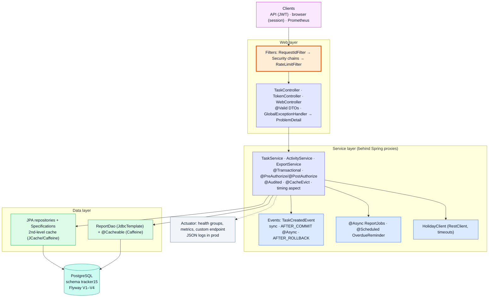
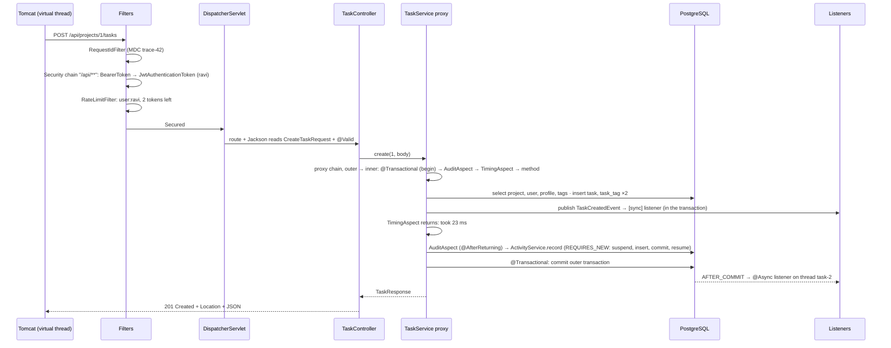
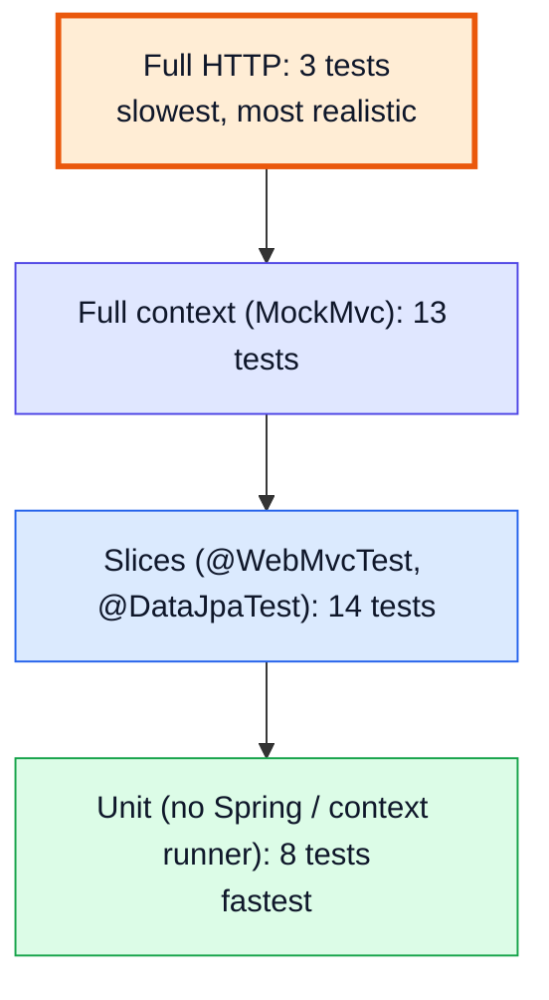

# Capstone: The Whole Task Tracker End to End — Complete In-Depth Guide

**Spring Boot notes #15 of 18** · Priority 🔴 · Track: Spring Boot ([README](README.md))

Files 04–14 built one application, the **Task Tracker**, a layer at a time. This file looks at the **finished whole**:

**See it as one system**
- The architecture: what's in it and how the parts connect.
- How it grew, file by file (taken from the example folders).

**Watch it work**
- **One request traced end to end**: from Tomcat's thread through security, MVC, validation, the service proxy, transactions, SQL, events and back.
- **A day in the life**: a 25-request user journey touching every feature.

**Check it like a reviewer**
- **What the end-to-end run caught**: four real regressions that eleven files of incremental work had hidden.
- The test suite, the design decisions, a production checklist.

**Talk about it**
- How to present the project in an interview, plus a **question bank** across all files.

> [!NOTE]
> This topic isn't in Kunal's playlist, so there are no video timestamps (see the [README](README.md#reference-playlist-where-each-video-is-covered)).
>
> **What was run:** [`examples/15-capstone/`](examples/15-capstone/) (Task Tracker 0.15.0, schema `tracker15`) on Spring Boot 4.0.5 / Spring Framework 7.0.6 / Spring Security 7.0.4 / Hibernate 7.2.7 / PostgreSQL 18.3 / JDK 21:
> - one request traced with DEBUG logging for security, MVC, transactions and SQL;
> - a 25-request user journey on a fresh schema, as three users and an operator;
> - `./mvnw package` with 39 tests, after restoring file 10's tests (the first run's two failures are shown).
>
> **Not run:** Docker, Kubernetes and CI (see [file 14](spring_14_deployment.md)), and the Testcontainers test (skipped without Docker).

---

## Table of Contents

| # | Topic (anchor link) | Level |
|---|---|---|
| 0 | [The Finished App at a Glance](#0-the-finished-app-at-a-glance) | Basics |
| 1 | [How It Grew, File by File](#1-how-it-grew-file-by-file) | Basics |
| 2 | [One Request, End to End](#2-one-request-end-to-end) | In depth |
| 3 | [A Day in the Life: The User Journey](#3-a-day-in-the-life-the-user-journey) | Core |
| 4 | [Every Status Code the API Returned](#4-every-status-code-the-api-returned) | Core |
| 5 | [What the End-to-End Run Caught](#5-what-the-end-to-end-run-caught) | In depth |
| 6 | [The Test Suite](#6-the-test-suite) | Core |
| 7 | [Design Decisions and Trade-offs](#7-design-decisions-and-trade-offs) | In depth |
| 8 | [Production Checklist](#8-production-checklist) | Core |
| 9 | [Presenting the Project in an Interview](#9-presenting-the-project-in-an-interview) | Interview |
| 10 | [Interview Question Bank](#10-interview-question-bank) | Interview |

---

## 0. The Finished App at a Glance

| | |
|---|---|
| **What it does** | Teams track tasks in projects: create, assign, tag, search, complete; admins see reports and an audit trail |
| **Size** | 53 main classes (2,312 lines) in 14 packages, 17 HTTP endpoints, 4 Flyway migrations, 11 test classes / 39 tests |
| **Stack** | Spring Boot 4.0.5, Spring MVC on Tomcat with virtual threads, Spring Data JPA + Hibernate 7, JdbcTemplate, PostgreSQL 18, Flyway, Spring Security 7 (JWT + form login), Caffeine, Micrometer/Prometheus, springdoc |



**Packages** (`com.notes.tasks.*`): `web`, `dto`, `service`, `model`, `repo`, `jdbc`, `security`, `aop`, `async`, `events`, `client`, `ratelimit`, `ops`, `demo`. Each depends only "downwards": `web` → `service` → `repo`/`jdbc` → `model`; the cross-cutting packages (`security`, `aop`, `ops`, `ratelimit`) plug in through filters, proxies and Actuator, not through calls from business code.

---

## 1. How It Grew, File by File

The table was made by comparing each example folder's source files with the previous one's (so it reflects the code, not the plan):

| File | Version | New in this stage (classes, migrations, config) | Main idea |
|---|---|---|---|
| [04](spring_04_spring_boot_fundamentals.md) | 0.4.0 | `TaskTrackerApplication`, `TaskTrackerProperties`, `Notifier`/`NotifierConfig`, `StartupReport`, `application(-dev).yml` | Auto-configuration, properties, profiles |
| [05](spring_05_rest_controllers.md) | 0.5.0 | `TaskController`, `TaskDtos`, `TaskService`, `RequestLoggingFilter`, `AuditInterceptor`, `TaskHalController` | REST, DTOs, filters vs interceptors, HATEOAS |
| [06](spring_06_validation_error_handling.md) | 0.6.0 | `GlobalExceptionHandler`, `NoHtml` validator | Bean Validation, ProblemDetail |
| [08](spring_08_data_access_jdbc_jpa.md) | 0.8.0 | Entities (`Task`, `Project`, `Tag`, `AppUser`, `UserProfile`, `AuditInfo`), repositories, `ReportDao`, `V1`, `V2` | JPA mapping, JdbcTemplate, Flyway |
| [09](spring_09_queries_transactions.md) | 0.9.0 | `TaskSpecs`, `TaskSummary`, `ActivityLog`/`ActivityService`, `V3` | Specifications, projections, propagation, locking |
| [10](spring_10_testing.md) | 0.10.0 | `TaskControllerTest`, `TaskRepositoryTest`, `TaskServiceTest`, `TaskApiIntegrationTest`, Testcontainers test, `application-test.yml` | Test slices, full-stack tests |
| [11](spring_11_security.md) | 0.11.0 | `SecurityConfig`, `DbUserDetailsService`, `TokenController`, `TaskSecurity`, `WebController`, `SecurityRulesTest`, `V4` | Filter chains, JWT, method security |
| [12](spring_12_production_features.md) | 0.12.0 | `RequestIdFilter`, `TaskMetrics`, `OpenTasksGauge`, `BacklogHealthIndicator`, `MaintenanceEndpoint`, `OpenApiConfig`, `ActuatorTest` | Logging, Actuator, metrics, OpenAPI |
| [13](spring_13_advanced_spring.md) | 0.13.0 | `TimingAspect`, `AuditAspect`, `AsyncConfig`, `ReportJobs`, `OverdueReminder`, `TaskEventListeners`, `CacheConfig`, `HolidayClient`, `RateLimitFilter` | AOP, async, scheduling, events, caching, rate limiting |
| [14](spring_14_deployment.md) | 0.14.0 | `JwtProperties`, `JwtPropertiesTest`, `application-prod.yml` (+ Dockerfile, compose, k8s, CI) | Packaging, prod config, secrets |
| 15 | 0.15.0 | `ErrorContractTest`; restored file 10's 4 test classes; field-error handler back | The end-to-end review (this file) |

The same comparison also lists what each stage **dropped**. That list is where Section 5's findings come from:

| Stage | Dropped from the previous stage |
|---|---|
| 08 | File 05/06 web extras (`RequestLoggingFilter`, `AuditInterceptor`, `TaskHalController`, `NoHtml`, …): file 08 started a fresh data-access codebase |
| 11 | **All four of file 10's test classes**: `TaskControllerTest`, `TaskRepositoryTest`, `TaskApiIntegrationTest`, `TaskRepositoryContainerTest` |
| others | Only demo runners (`JpaDemo`, `QueryTxDemo`, `SecurityDemo`) |

---

## 2. One Request, End to End

**The request:** ravi creates a task: `POST /api/projects/1/tasks` with a JWT, a JSON body and the header `X-Request-Id: trace-42`. DEBUG logging was switched on for the security filter chain, the bearer-token filter, `DispatcherServlet`, the message converters, `JpaTransactionManager` and Hibernate's SQL. An identical warm-up request ran first, so this one isn't a cold first call. Every line below carries the id `trace-42` in its fourth column; that is `RequestIdFilter`'s MDC value (file 12).

```
# THE TRACED REQUEST
> POST /api/projects/1/tasks  [Bearer ravi]  [X-Request-Id: trace-42]
  {"title": "Write the capstone", "priority": "HIGH", "assigneeId": 2, "dueDate": "2026-12-01", "tags": ["backend", "urgent"]}
< 201  Location: http://localhost:8080/api/tasks/14  X-Request-Id: trace-42  X-RateLimit-Remaining: 2  [application/json]
{
  "id": 14,
  "project": "Task Tracker",
  "title": "Write the capstone",
  "priority": "HIGH",
  "done": false,
  "dueDate": "2026-12-01",
  "assignee": "ravi",
  "tags": [
    "backend",
    "urgent"
  ],
  "createdAt": "2026-11-16T09:00:00Z",
  "createdBy": "ravi",
  "version": 0
}
  04:24:59.150 DEBUG [omcat-handler-2] [trace-42] FilterChainProxy                        : Securing POST /api/projects/1/tasks
  04:24:59.151 DEBUG [omcat-handler-2] [trace-42] BearerTokenAuthenticationFilter         : Set SecurityContextHolder to JwtAuthenticationToken [Principal=org.springframework.security.oauth2.jwt.Jwt@8bd1febf, Credentials=[PROTECTED], Authenti ...
  04:24:59.151 DEBUG [omcat-handler-2] [trace-42] FilterChainProxy                        : Secured POST /api/projects/1/tasks
  04:24:59.152 DEBUG [omcat-handler-2] [trace-42] DispatcherServlet                       : POST "/api/projects/1/tasks", parameters={}
  04:24:59.153 DEBUG [omcat-handler-2] [trace-42] RequestResponseBodyMethodProcessor      : Read "application/json;charset=UTF-8" to [CreateTaskRequest[title=Write the capstone, description=null, priority=HIGH, assigneeId=2, dueDate=2 (trunca ...
  04:24:59.153 DEBUG [omcat-handler-2] [trace-42] JpaTransactionManager                   : Creating new transaction with name [com.notes.tasks.service.TaskService.create]: PROPAGATION_REQUIRED,ISOLATION_DEFAULT
  04:24:59.153 DEBUG [omcat-handler-2] [trace-42] JpaTransactionManager                   : Opened new EntityManager [SessionImpl(948703060<open>)] for JPA transaction
  04:24:59.154 DEBUG [omcat-handler-2] [trace-42] JpaTransactionManager                   : Exposing JPA transaction as JDBC [org.springframework.orm.jpa.vendor.HibernateJpaDialect$HibernateConnectionHandle@78177994]
  04:24:59.154 DEBUG [omcat-handler-2] [trace-42] JpaTransactionManager                   : Found thread-bound EntityManager [SessionImpl(948703060<open>)] for JPA transaction
  04:24:59.154 DEBUG [omcat-handler-2] [trace-42] JpaTransactionManager                   : Participating in existing transaction
  04:24:59.154 DEBUG [omcat-handler-2] [trace-42] SQL                                     : select p1_0.id,p1_0.name,p1_0.owner_id from tracker15.project p1_0 where p1_0.id=?
  04:24:59.155 DEBUG [omcat-handler-2] [trace-42] JpaTransactionManager                   : Found thread-bound EntityManager [SessionImpl(948703060<open>)] for JPA transaction
  04:24:59.155 DEBUG [omcat-handler-2] [trace-42] JpaTransactionManager                   : Participating in existing transaction
  04:24:59.156 DEBUG [omcat-handler-2] [trace-42] SQL                                     : select au1_0.id,au1_0.email,au1_0.password_hash,au1_0.role,au1_0.username from tracker15.app_user au1_0 where au1_0.id=?
  04:24:59.157 DEBUG [omcat-handler-2] [trace-42] SQL                                     : select up1_0.user_id,up1_0.bio,up1_0.github from tracker15.user_profile up1_0 where up1_0.user_id=?
  04:24:59.159 DEBUG [omcat-handler-2] [trace-42] SQL                                     : select t1_0.id,t1_0.name from tracker15.tag t1_0 where t1_0.name=?
  04:24:59.161 DEBUG [omcat-handler-2] [trace-42] SQL                                     : select t1_0.id,t1_0.name from tracker15.tag t1_0 where t1_0.name=?
  04:24:59.163 DEBUG [omcat-handler-2] [trace-42] JpaTransactionManager                   : Found thread-bound EntityManager [SessionImpl(948703060<open>)] for JPA transaction
  04:24:59.164 DEBUG [omcat-handler-2] [trace-42] JpaTransactionManager                   : Participating in existing transaction
  04:24:59.165 DEBUG [omcat-handler-2] [trace-42] SQL                                     : insert into tracker15.task (assignee_id,created_at,created_by,description,done,due_date,priority,project_id,title,version) values (?,?,?,?,?,?,?,?,?,? ...
  04:24:59.171 DEBUG [omcat-handler-2] [trace-42] SQL                                     : insert into tracker15.task_tag (task_id,tag_id) values (?,?)
  04:24:59.173 DEBUG [omcat-handler-2] [trace-42] SQL                                     : insert into tracker15.task_tag (task_id,tag_id) values (?,?)
  04:24:59.177 INFO  [omcat-handler-2] [trace-42] TaskService                             : Created task 14 'Write the capstone' in project 1
  04:24:59.177 INFO  [omcat-handler-2] [trace-42] TaskEventListeners                      : [sync] task 14 created; in a transaction: true
  04:24:59.177 DEBUG [omcat-handler-2] [trace-42] TimingAspect                            : TaskService.create(..) took 23 ms
  04:24:59.177 DEBUG [omcat-handler-2] [trace-42] JpaTransactionManager                   : Found thread-bound EntityManager [SessionImpl(948703060<open>)] for JPA transaction
  04:24:59.177 DEBUG [omcat-handler-2] [trace-42] JpaTransactionManager                   : Suspending current transaction, creating new transaction with name [com.notes.tasks.service.ActivityService.record]
  04:24:59.177 DEBUG [omcat-handler-2] [trace-42] JpaTransactionManager                   : Opened new EntityManager [SessionImpl(340083777<open>)] for JPA transaction
  04:24:59.178 DEBUG [omcat-handler-2] [trace-42] JpaTransactionManager                   : Exposing JPA transaction as JDBC [org.springframework.orm.jpa.vendor.HibernateJpaDialect$HibernateConnectionHandle@672688d4]
  04:24:59.178 DEBUG [omcat-handler-2] [trace-42] JpaTransactionManager                   : Found thread-bound EntityManager [SessionImpl(340083777<open>)] for JPA transaction
  04:24:59.178 DEBUG [omcat-handler-2] [trace-42] JpaTransactionManager                   : Participating in existing transaction
  04:24:59.178 DEBUG [omcat-handler-2] [trace-42] SQL                                     : insert into tracker15.activity_log (created_at,message) values (?,?)
  04:24:59.180 DEBUG [omcat-handler-2] [trace-42] TimingAspect                            : ActivityService.record(..) took 2 ms
  04:24:59.180 DEBUG [omcat-handler-2] [trace-42] JpaTransactionManager                   : Initiating transaction commit
  04:24:59.180 DEBUG [omcat-handler-2] [trace-42] JpaTransactionManager                   : Committing JPA transaction on EntityManager [SessionImpl(340083777<open>)]
  04:24:59.182 DEBUG [omcat-handler-2] [trace-42] JpaTransactionManager                   : Closing JPA EntityManager after transaction
  04:24:59.182 DEBUG [omcat-handler-2] [trace-42] JpaTransactionManager                   : Resuming suspended transaction after completion of inner transaction
  04:24:59.182 DEBUG [omcat-handler-2] [trace-42] JpaTransactionManager                   : Initiating transaction commit
  04:24:59.182 DEBUG [omcat-handler-2] [trace-42] JpaTransactionManager                   : Committing JPA transaction on EntityManager [SessionImpl(948703060<open>)]
  04:24:59.183 DEBUG [omcat-handler-2] [trace-42] JpaTransactionManager                   : Closing JPA EntityManager after transaction
  04:24:59.183 INFO  [        task-2] [        ] TaskEventListeners                      : [after commit] notify watchers about 'Write the capstone' (on VirtualThread[#59,task-2]/runnable@ForkJoinPool-1-worker-1)
  04:24:59.184 DEBUG [omcat-handler-2] [trace-42] HttpEntityMethodProcessor               : Using 'application/json', given [application/json] and supported [application/json, application/*+json, application/yaml]
  04:24:59.184 DEBUG [omcat-handler-2] [trace-42] HttpEntityMethodProcessor               : Writing [TaskResponse[id=14, project=Task Tracker, title=Write the capstone, description=null, priority=HIGH, (truncated)...]
  04:24:59.185 DEBUG [omcat-handler-2] [trace-42] DispatcherServlet                       : Completed 201 CREATED
```



**Reading the trace, stage by stage:**

| Stage | Lines | What happens | File |
|---|---|---|---|
| Thread | `[omcat-handler-2]` | Tomcat runs the request on a **virtual thread** (`tomcat-handler-N`, cut to 15 characters by the log pattern) | [12](spring_12_production_features.md) |
| Correlation | `[trace-42]` on every line | `RequestIdFilter` (first filter) puts the client's id into the MDC and echoes `X-Request-Id` | [12](spring_12_production_features.md) |
| Security | `Securing` → `Set SecurityContextHolder to JwtAuthenticationToken` → `Secured` | The `/api/**` chain verifies the JWT's signature and expiry; no session, no database lookup | [11](spring_11_security.md) |
| Rate limit | no line, but `X-RateLimit-Remaining: 2` | Runs after security, so the key is `user:ravi`, not the IP | [13](spring_13_advanced_spring.md) |
| MVC | `POST "/api/projects/1/tasks"` → `Read ... to [CreateTaskRequest[...]]` | Handler mapping, then Jackson turns JSON into the record; `@Valid` passes (no line) | [05](spring_05_rest_controllers.md), [06](spring_06_validation_error_handling.md) |
| Transaction | `Creating new transaction with name [...TaskService.create]` | The service proxy begins `REQUIRED`; repository calls say `Participating in existing transaction` | [09](spring_09_queries_transactions.md) |
| SQL | 3 selects, 2 tag lookups, 3 inserts | Load the project, assignee (+ profile), tags; insert the task and its 2 tags | [08](spring_08_data_access_jdbc_jpa.md) |
| Event (sync) | `[sync] task 14 created; in a transaction: true` | `@EventListener` runs inside the caller's transaction | [13](spring_13_advanced_spring.md) |
| Aspects | `TaskService.create(..) took 23 ms`, then `ActivityService.record` | The log order shows the proxy chain, outer → inner: **transaction → audit → timing → method**. Timing (innermost) finishes first; then the audit aspect's `@AfterReturning` writes in `REQUIRES_NEW` (**suspend → new transaction → commit → resume**); the transaction commits last. `@CacheEvict` has no log line, so its place in the chain isn't visible here | [13](spring_13_advanced_spring.md), [09](spring_09_queries_transactions.md) |
| Commit | `Committing JPA transaction on EntityManager [SessionImpl(948703060...)]` | The outer transaction commits **after** the audit row's own commit | [09](spring_09_queries_transactions.md) |
| Event (after commit) | `[task-2] [        ]` … `[after commit] notify watchers` | `@TransactionalEventListener(AFTER_COMMIT)` + `@Async` on another (virtual) thread | [13](spring_13_advanced_spring.md) |
| Response | `Writing [TaskResponse[...]]` → `Completed 201 CREATED` | Jackson writes the DTO; `Location: /api/tasks/14` | [05](spring_05_rest_controllers.md) |

> [!IMPORTANT]
> **The after-commit line has an empty request id (`[        ]`).** MDC values live in a `ThreadLocal`, and `@Async` work runs on another thread, so the id doesn't follow. Fix it with a `TaskDecorator` on the executor that copies the MDC (or with Micrometer Tracing's context propagation): `executor.setTaskDecorator(r -> { var ctx = MDC.getCopyOfContextMap(); return () -> { MDC.setContextMap(ctx); try { r.run(); } finally { MDC.clear(); } }; })`. The same is true of the `SecurityContext` (file 13).

**What the trace also shows:** the whole request took about 35 ms on the server (`59.150` → `59.185`), of which `TaskService.create` was 23 ms. The audit row is committed **before** the task. If the outer transaction had failed after the audit commit, the audit would say "created" for a task that doesn't exist. That's the price of `REQUIRES_NEW`, and the reason file 13 also logs failures (`@AfterThrowing`).

---

## 3. A Day in the Life: The User Journey

Three users from the seed data, and an operator:
- **meera:** a regular user, assigned tasks in both projects;
- **ravi:** a regular user;
- **asha:** ADMIN;
- the operator uses Actuator with asha's credentials.

25 requests, fresh schema, default log levels (only the app's own log lines appear under the requests):

```
# 1. Is it up? (anonymous: status only)
> GET /actuator/health
< 200  [application/json]
{
  "groups": [
    "liveness",
    "readiness"
  ],
  "status": "UP"
}

# 2. The API without a token
> GET /api/tasks
< 401  WWW-Authenticate: Basic realm="Realm"  [application/json]

# 3. meera logs in (HTTP Basic -> JWT)
> POST /api/auth/token  [Basic meera:***]
< 200  [application/json]
{
  "token_type": "Bearer",
  "expires_in": 900,
  "access_token": "eyJhbGciOiJIUzI1NiJ9.eyJ...jWP_o8"
}

# 4. asha (ADMIN) and ravi log in
> POST /api/auth/token  [Basic asha:***]
< 200  [application/json]

> POST /api/auth/token  [Basic ravi:***]
< 200  [application/json]

# 5. meera: my open tasks, soonest first (Specification + paging + sorting)
> GET /api/tasks?done=false&assignee=meera&sort=dueDate,asc  [Bearer meera]
< 200  [application/json]
      "id": 9,
      "title": "Backlog item 5",
      "dueDate": "2026-11-15",
      "id": 11,
      "title": "Backlog item 7",
      "dueDate": "2026-11-17",
      "id": 4,
      "title": "New landing page",
      "dueDate": "2026-11-18",
      "id": 3,
      "title": "Add validation",
      "dueDate": "2026-11-20",
  "totalElements": 4,
  (13 of 67 lines shown)

# 6. meera: a task with an empty title (Bean Validation -> ProblemDetail)
> POST /api/projects/2/tasks  [Bearer meera]
  {"title": "", "priority": "HIGH"}
< 400  [application/problem+json]
{
  "detail": "1 field(s) are invalid",
  "instance": "/api/projects/2/tasks",
  "status": 400,
  "title": "Validation failed",
  "errors": [
    {
      "field": "title",
      "message": "must not be blank",
      "rejected": ""
    }
  ]
}

# 7. asha: a task in an unknown project
> POST /api/projects/99/tasks  [Bearer asha]
  {"title": "Lost task"}
< 404  [application/problem+json]
{
  "detail": "Project 99 does not exist",
  "instance": "/api/projects/99/tasks",
  "status": 404,
  "title": "Not Found"
}
  04:28:42.011 WARN  [omcat-handler-7] [11d948f3] AuditAspect                             : audit: 'create task' by asha failed: Project 99 does not exist
  04:28:42.014 WARN  [omcat-handler-7] [11d948f3] GlobalExceptionHandler                  : 404: Project 99 does not exist

# 8. meera: a valid task (201 + Location; audited, cache evicted, event published)
> POST /api/projects/2/tasks  [Bearer meera]
  {"title": "Fix the footer", "priority": "MEDIUM", "assigneeId": 3, "dueDate": "2026-11-25", "tags": ["frontend"]}
< 201  Location: http://localhost:8080/api/tasks/13  [application/json]
{
  "id": 13,
  "project": "Website",
  "title": "Fix the footer",
  "priority": "MEDIUM",
  "done": false,
  "dueDate": "2026-11-25",
  "assignee": "meera",
  "tags": [
    "frontend"
  ],
  "createdAt": "2026-11-16T09:00:00Z",
  "createdBy": "meera",
  "version": 0
}
  04:28:42.457 INFO  [omcat-handler-8] [dd77569c] TaskService                             : Created task 13 'Fix the footer' in project 2
  04:28:42.458 INFO  [omcat-handler-8] [dd77569c] TaskEventListeners                      : [sync] task 13 created; in a transaction: true
  04:28:42.477 INFO  [        task-1] [        ] TaskEventListeners                      : [after commit] notify watchers about 'Fix the footer' (on VirtualThread[#63,task-1]/runnable@ForkJoinPool-1-worker-2)

# 9. meera: someone else's task (@PostAuthorize)
> GET /api/tasks/1  [Bearer meera]
< 403  []

# 10. ravi: rename his task (version 0 = the version he read)
> PATCH /api/tasks/2  [Bearer ravi]
  {"title": "Write REST controllers (v2)", "version": 0}
< 200  [application/json]
  "id": 2,
  "title": "Write REST controllers (v2)",
  "version": 1
  (3 of 15 lines shown)

# 11. ravi: the same PATCH again with the old version (optimistic locking)
> PATCH /api/tasks/2  [Bearer ravi]
  {"title": "Write REST controllers (v3)", "version": 0}
< 409  [application/problem+json]
{
  "detail": "The task was changed by someone else; reload it and try again",
  "instance": "/api/tasks/2",
  "status": 409,
  "title": "Conflict"
}

# 12. ravi: an admin-only report
> GET /api/reports/projects  [Bearer ravi]
< 403  []

# 13. asha: the same report (cache miss, then a hit)
> GET /api/reports/projects  [Bearer asha]
< 200  [application/json]
[
  {
    "id": 1,
    "name": "Task Tracker",
    "owner": "asha",
    "tasks": 11,
    "done": 4
  },
  {
    "id": 2,
    "name": "Website",
    "owner": "meera",
    "tasks": 2,
    "done": 0
  }
]
  04:28:44.223 INFO  [mcat-handler-13] [24fc5f41] ReportDao                               : cache miss: loading project summaries from the database

> GET /api/reports/projects  [Bearer asha]
< 200  [application/json]

# 14. asha: delete meera's new task (ADMIN only; audited)
> DELETE /api/tasks/13  [Bearer asha]
< 204  []

# 15. asha: the audit trail
> GET /api/activity  [Bearer asha]
< 200  [application/json]
[
  {
    "message": "create task by meera via TaskService.create(..)",
    "createdAt": "2026-11-16T09:00:00Z",
    "id": 1
  },
  {
    "message": "delete task by asha via TaskService.delete(..)",
    "createdAt": "2026-11-16T09:00:00Z",
    "id": 2
  }
]

# 16. meera floods the API (token bucket: 5, then 1 every 2 s)
> GET /api/tasks?size=1  [Bearer meera]
< 200  X-RateLimit-Remaining: 1  [application/json]

> GET /api/tasks?size=1  [Bearer meera]
< 200  X-RateLimit-Remaining: 1  [application/json]

> GET /api/tasks?size=1  [Bearer meera]
< 200  X-RateLimit-Remaining: 0  [application/json]

> GET /api/tasks?size=1  [Bearer meera]
< 429  X-RateLimit-Remaining: 0  Retry-After: 2  [application/problem+json;charset=UTF-8]

> GET /api/tasks?size=1  [Bearer meera]
< 429  X-RateLimit-Remaining: 0  Retry-After: 1  [application/problem+json;charset=UTF-8]
{
  "title": "Too Many Requests",
  "status": 429,
  "detail": "Rate limit of 5 requests exceeded; retry in 1 s"
}

# 17. Operations (Actuator, HTTP Basic as ADMIN): readiness with details, then metrics
> GET /actuator/health/readiness  [Basic asha:***]
< 200  [application/json]
{
  "components": {
    "db": {
      "details": {
        "database": "PostgreSQL",
        "validationQuery": "isValid()"
      },
      "status": "UP"
    },
    "readinessState": {
      "status": "UP"
    }
  },
  "status": "UP"
}

> GET /actuator/metrics/tasks.created  [Basic asha:***]
< 200  [application/json]
      "tag": "priority",
        "MEDIUM"
      "statistic": "COUNT",
      "value": 1.0
  "name": "tasks.created"
  (5 of 18 lines shown)

> GET /actuator/metrics/http.server.requests?tag=status:429  [Basic asha:***]
< 200  [application/json]
      "statistic": "COUNT",
      "value": 2.0
      "statistic": "TOTAL_TIME",
      "value": 0.0106005
      "statistic": "MAX",
      "value": 0.0056525
  (6 of 56 lines shown)
```

---

## 4. Every Status Code the API Returned

Only codes this journey actually produced:

| Code | Step | Produced by | Body |
|---|---|---|---|
| **200** | 1, 3–5, 10, 13, 15–17 | Controllers / Actuator | JSON |
| **201** | 8 | `ResponseEntity.created(location)` | The new task + `Location` header |
| **204** | 14 | `ResponseEntity.noContent()` | none |
| **400** | 6 | `@Valid` → `MethodArgumentNotValidException` → `GlobalExceptionHandler` | ProblemDetail + `errors[]` |
| **401** | 2 | Security: `/api/**` chain, no credentials | `WWW-Authenticate: Basic realm="Realm"` |
| **403** | 9 | `@PostAuthorize` on `TaskService.get` (assignee ≠ caller) | empty |
| **403** | 12 | URL rule `GET /api/reports/** hasRole('ADMIN')` | empty |
| **404** | 7 | `NotFoundException` → `GlobalExceptionHandler` (also logged by the audit aspect as a failure) | ProblemDetail |
| **409** | 11 | `@Version` mismatch → `OptimisticLockingFailureException` | ProblemDetail |
| **429** | 16 (×2) | `RateLimitFilter` (token bucket, `Retry-After`) | ProblemDetail (UTF-8) |

**Error shapes are consistent:** every error the app produces itself is `application/problem+json`. The 401 and 403s are Spring Security's own responses (empty body); making them ProblemDetails too would take a custom `AuthenticationEntryPoint` / `AccessDeniedHandler`.

---

## 5. What the End-to-End Run Caught

Each file was verified when it was written. Running everything together still found four problems: three regressions and one test-config trap.

### 5.1 The 400 no longer said which field was wrong

Step 6, before the fix:

```
# 6. meera: a task with an empty title (Bean Validation -> ProblemDetail)
> POST /api/projects/2/tasks  [Bearer meera]
  {"title": "", "priority": "HIGH"}
< 400  [application/problem+json]
{
  "detail": "Invalid request content.",
  "instance": "/api/projects/2/tasks",
  "status": 400,
  "title": "Bad Request"
}
```

File 06 built a handler that listed every invalid field. From file 08 on, the examples used a **trimmed copy** of `GlobalExceptionHandler` without it. Nothing failed, because Spring's own handler still returned a valid 400 ProblemDetail. But clients lost the information they need to show errors next to form fields. The capstone restores the handler (step 6 in Section 3 shows the result) and adds a test that pins the contract:

```java
package com.notes.tasks.web;

import org.junit.jupiter.api.Test;
import org.springframework.beans.factory.annotation.Autowired;
import org.springframework.boot.test.context.SpringBootTest;
import org.springframework.boot.webmvc.test.autoconfigure.AutoConfigureMockMvc;
import org.springframework.http.MediaType;
import org.springframework.test.context.ActiveProfiles;
import org.springframework.test.web.servlet.assertj.MockMvcTester;

import static org.assertj.core.api.Assertions.assertThat;
import static org.springframework.security.test.web.servlet.request.SecurityMockMvcRequestPostProcessors.jwt;

/**
 * The API's error contract, through the whole stack (filters, security, MVC, validation, service).
 * The first test is the regression the capstone found: a 400 must say WHICH field is wrong.
 */
@SpringBootTest
@AutoConfigureMockMvc
@ActiveProfiles("test")
class ErrorContractTest {

    @Autowired MockMvcTester mvc;

    @Test
    void invalidBodyIs400WithOneEntryPerField() {
        assertThat(mvc.post().uri("/api/projects/2/tasks").with(jwt().jwt(j -> j.subject("meera")))
                .contentType(MediaType.APPLICATION_JSON).content("{\"title\":\"\",\"priority\":\"HIGH\"}"))
                .hasStatus(400)
                .hasContentTypeCompatibleWith(MediaType.APPLICATION_PROBLEM_JSON)
                .bodyJson()
                .hasPathSatisfying("$.title", t -> assertThat(t).isEqualTo("Validation failed"))
                .hasPathSatisfying("$.errors[0].field", f -> assertThat(f).isEqualTo("title"))
                .hasPathSatisfying("$.errors[0].rejected", r -> assertThat(r).isEqualTo(""));
    }

    @Test
    void unknownProjectIs404ProblemDetail() {
        assertThat(mvc.post().uri("/api/projects/99/tasks").with(jwt().jwt(j -> j.subject("asha")))
                .contentType(MediaType.APPLICATION_JSON).content("{\"title\":\"Lost task\"}"))
                .hasStatus(404)
                .hasContentTypeCompatibleWith(MediaType.APPLICATION_PROBLEM_JSON)
                .bodyJson()
                .hasPathSatisfying("$.detail", d -> assertThat(d).isEqualTo("Project 99 does not exist"));
    }

    @Test
    void badSortPropertyIs400NotA500() {
        assertThat(mvc.get().uri("/api/tasks?sort=nonsense").with(jwt().jwt(j -> j.subject("asha"))))
                .hasStatus(400)
                .hasContentTypeCompatibleWith(MediaType.APPLICATION_PROBLEM_JSON);
    }
}
```

### 5.2 File 10's tests disappeared in file 11

Example 11 no longer has them: once security is on, every request needs a user (and writes need a CSRF token or a Bearer token), so the old tests couldn't run unchanged, and they were left out instead of adapted. Four test classes, 17 tests, were gone, including the N+1 guard and the full HTTP round trip. Restored in the capstone, the first run gave:

```
[ERROR] Tests run: 8, Failures: 1, Errors: 0, Skipped: 0, Time elapsed: 1.563 s <<< FAILURE! -- in com.notes.tasks.repo.TaskRepositoryTest
[ERROR] com.notes.tasks.repo.TaskRepositoryTest.fetchJoinLoadsAProjectsTasksInOneStatement -- Time elapsed: 0.144 s <<< FAILURE!
expected: 1L
 but was: 0L
[ERROR] Tests run: 6, Failures: 1, Errors: 0, Skipped: 0, Time elapsed: 1.408 s <<< FAILURE! -- in com.notes.tasks.web.TaskControllerTest
[ERROR] com.notes.tasks.web.TaskControllerTest.getReturnsTheTaskAsJson -- Time elapsed: 0.028 s <<< FAILURE!
expected: 200
 but was: 429
[ERROR] Tests run: 39, Failures: 2, Errors: 0, Skipped: 1
```

### 5.3 `expected: 1L but was: 0L`: statistics were off

`TaskRepositoryTest` counts SQL statements with Hibernate's `Statistics` (the N+1 guard from file 10). File 10 had `hibernate.generate_statistics: true` in `application.yml`; the later stages dropped it. **With statistics off, every counter reads 0.** The exact assertion `isEqualTo(1)` caught it; an assertion like `isLessThan(5)` would have passed silently and protected nothing. Fix: enable statistics in the **test profile only** (it costs a little on every session in production).

### 5.4 `expected: 200 but was: 429`: the rate limiter inside a test slice

`@WebMvcTest` includes every `Filter` bean, so file 13's `RateLimitFilter` runs in the controller slice. All six tests use the default mock user `user`, and the cached context keeps **one token bucket across tests**. The bucket holds 5, so one of the six requests was rejected. Fix: a high capacity in the test profile. Only `TokenBucketTest` tests the algorithm, so no coverage is lost.

The restored controller test (with `jwt()`/`csrf()` for the default security chain the slice gets) and the integration test (which now logs in through `/api/auth/token`) are in [`examples/15-capstone/src/test/java/`](examples/15-capstone/src/test/java/).

> [!TIP]
> **Lessons:**
> - **Keep tests when you add a feature.** A test broken by a feature needs adapting, not deleting.
> - **Add tests for contracts, not just behaviour.** "A 400 names the field" is part of the API.
> - **Run the whole system regularly.** Each stage looked fine on its own; the regressions only showed end to end.
> - **Test config that silently changes results** (statistics, rate limits, caches, fixed clocks) belongs in the test profile, with a comment saying why.

---

## 6. The Test Suite

```
Tests run: 2, Failures: 0, Errors: 0, Skipped: 0 -- com.notes.tasks.AdvancedFeaturesTest
Tests run: 3, Failures: 0, Errors: 0, Skipped: 0 -- com.notes.tasks.TaskApiIntegrationTest
Tests run: 4, Failures: 0, Errors: 0, Skipped: 0 -- com.notes.tasks.ops.ActuatorTest
Tests run: 1, Failures: 0, Errors: 0, Skipped: 0 -- com.notes.tasks.ratelimit.TokenBucketTest
Tests run: 1, Failures: 0, Errors: 0, Skipped: 1 -- com.notes.tasks.repo.TaskRepositoryContainerTest
Tests run: 8, Failures: 0, Errors: 0, Skipped: 0 -- com.notes.tasks.repo.TaskRepositoryTest
Tests run: 3, Failures: 0, Errors: 0, Skipped: 0 -- com.notes.tasks.security.JwtPropertiesTest
Tests run: 4, Failures: 0, Errors: 0, Skipped: 0 -- com.notes.tasks.security.SecurityRulesTest
Tests run: 4, Failures: 0, Errors: 0, Skipped: 0 -- com.notes.tasks.service.TaskServiceTest
Tests run: 3, Failures: 0, Errors: 0, Skipped: 0 -- com.notes.tasks.web.ErrorContractTest
Tests run: 6, Failures: 0, Errors: 0, Skipped: 0 -- com.notes.tasks.web.TaskControllerTest
TOTAL 39 tests, 0 failures, 0 errors, 1 skipped (Testcontainers: no Docker on this machine)
```

| Layer | Test class | Style | What it pins down |
|---|---|---|---|
| Unit | `TokenBucketTest`, `JwtPropertiesTest` | No Spring / `ApplicationContextRunner` | The algorithm; config binding + validation |
| Repository slice | `TaskRepositoryTest` | `@DataJpaTest`, real PostgreSQL, rolled back | Derived queries, Specifications, fetch joins (N+1 guard), bulk update, `@Version` |
| Repository (container) | `TaskRepositoryContainerTest` | Testcontainers | Migrations on a throwaway PostgreSQL (skipped: no Docker) |
| Web slice | `TaskControllerTest` | `@WebMvcTest` + Mockito | JSON shape, 404/409 mapping, validation before the service, paging parameters |
| Service | `TaskServiceTest` | Plain Mockito | Business rules without Spring |
| Full context | `SecurityRulesTest`, `ErrorContractTest`, `ActuatorTest`, `AdvancedFeaturesTest` | `@SpringBootTest` + MockMvc | Security rules, error contract, Actuator exposure, async/cache/events |
| Full HTTP | `TaskApiIntegrationTest` | Random port + `RestTestClient` | Login → create → read → delete round trip |



(Unit 8 = `TokenBucketTest` 1 + `JwtPropertiesTest` 3 + `TaskServiceTest` 4; slices 14 = repository 8 + controller 6; full context 13 = 4 + 3 + 4 + 2; full HTTP 3; plus 1 skipped container test = 39.)

---

## 7. Design Decisions and Trade-offs

| Decision | Alternative | Why this one (and the cost) |
|---|---|---|
| DTOs (records) at the API, entities inside | Return entities | No lazy-loading surprises, no leaking columns, stable API. Cost: mapping code |
| JPA for writes, `JdbcTemplate` for reports | JPA everywhere | Reports are aggregations; plain SQL is clearer and faster. Cost: two data-access styles |
| Flyway migrations, `ddl-auto: validate` | `ddl-auto: update` | Reviewed, repeatable schema changes; Hibernate only checks. Cost: write SQL by hand |
| Optimistic locking (`@Version`) | Pessimistic locks | Conflicts are rare; no locks held while users think. Cost: clients handle 409 |
| Stateless JWT for the API, session for the browser | One mechanism | Scales without session storage; browsers get CSRF-protected sessions. Cost: two chains, token revocation is hard (short lifetime) |
| Authorization in the service (`@PreAuthorize`) | Only URL rules | Rules stay with the business logic and also apply to non-HTTP callers. Cost: harder to see at a glance |
| ProblemDetail everywhere | Custom error JSON | A standard (RFC 9457) clients can rely on |
| Events for side effects (`AFTER_COMMIT`) | Direct calls | Creation doesn't depend on notifications; nothing is sent for rolled-back work. Cost: harder to follow, lost on crash (file 16's outbox fixes that) |
| Caffeine (local cache), in-memory rate limit | Redis | No extra infrastructure. **Cost: wrong with several instances** (each has its own cache and buckets) |
| Virtual threads | A bigger platform-thread pool | Cheap blocking for I/O-bound requests. Cost: the 5-connection DB pool is still the limit (file 12) |
| Layered jar + prod profile + config-tree secrets | Rebuild per environment | One artifact everywhere, secrets as files (file 14) |

---

## 8. Production Checklist

What the app already has, and what a real deployment adds:

| Area | Done in these notes | Still to do for real production |
|---|---|---|
| Time | — | **Replace the fixed `Clock` bean** (`2026-11-16T09:00:00Z`, there to make the notes' output predictable) with `Clock.systemUTC()`. Every `createdAt` above is that fixed instant |
| Config & secrets | `prod` profile, config trees, validated `JwtProperties` | Secrets from a vault; rotation; asymmetric JWT keys (RS256) so other services verify without the signing secret |
| Data | Flyway, `validate`, optimistic locking, indexes (file 07) | Backups + restore drills; migrations that are backward compatible for rolling deploys (expand → migrate → contract) |
| Scale-out | Stateless API | Redis for cache and rate limits; ShedLock for `@Scheduled`; sticky-free sessions (Spring Session) for the browser part |
| Observability | JSON logs, request ids, metrics, health groups | Distributed tracing (Micrometer Tracing + OTLP); MDC propagation to `@Async` (Section 2); dashboards and alerts on error rate, latency, pool usage |
| Resilience | Timeouts on `RestClient` | Retries with backoff + circuit breaker (Resilience4j, file 17) for the holiday service |
| Security | BCrypt, JWT, CSRF, CORS, method security, masked Actuator | HTTPS everywhere (terminated at the ingress), dependency scanning in CI, security headers review (the CSP blocks Swagger UI, file 12) |
| API | ProblemDetail, OpenAPI | Versioning policy; ProblemDetail for 401/403 too |
| Delivery | Dockerfile, k8s manifests, CI | Actually run them; image scanning; staged rollouts |
| Tests | 39 tests across the pyramid | Run the Testcontainers test in CI (Docker available there) |

---

## 9. Presenting the Project in an Interview

**A two-minute walk-through:**

1. **What:** "A task-tracking REST API for teams: projects, tasks, tags, search, reports, an audit trail."
2. **Stack:** "Spring Boot 4 on Java 21, PostgreSQL with Flyway, JPA for writes and JdbcTemplate for reports, Spring Security with JWT, Caffeine caching, Actuator and Prometheus metrics, packaged as a layered container image."
3. **Architecture:** controller → service → repository, DTOs at the edge, cross-cutting concerns in filters and aspects (Section 0).
4. **One interesting problem**, told as problem → options → choice → result. Pick one you can go deep on:
   - **N+1 on the project page** (file 08/09): 9 queries became 1 with a fetch join, guarded by a statement-count test (and the statistics trap, Section 5.3).
   - **Concurrent edits:** `@Version` → 409 → the client reloads (step 11).
   - **Audit that survives rollbacks:** `REQUIRES_NEW` and its ordering cost (Section 2).
   - **Startup time:** CDS took it from 14.5 s to 8.5 s, after finding why the first archive covered only 16% (file 14).
5. **Quality:** "39 tests across the pyramid; an end-to-end run found regressions the per-feature tests had missed."
6. **What I'd do next:** Section 8: tracing, Redis for multi-instance, a resilience layer.

**Follow-ups to expect, and where the answers are:**

| They ask | Answer from |
|---|---|
| "Walk me through what happens when a request comes in." | Section 2's trace, stage by stage |
| "Why JWT? How do you log someone out?" | [File 11](spring_11_security.md): short lifetime, deny-list or refresh tokens |
| "What if two people edit the same task?" | `@Version`, 409, step 11 |
| "How would you scale it to 10 instances?" | Stateless API; Redis for cache/rate limit; ShedLock; DB pool sizing |
| "How do you know it works in production?" | Health groups, metrics, JSON logs with request ids (file 12) |
| "How do you deploy it?" | Layered image, `prod` profile, secrets as files, probes, rolling update (file 14) |
| "What was the hardest bug?" | Pick one from Section 5 or file 13's cache/executor surprises |

---

## 10. Interview Question Bank

One or two key questions per file. Each file's own Interview Questions section has more.

| # | Question | Short answer | More |
|---|---|---|---|
| 1 | What does `<dependencyManagement>` do? | Fixes versions for dependencies declared elsewhere, without adding them | [01](spring_01_maven_in_depth.md) |
| 2 | PUT vs PATCH; which methods are idempotent? | Replace vs partial update; GET, PUT, DELETE (and HEAD, OPTIONS) are idempotent | [02](spring_02_http_rest_basics.md) |
| 3 | What is IoC / dependency injection? Why constructor injection? | The container creates and wires objects; constructor injection gives immutable, testable, explicit dependencies | [03](spring_03_spring_core_ioc_di.md) |
| 4 | Bean scopes? | singleton (default), prototype, request, session, application | [03](spring_03_spring_core_ioc_di.md) |
| 5 | How does auto-configuration work? | `@Conditional…` classes listed in `AutoConfiguration.imports`, applied when their conditions hold; your beans win | [04](spring_04_spring_boot_fundamentals.md) |
| 6 | `@Controller` vs `@RestController`? | Views vs bodies (`@ResponseBody` on every method) | [05](spring_05_rest_controllers.md) |
| 7 | Filter vs interceptor? | Servlet level, before Spring MVC, sees every request vs MVC level, knows the handler method | [05](spring_05_rest_controllers.md) |
| 8 | How do you return consistent errors? | `@RestControllerAdvice` extending `ResponseEntityExceptionHandler`, returning `ProblemDetail` | [06](spring_06_validation_error_handling.md) |
| 9 | `WHERE` vs `HAVING`; what does an index cost? | Rows before grouping vs groups after; faster reads, slower writes and storage | [07](spring_07_sql_essentials.md) |
| 10 | Entity states in JPA? | Transient, managed, detached, removed | [08](spring_08_data_access_jdbc_jpa.md) |
| 11 | First-level vs second-level cache? | Per `EntityManager` (always on) vs shared across sessions (opt-in) | [08](spring_08_data_access_jdbc_jpa.md) |
| 12 | What is the N+1 problem and how do you fix it? | 1 query for parents + N for children; fetch join, `@EntityGraph`, batch size | [09](spring_09_queries_transactions.md) |
| 13 | `REQUIRED` vs `REQUIRES_NEW`? | Join the existing transaction vs suspend it and run in a new one (commits independently) | [09](spring_09_queries_transactions.md) |
| 14 | Optimistic vs pessimistic locking? | Version check at write (409 on conflict) vs a DB lock while reading | [09](spring_09_queries_transactions.md) |
| 15 | Why doesn't `@Transactional` work on a private method or self-call? | It's a proxy: only external calls to public methods go through it | [09](spring_09_queries_transactions.md), [13](spring_13_advanced_spring.md) |
| 16 | `@WebMvcTest` vs `@DataJpaTest` vs `@SpringBootTest`? | Web slice vs JPA slice vs full context | [10](spring_10_testing.md) |
| 17 | `@MockitoBean` vs `@Mock`? | Replaces a bean in the Spring context vs a plain Mockito mock | [10](spring_10_testing.md) |
| 18 | Describe Spring Security's architecture. | `DelegatingFilterProxy` → `FilterChainProxy` → `SecurityFilterChain`s → authentication → `SecurityContext` → authorization | [11](spring_11_security.md) |
| 19 | Session vs JWT? | Server state + cookie (easy logout, CSRF needed) vs self-contained signed token (stateless, hard to revoke) | [11](spring_11_security.md) |
| 20 | What is CSRF, and when can you disable protection? | Forged requests riding on cookies; safe to disable when auth isn't cookie-based (Bearer tokens) | [11](spring_11_security.md) |
| 21 | Liveness vs readiness? | Restart if stuck vs stop sending traffic | [12](spring_12_production_features.md), [14](spring_14_deployment.md) |
| 22 | Which Actuator endpoints are safe to expose? | `health` (status only), `info`; everything else behind auth, `env` masked | [12](spring_12_production_features.md) |
| 23 | How does `@Async` work? What about exceptions? | Proxy + executor; `CompletableFuture` carries them, `void` methods go to the uncaught-exception handler | [13](spring_13_advanced_spring.md) |
| 24 | `@EventListener` vs `@TransactionalEventListener`? | Immediately, inside the transaction vs after commit (or another phase) | [13](spring_13_advanced_spring.md) |
| 25 | How do you rate-limit an API? | Token bucket per caller → 429 + `Retry-After`; distributed: Redis or the gateway | [13](spring_13_advanced_spring.md) |
| 26 | What's in a Spring Boot fat jar? Layered jars? | Classes + nested dependency jars + launcher; layers split it for image caching | [14](spring_14_deployment.md) |
| 27 | How do you pass secrets to a Boot app? | Mounted files + `configtree:` import, or a vault; never in the image or git | [14](spring_14_deployment.md) |
| 28 | What happens, step by step, when a request hits this app? | Tomcat thread → filters (request id, security, rate limit) → DispatcherServlet → controller + validation → service proxy (aspects, transaction, security) → repositories/SQL → events → response | [Section 2](#2-one-request-end-to-end) |
| 29 | How would you make this app run as 10 instances? | Stateless API, Redis cache + rate limit, ShedLock, sized DB pool, sticky-free sessions | [Section 8](#8-production-checklist) |
| 30 | How do you stop tests from silently losing coverage? | Keep and adapt tests when features land; contract tests; exact assertions; review dropped files | [Section 5](#5-what-the-end-to-end-run-caught) |

---

## 🧩 Complete Example: Everything Together

**Task Tracker, stage 15.** File 14's app plus:
- **the field-error handler** restored in `GlobalExceptionHandler`;
- **file 10's four test classes** restored (adapted to security);
- **`ErrorContractTest`**;
- **test-profile settings** for statistics and rate limits.

Source: [`examples/15-capstone/`](examples/15-capstone/)

```
15-capstone/
├── pom.xml                         (0.15.0)
├── Dockerfile, compose.yaml, deploy/   (from file 14, renamed to 0.15.0 / tracker15)
└── src/
    ├── main/java/com/notes/tasks/
    │   ├── web/GlobalExceptionHandler.java   handleMethodArgumentNotValid restored
    │   └── ... 52 more classes in 14 packages (files 04–14)
    ├── main/resources/  application.yml (tracker15), application-prod.yml, application-demo.yml, db/migration V1–V4
    └── test/
        ├── java/.../  ErrorContractTest (new); TaskControllerTest, TaskRepositoryTest,
        │              TaskApiIntegrationTest, TaskRepositoryContainerTest (restored from file 10);
        │              + the tests of files 11–14
        └── resources/application-test.yml   + generate_statistics, + rate-limit capacity
```

**`web/GlobalExceptionHandler.java`**:

```java
package com.notes.tasks.web;

import com.notes.tasks.service.NotFoundException;
import org.slf4j.Logger;
import org.slf4j.LoggerFactory;
import org.springframework.dao.DataIntegrityViolationException;
import org.springframework.dao.OptimisticLockingFailureException;
import org.springframework.data.core.PropertyReferenceException;
import org.springframework.http.HttpHeaders;
import org.springframework.http.HttpStatus;
import org.springframework.http.HttpStatusCode;
import org.springframework.http.ProblemDetail;
import org.springframework.http.ResponseEntity;
import org.springframework.validation.FieldError;
import org.springframework.web.bind.MethodArgumentNotValidException;
import org.springframework.web.bind.annotation.ExceptionHandler;
import org.springframework.web.bind.annotation.RestControllerAdvice;
import org.springframework.web.context.request.WebRequest;
import org.springframework.web.servlet.mvc.method.annotation.ResponseEntityExceptionHandler;

import java.util.LinkedHashMap;
import java.util.List;
import java.util.Map;

/**
 * Every error is a ProblemDetail (file 06). Files 08-14 used a trimmed copy WITHOUT the field-error
 * list, so a 400 only said "Invalid request content." - the capstone's end-to-end run caught that,
 * and the handler for @Valid failures is back.
 */
@RestControllerAdvice
public class GlobalExceptionHandler extends ResponseEntityExceptionHandler {
    private static final Logger log = LoggerFactory.getLogger(GlobalExceptionHandler.class);

    @ExceptionHandler(NotFoundException.class)
    public ProblemDetail notFound(NotFoundException ex) {
        log.warn("404: {}", ex.getMessage());                     // the client's mistake: WARN, no stack trace
        return ProblemDetail.forStatusAndDetail(HttpStatus.NOT_FOUND, ex.getMessage());
    }

    /** @Valid @RequestBody failed: 400 with one entry per invalid field (restored from file 06). */
    @Override
    protected ResponseEntity<Object> handleMethodArgumentNotValid(MethodArgumentNotValidException ex,
            HttpHeaders headers, HttpStatusCode status, WebRequest request) {
        ProblemDetail pd = ex.getBody();                         // Spring already built a 400 ProblemDetail
        pd.setTitle("Validation failed");
        pd.setDetail(ex.getErrorCount() + " field(s) are invalid");
        List<Map<String, Object>> errors = ex.getBindingResult().getFieldErrors().stream()
                .sorted((a, b) -> a.getField().compareTo(b.getField()))
                .map(GlobalExceptionHandler::toMap)
                .toList();
        pd.setProperty("errors", errors);
        return handleExceptionInternal(ex, pd, headers, status, request);
    }

    /** A database constraint (UNIQUE, FK, CHECK) rejected the write. */
    @ExceptionHandler(DataIntegrityViolationException.class)
    public ProblemDetail conflict(DataIntegrityViolationException ex) {
        ProblemDetail pd = ProblemDetail.forStatusAndDetail(HttpStatus.CONFLICT,
                "The data conflicts with existing data or a database rule");
        pd.setProperty("exception", ex.getClass().getSimpleName());
        return pd;
    }

    /** Someone else updated the row since the client read it (@Version mismatch). */
    @ExceptionHandler(OptimisticLockingFailureException.class)
    public ProblemDetail staleVersion(OptimisticLockingFailureException ex) {
        return ProblemDetail.forStatusAndDetail(HttpStatus.CONFLICT,
                "The task was changed by someone else; reload it and try again");
    }

    /** ?sort=nonsense: the property doesn't exist on Task. */
    @ExceptionHandler(PropertyReferenceException.class)
    public ProblemDetail badSort(PropertyReferenceException ex) {
        return ProblemDetail.forStatusAndDetail(HttpStatus.BAD_REQUEST, ex.getMessage());
    }

    private static Map<String, Object> toMap(FieldError fe) {
        Map<String, Object> m = new LinkedHashMap<>();         // keeps this key order in the JSON
        m.put("field", fe.getField());
        m.put("message", fe.getDefaultMessage());
        m.put("rejected", fe.getRejectedValue());
        return m;
    }
}
```

**`test/resources/application-test.yml`**:

```yaml
# Profile "test": tests use their own schema, so running them never touches the app's data.
spring:
  datasource:
    url: jdbc:postgresql://localhost:5432/springnotes?currentSchema=tracker15_test
  flyway:
    schemas: tracker15_test
  jpa:
    properties:
      hibernate:
        default_schema: tracker15_test
        generate_statistics: true         # lets TaskRepositoryTest count SQL statements (off in production:
                                          # without it every count reads 0, see the capstone notes)

app:
  rate-limit:
    capacity: 10000                       # tests share one bucket per user in a cached context; only
                                          # TokenBucketTest tests the limiter itself

logging:
  level:
    org.hibernate.SQL: WARN               # keep test output short: tests count statements instead
    com.zaxxer.hikari: WARN
    org.flywaydb: WARN
    org.springframework.boot.tomcat: WARN
```

**`TaskApiIntegrationTest.java`** (restored, now logging in like a client):

```java
package com.notes.tasks;

import com.notes.tasks.dto.TaskDtos.TaskResponse;
import org.junit.jupiter.api.Test;
import org.springframework.beans.factory.annotation.Autowired;
import org.springframework.boot.resttestclient.autoconfigure.AutoConfigureRestTestClient;
import org.springframework.boot.test.context.SpringBootTest;
import org.springframework.http.HttpStatus;
import org.springframework.http.MediaType;
import org.springframework.test.context.ActiveProfiles;
import org.springframework.test.web.servlet.client.RestTestClient;

import java.util.Map;

import static org.assertj.core.api.Assertions.assertThat;

/**
 * The whole application on a random port, real HTTP, real PostgreSQL (schema tracker15_test).
 * Capstone: file 10's test, back after file 11 dropped it, now logging in like a real client:
 * HTTP Basic -> POST /api/auth/token -> "Authorization: Bearer ..." on every call.
 * Nothing is rolled back here (the server commits), so the test cleans up after itself.
 */
@SpringBootTest(webEnvironment = SpringBootTest.WebEnvironment.RANDOM_PORT)
@AutoConfigureRestTestClient
@ActiveProfiles("test")
class TaskApiIntegrationTest {

    @Autowired RestTestClient client;

    private String tokenFor(String user, String password) {
        Map<?, ?> body = client.post().uri("/api/auth/token")
                .headers(h -> h.setBasicAuth(user, password))
                .exchange()
                .expectStatus().isOk()
                .expectBody(Map.class)
                .returnResult().getResponseBody();
        assertThat(body).isNotNull();
        return (String) body.get("access_token");
    }

    @Test
    void createReadDeleteRoundTrip() {
        String meera = tokenFor("meera", "meera-secret");
        String asha = tokenFor("asha", "asha-secret");

        TaskResponse created = client.post().uri("/api/projects/2/tasks")
                .headers(h -> h.setBearerAuth(meera))
                .contentType(MediaType.APPLICATION_JSON)
                .body("""
                        {"title": "Write integration tests", "priority": "HIGH", "assigneeId": 3, "tags": ["testing"]}""")
                .exchange()
                .expectStatus().isCreated()
                .expectHeader().valueMatches("Location", ".*/api/tasks/\\d+")
                .expectBody(TaskResponse.class)
                .returnResult().getResponseBody();

        assertThat(created).isNotNull();
        assertThat(created.project()).isEqualTo("Website");
        assertThat(created.tags()).containsExactly("testing");
        assertThat(created.createdBy()).isEqualTo("meera");         // the logged-in user (file 11)

        client.get().uri("/api/tasks/{id}", created.id())
                .headers(h -> h.setBearerAuth(meera))                // assigned to meera: she may read it
                .exchange()
                .expectStatus().isOk()
                .expectBody().jsonPath("$.title").isEqualTo("Write integration tests");

        client.delete().uri("/api/tasks/{id}", created.id())
                .headers(h -> h.setBearerAuth(meera))                // delete is ADMIN only
                .exchange().expectStatus().isForbidden();
        client.delete().uri("/api/tasks/{id}", created.id())
                .headers(h -> h.setBearerAuth(asha))
                .exchange().expectStatus().isNoContent();
        client.get().uri("/api/tasks/{id}", created.id())
                .headers(h -> h.setBearerAuth(asha))
                .exchange().expectStatus().isEqualTo(HttpStatus.NOT_FOUND);
    }

    @Test
    void searchPagesThroughTheBacklog() {
        String asha = tokenFor("asha", "asha-secret");
        client.get().uri("/api/tasks?size=4&sort=dueDate")
                .headers(h -> h.setBearerAuth(asha))
                .exchange()
                .expectStatus().isOk()
                .expectBody()
                .jsonPath("$.content.length()").isEqualTo(4)
                .jsonPath("$.totalElements").isEqualTo(12)
                .jsonPath("$.totalPages").isEqualTo(3)
                .jsonPath("$.content[0].title").isEqualTo("Design the schema");
    }

    @Test
    void withoutATokenEverythingIs401() {
        client.get().uri("/api/tasks").exchange().expectStatus().isUnauthorized();
    }
}
```

### Run it

```bash
cd "Spring Boot Notes/examples/15-capstone"
./mvnw package                                         # 39 tests (1 skipped without Docker)
java -jar target/task-tracker-0.15.0.jar               # the API on port 8080
# trace one request:
java -jar target/task-tracker-0.15.0.jar --logging.level.com.notes=DEBUG \
  --logging.level.org.springframework.security.web.FilterChainProxy=DEBUG \
  --logging.level.org.springframework.security.oauth2.server.resource.web.authentication.BearerTokenAuthenticationFilter=DEBUG \
  --logging.level.org.springframework.web.servlet.DispatcherServlet=DEBUG \
  --logging.level.org.springframework.web.servlet.mvc.method.annotation.RequestResponseBodyMethodProcessor=DEBUG \
  --logging.level.org.springframework.web.servlet.mvc.method.annotation.HttpEntityMethodProcessor=DEBUG \
  --logging.level.org.springframework.orm.jpa.JpaTransactionManager=DEBUG --logging.level.org.hibernate.SQL=DEBUG
# then send the POST with a Bearer token and the header X-Request-Id: trace-42
```

**Expected Output:** the trace (Section 2), the journey (Section 3) and the test summary (Section 6) above, all from this project on fresh schemas.

**Reading the output:**

| Output | Concept |
|---|---|
| `[trace-42]` on every server line, `X-Request-Id: trace-42` echoed | Correlation id via MDC ([Section 2](#2-one-request-end-to-end)) |
| `Securing` → `JwtAuthenticationToken` → `Secured` | The `/api/**` security chain |
| `Creating new transaction` … `Participating` … `Suspending` … `Resuming` | `REQUIRED` + `REQUIRES_NEW` |
| `[task-2] [        ] [after commit]` | `@Async` after-commit listener; MDC doesn't follow threads |
| 200 / 201 / 204 / 400 / 401 / 403 / 404 / 409 / 429 | Every layer's error handling ([Section 4](#4-every-status-code-the-api-returned)) |
| `"errors": [{"field": "title", ...}]` vs `"Invalid request content."` | The restored field-error contract ([Section 5](#5-what-the-end-to-end-run-caught)) |
| `cache miss` once for two report calls | `@Cacheable` |
| `create task by meera`, `delete task by asha` | The audit aspect |
| `expected: 1L but was: 0L`, `expected: 200 but was: 429` | Test-config traps, fixed in the test profile |
| `Tests run: 39 ... Skipped: 1` | The restored test pyramid ([Section 6](#6-the-test-suite)) |

---

## Quick Reference Cheat Sheet

| Concept | Key point |
|---|---|
| Layers | `web` → `service` → `repo`/`jdbc` → `model`; DTOs at the edge |
| Request path | Tomcat (virtual thread) → `RequestIdFilter` → security chain → `RateLimitFilter` → `DispatcherServlet` → controller (`@Valid`) → service proxy → repositories → events → response |
| Proxies | Transactions, security, caching, async and aspects all wrap `TaskService`; self-calls skip them |
| Transactions | `REQUIRED` joins; `REQUIRES_NEW` suspends and commits on its own (audit) |
| Events | Sync listener inside the transaction; `AFTER_COMMIT` + `@Async` outside it, on another thread |
| MDC | Thread-local: copy it to `@Async` threads with a `TaskDecorator` |
| Errors | Everything the app throws → ProblemDetail; 400 lists fields; Security's 401/403 are separate |
| Tests | Unit → slices → full context → full HTTP; adapt tests when features land, don't drop them |
| Test profile | Its own schema; statistics on; rate limit high; only the limiter's own test tests limits |
| Before production | Real clock, vault secrets, Redis for multi-instance, tracing, resilience, run the deploy files |
| Interview pitch | What → stack → architecture → one deep problem → quality → next steps |
