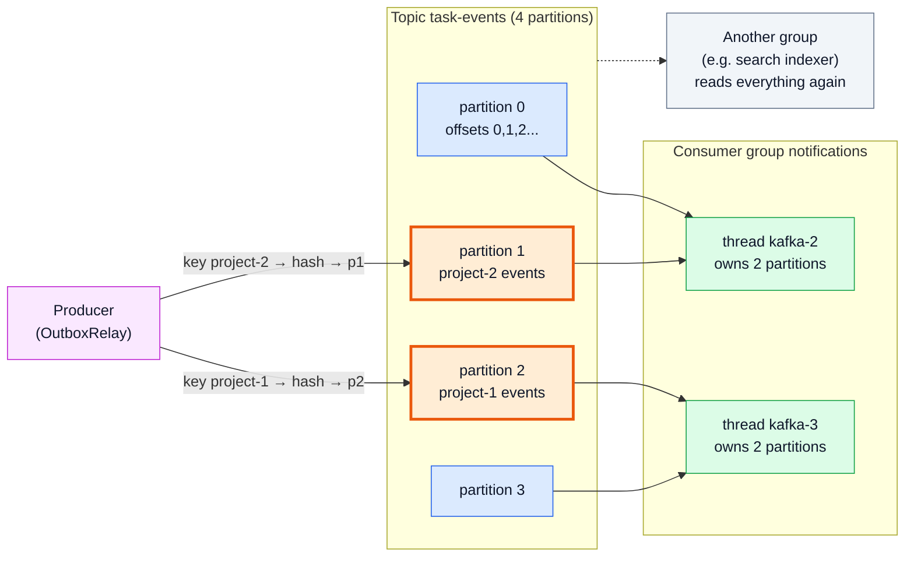
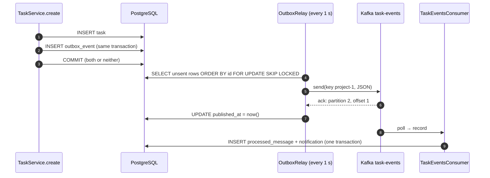
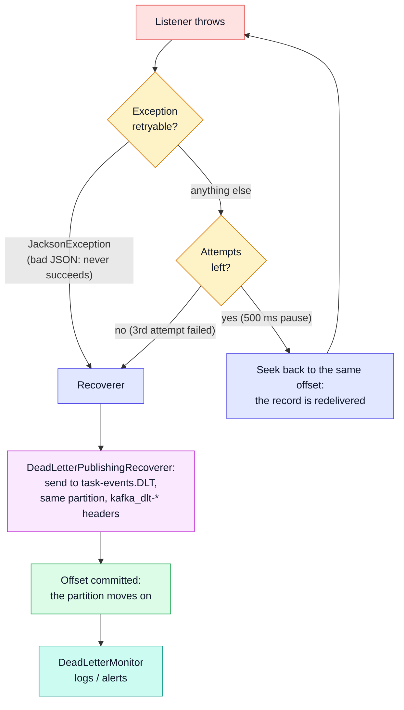

# Messaging with Kafka (and RabbitMQ) — Complete In-Depth Guide

**Spring Boot notes #16 of 18** · Priority 🔴 · Track: Spring Boot ([README](README.md))

So far every part of the Task Tracker talks **synchronously**: a request comes in, the code calls what it needs, the answer goes back. This file adds **asynchronous messaging**. When a task is created, the app publishes an event to **Apache Kafka**, and a consumer reacts to it later, on its own threads.

**Learn the model**
- Brokers, topics, partitions, offsets, keys and consumer groups.
- Kafka vs RabbitMQ: a log vs a queue, and when to pick which.

**Build it with Spring**
- `KafkaTemplate`, `@KafkaListener`, Boot's `spring.kafka.*` settings, serializers.
- The **transactional outbox**: the event is stored in the same database transaction as the task, so neither exists without the other.
- An **idempotent consumer**: Kafka delivers at least once, so duplicates are detected and skipped.
- **Retries and a dead-letter topic**: a failing message gets 3 attempts; a malformed one gets 1; then both are moved aside.

**Check it**
- Keys and partitions, measured: with 3 partitions both project keys landed on the same partition.
- Tests against an embedded Kafka broker, plus a test-isolation bug they caused.

> [!NOTE]
> This topic isn't in Kunal's playlist, so there are no video timestamps (see the [README](README.md#reference-playlist-where-each-video-is-covered)).
>
> **What was run:** [`examples/16-messaging/`](examples/16-messaging/) (Task Tracker 0.16.0, schema `tracker16`) on Spring Boot 4.0.5 / Spring for Apache Kafka 4.0.4 / Kafka clients and broker 4.1.2 / PostgreSQL 18.3 / JDK 21:
> - the app against an **embedded Kafka broker** (KRaft, in the same JVM, started by a `main` in `src/test`); no Docker and no Kafka install;
> - an 8-request scenario on a fresh schema, plus a malformed message from a "buggy producer" (Section 11);
> - a temporary log line in the listener to count its calls (Section 7);
> - `./mvnw test`: 43 tests, run three times, including twice without dropping the test schema; plus the first run's 5 failures (Section 9).
>
> **Not run:** RabbitMQ (Section 10 is configuration only; the dependency isn't in the example), a real multi-broker Kafka cluster, `@RetryableTopic`, Kafka transactions, and the JSON serializers named in Section 4 (the example sends JSON as text).

---

## Table of Contents

| # | Topic (anchor link) | Level |
|---|---|---|
| 0 | [Why Messaging?](#0-why-messaging) | Basics |
| 1 | [Kafka's Model: Topics, Partitions, Offsets, Groups](#1-kafkas-model-topics-partitions-offsets-groups) | Basics |
| 2 | [Kafka vs RabbitMQ](#2-kafka-vs-rabbitmq) | Core |
| 3 | [Spring for Apache Kafka: Producing and Consuming](#3-spring-for-apache-kafka-producing-and-consuming) | Core |
| 4 | [Serialization: Text, JSON and Poison Pills](#4-serialization-text-json-and-poison-pills) | Core |
| 5 | [The Dual-Write Problem and the Transactional Outbox](#5-the-dual-write-problem-and-the-transactional-outbox) | In depth |
| 6 | [Delivery Guarantees and the Idempotent Consumer](#6-delivery-guarantees-and-the-idempotent-consumer) | In depth |
| 7 | [Errors, Retries and the Dead-Letter Topic](#7-errors-retries-and-the-dead-letter-topic) | In depth |
| 8 | [Keys, Partitions and Ordering (Measured)](#8-keys-partitions-and-ordering-measured) | In depth |
| 9 | [Testing with an Embedded Broker](#9-testing-with-an-embedded-broker) | Core |
| 10 | [RabbitMQ with Spring AMQP](#10-rabbitmq-with-spring-amqp) | Core |
| 11 | [Production Concerns](#11-production-concerns) | In depth |
| 12 | [Interview Questions](#12-interview-questions) | Interview |

---

## 0. Why Messaging?

When a task is created, other things should happen: notify watchers, update a search index, feed analytics. There are two ways to make them happen.

| | **Synchronous call** (HTTP, file 13's `RestClient`) | **Asynchronous message** (this file) |
|---|---|---|
| Who knows whom | The caller knows every receiver and its address | The producer knows only a **topic**; receivers subscribe |
| If a receiver is down | The call fails (or waits); the caller must handle it | Messages wait in the broker; the receiver catches up |
| Latency for the user | The sum of all calls | Only the producer's own work |
| Adding a receiver | Change the caller | Subscribe; the producer doesn't change |
| Consistency | Immediate, or an error | **Eventual**: receivers are seconds (or more) behind |
| Debugging | One stack trace | Several services, logs and offsets |

Messaging trades **immediacy** for **decoupling** and **resilience**. Use it when the producer doesn't need the receiver's answer to finish its own work. "Send a notification about a new task" qualifies. "Check that the user may create a task" doesn't.

> [!TIP]
> File 13 already had **in-process** events: `ApplicationEventPublisher` and `@TransactionalEventListener`. Those stay inside one JVM and vanish if it crashes. A broker makes the events **durable** and lets **other services** read them.

---

## 1. Kafka's Model: Topics, Partitions, Offsets, Groups



| Term | Meaning |
|---|---|
| **Broker** | A Kafka server. A **cluster** has several brokers. Kafka 4 runs in **KRaft** mode (no ZooKeeper; the brokers manage their own metadata). |
| **Topic** | A named stream of records, e.g. `task-events`. |
| **Partition** | A topic is split into partitions. Each is an **append-only log** on disk, replicated to other brokers. Partitions are the unit of **parallelism** and of **ordering**. |
| **Offset** | A record's position in its partition: 0, 1, 2… Records are **not deleted when read**; they stay until retention (time or size) removes them. |
| **Record** | Key (optional), value, headers, timestamp. |
| **Key** | Picks the partition: `hash(key) % partitions`. **Same key → same partition → kept in order.** No key → spread across partitions. |
| **Consumer group** | Consumers sharing a `group.id`. Each partition is read by **one** member of the group, so the group shares the work. Another group gets **all** the records again, independently. |
| **Committed offset** | Per group and partition: "processed up to here". After a restart or rebalance, the group continues from it. |
| **Rebalance** | When members join or leave, partitions are redistributed among them. |
| **Lag** | The newest offset minus the committed offset: how far behind a group is. The main health metric. |

> [!IMPORTANT]
> A group never gets more parallelism than the topic has partitions. With 4 partitions, a 5th consumer in the group sits idle. Choose the partition count for the parallelism you'll need. You can add partitions later, but that changes which partition each key goes to.

---

## 2. Kafka vs RabbitMQ

| | **Kafka** | **RabbitMQ** |
|---|---|---|
| Model | A distributed **log**: records stay; consumers track their own position | A **queue broker**: messages are routed to queues and deleted when acknowledged |
| Routing | By topic and partition (key hash) | **Exchanges** (direct, topic, fanout, headers) route to queues by **binding** rules |
| Re-reading | Any group can replay from any offset, within retention | Once acked, gone (unless you keep a copy) |
| Ordering | Per partition | Per queue (with one consumer) |
| Throughput | Very high (sequential disk writes, batching) | High, lower than Kafka at extreme volume |
| Per-message features | Basic; retries and DLTs are built on the client side (Section 7) | Rich: per-message TTL, priorities, dead-letter exchanges, delayed messages (plugin) |
| Typical use | Event streams, event sourcing, analytics pipelines, many independent readers | Task queues, work distribution, request/reply, complex routing |
| Spring project | Spring for Apache Kafka (`spring-kafka`) | Spring AMQP (`spring-rabbit`) |
| Boot starter | `spring-boot-starter-kafka` | `spring-boot-starter-amqp` |

**Rule of thumb:** if several systems should read the **same history** of events, or you need replay, use Kafka. If you need a **work queue** with flexible routing and per-message control, use RabbitMQ. The outbox and idempotency patterns in Sections 5–6 apply to **both**.

---

## 3. Spring for Apache Kafka: Producing and Consuming

### 3.1 Dependencies

```xml
<dependency>
    <groupId>org.springframework.boot</groupId>
    <artifactId>spring-boot-starter-kafka</artifactId>
</dependency>
<dependency>                                   <!-- @EmbeddedKafka, EmbeddedKafkaKraftBroker, KafkaTestUtils -->
    <groupId>org.springframework.boot</groupId>
    <artifactId>spring-boot-starter-kafka-test</artifactId>
    <scope>test</scope>
</dependency>
```

> [!NOTE]
> In Boot 4 the Kafka support has its own starter and module (`spring-boot-starter-kafka`, `spring-boot-kafka`). With Boot 3 you added `spring-kafka` directly. Here the BOM resolved `spring-kafka` 4.0.4 and `kafka-clients` 4.1.2.

### 3.2 Configuration

Boot auto-configures a `ProducerFactory`, a `KafkaTemplate`, a `ConsumerFactory`, a listener container factory and a `KafkaAdmin`, all from `spring.kafka.*`:

```yaml
spring:
  kafka:
    bootstrap-servers: localhost:9092     # the default; the demo launcher passes the embedded broker's address
    producer:
      acks: all                           # the ack the relay waits for means "written to all in-sync replicas"
      # key/value serializers default to StringSerializer: the outbox already holds the JSON text
    consumer:
      auto-offset-reset: earliest         # a NEW consumer group starts at the beginning, not "only new messages"

app:
  messaging:
    enabled: false                        # Kafka relay + listeners off: the app (and its tests) run without a broker
  outbox:
    poll-interval: PT1S                   # how often the relay looks for unsent outbox rows
```

| Setting | Why |
|---|---|
| `acks: all` | The send is acknowledged only when every in-sync replica has the record. It's already the default since Kafka 3.0 (along with `enable.idempotence=true`); writing it down documents the intent. |
| `auto-offset-reset: earliest` | Applies only when a group has **no committed offset**. The default `latest` makes a new group skip everything already in the topic. |
| `app.messaging.enabled: false` | The app has to start without a broker: the default profile, and the 39 tests from file 15. The relay, the listeners and the topic beans are all `@ConditionalOnProperty` on it. |

> [!WARNING]
> **Gotcha:** `KafkaTemplate` and the other Kafka beans are auto-configured as soon as the starter is on the classpath, gated or not. They don't connect until something uses them. That's why the gating goes on **our** beans, the ones that would connect: the relay, the listeners and the `NewTopic` beans that `KafkaAdmin` creates at startup.

### 3.3 Producing

```java
// the simplest form: topic, key, value; returns CompletableFuture<SendResult<K, V>>
kafka.send("task-events", "project-1", json);

// with headers: build the ProducerRecord yourself (this is what OutboxRelay does)
var record = new ProducerRecord<>("task-events", "project-1", json);
record.headers().add("event-id", eventId.getBytes(StandardCharsets.UTF_8));
RecordMetadata meta = kafka.send(record).get(10, TimeUnit.SECONDS).getRecordMetadata();  // wait for the ack
```

`send` is **asynchronous**: it returns immediately with a future. Waiting for the future (`.get`) tells you the broker stored the record, and at which partition and offset. Fire-and-forget (ignoring the future) loses errors silently.

### 3.4 Consuming

```java
@KafkaListener(id = "notifications", topics = "task-events", groupId = "notifications", concurrency = "2")
public void onMessage(ConsumerRecord<String, String> rec) { ... }
```

| Attribute | Meaning |
|---|---|
| `id` | The listener container's id (in logs, and for starting and stopping it via `KafkaListenerEndpointRegistry`) |
| `topics` | What to subscribe to (or `topicPattern`, or explicit `topicPartitions`) |
| `groupId` | The consumer group; overrides `spring.kafka.consumer.group-id` |
| `concurrency` | How many consumer threads this container runs. Each gets a share of the partitions. |

The method can take `ConsumerRecord<K, V>` (everything, including partition, offset and headers), just the value, `@Payload`/`@Header` parameters, or a `List` for batch listeners.

**Offsets:** by default the container commits the offset after the listener returns (`AckMode.BATCH`: after each poll's records are processed). If the listener throws, the **error handler** decides what happens (Section 7).

> [!TIP]
> In this example's output (virtual threads on since file 13), the listener threads are named `kafka-1`, `kafka-2`, `kafka-3`: one per consumer thread (the DLT monitor plus 2 for `notifications`).

### 3.5 Topics

```java
@Bean
NewTopic taskEvents() {
    return TopicBuilder.name("task-events").partitions(4).replicas(1).build();
}
```

`KafkaAdmin` creates missing topics at startup from `NewTopic` beans. In production, topics are usually created by the platform team or by infrastructure-as-code, with `replicas(3)`.

---

## 4. Serialization: Text, JSON and Poison Pills

Kafka stores **bytes**. A serializer turns your key and value into bytes; a deserializer turns them back.

| Approach | Producer | Consumer | Trade-off |
|---|---|---|---|
| **Text** (this example) | `StringSerializer` (Boot's default) with JSON you wrote yourself | `StringDeserializer`, then `JsonMapper.readValue` in the listener | Simple and explicit; bad JSON is an ordinary exception in your code |
| **JSON serializers** | `JacksonJsonSerializer` | `JacksonJsonDeserializer` + trusted packages | Typed listener parameters; needs type info (headers or a default type) |
| **Schema registry** | Avro / Protobuf / JSON Schema serializers | Matching deserializers | Enforced schemas and compatible evolution; needs a registry service |

> [!NOTE]
> In spring-kafka 4.0, `JacksonJsonSerializer` / `JacksonJsonDeserializer` use **Jackson 3** (`tools.jackson`). The older `JsonSerializer` / `JsonDeserializer` (Jackson 2) are still in the jar, marked deprecated (checked with `javap` on `spring-kafka-4.0.4.jar`). These serializers weren't used in the example.

A **poison pill** is a record that can never be processed, for example bytes that aren't valid JSON. If the failure happens **inside the deserializer**, the listener is never called, and a naive setup fails on the same record forever. The fix is `ErrorHandlingDeserializer`. It wraps the real deserializer, catches the failure, and hands it to the error handler as an exception, which can then dead-letter the record:

```yaml
spring:
  kafka:
    consumer:
      value-deserializer: org.springframework.kafka.support.serializer.ErrorHandlingDeserializer
      properties:
        spring.deserializer.value.delegate.class: org.springframework.kafka.support.serializer.JacksonJsonDeserializer
        spring.json.value.default.type: com.notes.tasks.messaging.TaskEventMessage
        spring.json.trusted.packages: com.notes.tasks.messaging
```

(The property names are the constants in `ErrorHandlingDeserializer` and `JacksonJsonDeserializer`, checked with `javap`. This configuration wasn't run.)

This example avoids the problem: values arrive as `String`, and parsing happens **in the listener**, where a `JacksonException` reaches the error handler like any other exception. Section 7 shows the malformed record going to the dead-letter topic.

**The message is a contract.** `TaskEventMessage` is a separate record, not the JPA entity and not file 13's in-process `TaskCreatedEvent`:

```java
package com.notes.tasks.messaging;

import java.time.Instant;
import java.util.UUID;

/**
 * The message on the "task-events" topic: a public contract between teams, so it is its own type,
 * not the JPA entity and not the in-process TaskCreatedEvent. eventId makes every message unique.
 */
public record TaskEventMessage(UUID eventId, String type, long taskId, long projectId, String title,
                               String priority, String createdBy, Instant occurredAt) {
    public static final String TOPIC = "task-events";
    public static final String DLT = "task-events.DLT";
}
```

Other teams will read it, so treat changes like API changes: add fields, don't rename or remove them.

---

## 5. The Dual-Write Problem and the Transactional Outbox

The obvious code is wrong:

```java
@Transactional
public TaskResponse create(...) {
    tasks.save(task);
    kafka.send("task-events", ...);    // ❌ two systems, no shared transaction
}
```

| What fails | Result |
|---|---|
| Kafka is down | `send` fails or hangs: task creation fails because of the **notification** system |
| `send` succeeds, then the DB commit fails | Consumers hear about a task that **doesn't exist** |
| Commit succeeds, the app crashes before `send` | The task exists; the event is **lost forever** |
| Send after commit (`AFTER_COMMIT` listener) | Fixes the second row, not the third: a crash between commit and send still loses it |

There is no transaction spanning PostgreSQL and Kafka. The **transactional outbox** avoids needing one: write the event **into the database, in the same transaction as the task**, and let a separate process move it to Kafka.



**The outbox table (V5 migration):**

```sql
-- V5: transactional outbox (producer side) + processed messages and notifications (consumer side).

-- Written in the SAME transaction as the task: either both exist or neither does.
CREATE TABLE outbox_event (
    id           BIGINT GENERATED BY DEFAULT AS IDENTITY PRIMARY KEY,   -- the relay sends in id order
    event_id     UUID         NOT NULL UNIQUE,                           -- consumers deduplicate on this
    topic        VARCHAR(100) NOT NULL,
    msg_key      VARCHAR(100) NOT NULL,                                  -- Kafka key: same key, same partition
    payload      TEXT         NOT NULL,                                  -- the JSON message, ready to send
    created_at   TIMESTAMPTZ  NOT NULL,
    published_at TIMESTAMPTZ,                                            -- NULL = not sent yet
    attempts     INT          NOT NULL DEFAULT 0
);
CREATE INDEX outbox_event_pending ON outbox_event (id) WHERE published_at IS NULL;

-- "Inbox": which events a consumer has already handled (at-least-once delivery -> duplicates happen).
CREATE TABLE processed_message (
    event_id     UUID        NOT NULL,
    consumer     VARCHAR(50) NOT NULL,
    processed_at TIMESTAMPTZ NOT NULL,
    PRIMARY KEY (event_id, consumer)
);

-- The consumer's own side effect, written in the same transaction as its processed_message row.
CREATE TABLE notification (
    id         BIGINT GENERATED BY DEFAULT AS IDENTITY PRIMARY KEY,
    event_id   UUID         NOT NULL,
    task_id    BIGINT       NOT NULL,
    text       VARCHAR(200) NOT NULL,
    created_at TIMESTAMPTZ  NOT NULL
);
```

**Writing the row:** a plain `@EventListener` runs on the publisher's thread, inside `TaskService.create`'s transaction. `Propagation.MANDATORY` makes it fail loudly if someone publishes the event outside a transaction:

```java
package com.notes.tasks.messaging;

import com.notes.tasks.events.TaskCreatedEvent;
import org.slf4j.Logger;
import org.slf4j.LoggerFactory;
import org.springframework.context.event.EventListener;
import org.springframework.jdbc.core.JdbcTemplate;
import org.springframework.stereotype.Component;
import org.springframework.transaction.annotation.Propagation;
import org.springframework.transaction.annotation.Transactional;
import tools.jackson.databind.json.JsonMapper;

import java.sql.Timestamp;
import java.time.Clock;
import java.time.Instant;
import java.util.UUID;

/**
 * Producer side of the transactional outbox. A plain @EventListener runs on the publisher's thread,
 * INSIDE TaskService.create's transaction (file 13): the outbox row commits or rolls back with the task.
 * Nothing talks to Kafka here, so a broker outage can't fail (or slow down) creating a task.
 */
@Component
public class OutboxWriter {
    private static final Logger log = LoggerFactory.getLogger(OutboxWriter.class);
    private final JdbcTemplate jdbc;
    private final JsonMapper json;
    private final Clock clock;

    public OutboxWriter(JdbcTemplate jdbc, JsonMapper json, Clock clock) {
        this.jdbc = jdbc;
        this.json = json;
        this.clock = clock;
    }

    @EventListener
    @Transactional(propagation = Propagation.MANDATORY)       // refuse to run outside the task's transaction
    public void onTaskCreated(TaskCreatedEvent e) {
        Instant now = Instant.now(clock);
        TaskEventMessage msg = new TaskEventMessage(UUID.randomUUID(), "TaskCreated", e.taskId(), e.projectId(),
                e.title(), e.priority(), e.createdBy(), now);
        jdbc.update("""
                INSERT INTO outbox_event (event_id, topic, msg_key, payload, created_at)
                VALUES (?, ?, ?, ?, ?)""",
                msg.eventId(), TaskEventMessage.TOPIC, "project-" + e.projectId(),
                json.writeValueAsString(msg), Timestamp.from(now));
        log.info("outbox: stored {} for task {} (same transaction as the task)", msg.eventId(), e.taskId());
    }
}
```

**Relaying the rows:**

```java
package com.notes.tasks.messaging;

import org.apache.kafka.clients.producer.ProducerRecord;
import org.apache.kafka.clients.producer.RecordMetadata;
import org.slf4j.Logger;
import org.slf4j.LoggerFactory;
import org.springframework.boot.autoconfigure.condition.ConditionalOnProperty;
import org.springframework.jdbc.core.JdbcTemplate;
import org.springframework.kafka.core.KafkaTemplate;
import org.springframework.scheduling.annotation.Scheduled;
import org.springframework.stereotype.Component;
import org.springframework.transaction.annotation.Transactional;

import java.nio.charset.StandardCharsets;
import java.util.List;
import java.util.Map;
import java.util.concurrent.TimeUnit;

/**
 * Moves outbox rows to Kafka. Runs only with app.messaging.enabled=true (the app works without a broker).
 * At-least-once: a row is marked published only AFTER Kafka acknowledged it. A crash between the two
 * sends the row again on the next run -> consumers must be idempotent (TaskEventsConsumer).
 */
@Component
@ConditionalOnProperty(name = "app.messaging.enabled", havingValue = "true")
public class OutboxRelay {
    private static final Logger log = LoggerFactory.getLogger(OutboxRelay.class);
    private final JdbcTemplate jdbc;
    private final KafkaTemplate<String, String> kafka;

    public OutboxRelay(JdbcTemplate jdbc, KafkaTemplate<String, String> kafka) {
        this.jdbc = jdbc;
        this.kafka = kafka;
    }

    @Scheduled(fixedDelayString = "${app.outbox.poll-interval:PT1S}")
    @Transactional
    public void publishPending() throws Exception {
        // FOR UPDATE SKIP LOCKED: several app instances can run the relay without sending a row twice at once
        List<Map<String, Object>> rows = jdbc.queryForList("""
                SELECT id, event_id, topic, msg_key, payload FROM outbox_event
                WHERE published_at IS NULL ORDER BY id LIMIT 50 FOR UPDATE SKIP LOCKED""");
        for (Map<String, Object> row : rows) {
            long id = ((Number) row.get("id")).longValue();
            var record = new ProducerRecord<>((String) row.get("topic"), (String) row.get("msg_key"), (String) row.get("payload"));
            record.headers().add("event-id", row.get("event_id").toString().getBytes(StandardCharsets.UTF_8));
            try {
                RecordMetadata meta = kafka.send(record).get(10, TimeUnit.SECONDS).getRecordMetadata();  // wait for the ack
                jdbc.update("UPDATE outbox_event SET published_at = now(), attempts = attempts + 1 WHERE id = ?", id);
                log.info("relay: outbox row {} -> {}-{} offset {} (key {})", id, meta.topic(), meta.partition(),
                        meta.offset(), row.get("msg_key"));
            } catch (Exception ex) {
                jdbc.update("UPDATE outbox_event SET attempts = attempts + 1 WHERE id = ?", id);
                log.warn("relay: outbox row {} not sent ({}); will retry", id, ex.toString());
                break;                                           // keep the order: don't send later rows first
            }
        }
    }
}
```

| Design point | Why |
|---|---|
| Mark published **after** the ack | Never lose an event. The price: a crash between ack and `UPDATE` sends the row again (Section 6). |
| `ORDER BY id`, and `break` on failure | Rows go out in creation order. If row 7 fails, rows 8+ wait instead of overtaking it. |
| `FOR UPDATE SKIP LOCKED` | Several app instances can each run the relay without two of them taking the same row. |
| Order by `id`, not `created_at` | The app's `Clock` is fixed in these notes (file 13), so every `created_at` is equal. Identity ids are always increasing. |
| The writer isn't gated | With `app.messaging.enabled=false`, rows pile up unsent and go out when the relay is switched on. |

**What the run showed** (requests 2–3 of the scenario; the output is filtered, see Section 11):

```
# 2. A task in project 1: the task row and its outbox row commit together
> POST /api/projects/1/tasks  [Bearer asha]
  {"title": "Write the release notes", "priority": "HIGH"}
< 201  [application/json]
  04:56:28.087 INFO  [omcat-handler-1] TaskService        : Created task 13 'Write the release notes' in project 1
  04:56:28.111 INFO  [omcat-handler-1] OutboxWriter       : outbox: stored a658c274-4470-483a-baf4-9ff83b0c9cda for task 13 (same transaction as the task)
  04:56:28.218 INFO  [  scheduling-2] OutboxRelay        : relay: outbox row 1 -> task-events-2 offset 1 (key project-1)
  04:56:28.226 INFO  [       kafka-3] TaskEventsConsumer : consumer: notified watchers of task 13 'Write the release notes' [key project-1, partition 2, offset 1]
# 3. Two more: project 2, then project 1 again (same key -> same partition)
> POST /api/projects/2/tasks  [Bearer asha]
  {"title": "Rotate the API keys", "priority": "MEDIUM"}
< 201  [application/json]
  04:56:30.695 INFO  [omcat-handler-2] TaskService        : Created task 14 'Rotate the API keys' in project 2
  04:56:30.696 INFO  [omcat-handler-2] OutboxWriter       : outbox: stored ee749229-c622-42e5-8c2b-0270a0d876b8 for task 14 (same transaction as the task)
  04:56:31.266 INFO  [  scheduling-2] OutboxRelay        : relay: outbox row 2 -> task-events-1 offset 0 (key project-2)
  04:56:31.269 INFO  [       kafka-2] TaskEventsConsumer : consumer: notified watchers of task 14 'Rotate the API keys' [key project-2, partition 1, offset 0]

> POST /api/projects/1/tasks  [Bearer asha]
  {"title": "Tag v1.0", "priority": "LOW"}
< 201  [application/json]
  04:56:33.225 INFO  [omcat-handler-3] TaskService        : Created task 15 'Tag v1.0' in project 1
  04:56:33.227 INFO  [omcat-handler-3] OutboxWriter       : outbox: stored 7ca65e12-6cd7-4473-89ef-61b0cd3d6c9d for task 15 (same transaction as the task)
  04:56:33.299 INFO  [  scheduling-2] OutboxRelay        : relay: outbox row 3 -> task-events-2 offset 2 (key project-1)
  04:56:33.301 INFO  [       kafka-3] TaskEventsConsumer : consumer: notified watchers of task 15 'Tag v1.0' [key project-1, partition 2, offset 2]
```

The task's request thread (`omcat-handler-1`, Boot's 15-character thread column cutting off `tomcat-handler-1`) stores the outbox row. Within 0.6 s the scheduler thread (`scheduling-2`) sends it. The consumer gets it within a few milliseconds.

> [!WARNING]
> **Costs of this relay:**
> - **Locks:** the relay holds row locks for the length of the batch, including the Kafka round trips (up to 10 s each).
> - **Latency:** polling adds up to `poll-interval` of delay.
> - **Growth:** nothing deletes old outbox rows, or old `processed_message` rows.
>
> Production versions prune old rows on a schedule, or replace polling with **change data capture** (Debezium reading the PostgreSQL WAL).

---

## 6. Delivery Guarantees and the Idempotent Consumer

| Guarantee | How you get it | Risk |
|---|---|---|
| **At most once** | Commit the offset *before* processing (or ignore send errors) | Messages lost on a crash |
| **At least once** | Commit *after* processing; retry sends until acked | **Duplicates** on a crash or retry |
| **Exactly once** | Kafka transactions (`read → process → write` within Kafka), or at-least-once + idempotent processing | Kafka transactions cover Kafka only, not your database |

The outbox relay and the default listener container both give **at least once**. So the consumer must be **idempotent**: processing the same message twice has the same effect as once.

The technique is an **inbox** (`processed_message`) with a primary key on `(event_id, consumer)`, written **in the same transaction as the side effect**:

```java
package com.notes.tasks.messaging;

import org.apache.kafka.clients.consumer.ConsumerRecord;
import org.slf4j.Logger;
import org.slf4j.LoggerFactory;
import org.springframework.boot.autoconfigure.condition.ConditionalOnProperty;
import org.springframework.jdbc.core.JdbcTemplate;
import org.springframework.kafka.annotation.KafkaListener;
import org.springframework.stereotype.Component;
import org.springframework.transaction.support.TransactionTemplate;
import tools.jackson.databind.json.JsonMapper;

import java.util.concurrent.atomic.AtomicLong;

/**
 * Consumer group "notifications", 2 listener threads sharing the 4 partitions (2 each).
 * Idempotent: the processed_message row and the notification row are written in ONE database
 * transaction, so a duplicate is detected, and a failure rolls back both (the retry is not "a duplicate").
 */
@Component
@ConditionalOnProperty(name = "app.messaging.enabled", havingValue = "true")
public class TaskEventsConsumer {
    private static final Logger log = LoggerFactory.getLogger(TaskEventsConsumer.class);
    private static final String CONSUMER = "notifications";
    private final JdbcTemplate jdbc;
    private final TransactionTemplate tx;
    private final JsonMapper json;
    private final AtomicLong duplicates = new AtomicLong();

    public TaskEventsConsumer(JdbcTemplate jdbc, TransactionTemplate tx, JsonMapper json) {
        this.jdbc = jdbc;
        this.tx = tx;
        this.json = json;
    }

    @KafkaListener(id = "notifications", topics = TaskEventMessage.TOPIC, groupId = CONSUMER, concurrency = "2")
    public void onMessage(ConsumerRecord<String, String> rec) {
        // Malformed JSON throws tools.jackson.core.JacksonException: not retryable (MessagingConfig) -> DLT at once
        TaskEventMessage m = json.readValue(rec.value(), TaskEventMessage.class);
        tx.executeWithoutResult(status -> {
            int inserted = jdbc.update("""
                    INSERT INTO processed_message (event_id, consumer, processed_at) VALUES (?, ?, now())
                    ON CONFLICT DO NOTHING""", m.eventId(), CONSUMER);
            if (inserted == 0) {
                duplicates.incrementAndGet();
                log.info("consumer: DUPLICATE {} (task {}) skipped [partition {}, offset {}]",
                        m.eventId(), m.taskId(), rec.partition(), rec.offset());
                return;
            }
            if (m.title().contains("[boom]")) {                  // a downstream service failing, simulated
                throw new IllegalStateException("simulated: the mail service is down");
            }
            jdbc.update("INSERT INTO notification (event_id, task_id, text, created_at) VALUES (?, ?, ?, now())",
                    m.eventId(), m.taskId(), "New " + m.priority() + " task '" + m.title() + "' by " + m.createdBy());
            log.info("consumer: notified watchers of task {} '{}' [key {}, partition {}, offset {}]",
                    m.taskId(), m.title(), rec.key(), rec.partition(), rec.offset());
        });
    }

    public long duplicatesSkipped() {
        return duplicates.get();
    }
}
```

| Detail | Why it matters |
|---|---|
| `ON CONFLICT DO NOTHING` returns 0 rows | Duplicate detected without an exception, and without a check-then-insert race between threads |
| Inbox row + notification in **one** transaction | If the notification fails, the inbox row rolls back too, so the retry isn't mistaken for a duplicate. `MessagingFlowTest` asserts this: no `processed_message` row exists for the failed task. |
| `event_id` comes from the producer | A UUID created once, when the outbox row is written, so every re-send of a row carries the same id. Kafka's offset is not usable here: a re-send gets a **new** offset. |
| Key includes the consumer name | Another consumer of the same events keeps its own record of what it processed |

**The duplicate, for real:** request 5 asks the relay to send outbox row 1 again. That's what an operator does after an incident, and what a relay crash between ack and `UPDATE` does by accident:

```
# 5. The operator re-sends outbox row 1: Kafka gets the same event twice
> POST /api/ops/messaging/outbox/1/replay  [Bearer asha]
< 200  [application/json]
{
  "id": 1,
  "requeued": true
}
  04:56:40.401 INFO  [  scheduling-2] OutboxRelay        : relay: outbox row 1 -> task-events-2 offset 3 (key project-1)
  04:56:40.403 INFO  [       kafka-3] TaskEventsConsumer : consumer: DUPLICATE a658c274-4470-483a-baf4-9ff83b0c9cda (task 13) skipped [partition 2, offset 3]
```

Same `event_id` (`a658c274…`), new offset (3 instead of 1), and the consumer skips it. The final state (requests 6–7):

```
# 6. The outbox: every row published (row 1 twice: attempts 2)
> GET /api/ops/messaging/outbox  [Bearer asha]
< 200  [application/json]
[
  {
    "id": 1,
    "msg_key": "project-1",
    "attempts": 2,
    "published": true,
    "title": "Write the release notes"
  },
  {
    "id": 2,
    "msg_key": "project-2",
    "attempts": 1,
    "published": true,
    "title": "Rotate the API keys"
  },
  {
    "id": 3,
    "msg_key": "project-1",
    "attempts": 1,
    "published": true,
    "title": "Tag v1.0"
  },
  {
    "id": 4,
    "msg_key": "project-2",
    "attempts": 1,
    "published": true,
    "title": "Order cake [boom]"
  }
]
# 7. The consumer's side effects: 3 notifications, no duplicate, none for [boom]
> GET /api/ops/messaging/notifications  [Bearer asha]
< 200  [application/json]
[
  {
    "id": 1,
    "task_id": 13,
    "text": "New HIGH task 'Write the release notes' by asha"
  },
  {
    "id": 2,
    "task_id": 14,
    "text": "New MEDIUM task 'Rotate the API keys' by asha"
  },
  {
    "id": 3,
    "task_id": 15,
    "text": "New LOW task 'Tag v1.0' by asha"
  }
]
```

Row 1 shows `attempts: 2`; there are 3 notifications for 4 events. Task 16's notification failed, as the next section shows.

---

## 7. Errors, Retries and the Dead-Letter Topic

When a listener throws, the container's **`CommonErrorHandler`** decides. Boot's default is a `DefaultErrorHandler` with `FixedBackOff(0, 9)`: 10 attempts, no pause, then the record is **logged and skipped**. This app defines its own handler bean, which Boot applies to every `@KafkaListener` container:

```java
package com.notes.tasks.messaging;

import org.apache.kafka.clients.admin.NewTopic;
import org.apache.kafka.clients.consumer.ConsumerRecord;
import org.apache.kafka.common.TopicPartition;
import org.slf4j.Logger;
import org.slf4j.LoggerFactory;
import org.springframework.boot.autoconfigure.condition.ConditionalOnProperty;
import org.springframework.context.annotation.Bean;
import org.springframework.context.annotation.Configuration;
import org.springframework.kafka.config.TopicBuilder;
import org.springframework.kafka.core.KafkaTemplate;
import org.springframework.kafka.listener.DeadLetterPublishingRecoverer;
import org.springframework.kafka.listener.DefaultErrorHandler;
import org.springframework.kafka.listener.RetryListener;
import org.springframework.util.backoff.FixedBackOff;
import tools.jackson.core.JacksonException;

/** Topics and error handling; only when app.messaging.enabled=true. */
@Configuration
@ConditionalOnProperty(name = "app.messaging.enabled", havingValue = "true")
public class MessagingConfig {
    private static final Logger log = LoggerFactory.getLogger(MessagingConfig.class);

    /** KafkaAdmin (auto-configured) creates these at startup if they don't exist. */
    @Bean
    NewTopic taskEvents() {
        return TopicBuilder.name(TaskEventMessage.TOPIC).partitions(4).replicas(1).build();   // 4: see the notes (3 put both projects on one)
    }

    @Bean
    NewTopic taskEventsDlt() {                       // same partition count: a dead letter keeps its partition
        return TopicBuilder.name(TaskEventMessage.DLT).partitions(4).replicas(1).build();
    }

    /**
     * Boot gives this CommonErrorHandler to every @KafkaListener container. A failing record is retried
     * 2 more times, 500 ms apart (3 attempts), then published to task-events.DLT (same partition) and SKIPPED, so one
     * bad message doesn't block its partition forever. Malformed JSON can never succeed: no retries.
     */
    @Bean
    DefaultErrorHandler kafkaErrorHandler(KafkaTemplate<String, String> template) {
        var recoverer = new DeadLetterPublishingRecoverer(template,
                (record, ex) -> new TopicPartition(TaskEventMessage.DLT, record.partition()));
        var handler = new DefaultErrorHandler(recoverer, new FixedBackOff(500L, 2L));
        handler.addNotRetryableExceptions(JacksonException.class);
        handler.setRetryListeners(new RetryListener() {             // make every failed attempt visible
            @Override
            public void failedDelivery(ConsumerRecord<?, ?> rec, Exception ex, int attempt) {
                log.warn("retry: {}-{}@{} failed, attempt {}: {}", rec.topic(), rec.partition(), rec.offset(),
                        attempt, rootMessage(ex));
            }

            @Override
            public void recovered(ConsumerRecord<?, ?> rec, Exception ex) {
                log.warn("retry: {}-{}@{} gave up -> {}", rec.topic(), rec.partition(), rec.offset(), TaskEventMessage.DLT);
            }
        });
        return handler;
    }

    private static String rootMessage(Throwable ex) {
        Throwable t = ex;
        while (t.getCause() != null) t = t.getCause();
        String msg = String.valueOf(t.getMessage()).lines().findFirst().orElse("");
        return t.getClass().getSimpleName() + ": " + msg;
    }
}
```



**A downstream failure** (request 4: the title contains `[boom]`, which simulates the mail service being down):

```
# 4. A task whose notification fails ([boom]): 3 attempts, then the dead-letter topic
> POST /api/projects/2/tasks  [Bearer asha]
  {"title": "Order cake [boom]", "priority": "LOW"}
< 201  [application/json]
  04:56:35.766 INFO  [omcat-handler-4] TaskService        : Created task 16 'Order cake [boom]' in project 2
  04:56:35.770 INFO  [omcat-handler-4] OutboxWriter       : outbox: stored fe6e8ea4-c61f-4640-bc33-d107205535e8 for task 16 (same transaction as the task)
  04:56:36.350 INFO  [  scheduling-2] OutboxRelay        : relay: outbox row 4 -> task-events-1 offset 1 (key project-2)
  04:56:36.354 WARN  [       kafka-2] MessagingConfig    : retry: task-events-1@1 failed, attempt 1: IllegalStateException: simulated: the mail service is down
  04:56:36.861 WARN  [       kafka-2] MessagingConfig    : retry: task-events-1@1 failed, attempt 2: IllegalStateException: simulated: the mail service is down
  04:56:37.373 WARN  [       kafka-2] MessagingConfig    : retry: task-events-1@1 failed, attempt 3: IllegalStateException: simulated: the mail service is down
  04:56:37.903 WARN  [       kafka-2] MessagingConfig    : retry: task-events-1@1 gave up -> task-events.DLT
  04:56:37.904 WARN  [       kafka-1] DeadLetterMonitor  : DLT: value={"eventId":"fe6e8ea4-c61f-4640-bc33-d107205535e8","type":"Ta... | from task-events-1@1 | cause java.lang.IllegalStateException
```

**A malformed record** from a "buggy producer" (the demo launcher writes `{not json` to the topic right after startup):

```
DEMO: embedded Kafka broker at localhost:63499
04:56:24.000 INFO  [          main] MessagingDemo      : Started MessagingDemo in 19.648 seconds (process running for 23.79)
DEMO: a buggy producer sent '{not json' to task-events
04:56:25.850 WARN  [       kafka-3] MessagingConfig    : retry: task-events-2@0 failed, attempt 1: StreamReadException: Unexpected character ('n' (code 110)): was expecting double-quote to start property name
04:56:26.256 WARN  [       kafka-3] MessagingConfig    : retry: task-events-2@0 gave up -> task-events.DLT
04:56:26.258 WARN  [       kafka-1] DeadLetterMonitor  : DLT: value={not json | from task-events-2@0 | cause tools.jackson.core.exc.StreamReadException
```

| What the logs show | Meaning |
|---|---|
| `[boom]`: `attempt 1`, `2`, `3`, about 0.5 s apart | `FixedBackOff(500L, 2L)`: one delivery + 2 retries |
| Malformed: `attempt 1`, then `gave up` | `addNotRetryableExceptions(JacksonException.class)`: no retries |
| `from task-events-1@1`, `cause java.lang.IllegalStateException` | The headers `DeadLetterPublishingRecoverer` adds: `kafka_dlt-original-topic/partition/offset`, `kafka_dlt-exception-cause-fqcn` (also `-fqcn`, `-message`, `-stacktrace`) |
| The malformed record was `task-events-2@0`; task 13 at `task-events-2@1` was processed right after it | The bad record was moved aside, so its partition kept flowing |

> [!NOTE]
> **How the attempts were counted.** The `retry:` lines come from the `RetryListener` callbacks, not from the listener itself. To be sure, a temporary log line at the top of `onMessage` counted the calls in a separate run: **1** for the malformed record, **3** for `[boom]`. In both cases `gave up` appeared about 0.5 s after the last call, with **no** further listener call in between.

**Why `.DLT` and the same partition?** This resolver does what `DeadLetterPublishingRecoverer` does by default; it's written out here so it's visible. Keeping the partition means the DLT topic needs **at least as many partitions** as the original. Both topics have 4 here.

**Beyond this example (not run):**

| Option | What it adds |
|---|---|
| `ExponentialBackOffWithMaxRetries` | Growing pauses (1 s, 2 s, 4 s…) instead of fixed ones |
| `@RetryableTopic` + `@DltHandler` | **Non-blocking** retries: a failing record moves to `-retry-…` topics with delays, so the main partition isn't paused during the back-off. The cost: ordering per key is lost for that record. |
| Replaying the DLT | A tool or endpoint that reads the DLT and re-publishes fixed records after the cause is fixed |

> [!IMPORTANT]
> Blocking retries (`DefaultErrorHandler`) **pause the whole partition** while they back off. Three attempts 500 ms apart is fine. Ten attempts with exponential pauses can stall every later record on that partition for minutes. Keep blocking retries short, and use the DLT (or retry topics) for the rest.

---

## 8. Keys, Partitions and Ordering (Measured)

Kafka guarantees order **within a partition** only. The relay keys every event by project (`project-1`, `project-2`), so all events of one project land in one partition and are consumed **in order**. The ordering is per project; there's no global order.

**The first run used 3 partitions, and every record went to partition 0**:

```
relay: outbox row 1 -> task-events-0 offset 1 (key project-1)
relay: outbox row 2 -> task-events-0 offset 2 (key project-2)
```

That's not a bug. The default partitioner computes `toPositive(murmur2(keyBytes)) % partitions`. Computed with `kafka-clients`' own `Utils.murmur2` for the keys in this app:

| Key | 3 partitions | 4 partitions | 6 partitions |
|---|---|---|---|
| `project-1` | 0 | **2** | 0 |
| `project-2` | 0 | **1** | 3 |
| `project-3` | 0 | 3 | 3 |
| `project-4` | 2 | 0 | 2 |
| `project-5` | 1 | 0 | 4 |

With 3 partitions, projects 1–3 all collide on partition 0. The example uses 4, where projects 1 and 2 separate. The final run confirms it: project-1 went to partition 2 (`kafka-3` consumed it) and project-2 to partition 1 (`kafka-2`).

**Lessons:**
- **"Same key → same partition" is guaranteed. "Different keys → different partitions" is not.** With few keys, collisions are likely, and some consumers sit idle. With many keys (thousands of projects), the hash spreads them evenly.
- A **hot key** (one huge project) makes one hot partition. Partitions can't be split per key.
- **Adding partitions** changes `% partitions` for existing keys: new events for a key may land elsewhere while old ones are still being processed, which breaks ordering during the transition.
- **Concurrency ≤ partitions**: `concurrency = "2"` with 4 partitions gave each thread 2.

---

## 9. Testing with an Embedded Broker

`spring-boot-starter-kafka-test` brings `@EmbeddedKafka`: a real Kafka broker (KRaft) **inside the test JVM**, on a random port. No Docker needed. A one-message spike (`EmbeddedKafkaSpikeTest`) checked first that it starts on this Windows machine. It does, and it logs a harmless error at JVM exit when it can't delete its temporary directory.

```java
package com.notes.tasks.messaging;

import com.notes.tasks.model.Priority;
import com.notes.tasks.dto.TaskDtos.CreateTaskRequest;
import com.notes.tasks.service.TaskService;
import org.apache.kafka.clients.consumer.Consumer;
import org.apache.kafka.clients.consumer.ConsumerRecord;
import org.apache.kafka.clients.consumer.KafkaConsumer;
import org.apache.kafka.common.serialization.StringDeserializer;
import org.junit.jupiter.api.AfterAll;
import org.junit.jupiter.api.AfterEach;
import org.junit.jupiter.api.Test;
import org.springframework.beans.factory.annotation.Autowired;
import org.springframework.boot.test.context.SpringBootTest;
import org.springframework.jdbc.core.JdbcTemplate;
import org.springframework.kafka.core.KafkaTemplate;
import org.springframework.kafka.test.EmbeddedKafkaBroker;
import org.springframework.kafka.test.context.EmbeddedKafka;
import org.springframework.kafka.test.utils.KafkaTestUtils;
import org.springframework.security.test.context.support.WithMockUser;
import org.springframework.test.context.ActiveProfiles;

import java.nio.charset.StandardCharsets;
import java.time.Duration;
import java.util.Map;

import static org.assertj.core.api.Assertions.assertThat;
import static org.awaitility.Awaitility.await;

/**
 * The whole flow against an embedded Kafka broker: task -> outbox -> relay -> topic -> consumer.
 * Messaging is asynchronous, so the assertions WAIT (Awaitility) instead of sleeping a fixed time.
 */
@SpringBootTest(properties = {
        "spring.kafka.bootstrap-servers=${spring.embedded.kafka.brokers}",   // set by @EmbeddedKafka
        "app.messaging.enabled=true",
        "app.outbox.poll-interval=PT0.2S"})
@EmbeddedKafka(partitions = 4, topics = {TaskEventMessage.TOPIC, TaskEventMessage.DLT})
@ActiveProfiles("test")
class MessagingFlowTest {
    private static final Duration WAIT = Duration.ofSeconds(20);

    @Autowired TaskService tasks;
    @Autowired JdbcTemplate jdbc;
    @Autowired TaskEventsConsumer consumer;
    @Autowired KafkaTemplate<String, String> kafka;
    @Autowired EmbeddedKafkaBroker broker;

    static Consumer<String, String> dlt;                   // a plain consumer that reads the dead letters

    final java.util.List<Long> created = new java.util.ArrayList<>();

    /** These tasks COMMIT (the consumer must see them), so remove them: other tests count tasks. */
    @AfterEach
    void removeWhatThisTestCreated() {
        created.forEach(id -> jdbc.update("DELETE FROM task WHERE id = ?", id));
        jdbc.update("DELETE FROM notification");
        jdbc.update("DELETE FROM processed_message");
        jdbc.update("DELETE FROM outbox_event");
    }

    @AfterAll
    static void closeDltReader() {
        if (dlt != null) dlt.close();
    }

    @Test
    @WithMockUser(username = "asha", roles = "ADMIN")
    void createdTaskReachesTheConsumerOnce_evenWhenTheEventIsSentTwice() {
        long id = tasks.create(1, new CreateTaskRequest("Messaging test task", null, Priority.HIGH, null, null, null)).id();
        created.add(id);

        await().atMost(WAIT).until(() -> notificationsFor(id) == 1);
        assertThat(jdbc.queryForObject("SELECT published_at IS NOT NULL FROM outbox_event WHERE payload::json ->> 'taskId' = ?",
                Boolean.class, String.valueOf(id))).isTrue();

        long duplicatesBefore = consumer.duplicatesSkipped();
        jdbc.update("UPDATE outbox_event SET published_at = NULL WHERE payload::json ->> 'taskId' = ?", String.valueOf(id));

        await().atMost(WAIT).until(() -> consumer.duplicatesSkipped() > duplicatesBefore);   // delivered again...
        assertThat(notificationsFor(id)).isEqualTo(1);                                         // ...handled once
    }

    @Test
    @WithMockUser(username = "asha", roles = "ADMIN")
    void failingMessageIsRetriedThenDeadLettered_withoutANotification() {
        long id = tasks.create(2, new CreateTaskRequest("Order cake [boom]", null, Priority.LOW, null, null, null)).id();
        created.add(id);

        ConsumerRecord<String, String> dead = nextDeadLetter(rec -> rec.value().contains("\"taskId\":" + id + ","));
        assertThat(header(dead, "kafka_dlt-exception-cause-fqcn")).isEqualTo(IllegalStateException.class.getName());
        assertThat(notificationsFor(id)).isZero();
        assertThat(jdbc.queryForObject("SELECT count(*) FROM processed_message pm JOIN outbox_event o USING (event_id) "
                + "WHERE o.payload::json ->> 'taskId' = ?", Long.class, String.valueOf(id)))
                .as("the failed attempts rolled back their processed_message rows").isZero();
    }

    @Test
    void malformedJsonGoesStraightToTheDeadLetterTopic() {
        kafka.send(TaskEventMessage.TOPIC, "project-9", "{this is not json");

        ConsumerRecord<String, String> dead = nextDeadLetter(rec -> rec.value().startsWith("{this is not json"));
        assertThat(header(dead, "kafka_dlt-exception-cause-fqcn")).endsWith("StreamReadException");
    }

    private long notificationsFor(long taskId) {
        return jdbc.queryForObject("SELECT count(*) FROM notification WHERE task_id = ?", Long.class, taskId);
    }

    private ConsumerRecord<String, String> nextDeadLetter(java.util.function.Predicate<ConsumerRecord<String, String>> match) {
        if (dlt == null) {
            Map<String, Object> props = KafkaTestUtils.consumerProps(broker, "test-dlt-reader", false);
            props.put("auto.offset.reset", "earliest");
            dlt = new KafkaConsumer<>(props, new StringDeserializer(), new StringDeserializer());
            broker.consumeFromAnEmbeddedTopic(dlt, TaskEventMessage.DLT);
        }
        var found = new java.util.concurrent.atomic.AtomicReference<ConsumerRecord<String, String>>();
        await().atMost(WAIT).until(() -> {
            for (ConsumerRecord<String, String> r : KafkaTestUtils.getRecords(dlt, Duration.ofMillis(500), 0)) {
                if (match.test(r)) found.set(r);
            }
            return found.get() != null;
        });
        return found.get();
    }

    private static String header(ConsumerRecord<?, ?> rec, String name) {
        return new String(rec.headers().lastHeader(name).value(), StandardCharsets.UTF_8);
    }
}
```

| Technique | Why |
|---|---|
| `spring.kafka.bootstrap-servers=${spring.embedded.kafka.brokers}` | `@EmbeddedKafka` publishes its address in this property; the app connects to it |
| `topics = {TOPIC, DLT}` on `@EmbeddedKafka` | `consumeFromAnEmbeddedTopic` only accepts topics the broker declared. Without it: `topic(s):'[task-events.DLT]' are not in embedded topic list`. |
| `await().atMost(...).until(...)` (Awaitility) | Messaging is asynchronous: **poll for the result** instead of `Thread.sleep(…)`, which is slow when it's long enough and flaky when it isn't |
| `poll-interval=PT0.2S` | A faster relay makes a faster test |
| A plain `KafkaConsumer` on the DLT | Asserts on what was **dead-lettered** and its headers, not just on logs |
| `@AfterEach` cleanup | See below |

**The first full run failed 5 tests in other classes:**

```
[ERROR] Tests run: 43, Failures: 5, Errors: 0, Skipped: 1
[ERROR]   TaskApiIntegrationTest.searchPagesThroughTheBacklog:88 JSON path "$.totalElements" expected:<12> but was:<14>
[ERROR]   TaskRepositoryTest.bulkUpdateCompletesOverdueTasks:74
[ERROR]   TaskRepositoryTest.derivedQueryFindsOpenTasksByDueDate:47
[ERROR]   TaskRepositoryTest.fetchJoinLoadsAProjectsTasksInOneStatement:65
[ERROR]   TaskRepositoryTest.specificationsCombineOptionalFilters:57
```

`MessagingFlowTest` can't roll back like an ordinary `@Transactional` test: the consumer runs on another thread, so it only sees **committed** rows. The tasks it created stayed in the shared test schema, and later tests counting tasks (`expected:<12> but was:<14>`) failed. The fix is the `@AfterEach` that deletes exactly what the test created.

After the fix, the suite passed three times in a row, twice **without** dropping the test schema first:

```
Tests run: 2, Failures: 0, Errors: 0, Skipped: 0 -- com.notes.tasks.AdvancedFeaturesTest
Tests run: 3, Failures: 0, Errors: 0, Skipped: 0 -- com.notes.tasks.TaskApiIntegrationTest
Tests run: 1, Failures: 0, Errors: 0, Skipped: 0 -- com.notes.tasks.messaging.EmbeddedKafkaSpikeTest
Tests run: 3, Failures: 0, Errors: 0, Skipped: 0 -- com.notes.tasks.messaging.MessagingFlowTest
Tests run: 4, Failures: 0, Errors: 0, Skipped: 0 -- com.notes.tasks.ops.ActuatorTest
Tests run: 1, Failures: 0, Errors: 0, Skipped: 0 -- com.notes.tasks.ratelimit.TokenBucketTest
Tests run: 1, Failures: 0, Errors: 0, Skipped: 1 -- com.notes.tasks.repo.TaskRepositoryContainerTest
Tests run: 8, Failures: 0, Errors: 0, Skipped: 0 -- com.notes.tasks.repo.TaskRepositoryTest
Tests run: 3, Failures: 0, Errors: 0, Skipped: 0 -- com.notes.tasks.security.JwtPropertiesTest
Tests run: 4, Failures: 0, Errors: 0, Skipped: 0 -- com.notes.tasks.security.SecurityRulesTest
Tests run: 4, Failures: 0, Errors: 0, Skipped: 0 -- com.notes.tasks.service.TaskServiceTest
Tests run: 3, Failures: 0, Errors: 0, Skipped: 0 -- com.notes.tasks.web.ErrorContractTest
Tests run: 6, Failures: 0, Errors: 0, Skipped: 0 -- com.notes.tasks.web.TaskControllerTest
TOTAL 43 tests, 0 failures, 0 errors, 1 skipped (Testcontainers: no Docker on this machine)
```

> [!TIP]
> Testing levels for messaging:
> - **Unit:** call `onMessage(new ConsumerRecord<>(...))` directly; no broker.
> - **Embedded broker:** fast; the real protocol (this file).
> - **Testcontainers** `KafkaContainer`: the exact broker version you run in production; needs Docker.
> - **Contract tests** on the message format: the consumer team's tests run against the producer's message examples.

---

## 10. RabbitMQ with Spring AMQP

> [!NOTE]
> **Not run.** RabbitMQ isn't installed here and `spring-boot-starter-amqp` isn't in the example's `pom.xml`. The code below shows the standard Spring AMQP API but wasn't compiled.

**The model:** producers publish to an **exchange** with a **routing key**. **Bindings** route the message to **queues**. Consumers read from queues and **ack** each message, which deletes it.

| Exchange type | Routes to queues whose binding… |
|---|---|
| `direct` | has exactly the routing key |
| `topic` | matches a pattern: `task.*.created`, `task.#` (`*` = one word, `#` = zero or more) |
| `fanout` | exists: every bound queue gets a copy |
| `headers` | matches message headers instead of the key |

```java
@Configuration
class RabbitConfig {
    @Bean TopicExchange taskExchange() { return new TopicExchange("tasks"); }

    @Bean Queue notifications() {
        return QueueBuilder.durable("notifications")
                .deadLetterExchange("tasks.dlx")          // rejected or expired messages go here
                .build();
    }

    @Bean Binding notificationsBinding(Queue notifications, TopicExchange taskExchange) {
        return BindingBuilder.bind(notifications).to(taskExchange).with("task.*.created");
    }
}

// producing
rabbitTemplate.convertAndSend("tasks", "task.project-1.created", json);

// consuming: acked automatically when the method returns, rejected when it throws
@RabbitListener(queues = "notifications")
void onTaskCreated(String json) { ... }
```

```yaml
spring:
  rabbitmq:
    host: localhost
    port: 5672
    username: guest          # the broker's default; change it outside a laptop
    password: guest
    listener:
      simple:
        retry:
          enabled: true      # retries inside the listener, then reject → the dead-letter exchange
          max-attempts: 3
```

**Same patterns, different broker:** the outbox (Section 5) and the idempotent consumer (Section 6) carry over unchanged. RabbitMQ also delivers at least once: a consumer crash before the ack redelivers the message.

---

## 11. Production Concerns

| Concern | What to do |
|---|---|
| **Durability** | `replicas(3)`, `min.insync.replicas=2`, producer `acks=all`: a write survives one broker failure |
| **Producer retries** | `enable.idempotence=true` (the default) stops the producer's own retries from duplicating records within a partition. It does **not** cover the outbox re-sending a row; the consumer's inbox does. |
| **Consumer lag** | Monitor it per group and partition (Micrometer exposes Kafka client metrics; Burrow, Kafka UI or Grafana show lag). Rising lag means consumers can't keep up. |
| **Retention** | The topic keeps records for `retention.ms` (7 days by default). Replays and new consumer groups can only go back that far. Compacted topics keep the last record per key instead. |
| **Message evolution** | Add fields, never repurpose them; consumers ignore unknown fields. Or use a schema registry with compatibility rules. |
| **Outbox housekeeping** | Delete published rows older than N days. Delete `processed_message` rows older than the longest possible redelivery window. |
| **Security** | TLS and SASL to the brokers; ACLs per topic and group. Bootstrap servers and credentials come from the environment (file 14's secrets), never from the jar. |
| **Poison pills** | `ErrorHandlingDeserializer` (or text + parse in code), a DLT, and an **alert** on the DLT |
| **Rebalances** | A listener that takes longer than `max.poll.interval.ms` (5 min by default) is considered dead and its partitions are reassigned, which causes duplicates. Keep processing short, or hand slow work to a queue of its own. |
| **Graceful shutdown** | The containers stop with the application context (file 12's graceful shutdown); a record in flight finishes, and an unfinished one is redelivered to the next owner of the partition |

> [!NOTE]
> **The output in these notes is filtered.** `fmt16.py` (a scratch script) shortens log lines to `time LEVEL [thread] logger : message` and drops lines from file 13's `TaskEventListeners` (`[sync]` / `[after commit]`), the audit aspect and SpringDoc's startup warnings. The unfiltered run logged all of them too.

---

## 12. Interview Questions

| # | Question | Answer |
|---|---|---|
| 1 | Kafka vs RabbitMQ? | Kafka is a replicated, partitioned **log**: records stay, consumer groups track offsets, replay is possible. RabbitMQ is a **queue broker**: exchanges route to queues, acked messages are deleted, and it has rich per-message features. |
| 2 | What's a partition for? | Parallelism (one consumer per partition per group) and ordering (guaranteed within a partition only) |
| 3 | How do you keep a customer's events in order? | Use the customer id as the **key**: same key → same partition → in order. One consumer thread per partition processes them in sequence. |
| 4 | What's a consumer group? | Consumers sharing a `group.id` split the partitions among themselves. A different group reads every record again, independently. |
| 5 | What happens with more consumers than partitions? | The extra consumers sit idle |
| 6 | At-least-once vs exactly-once? | At-least-once: commit after processing, so duplicates are possible. Exactly-once in Kafka means transactions for read-process-write **within Kafka**. With a database involved, at-least-once + an idempotent consumer is the practical answer. |
| 7 | What is the dual-write problem? | Writing to the DB and the broker separately can't be atomic: a crash between them loses an event, or announces a change that was rolled back |
| 8 | How does the transactional outbox work? | Insert the event into an outbox table in the same DB transaction as the change. A relay (polling or CDC) publishes it, then marks it sent. The result is at-least-once, so consumers deduplicate. |
| 9 | How do you make a consumer idempotent? | Record each processed event id (unique key) in the **same transaction** as the side effect; skip it if the id is already there. Or make the operation naturally idempotent (an upsert or a "set" rather than an "add"). |
| 10 | Why not use the Kafka offset as the dedup key? | A re-sent record gets a new offset. The id has to come from the producer's business event. |
| 11 | What is a poison pill and how do you handle it? | A record that always fails (often bad bytes). Use `ErrorHandlingDeserializer` (or parse in code), mark it not retryable, publish it to a DLT, alert. |
| 12 | What does `DefaultErrorHandler` do by default? | 10 attempts with no pause (`FixedBackOff(0, 9)`), then logs and skips the record. Add a `DeadLetterPublishingRecoverer` to keep it. |
| 13 | Blocking vs non-blocking retries? | Blocking (`DefaultErrorHandler` back-off) pauses the partition but keeps the order. Non-blocking (`@RetryableTopic`) moves the record to retry topics, so the partition keeps flowing, but that record loses its place in the order. |
| 14 | What is `auto.offset.reset`? | What a group does when it has **no committed offset**: `latest` (the default; only new records) or `earliest` (from the beginning) |
| 15 | What is consumer lag and why watch it? | The newest offset minus the committed offset. Growing lag means consumers are falling behind; it's the main health signal. |
| 16 | `acks=0/1/all`? | No wait / the leader wrote it / all in-sync replicas wrote it. `all` + `min.insync.replicas=2` + 3 replicas survives a broker loss. |
| 17 | How do you test Kafka code in Spring? | `@EmbeddedKafka` (in-JVM broker), Testcontainers for a real one, Awaitility for async assertions, and plain unit tests calling the listener method |
| 18 | What triggers a rebalance, and why does it matter? | A consumer joining, leaving, or exceeding `max.poll.interval.ms`. Partitions move to other consumers, and anything processed but not committed is delivered again. |

---

## 🧩 Complete Example: Everything Together

**Task Tracker, stage 16.** File 15's app plus:
- **V5 migration:** `outbox_event`, `processed_message`, `notification`;
- **producer side:** `OutboxWriter` (same transaction) and `OutboxRelay` (scheduled, ack before marking);
- **consumer side:** `TaskEventsConsumer` (idempotent) and `DeadLetterMonitor`;
- **`MessagingConfig`:** topics, retries, the DLT;
- **`OutboxController`:** `/api/ops/messaging/...` for admins;
- **tests:** `MessagingDemo` (embedded-broker launcher), `MessagingFlowTest`, `EmbeddedKafkaSpikeTest`.

Source: [`examples/16-messaging/`](examples/16-messaging/)

```
16-messaging/
├── pom.xml                                       (0.16.0; + spring-boot-starter-kafka, -kafka-test)
└── src/
    ├── main/java/com/notes/tasks/
    │   ├── events/TaskCreatedEvent.java          now carries projectId, title, priority, createdBy
    │   ├── messaging/
    │   │   ├── TaskEventMessage.java             the message contract (JSON on the topic)
    │   │   ├── OutboxWriter.java                 @EventListener, MANDATORY transaction
    │   │   ├── OutboxRelay.java                  @Scheduled, gated by app.messaging.enabled
    │   │   ├── TaskEventsConsumer.java           @KafkaListener, inbox + notification in one tx
    │   │   ├── DeadLetterMonitor.java            @KafkaListener on task-events.DLT
    │   │   ├── MessagingConfig.java              NewTopic x2, DefaultErrorHandler + DLT
    │   │   └── OutboxController.java             GET outbox / notifications, POST replay (ADMIN)
    │   └── ... 53 classes from files 04–15
    ├── main/resources/
    │   ├── application.yml                       + spring.kafka.*, app.messaging.enabled=false
    │   └── db/migration/V5__outbox_and_inbox.sql
    └── test/java/com/notes/tasks/messaging/
        ├── MessagingDemo.java                    embedded broker + the app + a poison pill
        ├── MessagingFlowTest.java                3 tests, @EmbeddedKafka + Awaitility
        └── EmbeddedKafkaSpikeTest.java           1 message there and back
```

**The operator endpoints:**

```java
package com.notes.tasks.messaging;

import org.springframework.jdbc.core.JdbcTemplate;
import org.springframework.security.access.prepost.PreAuthorize;
import org.springframework.web.bind.annotation.GetMapping;
import org.springframework.web.bind.annotation.PathVariable;
import org.springframework.web.bind.annotation.PostMapping;
import org.springframework.web.bind.annotation.RequestMapping;
import org.springframework.web.bind.annotation.RestController;

import java.util.List;
import java.util.Map;

/** Operator view of both sides of the messaging flow (ADMIN only). */
@RestController
@RequestMapping("/api/ops/messaging")
@PreAuthorize("hasRole('ADMIN')")
public class OutboxController {
    private final JdbcTemplate jdbc;

    public OutboxController(JdbcTemplate jdbc) {
        this.jdbc = jdbc;
    }

    @GetMapping("/outbox")
    public List<Map<String, Object>> outbox() {
        return jdbc.queryForList("""
                SELECT id, msg_key, attempts, published_at IS NOT NULL AS published,
                       payload::json ->> 'title' AS title
                FROM outbox_event ORDER BY id""");
    }

    @GetMapping("/notifications")
    public List<Map<String, Object>> notifications() {
        return jdbc.queryForList("SELECT id, task_id, text FROM notification ORDER BY id");
    }

    /** Re-send a row: what an operator does after an incident, and what a relay crash does by accident. */
    @PostMapping("/outbox/{id}/replay")
    public Map<String, Object> replay(@PathVariable long id) {
        int n = jdbc.update("UPDATE outbox_event SET published_at = NULL WHERE id = ?", id);
        return Map.of("id", id, "requeued", n == 1);
    }
}
```

**The demo launcher** (in `src/test`, because the embedded broker comes from a test dependency):

```java
package com.notes.tasks.messaging;

import com.notes.tasks.TaskTrackerApplication;
import org.apache.kafka.clients.producer.KafkaProducer;
import org.apache.kafka.clients.producer.ProducerRecord;
import org.apache.kafka.common.serialization.StringSerializer;
import org.slf4j.LoggerFactory;
import org.springframework.boot.SpringApplication;
import org.springframework.kafka.test.EmbeddedKafkaKraftBroker;
import org.springframework.kafka.test.utils.KafkaTestUtils;

/**
 * Runs the real app against a throwaway in-process Kafka broker (no Docker, no Kafka install).
 * Lives in src/test because spring-kafka-test is a test dependency; production points
 * spring.kafka.bootstrap-servers at a real cluster instead.
 */
public class MessagingDemo {

    public static void main(String[] args) throws Exception {
        var broker = new EmbeddedKafkaKraftBroker(1, 4);          // 1 broker; 4 partitions for auto-created topics
        // Logback's default before Spring Boot configures it is DEBUG: the broker would print ~1,300 config lines
        ((ch.qos.logback.classic.Logger) LoggerFactory.getLogger(org.slf4j.Logger.ROOT_LOGGER_NAME))
                .setLevel(ch.qos.logback.classic.Level.WARN);
        broker.afterPropertiesSet();                              // starts it on a free port
        Runtime.getRuntime().addShutdownHook(new Thread(broker::destroy));
        System.out.println("DEMO: embedded Kafka broker at " + broker.getBrokersAsString());

        String[] appArgs = new String[args.length + 2];
        appArgs[0] = "--spring.kafka.bootstrap-servers=" + broker.getBrokersAsString();
        appArgs[1] = "--app.messaging.enabled=true";
        System.arraycopy(args, 0, appArgs, 2, args.length);
        SpringApplication.run(TaskTrackerApplication.class, appArgs);

        // Another (buggy) service writes something that is not JSON to our topic: a "poison pill".
        try (var producer = new KafkaProducer<>(KafkaTestUtils.producerProps(broker),
                new StringSerializer(), new StringSerializer())) {
            producer.send(new ProducerRecord<>(TaskEventMessage.TOPIC, "project-1", "{not json")).get();
        }
        System.out.println("DEMO: a buggy producer sent '{not json' to " + TaskEventMessage.TOPIC);
    }
}
```

### Run it

```bash
cd "Spring Boot Notes/examples/16-messaging"
./mvnw test                                      # 43 tests (1 skipped without Docker); no broker needed
java -jar target/task-tracker-0.16.0.jar         # after ./mvnw package: messaging OFF, outbox rows wait
# the app + an embedded Kafka broker (port 8080):
./mvnw spring-boot:test-run -Dspring-boot.run.main-class=com.notes.tasks.messaging.MessagingDemo \
  -Dspring-boot.run.arguments=--app.rate-limit.capacity=100
# against a real broker instead:
java -jar target/task-tracker-0.16.0.jar --app.messaging.enabled=true --spring.kafka.bootstrap-servers=broker:9092
```

Then, as asha (ADMIN), get a token and create tasks: `POST /api/projects/1/tasks`, then `GET /api/ops/messaging/outbox` and `/notifications`. A title containing `[boom]` fails in the consumer.

> [!NOTE]
> The `spring-boot:test-run` command was run once to check that it starts the demo (the poison pill reached the DLT and `/actuator/health` answered `UP`). The output below comes from the same `MessagingDemo` main started with `java -cp` (the test classpath from `dependency:build-classpath`) and the same `--app.rate-limit.capacity=100`. The scenario sends 8 requests from one user, more than the rate limit's burst of 5. The real-broker command wasn't run.

**Expected Output** (the full run on a fresh schema, filtered as Section 11 explains):

```
DEMO: embedded Kafka broker at localhost:63499
04:56:24.000 INFO  [          main] MessagingDemo      : Started MessagingDemo in 19.648 seconds (process running for 23.79)
DEMO: a buggy producer sent '{not json' to task-events
04:56:25.850 WARN  [       kafka-3] MessagingConfig    : retry: task-events-2@0 failed, attempt 1: StreamReadException: Unexpected character ('n' (code 110)): was expecting double-quote to start property name
04:56:26.256 WARN  [       kafka-3] MessagingConfig    : retry: task-events-2@0 gave up -> task-events.DLT
04:56:26.258 WARN  [       kafka-1] DeadLetterMonitor  : DLT: value={not json | from task-events-2@0 | cause tools.jackson.core.exc.StreamReadException
----- requests -----
# 1. asha (ADMIN) logs in
> POST /api/auth/token  [Basic asha:***]
< 200  [application/json]

# 2. A task in project 1: the task row and its outbox row commit together
> POST /api/projects/1/tasks  [Bearer asha]
  {"title": "Write the release notes", "priority": "HIGH"}
< 201  [application/json]
  04:56:28.087 INFO  [omcat-handler-1] TaskService        : Created task 13 'Write the release notes' in project 1
  04:56:28.111 INFO  [omcat-handler-1] OutboxWriter       : outbox: stored a658c274-4470-483a-baf4-9ff83b0c9cda for task 13 (same transaction as the task)
  04:56:28.218 INFO  [  scheduling-2] OutboxRelay        : relay: outbox row 1 -> task-events-2 offset 1 (key project-1)
  04:56:28.226 INFO  [       kafka-3] TaskEventsConsumer : consumer: notified watchers of task 13 'Write the release notes' [key project-1, partition 2, offset 1]

# 3. Two more: project 2, then project 1 again (same key -> same partition)
> POST /api/projects/2/tasks  [Bearer asha]
  {"title": "Rotate the API keys", "priority": "MEDIUM"}
< 201  [application/json]
  04:56:30.695 INFO  [omcat-handler-2] TaskService        : Created task 14 'Rotate the API keys' in project 2
  04:56:30.696 INFO  [omcat-handler-2] OutboxWriter       : outbox: stored ee749229-c622-42e5-8c2b-0270a0d876b8 for task 14 (same transaction as the task)
  04:56:31.266 INFO  [  scheduling-2] OutboxRelay        : relay: outbox row 2 -> task-events-1 offset 0 (key project-2)
  04:56:31.269 INFO  [       kafka-2] TaskEventsConsumer : consumer: notified watchers of task 14 'Rotate the API keys' [key project-2, partition 1, offset 0]

> POST /api/projects/1/tasks  [Bearer asha]
  {"title": "Tag v1.0", "priority": "LOW"}
< 201  [application/json]
  04:56:33.225 INFO  [omcat-handler-3] TaskService        : Created task 15 'Tag v1.0' in project 1
  04:56:33.227 INFO  [omcat-handler-3] OutboxWriter       : outbox: stored 7ca65e12-6cd7-4473-89ef-61b0cd3d6c9d for task 15 (same transaction as the task)
  04:56:33.299 INFO  [  scheduling-2] OutboxRelay        : relay: outbox row 3 -> task-events-2 offset 2 (key project-1)
  04:56:33.301 INFO  [       kafka-3] TaskEventsConsumer : consumer: notified watchers of task 15 'Tag v1.0' [key project-1, partition 2, offset 2]

# 4. A task whose notification fails ([boom]): 3 attempts, then the dead-letter topic
> POST /api/projects/2/tasks  [Bearer asha]
  {"title": "Order cake [boom]", "priority": "LOW"}
< 201  [application/json]
  04:56:35.766 INFO  [omcat-handler-4] TaskService        : Created task 16 'Order cake [boom]' in project 2
  04:56:35.770 INFO  [omcat-handler-4] OutboxWriter       : outbox: stored fe6e8ea4-c61f-4640-bc33-d107205535e8 for task 16 (same transaction as the task)
  04:56:36.350 INFO  [  scheduling-2] OutboxRelay        : relay: outbox row 4 -> task-events-1 offset 1 (key project-2)
  04:56:36.354 WARN  [       kafka-2] MessagingConfig    : retry: task-events-1@1 failed, attempt 1: IllegalStateException: simulated: the mail service is down
  04:56:36.861 WARN  [       kafka-2] MessagingConfig    : retry: task-events-1@1 failed, attempt 2: IllegalStateException: simulated: the mail service is down
  04:56:37.373 WARN  [       kafka-2] MessagingConfig    : retry: task-events-1@1 failed, attempt 3: IllegalStateException: simulated: the mail service is down
  04:56:37.903 WARN  [       kafka-2] MessagingConfig    : retry: task-events-1@1 gave up -> task-events.DLT
  04:56:37.904 WARN  [       kafka-1] DeadLetterMonitor  : DLT: value={"eventId":"fe6e8ea4-c61f-4640-bc33-d107205535e8","type":"Ta... | from task-events-1@1 | cause java.lang.IllegalStateException

# 5. The operator re-sends outbox row 1: Kafka gets the same event twice
> POST /api/ops/messaging/outbox/1/replay  [Bearer asha]
< 200  [application/json]
{
  "id": 1,
  "requeued": true
}
  04:56:40.401 INFO  [  scheduling-2] OutboxRelay        : relay: outbox row 1 -> task-events-2 offset 3 (key project-1)
  04:56:40.403 INFO  [       kafka-3] TaskEventsConsumer : consumer: DUPLICATE a658c274-4470-483a-baf4-9ff83b0c9cda (task 13) skipped [partition 2, offset 3]

# 6. The outbox: every row published (row 1 twice: attempts 2)
> GET /api/ops/messaging/outbox  [Bearer asha]
< 200  [application/json]
[
  {
    "id": 1,
    "msg_key": "project-1",
    "attempts": 2,
    "published": true,
    "title": "Write the release notes"
  },
  {
    "id": 2,
    "msg_key": "project-2",
    "attempts": 1,
    "published": true,
    "title": "Rotate the API keys"
  },
  {
    "id": 3,
    "msg_key": "project-1",
    "attempts": 1,
    "published": true,
    "title": "Tag v1.0"
  },
  {
    "id": 4,
    "msg_key": "project-2",
    "attempts": 1,
    "published": true,
    "title": "Order cake [boom]"
  }
]

# 7. The consumer's side effects: 3 notifications, no duplicate, none for [boom]
> GET /api/ops/messaging/notifications  [Bearer asha]
< 200  [application/json]
[
  {
    "id": 1,
    "task_id": 13,
    "text": "New HIGH task 'Write the release notes' by asha"
  },
  {
    "id": 2,
    "task_id": 14,
    "text": "New MEDIUM task 'Rotate the API keys' by asha"
  },
  {
    "id": 3,
    "task_id": 15,
    "text": "New LOW task 'Tag v1.0' by asha"
  }
]
```

**Reading the output:**

| Output | Concept |
|---|---|
| `DEMO: embedded Kafka broker at localhost:63499` | `EmbeddedKafkaKraftBroker` on a random port, passed to the app as `spring.kafka.bootstrap-servers` |
| `retry: task-events-2@0 ... attempt 1` → `gave up` → `DLT: value={not json` | A poison pill: not retryable, dead-lettered, partition 2 moves on ([Section 7](#7-errors-retries-and-the-dead-letter-topic)) |
| `outbox: stored ... (same transaction as the task)` on `omcat-handler-N` | The outbox row is written on the request thread, inside the task's transaction ([Section 5](#5-the-dual-write-problem-and-the-transactional-outbox)) |
| `relay: outbox row 1 -> task-events-2 offset 1` on `scheduling-2` | The scheduled relay sends after the commit, waits for the ack |
| `key project-1` → partition 2, `key project-2` → partition 1, each on its own `kafka-N` thread | Keys pick partitions; 2 consumer threads share 4 partitions ([Section 8](#8-keys-partitions-and-ordering-measured)) |
| `attempt 1/2/3` → `gave up -> task-events.DLT` for `[boom]` | `FixedBackOff(500L, 2L)` then `DeadLetterPublishingRecoverer` |
| `DUPLICATE a658c274... skipped [partition 2, offset 3]` | The same `event_id` at a new offset: the idempotent consumer ([Section 6](#6-delivery-guarantees-and-the-idempotent-consumer)) |
| `"attempts": 2` for row 1; 3 notifications for 4 events | At-least-once delivery, exactly-once **effect**; the failed one is in the DLT |
| `Tests run: 43 ... Skipped: 1` | All earlier tests still pass with messaging **off**, plus 4 messaging tests with it on ([Section 9](#9-testing-with-an-embedded-broker)) |

---

## Quick Reference Cheat Sheet

| Concept | Key point |
|---|---|
| Topic / partition / offset | A named log, split into ordered append-only partitions; offset = position; records stay until retention |
| Key | `murmur2(key) % partitions`: same key, same partition, same order; different keys **may** collide |
| Consumer group | Partitions shared among members; each group reads everything; parallelism ≤ partitions |
| Kafka vs RabbitMQ | Log + replay + many readers vs queues + routing + per-message features |
| Boot setup | `spring-boot-starter-kafka`; `spring.kafka.bootstrap-servers`, `producer.acks`, `consumer.auto-offset-reset` |
| Produce | `KafkaTemplate.send(...)` returns a future; wait on it if you must know it was stored |
| Consume | `@KafkaListener(id, topics, groupId, concurrency)`; offset committed after the listener returns |
| Dual write | DB + broker can't be atomic → **transactional outbox** + relay (polling or CDC) |
| Delivery | At-least-once is the norm → **idempotent consumer**: inbox table, same transaction as the side effect |
| Errors | `DefaultErrorHandler` + `FixedBackOff` + `DeadLetterPublishingRecoverer`; not-retryable for poison pills |
| DLT headers | `kafka_dlt-original-topic/-partition/-offset`, `kafka_dlt-exception-fqcn/-cause-fqcn/-message` |
| Retries pause | Blocking retries stall the partition; keep them short or use `@RetryableTopic` |
| Serialization | Text + parse in code, or `JacksonJsonSerializer` / `ErrorHandlingDeserializer(JacksonJsonDeserializer)`, or a schema registry |
| Testing | `@EmbeddedKafka`, `${spring.embedded.kafka.brokers}`, Awaitility, clean up committed data |
| Gating | `@ConditionalOnProperty(app.messaging.enabled)` on the beans that connect: the app runs without a broker |
| Production | 3 replicas, `min.insync.replicas=2`, lag alerts, DLT alerts, outbox pruning, schema evolution rules |
