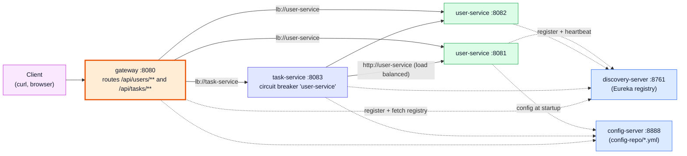
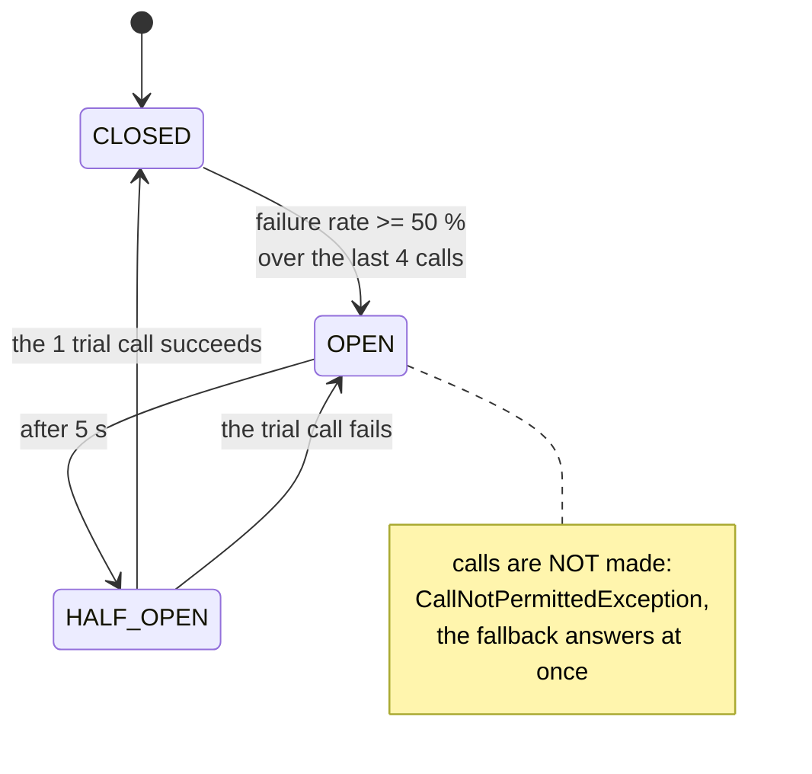

# Microservices with Spring Cloud — Complete In-Depth Guide

**Spring Boot notes #17 of 18** · Priority 🔴 · Track: Spring Boot ([README](README.md))

Files 04–16 built one application, a **monolith**: one deployable, one database, calls between parts are method calls. This file splits a small piece of it into **separate services**. Each runs as its own process and talks to the others over HTTP. Spring Cloud supplies the parts that a distributed system needs and a monolith doesn't.

**Decide**
- Monolith vs microservices: what you gain, what you pay, when to split.

**Build: six processes on one machine**
- **Config server:** one place for every service's settings.
- **Service discovery** (Eureka): services find each other by name, not by address.
- **Client-side load balancing** and a **declarative HTTP client** (`@HttpExchange`).
- An **API gateway**: one entry point that routes to the services.
- **Distributed tracing:** one trace id across three services.
- **Resilience:** timeouts, a **circuit breaker**, fallbacks.

**Break it on purpose**
- Both instances become slow: the breaker opens, then recovers.
- One instance crashes: what happens until the registry notices.
- Plus four configuration traps the runs exposed.

> [!NOTE]
> This topic isn't in Kunal's playlist, so there are no video timestamps (see the [README](README.md#reference-playlist-where-each-video-is-covered)).
>
> **What was run:** [`examples/17-microservices/`](examples/17-microservices/) (version 0.17.0) on Spring Boot 4.0.5 / **Spring Cloud 2025.1.4** (Config 5.0.6, Netflix Eureka 5.0.3, Gateway 5.0.4, CircuitBreaker 5.0.3 with Resilience4j 2.3.0, Commons/LoadBalancer 5.0.4) / Micrometer Tracing 1.6.4 with Brave / JDK 21:
> - 6 processes on one Windows machine (config server, Eureka, user-service ×2, task-service, gateway), started by a script;
> - an 8-step scenario through the gateway, including slowness injected at runtime and one instance killed;
> - `./mvnw test`: 4 tests, with no config server or Eureka running.
>
> Several earlier runs failed in instructive ways. Each failure is shown where it belongs (Sections 4, 6, 7 and 9).
>
> **Not run:** Docker and Kubernetes, the reactive (WebFlux) gateway, OpenFeign, a Git-backed config server, Zipkin or any trace backend, more than one Eureka server, and the gateway `Retry` filter suggested in Section 8.

---

## Table of Contents

| # | Topic (anchor link) | Level |
|---|---|---|
| 0 | [Monolith or Microservices?](#0-monolith-or-microservices) | Basics |
| 1 | [The Example: Six Processes](#1-the-example-six-processes) | Basics |
| 2 | [Centralized Configuration: Spring Cloud Config](#2-centralized-configuration-spring-cloud-config) | Core |
| 3 | [Service Discovery: Eureka](#3-service-discovery-eureka) | Core |
| 4 | [Load Balancing and Declarative HTTP Clients](#4-load-balancing-and-declarative-http-clients) | Core |
| 5 | [The API Gateway](#5-the-api-gateway) | Core |
| 6 | [Distributed Tracing](#6-distributed-tracing) | Core |
| 7 | [Resilience: Timeouts, Circuit Breakers, Fallbacks](#7-resilience-timeouts-circuit-breakers-fallbacks) | In depth |
| 8 | [When an Instance Dies](#8-when-an-instance-dies) | In depth |
| 9 | [Testing a Service Alone](#9-testing-a-service-alone) | Core |
| 10 | [Data and Communication Between Services](#10-data-and-communication-between-services) | In depth |
| 11 | [Production: Kubernetes and the Rest](#11-production-kubernetes-and-the-rest) | In depth |
| 12 | [Interview Questions](#12-interview-questions) | Interview |

---

## 0. Monolith or Microservices?

| | **Monolith** (files 04–16) | **Microservices** (this file) |
|---|---|---|
| Deploy | One artifact; every change redeploys everything | Each service on its own schedule |
| Scale | The whole app | Only the busy service |
| Team ownership | Shared codebase; coordination needed | One team per service, end to end |
| Technology | One stack | Per service (within reason) |
| A call between parts | A method call: nanoseconds, never "half fails" | A network call: milliseconds, can be slow, fail, or succeed without you knowing |
| Data | One database, ACID transactions across everything | **A database per service**; no cross-service transactions |
| Debugging | One log, one stack trace | Many logs: needs correlation (tracing) |
| Operations | One thing to run | Many things to run, plus the infrastructure in this file |

> [!IMPORTANT]
> Microservices solve **organizational and scaling** problems, at the price of **distributed-systems** problems. Start with a well-structured monolith (clear packages or modules, no shared tables between modules). Split out a service when a team, a scaling need or a release cadence actually requires it. A "distributed monolith", where services must be deployed together and call each other synchronously in long chains, has the costs of both and the benefits of neither.

**Splitting the Task Tracker** along business capabilities (bounded contexts):

| Candidate service | Owns | Talks to |
|---|---|---|
| user-service | users, credentials, profiles | — |
| task-service | projects, tasks, tags | user-service (names), publishes task events |
| notification-service | notifications | consumes task events (file 16's consumer, as its own service) |
| reporting-service | read-optimized summaries | consumes events (CQRS, Section 10) |

The example builds the first two, small and in memory, so the infrastructure stays in focus.

---

## 1. The Example: Six Processes



| Module | Spring Cloud piece | Dependencies (besides Boot web + actuator) |
|---|---|---|
| `config-server` | Spring Cloud Config Server | `spring-cloud-config-server` |
| `discovery-server` | Eureka server | `spring-cloud-starter-netflix-eureka-server` |
| `user-service` | Config client + Eureka client | `spring-cloud-starter-config`, `spring-cloud-starter-netflix-eureka-client`, tracing |
| `task-service` | + LoadBalancer + CircuitBreaker | + `spring-boot-starter-restclient`, `spring-cloud-starter-loadbalancer`, `spring-cloud-starter-circuitbreaker-resilience4j` |
| `gateway` | Spring Cloud Gateway (Server MVC) | `spring-cloud-starter-gateway-server-webmvc` + config, Eureka client, LoadBalancer, tracing |

One Maven **multi-module** build holds all five. The parent fixes the versions for every `spring-cloud-*` artifact by importing the release-train BOM:

```xml
<?xml version="1.0" encoding="UTF-8"?>
<project xmlns="http://maven.apache.org/POM/4.0.0"
         xmlns:xsi="http://www.w3.org/2001/XMLSchema-instance"
         xsi:schemaLocation="http://maven.apache.org/POM/4.0.0 https://maven.apache.org/xsd/maven-4.0.0.xsd">
    <modelVersion>4.0.0</modelVersion>

    <!-- Parent of the 5 services: one build, one set of versions. Each service is still its own jar and process. -->
    <parent>
        <groupId>org.springframework.boot</groupId>
        <artifactId>spring-boot-starter-parent</artifactId>
        <version>4.0.5</version>
        <relativePath/>
    </parent>

    <groupId>com.notes.ms</groupId>
    <artifactId>microservices</artifactId>
    <version>0.17.0</version>
    <packaging>pom</packaging>
    <description>Spring Boot notes, stage 17: microservices with Spring Cloud</description>

    <modules>
        <module>config-server</module>
        <module>discovery-server</module>
        <module>user-service</module>
        <module>task-service</module>
        <module>gateway</module>
    </modules>

    <properties>
        <java.version>21</java.version>
        <spring-cloud.version>2025.1.4</spring-cloud.version>   <!-- the release train for Boot 4.0.x -->
    </properties>

    <dependencyManagement>
        <dependencies>
            <dependency>                                        <!-- versions for every spring-cloud-* artifact -->
                <groupId>org.springframework.cloud</groupId>
                <artifactId>spring-cloud-dependencies</artifactId>
                <version>${spring-cloud.version}</version>
                <type>pom</type>
                <scope>import</scope>
            </dependency>
        </dependencies>
    </dependencyManagement>

    <build>
        <pluginManagement>
            <plugins>
                <plugin>
                    <groupId>org.springframework.boot</groupId>
                    <artifactId>spring-boot-maven-plugin</artifactId>
                </plugin>
            </plugins>
        </pluginManagement>
    </build>
</project>
```

> [!NOTE]
> Spring Cloud ships as a **release train** (`2025.1.x`, code name Oakwood) matched to a Boot line: 2025.1 targets Boot 4.0. Maven Central also had `2026.0.0-RC2` at the time of writing, the next train, not a release. Using a train that doesn't match your Boot version fails at startup with a compatibility check error.

**Startup**, in dependency order (config server, then Eureka, then the services). The output is filtered (Section 11 explains how):

```
  config-server 36:04.743 INFO   TomcatWebServer  : Tomcat started on port 8888 (http) with context path '/'
  config-server 36:04.763 INFO   ConfigServerApplication: Started ConfigServerApplication in 6.192 seconds (process running for 7.571)
  discovery     36:15.348 INFO   TomcatWebServer  : Tomcat started on port 8761 (http) with context path '/'
  discovery     36:15.374 INFO   DiscoveryServerApplication: Started DiscoveryServerApplication in 9.179 seconds (process running for 10.578)
  user-8081     36:25.554 INFO  [              ] TomcatWebServer  : Tomcat started on port 8081 (http) with context path '/'
  user-8081     36:25.590 INFO  [              ] UserServiceApplication: Started UserServiceApplication in 8.789 seconds (process running for 10.176)
  discovery     36:26.026 INFO   AbstractInstanceRegistry: Registered instance USER-SERVICE/user-service:8081 with status UP (replication=false)
  discovery     36:26.884 INFO   AbstractInstanceRegistry: Registered instance USER-SERVICE/user-service:8081 with status UP (replication=true)
  user-8082     36:35.560 INFO  [              ] TomcatWebServer  : Tomcat started on port 8082 (http) with context path '/'
  user-8082     36:35.588 INFO  [              ] UserServiceApplication: Started UserServiceApplication in 8.327 seconds (process running for 9.929)
  discovery     36:35.610 INFO   AbstractInstanceRegistry: Registered instance USER-SERVICE/user-service:8082 with status UP (replication=false)
  discovery     36:36.067 INFO   AbstractInstanceRegistry: Registered instance USER-SERVICE/user-service:8082 with status UP (replication=true)
  task-service  36:47.800 INFO  [              ] TomcatWebServer  : Tomcat started on port 8083 (http) with context path '/'
  task-service  36:47.837 INFO  [              ] TaskServiceApplication: Started TaskServiceApplication in 10.315 seconds (process running for 12.194)
  discovery     36:47.852 INFO   AbstractInstanceRegistry: Registered instance TASK-SERVICE/task-service:8083 with status UP (replication=false)
  discovery     36:48.173 INFO   AbstractInstanceRegistry: Registered instance TASK-SERVICE/task-service:8083 with status UP (replication=true)
  gateway       36:59.063 INFO  [              ] TomcatWebServer  : Tomcat started on port 8080 (http) with context path '/'
  gateway       36:59.096 INFO  [              ] GatewayApplication: Started GatewayApplication in 9.582 seconds (process running for 11.222)
  discovery     36:59.118 INFO   AbstractInstanceRegistry: Registered instance GATEWAY/gateway:8080 with status UP (replication=false)
  discovery     36:59.628 INFO   AbstractInstanceRegistry: Registered instance GATEWAY/gateway:8080 with status UP (replication=true)
```

Each service needs ~10 s to start. A service registers within a second of starting.

---

## 2. Centralized Configuration: Spring Cloud Config

Six processes with their own `application.yml` means six places to change a timeout. The **config server** serves configuration over HTTP, and each **config client** fetches its own at startup.

```yaml
# config-server/src/main/resources/application.yml
server:
  port: 8888

spring:
  application:
    name: config-server
  main:
    banner-mode: off
  profiles:
    active: native                        # files instead of a Git repository (the default backend)
  cloud:
    config:
      server:
        native:
          search-locations: classpath:/config-repo/   # application.yml = shared, {name}.yml = per service

logging:
  level:
    root: WARN
    com.notes: INFO
    org.springframework.boot.tomcat: INFO
```

```java
package com.notes.ms.config;

import org.springframework.boot.SpringApplication;
import org.springframework.boot.autoconfigure.SpringBootApplication;
import org.springframework.cloud.config.server.EnableConfigServer;

/** Serves {application}.yml files over HTTP: GET /{application}/{profile}. Started first. */
@SpringBootApplication
@EnableConfigServer
public class ConfigServerApplication {
    public static void main(String[] args) {
        SpringApplication.run(ConfigServerApplication.class, args);
    }
}
```

**The repository** (`config-repo/`): `application.yml` is shared by all clients, and `{spring.application.name}.yml` is for one service:

```yaml
# config-repo/application.yml (every client)
# Shared by EVERY client of the config server (user-service, task-service, gateway).

eureka:
  client:
    service-url:
      defaultZone: http://localhost:8761/eureka/
    registry-fetch-interval-seconds: 2          # default 30: how often a client refreshes its copy of the registry
  instance:
    instance-id: ${spring.application.name}:${server.port}
    lease-renewal-interval-in-seconds: 2        # heartbeat; default 30
    lease-expiration-duration-in-seconds: 6     # evicted after this long without one; default 90
    hostname: localhost                         # advertise http://localhost:<port> (one machine); real hosts
                                                # use their own name or prefer-ip-address: true

spring:
  main:
    banner-mode: off
  cloud:
    loadbalancer:
      cache:
        ttl: 2s                                 # default 35s: how long the load balancer caches instance lists

management:
  tracing:
    sampling:
      probability: 1.0                          # default 0.1: trace every request (fine for a demo, not for production)
  endpoints:
    web:
      exposure:
        include: health, info

logging:
  level:
    root: WARN
    com.notes: INFO
    org.springframework.boot.tomcat: INFO
```

```yaml
# config-repo/task-service.yml
# Only for task-service: the circuit breaker around calls to user-service.
app:
  user-service:
    timeout: 1s                       # slower answers count as failures
    breaker:
      window: 4                       # look at the last 4 calls...
      failure-rate: 50                # ...open the breaker when half or more failed
      open-for: 5s                    # then fail fast for 5 s before trying again (half-open)

spring:
  cloud:
    circuitbreaker:
      resilience4j:
        disable-time-limiter: true    # the HTTP client's read timeout (above) does the timing
        disable-thread-pool: true     # default false: each call runs on a separate thread pool (a bulkhead),
                                      # so it leaves the request thread and its trace context
```

**A client** declares where its configuration comes from:

```yaml
# user-service/src/main/resources/application.yml (the whole file)
server:
  port: ${PORT:8081}                      # two instances: PORT=8081 and PORT=8082

spring:
  application:
    name: user-service                    # the name others use to find it (and the config server's file name)
  config:
    import: "${CONFIG_IMPORT:configserver:http://localhost:8888}"   # mandatory (no optional:): no config server, no start
  cloud:
    config:
      fail-fast: true
```

| Setting | Meaning |
|---|---|
| `spring.config.import: configserver:...` | Boot's config-data API (`spring.config.import`) with the `configserver:` prefix that Spring Cloud Config adds. Without `optional:`, the service **refuses to start** if the server is unreachable. |
| `${CONFIG_IMPORT:...}` | The value can be overridden; the tests set it to empty (Section 9) |
| `fail-fast: true` | Fail at startup rather than run with missing settings |

What the server returns for user-service: the two files, most specific first:

```
# 1. The config server: what user-service gets (shared application.yml + user-service.yml)
> GET :8888/user-service/default
< 200  (38 ms)
{
  "name": "user-service",
  "profiles": [
    "default"
  ],
  "label": null,
  "version": null,
  "state": null,
  "propertySources": [
    {
      "name": "classpath:/config-repo/user-service.yml",
      "source": {
        "app.greeting": "Hello from the config server"
      }
    },
    {
      "name": "classpath:/config-repo/application.yml",
      "source": {
        "eureka.client.service-url.defaultZone": "http://localhost:8761/eureka/",
        "eureka.client.registry-fetch-interval-seconds": 2,
        "eureka.instance.instance-id": "${spring.application.name}:${server.port}",
        "eureka.instance.lease-renewal-interval-in-seconds": 2,
        "eureka.instance.lease-expiration-duration-in-seconds": 6,
        "eureka.instance.hostname": "localhost",
        "spring.main.banner-mode": false,
        "spring.cloud.loadbalancer.cache.ttl": "2s",
        "management.tracing.sampling.probability": 1.0,
        "management.endpoints.web.exposure.include": "health, info",
        "logging.level.root": "WARN",
        "logging.level.com.notes": "INFO",
        "logging.level.org.springframework.boot.tomcat": "INFO"
      }
    }
  ]
}
  gateway       37:00.417 INFO  […432a2f23 e691] AccessLogFilter  : GET /api/users/1 -> 200 (13 ms)
```

| Topic | Notes |
|---|---|
| Backends | **Git** (the default: versioned, reviewed, auditable), native files (this example), Vault, JDBC, S3 |
| Profiles | `user-service-prod.yml` is added for the `prod` profile; the URL is `/{application}/{profile}` |
| Secrets | Don't put them in plain config. Use Vault, or `{cipher}...` values the server decrypts. |
| Refresh | Changing a file does nothing to running clients until they **refresh**: `POST /actuator/refresh` (with `@RefreshScope` beans), or Spring Cloud Bus to broadcast it (not run) |

---

## 3. Service Discovery: Eureka

Instances come and go (scaling, deployments, crashes), and their addresses change. Hard-coding `http://10.0.3.17:8081` doesn't work. **Discovery**: each instance **registers** its name and address with a registry and sends **heartbeats**; callers ask the registry for "user-service".

```java
package com.notes.ms.discovery;

import org.springframework.boot.SpringApplication;
import org.springframework.boot.autoconfigure.SpringBootApplication;
import org.springframework.cloud.netflix.eureka.server.EnableEurekaServer;

/** The registry: services register here and look each other up by name. Dashboard on http://localhost:8761. */
@SpringBootApplication
@EnableEurekaServer
public class DiscoveryServerApplication {
    public static void main(String[] args) {
        SpringApplication.run(DiscoveryServerApplication.class, args);
    }
}
```

```yaml
server:
  port: 8761

spring:
  application:
    name: discovery-server
  main:
    banner-mode: off

eureka:
  client:
    register-with-eureka: false           # a single registry doesn't register with itself...
    fetch-registry: false                 # ...or copy the registry from a peer
  server:
    enable-self-preservation: false       # demo only: evict dead instances instead of keeping them "just in case"
    eviction-interval-timer-in-ms: 2000   # check for expired leases every 2 s (default 60 s)
    response-cache-update-interval-ms: 1000   # clients see changes within ~1 s (default 30 s)

logging:
  level:
    root: WARN
    com.notes: INFO
    org.springframework.boot.tomcat: INFO
    com.netflix.eureka.registry.AbstractInstanceRegistry: INFO   # "Registered instance ..." / "Cancelled instance ..."
```

**Clients** need only the Eureka client starter and `eureka.client.service-url.defaultZone`; here that comes from the shared `config-repo/application.yml`. The registry after startup:

```
# 2. The registry: who is registered (Eureka REST API)
> GET /eureka/apps
< 200  (18 ms)
  GATEWAY: gateway:8080 UP
  TASK-SERVICE: task-service:8083 UP
  USER-SERVICE: user-service:8081 UP, user-service:8082 UP
```

| Timing setting | Default | Here | Effect |
|---|---|---|---|
| `eureka.instance.lease-renewal-interval-in-seconds` | 30 | 2 | Heartbeat interval |
| `eureka.instance.lease-expiration-duration-in-seconds` | 90 | 6 | Silence before an instance may be evicted |
| `eureka.client.registry-fetch-interval-seconds` | 30 | 2 | How often a caller refreshes its local copy |
| `eureka.server.response-cache-update-interval-ms` | 30000 | 1000 | The server's own response cache |
| `spring.cloud.loadbalancer.cache.ttl` | 35 s | 2 s | The LoadBalancer's cache of instance lists |

The defaults are deliberately slow: discovery is **eventually consistent**. A caller may see a dead instance for a while, or not yet see a new one. Section 8 measures how long "a while" is.

> [!WARNING]
> **Self-preservation.** When many heartbeats go missing at once, Eureka assumes a **network problem**, not mass death, and stops evicting. It's on by default and is the right choice for production. It's disabled here (`enable-self-preservation: false`) so that one killed instance is evicted during the demo. With it on, a single dead instance in a small cluster can stay registered indefinitely.

> [!NOTE]
> `eureka.instance.hostname: localhost` makes instances advertise `http://localhost:<port>`. The first run used `prefer-ip-address: true`, which advertised the machine's LAN address. Each refused connection to that address took about **2 s** on this machine, against about **50 ms** for `localhost`.

---

## 4. Load Balancing and Declarative HTTP Clients

**Client-side load balancing:** the *caller* gets the instance list (from Eureka, through Spring Cloud **LoadBalancer**) and picks one per request. The default is round robin. No separate load balancer box is involved.

### 4.1 A load-balanced `RestClient`

```java
package com.notes.ms.tasks;

import org.springframework.beans.factory.annotation.Value;
import org.springframework.boot.restclient.autoconfigure.RestClientBuilderConfigurer;
import org.springframework.cloud.client.loadbalancer.LoadBalanced;
import org.springframework.context.annotation.Bean;
import org.springframework.context.annotation.Configuration;
import org.springframework.context.annotation.Primary;
import org.springframework.http.client.SimpleClientHttpRequestFactory;
import org.springframework.web.client.RestClient;
import org.springframework.web.client.support.RestClientAdapter;
import org.springframework.web.service.invoker.HttpServiceProxyFactory;

import java.time.Duration;

@Configuration
public class ClientConfig {

    /**
     * The PLAIN builder, for everyone else. Without it, the @LoadBalanced builder below would be the only
     * RestClient.Builder bean (Boot's default backs off), and the Eureka client would get it too: it then
     * treated "localhost" in http://localhost:8761/eureka/ as a service name and never registered
     * ("No servers available for service: localhost"). @Primary makes plain injection points get this one.
     */
    @Bean
    @Primary
    RestClient.Builder restClientBuilder(RestClientBuilderConfigurer configurer) {
        return configurer.configure(RestClient.builder());
    }

    /**
     * @LoadBalanced: Spring Cloud adds an interceptor that turns http://user-service into the address of one
     * registered instance, chosen per request (round robin by default).
     * configurer.configure(...) applies Boot's customizations, including the observation (tracing) one,
     * so the trace id travels to user-service in the request headers.
     */
    @Bean
    @LoadBalanced
    RestClient.Builder loadBalancedRestClientBuilder(RestClientBuilderConfigurer configurer,
                                                     @Value("${app.user-service.timeout:1s}") Duration timeout) {
        var factory = new SimpleClientHttpRequestFactory();
        factory.setConnectTimeout(Duration.ofMillis(500));
        factory.setReadTimeout(timeout);                     // a slow user-service fails the call after 1 s
        return configurer.configure(RestClient.builder()).requestFactory(factory);
    }

    @Bean
    UserClient userClient(@LoadBalanced RestClient.Builder builder) {
        RestClient client = builder.baseUrl("http://user-service").build();   // a service NAME, not a host
        return HttpServiceProxyFactory.builderFor(RestClientAdapter.create(client)).build()
                .createClient(UserClient.class);
    }
}
```

```java
package com.notes.ms.tasks;

import org.springframework.web.bind.annotation.PathVariable;
import org.springframework.web.service.annotation.GetExchange;
import org.springframework.web.service.annotation.HttpExchange;

/**
 * A declarative HTTP client (Spring Framework's HTTP interface): Spring generates the implementation.
 * The same idea as OpenFeign's @FeignClient, built into the framework.
 */
@HttpExchange("/users")
public interface UserClient {

    record User(long id, String name, String servedBy, String greeting) {}

    @GetExchange("/{id}")
    User get(@PathVariable long id);
}
```

| Piece | What it does |
|---|---|
| `@LoadBalanced` on a `RestClient.Builder` bean | Spring Cloud adds an interceptor: the host in `http://user-service/...` is treated as a **service id** and replaced by a chosen instance's address |
| `RestClientBuilderConfigurer.configure(...)` | Applies Boot's customizers to a builder you create yourself, including the **observation** one that sends the trace context (Section 6) |
| `@HttpExchange` interface + `HttpServiceProxyFactory` | A **declarative client**: you write an interface, Spring generates the HTTP calls. Part of Spring Framework since 6. |
| `SimpleClientHttpRequestFactory` read timeout 1 s | The **timeout**: the first resilience tool (Section 7) |

> [!TIP]
> **OpenFeign** (`@FeignClient`) was the classic Spring Cloud declarative client. Spring Cloud OpenFeign is now feature-complete (in maintenance), and its documentation points new code to the framework's HTTP interfaces used here.

### 4.2 Trap: the `@LoadBalanced` builder captured the Eureka client

The first version declared **only** the `@LoadBalanced` builder. task-service started, but never appeared in Eureka, and logged every 2 s:

```
WARN  RoundRobinLoadBalancer : No servers available for service: localhost
WARN  RetryableEurekaHttpClient : Request execution failed with message: No instances available for localhost
ERROR DiscoveryClient : DiscoveryClient_TASK-SERVICE/task-service:8083 - was unable to send heartbeat!
```

Boot's own `RestClient.Builder` is `@ConditionalOnMissingBean`, so declaring one made it back off. The Eureka client builds its HTTP client from the `RestClient.Builder` bean, so it got the load-balanced one. That builder treated `localhost` in `http://localhost:8761/eureka/` as a **service name**. Through the gateway, every `/api/tasks/...` request failed with `503 Unable to find instance for task-service`.

**Fix:** a plain `@Primary` builder for everyone, and the `@LoadBalanced` one injected only where it's wanted (`userClient(@LoadBalanced RestClient.Builder builder)`).

### 4.3 Round robin, measured

Through the gateway twice: one instance each time:

```
# 3. Through the gateway, twice: round robin across the two user-service instances
> GET :8080/api/users/1
< 200  X-Routed-By: gateway  (30 ms)
{
  "id": 1,
  "name": "asha",
  "servedBy": "user-service:8082",
  "greeting": "Hello from the config server"
}
  user-8082     37:00.907 INFO  […f1ac8030 17c8] UserController   : GET /users/1
  gateway       37:00.914 INFO  […f1ac8030 db9d] AccessLogFilter  : GET /api/users/1 -> 200 (13 ms)
> GET :8080/api/users/1
< 200  X-Routed-By: gateway  (23 ms)
{"id": 1, "name": "asha", "servedBy": "user-service:8081", "greeting": "Hello from the config server"}
  user-8081     37:01.338 INFO  […5dba548b 8d19] UserController   : GET /users/1
  gateway       37:01.341 INFO  […5dba548b 2c27] AccessLogFilter  : GET /api/users/1 -> 200 (6 ms)
```

---

## 5. The API Gateway

Clients shouldn't know the internal services, their names, or how many there are. A **gateway** is the single entry point. It handles routing, and is the natural place for cross-cutting concerns: authentication (validate the JWT once, file 11), rate limiting, CORS, request logging.

```yaml
server:
  port: 8080

spring:
  application:
    name: gateway
  config:
    import: "${CONFIG_IMPORT:configserver:http://localhost:8888}"
  cloud:
    config:
      fail-fast: true
    gateway:
      server:
        webmvc:
          routes:
            - id: users
              uri: lb://user-service          # lb:// = look the name up in Eureka, pick an instance
              predicates:
                - Path=/api/users/**
              filters:
                - StripPrefix=1               # /api/users/1 -> /users/1
                - AddResponseHeader=X-Routed-By, gateway
            - id: tasks
              uri: lb://task-service
              predicates:
                - Path=/api/tasks/**
              filters:
                - StripPrefix=1
                - AddResponseHeader=X-Routed-By, gateway
```

| Route part | Meaning |
|---|---|
| `uri: lb://user-service` | Resolve the name through discovery + LoadBalancer, per request |
| `predicates: Path=/api/users/**` | Which requests this route takes (also `Method`, `Header`, `Host`, `Query`…) |
| `filters: StripPrefix=1` | `/api/users/1` → `/users/1` |
| `AddResponseHeader=X-Routed-By, gateway` | Visible in the responses above |

> [!NOTE]
> Spring Cloud Gateway comes in two flavors. **Server WebFlux** (`spring-cloud-starter-gateway-server-webflux`) is the original, reactive one. **Server Web MVC** (`spring-cloud-starter-gateway-server-webmvc`, used here) runs on the servlet stack and works well with virtual threads; its routes live under `spring.cloud.gateway.server.webmvc.*`. Netflix **Zuul**, the old Spring Cloud gateway, was removed years ago.

**Errors pass through**, and so does an internal detail:

```
# 5. Errors pass through: unknown task, unknown user
> GET :8080/api/tasks/99
< 404  (49 ms)
{"timestamp": "2026-11-17T00:07:02.764Z", "status": 404, "error": "Not Found", "path": "/tasks/99"}
  task-service  37:02.753 INFO  […b9bb0e86 2648] TaskController   : GET /tasks/99
  gateway       37:02.783 INFO  […b9bb0e86 9ae2] AccessLogFilter  : GET /api/tasks/99 -> 404 (32 ms)
> GET :8080/api/users/99
< 404  (60 ms)
{"timestamp": "2026-11-17T00:07:03.239Z", "status": 404, "error": "Not Found", "path": "/users/99"}
  user-8082     37:03.221 INFO  […170bbe3b 08ce] UserController   : GET /users/99
  gateway       37:03.246 INFO  […170bbe3b 3594] AccessLogFilter  : GET /api/users/99 -> 404 (42 ms)
```

Status and body come from the service. `"path": "/tasks/99"` exposes the **internal** path, not `/api/tasks/99`. Production gateways usually normalize error bodies (file 06's `ProblemDetail` in each service, or a gateway-level error filter).

**Trap: an access log that said 200 for failures.** The gateway's `AccessLogFilter` first logged `res.getStatus()` in a `finally` block. During Section 8's crash, it printed `-> 200` for requests the client received as **500**. The exception from the proxied call leaves the filter first; only afterwards does Tomcat turn it into a 500. The fixed filter logs failures from a `catch`:

```java
package com.notes.ms.gateway;

import jakarta.servlet.FilterChain;
import jakarta.servlet.ServletException;
import jakarta.servlet.http.HttpServletRequest;
import jakarta.servlet.http.HttpServletResponse;
import org.slf4j.Logger;
import org.slf4j.LoggerFactory;
import org.springframework.stereotype.Component;
import org.springframework.web.filter.OncePerRequestFilter;

import java.io.IOException;

/**
 * One line per request at the edge. It runs inside Boot's server observation, so the line carries the
 * trace id that the gateway starts and then sends on to the services (W3C traceparent header).
 */
@Component
public class AccessLogFilter extends OncePerRequestFilter {
    private static final Logger log = LoggerFactory.getLogger(AccessLogFilter.class);

    @Override
    protected void doFilterInternal(HttpServletRequest req, HttpServletResponse res, FilterChain chain)
            throws ServletException, IOException {
        long t0 = System.nanoTime();
        try {
            chain.doFilter(req, res);
            log.info("{} {} -> {} ({} ms)", req.getMethod(), req.getRequestURI(), res.getStatus(), ms(t0));
        } catch (ServletException | IOException | RuntimeException e) {
            // Not res.getStatus() in a finally block: it still says 200 here, because Tomcat turns the
            // exception into a 500 only AFTER it has left this filter (the first version logged "-> 200")
            log.warn("{} {} -> failed after {} ms: {}", req.getMethod(), req.getRequestURI(), ms(t0), rootCause(e));
            throw e;
        }
    }

    private static long ms(long t0) {
        return (System.nanoTime() - t0) / 1_000_000;
    }

    private static String rootCause(Throwable e) {
        while (e.getCause() != null) e = e.getCause();
        return e.getClass().getSimpleName() + ": " + e.getMessage();
    }
}
```

---

## 6. Distributed Tracing

One user request now touches three processes. To follow it, every hop needs a shared **trace id**:
- **Trace:** the whole request, identified by a 128-bit trace id.
- **Span:** one unit of work inside it (the gateway's handling, task-service's handling, the HTTP call to user-service…), each with its own span id and a parent.
- **Propagation:** the ids travel in HTTP headers. Boot's default is **W3C** `traceparent: 00-<trace id>-<span id>-01`.

Boot's Micrometer **Observation** instruments incoming requests (server spans) and `RestClient` calls built from Boot's builder (client spans). A **tracer** (Brave or OpenTelemetry) turns observations into spans and puts `traceId`/`spanId` in the logging MDC. Boot's default log pattern then prints them.

```xml
<dependency>                         <!-- Boot 4 module: the auto-configuration -->
    <groupId>org.springframework.boot</groupId>
    <artifactId>spring-boot-micrometer-tracing-brave</artifactId>
</dependency>
<dependency>                         <!-- the tracer itself -->
    <groupId>io.micrometer</groupId>
    <artifactId>micrometer-tracing-bridge-brave</artifactId>
</dependency>
```

```yaml
management.tracing.sampling.probability: 1.0    # default 0.1 (10 % of requests); from config-repo/application.yml
```

**One request through three services** (the trace column shows the trace id's last 8 hex digits and the span id's first 4):

```
# 4. One request crossing three services (gateway -> task-service -> user-service): one trace id
> GET :8080/api/tasks/1
< 200  (566 ms)
{
  "id": 1,
  "title": "Design the schema",
  "assignee": "ravi",
  "assigneeServedBy": "user-service:8081"
}
  task-service  37:01.997 INFO  […f08f685f 22d2] TaskController   : GET /tasks/1
  user-8081     37:02.233 INFO  […f08f685f e74e] UserController   : GET /users/2
  gateway       37:02.322 INFO  […f08f685f adf5] AccessLogFilter  : GET /api/tasks/1 -> 200 (550 ms)
```

The trace id (`…77f2c3e8`) is the same in all three processes; each has its own span. The gateway logs **last**: its line is written when the whole request has finished, after both downstream calls.

> [!WARNING]
> **Trap 1: the trace column stayed empty.** The first runs had `spring-boot-micrometer-tracing-brave` only. Its jar contains the auto-configuration, not the tracer, so every line logged `[` + blanks + `]`. `jar tf` on the fat jar showed no `brave` jar. Adding `micrometer-tracing-bridge-brave` fixed it. Boot's `spring-boot-starter-zipkin` and `spring-boot-starter-opentelemetry` starters bundle a tracer with an exporter, but there's no collector here to export to.
>
> **Trap 2: contexts and threads.** The MDC is thread-local (file 15 showed it empty on `@Async` threads). Section 7.3 shows a circuit breaker moving each call to another thread.

**Brave trace ids start with a timestamp:** the first 8 hex digits are the same for requests made within the same second (`6afb9975…` for every request of one step). That's why the column shows the end of the id. In production, the ids go to a backend (Zipkin, Jaeger, Grafana Tempo) that draws each trace as a timeline of spans.

---

## 7. Resilience: Timeouts, Circuit Breakers, Fallbacks

In a monolith, a slow component is a slow method. Across services, a slow dependency **holds threads**. If task-service waits 30 s for user-service, its threads fill up, it stops answering, and its callers fail too: a **cascading failure**.

| Tool | Answers | Here |
|---|---|---|
| **Timeout** | "How long may a call take?" | HTTP read timeout 1 s |
| **Circuit breaker** | "This dependency is failing: stop calling it for a while" | Resilience4j via Spring Cloud CircuitBreaker |
| **Fallback** | "What do we answer instead?" | Assignee `(unavailable)`; the task itself still shows |
| **Retry** | "Was it a blip?" (only for idempotent calls, with back-off) | Not used (Section 8) |
| **Bulkhead** | "Limit how many threads one dependency can take" | Disabled (Section 7.3) |
| **Rate limiter** | "Protect a service from too many calls" | File 12's token bucket, per service |

### 7.1 The state machine



```java
package com.notes.ms.tasks;

import io.github.resilience4j.circuitbreaker.CircuitBreakerConfig;
import org.slf4j.Logger;
import org.slf4j.LoggerFactory;
import org.springframework.beans.factory.annotation.Value;
import org.springframework.cloud.circuitbreaker.resilience4j.Resilience4JCircuitBreakerFactory;
import org.springframework.cloud.client.circuitbreaker.Customizer;
import org.springframework.context.annotation.Bean;
import org.springframework.context.annotation.Configuration;
import org.springframework.web.client.HttpClientErrorException;

import java.time.Duration;

@Configuration
public class BreakerConfig {
    private static final Logger log = LoggerFactory.getLogger(BreakerConfig.class);

    /** The "user-service" circuit breaker, from task-service.yml on the config server. */
    @Bean
    Customizer<Resilience4JCircuitBreakerFactory> userServiceBreaker(
            @Value("${app.user-service.breaker.window:4}") int window,
            @Value("${app.user-service.breaker.failure-rate:50}") float failureRate,
            @Value("${app.user-service.breaker.open-for:5s}") Duration openFor) {
        return factory -> {
            factory.configure(builder -> builder.circuitBreakerConfig(CircuitBreakerConfig.custom()
                    .slidingWindowSize(window)                        // the last N calls...
                    .minimumNumberOfCalls(window)                     // ...once there are N of them
                    .failureRateThreshold(failureRate)                // open at >= 50 % failures
                    .waitDurationInOpenState(openFor)                 // fail fast this long, then half-open
                    .permittedNumberOfCallsInHalfOpenState(1)         // one trial call decides: close or re-open
                    .ignoreExceptions(HttpClientErrorException.class) // a 404 is an answer, not an outage
                    .build()), "user-service");
            factory.addCircuitBreakerCustomizer(cb -> cb.getEventPublisher().onStateTransition(e ->
                    log.warn("circuit breaker '{}': {}", e.getCircuitBreakerName(), e.getStateTransition())),
                    "user-service");
        };
    }
}
```

```java
package com.notes.ms.tasks;

import io.github.resilience4j.circuitbreaker.CallNotPermittedException;
import org.slf4j.Logger;
import org.slf4j.LoggerFactory;
import org.springframework.cloud.client.circuitbreaker.CircuitBreaker;
import org.springframework.cloud.client.circuitbreaker.CircuitBreakerFactory;
import org.springframework.stereotype.Component;
import org.springframework.web.client.HttpClientErrorException;

/** Every call to user-service goes through the "user-service" circuit breaker, with a fallback. */
@Component
public class UserLookup {
    private static final Logger log = LoggerFactory.getLogger(UserLookup.class);
    private final UserClient users;
    private final CircuitBreaker breaker;

    public UserLookup(UserClient users, CircuitBreakerFactory<?, ?> factory) {
        this.users = users;
        this.breaker = factory.create("user-service");
    }

    public UserClient.User find(long id) {
        return breaker.run(() -> users.get(id), failure -> fallback(id, failure));
    }

    private UserClient.User fallback(long id, Throwable failure) {
        if (failure instanceof HttpClientErrorException e) throw e;     // 404 etc.: pass the answer on
        String reason = failure instanceof CallNotPermittedException
                ? "circuit open: user-service not called"
                : failure.getClass().getSimpleName() + ": " + firstLine(failure.getMessage());
        log.warn("fallback for user {}: {}", id, reason);
        return new UserClient.User(id, "(unavailable)", "fallback", null);
    }

    private static String firstLine(String s) {
        return s == null ? "" : s.lines().findFirst().orElse("");
    }
}
```

| Resilience4j setting | Default | Here |
|---|---|---|
| `slidingWindowSize` | 100 calls | 4 |
| `minimumNumberOfCalls` | 100 | 4 |
| `failureRateThreshold` | 50 % | 50 % |
| `waitDurationInOpenState` | 60 s | 5 s |
| `permittedNumberOfCallsInHalfOpenState` | 10 | 1 |

`ignoreExceptions(HttpClientErrorException.class)`: a **404 is an answer**, not an outage. Counting 4xx as failures would let one client's bad requests open the breaker for everyone.

### 7.2 The run: slow, open, recover

Both user-service instances are made slow (2 s) at runtime through a demo-only `/chaos/delay` endpoint:

```
# 6. Both user-service instances become slow (2 s; task-service waits 1 s): timeouts, then the breaker opens
> POST :8081/chaos/delay?millis=2000
< 200  (29 ms)
{"instance": "user-service:8081", "delayMillis": 2000}
  user-8081     37:03.680 WARN  […713ec975 583f] UserController   : chaos: every response now waits 2000 ms
> POST :8082/chaos/delay?millis=2000
< 200  (30 ms)
{"delayMillis": 2000, "instance": "user-service:8082"}
  user-8082     37:04.113 WARN  […3fe2561a efc3] UserController   : chaos: every response now waits 2000 ms
> GET :8080/api/tasks/2
< 200  (1029 ms)
{"id": 2, "title": "Write REST controllers", "assignee": "(unavailable)", "assigneeServedBy": "fallback"}
  task-service  37:04.547 INFO  […bfa781c6 948b] TaskController   : GET /tasks/2
  user-8081     37:04.550 INFO  […bfa781c6 2808] UserController   : GET /users/3
  task-service  37:05.554 WARN  […bfa781c6 948b] UserLookup       : fallback for user 3: ResourceAccessException: I/O error on GET request for "http://user-service/users/3": Read timed out
  gateway       37:05.557 INFO  […bfa781c6 31db] AccessLogFilter  : GET /api/tasks/2 -> 200 (1013 ms)
> GET :8080/api/tasks/2
< 200  (1031 ms)
{"id": 2, "title": "Write REST controllers", "assignee": "(unavailable)", "assigneeServedBy": "fallback"}
  task-service  37:05.978 INFO  […94183866 2ea8] TaskController   : GET /tasks/2
  user-8082     37:05.982 INFO  […94183866 3e8a] UserController   : GET /users/3
  task-service  37:06.985 WARN  […94183866 2ea8] UserLookup       : fallback for user 3: ResourceAccessException: I/O error on GET request for "http://user-service/users/3": Read timed out
  gateway       37:06.988 INFO  […94183866 6959] AccessLogFilter  : GET /api/tasks/2 -> 200 (1013 ms)
> GET :8080/api/tasks/2
< 200  (1051 ms)
{"id": 2, "title": "Write REST controllers", "assignee": "(unavailable)", "assigneeServedBy": "fallback"}
  task-service  37:07.418 INFO  […257cd21d 803e] TaskController   : GET /tasks/2
  user-8081     37:07.421 INFO  […257cd21d 52c9] UserController   : GET /users/3
  task-service  37:08.439 WARN  […257cd21d 803e] BreakerConfig    : circuit breaker 'user-service': State transition from CLOSED to OPEN
  task-service  37:08.440 WARN  […257cd21d 803e] UserLookup       : fallback for user 3: ResourceAccessException: I/O error on GET request for "http://user-service/users/3": Read timed out
  gateway       37:08.442 INFO  […257cd21d 686f] AccessLogFilter  : GET /api/tasks/2 -> 200 (1031 ms)
> GET :8080/api/tasks/2
< 200  (30 ms)
{"id": 2, "title": "Write REST controllers", "assignee": "(unavailable)", "assigneeServedBy": "fallback"}
  task-service  37:08.877 INFO  […5b36b981 85c1] TaskController   : GET /tasks/2
  task-service  37:08.878 WARN  […5b36b981 85c1] UserLookup       : fallback for user 3: circuit open: user-service not called
  gateway       37:08.883 INFO  […5b36b981 1d4c] AccessLogFilter  : GET /api/tasks/2 -> 200 (13 ms)
> GET :8080/api/tasks/2
< 200  (21 ms)
{"id": 2, "title": "Write REST controllers", "assignee": "(unavailable)", "assigneeServedBy": "fallback"}
  task-service  37:09.307 INFO  […73b9ca88 6be0] TaskController   : GET /tasks/2
  task-service  37:09.308 WARN  […73b9ca88 6be0] UserLookup       : fallback for user 3: circuit open: user-service not called
  gateway       37:09.310 INFO  […73b9ca88 eff5] AccessLogFilter  : GET /api/tasks/2 -> 200 (5 ms)
```

| Observation | Explanation |
|---|---|
| Calls 1–3 take ~1,030 ms and answer `(unavailable)` | The 1 s read timeout fires; the fallback answers. Each user-service instance still logged `GET /users/3`: it got the request and worked for 2 s for nobody. |
| `CLOSED to OPEN` after the **3rd** failure, not the 4th | The window holds the last 4 calls, and step 4's successful call was one of them: 1 success + 3 failures = 75 % ≥ 50 % |
| Calls 4–5 take ~22 ms: `circuit open: user-service not called` | No user-service line in the log: the breaker failed fast |

Then user-service recovers:

```
# 7. user-service recovers; after 5 s the breaker lets one trial call through (half-open), then closes
> POST :8081/chaos/delay?millis=0
< 200  (23 ms)
{"instance": "user-service:8081", "delayMillis": 0}
  user-8081     37:09.745 WARN  […fdb3f1a5 4d0a] UserController   : chaos: every response now waits 0 ms
> POST :8082/chaos/delay?millis=0
< 200  (34 ms)
{"delayMillis": 0, "instance": "user-service:8082"}
  user-8082     37:10.193 WARN  […5f587fa4 862c] UserController   : chaos: every response now waits 0 ms
> GET :8080/api/tasks/2
< 200  (22 ms)
{"id": 2, "title": "Write REST controllers", "assignee": "(unavailable)", "assigneeServedBy": "fallback"}
  task-service  37:10.619 INFO  […875ddd27 ee28] TaskController   : GET /tasks/2
  task-service  37:10.619 WARN  […875ddd27 ee28] UserLookup       : fallback for user 3: circuit open: user-service not called
  gateway       37:10.623 INFO  […875ddd27 430c] AccessLogFilter  : GET /api/tasks/2 -> 200 (18 ms)
(waited 5.5 s)
> GET :8080/api/tasks/2
< 200  (58 ms)
{"id": 2, "title": "Write REST controllers", "assignee": "meera", "assigneeServedBy": "user-service:8082"}
  task-service  37:16.582 INFO  […b7829f4c 856e] TaskController   : GET /tasks/2
  task-service  37:16.584 WARN  […b7829f4c 856e] BreakerConfig    : circuit breaker 'user-service': State transition from OPEN to HALF_OPEN
  user-8082     37:16.589 INFO  […b7829f4c d1d4] UserController   : GET /users/3
  task-service  37:16.592 WARN  […b7829f4c 856e] BreakerConfig    : circuit breaker 'user-service': State transition from HALF_OPEN to CLOSED
  gateway       37:16.595 INFO  […b7829f4c 7651] AccessLogFilter  : GET /api/tasks/2 -> 200 (42 ms)
> GET :8080/api/tasks/2
< 200  (38 ms)
{"id": 2, "title": "Write REST controllers", "assignee": "meera", "assigneeServedBy": "user-service:8081"}
  task-service  37:17.024 INFO  […bbfb584c 91e5] TaskController   : GET /tasks/2
  user-8081     37:17.026 INFO  […bbfb584c b49d] UserController   : GET /users/3
  gateway       37:17.034 INFO  […bbfb584c 5ae0] AccessLogFilter  : GET /api/tasks/2 -> 200 (22 ms)
```

The first call after recovery still gets the fallback: the breaker is open for 5 s, whatever the dependency does meanwhile. After the wait, one trial call goes through (`OPEN to HALF_OPEN`), succeeds, and the breaker closes (`HALF_OPEN to CLOSED`). The next call is load-balanced to the other instance again.

### 7.3 Trap: the breaker's thread pool

The first runs logged `fallback for user 3: ExecutionException: ...ResourceAccessException`. An `ExecutionException` means the call ran as a `Future` on **another thread**. By default, Spring Cloud CircuitBreaker 5's Resilience4j integration runs each call on a thread pool, with a `TimeLimiter`. The configuration metadata in its jar lists both switches:

```yaml
spring.cloud.circuitbreaker.resilience4j.disable-thread-pool: false     # default
spring.cloud.circuitbreaker.resilience4j.disable-time-limiter: false    # default (TimeLimiter: 1 s)
```

On another thread the MDC is empty, and nothing tells the tracer which trace the call belongs to. Here **both** are disabled (in `task-service.yml`), and the HTTP read timeout does the timing. The call stays on the request thread, keeps its trace, and the fallback logs the real exception (`ResourceAccessException ... Read timed out`).

The trade-off: without the bulkhead, a slow dependency can still occupy request threads until the timeout. Keep timeouts short, or use a semaphore bulkhead (`enable-semaphore-default-bulkhead`, which stays on the same thread; not run).

---

## 8. When an Instance Dies

`user-service:8082` is killed (`TerminateProcess` on Windows: no shutdown hook, so no "goodbye" to Eureka), while the gateway keeps sending `GET /api/users/3` once a second:

```
# 8. Instance 8082 crashes (killed, no goodbye to Eureka): calls until the registry and caches catch up
(user-service:8082 killed)
(t+ 0.0 s) gateway 37:17.506 INFO  […6c6c4872 32fd] AccessLogFilter  : GET /api/users/3 -> 200 (25 ms)
(t+ 1.1 s) gateway 37:18.593 WARN  […b7fd6d38 85a8] AccessLogFilter  : GET /api/users/3 -> failed after 46 ms: HttpHostConnectException: Connect to http://localhost:8082 failed: Connection re …
(t+ 2.2 s) gateway 37:19.701 INFO  […9f6edc8c 0b7f] AccessLogFilter  : GET /api/users/3 -> 200 (18 ms)
(t+ 3.3 s) gateway 37:20.754 WARN  […5891d002 6f13] AccessLogFilter  : GET /api/users/3 -> failed after 15 ms: HttpHostConnectException: Connect to http://localhost:8082 failed: Connection re …
(t+ 4.3 s) gateway 37:21.812 WARN  […273701b3 6567] AccessLogFilter  : GET /api/users/3 -> failed after 41 ms: HttpHostConnectException: Connect to http://localhost:8082 failed: Connection re …
(t+ 5.4 s) gateway 37:22.858 INFO  […37da4c5c e36d] AccessLogFilter  : GET /api/users/3 -> 200 (15 ms)
(t+ 6.4 s) gateway 37:23.917 WARN  […1e5e6627 9ad3] AccessLogFilter  : GET /api/users/3 -> failed after 32 ms: HttpHostConnectException: Connect to http://localhost:8082 failed: Connection re …
(t+ 7.5 s) gateway 37:24.977 INFO  […1dbda9fe a8db] AccessLogFilter  : GET /api/users/3 -> 200 (21 ms)
(t+ 8.5 s) gateway 37:26.048 WARN  […fa71f8a5 c4f0] AccessLogFilter  : GET /api/users/3 -> failed after 31 ms: HttpHostConnectException: Connect to http://localhost:8082 failed: Connection re …
(t+ 9.6 s) gateway 37:27.109 INFO  […7e1ccd74 9f39] AccessLogFilter  : GET /api/users/3 -> 200 (19 ms)
(t+10.7 s) gateway 37:28.147 INFO  […3140c903 e88d] AccessLogFilter  : GET /api/users/3 -> 200 (10 ms)
(t+11.7 s) gateway 37:29.210 WARN  […0b2a5d14 855f] AccessLogFilter  : GET /api/users/3 -> failed after 30 ms: HttpHostConnectException: Connect to http://localhost:8082 failed: Connection re …
            discovery 37:29.504 INFO   AbstractInstanceRegistry: Cancelled instance USER-SERVICE/user-service:8082 (replication=false)
(t+12.8 s) gateway 37:30.276 INFO  […0255d3a7 3b1a] AccessLogFilter  : GET /api/users/3 -> 200 (25 ms)
(t+13.8 s) gateway 37:31.325 WARN  […638c62f1 e9ed] AccessLogFilter  : GET /api/users/3 -> failed after 29 ms: HttpHostConnectException: Connect to http://localhost:8082 failed: Connection re …
(t+14.9 s) gateway 37:32.371 INFO  […eaeb3d02 5485] AccessLogFilter  : GET /api/users/3 -> 200 (17 ms)
(t+15.9 s) gateway 37:33.397 INFO  […ad77712a 5e96] AccessLogFilter  : GET /api/users/3 -> 200 (5 ms)
(t+16.9 s) gateway 37:34.433 INFO  […d828b9d9 e5bb] AccessLogFilter  : GET /api/users/3 -> 200 (8 ms)
(t+18.0 s) gateway 37:35.469 INFO  […0b235601 b740] AccessLogFilter  : GET /api/users/3 -> 200 (4 ms)
(t+19.0 s) gateway 37:36.496 INFO  […1daa1964 9568] AccessLogFilter  : GET /api/users/3 -> 200 (4 ms)
(t+20.0 s) gateway 37:37.537 INFO  […b3d493ab b1c3] AccessLogFilter  : GET /api/users/3 -> 200 (4 ms)
(t+21.1 s) gateway 37:38.578 INFO  […2a65e757 9396] AccessLogFilter  : GET /api/users/3 -> 200 (4 ms)
(t+22.1 s) gateway 37:39.621 INFO  […d29b9bb0 0d5b] AccessLogFilter  : GET /api/users/3 -> 200 (4 ms)
```

| Time after the kill | What happened |
|---|---|
| 0–12 s | Round robin still includes 8082: about every other request fails with `Connection refused` → **500** to the client |
| ~12.8 s | Eureka evicts 8082 (`Cancelled instance`): about **twice** the 6 s lease, plus the eviction timer |
| ~13.8 s | One more failure: the gateway's registry copy and LoadBalancer cache (2 s each) hadn't caught up yet |
| From ~14.9 s | Every request succeeds |

So 7 of the 22 requests failed. With Eureka's **defaults** (30 s heartbeats, 90 s lease, 30 s fetch, 35 s LoadBalancer cache), the same window would last minutes.

**How production closes the window** (none of these were run here):

| Technique | Effect |
|---|---|
| **Retry on another instance** (Gateway `Retry` filter; LoadBalancer retries with `spring-retry`) | A refused connection is retried on the next instance, and the client never sees it. Safe for GET; dangerous for non-idempotent calls. |
| **Graceful shutdown** (files 12, 14) | On a normal stop (SIGTERM), the Eureka client **deregisters**, so the registry learns at once, unlike a crash |
| **Health-based routing** | Kubernetes readiness probes remove a pod from its Service as soon as it fails (Section 11) |
| **Circuit breaker per instance** | Stop sending to the one bad instance, not to the whole service |

---

## 9. Testing a Service Alone

Each service gets tested **without** the other five processes. Two pieces make that possible:
- an import that can be switched off;
- a discovery client that needs no Eureka.

```java
package com.notes.ms.tasks;

import com.sun.net.httpserver.HttpServer;
import org.junit.jupiter.api.AfterAll;
import org.junit.jupiter.api.BeforeEach;
import org.junit.jupiter.api.Test;
import org.springframework.beans.factory.annotation.Autowired;
import org.springframework.boot.test.context.SpringBootTest;
import org.springframework.boot.webmvc.test.autoconfigure.AutoConfigureMockMvc;
import org.springframework.cloud.circuitbreaker.resilience4j.Resilience4JCircuitBreakerFactory;
import org.springframework.test.context.DynamicPropertyRegistry;
import org.springframework.test.context.DynamicPropertySource;
import org.springframework.test.web.servlet.assertj.MockMvcTester;

import java.io.IOException;
import java.net.InetSocketAddress;
import java.nio.charset.StandardCharsets;
import java.util.concurrent.atomic.AtomicBoolean;
import java.util.concurrent.atomic.AtomicInteger;

import static org.assertj.core.api.Assertions.assertThat;

/**
 * task-service alone: no config server, no Eureka. "user-service" is a stub HTTP server, and Spring Cloud's
 * SimpleDiscoveryClient maps the name to it (spring.cloud.discovery.client.simple.instances...).
 */
@SpringBootTest(properties = {
        "CONFIG_IMPORT=",                              // no config server import (see application.yml)
        "spring.cloud.config.enabled=false",
        "eureka.client.enabled=false"})
@AutoConfigureMockMvc
class TaskServiceResilienceTest {
    static final AtomicInteger calls = new AtomicInteger();
    static final AtomicBoolean failing = new AtomicBoolean();
    static final HttpServer stub = startStub();

    static HttpServer startStub() {
        try {
            HttpServer s = HttpServer.create(new InetSocketAddress("localhost", 0), 0);
            s.createContext("/users/", ex -> {
                calls.incrementAndGet();
                byte[] body = (failing.get() ? "{\"error\":\"down\"}"
                        : "{\"id\":2,\"name\":\"ravi\",\"servedBy\":\"stub\",\"greeting\":null}")
                        .getBytes(StandardCharsets.UTF_8);
                ex.getResponseHeaders().add("Content-Type", "application/json");
                ex.sendResponseHeaders(failing.get() ? 500 : 200, body.length);
                ex.getResponseBody().write(body);
                ex.close();
            });
            s.start();
            return s;
        } catch (IOException e) {
            throw new IllegalStateException(e);
        }
    }

    @DynamicPropertySource
    static void userServiceIsTheStub(DynamicPropertyRegistry r) {
        r.add("spring.cloud.discovery.client.simple.instances.user-service[0].uri",
                () -> "http://localhost:" + stub.getAddress().getPort());
    }

    @AfterAll
    static void stopStub() {
        stub.stop(0);
    }

    @Autowired MockMvcTester mvc;
    @Autowired Resilience4JCircuitBreakerFactory breakers;

    @BeforeEach
    void healthyStub() {
        failing.set(false);
        calls.set(0);
        // tests share the context, so reset the breaker. find(), not circuitBreaker(): that would CREATE it here
        // with Resilience4j's defaults (window 100) before the factory applies BreakerConfig's settings
        breakers.getCircuitBreakerRegistry().find("user-service").ifPresent(cb -> cb.reset());
    }

    @Test
    void enrichesTheTaskWithTheUserFromUserService() {
        assertThat(mvc.get().uri("/tasks/1")).hasStatusOk().bodyJson()
                .isLenientlyEqualTo("""
                        {"id": 1, "title": "Design the schema", "assignee": "ravi", "assigneeServedBy": "stub"}""");
        assertThat(calls).hasValue(1);
    }

    @Test
    void failuresFallBackAndThenOpenTheBreaker() {
        failing.set(true);
        for (int i = 0; i < 6; i++) {
            assertThat(mvc.get().uri("/tasks/1")).hasStatusOk()             // still 200: the fallback answers
                    .bodyJson().extractingPath("$.assignee").isEqualTo("(unavailable)");
        }
        // window 4, 50 %: the breaker opened after the 4th failed call; calls 5 and 6 never reached the stub
        assertThat(calls).hasValue(4);
    }
}
```

```java
package com.notes.ms.users;

import org.junit.jupiter.api.Test;
import org.springframework.beans.factory.annotation.Autowired;
import org.springframework.boot.webmvc.test.autoconfigure.WebMvcTest;
import org.springframework.test.context.TestPropertySource;
import org.springframework.test.web.servlet.assertj.MockMvcTester;

import static org.assertj.core.api.Assertions.assertThat;

/** A slice test: no config server, no Eureka. Each service is tested on its own first. */
@WebMvcTest(properties = {
        "CONFIG_IMPORT=",                              // no config server import (see application.yml)
        "spring.cloud.config.enabled=false",
        "eureka.client.enabled=false"})
@TestPropertySource(properties = {"eureka.instance.instance-id=user-service:test", "app.greeting=hi"})
class UserControllerTest {
    @Autowired MockMvcTester mvc;

    @Test
    void returnsAUserWithTheInstanceThatServedIt() {
        assertThat(mvc.get().uri("/users/2")).hasStatusOk().bodyJson()
                .isLenientlyEqualTo("""
                        {"id": 2, "name": "ravi", "servedBy": "user-service:test", "greeting": "hi"}""");
    }

    @Test
    void unknownUserIs404() {
        assertThat(mvc.get().uri("/users/99")).hasStatus(404);
    }
}
```

| Technique | Why |
|---|---|
| `CONFIG_IMPORT=` (empty) | The first attempt set `spring.config.import=` in the test, but the `configserver:` import from `application.yml` was still processed. With `spring.cloud.config.enabled=false` no resolver handles that prefix, and the context failed: `Unable to load config data from 'configserver:http://localhost:8888'`. A placeholder in the import (`${CONFIG_IMPORT:configserver:...}`) gives tests a switch. |
| `eureka.client.enabled=false` | No registration attempts during tests |
| `spring.cloud.discovery.client.simple.instances.user-service[0].uri` | `SimpleDiscoveryClient`: a fixed name → address map, here pointing at a JDK `HttpServer` stub on a random port |
| A stub that counts calls | Proves the breaker **stopped calling**: 6 requests, but only 4 reached the stub |
| `registry.find(...).ifPresent(reset)` | Tests share one context, so one breaker. The first version called `registry.circuitBreaker("user-service")`, which **created** the breaker with Resilience4j's defaults (window 100) before the factory applied `BreakerConfig`. The breaker then never opened: `Expecting AtomicInteger(6) to have value: 4`. |

```
Tests run: 2, Failures: 0, Errors: 0, Skipped: 0 -- com.notes.ms.users.UserControllerTest
Tests run: 2, Failures: 0, Errors: 0, Skipped: 0 -- com.notes.ms.tasks.TaskServiceResilienceTest
TOTAL 4 tests, 0 failures, 0 errors (user-service 2, task-service 2)
```

> [!TIP]
> Testing levels for microservices:
> - **Unit and slice tests** per service (here).
> - **Component tests** with stubbed neighbors (here, or WireMock).
> - **Contract tests:** Spring Cloud Contract or Pact check that the consumer's expectations match the provider's API.
> - **A few end-to-end tests** of the whole system: `run17.py` plays that role here.
>
> Lean on contracts rather than end-to-end tests: end-to-end tests are slow and flaky.

---

## 10. Data and Communication Between Services

| Rule / pattern | Meaning |
|---|---|
| **Database per service** | user-service's tables are private. task-service stores `assigneeId` and **asks** for the name; it never joins the users table. Shared tables couple deployments and schemas. |
| **Synchronous calls** (HTTP, gRPC) | Simple, immediate, but couple availability: if user-service is down, task-service degrades (Section 7) |
| **Asynchronous events** (file 16) | Decoupled availability; eventual consistency. Use the **outbox** for reliable publishing. |
| **Local copies** | task-service could consume `UserRenamed` events and keep the names it needs: no call at read time, but data that may be slightly stale |
| **API composition** | The caller (or the gateway, or a BFF) calls several services and merges the results; that's what `GET /tasks/{id}` does |
| **Saga** | A business transaction across services as a sequence of local transactions, each with a **compensating** action (cancel the reservation if payment fails). Choreography: through events. Orchestration: a coordinator. |
| **CQRS** | Separate read models (built from events) from the write model; e.g. a reporting-service |
| **No distributed transactions** | Two-phase commit (XA) across services is avoided: it is slow, fragile, and blocks everyone when the coordinator fails |

---

## 11. Production: Kubernetes and the Rest

| Concern | Spring Cloud way (this file) | Kubernetes way |
|---|---|---|
| Discovery | Eureka | Kubernetes **Service** + DNS (`http://user-service`): no Eureka needed |
| Load balancing | Client-side (LoadBalancer) | kube-proxy / service mesh, server-side |
| Configuration | Config server | ConfigMaps + Secrets (file 14's config tree), or Spring Cloud Kubernetes |
| Gateway | Spring Cloud Gateway | Ingress / Gateway API controller, or keep Spring Cloud Gateway behind it |
| Resilience | Resilience4j in code | Plus mesh features (Istio/Linkerd retries, timeouts, outlier detection) |
| Tracing | Micrometer Tracing → Zipkin/Tempo | Same, often via an OpenTelemetry collector |

On Kubernetes, many teams **drop Eureka and the config server** and keep the in-code parts: HTTP interfaces, Resilience4j, tracing. Spring Cloud's abstractions (`DiscoveryClient`, `@LoadBalanced`) keep working on top of Kubernetes with `spring-cloud-kubernetes`.

**More production concerns:**
- **Security:** the gateway validates the JWT (file 11). Services either trust the gateway on a private network, or validate the token again ("zero trust"), with service-to-service identity (mTLS).
- **API versioning:** `/v1/...` paths or headers. Never break a published contract; add, deprecate, then remove.
- **Observability per service:** health, metrics and logs (file 12), plus traces across services, plus a **service map**.
- **Independent pipelines:** one CI pipeline and image per service (file 14), deployed separately, with backward-compatible changes.

> [!NOTE]
> **How the outputs in these notes were made.** `run17.py` (a scratch script) starts the six jars, sends the requests, and merges every process's log lines into each step by time. `fmt17.py` shortens them: `service time LEVEL [trace span] Logger : message`. It also drops Eureka's "Running the evict task" lines (every 2 s), stack-trace lines (keeping each exception's first line), and messages past 120 characters (cut with `…`).

---

## 12. Interview Questions

| # | Question | Answer |
|---|---|---|
| 1 | When would you choose microservices over a monolith? | When independent deployment, scaling or team ownership is a real need. Start with a modular monolith; split along bounded contexts. |
| 2 | What is a distributed monolith? | Services that must be deployed together and depend on each other synchronously: the costs of both styles, the benefits of neither |
| 3 | What does service discovery solve? | Instances' addresses change; callers look up a **name** in a registry (Eureka, Consul, Kubernetes DNS) instead of hard-coding hosts |
| 4 | Client-side vs server-side load balancing? | Client-side: the caller has the instance list and picks one (Spring Cloud LoadBalancer). Server-side: a proxy picks (Nginx, kube-proxy, a cloud LB). |
| 5 | What does `@LoadBalanced` do? | Marks a `RestClient.Builder` / `RestTemplate` / `WebClient.Builder` bean so that service names in URLs are resolved to instances through LoadBalancer |
| 6 | What is Eureka's self-preservation mode? | When too many heartbeats are missing at once, Eureka stops evicting, assuming a network partition. It favors availability (AP). |
| 7 | Why a config server? | One versioned source of configuration for many services and environments; change without rebuilding; with refresh, without restarting |
| 8 | What does an API gateway do? | A single entry point: routing, auth, rate limiting, CORS, logging, response shaping. It hides the internal topology. |
| 9 | Explain the circuit breaker states | CLOSED (calls flow, failures counted) → OPEN (calls rejected at once, fallback) → after a wait, HALF_OPEN (a few trial calls) → CLOSED or back to OPEN |
| 10 | Why not just retry? | Retries multiply load on a struggling service. Use them only for idempotent calls, with back-off and a limit, and behind a breaker. |
| 11 | What's a fallback, and what should it return? | The degraded answer when a call fails or is rejected: a default, a cached value, a partial result. Never fake success for a write. |
| 12 | What is a cascading failure, and how do you prevent it? | A slow dependency exhausts its callers' threads, and failure spreads upstream. Timeouts on every call, circuit breakers, bulkheads, load shedding. |
| 13 | How does distributed tracing work? | A trace id (plus a span id per hop) propagated in headers (W3C `traceparent`); each service reports spans; a backend assembles them |
| 14 | How do you handle a transaction across services? | A saga: local transactions plus compensating actions, coordinated by events (choreography) or an orchestrator. Publish events reliably with the outbox. |
| 15 | Database per service: why, and how do you query across services? | Independence of schema and deployment. Across services: API composition, or read models built from events (CQRS). |
| 16 | How do you test microservices? | Unit and slice tests per service, component tests with stubs, contract tests between services, few end-to-end tests |
| 17 | Eureka on Kubernetes? | Usually unnecessary: Kubernetes Services give DNS-based discovery and load balancing; ConfigMaps replace the config server |
| 18 | Feign vs `@HttpExchange`? | Both are declarative HTTP clients. OpenFeign is a Spring Cloud project in maintenance; HTTP interfaces are built into Spring Framework (6+) and work with `RestClient` and `WebClient`. |

---

## 🧩 Complete Example: Everything Together

**Five modules, six processes.** A user-service (run twice) and a task-service, with a config server, a Eureka registry and a gateway in front.

Source: [`examples/17-microservices/`](examples/17-microservices/)

```
17-microservices/
├── pom.xml                                 parent: Boot 4.0.5 + Spring Cloud 2025.1.4 BOM, 5 modules
├── config-server/    ConfigServerApplication (@EnableConfigServer), port 8888
│   └── src/main/resources/config-repo/     application.yml (shared), user-service.yml, task-service.yml
├── discovery-server/ DiscoveryServerApplication (@EnableEurekaServer), port 8761
├── user-service/     UserController (/users/{id}, /chaos/delay), PORT 8081 / 8082
│   └── src/test/.../UserControllerTest.java          slice test, no config server, no Eureka
├── task-service/     TaskController, UserClient (@HttpExchange), ClientConfig (@LoadBalanced),
│   │                 UserLookup (circuit breaker + fallback), BreakerConfig, port 8083
│   └── src/test/.../TaskServiceResilienceTest.java   stub user-service + SimpleDiscoveryClient
└── gateway/          GatewayApplication, AccessLogFilter, routes in application.yml, port 8080
```

**The two services' remaining code:**

```java
package com.notes.ms.users;

import org.slf4j.Logger;
import org.slf4j.LoggerFactory;
import org.springframework.beans.factory.annotation.Value;
import org.springframework.http.HttpStatus;
import org.springframework.web.bind.annotation.GetMapping;
import org.springframework.web.bind.annotation.PathVariable;
import org.springframework.web.bind.annotation.PostMapping;
import org.springframework.web.bind.annotation.RequestParam;
import org.springframework.web.bind.annotation.RestController;
import org.springframework.web.server.ResponseStatusException;

import java.time.Duration;
import java.util.Map;

/** The user-service owns user data. Other services ask it; they never read its database. */
@RestController
public class UserController {
    private static final Logger log = LoggerFactory.getLogger(UserController.class);
    private static final Map<Long, String> USERS = Map.of(1L, "asha", 2L, "ravi", 3L, "meera");

    private final String instance;
    private final String greeting;
    private volatile Duration delay = Duration.ZERO;

    public UserController(@Value("${eureka.instance.instance-id}") String instance,
                          @Value("${app.greeting:(no greeting: config server not used)}") String greeting) {
        this.instance = instance;
        this.greeting = greeting;
    }

    public record UserResponse(long id, String name, String servedBy, String greeting) {}

    @GetMapping("/users/{id}")
    public UserResponse get(@PathVariable long id) throws InterruptedException {
        log.info("GET /users/{}", id);
        if (!delay.isZero()) Thread.sleep(delay);                    // simulated slowness (see /chaos/delay)
        String name = USERS.get(id);
        if (name == null) throw new ResponseStatusException(HttpStatus.NOT_FOUND, "User " + id + " does not exist");
        return new UserResponse(id, name, instance, greeting);
    }

    /** Demo only: make this instance slow, to trip the caller's timeout and circuit breaker. */
    @PostMapping("/chaos/delay")
    public Map<String, Object> delay(@RequestParam long millis) {
        delay = Duration.ofMillis(millis);
        log.warn("chaos: every response now waits {} ms", millis);
        return Map.of("instance", instance, "delayMillis", millis);
    }
}
```

```java
package com.notes.ms.tasks;

import org.slf4j.Logger;
import org.slf4j.LoggerFactory;
import org.springframework.http.HttpStatus;
import org.springframework.web.bind.annotation.GetMapping;
import org.springframework.web.bind.annotation.PathVariable;
import org.springframework.web.bind.annotation.RestController;
import org.springframework.web.server.ResponseStatusException;

import java.util.Map;

/** The task-service owns tasks. A task stores only the assignee's ID; the name comes from user-service. */
@RestController
public class TaskController {
    private static final Logger log = LoggerFactory.getLogger(TaskController.class);

    record Task(long id, String title, long assigneeId) {}

    public record TaskView(long id, String title, String assignee, String assigneeServedBy) {}

    private static final Map<Long, Task> TASKS = Map.of(
            1L, new Task(1, "Design the schema", 2),
            2L, new Task(2, "Write REST controllers", 3),
            3L, new Task(3, "Plan the release", 1));

    private final UserLookup users;

    public TaskController(UserLookup users) {
        this.users = users;
    }

    @GetMapping("/tasks/{id}")
    public TaskView get(@PathVariable long id) {
        log.info("GET /tasks/{}", id);
        Task t = TASKS.get(id);
        if (t == null) throw new ResponseStatusException(HttpStatus.NOT_FOUND, "Task " + id + " does not exist");
        UserClient.User u = users.find(t.assigneeId());               // a network call to another service
        return new TaskView(t.id(), t.title(), u.name(), u.servedBy());
    }
}
```

### Run it

```bash
cd "Spring Boot Notes/examples/17-microservices"
./mvnw package                     # builds 5 jars; 4 tests; no other process needed
# then, each in its own terminal, in this order (wait for "Started ..." each time):
java -jar config-server/target/config-server-0.17.0.jar
java -jar discovery-server/target/discovery-server-0.17.0.jar
PORT=8081 java -jar user-service/target/user-service-0.17.0.jar
PORT=8082 java -jar user-service/target/user-service-0.17.0.jar
java -jar task-service/target/task-service-0.17.0.jar
java -jar gateway/target/gateway-0.17.0.jar
# try it:
curl localhost:8080/api/tasks/1
curl -X POST "localhost:8081/chaos/delay?millis=2000"     # make one instance slow
# the Eureka dashboard: http://localhost:8761 in a browser
```

(On Windows `cmd`, use `set PORT=8081` first. The run in these notes started the same jars from `run17.py`, with `PORT` set in each process's environment. The terminal commands above weren't typed by hand, and the dashboard wasn't opened.)

**Expected Output** (the scenario, after the startup shown in Section 1; filtered as Section 11 explains):

```
# 1. The config server: what user-service gets (shared application.yml + user-service.yml)
> GET :8888/user-service/default
< 200  (38 ms)
{
  "name": "user-service",
  "profiles": [
    "default"
  ],
  "label": null,
  "version": null,
  "state": null,
  "propertySources": [
    {
      "name": "classpath:/config-repo/user-service.yml",
      "source": {
        "app.greeting": "Hello from the config server"
      }
    },
    {
      "name": "classpath:/config-repo/application.yml",
      "source": {
        "eureka.client.service-url.defaultZone": "http://localhost:8761/eureka/",
        "eureka.client.registry-fetch-interval-seconds": 2,
        "eureka.instance.instance-id": "${spring.application.name}:${server.port}",
        "eureka.instance.lease-renewal-interval-in-seconds": 2,
        "eureka.instance.lease-expiration-duration-in-seconds": 6,
        "eureka.instance.hostname": "localhost",
        "spring.main.banner-mode": false,
        "spring.cloud.loadbalancer.cache.ttl": "2s",
        "management.tracing.sampling.probability": 1.0,
        "management.endpoints.web.exposure.include": "health, info",
        "logging.level.root": "WARN",
        "logging.level.com.notes": "INFO",
        "logging.level.org.springframework.boot.tomcat": "INFO"
      }
    }
  ]
}
  gateway       37:00.417 INFO  […432a2f23 e691] AccessLogFilter  : GET /api/users/1 -> 200 (13 ms)

# 2. The registry: who is registered (Eureka REST API)
> GET /eureka/apps
< 200  (18 ms)
  GATEWAY: gateway:8080 UP
  TASK-SERVICE: task-service:8083 UP
  USER-SERVICE: user-service:8081 UP, user-service:8082 UP

# 3. Through the gateway, twice: round robin across the two user-service instances
> GET :8080/api/users/1
< 200  X-Routed-By: gateway  (30 ms)
{
  "id": 1,
  "name": "asha",
  "servedBy": "user-service:8082",
  "greeting": "Hello from the config server"
}
  user-8082     37:00.907 INFO  […f1ac8030 17c8] UserController   : GET /users/1
  gateway       37:00.914 INFO  […f1ac8030 db9d] AccessLogFilter  : GET /api/users/1 -> 200 (13 ms)
> GET :8080/api/users/1
< 200  X-Routed-By: gateway  (23 ms)
{"id": 1, "name": "asha", "servedBy": "user-service:8081", "greeting": "Hello from the config server"}
  user-8081     37:01.338 INFO  […5dba548b 8d19] UserController   : GET /users/1
  gateway       37:01.341 INFO  […5dba548b 2c27] AccessLogFilter  : GET /api/users/1 -> 200 (6 ms)

# 4. One request crossing three services (gateway -> task-service -> user-service): one trace id
> GET :8080/api/tasks/1
< 200  (566 ms)
{
  "id": 1,
  "title": "Design the schema",
  "assignee": "ravi",
  "assigneeServedBy": "user-service:8081"
}
  task-service  37:01.997 INFO  […f08f685f 22d2] TaskController   : GET /tasks/1
  user-8081     37:02.233 INFO  […f08f685f e74e] UserController   : GET /users/2
  gateway       37:02.322 INFO  […f08f685f adf5] AccessLogFilter  : GET /api/tasks/1 -> 200 (550 ms)

# 5. Errors pass through: unknown task, unknown user
> GET :8080/api/tasks/99
< 404  (49 ms)
{"timestamp": "2026-11-17T00:07:02.764Z", "status": 404, "error": "Not Found", "path": "/tasks/99"}
  task-service  37:02.753 INFO  […b9bb0e86 2648] TaskController   : GET /tasks/99
  gateway       37:02.783 INFO  […b9bb0e86 9ae2] AccessLogFilter  : GET /api/tasks/99 -> 404 (32 ms)
> GET :8080/api/users/99
< 404  (60 ms)
{"timestamp": "2026-11-17T00:07:03.239Z", "status": 404, "error": "Not Found", "path": "/users/99"}
  user-8082     37:03.221 INFO  […170bbe3b 08ce] UserController   : GET /users/99
  gateway       37:03.246 INFO  […170bbe3b 3594] AccessLogFilter  : GET /api/users/99 -> 404 (42 ms)

# 6. Both user-service instances become slow (2 s; task-service waits 1 s): timeouts, then the breaker opens
> POST :8081/chaos/delay?millis=2000
< 200  (29 ms)
{"instance": "user-service:8081", "delayMillis": 2000}
  user-8081     37:03.680 WARN  […713ec975 583f] UserController   : chaos: every response now waits 2000 ms
> POST :8082/chaos/delay?millis=2000
< 200  (30 ms)
{"delayMillis": 2000, "instance": "user-service:8082"}
  user-8082     37:04.113 WARN  […3fe2561a efc3] UserController   : chaos: every response now waits 2000 ms
> GET :8080/api/tasks/2
< 200  (1029 ms)
{"id": 2, "title": "Write REST controllers", "assignee": "(unavailable)", "assigneeServedBy": "fallback"}
  task-service  37:04.547 INFO  […bfa781c6 948b] TaskController   : GET /tasks/2
  user-8081     37:04.550 INFO  […bfa781c6 2808] UserController   : GET /users/3
  task-service  37:05.554 WARN  […bfa781c6 948b] UserLookup       : fallback for user 3: ResourceAccessException: I/O error on GET request for "http://user-service/users/3": Read timed out
  gateway       37:05.557 INFO  […bfa781c6 31db] AccessLogFilter  : GET /api/tasks/2 -> 200 (1013 ms)
> GET :8080/api/tasks/2
< 200  (1031 ms)
{"id": 2, "title": "Write REST controllers", "assignee": "(unavailable)", "assigneeServedBy": "fallback"}
  task-service  37:05.978 INFO  […94183866 2ea8] TaskController   : GET /tasks/2
  user-8082     37:05.982 INFO  […94183866 3e8a] UserController   : GET /users/3
  task-service  37:06.985 WARN  […94183866 2ea8] UserLookup       : fallback for user 3: ResourceAccessException: I/O error on GET request for "http://user-service/users/3": Read timed out
  gateway       37:06.988 INFO  […94183866 6959] AccessLogFilter  : GET /api/tasks/2 -> 200 (1013 ms)
> GET :8080/api/tasks/2
< 200  (1051 ms)
{"id": 2, "title": "Write REST controllers", "assignee": "(unavailable)", "assigneeServedBy": "fallback"}
  task-service  37:07.418 INFO  […257cd21d 803e] TaskController   : GET /tasks/2
  user-8081     37:07.421 INFO  […257cd21d 52c9] UserController   : GET /users/3
  task-service  37:08.439 WARN  […257cd21d 803e] BreakerConfig    : circuit breaker 'user-service': State transition from CLOSED to OPEN
  task-service  37:08.440 WARN  […257cd21d 803e] UserLookup       : fallback for user 3: ResourceAccessException: I/O error on GET request for "http://user-service/users/3": Read timed out
  gateway       37:08.442 INFO  […257cd21d 686f] AccessLogFilter  : GET /api/tasks/2 -> 200 (1031 ms)
> GET :8080/api/tasks/2
< 200  (30 ms)
{"id": 2, "title": "Write REST controllers", "assignee": "(unavailable)", "assigneeServedBy": "fallback"}
  task-service  37:08.877 INFO  […5b36b981 85c1] TaskController   : GET /tasks/2
  task-service  37:08.878 WARN  […5b36b981 85c1] UserLookup       : fallback for user 3: circuit open: user-service not called
  gateway       37:08.883 INFO  […5b36b981 1d4c] AccessLogFilter  : GET /api/tasks/2 -> 200 (13 ms)
> GET :8080/api/tasks/2
< 200  (21 ms)
{"id": 2, "title": "Write REST controllers", "assignee": "(unavailable)", "assigneeServedBy": "fallback"}
  task-service  37:09.307 INFO  […73b9ca88 6be0] TaskController   : GET /tasks/2
  task-service  37:09.308 WARN  […73b9ca88 6be0] UserLookup       : fallback for user 3: circuit open: user-service not called
  gateway       37:09.310 INFO  […73b9ca88 eff5] AccessLogFilter  : GET /api/tasks/2 -> 200 (5 ms)

# 7. user-service recovers; after 5 s the breaker lets one trial call through (half-open), then closes
> POST :8081/chaos/delay?millis=0
< 200  (23 ms)
{"instance": "user-service:8081", "delayMillis": 0}
  user-8081     37:09.745 WARN  […fdb3f1a5 4d0a] UserController   : chaos: every response now waits 0 ms
> POST :8082/chaos/delay?millis=0
< 200  (34 ms)
{"delayMillis": 0, "instance": "user-service:8082"}
  user-8082     37:10.193 WARN  […5f587fa4 862c] UserController   : chaos: every response now waits 0 ms
> GET :8080/api/tasks/2
< 200  (22 ms)
{"id": 2, "title": "Write REST controllers", "assignee": "(unavailable)", "assigneeServedBy": "fallback"}
  task-service  37:10.619 INFO  […875ddd27 ee28] TaskController   : GET /tasks/2
  task-service  37:10.619 WARN  […875ddd27 ee28] UserLookup       : fallback for user 3: circuit open: user-service not called
  gateway       37:10.623 INFO  […875ddd27 430c] AccessLogFilter  : GET /api/tasks/2 -> 200 (18 ms)
(waited 5.5 s)
> GET :8080/api/tasks/2
< 200  (58 ms)
{"id": 2, "title": "Write REST controllers", "assignee": "meera", "assigneeServedBy": "user-service:8082"}
  task-service  37:16.582 INFO  […b7829f4c 856e] TaskController   : GET /tasks/2
  task-service  37:16.584 WARN  […b7829f4c 856e] BreakerConfig    : circuit breaker 'user-service': State transition from OPEN to HALF_OPEN
  user-8082     37:16.589 INFO  […b7829f4c d1d4] UserController   : GET /users/3
  task-service  37:16.592 WARN  […b7829f4c 856e] BreakerConfig    : circuit breaker 'user-service': State transition from HALF_OPEN to CLOSED
  gateway       37:16.595 INFO  […b7829f4c 7651] AccessLogFilter  : GET /api/tasks/2 -> 200 (42 ms)
> GET :8080/api/tasks/2
< 200  (38 ms)
{"id": 2, "title": "Write REST controllers", "assignee": "meera", "assigneeServedBy": "user-service:8081"}
  task-service  37:17.024 INFO  […bbfb584c 91e5] TaskController   : GET /tasks/2
  user-8081     37:17.026 INFO  […bbfb584c b49d] UserController   : GET /users/3
  gateway       37:17.034 INFO  […bbfb584c 5ae0] AccessLogFilter  : GET /api/tasks/2 -> 200 (22 ms)

# 8. Instance 8082 crashes (killed, no goodbye to Eureka): calls until the registry and caches catch up
(user-service:8082 killed)
(t+0.0 s)
> GET :8080/api/users/3
< 200  (38 ms)
{"id": 3, "name": "meera", "servedBy": "user-service:8081", "greeting": "Hello from the config server"}
  user-8081     37:17.499 INFO  […6c6c4872 6004] UserController   : GET /users/3
  gateway       37:17.506 INFO  […6c6c4872 32fd] AccessLogFilter  : GET /api/users/3 -> 200 (25 ms)
(t+1.1 s)
> GET :8080/api/users/3
< 500  (135 ms)
{"timestamp": "2026-11-17T00:07:18.622Z", "status": 500, "error": "Internal Server Error", "path": "/api/users/3"}
  gateway       37:18.593 WARN  […b7fd6d38 85a8] AccessLogFilter  : GET /api/users/3 -> failed after 46 ms: HttpHostConnectException: Connect to http://localhost:8082 failed: Connection re …
  gateway       37:18.594 ERROR [              ] [dispatcherServlet]: request failed:
  gateway                           ↳ org.apache.hc.client5.http.HttpHostConnectException: Connect to http://localhost:8082 failed: Connection refused: no further information
(t+2.2 s)
> GET :8080/api/users/3
< 200  (21 ms)
{"id": 3, "name": "meera", "servedBy": "user-service:8081", "greeting": "Hello from the config server"}
  user-8081     37:19.699 INFO  […9f6edc8c 6aaa] UserController   : GET /users/3
  gateway       37:19.701 INFO  […9f6edc8c 0b7f] AccessLogFilter  : GET /api/users/3 -> 200 (18 ms)
(t+3.3 s)
> GET :8080/api/users/3
< 500  (34 ms)
{"timestamp": "2026-11-17T00:07:20.756Z", "status": 500, "error": "Internal Server Error", "path": "/api/users/3"}
  gateway       37:20.754 WARN  […5891d002 6f13] AccessLogFilter  : GET /api/users/3 -> failed after 15 ms: HttpHostConnectException: Connect to http://localhost:8082 failed: Connection re …
  gateway       37:20.754 ERROR [              ] [dispatcherServlet]: request failed:
  gateway                           ↳ org.apache.hc.client5.http.HttpHostConnectException: Connect to http://localhost:8082 failed: Connection refused: no further information
(t+4.3 s)
> GET :8080/api/users/3
< 500  (49 ms)
{"timestamp": "2026-11-17T00:07:21.814Z", "status": 500, "error": "Internal Server Error", "path": "/api/users/3"}
  gateway       37:21.812 WARN  […273701b3 6567] AccessLogFilter  : GET /api/users/3 -> failed after 41 ms: HttpHostConnectException: Connect to http://localhost:8082 failed: Connection re …
  gateway       37:21.812 ERROR [              ] [dispatcherServlet]: request failed:
  gateway                           ↳ org.apache.hc.client5.http.HttpHostConnectException: Connect to http://localhost:8082 failed: Connection refused: no further information
(t+5.4 s)
> GET :8080/api/users/3
< 200  (33 ms)
{"id": 3, "name": "meera", "servedBy": "user-service:8081", "greeting": "Hello from the config server"}
  user-8081     37:22.856 INFO  […37da4c5c 5b0c] UserController   : GET /users/3
  gateway       37:22.858 INFO  […37da4c5c e36d] AccessLogFilter  : GET /api/users/3 -> 200 (15 ms)
(t+6.4 s)
> GET :8080/api/users/3
< 500  (52 ms)
{"timestamp": "2026-11-17T00:07:23.919Z", "status": 500, "error": "Internal Server Error", "path": "/api/users/3"}
  gateway       37:23.917 WARN  […1e5e6627 9ad3] AccessLogFilter  : GET /api/users/3 -> failed after 32 ms: HttpHostConnectException: Connect to http://localhost:8082 failed: Connection re …
  gateway       37:23.917 ERROR [              ] [dispatcherServlet]: request failed:
  gateway                           ↳ org.apache.hc.client5.http.HttpHostConnectException: Connect to http://localhost:8082 failed: Connection refused: no further information
(t+7.5 s)
> GET :8080/api/users/3
< 200  (37 ms)
{"id": 3, "name": "meera", "servedBy": "user-service:8081", "greeting": "Hello from the config server"}
  user-8081     37:24.975 INFO  […1dbda9fe dc51] UserController   : GET /users/3
  gateway       37:24.977 INFO  […1dbda9fe a8db] AccessLogFilter  : GET /api/users/3 -> 200 (21 ms)
(t+8.5 s)
> GET :8080/api/users/3
< 500  (54 ms)
{"timestamp": "2026-11-17T00:07:26.052Z", "status": 500, "error": "Internal Server Error", "path": "/api/users/3"}
  gateway       37:26.048 WARN  […fa71f8a5 c4f0] AccessLogFilter  : GET /api/users/3 -> failed after 31 ms: HttpHostConnectException: Connect to http://localhost:8082 failed: Connection re …
  gateway       37:26.049 ERROR [              ] [dispatcherServlet]: request failed:
  gateway                           ↳ org.apache.hc.client5.http.HttpHostConnectException: Connect to http://localhost:8082 failed: Connection refused: no further information
(t+9.6 s)
> GET :8080/api/users/3
< 200  (35 ms)
{"id": 3, "name": "meera", "servedBy": "user-service:8081", "greeting": "Hello from the config server"}
  user-8081     37:27.107 INFO  […7e1ccd74 9932] UserController   : GET /users/3
  gateway       37:27.109 INFO  […7e1ccd74 9f39] AccessLogFilter  : GET /api/users/3 -> 200 (19 ms)
(t+10.7 s)
> GET :8080/api/users/3
< 200  (26 ms)
{"id": 3, "name": "meera", "servedBy": "user-service:8081", "greeting": "Hello from the config server"}
  user-8081     37:28.142 INFO  […3140c903 6e98] UserController   : GET /users/3
  gateway       37:28.147 INFO  […3140c903 e88d] AccessLogFilter  : GET /api/users/3 -> 200 (10 ms)
(t+11.7 s)
> GET :8080/api/users/3
< 500  (55 ms)
{"timestamp": "2026-11-17T00:07:29.216Z", "status": 500, "error": "Internal Server Error", "path": "/api/users/3"}
  gateway       37:29.210 WARN  […0b2a5d14 855f] AccessLogFilter  : GET /api/users/3 -> failed after 30 ms: HttpHostConnectException: Connect to http://localhost:8082 failed: Connection re …
  gateway       37:29.212 ERROR [              ] [dispatcherServlet]: request failed:
  gateway                           ↳ org.apache.hc.client5.http.HttpHostConnectException: Connect to http://localhost:8082 failed: Connection refused: no further information
  discovery     37:29.503 INFO   AbstractInstanceRegistry: Evicting 1 items (expired=1, evictionLimit=1)
  discovery     37:29.504 WARN   AbstractInstanceRegistry: DS: Registry: expired lease for USER-SERVICE/user-service:8082
  discovery     37:29.504 INFO   AbstractInstanceRegistry: Cancelled instance USER-SERVICE/user-service:8082 (replication=false)
(t+12.8 s)
> GET :8080/api/users/3
< 200  (41 ms)
{"id": 3, "name": "meera", "servedBy": "user-service:8081", "greeting": "Hello from the config server"}
  user-8081     37:30.271 INFO  […0255d3a7 602a] UserController   : GET /users/3
  gateway       37:30.276 INFO  […0255d3a7 3b1a] AccessLogFilter  : GET /api/users/3 -> 200 (25 ms)
(t+13.8 s)
> GET :8080/api/users/3
< 500  (34 ms)
{"timestamp": "2026-11-17T00:07:31.326Z", "status": 500, "error": "Internal Server Error", "path": "/api/users/3"}
  gateway       37:31.325 WARN  […638c62f1 e9ed] AccessLogFilter  : GET /api/users/3 -> failed after 29 ms: HttpHostConnectException: Connect to http://localhost:8082 failed: Connection re …
  gateway       37:31.325 ERROR [              ] [dispatcherServlet]: request failed:
  gateway                           ↳ org.apache.hc.client5.http.HttpHostConnectException: Connect to http://localhost:8082 failed: Connection refused: no further information
(t+14.9 s)
> GET :8080/api/users/3
< 200  (35 ms)
{"id": 3, "name": "meera", "servedBy": "user-service:8081", "greeting": "Hello from the config server"}
  user-8081     37:32.368 INFO  […eaeb3d02 4bac] UserController   : GET /users/3
  gateway       37:32.371 INFO  […eaeb3d02 5485] AccessLogFilter  : GET /api/users/3 -> 200 (17 ms)
(t+15.9 s)
> GET :8080/api/users/3
< 200  (20 ms)
{"id": 3, "name": "meera", "servedBy": "user-service:8081", "greeting": "Hello from the config server"}
  user-8081     37:33.395 INFO  […ad77712a bda3] UserController   : GET /users/3
  gateway       37:33.397 INFO  […ad77712a 5e96] AccessLogFilter  : GET /api/users/3 -> 200 (5 ms)
(t+16.9 s)
> GET :8080/api/users/3
< 200  (23 ms)
{"id": 3, "name": "meera", "servedBy": "user-service:8081", "greeting": "Hello from the config server"}
  user-8081     37:34.428 INFO  […d828b9d9 629c] UserController   : GET /users/3
  gateway       37:34.433 INFO  […d828b9d9 e5bb] AccessLogFilter  : GET /api/users/3 -> 200 (8 ms)
(t+18.0 s)
> GET :8080/api/users/3
< 200  (21 ms)
{"id": 3, "name": "meera", "servedBy": "user-service:8081", "greeting": "Hello from the config server"}
  user-8081     37:35.467 INFO  […0b235601 4e7c] UserController   : GET /users/3
  gateway       37:35.469 INFO  […0b235601 b740] AccessLogFilter  : GET /api/users/3 -> 200 (4 ms)
(t+19.0 s)
> GET :8080/api/users/3
< 200  (21 ms)
{"id": 3, "name": "meera", "servedBy": "user-service:8081", "greeting": "Hello from the config server"}
  user-8081     37:36.493 INFO  […1daa1964 5cb9] UserController   : GET /users/3
  gateway       37:36.496 INFO  […1daa1964 9568] AccessLogFilter  : GET /api/users/3 -> 200 (4 ms)
(t+20.0 s)
> GET :8080/api/users/3
< 200  (21 ms)
{"id": 3, "name": "meera", "servedBy": "user-service:8081", "greeting": "Hello from the config server"}
  user-8081     37:37.535 INFO  […b3d493ab 4eb7] UserController   : GET /users/3
  gateway       37:37.537 INFO  […b3d493ab b1c3] AccessLogFilter  : GET /api/users/3 -> 200 (4 ms)
(t+21.1 s)
> GET :8080/api/users/3
< 200  (20 ms)
{"id": 3, "name": "meera", "servedBy": "user-service:8081", "greeting": "Hello from the config server"}
  user-8081     37:38.576 INFO  […2a65e757 8344] UserController   : GET /users/3
  gateway       37:38.578 INFO  […2a65e757 9396] AccessLogFilter  : GET /api/users/3 -> 200 (4 ms)
(t+22.1 s)
> GET :8080/api/users/3
< 200  (20 ms)
{"id": 3, "name": "meera", "servedBy": "user-service:8081", "greeting": "Hello from the config server"}
  user-8081     37:39.619 INFO  […d29b9bb0 11a3] UserController   : GET /users/3
  gateway       37:39.621 INFO  […d29b9bb0 0d5b] AccessLogFilter  : GET /api/users/3 -> 200 (4 ms)
```

**Reading the output:**

| Output | Concept |
|---|---|
| `"propertySources": [ user-service.yml, application.yml ]` | The config server merges the service's file over the shared one ([Section 2](#2-centralized-configuration-spring-cloud-config)) |
| `USER-SERVICE: user-service:8081 UP, user-service:8082 UP` | Two instances registered under one name ([Section 3](#3-service-discovery-eureka)) |
| `servedBy: user-service:8082`, then `:8081` | Round-robin client-side load balancing ([Section 4](#4-load-balancing-and-declarative-http-clients)) |
| `X-Routed-By: gateway`, `StripPrefix` | Gateway routes and filters ([Section 5](#5-the-api-gateway)) |
| `[…77f2c3e8 ...]` in gateway, task-service and user-service | One trace across three processes ([Section 6](#6-distributed-tracing)) |
| `"path": "/tasks/99"` | An internal path leaking through the gateway |
| ~1,030 ms + `Read timed out` → `CLOSED to OPEN` → ~22 ms `circuit open` | Timeout, breaker, fail fast ([Section 7](#7-resilience-timeouts-circuit-breakers-fallbacks)) |
| `OPEN to HALF_OPEN` → `HALF_OPEN to CLOSED` | Automatic recovery after `waitDurationInOpenState` |
| Alternating `-> failed ... Connection refused` for ~14 s, `Cancelled instance` at ~12.8 s | Discovery is eventually consistent ([Section 8](#8-when-an-instance-dies)) |
| `Tests run: 2` + `2`, no other process | Each service tested alone ([Section 9](#9-testing-a-service-alone)) |

---

## Quick Reference Cheat Sheet

| Concept | Key point |
|---|---|
| When to split | For teams, scaling, release cadence; start modular, split along bounded contexts |
| Release train | Spring Cloud `2025.1.x` ↔ Boot 4.0; import `spring-cloud-dependencies` as a BOM |
| Config server | `@EnableConfigServer`; `{name}.yml` + shared `application.yml`; clients: `spring.config.import: configserver:URL` |
| Discovery | `@EnableEurekaServer`; clients register + heartbeat; lookups by name; eventually consistent |
| Eureka timings | Defaults 30 s heartbeat / 90 s lease / 30 s fetch; self-preservation on in production |
| Load balancing | `@LoadBalanced RestClient.Builder` + `http://service-name`; keep a `@Primary` plain builder |
| Declarative client | `@HttpExchange` interface + `HttpServiceProxyFactory` (OpenFeign is in maintenance) |
| Gateway | `spring-cloud-starter-gateway-server-webmvc`; routes = `uri: lb://name` + predicates + filters |
| Tracing | `spring-boot-micrometer-tracing-brave` **and** `micrometer-tracing-bridge-brave`; W3C `traceparent`; sampling 0.1 by default |
| Timeout | Every remote call has one: here the HTTP read timeout |
| Circuit breaker | CLOSED → OPEN (fail fast) → HALF_OPEN → CLOSED; ignore 4xx; a fallback for reads |
| Thread hops | Spring Cloud CircuitBreaker's Resilience4j thread pool + TimeLimiter move calls off the request thread: the trace context and MDC are lost |
| Instance crash | Callers keep hitting it until eviction + caches expire; retry on another instance, graceful deregistration |
| Testing | Switchable config import, `eureka.client.enabled=false`, `SimpleDiscoveryClient` + a stub |
| Data | Database per service; API composition; events + outbox; sagas; no distributed transactions |
| Kubernetes | Services/DNS replace Eureka; ConfigMaps replace the config server; keep resilience + tracing in code |
