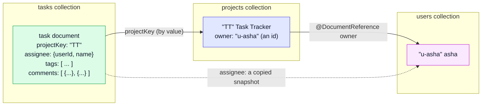
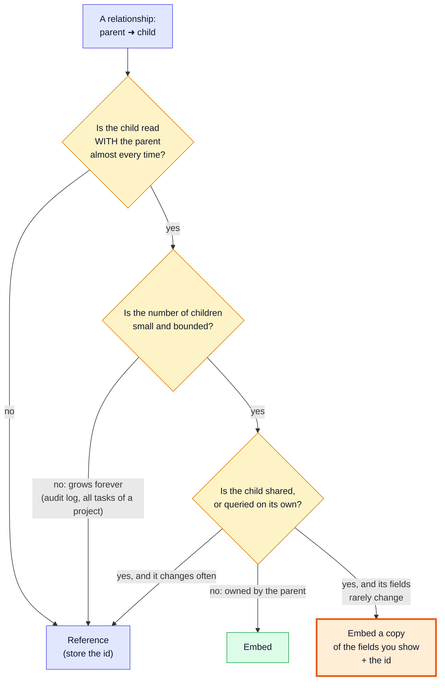
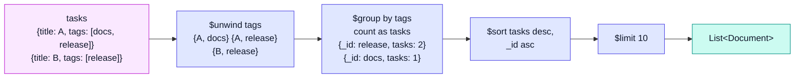

# NoSQL with Spring Data MongoDB — Complete In-Depth Guide

**Spring Boot notes #18 of 18** · Priority 🟢 · Track: Spring Boot ([README](README.md))

Files 07–09 stored the Task Tracker in PostgreSQL: tables, rows, foreign keys, joins. This file stores the same data in **MongoDB**, a **document database**. A task becomes one JSON-like document that holds its tags, its comments and a copy of its assignee's name. Spring Data MongoDB keeps the programming model of file 08 (entities, repositories, derived queries). What changes is how you **design the data**.

**Model**
- Documents vs rows: what a document database is good at, and what it isn't.
- **Embed or reference:** the central design decision, with a rule for choosing.

**Use Spring Data MongoDB**
- Mapping: `@Document`, `@Id`, `@Field`, embedded records, `@DocumentReference`.
- Repositories: derived queries and `@Query` in MongoDB's JSON syntax.
- `MongoTemplate`: `Criteria` queries, **partial updates** (`$push`, `$set`), bulk updates.
- **Aggregation pipelines**: `GROUP BY` and more as a list of stages.
- Indexes from annotations, and why auto-creating them can stop the application from starting.

**Get it right**
- Concurrency: single-document atomicity, `@Version`, multi-document transactions.
- Schema evolution without migrations, and when you still need them.
- Testing, and choosing between MongoDB and SQL.

> [!NOTE]
> This topic isn't in Kunal's playlist, so there are no video timestamps (see the [README](README.md#reference-playlist-where-each-video-is-covered)).
>
> **What was run:** [`examples/18-mongodb/`](examples/18-mongodb/) (version 0.18.0) on Spring Boot 4.0.5 / Spring Data MongoDB (release train 2025.1.4) / MongoDB Java driver 5.6.4 / JDK 21. **There is no MongoDB server on this machine**, so every output in this file comes from Spring's own objects *before* anything reaches the network:
> - `WhatMongoReceivesTest` (8 tests, all pass): the auto-configured converter, mapping context and `MongoTemplate` turn entities, queries, updates and pipelines into the BSON the driver would send, and the test prints it;
> - repository and template calls that log their translated query (DEBUG) and then fail with "no server";
> - `java -jar` with no server: the startup failure from index creation (Section 7);
> - property names checked against the jar's configuration metadata.
>
> **Not run** (needs a server): reading data back, lazy loading of references, optimistic-locking conflicts, auditing, `updateMulti` counts, aggregation results, transactions, and `TaskRepositoryTest` (2 tests, skipped unless `MONGODB_URI` is set). Statements about those behaviours come from the Spring Data and MongoDB documentation, not from a run.

---

## Table of Contents

| # | Topic (anchor link) | Level |
|---|---|---|
| 0 | [Why a Document Database?](#0-why-a-document-database) | Basics |
| 1 | [The Example: Task Tracker as Documents](#1-the-example-task-tracker-as-documents) | Basics |
| 2 | [Modelling: Embed or Reference](#2-modelling-embed-or-reference) | Core |
| 3 | [Mapping Entities to Documents](#3-mapping-entities-to-documents) | Core |
| 4 | [Repositories](#4-repositories) | Core |
| 5 | [MongoTemplate: Queries and Partial Updates](#5-mongotemplate-queries-and-partial-updates) | Core |
| 6 | [Aggregation Pipelines](#6-aggregation-pipelines) | In depth |
| 7 | [Indexes](#7-indexes) | In depth |
| 8 | [Atomicity, Optimistic Locking and Transactions](#8-atomicity-optimistic-locking-and-transactions) | In depth |
| 9 | [Schema Evolution](#9-schema-evolution) | In depth |
| 10 | [Testing](#10-testing) | Core |
| 11 | [MongoDB or SQL?](#11-mongodb-or-sql) | Basics |
| 12 | [Interview Questions](#12-interview-questions) | Interview |

---

## 0. Why a Document Database?

A relational database stores **rows** in **tables** with a fixed set of columns. Anything with several values (a task's tags, its comments) goes in another table, and you **join** to put the object back together. File 08 needed `task`, `task_tag`, `tag` and `app_user` to show one task card.

A document database stores **documents**: nested key–value structures (MongoDB stores them as **BSON**, a binary JSON with extra types such as dates and ObjectIds). A document can hold arrays and sub-documents, so one task card is **one document, read in one lookup**.

| | Relational (PostgreSQL) | Document (MongoDB) |
|---|---|---|
| Unit of storage | Row in a table | Document in a **collection** |
| Structure | Schema declared up front (`CREATE TABLE`), enforced | Flexible: documents in one collection may differ (optional validation) |
| Nested data | Separate tables + joins | Arrays and sub-documents inside the document |
| Relationships | Foreign keys, enforced | Stored ids or copied values; **not enforced** |
| Joins | Core feature, optimised | `$lookup` exists, but you design so you rarely need it |
| Atomic unit | Any set of rows in a transaction | **One document** always; multi-document transactions are possible but cost more |
| Scaling out | Mostly vertical; sharding is add-on | Built-in sharding by a shard key |
| Query language | SQL | JSON-shaped filters + aggregation pipelines |

> [!IMPORTANT]
> "Schemaless" doesn't mean "no design". The schema moves from the database into **your code and your access patterns**. In SQL you model the data and then write queries; in MongoDB you list the queries first and shape the documents so the common ones touch **one document**.

---

## 1. The Example: Task Tracker as Documents

Three collections. The board query ("open tasks of a project, by due date") reads only `tasks`.



| Decision | Choice in the example | Why |
|---|---|---|
| Comments | **Embedded** array in the task | Always shown with the task; owned by it; few per task |
| Tags | **Embedded** array of strings | Tiny; queried as "tasks with tag X" (a multikey index) |
| Assignee | **Embedded snapshot** `{userId, name}` | The board shows the name without a second query; a rename must update copies |
| Project | **Reference by value** (`projectKey`) | A project has unbounded tasks, and tasks are queried on their own |
| Project owner | **`@DocumentReference`** (stores the user's id) | Loaded only when needed, by a second query |

The example's parts:

| Class | Role |
|---|---|
| `model/Task`, `Project`, `User`, `Priority` | The mapped documents |
| `repo/TaskRepository` | Spring Data repository: derived queries, `@Query`, paging |
| `service/TaskQueries` | Builds `Query`, `Update` and `Aggregation` objects (so a test can print them) |
| `service/TaskService` | Runs them through `MongoTemplate` |
| `config/MongoConfig` | Fixes how `LocalDate` is stored (Section 3.3) |
| `web/TaskController` | REST endpoints over all of the above |

Dependencies (Boot 4 names; the starter brings the sync driver and Spring Data MongoDB):

```xml
<dependency>
    <groupId>org.springframework.boot</groupId>
    <artifactId>spring-boot-starter-data-mongodb</artifactId>
</dependency>
<dependency>                                         <!-- @DataMongoTest -->
    <groupId>org.springframework.boot</groupId>
    <artifactId>spring-boot-starter-data-mongodb-test</artifactId>
    <scope>test</scope>
</dependency>
```

```yaml
spring:
  mongodb:
    uri: ${MONGODB_URI:mongodb://localhost:27017/tasks}   # Boot 4: spring.mongodb.* (Boot 3: spring.data.mongodb.uri)
  data:
    mongodb:
      auto-index-creation: true          # create @Indexed / @CompoundIndex indexes at startup (off by default)
```

> [!NOTE]
> Both keys were checked against the configuration metadata in the built jar (0 unknown keys). Boot 4 moved the connection settings (`uri`, `host`, `port`, `database`, …) from `spring.data.mongodb.*` to `spring.mongodb.*`; Spring Data settings such as `auto-index-creation` stayed under `spring.data.mongodb.*`. The database name comes from the URI path (`/tasks`); MongoDB creates databases and collections on first write.

---

## 2. Modelling: Embed or Reference

Every relationship gets one of three shapes:

| Shape | Stored as | Read cost | Write cost |
|---|---|---|---|
| **Embed** | The child inside the parent document | One read gets both | Update one document; the child can't be queried as its own thing easily |
| **Reference** | The child's id (or a key) in the parent | A second query (or `$lookup`) | Each document changes independently |
| **Embedded copy** (denormalised) | Some of the child's fields copied into the parent, plus its id | One read | Changes to the original must be copied to every copy |



> [!WARNING]
> **Unbounded arrays are the classic mistake.** A document is limited to **16 MB**, and a document that keeps growing gets slower to read, update and index. "Comments on a task" is fine for a tracker; "every event a sensor ever sent" is not: store those as separate documents (or use a time-series collection).

What the example does with each relationship is in the table in Section 1. The SQL version (file 08) normalised everything; here the board query needs **one** collection and **no joins**.

---

## 3. Mapping Entities to Documents

### 3.1 The annotations

```java
@Document("tasks")                                            // the collection
@CompoundIndex(name = "project_open_due", def = "{'projectKey': 1, 'done': 1, 'due': 1}")
public class Task {
    @Id private String id;                // _id; a String holding an ObjectId, generated on insert
    private String projectKey;
    private Priority priority = Priority.MEDIUM;   // enum: stored by name
    private boolean done;
    @Field("due") private LocalDate dueDate;       // a different name in the document
    private Assignee assignee;                     // a record: embedded sub-document
    @Indexed private List<String> tags = new ArrayList<>();
    private List<Comment> comments = new ArrayList<>();
    @Version private Long version;                 // optimistic locking (Section 8)
    @CreatedDate private Instant createdAt;        // auditing, with @EnableMongoAuditing
    private Instant completedAt;                   // added later (Section 9)

    public record Assignee(long userId, String name) {}
    public record Comment(String author, String text, Instant at) {}
    ...
}
```

| Annotation | Effect | JPA counterpart (file 08) |
|---|---|---|
| `@Document("tasks")` | Maps the class to a collection (default: the class name, first letter lower-case) | `@Entity` + `@Table` |
| `@Id` | The `_id` field. `String` or `ObjectId` → generated on insert | `@Id @GeneratedValue` |
| `@Field("due")` | Stored name differs from the Java name | `@Column(name = ...)` |
| *(nothing)* on an object field | Embedded as a sub-document | `@Embedded`, or a separate table + join |
| `@DocumentReference` | Stores the referenced document's id | `@ManyToOne` |
| `@Version` | Optimistic locking | `@Version` |
| `@Transient` | Not stored | `@Transient` |

No `@Entity`-style registration is needed: every class reachable from a repository or used with `MongoTemplate` is mapped, and Java records work as embedded values.

### 3.2 What `insert()` would send

`converter.write(task, document)` is the step `MongoTemplate.insert` performs before handing the document to the driver. The test prints it with the driver's own codecs:

```
1. Task -> BSON document (what insert() sends)
{
  "projectKey": "TT",
  "title": "Write the release notes",
  "priority": "HIGH",
  "done": false,
  "due": {
    "$date": "2026-11-20T00:00:00Z"
  },
  "assignee": {
    "userId": 2,
    "name": "ravi"
  },
  "tags": [
    "docs",
    "release"
  ],
  "comments": [
    {
      "author": "asha",
      "text": "Include the migration steps",
      "at": {
        "$date": "2026-11-16T09:00:00Z"
      }
    }
  ],
  "_class": "com.notes.mongo.model.Task"
}
```

What to notice:
- **No `_id`** yet: the driver generates an ObjectId on insert. `version` and `createdAt` are also missing here because `save()` sets them, not the converter.
- `dueDate` is stored as **`due`**; the enum is the **string** `"HIGH"`.
- The records became **sub-documents**; the lists became **arrays**.
- **`_class`**: a type hint Spring Data adds so that it can read the right subclass back. Section 9 shows how to control it.

### 3.3 Trap: `LocalDate` and the machine's time zone

BSON has a **date-time** type (milliseconds since the epoch, UTC) but **no date-only type**. The first run, before `MongoConfig` existed, stored `LocalDate.of(2026, 11, 20)` like this:

```
"due": {
  "$date": "2026-11-19T18:30:00Z"
},
```

That is **midnight in the JVM's time zone** (this machine is UTC+5:30), written as UTC. A server in another zone stores the same date as a different instant, and range queries on `due` disagree between them. The fix makes the driver's own `java.time` codecs do the conversion, which use **UTC**:

```java
@Configuration
public class MongoConfig {
    @Bean
    MongoCustomConversions mongoCustomConversions() {
        return MongoCustomConversions.create(adapter -> adapter.useNativeDriverJavaTimeCodecs());
    }
}
```

After it (the output in 3.2): `"$date": "2026-11-20T00:00:00Z"`. Boot backs off its own `MongoCustomConversions` bean when you declare one.

> [!TIP]
> Other ways out: run every JVM with `-Duser.timezone=UTC`, store the date as a `"2026-11-20"` string (sorts correctly, ranges work), or store an `Instant` when you really mean a moment. Pick one and use it everywhere.

### 3.4 References: `@DocumentReference`

```java
@Document("projects")
public class Project {
    @Id private String id;
    @Indexed(unique = true) private String key;
    private String name;
    @DocumentReference(lazy = true) private User owner;   // stored as the user's id
}
```

```
2. Project with @DocumentReference owner
{
  "key": "TT",
  "name": "Task Tracker",
  "owner": "u-asha",
  "_class": "com.notes.mongo.model.Project"
}
```

The whole `User` object became `"owner": "u-asha"`. Reading a `Project` back would leave `owner` as a **lazy proxy** that runs `users.find({_id: "u-asha"})` on first access (**Not run**). Without `lazy = true` the extra query runs while the project is read.

| | `@DocumentReference` | `@DBRef` (older) |
|---|---|---|
| Stored as | Just the id (or any field you choose with `lookup`) | `{ "$ref": "users", "$id": ... }` |
| Usable in `$lookup` / readable by other tools | Yes | Awkward |
| Use for new code | ✅ | Only for existing data |

> [!CAUTION]
> Neither kind is a foreign key. Deleting the user leaves `"owner": "u-asha"` in the project, and reading it gives `null`. Integrity across documents is **your code's job**.

---

## 4. Repositories

The same interface model as Spring Data JPA (file 08):

```java
public interface TaskRepository extends MongoRepository<Task, String> {
    List<Task> findByProjectKeyAndDoneFalseOrderByDueDateAsc(String projectKey);
    List<Task> findByTags(String tag);                              // array field: equality = "contains"
    Page<Task> findByAssigneeName(String name, Pageable page);      // path into an embedded document

    @Query("{ 'priority': ?0, 'done': false, 'due': { $lt: ?1 } }") // MongoDB's own syntax
    List<Task> findOverdue(Priority priority, LocalDate today);

    long countByProjectKeyAndDoneFalse(String projectKey);
}
```

Each call below was made with no server. `MongoTemplate` logs the query it is about to send (DEBUG), then the driver times out:

```
7. Repository calls (MongoTemplate DEBUG lines), each then fails: no server
MongoTemplate: find using query: { "projectKey" : "TT", "done" : false} sort: { "due" : 1}
MongoTemplate: find using query: { "tags" : "release"} sort: null
MongoTemplate: find using query: { "assignee.name" : "ravi"} sort: null
MongoTemplate: find using query: { "priority" : "HIGH", "done" : false, "due" : { "$lt" : { "$java" : 2026-11-17 } } } sort: null
MongoTemplate: Executing count: { "projectKey" : "TT", "done" : false}
7b. The exception: org.springframework.dao.DataAccessResourceFailureException
Timed out while waiting for a server that matches ReadPreferenceServerSelector{readPreference=primary}. Client view of cluster state is {type=UNKNOWN, servers=[{address=localhost:27017, type=UNKNOWN, state=CONNECTING, exception={c …
```

| Method | Translated to | Point |
|---|---|---|
| `...AndDoneFalseOrderByDueDateAsc` | `{projectKey, done: false}` sort `{due: 1}` | `dueDate` in Java, **`due`** in the query: names are mapped |
| `findByTags("release")` | `{tags: "release"}` | On an array, equality matches **any element** |
| `findByAssigneeName` | `{"assignee.name": "ravi"}` | Dot notation into the embedded record |
| `@Query findOverdue` | Your JSON, `?0`/`?1` bound | The example writes the **stored** name `due`; write `@Query` in document terms, not Java names |
| `countBy...` | A `count` command | |

> [!NOTE]
> `{ "$java" : 2026-11-17 }` in the `findOverdue` line is only how the DEBUG log renders a `LocalDate` it hasn't encoded yet. With the native codecs from 3.3 the driver encodes it as a UTC `$date`; Section 5 prints a query through the driver's codec and shows exactly that.

The exception is Spring's `DataAccessResourceFailureException`, the same translated hierarchy as with JDBC (file 08), so error handling doesn't depend on the store.

`MongoRepository` also gives `save`, `saveAll`, `findById`, `findAll(Sort/Pageable)`, `deleteById`, `existsById`, `count`, and query by example. `save` on an entity whose `id` is set **replaces the whole document**: an upsert for an unversioned entity; for `Task`, which has `@Version`, a replace that only matches the expected version (Section 8). Use `MongoTemplate` updates when you only want to change a field.

---

## 5. MongoTemplate: Queries and Partial Updates

Repositories cover fixed queries. For **optional filters**, **partial updates** and **bulk changes**, use `MongoTemplate` (auto-configured).

### 5.1 Dynamic filters with `Criteria`

The MongoDB version of file 09's Specifications: add a condition only when the parameter is present.

```java
public static Query search(String projectKey, Priority priority, String tag, LocalDate dueBefore) {
    Criteria c = new Criteria();
    if (projectKey != null) c = c.and("projectKey").is(projectKey);
    if (priority != null) c = c.and("priority").is(priority);
    if (tag != null) c = c.and("tags").is(tag);
    if (dueBefore != null) c = c.and("dueDate").lt(dueBefore);   // Java name: mapped to "due"
    return Query.query(c).with(Sort.by("dueDate")).limit(20);
}
```

Mapped by Spring's `QueryMapper` against `Task` and printed with the driver's codecs (what `mongo.find(query, Task.class)` sends):

```
3. TaskQueries.search(...)
filter: {"projectKey": "TT", "priority": "HIGH", "tags": "release", "due": {"$lt": {"$date": "2026-12-01T00:00:00Z"}}}
sort:   {"due": 1}
limit:  20
```

`dueDate` became `due`, the enum became a string, and the `LocalDate` a UTC `$date`.

### 5.2 Partial updates: change one field, don't rewrite the document

```java
public static Update addComment(Task.Comment comment) {
    return new Update().push("comments", comment);
}

public boolean addComment(String taskId, String author, String text) {
    var comment = new Task.Comment(author, text, Instant.now(clock));
    return mongo.updateFirst(Query.query(Criteria.where("id").is(taskId)), TaskQueries.addComment(comment),
            Task.class).getMatchedCount() == 1;
}
```

The `Update` alone, mapped:

```
4. TaskQueries.addComment(...)
{
  "$push": {
    "comments": {
      "author": "meera",
      "text": "Done in PR 42",
      "at": {
        "$date": "2026-11-17T10:00:00Z"
      }
    }
  }
}
```

And the same updates sent through `TaskService` (`updateFirst` and `updateMulti`), as `MongoTemplate` logs them:

```
4b. The same updates sent through TaskService (MongoTemplate DEBUG lines)
MongoTemplate: Calling update using query: { "_id" : { "$oid" : "6739a1f0c2b4e83d5f0a1b2c"}} and update: { "$push" : { "comments" : { "author" : "meera", "text" : "Done in PR 42", "at" : { "$date" : "2026-11-17T00:23:32.958Z"}}}, "$inc" : { "version" : 1}}
MongoTemplate: Calling update using query: { "done" : false, "due" : { "$lt" : { "$java" : 2026-11-17 } } } and update: { "$set" : { "done" : true, "completedAt" : { "$date" : "2026-11-17T00:23:33.278Z"}}, "$inc" : { "version" : 1}}
```

Two things the run showed:
- **`MongoTemplate` added `"$inc": {"version": 1}` by itself**, on both updates, because `Task` has a `@Version` field. Optimistic locking stays correct even for updates that never read the document (an earlier draft of this example added the `$inc` by hand, which is redundant).
- `Criteria.where("id")` became `"_id"` with an **`$oid`**: a 24-hex-digit `String` id is converted to an ObjectId. A string that isn't valid hex (an earlier probe used `"x"`) stays a string.

| Operator | `Update` method | Effect |
|---|---|---|
| `$set` / `$unset` | `set`, `unset` | Set or remove a field |
| `$inc` | `inc` | Add to a number, atomically |
| `$push` / `$addToSet` | `push`, `addToSet` | Append to an array (`addToSet`: only if absent) |
| `$pull` | `pull` | Remove matching array elements |
| `$currentDate` | `currentDate` | Server time |
| (upsert) | `mongo.upsert(query, update, T.class)` | Update, or insert if nothing matched |

> [!IMPORTANT]
> **Read-modify-write loses updates.** `findById` → `getComments().add(...)` → `save` in two requests at once: both read the same comments, and the second save overwrites the first's comment (unless `@Version` turns it into an error). `$push` is applied on the server, to the current document, atomically. Prefer update operators for changes to part of a document.

`updateMulti` changes every match in one command; the result's `getModifiedCount()` is how many changed (**Not run**: no server to count).

---

## 6. Aggregation Pipelines

An aggregation is a **list of stages**; each stage takes documents in and passes documents on. It is MongoDB's `GROUP BY`, `JOIN`, `HAVING` and more.

```java
public static Aggregation tagUsage() {
    return newAggregation(Task.class,
            unwind("tags"),                                   // one task with 3 tags -> 3 documents
            group("tags").count().as("tasks"),
            sort(Sort.Direction.DESC, "tasks").and(Sort.Direction.ASC, "_id"),
            limit(10));
}
```



The two pipelines from `TaskQueries`, rendered by Spring (`agg.toPipeline(context)` with a context typed to `Task`):

```
5. TaskQueries.openByPriority("TT")
{"$match": {"projectKey": "TT", "done": false}}
{"$group": {"_id": "$priority", "open": {"$sum": 1}}}
{"$sort": {"open": -1}}
5. TaskQueries.tagUsage()
{"$unwind": "$tags"}
{"$group": {"_id": "$tags", "tasks": {"$sum": 1}}}
{"$sort": {"tasks": -1, "_id": 1}}
{"$limit": 10}
```

| Stage | SQL idea | Spring method |
|---|---|---|
| `$match` | `WHERE` (put it **first**: it can use an index) | `match(Criteria)` |
| `$group` | `GROUP BY` + `COUNT/SUM/AVG` | `group("field").count().as("n")`, `.sum("x").as(...)` |
| `$project` | `SELECT` list, computed fields | `project("a", "b").and("x").as("y")` |
| `$sort`, `$skip`, `$limit` | `ORDER BY`, `OFFSET`, `LIMIT` | `sort`, `skip`, `limit` |
| `$unwind` | One row per array element | `unwind("tags")` |
| `$lookup` | `LEFT JOIN` | `lookup("projects", "projectKey", "key", "project")` |
| `$facet` | Several aggregations in one pass | `facet(...)` |

Run it with the **input type**, so Spring maps field names in every stage and knows the collection:

```java
mongo.aggregate(TaskQueries.tagUsage(), Task.class, Document.class).getMappedResults();
```

> [!NOTE]
> The first version called `mongo.aggregate(aggregation, Document.class)`. It didn't compile: the builders return `Aggregation`, and the two-argument overload only accepts a `TypedAggregation`. An untyped aggregation needs the input type or a collection name to know **where** to run. The results (**Not run**) would be documents like `{"_id": "release", "tasks": 2}`; map them to a record instead of `Document.class` when the shape is fixed.

---

## 7. Indexes

Without an index MongoDB scans the whole collection (a `COLLSCAN`), like a table scan in file 09. The example declares its indexes on the classes, and Spring resolves them like this (the run):

```
6. Indexes resolved from Task's and Project's annotations
tasks: keys {"projectKey": 1, "done": 1, "due": 1}  options {"name": "project_open_due"}
tasks: keys {"tags": 1}  options {"name": "tags"}
projects: keys {"key": 1}  options {"name": "key", "unique": true}
```

| Annotation | Index |
|---|---|
| `@Indexed` on `tags` | Single field; on an array it is a **multikey** index (one entry per element) |
| `@Indexed(unique = true)` on `Project.key` | Unique: a second `"TT"` is rejected with a duplicate-key error |
| `@CompoundIndex(def = "{'projectKey': 1, 'done': 1, 'due': 1}")` | Compound, in this field order |
| `@TextIndexed`, `@GeoSpatialIndexed`, `@Indexed(expireAfter = "30d")` | Text search, geo queries, TTL (expire old documents) |

The compound index serves the board query: **equality** fields first (`projectKey`, `done`), then the **sort/range** field (`due`). This is the *ESR rule* (Equality, Sort, Range), the same reasoning as a composite B-tree index in SQL.

### Trap: `auto-index-creation` and a missing server

With `spring.data.mongodb.auto-index-creation: true`, Spring creates those indexes **while the application starts**. `java -jar` with no server (and a 2 s server-selection timeout in the URI so the failure is quick):

```
05:48:58.500 INFO  [           main] TaskDocsApplication         : Starting TaskDocsApplication v0.18.0 using Java 21
05:48:58.516 INFO  [           main] TaskDocsApplication         : No active profile set, falling back to 1 default profile: "default"
05:48:59.708 INFO  [           main] RepositoryConfigurationDeleg: Bootstrapping Spring Data MongoDB repositories in DEFAULT mode.
05:48:59.798 INFO  [           main] RepositoryConfigurationDeleg: Finished Spring Data repository scanning in 80 ms. Found 1 MongoDB repository interface.
05:49:00.606 INFO  [           main] TomcatWebServer             : Tomcat initialized with port 8080 (http)
05:49:00.628 INFO  [           main] StandardService             : Starting service [Tomcat]
05:49:00.628 INFO  [           main] StandardEngine              : Starting Servlet engine: [Apache Tomcat/11.0.20]
05:49:00.685 INFO  [           main] WebApplicationContextInitial: Root WebApplicationContext: initialization completed in 2026 ms
05:49:00.995 INFO  [           main] client                      : MongoClient created (driver 5.6.4, "spring-boot|sync")
05:49:01.017 INFO  [localhost:27017] cluster                     : Exception in monitor thread while connecting to server localhost:27017
  com.mongodb.MongoSocketOpenException: Exception opening socket
  Caused by: java.net.ConnectException: Connection refused: no further information
05:49:01.369 INFO  [           main] cluster                     : Waiting for server to become available for operation createIndexes with ID 3. Remaining time: 1994 ms. Selector: WritableServerSelector, topology desc …
05:49:03.373 WARN  [           main] ConfigServletWebServerApplic: Exception encountered during context initialization - cancelling refresh attempt: org.springframework.beans.factory.UnsatisfiedDependencyException: Er …
05:49:03.379 INFO  [           main] StandardService             : Stopping service [Tomcat]
05:49:03.406 INFO  [           main] ConditionEvaluationReportLog:
05:49:03.423 ERROR [           main] SpringApplication           : Application run failed
  Caused by: org.springframework.dao.DataAccessResourceFailureException: Timed out while waiting for a server that matches WritableServerSelector. Client view of  …
```

The context failed on **`createIndexes`**, so the application never started. With the default 30 s server-selection timeout it hangs for 30 s first. Without auto-index-creation it would have started and failed on the first request instead.

| Approach | When |
|---|---|
| `auto-index-creation: true` | Development, small apps; indexes follow the code |
| Off (the default) + create indexes in a migration (Mongock, a script) or `mongo.indexOps(Task.class).createIndex(...)` at a controlled time | Production: building an index on a large collection is heavy, and you want to choose when it happens |

---

## 8. Atomicity, Optimistic Locking and Transactions

**One document is always atomic.** A single update that does `$push` and `$inc` and `$set` on one document is applied entirely or not at all, and no reader sees half of it. Good document design makes most business operations a **single-document** write, which is why embedding matters.

**`@Version` (optimistic locking)** works like file 09's JPA version:

| Step | Document's version | What happens |
|---|---|---|
| Request A reads the task | 0 | A holds a copy with version 0 |
| Request B adds a comment (`updateFirst`) | 0 → **1** | `$inc` added by `MongoTemplate` (Section 5) |
| A calls `save(task)` | 1 | Spring sends "replace where `_id` = … **and `version` = 0**": no match → `OptimisticLockingFailureException` |

`TaskRepositoryTest.commentsArePushedAtomicallyAndStaleSavesFail` asserts exactly this sequence (**Not run**: it needs a server).

**Multi-document transactions** exist (MongoDB 4.0+) but need a **replica set** (or sharded cluster); a standalone `mongod` refuses them. Boot does **not** auto-configure a transaction manager for MongoDB; you declare one, and then `@Transactional` works as in file 09:

```java
@Bean
MongoTransactionManager transactionManager(MongoDatabaseFactory factory) {
    return new MongoTransactionManager(factory);
}
```

(**Not run.**) Use them for the rare operation that must change several documents together; if most writes need one, the documents are probably modelled too much like tables. In a single-node development setup, start `mongod --replSet rs0` and run `rs.initiate()` once.

| Read/write setting | Meaning |
|---|---|
| Write concern `w: "majority"` | The write is acknowledged once most replica-set members have it: survives a primary failover |
| Read concern `"majority"` | Read only data acknowledged by a majority: no reads that a failover could roll back |
| Read preference `secondaryPreferred` | Read from secondaries: offloads the primary, but reads can be stale |

Set them in the URI (`?w=majority&readPreference=primary`), for the whole template with `mongo.setWriteConcern(...)`, or per operation with a `WriteConcernResolver` bean.

---

## 9. Schema Evolution

Documents in one collection don't have to look the same, so adding a field needs **no migration**: version 0.18 added `completedAt` to `Task`, and older documents simply don't have it. Spring reads a missing field as `null` (or the primitive default). The bulk update in Section 5 sets it only on the tasks it completes.

| Change | What to do |
|---|---|
| Add a field | Nothing; handle `null` in code (or give it a default in Java) |
| Rename a field | Keep the old name with `@Field("oldName")`, or migrate: `updateMulti({}, {$rename: {old: new}})` |
| Change a type (string → number) | Read both for a while (a custom converter), migrate in the background, then remove the old reading code |
| Remove a field | Stop writing it; optionally `$unset` it later |
| Enforce a shape | A `$jsonSchema` **validator** on the collection (server-side, optional) |

**`_class`**: Spring stores the fully qualified class name so that it can read polymorphic data back. Renaming or moving the class breaks reading old documents. Use `@TypeAlias("task")` to store a short, stable alias instead, or configure the converter not to write a type key at all when there is no inheritance.

> [!TIP]
> Schema-less means the **old shapes stay in the database** until something rewrites them. Versioned migrations (Mongock, or a script run in CI like Flyway in file 09) keep that under control, especially for renames and index changes.

---

## 10. Testing

| Kind | What it checks | Needs a server | In the example |
|---|---|---|---|
| Mapping test (as here) | Entities, queries, updates and pipelines translate to the BSON you expect | No | `WhatMongoReceivesTest`, 8 tests, **run** |
| `@DataMongoTest` slice | Repositories and templates against a real database; only the MongoDB slice starts | Yes | `TaskRepositoryTest`, 2 tests, **skipped** |
| `@SpringBootTest` + MockMvc | The whole app through HTTP | Yes | — |

The build:

```
[WARNING] Tests run: 2, Failures: 0, Errors: 0, Skipped: 2, Time elapsed: 0.019 s -- in com.notes.mongo.TaskRepositoryTest
[INFO] Tests run: 8, Failures: 0, Errors: 0, Skipped: 0, Time elapsed: 8.096 s -- in com.notes.mongo.WhatMongoReceivesTest
[INFO] Tests run: 10, Failures: 0, Errors: 0, Skipped: 2
[INFO] BUILD SUCCESS
```

The slice test, enabled only when `MONGODB_URI` is set:

```java
@DataMongoTest(properties = "spring.mongodb.uri=${MONGODB_URI}")
@Import({MongoConfig.class, TaskService.class, TaskRepositoryTest.FixedClock.class})
@EnabledIfEnvironmentVariable(named = "MONGODB_URI", matches = ".+")
class TaskRepositoryTest { ... }
```

```bash
MONGODB_URI=mongodb://localhost:27017/tasks_test ./mvnw test
```

> [!WARNING]
> **Trap: a test bean with the same name.** The first version declared `@Bean Clock clock()` in the test, and the application already has a bean named `clock`. Run once with a dummy URI, it failed before reaching the database:
> `BeanDefinitionOverrideException: Invalid bean definition with name 'clock' defined in com.notes.mongo.TaskDocsApplication`
> Boot forbids overriding beans by default. The fix: a different name (`fixedClock`) plus `@Primary`. After it, the same run got as far as `createIndexes` and timed out: the wiring was right and only the server was missing. Always run a skipped test once, even against nothing, to check its wiring.

Where the server comes from (**Not run** here):
- **Testcontainers**: `@Container @ServiceConnection static MongoDBContainer mongo = new MongoDBContainer("mongo:8");` and Boot points `spring.mongodb.*` at the container.
- A local `mongod` or a CI service container, passed in with `MONGODB_URI`.

Boot no longer auto-configures an embedded MongoDB (Flapdoodle) since 3.0; Testcontainers is the usual replacement.

---

## 11. MongoDB or SQL?

| Choose MongoDB when | Choose a relational database when |
|---|---|
| Data is naturally **hierarchical** and read as a unit (a product with variants, a form with answers, a task card) | Data is **highly related** and queried in many different combinations |
| The shape **varies** between records or changes often | The shape is stable and you want the database to **enforce** it |
| You need to **scale writes horizontally** (sharding) | Strong cross-entity consistency and **multi-row transactions** are everyday needs |
| Access patterns are known and few | Ad-hoc reporting, analytics, joins are common |

Many systems use both: relational for orders and money, a document store for catalogues, content or event data. PostgreSQL's `jsonb` columns give a middle ground: documents inside a relational database (indexable, queryable).

> [!IMPORTANT]
> The skill that transfers is **access-pattern-first design**. List the queries, then decide what lives together. A MongoDB schema copied table-for-table from SQL (one collection per table, ids everywhere, `$lookup` in every query) gets the weaknesses of both.

---

## 12. Interview Questions

| # | Question | Answer |
|---|---|---|
| 1 | What is a document database? | It stores nested, self-describing documents (BSON in MongoDB) in collections; a document can hold arrays and sub-documents, so related data is read in one lookup |
| 2 | Embed or reference: how do you decide? | Embed what is read with the parent, owned by it and bounded in size; reference what is unbounded, shared, changes often or is queried on its own |
| 3 | What's the document size limit, and why does it matter? | 16 MB; unbounded arrays hit it and slow down reads and updates long before |
| 4 | What is `_id`, and what is an ObjectId? | Every document's primary key (unique, indexed). ObjectId is a 12-byte id with a timestamp, generated client-side by default |
| 5 | What does `_class` do in Spring Data MongoDB? | A type hint so polymorphic data reads back as the right class; use `@TypeAlias` to keep it stable across renames |
| 6 | `@DocumentReference` vs `@DBRef`? | Both store a reference, not the data. `@DocumentReference` stores just the id (flexible, `$lookup`-friendly); `@DBRef` stores `$ref/$id`. Neither is a foreign key |
| 7 | `MongoRepository` vs `MongoTemplate`? | Repositories for standard CRUD and fixed queries; the template for dynamic `Criteria`, partial updates, upserts, bulk and aggregation |
| 8 | Why prefer `$push`/`$inc` over read-modify-write? | Applied atomically on the server to the current document; read-modify-write loses concurrent changes |
| 9 | Is MongoDB transactional? | Single-document operations are always atomic. Multi-document ACID transactions exist since 4.0 but need a replica set and cost more |
| 10 | How does optimistic locking work here? | `@Version`: writes include `version = expected`; a mismatch matches nothing and throws `OptimisticLockingFailureException`. `MongoTemplate` also increments it on updates |
| 11 | What is an aggregation pipeline? | A sequence of stages (`$match`, `$group`, `$project`, `$sort`, `$lookup`, `$unwind` …), each transforming the document stream |
| 12 | How should a compound index be ordered? | ESR: equality fields, then sort fields, then range fields |
| 13 | What is a multikey index? | An index on an array field: one entry per element, so "contains" queries are fast |
| 14 | How do you evolve a schema without migrations? | Add fields freely, handle missing values in code; for renames and type changes, read both shapes then migrate in the background; validators for enforcement |
| 15 | Replica set vs sharding? | Replica set: copies for availability and failover (one primary). Sharding: data split across shards by a shard key, for scale |
| 16 | What do write concern and read concern control? | How many members must acknowledge a write; which data a read may see (e.g. only majority-committed). Durability vs latency |
| 17 | How do you test Spring Data MongoDB code? | Mapping tests without a server; `@DataMongoTest` against a real MongoDB from Testcontainers (`@ServiceConnection`) |
| 18 | When would you not use MongoDB? | Highly relational data with many ad-hoc joins, heavy cross-entity transactions, or when a fixed, enforced schema is the point |

---

## 🧩 Complete Example: Everything Together

**One Spring Boot application** storing the Task Tracker as MongoDB documents: three collections, a repository, a template-based service, a pipeline, and a test that prints everything the driver would receive.

Source: [`examples/18-mongodb/`](examples/18-mongodb/)

```
18-mongodb/
├── pom.xml                                  Boot 4.0.5: starter-data-mongodb, webmvc, test starters
├── src/main/java/com/notes/mongo/
│   ├── TaskDocsApplication.java              @EnableMongoAuditing, Clock bean
│   ├── config/MongoConfig.java               native java.time codecs (UTC dates)
│   ├── model/Task.java                       the task document: embedded records, arrays, indexes, @Version
│   ├── model/Project.java, User.java         a unique index, a @DocumentReference
│   ├── model/Priority.java
│   ├── repo/TaskRepository.java              derived queries, @Query, paging
│   ├── service/TaskQueries.java              Query / Update / Aggregation builders
│   ├── service/TaskService.java              MongoTemplate: search, $push, pipelines, updateMulti
│   └── web/TaskController.java               REST endpoints
├── src/main/resources/application.yml       spring.mongodb.uri, auto-index-creation
└── src/test/java/com/notes/mongo/
    ├── WhatMongoReceivesTest.java            no server: prints BSON, queries, updates, pipelines, indexes
    └── TaskRepositoryTest.java               @DataMongoTest; runs only with MONGODB_URI
```

**`model/Task.java`**

```java
package com.notes.mongo.model;

import org.springframework.data.annotation.CreatedDate;
import org.springframework.data.annotation.Id;
import org.springframework.data.annotation.Version;
import org.springframework.data.mongodb.core.index.CompoundIndex;
import org.springframework.data.mongodb.core.index.Indexed;
import org.springframework.data.mongodb.core.mapping.Document;
import org.springframework.data.mongodb.core.mapping.Field;

import java.time.Instant;
import java.time.LocalDate;
import java.util.ArrayList;
import java.util.List;

/**
 * One task = one document. What JPA spread over task, task_tag, tag and app_user (files 07-09) lives here
 * together: tags as an array, comments EMBEDDED, the assignee as an embedded SNAPSHOT (id + name).
 */
@Document("tasks")
@CompoundIndex(name = "project_open_due", def = "{'projectKey': 1, 'done': 1, 'due': 1}")   // the board query
public class Task {
    @Id
    private String id;                      // null until saved; MongoDB generates an ObjectId

    private String projectKey;              // a reference BY VALUE to projects.key (no foreign keys in MongoDB)
    private String title;
    private Priority priority = Priority.MEDIUM;
    private boolean done;

    @Field("due")                           // stored as "due", called dueDate in Java
    private LocalDate dueDate;

    private Assignee assignee;              // embedded: no join needed to show the name

    @Indexed                                // a multikey index: one entry per array element
    private List<String> tags = new ArrayList<>();

    private List<Comment> comments = new ArrayList<>();   // embedded, grows with the task (bounded!)

    @Version
    private Long version;                   // optimistic locking, like JPA's @Version (file 09)

    @CreatedDate
    private Instant createdAt;              // set by auditing (@EnableMongoAuditing)

    private Instant completedAt;            // added in 0.18: older documents simply don't have it (null)

    public record Assignee(long userId, String name) {}

    public record Comment(String author, String text, Instant at) {}

    protected Task() {}                     // for Spring Data

    public Task(String projectKey, String title, Priority priority, LocalDate dueDate) {
        this.projectKey = projectKey;
        this.title = title;
        this.priority = priority;
        this.dueDate = dueDate;
    }

    public String getId() { return id; }
    public String getProjectKey() { return projectKey; }
    public String getTitle() { return title; }
    public Priority getPriority() { return priority; }
    public boolean isDone() { return done; }
    public void setDone(boolean done) { this.done = done; }
    public LocalDate getDueDate() { return dueDate; }
    public Assignee getAssignee() { return assignee; }
    public void setAssignee(Assignee assignee) { this.assignee = assignee; }
    public List<String> getTags() { return tags; }
    public List<Comment> getComments() { return comments; }
    public Long getVersion() { return version; }
    public Instant getCreatedAt() { return createdAt; }
    public Instant getCompletedAt() { return completedAt; }
}
```

**`model/Project.java`**

```java
package com.notes.mongo.model;

import org.springframework.data.annotation.Id;
import org.springframework.data.mongodb.core.index.Indexed;
import org.springframework.data.mongodb.core.mapping.Document;
import org.springframework.data.mongodb.core.mapping.DocumentReference;

/**
 * Projects are NOT embedded in tasks (tasks are queried on their own and a project has unbounded tasks),
 * and the owner is a REFERENCE: stored as the user's id, loaded with a second query when accessed.
 */
@Document("projects")
public class Project {
    @Id
    private String id;

    @Indexed(unique = true)
    private String key;                      // "TT", "WEB": what tasks point to

    private String name;

    @DocumentReference(lazy = true)          // stored as the User's id; fetched on first access
    private User owner;

    protected Project() {}

    public Project(String key, String name, User owner) {
        this.key = key;
        this.name = name;
        this.owner = owner;
    }

    public String getId() { return id; }
    public String getKey() { return key; }
    public String getName() { return name; }
    public User getOwner() { return owner; }
}
```

**`repo/TaskRepository.java`**

```java
package com.notes.mongo.repo;

import com.notes.mongo.model.Priority;
import com.notes.mongo.model.Task;
import org.springframework.data.domain.Page;
import org.springframework.data.domain.Pageable;
import org.springframework.data.mongodb.repository.MongoRepository;
import org.springframework.data.mongodb.repository.Query;

import java.time.LocalDate;
import java.util.List;

/** The same Spring Data repository model as JPA (file 08): derived queries, @Query, paging. */
public interface TaskRepository extends MongoRepository<Task, String> {

    // derived: { projectKey: ?0, done: false } sorted by due ascending
    List<Task> findByProjectKeyAndDoneFalseOrderByDueDateAsc(String projectKey);

    // on an array field, equality means "contains": { tags: ?0 }
    List<Task> findByTags(String tag);

    // a path into the embedded assignee: { "assignee.name": ?0 }
    Page<Task> findByAssigneeName(String name, Pageable page);

    // MongoDB's own query language when deriving gets awkward; ?0 ?1 are the parameters
    @Query("{ 'priority': ?0, 'done': false, 'due': { $lt: ?1 } }")
    List<Task> findOverdue(Priority priority, LocalDate today);

    long countByProjectKeyAndDoneFalse(String projectKey);
}
```

**`service/TaskQueries.java`**

```java
package com.notes.mongo.service;

import com.notes.mongo.model.Priority;
import com.notes.mongo.model.Task;
import org.springframework.data.domain.Sort;
import org.springframework.data.mongodb.core.aggregation.Aggregation;
import org.springframework.data.mongodb.core.query.Criteria;
import org.springframework.data.mongodb.core.query.Query;
import org.springframework.data.mongodb.core.query.Update;

import java.time.Instant;
import java.time.LocalDate;

import static org.springframework.data.mongodb.core.aggregation.Aggregation.*;

/**
 * The queries, updates and pipelines TaskService sends through MongoTemplate, built in one place so
 * WhatMongoReceivesTest can print exactly what the driver would get (no server needed for that).
 */
public final class TaskQueries {
    private TaskQueries() {}

    /** Optional filters, combined only when present: the Criteria equivalent of file 09's Specifications. */
    public static Query search(String projectKey, Priority priority, String tag, LocalDate dueBefore) {
        Criteria c = new Criteria();
        if (projectKey != null) c = c.and("projectKey").is(projectKey);
        if (priority != null) c = c.and("priority").is(priority);
        if (tag != null) c = c.and("tags").is(tag);
        if (dueBefore != null) c = c.and("dueDate").lt(dueBefore);   // Java name: mapped to "due"
        return Query.query(c).with(Sort.by("dueDate")).limit(20);
    }

    /** Add a comment WITHOUT reading the document: one atomic update on the server.
     *  No inc("version"): MongoTemplate adds $inc on the @Version field to every update itself. */
    public static Update addComment(Task.Comment comment) {
        return new Update().push("comments", comment);
    }

    /** Open tasks per priority, highest count first: GROUP BY in a pipeline. */
    public static Aggregation openByPriority(String projectKey) {
        return newAggregation(Task.class,
                match(Criteria.where("projectKey").is(projectKey).and("done").is(false)),
                group("priority").count().as("open"),
                sort(Sort.Direction.DESC, "open"));
    }

    /** How often each tag is used: $unwind turns one task with 3 tags into 3 rows. */
    public static Aggregation tagUsage() {
        return newAggregation(Task.class,
                unwind("tags"),
                group("tags").count().as("tasks"),
                sort(Sort.Direction.DESC, "tasks").and(Sort.Direction.ASC, "_id"),
                limit(10));
    }

    /** Complete everything overdue in one statement (file 09's bulk JPQL update). */
    public static Query overdue(LocalDate today) {
        return Query.query(Criteria.where("done").is(false).and("dueDate").lt(today));
    }

    public static Update complete(Instant at) {
        return new Update().set("done", true).set("completedAt", at);
    }
}
```

**`service/TaskService.java`**

```java
package com.notes.mongo.service;

import com.notes.mongo.model.Priority;
import com.notes.mongo.model.Task;
import org.bson.Document;
import org.springframework.data.mongodb.core.MongoTemplate;
import org.springframework.data.mongodb.core.query.Criteria;
import org.springframework.data.mongodb.core.query.Query;
import org.springframework.stereotype.Service;

import java.time.Clock;
import java.time.Instant;
import java.time.LocalDate;
import java.util.List;

/** MongoTemplate for what repositories can't express: partial updates, pipelines, bulk changes. */
@Service
public class TaskService {
    private final MongoTemplate mongo;
    private final Clock clock;

    public TaskService(MongoTemplate mongo, Clock clock) {
        this.mongo = mongo;
        this.clock = clock;
    }

    public List<Task> search(String projectKey, Priority priority, String tag, LocalDate dueBefore) {
        return mongo.find(TaskQueries.search(projectKey, priority, tag, dueBefore), Task.class);
    }

    /** true if the task existed. No read-modify-write: the server appends the comment atomically. */
    public boolean addComment(String taskId, String author, String text) {
        var comment = new Task.Comment(author, text, Instant.now(clock));
        return mongo.updateFirst(Query.query(Criteria.where("id").is(taskId)), TaskQueries.addComment(comment),
                Task.class).getMatchedCount() == 1;
    }

    public List<Document> openByPriority(String projectKey) {
        // input type Task.class: names the collection AND maps field names (dueDate -> due) in each stage
        return mongo.aggregate(TaskQueries.openByPriority(projectKey), Task.class, Document.class).getMappedResults();
    }

    public List<Document> tagUsage() {
        return mongo.aggregate(TaskQueries.tagUsage(), Task.class, Document.class).getMappedResults();
    }

    public long completeOverdue() {
        return mongo.updateMulti(TaskQueries.overdue(LocalDate.now(clock)), TaskQueries.complete(Instant.now(clock)),
                Task.class).getModifiedCount();
    }
}
```

**`config/MongoConfig.java`**

```java
package com.notes.mongo.config;

import org.springframework.context.annotation.Bean;
import org.springframework.context.annotation.Configuration;
import org.springframework.data.mongodb.core.convert.MongoCustomConversions;

/**
 * BSON has no date-only type. By default Spring Data turns a LocalDate into midnight in the JVM's
 * time zone (on an IST machine 2026-11-20 is stored as 2026-11-19T18:30Z), so two servers in
 * different zones store the same date differently. The driver's own java.time codecs use UTC.
 */
@Configuration
public class MongoConfig {
    @Bean
    MongoCustomConversions mongoCustomConversions() {
        return MongoCustomConversions.create(adapter -> adapter.useNativeDriverJavaTimeCodecs());
    }
}
```

**`web/TaskController.java`**

```java
package com.notes.mongo.web;

import com.notes.mongo.model.Priority;
import com.notes.mongo.model.Task;
import com.notes.mongo.repo.TaskRepository;
import com.notes.mongo.service.TaskService;
import org.bson.Document;
import org.springframework.http.HttpStatus;
import org.springframework.web.bind.annotation.*;
import org.springframework.web.server.ResponseStatusException;

import java.time.LocalDate;
import java.util.List;
import java.util.Map;

@RestController
@RequestMapping("/api")
public class TaskController {
    private final TaskRepository tasks;
    private final TaskService service;

    public TaskController(TaskRepository tasks, TaskService service) {
        this.tasks = tasks;
        this.service = service;
    }

    @GetMapping("/projects/{key}/board")
    public List<Task> board(@PathVariable String key) {
        return tasks.findByProjectKeyAndDoneFalseOrderByDueDateAsc(key);
    }

    @GetMapping("/tasks")
    public List<Task> search(@RequestParam(required = false) String project, @RequestParam(required = false) Priority priority,
                             @RequestParam(required = false) String tag, @RequestParam(required = false) LocalDate dueBefore) {
        return service.search(project, priority, tag, dueBefore);
    }

    @PostMapping("/tasks/{id}/comments")
    @ResponseStatus(HttpStatus.CREATED)
    public Map<String, String> comment(@PathVariable String id, @RequestBody Map<String, String> body) {
        if (!service.addComment(id, body.get("author"), body.get("text")))
            throw new ResponseStatusException(HttpStatus.NOT_FOUND, "Task " + id + " does not exist");
        return Map.of("task", id, "status", "comment added");
    }

    @GetMapping("/projects/{key}/open-by-priority")
    public List<Document> openByPriority(@PathVariable String key) {
        return service.openByPriority(key);
    }
}
```

**`test/.../WhatMongoReceivesTest.java`**

```java
package com.notes.mongo;

import com.notes.mongo.model.Priority;
import com.notes.mongo.model.Project;
import com.notes.mongo.model.Task;
import com.notes.mongo.model.User;
import com.notes.mongo.repo.TaskRepository;
import com.notes.mongo.service.TaskQueries;
import com.notes.mongo.service.TaskService;
import com.mongodb.MongoClientSettings;
import org.bson.Document;
import org.bson.codecs.Codec;
import org.bson.json.JsonWriterSettings;
import org.junit.jupiter.api.Test;
import org.springframework.beans.factory.annotation.Autowired;
import org.springframework.boot.test.context.SpringBootTest;
import org.springframework.data.domain.PageRequest;
import org.springframework.data.mongodb.core.aggregation.Aggregation;
import org.springframework.data.mongodb.core.aggregation.TypeBasedAggregationOperationContext;
import org.springframework.data.mongodb.core.convert.MappingMongoConverter;
import org.springframework.data.mongodb.core.convert.QueryMapper;
import org.springframework.data.mongodb.core.convert.UpdateMapper;
import org.springframework.data.mongodb.core.index.IndexDefinition;
import org.springframework.data.mongodb.core.index.MongoPersistentEntityIndexResolver;
import org.springframework.data.mongodb.core.mapping.MongoMappingContext;
import org.springframework.data.mongodb.core.mapping.MongoPersistentEntity;
import org.springframework.data.mongodb.core.query.Query;
import org.springframework.data.mongodb.core.query.Update;

import java.time.Instant;
import java.time.LocalDate;
import java.util.List;

import static org.assertj.core.api.Assertions.assertThat;
import static org.assertj.core.api.Assertions.catchThrowable;

/**
 * What would MongoDB receive? Everything here uses Boot's own auto-configured converter, mapping context
 * and MongoTemplate, but no server: there is none on this machine. The URI points at localhost with a
 * 300 ms server-selection timeout, so repository calls fail fast AFTER MongoTemplate has logged the
 * query it was about to send (DEBUG).
 */
@SpringBootTest(properties = {
        "spring.mongodb.uri=mongodb://localhost:27017/tasks?serverSelectionTimeoutMS=300",
        "spring.data.mongodb.auto-index-creation=false",          // would need a server at startup
        "logging.level.org.springframework.data.mongodb.core.MongoTemplate=DEBUG",
        "logging.level.org.mongodb.driver=ERROR"})
class WhatMongoReceivesTest {
    static final JsonWriterSettings PRETTY = JsonWriterSettings.builder().indent(true).build();
    /** The codecs the real MongoClient encodes with (they include java.time). */
    static final Codec<Document> DRIVER = MongoClientSettings.getDefaultCodecRegistry().get(Document.class);

    static String json(Document d) { return d.toJson(PRETTY, DRIVER); }
    static String line(Document d) { return d.toJson(JsonWriterSettings.builder().build(), DRIVER); }

    @Autowired MappingMongoConverter converter;
    @Autowired MongoMappingContext mappingContext;
    @Autowired TaskRepository tasks;
    @Autowired TaskService service;

    MongoPersistentEntity<?> taskEntity() {
        return mappingContext.getRequiredPersistentEntity(Task.class);
    }

    static Task sampleTask() {
        Task t = new Task("TT", "Write the release notes", Priority.HIGH, LocalDate.of(2026, 11, 20));
        t.setAssignee(new Task.Assignee(2, "ravi"));
        t.getTags().addAll(List.of("docs", "release"));
        t.getComments().add(new Task.Comment("asha", "Include the migration steps", Instant.parse("2026-11-16T09:00:00Z")));
        return t;
    }

    @Test
    void anEntityBecomesOneDocument() {
        Document doc = new Document();
        converter.write(sampleTask(), doc);
        System.out.println("=== 1. Task -> BSON document (what insert() sends)\n" + json(doc));
        assertThat(doc).containsKeys("projectKey", "due", "assignee", "tags", "comments", "_class");
        assertThat(doc.get("priority")).isEqualTo("HIGH");                 // enums are stored by name
        assertThat(json(doc)).contains("2026-11-20T00:00:00Z");           // UTC midnight: MongoConfig
    }

    @Test
    void aDocumentReferenceStoresOnlyTheId() {
        Document doc = new Document();
        converter.write(new Project("TT", "Task Tracker", new User("u-asha", "asha")), doc);
        System.out.println("=== 2. Project with @DocumentReference owner\n" + json(doc));
        assertThat(doc.get("owner")).isEqualTo("u-asha");
    }

    @Test
    void criteriaQueriesAreMappedToFieldNamesAndBsonTypes() {
        Query q = TaskQueries.search("TT", Priority.HIGH, "release", LocalDate.of(2026, 12, 1));
        QueryMapper mapper = new QueryMapper(converter);
        Document filter = mapper.getMappedObject(q.getQueryObject(), taskEntity());
        Document sort = mapper.getMappedSort(q.getSortObject(), taskEntity());
        System.out.println("=== 3. TaskQueries.search(...)\nfilter: " + line(filter) + "\nsort:   " + line(sort)
                + "\nlimit:  " + q.getLimit());
        assertThat(filter).containsKey("due").doesNotContainKey("dueDate");
    }

    @Test
    void anUpdateIsAPartialChange() {
        Update u = TaskQueries.addComment(new Task.Comment("meera", "Done in PR 42", Instant.parse("2026-11-17T10:00:00Z")));
        Document mapped = new UpdateMapper(converter).getMappedObject(u.getUpdateObject(), taskEntity());
        System.out.println("=== 4. TaskQueries.addComment(...)\n" + json(mapped));
        assertThat(mapped).containsKey("$push").doesNotContainKey("$inc");
    }

    @Test
    void theTemplateAddsTheVersionIncrement() {
        System.out.println("=== 4b. The same updates sent through TaskService (MongoTemplate DEBUG lines)");
        catchThrowable(() -> service.addComment("6739a1f0c2b4e83d5f0a1b2c", "meera", "Done in PR 42"));
        catchThrowable(() -> service.completeOverdue());
    }

    @Test
    void aggregationsArePipelinesOfStages() {
        var ctx = new TypeBasedAggregationOperationContext(Task.class, mappingContext, new QueryMapper(converter));
        for (var entry : List.of(
                java.util.Map.entry("openByPriority(\"TT\")", TaskQueries.openByPriority("TT")),
                java.util.Map.entry("tagUsage()", TaskQueries.tagUsage()))) {
            Aggregation agg = entry.getValue();
            List<Document> pipeline = agg.toPipeline(ctx);
            System.out.println("=== 5. TaskQueries." + entry.getKey() + "\n"
                    + String.join("\n", pipeline.stream().map(WhatMongoReceivesTest::line).toList()));
            assertThat(pipeline).isNotEmpty();
        }
    }

    @Test
    void indexesComeFromAnnotations() {
        var resolver = new MongoPersistentEntityIndexResolver(mappingContext);
        StringBuilder out = new StringBuilder("=== 6. Indexes resolved from Task's and Project's annotations");
        for (Class<?> type : List.of(Task.class, Project.class)) {
            String collection = mappingContext.getRequiredPersistentEntity(type).getCollection();
            for (IndexDefinition def : resolver.resolveIndexFor(type)) {
                out.append("\n").append(collection).append(": keys ").append(def.getIndexKeys().toJson())
                        .append("  options ").append(def.getIndexOptions().toJson());
            }
        }
        System.out.println(out);
    }

    @Test
    void repositoryMethodsAreTranslatedBeforeTheyFail() {
        System.out.println("=== 7. Repository calls (MongoTemplate DEBUG lines), each then fails: no server");
        Throwable t = catchThrowable(() -> tasks.findByProjectKeyAndDoneFalseOrderByDueDateAsc("TT"));
        catchThrowable(() -> tasks.findByTags("release"));
        catchThrowable(() -> tasks.findByAssigneeName("ravi", PageRequest.of(0, 5)));
        catchThrowable(() -> tasks.findOverdue(Priority.HIGH, LocalDate.of(2026, 11, 17)));
        catchThrowable(() -> tasks.countByProjectKeyAndDoneFalse("TT"));
        System.out.println("=== 7b. The exception: " + t.getClass().getName() + "\n" + t.getMessage().lines().findFirst().orElse(""));
        assertThat(t).isInstanceOf(org.springframework.dao.DataAccessResourceFailureException.class);
    }
}
```

**`test/.../TaskRepositoryTest.java`** (skipped without a server)

```java
package com.notes.mongo;

import com.notes.mongo.config.MongoConfig;
import com.notes.mongo.model.Priority;
import com.notes.mongo.model.Task;
import com.notes.mongo.repo.TaskRepository;
import com.notes.mongo.service.TaskService;
import org.junit.jupiter.api.BeforeEach;
import org.junit.jupiter.api.Test;
import org.junit.jupiter.api.condition.EnabledIfEnvironmentVariable;
import org.springframework.beans.factory.annotation.Autowired;
import org.springframework.boot.data.mongodb.test.autoconfigure.DataMongoTest;
import org.springframework.context.annotation.Import;
import org.springframework.dao.OptimisticLockingFailureException;

import java.time.Clock;
import java.time.Instant;
import java.time.LocalDate;
import java.time.ZoneOffset;
import java.util.List;

import static org.assertj.core.api.Assertions.assertThat;
import static org.assertj.core.api.Assertions.assertThatThrownBy;

/**
 * Against a REAL MongoDB: runs only when MONGODB_URI is set, e.g.
 *   docker run -d -p 27017:27017 mongo:8   then   MONGODB_URI=mongodb://localhost:27017/tasks_test ./mvnw test
 * @DataMongoTest starts only the MongoDB slice (no web layer); TaskService is imported explicitly.
 */
@DataMongoTest(properties = "spring.mongodb.uri=${MONGODB_URI}")
@Import({MongoConfig.class, TaskService.class, TaskRepositoryTest.FixedClock.class})
@EnabledIfEnvironmentVariable(named = "MONGODB_URI", matches = ".+")
class TaskRepositoryTest {
    static class FixedClock {
        @org.springframework.context.annotation.Bean   // a different name: Boot forbids overriding the app's "clock"
        @org.springframework.context.annotation.Primary
        Clock fixedClock() { return Clock.fixed(Instant.parse("2026-11-17T10:00:00Z"), ZoneOffset.UTC); }
    }

    @Autowired TaskRepository tasks;
    @Autowired TaskService service;

    @BeforeEach
    void clean() {
        tasks.deleteAll();
    }

    Task task(String title, Priority p, LocalDate due, String... tags) {
        Task t = new Task("TT", title, p, due);
        t.getTags().addAll(List.of(tags));
        return t;
    }

    @Test
    void derivedQueriesAndAggregation() {
        tasks.saveAll(List.of(
                task("A", Priority.HIGH, LocalDate.of(2026, 11, 10), "release"),
                task("B", Priority.HIGH, LocalDate.of(2026, 11, 25), "docs", "release"),
                task("C", Priority.LOW, LocalDate.of(2026, 11, 20), "docs")));

        assertThat(tasks.findByProjectKeyAndDoneFalseOrderByDueDateAsc("TT")).extracting(Task::getTitle)
                .containsExactly("A", "C", "B");
        assertThat(tasks.findByTags("release")).hasSize(2);
        assertThat(service.openByPriority("TT").getFirst()).containsEntry("_id", "HIGH").containsEntry("open", 2);
        assertThat(service.completeOverdue()).isEqualTo(1);                     // only A is before 2026-11-17
    }

    @Test
    void commentsArePushedAtomicallyAndStaleSavesFail() {
        Task saved = tasks.save(task("A", Priority.HIGH, LocalDate.of(2026, 11, 20)));
        assertThat(saved.getVersion()).isZero();
        assertThat(saved.getCreatedAt()).isNotNull();                           // auditing

        assertThat(service.addComment(saved.getId(), "asha", "on it")).isTrue();  // version 0 -> 1 on the server
        assertThat(tasks.findById(saved.getId()).orElseThrow().getComments()).hasSize(1);

        saved.setDone(true);                                                    // our copy still says version 0
        assertThatThrownBy(() -> tasks.save(saved)).isInstanceOf(OptimisticLockingFailureException.class);
    }
}
```

### Run it

```bash
cd "Spring Boot Notes/examples/18-mongodb"
./mvnw package
```

With a MongoDB server (**Not run** here), for example from Docker, the skipped tests and the application run too:

```bash
docker run -d --name mongo -p 27017:27017 mongo:8
MONGODB_URI=mongodb://localhost:27017/tasks_test ./mvnw test
java -jar target/task-docs-0.18.0.jar
curl "http://localhost:8080/api/tasks?project=TT&tag=release"
```

**Expected Output** (`./mvnw package`, no server):

```
[WARNING] Tests run: 2, Failures: 0, Errors: 0, Skipped: 2, Time elapsed: 0.019 s -- in com.notes.mongo.TaskRepositoryTest
[INFO] Tests run: 8, Failures: 0, Errors: 0, Skipped: 0, Time elapsed: 8.096 s -- in com.notes.mongo.WhatMongoReceivesTest
[INFO] Tests run: 10, Failures: 0, Errors: 0, Skipped: 2
[INFO] BUILD SUCCESS
```

What `WhatMongoReceivesTest` printed, in order of the sections above: the task document (3.2), the project with its reference (3.4), the repository queries (4), the `search` filter (5.1), the updates (5.2), the pipelines (6) and the indexes (7).

---

## Quick Reference Cheat Sheet

| Concept | Key point |
|---|---|
| Starter | `spring-boot-starter-data-mongodb` (+ `-test` for `@DataMongoTest`) |
| Connection | Boot 4: `spring.mongodb.uri` (Boot 3: `spring.data.mongodb.uri`); database = URI path |
| Mapping | `@Document`, `@Id` (String/ObjectId, generated), `@Field`, records embed, enums as names, `_class` hint |
| Dates | No date-only BSON type: `LocalDate` → midnight in the **JVM zone** unless `useNativeDriverJavaTimeCodecs()` (UTC) |
| Embed vs reference | Embed: read together, owned, bounded. Reference: unbounded, shared, changing, queried alone |
| References | `@DocumentReference(lazy = true)` stores the id; no foreign keys, no cascades |
| Repositories | Same model as JPA; array equality = contains; `@Query` uses stored field names |
| `MongoTemplate` | `Criteria` for dynamic filters; `Update` for `$set/$inc/$push/$pull`; `updateMulti`, `upsert` |
| `@Version` | Optimistic locking on `save`; `MongoTemplate` adds `$inc` to updates itself |
| Aggregation | `newAggregation(Task.class, match, group, sort, ...)`; `$match` first; `aggregate(agg, Task.class, Out.class)` |
| Indexes | `@Indexed`, `@CompoundIndex` (ESR order), unique, TTL, text; auto-creation off by default |
| Auto-index trap | `auto-index-creation: true` + no server = the app doesn't start (`createIndexes` times out) |
| Atomicity | One document always; multi-document transactions need a replica set + `MongoTransactionManager` |
| Schema evolution | Add fields freely; renames/types need migrations; `@TypeAlias` for stable `_class` |
| Testing | Mapping tests offline; `@DataMongoTest` + Testcontainers `@ServiceConnection` for real queries |
| Choose it when | Hierarchical, variable data read as a unit; horizontal scale; known access patterns |
