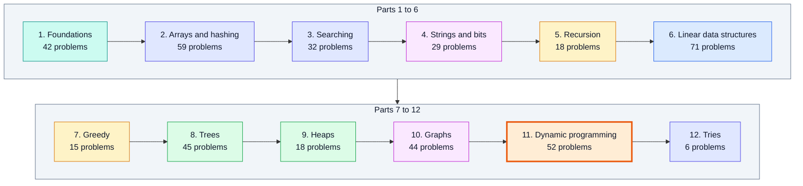

# DSA Practice Sheet — Pattern-wise, Mapped to Our Notes

**431 problems** from [Striver's A2Z DSA Sheet](https://takeuforward.org/prep-hub/strivers-a2z-dsa-sheet) (takeuforward), regrouped by the **pattern that solves them** and linked to the notes in this repo. Tick a box when you solve a problem.

- **260** problems link to LeetCode (15 of them are LeetCode premium 🔒).
- **171** problems have no LeetCode page that matches them exactly (or the sheet links a different problem). For these I wrote the task in my own words, with 2–3 test cases. Every expected output was computed by a reference solution, not typed by hand.
- The sheet's 42 theory/video lessons, 16 contests and 22 pattern-printing exercises (star and number triangles) are not listed.
- Each problem was placed by what it actually is, not by the sheet's chapter. For example, the stock problems are all under DP on stocks, "Trapping Rain Water" is under Two pointers, and the union-find graph questions are under Union-Find.

> [!TIP]
> Work part by part, top to bottom: each part uses ideas from the ones before it. Inside a section the problems go roughly from easy to hard. Read the section's 📘 notes first, then solve; come back to a problem a week later without looking at your old code.
>
> **Study site:** the same problems, grouped by the roadmap's topics, with filters and saved ticks: double-click `index.html` in the repo folder and open the Practice tab.

## How to read an entry

| Mark | Meaning |
|---|---|
| `- [ ]` | Not solved yet: edit it to `- [x]` when done (VS Code and Obsidian previews tick it on click; on GitHub you edit the file) |
| [LC 1](https://leetcode.com/problems/two-sum/) · Easy | Exact LeetCode problem and its LeetCode difficulty |
| 🔒 | LeetCode premium problem; the entry also links the sheet's free statement on takeuforward |
| Sheet: Basic / Core / Pro | Problem with no exact LeetCode page; the level is the sheet's own |
| Related: LC N | A LeetCode problem with the same idea but different details: practise the described version first |
| 📘 | Our notes mention this LeetCode number (a worked solution or a practice pointer) |
| ⚠️ Note | A difference between the sheet's version and LeetCode's |

## Study order

## Table of Contents

| # | Part | Section | Problems | Notes |
|---|---|---|---|---|
| 1.1 | Foundations | [Basic maths (digits, primes, GCD, sieve)](#11-basic-maths-digits-primes-gcd-sieve) | 22 | [java_26](kunal-java-notes-claude/java_26_video_maths_for_dsa.md), [dsa_gap_16](DSA%20Topics%20Not%20Covered%20Notes/dsa_gap_16_maths_extras.md) |
| 1.2 |  | [Recursion basics](#12-recursion-basics) | 10 | [java_23](kunal-java-notes-claude/java_23_video_recursion_intro.md), [java_27](kunal-java-notes-claude/java_27_video_recursion_level1.md), [java_28](kunal-java-notes-claude/java_28_video_recursion_arrays.md) |
| 1.3 |  | [Sorting algorithms](#13-sorting-algorithms) | 7 | [java_17](kunal-java-notes-claude/java_17_video_bubble_sort.md), [java_18](kunal-java-notes-claude/java_18_video_selection_sort.md), [java_19](kunal-java-notes-claude/java_19_video_insertion_sort.md), [java_29](kunal-java-notes-claude/java_29_video_recursion_patterns_sorting.md), [java_30](kunal-java-notes-claude/java_30_video_merge_sort.md), [java_31](kunal-java-notes-claude/java_31_video_quick_sort.md) |
| 1.4 |  | [Counting with merge sort](#14-counting-with-merge-sort) | 3 | [java_30](kunal-java-notes-claude/java_30_video_merge_sort.md) |
| 2.1 | Arrays and hashing | [Array basics (one pass)](#21-array-basics-one-pass) | 13 | [java_12](kunal-java-notes-claude/java_12_video_arrays_arraylist.md), [java_13](kunal-java-notes-claude/java_13_video_linear_search.md) |
| 2.2 |  | [Array tricks: voting, sum/XOR, cyclic sort](#22-array-tricks-voting-sumxor-cyclic-sort) | 4 | [java_20](kunal-java-notes-claude/java_20_video_cyclic_sort.md), [java_25](kunal-java-notes-claude/java_25_video_bitwise_number_systems.md) |
| 2.3 |  | [Matrix traversal](#23-matrix-traversal) | 3 | [dsa_gap_11](DSA%20Topics%20Not%20Covered%20Notes/dsa_gap_11_matrix_traversal.md) |
| 2.4 |  | [Hashing and frequency counting](#24-hashing-and-frequency-counting) | 9 | [java_57](kunal-java-notes-claude/java_57_video_hashmap_hashtable.md) |
| 2.5 |  | [Two pointers](#25-two-pointers) | 11 | [dsa_gap_02](DSA%20Topics%20Not%20Covered%20Notes/dsa_gap_02_two_pointers.md) |
| 2.6 |  | [Sliding window](#26-sliding-window) | 12 | [dsa_gap_01](DSA%20Topics%20Not%20Covered%20Notes/dsa_gap_01_sliding_window.md) |
| 2.7 |  | [Prefix sum + hashing](#27-prefix-sum--hashing) | 5 | [dsa_gap_03](DSA%20Topics%20Not%20Covered%20Notes/dsa_gap_03_prefix_sum_difference_array.md) |
| 2.8 |  | [Kadane's algorithm](#28-kadanes-algorithm) | 2 | [dsa_gap_04](DSA%20Topics%20Not%20Covered%20Notes/dsa_gap_04_kadanes_algorithm.md) |
| 3.1 | Searching | [Binary search on a sorted array](#31-binary-search-on-a-sorted-array) | 15 | [java_14](kunal-java-notes-claude/java_14_video_binary_search.md), [java_15](kunal-java-notes-claude/java_15_video_binary_search_questions.md) |
| 3.2 |  | [Binary search on the answer](#32-binary-search-on-the-answer) | 12 | [java_15](kunal-java-notes-claude/java_15_video_binary_search_questions.md) |
| 3.3 |  | [Binary search in 2D](#33-binary-search-in-2d) | 5 | [java_16](kunal-java-notes-claude/java_16_video_binary_search_2d_arrays.md) |
| 4.1 | Strings and bits | [Strings](#41-strings) | 11 | [java_21](kunal-java-notes-claude/java_21_video_strings_stringbuilder.md) |
| 4.2 |  | [String matching (Rabin-Karp, KMP, Z)](#42-string-matching-rabin-karp-kmp-z) | 5 | [java_58](kunal-java-notes-claude/java_58_video_karp_rabin.md), [dsa_gap_14](DSA%20Topics%20Not%20Covered%20Notes/dsa_gap_14_string_algorithms.md) |
| 4.3 |  | [Bit manipulation](#43-bit-manipulation) | 13 | [java_25](kunal-java-notes-claude/java_25_video_bitwise_number_systems.md) |
| 5.1 | Recursion | [Subsets and subsequences (pick / not pick)](#51-subsets-and-subsequences-pick--not-pick) | 8 | [java_32](kunal-java-notes-claude/java_32_video_recursion_subsets_strings.md), [java_34](kunal-java-notes-claude/java_34_video_recursion_dice_phone_letters.md) |
| 5.2 |  | [Backtracking](#52-backtracking) | 10 | [java_35](kunal-java-notes-claude/java_35_video_backtracking_maze.md), [java_36](kunal-java-notes-claude/java_36_video_nqueens_nknights_sudoku.md), [dsa_gap_12](DSA%20Topics%20Not%20Covered%20Notes/dsa_gap_12_combination_backtracking.md) |
| 6.1 | Linear data structures | [Linked list basics (singly and doubly)](#61-linked-list-basics-singly-and-doubly) | 24 | [java_44](kunal-java-notes-claude/java_44_video_linked_list.md) |
| 6.2 |  | [Linked list patterns (fast/slow, reverse, merge)](#62-linked-list-patterns-fastslow-reverse-merge) | 19 | [java_45](kunal-java-notes-claude/java_45_video_linkedlist_interview_questions.md) |
| 6.3 |  | [Stack and queue](#63-stack-and-queue) | 16 | [java_46](kunal-java-notes-claude/java_46_video_stacks_queues.md), [java_47](kunal-java-notes-claude/java_47_video_stack_queue_questions.md) |
| 6.4 |  | [Monotonic stack](#64-monotonic-stack) | 9 | [dsa_gap_08](DSA%20Topics%20Not%20Covered%20Notes/dsa_gap_08_monotonic_stack.md) |
| 6.5 |  | [Monotonic deque](#65-monotonic-deque) | 1 | [dsa_gap_09](DSA%20Topics%20Not%20Covered%20Notes/dsa_gap_09_monotonic_deque.md) |
| 6.6 |  | [Cache design (LRU / LFU)](#66-cache-design-lru--lfu) | 2 | [dsa_gap_13](DSA%20Topics%20Not%20Covered%20Notes/dsa_gap_13_lru_lfu_cache.md) |
| 7.1 | Greedy | [Greedy](#71-greedy) | 10 | [dsa_gap_10](DSA%20Topics%20Not%20Covered%20Notes/dsa_gap_10_greedy.md) |
| 7.2 |  | [Intervals](#72-intervals) | 5 | [dsa_gap_05](DSA%20Topics%20Not%20Covered%20Notes/dsa_gap_05_merge_intervals.md) |
| 8.1 | Trees | [Binary tree traversals and views](#81-binary-tree-traversals-and-views) | 13 | [java_49](kunal-java-notes-claude/java_49_video_binary_trees_bst.md), [java_55](kunal-java-notes-claude/java_55_video_binary_tree_questions.md), [java_64](kunal-java-notes-claude/java_64_video_vertical_order_traversal.md) |
| 8.2 |  | [Binary tree DFS: heights, paths, ancestors](#82-binary-tree-dfs-heights-paths-ancestors) | 13 | [java_55](kunal-java-notes-claude/java_55_video_binary_tree_questions.md) |
| 8.3 |  | [Binary tree construction and conversion](#83-binary-tree-construction-and-conversion) | 5 | [java_63](kunal-java-notes-claude/java_63_video_construct_tree_preorder_inorder.md), [java_68](kunal-java-notes-claude/java_68_video_binary_tree_to_dll.md) |
| 8.4 |  | [Binary search tree](#84-binary-search-tree) | 14 | [java_49](kunal-java-notes-claude/java_49_video_binary_trees_bst.md), [java_66](kunal-java-notes-claude/java_66_video_two_sum_bst.md), [java_67](kunal-java-notes-claude/java_67_video_kth_smallest_bst.md), [java_69](kunal-java-notes-claude/java_69_video_recover_bst.md) |
| 9.1 | Heaps | [Heap implementation](#91-heap-implementation) | 7 | [java_56](kunal-java-notes-claude/java_56_video_heaps_priority_queue.md) |
| 9.2 |  | [Top-K and K-way merge](#92-top-k-and-k-way-merge) | 7 | [dsa_gap_06](DSA%20Topics%20Not%20Covered%20Notes/dsa_gap_06_top_k_k_way_merge.md) |
| 9.3 |  | [Greedy with a heap or sorted map](#93-greedy-with-a-heap-or-sorted-map) | 3 | [dsa_gap_10](DSA%20Topics%20Not%20Covered%20Notes/dsa_gap_10_greedy.md), [java_56](kunal-java-notes-claude/java_56_video_heaps_priority_queue.md) |
| 9.4 |  | [Two heaps](#94-two-heaps) | 1 | [dsa_gap_07](DSA%20Topics%20Not%20Covered%20Notes/dsa_gap_07_two_heaps.md) |
| 10.1 | Graphs | [Graph BFS / DFS and grids](#101-graph-bfs--dfs-and-grids) | 14 | [dsa_topic_02](DSA%20Topics%20Not%20Covered%20Notes/dsa_topic_02_graphs.md), [java_65](kunal-java-notes-claude/java_65_video_word_ladder.md) |
| 10.2 |  | [Topological sort and directed cycles](#102-topological-sort-and-directed-cycles) | 6 | [dsa_topic_02](DSA%20Topics%20Not%20Covered%20Notes/dsa_topic_02_graphs.md) |
| 10.3 |  | [Shortest paths](#103-shortest-paths) | 14 | [dsa_topic_02](DSA%20Topics%20Not%20Covered%20Notes/dsa_topic_02_graphs.md) |
| 10.4 |  | [Union-Find and minimum spanning tree](#104-union-find-and-minimum-spanning-tree) | 7 | [dsa_topic_03](DSA%20Topics%20Not%20Covered%20Notes/dsa_topic_03_union_find.md), [dsa_topic_02](DSA%20Topics%20Not%20Covered%20Notes/dsa_topic_02_graphs.md) |
| 10.5 |  | [Advanced graph algorithms](#105-advanced-graph-algorithms) | 3 | [dsa_topic_02](DSA%20Topics%20Not%20Covered%20Notes/dsa_topic_02_graphs.md) |
| 11.1 | Dynamic programming | [DP 1D](#111-dp-1d) | 5 | [dsa_topic_01](DSA%20Topics%20Not%20Covered%20Notes/dsa_topic_01_dynamic_programming.md) |
| 11.2 |  | [DP on grids and 2D states](#112-dp-on-grids-and-2d-states) | 7 | [dsa_topic_01](DSA%20Topics%20Not%20Covered%20Notes/dsa_topic_01_dynamic_programming.md) |
| 11.3 |  | [DP on subsets (knapsack family)](#113-dp-on-subsets-knapsack-family) | 11 | [dsa_topic_01](DSA%20Topics%20Not%20Covered%20Notes/dsa_topic_01_dynamic_programming.md) |
| 11.4 |  | [DP on strings](#114-dp-on-strings) | 11 | [dsa_topic_01](DSA%20Topics%20Not%20Covered%20Notes/dsa_topic_01_dynamic_programming.md) |
| 11.5 |  | [DP on stocks (state machine)](#115-dp-on-stocks-state-machine) | 6 | [dsa_topic_01](DSA%20Topics%20Not%20Covered%20Notes/dsa_topic_01_dynamic_programming.md), [dsa_gap_04](DSA%20Topics%20Not%20Covered%20Notes/dsa_gap_04_kadanes_algorithm.md), [dsa_gap_10](DSA%20Topics%20Not%20Covered%20Notes/dsa_gap_10_greedy.md) |
| 11.6 |  | [Longest increasing subsequence family](#116-longest-increasing-subsequence-family) | 6 | [dsa_topic_01](DSA%20Topics%20Not%20Covered%20Notes/dsa_topic_01_dynamic_programming.md) |
| 11.7 |  | [Partition DP (matrix chain)](#117-partition-dp-matrix-chain) | 6 | [dsa_topic_01](DSA%20Topics%20Not%20Covered%20Notes/dsa_topic_01_dynamic_programming.md) |
| 12.1 | Tries | [Trie](#121-trie) | 6 | [dsa_topic_04](DSA%20Topics%20Not%20Covered%20Notes/dsa_topic_04_trie.md) |

---

## Part 1: Foundations

### 1.1 Basic maths (digits, primes, GCD, sieve)

📘 **Notes:** [java_26: Maths for DSA](kunal-java-notes-claude/java_26_video_maths_for_dsa.md) · [dsa_gap_16: Maths Extras: Fast Power, Modular Inverse, nCr, Combinatorics](DSA%20Topics%20Not%20Covered%20Notes/dsa_gap_16_maths_extras.md)

**Spot it:** Digit problems peel digits with `% 10` and `/ 10`; prime and divisor problems loop only up to sqrt(n); many queries call for a sieve.

- [ ] **Count all Digits of a Number** · Sheet: Basic
  Return how many digits n has.
  - `n = 4` → `1`
  - `n = 14325` → `5`
  - `n = 0` → `1`
- [ ] **Count number of odd digits in a number** · Sheet: Basic
  Return how many digits of n are odd.
  - `n = 5` → `1`
  - `n = 25` → `1`
  - `n = 2468` → `0`
- [ ] **Reverse a number** · [LC 7](https://leetcode.com/problems/reverse-integer/) · Medium · 📘 [java_27](kunal-java-notes-claude/java_27_video_recursion_level1.md)
  ⚠️ Note: LeetCode also wants 0 when the reversed number overflows a 32-bit int.
- [ ] **Palindrome Number** · [LC 9](https://leetcode.com/problems/palindrome-number/) · Easy · 📘 [java_27](kunal-java-notes-claude/java_27_video_recursion_level1.md)
- [ ] **Return the Largest Digit in a Number** · Sheet: Basic
  Return the largest digit of n.
  - `n = 25` → `5`
  - `n = 99` → `9`
  - `n = 0` → `0`
- [ ] **Sum of Digits in a Given Number** · [LC 258](https://leetcode.com/problems/add-digits/) · Easy
- [ ] **Factorial of a given number** · Sheet: Basic
  Return n! (n is small enough that the answer fits in a long).
  - `n = 2` → `2`
  - `n = 5` → `120`
  - `n = 0` → `1`
- [ ] **Check if the Number is Armstrong** · [LC 1134](https://leetcode.com/problems/armstrong-number/) 🔒 · Easy · [free statement](https://takeuforward.org/practice/dsa/check-if-the-number-if-armstrong?source=strivers-a2z-dsa-sheet) · 📘 [java_11](kunal-java-notes-claude/java_11_video_functions_methods.md)
- [ ] **Check for Perfect Number** · [LC 507](https://leetcode.com/problems/perfect-number/) · Easy
- [ ] **Divisors of a Number** · Sheet: Core
  Return all positive divisors of n in increasing order.
  - `n = 6` → `[1, 2, 3, 6]`
  - `n = 7` → `[1, 7]`
  - `n = 36` → `[1, 2, 3, 4, 6, 9, 12, 18, 36]`
- [ ] **Check for Prime Number** · Sheet: Core
  Return true if n is prime.
  - `n = 5` → `true`
  - `n = 1` → `false`
  - `n = 49` → `false`
- [ ] **GCD of Two Numbers** · Sheet: Core · Related: [LC 1979](https://leetcode.com/problems/find-greatest-common-divisor-of-array/) · 📘 [java_26](kunal-java-notes-claude/java_26_video_maths_for_dsa.md)
  Return the greatest common divisor of n1 and n2 (Euclid: gcd(a, b) = gcd(b, a % b)).
  - `n1 = 4, n2 = 6` → `2`
  - `n1 = 9, n2 = 8` → `1`
  - `n1 = 48, n2 = 18` → `6`
- [ ] **LCM of two numbers** · Sheet: Core
  Return the least common multiple of n1 and n2 (lcm = a / gcd(a, b) * b).
  - `n1 = 4, n2 = 6` → `12`
  - `n1 = 3, n2 = 5` → `15`
  - `n1 = 12, n2 = 18` → `36`
- [ ] **Count of Prime Numbers till N** · [LC 204](https://leetcode.com/problems/count-primes/) · Medium · 📘 [java_26](kunal-java-notes-claude/java_26_video_maths_for_dsa.md), [java_11](kunal-java-notes-claude/java_11_video_functions_methods.md)
  ⚠️ Note: The sheet counts primes up to and including n; LeetCode counts primes strictly less than n.
- [ ] **Print all primes till N** · Sheet: Core · Related: [LC 204](https://leetcode.com/problems/count-primes/) · 📘 [java_26](kunal-java-notes-claude/java_26_video_maths_for_dsa.md), [java_11](kunal-java-notes-claude/java_11_video_functions_methods.md)
  Return every prime from 2 up to n, inclusive (Sieve of Eratosthenes).
  - `n = 10` → `[2, 3, 5, 7]`
  - `n = 2` → `[2]`
  - `n = 30` → `[2, 3, 5, 7, 11, 13, 17, 19, 23, 29]`
- [ ] **Prime factorisation of a Number** · Sheet: Core
  For each number in queries, return its prime factors in increasing order, with repeats (smallest-prime-factor sieve for many queries).
  - `queries = [2, 3, 4, 5, 6]` → `[[2], [3], [2, 2], [5], [2, 3]]`
  - `queries = [12, 60]` → `[[2, 2, 3], [2, 2, 3, 5]]`
  - `queries = [97, 100]` → `[[97], [2, 2, 5, 5]]`
- [ ] **Count primes in range L to R** · Sheet: Pro · Related: [LC 204](https://leetcode.com/problems/count-primes/) · 📘 [java_26](kunal-java-notes-claude/java_26_video_maths_for_dsa.md), [java_11](kunal-java-notes-claude/java_11_video_functions_methods.md)
  For each query [L, R], return how many primes lie in L..R inclusive (sieve once, then prefix counts).
  - `queries = [[2, 5], [4, 7]]` → `[3, 2]`
  - `queries = [[1, 10]]` → `[4]`
  - `queries = [[14, 16], [11, 13]]` → `[0, 2]`
- [ ] **Pascal's Triangle I** · Sheet: Core · Related: [LC 118](https://leetcode.com/problems/pascals-triangle/) · 📘 [dsa_gap_16](DSA%20Topics%20Not%20Covered%20Notes/dsa_gap_16_maths_extras.md)
  Return the value at row r, column c of Pascal's triangle, both 1-indexed. It equals C(r-1, c-1).
  - `r = 4, c = 2` → `3`
  - `r = 5, c = 3` → `6`
  - `r = 1, c = 1` → `1`
- [ ] **Pascal's Triangle II** · [LC 119](https://leetcode.com/problems/pascals-triangle-ii/) · Easy · 📘 [dsa_gap_16](DSA%20Topics%20Not%20Covered%20Notes/dsa_gap_16_maths_extras.md)
  ⚠️ Note: The sheet numbers rows from 1; LeetCode numbers them from 0.
- [ ] **Pascal's Triangle III** · [LC 118](https://leetcode.com/problems/pascals-triangle/) · Easy · 📘 [dsa_gap_16](DSA%20Topics%20Not%20Covered%20Notes/dsa_gap_16_maths_extras.md)
- [ ] **Pow(x,n)** · [LC 50](https://leetcode.com/problems/powx-n/) · Medium · 📘 [dsa_gap_16](DSA%20Topics%20Not%20Covered%20Notes/dsa_gap_16_maths_extras.md), [java_25](kunal-java-notes-claude/java_25_video_bitwise_number_systems.md)
- [ ] **Count Good Numbers** · [LC 1922](https://leetcode.com/problems/count-good-numbers/) · Medium · 📘 [dsa_gap_16](DSA%20Topics%20Not%20Covered%20Notes/dsa_gap_16_maths_extras.md)

### 1.2 Recursion basics

📘 **Notes:** [java_23: Introduction to Recursion](kunal-java-notes-claude/java_23_video_recursion_intro.md) · [java_27: Recursion Level 1 Questions](kunal-java-notes-claude/java_27_video_recursion_level1.md) · [java_28: Recursion with Arrays](kunal-java-notes-claude/java_28_video_recursion_arrays.md)

**Spot it:** Write each of these with recursion, not a loop: base case first, then trust the call on the smaller input.

- [ ] **Sum of First N Numbers** · Sheet: Basic
  Return 1 + 2 + ... + N using recursion.
  - `N = 4` → `10`
  - `N = 1` → `1`
  - `N = 10` → `55`
- [ ] **Factorial of a Given Number** · Sheet: Basic
  Return n! using recursion.
  - `n = 3` → `6`
  - `n = 0` → `1`
  - `n = 10` → `3628800`
- [ ] **Fibonacci Number** · [LC 509](https://leetcode.com/problems/fibonacci-number/) · Easy · 📘 [java_23](kunal-java-notes-claude/java_23_video_recursion_intro.md), [dsa_gap_16](DSA%20Topics%20Not%20Covered%20Notes/dsa_gap_16_maths_extras.md)
  ⚠️ Note: Solve it with plain recursion first, then see why it is slow (DP 1D fixes it).
- [ ] **Sum of Array Elements II** · Sheet: Basic
  Return the sum of the array using recursion.
  - `nums = [1, 2, 3]` → `6`
  - `nums = [5]` → `5`
  - `nums = [-4, 4, 10]` → `10`
- [ ] **Reverse an array 2** · Sheet: Core
  Reverse the array in place using recursion (swap the ends, recurse inward).
  - `nums = [1, 2, 3, 4, 5]` → `[5, 4, 3, 2, 1]`
  - `nums = [3, 8]` → `[8, 3]`
  - `nums = [6]` → `[6]`
- [ ] **Reverse a String I** · [LC 344](https://leetcode.com/problems/reverse-string/) · Easy · 📘 [dsa_gap_02](DSA%20Topics%20Not%20Covered%20Notes/dsa_gap_02_two_pointers.md), [java_12](kunal-java-notes-claude/java_12_video_arrays_arraylist.md)
  ⚠️ Note: Solve it recursively here; the two-pointer version is in Two pointers.
- [ ] **Check if String is Palindrome or Not** · [LC 125](https://leetcode.com/problems/valid-palindrome/) · Easy · 📘 [dsa_gap_02](DSA%20Topics%20Not%20Covered%20Notes/dsa_gap_02_two_pointers.md), [java_21](kunal-java-notes-claude/java_21_video_strings_stringbuilder.md)
  ⚠️ Note: Solve it recursively (compare the ends, recurse on the middle). LeetCode also ignores case and non-alphanumerics.
- [ ] **Check if a Number is Prime or Not** · Sheet: Core
  Return true if num is prime, checking divisors recursively.
  - `num = 13` → `true`
  - `num = 2` → `true`
  - `num = 15` → `false`
- [ ] **Check if the Array is Sorted II** · Sheet: Basic
  Return true if the array is sorted in non-decreasing order, using recursion.
  - `nums = [1, 2, 2, 5]` → `true`
  - `nums = [5, 4]` → `false`
  - `nums = [7]` → `true`
- [ ] **Reverse a Stack** · Sheet: Core
  Reverse a stack using recursion only (no loops, no second stack): pop everything, then insert each element at the bottom.
  - `stack = [4, 1, 3, 2] (top is the last element)` → `[2, 3, 1, 4]`
  - `stack = [10, 20]` → `[20, 10]`
  - `stack = [8]` → `[8]`

### 1.3 Sorting algorithms

📘 **Notes:** [java_17: Bubble Sort](kunal-java-notes-claude/java_17_video_bubble_sort.md) · [java_18: Selection Sort](kunal-java-notes-claude/java_18_video_selection_sort.md) · [java_19: Insertion Sort](kunal-java-notes-claude/java_19_video_insertion_sort.md) · [java_29: Recursion: Patterns, Bubble Sort and Selection Sort](kunal-java-notes-claude/java_29_video_recursion_patterns_sorting.md) · [java_30: Merge Sort](kunal-java-notes-claude/java_30_video_merge_sort.md) · [java_31: Quick Sort](kunal-java-notes-claude/java_31_video_quick_sort.md)

**Spot it:** Implement the named algorithm yourself; the answer is always the sorted array.

- [ ] **Selection Sort** · Sheet: Core · Related: [LC 912](https://leetcode.com/problems/sort-an-array/) · 📘 [java_17](kunal-java-notes-claude/java_17_video_bubble_sort.md), [java_18](kunal-java-notes-claude/java_18_video_selection_sort.md)
  Sort the array with selection sort: put the minimum of the unsorted part at its front, repeat.
  - `nums = [7, 4, 1, 5, 3]` → `[1, 3, 4, 5, 7]`
  - `nums = [5, 4, 4, 1, 1]` → `[1, 1, 4, 4, 5]`
  - `nums = [-2, 9]` → `[-2, 9]`
- [ ] **Bubble Sort** · Sheet: Core · Related: [LC 912](https://leetcode.com/problems/sort-an-array/) · 📘 [java_17](kunal-java-notes-claude/java_17_video_bubble_sort.md), [java_18](kunal-java-notes-claude/java_18_video_selection_sort.md)
  Sort the array with bubble sort: swap adjacent out-of-order pairs; stop early if a pass makes no swap.
  - `nums = [7, 4, 1, 5, 3]` → `[1, 3, 4, 5, 7]`
  - `nums = [5, 4, 4, 1, 1]` → `[1, 1, 4, 4, 5]`
  - `nums = [-2, 9]` → `[-2, 9]`
- [ ] **Insertion Sorting** · Sheet: Core · Related: [LC 912](https://leetcode.com/problems/sort-an-array/) · 📘 [java_17](kunal-java-notes-claude/java_17_video_bubble_sort.md), [java_18](kunal-java-notes-claude/java_18_video_selection_sort.md)
  Sort the array with insertion sort: insert each element into the sorted part on its left.
  - `nums = [7, 4, 1, 5, 3]` → `[1, 3, 4, 5, 7]`
  - `nums = [5, 4, 4, 1, 1]` → `[1, 1, 4, 4, 5]`
  - `nums = [-2, 9]` → `[-2, 9]`
- [ ] **Recursive Bubble Sort** · Sheet: Core · Related: [LC 912](https://leetcode.com/problems/sort-an-array/) · 📘 [java_17](kunal-java-notes-claude/java_17_video_bubble_sort.md), [java_18](kunal-java-notes-claude/java_18_video_selection_sort.md)
  Bubble sort written recursively: one pass bubbles the maximum to the end, then recurse on n - 1 elements.
  - `nums = [7, 4, 1, 5, 3]` → `[1, 3, 4, 5, 7]`
  - `nums = [5, 4, 4, 1, 1]` → `[1, 1, 4, 4, 5]`
  - `nums = [-2, 9]` → `[-2, 9]`
- [ ] **Recursive Insertion Sort** · Sheet: Core · Related: [LC 912](https://leetcode.com/problems/sort-an-array/) · 📘 [java_17](kunal-java-notes-claude/java_17_video_bubble_sort.md), [java_18](kunal-java-notes-claude/java_18_video_selection_sort.md)
  Insertion sort written recursively: sort the first n - 1 elements, then insert the last one.
  - `nums = [7, 4, 1, 5, 3]` → `[1, 3, 4, 5, 7]`
  - `nums = [5, 4, 4, 1, 1]` → `[1, 1, 4, 4, 5]`
  - `nums = [-2, 9]` → `[-2, 9]`
- [ ] **Merge Sorting** · Sheet: Core · Related: [LC 912](https://leetcode.com/problems/sort-an-array/) · 📘 [java_17](kunal-java-notes-claude/java_17_video_bubble_sort.md), [java_18](kunal-java-notes-claude/java_18_video_selection_sort.md)
  Sort the array with merge sort: split in halves, sort each, merge.
  - `nums = [7, 4, 1, 5, 3]` → `[1, 3, 4, 5, 7]`
  - `nums = [5, 4, 4, 1, 1]` → `[1, 1, 4, 4, 5]`
  - `nums = [-2, 9]` → `[-2, 9]`
- [ ] **Quick Sorting** · Sheet: Core · Related: [LC 912](https://leetcode.com/problems/sort-an-array/) · 📘 [java_17](kunal-java-notes-claude/java_17_video_bubble_sort.md), [java_18](kunal-java-notes-claude/java_18_video_selection_sort.md)
  Sort the array with quick sort: partition around a pivot, recurse on both sides.
  - `nums = [7, 4, 1, 5, 3]` → `[1, 3, 4, 5, 7]`
  - `nums = [5, 4, 4, 1, 1]` → `[1, 1, 4, 4, 5]`
  - `nums = [-2, 9]` → `[-2, 9]`

### 1.4 Counting with merge sort

📘 **Notes:** [java_30: Merge Sort](kunal-java-notes-claude/java_30_video_merge_sort.md)

**Spot it:** Count pairs (i < j) with some order condition: count them during the merge step of merge sort in O(n log n).

- [ ] **Count Inversions** · Sheet: Pro · Related: [LC 493](https://leetcode.com/problems/reverse-pairs/) · 📘 [dsa_gap_15](DSA%20Topics%20Not%20Covered%20Notes/dsa_gap_15_range_query_structures.md)
  Count pairs (i, j) with i < j and nums[i] > nums[j].
  - `nums = [2, 3, 7, 1, 3, 5]` → `5`
  - `nums = [5, 4, 3, 2, 1]` → `10`
  - `nums = [1, 2, 3]` → `0`
- [ ] **Reverse Pairs** · [LC 493](https://leetcode.com/problems/reverse-pairs/) · Hard · 📘 [dsa_gap_15](DSA%20Topics%20Not%20Covered%20Notes/dsa_gap_15_range_query_structures.md)
- [ ] **Number of Greater Elements to the Right** · Sheet: Core · Related: [LC 315](https://leetcode.com/problems/count-of-smaller-numbers-after-self/) · 📘 [dsa_gap_15](DSA%20Topics%20Not%20Covered%20Notes/dsa_gap_15_range_query_structures.md)
  For each index in indices, count the elements to its right that are strictly greater than arr[index] (all of them, not just the next one).
  - `arr = [3, 4, 2, 7, 5, 8, 10, 6], indices = [0, 5]` → `[6, 1]`
  - `arr = [1, 2, 3, 4], indices = [0, 3]` → `[3, 0]`
  - `arr = [5, 1, 5, 2], indices = [1, 2]` → `[2, 0]`

---

## Part 2: Arrays and hashing

### 2.1 Array basics (one pass)

📘 **Notes:** [java_12: Arrays and ArrayList in Java](kunal-java-notes-claude/java_12_video_arrays_arraylist.md) · [java_13: Linear Search Algorithm](kunal-java-notes-claude/java_13_video_linear_search.md)

**Spot it:** One loop with a few variables (max, second max, count, previous value) is enough.

- [ ] **Sum of Array Elements** · Sheet: Basic
  Return the sum of all elements.
  - `arr = [1, 2, 3, 4, 5]` → `15`
  - `arr = [-1, 7]` → `6`
  - `arr = [0]` → `0`
- [ ] **Count of odd numbers in Array** · Sheet: Basic
  Return how many elements are odd.
  - `arr = [1, 2, 3, 4, 5]` → `3`
  - `arr = [2, 4, 6]` → `0`
  - `arr = [-3, 7, 8]` → `2`
- [ ] **Linear Search** · Sheet: Basic
  Return the first index of target in nums, or -1 if it is absent.
  - `nums = [2, 3, 4, 5, 3], target = 3` → `1`
  - `nums = [2, 4], target = 7` → `-1`
  - `nums = [1], target = 1` → `0`
- [ ] **Largest Element** · Sheet: Basic
  Return the largest element.
  - `nums = [3, 3, 6, 1]` → `6`
  - `nums = [-5, -2]` → `-2`
  - `nums = [7]` → `7`
- [ ] **Second Largest Element** · Sheet: Basic
  Return the second largest distinct value, or -1 if every element is equal. Do it in one pass.
  - `nums = [8, 8, 7, 6, 5]` → `7`
  - `nums = [10, 10, 10]` → `-1`
  - `nums = [1, 9]` → `1`
- [ ] **Check if the Array is Sorted I** · Sheet: Basic
  Return true if the array is sorted in non-decreasing order.
  - `arr = [1, 2, 3, 4, 5]` → `true`
  - `arr = [1, 3, 2]` → `false`
  - `arr = [2, 2, 2]` → `true`
- [ ] **Reverse an array** · Sheet: Basic
  Reverse the array.
  - `arr = [1, 2, 3, 4, 5]` → `[5, 4, 3, 2, 1]`
  - `arr = [1, 2]` → `[2, 1]`
  - `arr = [9]` → `[9]`
- [ ] **Maximum Consecutive Ones** · [LC 485](https://leetcode.com/problems/max-consecutive-ones/) · Easy
- [ ] **Left Rotate Array by One** · Sheet: Basic · Related: [LC 189](https://leetcode.com/problems/rotate-array/)
  Rotate the array left by one place, in place.
  - `nums = [1, 2, 3, 4, 5]` → `[2, 3, 4, 5, 1]`
  - `nums = [4]` → `[4]`
  - `nums = [7, 8]` → `[8, 7]`
- [ ] **Left Rotate Array by K Places** · Sheet: Core · Related: [LC 189](https://leetcode.com/problems/rotate-array/)
  Rotate the array left by k places, in place (reverse the first k, the rest, then the whole array). LeetCode 189 rotates right instead.
  - `nums = [1, 2, 3, 4, 5, 6], k = 2` → `[3, 4, 5, 6, 1, 2]`
  - `nums = [3, 4, 1], k = 5` → `[1, 3, 4]`
  - `nums = [1, 2], k = 0` → `[1, 2]`
- [ ] **Leaders in an Array** · Sheet: Core · Related: [LC 1762](https://leetcode.com/problems/buildings-with-an-ocean-view/) 🔒
  A leader is greater than every element to its right (the last element always is). Return the leaders in their original order.
  - `nums = [1, 2, 5, 3, 1, 2]` → `[5, 3, 2]`
  - `nums = [5, 5, 5]` → `[5]`
  - `nums = [1, 2, 3]` → `[3]`
- [ ] **Rearrange array elements by sign** · [LC 2149](https://leetcode.com/problems/rearrange-array-elements-by-sign/) · Medium
- [ ] **Next Permutation** · [LC 31](https://leetcode.com/problems/next-permutation/) · Medium

### 2.2 Array tricks: voting, sum/XOR, cyclic sort

📘 **Notes:** [java_20: Cyclic Sort](kunal-java-notes-claude/java_20_video_cyclic_sort.md) · [java_25: Bitwise Operators + Number Systems](kunal-java-notes-claude/java_25_video_bitwise_number_systems.md)

**Spot it:** Values in a known range 0..n or 1..n, or "appears more than n/2 times": use sum/XOR maths, cyclic sort or Boyer-Moore voting instead of extra space.

- [ ] **Find missing number** · [LC 268](https://leetcode.com/problems/missing-number/) · Easy · 📘 [java_20](kunal-java-notes-claude/java_20_video_cyclic_sort.md)
- [ ] **Find the repeating and missing number** · Sheet: Core · Related: [LC 645](https://leetcode.com/problems/set-mismatch/) · 📘 [java_20](kunal-java-notes-claude/java_20_video_cyclic_sort.md)
  nums holds 1..n with one value repeated and one missing. Return [repeating, missing].
  - `nums = [3, 5, 4, 1, 1]` → `[1, 2]`
  - `nums = [1, 2, 3, 6, 7, 5, 7]` → `[7, 4]`
  - `nums = [2, 2]` → `[2, 1]`
- [ ] **Majority Element-I** · [LC 169](https://leetcode.com/problems/majority-element/) · Easy
- [ ] **Majority Element-II** · [LC 229](https://leetcode.com/problems/majority-element-ii/) · Medium

### 2.3 Matrix traversal

📘 **Notes:** [dsa_gap_11: Matrix Traversal](DSA%20Topics%20Not%20Covered%20Notes/dsa_gap_11_matrix_traversal.md)

**Spot it:** Work layer by layer or with boundary variables; do it in place when asked.

- [ ] **Print the matrix in spiral manner** · [LC 54](https://leetcode.com/problems/spiral-matrix/) · Medium · 📘 [dsa_gap_11](DSA%20Topics%20Not%20Covered%20Notes/dsa_gap_11_matrix_traversal.md)
- [ ] **Rotate matrix by 90 degrees** · [LC 48](https://leetcode.com/problems/rotate-image/) · Medium · 📘 [dsa_gap_11](DSA%20Topics%20Not%20Covered%20Notes/dsa_gap_11_matrix_traversal.md)
- [ ] **Set Matrix Zeroes** · [LC 73](https://leetcode.com/problems/set-matrix-zeroes/) · Medium · 📘 [dsa_gap_11](DSA%20Topics%20Not%20Covered%20Notes/dsa_gap_11_matrix_traversal.md)

### 2.4 Hashing and frequency counting

📘 **Notes:** [java_57: HashMap & HashTable](kunal-java-notes-claude/java_57_video_hashmap_hashtable.md)

**Spot it:** You need "how many times" or "have I seen this before": a HashMap or a count array.

- [ ] **Highest Occurring Element in an Array** · Sheet: Core
  Return the most frequent element; on a tie, the smallest one.
  - `nums = [1, 2, 2, 3, 3, 3]` → `3`
  - `nums = [4, 4, 5, 5]` → `4`
  - `nums = [7]` → `7`
- [ ] **Second Highest Occurring Element** · Sheet: Core
  Return the element with the second highest frequency (smallest one on a tie), or -1 if there is none.
  - `arr = [1, 2, 2, 3, 3, 3]` → `2`
  - `arr = [4, 4, 5, 5, 6]` → `6`
  - `arr = [8, 8, 8]` → `-1`
- [ ] **Sum of Highest and Lowest Frequency** · Sheet: Core
  Return the highest frequency plus the lowest frequency among the distinct elements.
  - `arr = [1, 2, 2, 3, 3, 3]` → `4`
  - `arr = [5, 5, 5, 5]` → `8`
  - `arr = [1, 1, 2, 2]` → `4`
- [ ] **Two Sum** · [LC 1](https://leetcode.com/problems/two-sum/) · Easy · 📘 [java_57](kunal-java-notes-claude/java_57_video_hashmap_hashtable.md), [dsa_gap_02](DSA%20Topics%20Not%20Covered%20Notes/dsa_gap_02_two_pointers.md)
- [ ] **Valid Anagram** · [LC 242](https://leetcode.com/problems/valid-anagram/) · Easy
- [ ] **Isomorphic Strings** · [LC 205](https://leetcode.com/problems/isomorphic-strings/) · Easy
- [ ] **Sort Characters by Frequency** · [LC 451](https://leetcode.com/problems/sort-characters-by-frequency/) · Medium · 📘 [dsa_gap_06](DSA%20Topics%20Not%20Covered%20Notes/dsa_gap_06_top_k_k_way_merge.md), [java_gap_03_comparator_comparable](Java%20Topics%20Not%20Covered%20Notes/java_gap_03_comparator_comparable.md)
  ⚠️ Note: The sheet returns the unique characters only (ties alphabetical); LeetCode returns the whole string with repeats.
- [ ] **Replace Elements by Their Rank** · [LC 1331](https://leetcode.com/problems/rank-transform-of-an-array/) · Easy
- [ ] **Longest Consecutive Sequence in an Array** · [LC 128](https://leetcode.com/problems/longest-consecutive-sequence/) · Medium · 📘 [dsa_topic_03](DSA%20Topics%20Not%20Covered%20Notes/dsa_topic_03_union_find.md)

### 2.5 Two pointers

📘 **Notes:** [dsa_gap_02: Two Pointers on Arrays](DSA%20Topics%20Not%20Covered%20Notes/dsa_gap_02_two_pointers.md)

**Spot it:** Sorted input, pairs or triplets, in-place compaction, or merging two sorted arrays: move two indices instead of nesting loops.

- [ ] **Reverse a String II** · [LC 344](https://leetcode.com/problems/reverse-string/) · Easy · 📘 [dsa_gap_02](DSA%20Topics%20Not%20Covered%20Notes/dsa_gap_02_two_pointers.md), [java_12](kunal-java-notes-claude/java_12_video_arrays_arraylist.md)
- [ ] **Palindrome Check** · [LC 125](https://leetcode.com/problems/valid-palindrome/) · Easy · 📘 [dsa_gap_02](DSA%20Topics%20Not%20Covered%20Notes/dsa_gap_02_two_pointers.md), [java_21](kunal-java-notes-claude/java_21_video_strings_stringbuilder.md)
  ⚠️ Note: LeetCode also ignores case and non-alphanumeric characters; the sheet compares the string as it is.
- [ ] **Move Zeros to End** · [LC 283](https://leetcode.com/problems/move-zeroes/) · Easy · 📘 [dsa_gap_02](DSA%20Topics%20Not%20Covered%20Notes/dsa_gap_02_two_pointers.md), [java_17](kunal-java-notes-claude/java_17_video_bubble_sort.md)
- [ ] **Remove duplicates from sorted array** · [LC 26](https://leetcode.com/problems/remove-duplicates-from-sorted-array/) · Easy · 📘 [dsa_gap_02](DSA%20Topics%20Not%20Covered%20Notes/dsa_gap_02_two_pointers.md)
- [ ] **Union of two sorted arrays** · Sheet: Core
  Return the sorted list of distinct values that appear in either array.
  - `nums1 = [1, 2, 3, 4, 5], nums2 = [1, 2, 7]` → `[1, 2, 3, 4, 5, 7]`
  - `nums1 = [3, 4, 6, 7], nums2 = [3, 3]` → `[3, 4, 6, 7]`
  - `nums1 = [1], nums2 = [2]` → `[1, 2]`
- [ ] **Intersection of two sorted arrays** · Sheet: Core · Related: [LC 350](https://leetcode.com/problems/intersection-of-two-arrays-ii/) · 📘 [dsa_gap_02](DSA%20Topics%20Not%20Covered%20Notes/dsa_gap_02_two_pointers.md)
  Return the common elements, keeping duplicates as many times as both arrays have them, in sorted order.
  - `nums1 = [1, 2, 2, 3, 5], nums2 = [1, 2, 7]` → `[1, 2]`
  - `nums1 = [1, 2, 2, 3], nums2 = [2, 2, 3, 3]` → `[2, 2, 3]`
  - `nums1 = [1, 2], nums2 = [3, 4]` → `[]`
- [ ] **Merge two sorted arrays without extra space** · [LC 88](https://leetcode.com/problems/merge-sorted-array/) · Easy · 📘 [dsa_gap_02](DSA%20Topics%20Not%20Covered%20Notes/dsa_gap_02_two_pointers.md)
- [ ] **Sort an array of 0's 1's and 2's** · [LC 75](https://leetcode.com/problems/sort-colors/) · Medium · 📘 [dsa_gap_02](DSA%20Topics%20Not%20Covered%20Notes/dsa_gap_02_two_pointers.md), [java_17](kunal-java-notes-claude/java_17_video_bubble_sort.md)
- [ ] **3 Sum** · [LC 15](https://leetcode.com/problems/3sum/) · Medium · 📘 [dsa_gap_02](DSA%20Topics%20Not%20Covered%20Notes/dsa_gap_02_two_pointers.md)
- [ ] **4 Sum** · [LC 18](https://leetcode.com/problems/4sum/) · Medium · 📘 [dsa_gap_02](DSA%20Topics%20Not%20Covered%20Notes/dsa_gap_02_two_pointers.md)
- [ ] **Trapping Rainwater** · [LC 42](https://leetcode.com/problems/trapping-rain-water/) · Hard · 📘 [dsa_gap_02](DSA%20Topics%20Not%20Covered%20Notes/dsa_gap_02_two_pointers.md), [dsa_gap_08](DSA%20Topics%20Not%20Covered%20Notes/dsa_gap_08_monotonic_stack.md)
  ⚠️ Note: Also solvable with a monotonic stack; two pointers is the O(1)-space answer.

### 2.6 Sliding window

📘 **Notes:** [dsa_gap_01: Sliding Window](DSA%20Topics%20Not%20Covered%20Notes/dsa_gap_01_sliding_window.md)

**Spot it:** Longest/shortest contiguous window with a condition, or "count subarrays with exactly K" (= atMost(K) - atMost(K-1)).

- [ ] **Maximum Points You Can Obtain from Cards** · [LC 1423](https://leetcode.com/problems/maximum-points-you-can-obtain-from-cards/) · Medium
- [ ] **Longest Substring Without Repeating Characters** · [LC 3](https://leetcode.com/problems/longest-substring-without-repeating-characters/) · Medium · 📘 [dsa_gap_01](DSA%20Topics%20Not%20Covered%20Notes/dsa_gap_01_sliding_window.md)
- [ ] **Max Consecutive Ones III** · [LC 1004](https://leetcode.com/problems/max-consecutive-ones-iii/) · Medium · 📘 [dsa_gap_01](DSA%20Topics%20Not%20Covered%20Notes/dsa_gap_01_sliding_window.md)
- [ ] **Fruit Into Baskets** · [LC 904](https://leetcode.com/problems/fruit-into-baskets/) · Medium · 📘 [dsa_gap_01](DSA%20Topics%20Not%20Covered%20Notes/dsa_gap_01_sliding_window.md)
- [ ] **Longest Substring With At Most K Distinct Characters** · [LC 340](https://leetcode.com/problems/longest-substring-with-at-most-k-distinct-characters/) 🔒 · Medium · [free statement](https://takeuforward.org/practice/dsa/longest-substring-with-at-most-k-distinct-characters?source=strivers-a2z-dsa-sheet)
- [ ] **Longest Repeating Character Replacement** · [LC 424](https://leetcode.com/problems/longest-repeating-character-replacement/) · Medium · 📘 [dsa_gap_01](DSA%20Topics%20Not%20Covered%20Notes/dsa_gap_01_sliding_window.md)
- [ ] **Minimum Window Substring** · [LC 76](https://leetcode.com/problems/minimum-window-substring/) · Hard · 📘 [dsa_gap_01](DSA%20Topics%20Not%20Covered%20Notes/dsa_gap_01_sliding_window.md)
- [ ] **Minimum Window Subsequence** · [LC 727](https://leetcode.com/problems/minimum-window-subsequence/) 🔒 · Hard · [free statement](https://takeuforward.org/practice/dsa/minimum-window-subsequence?source=strivers-a2z-dsa-sheet)
- [ ] **Number of Substrings Containing All Three Characters** · [LC 1358](https://leetcode.com/problems/number-of-substrings-containing-all-three-characters/) · Medium
- [ ] **Binary Subarrays With Sum** · [LC 930](https://leetcode.com/problems/binary-subarrays-with-sum/) · Medium · 📘 [dsa_gap_01](DSA%20Topics%20Not%20Covered%20Notes/dsa_gap_01_sliding_window.md)
- [ ] **Count number of Nice subarrays** · [LC 1248](https://leetcode.com/problems/count-number-of-nice-subarrays/) · Medium · 📘 [dsa_gap_01](DSA%20Topics%20Not%20Covered%20Notes/dsa_gap_01_sliding_window.md)
- [ ] **Subarrays with K Different Integers** · [LC 992](https://leetcode.com/problems/subarrays-with-k-different-integers/) · Hard · 📘 [dsa_gap_01](DSA%20Topics%20Not%20Covered%20Notes/dsa_gap_01_sliding_window.md)

### 2.7 Prefix sum + hashing

📘 **Notes:** [dsa_gap_03: Prefix Sum & Difference Array](DSA%20Topics%20Not%20Covered%20Notes/dsa_gap_03_prefix_sum_difference_array.md)

**Spot it:** Subarray sum (or XOR) equal to K, with negatives allowed: store prefix values in a HashMap and look up prefix - K.

- [ ] **Longest subarray with sum K** · [LC 325](https://leetcode.com/problems/maximum-size-subarray-sum-equals-k/) 🔒 · Medium · [free statement](https://takeuforward.org/practice/dsa/longest-subarray-with-sum-k?source=strivers-a2z-dsa-sheet) · 📘 [dsa_gap_03](DSA%20Topics%20Not%20Covered%20Notes/dsa_gap_03_prefix_sum_difference_array.md)
  ⚠️ Note: LeetCode allows negative numbers, so the sliding-window shortcut (positives only) does not work there: use prefix sums.
- [ ] **Largest Subarray with Sum 0** · Sheet: Core · Related: [LC 325](https://leetcode.com/problems/maximum-size-subarray-sum-equals-k/) 🔒 · 📘 [dsa_gap_03](DSA%20Topics%20Not%20Covered%20Notes/dsa_gap_03_prefix_sum_difference_array.md)
  Return the length of the longest subarray whose sum is 0 (negatives allowed).
  - `arr = [15, -2, 2, -8, 1, 7, 10, 23]` → `5`
  - `arr = [2, 10, 4]` → `0`
  - `arr = [1, 0, -1]` → `3`
- [ ] **Count subarrays with given sum** · [LC 560](https://leetcode.com/problems/subarray-sum-equals-k/) · Medium · 📘 [dsa_gap_03](DSA%20Topics%20Not%20Covered%20Notes/dsa_gap_03_prefix_sum_difference_array.md), [dsa_gap_01](DSA%20Topics%20Not%20Covered%20Notes/dsa_gap_01_sliding_window.md)
- [ ] **Count subarrays with given xor K** · Sheet: Pro
  Return how many subarrays have XOR equal to k.
  - `nums = [4, 2, 2, 6, 4], k = 6` → `4`
  - `nums = [5, 6, 7, 8, 9], k = 5` → `2`
  - `nums = [1, 1, 1], k = 1` → `4`
- [ ] **Count Number of Substrings** · [LC 1915](https://leetcode.com/problems/number-of-wonderful-substrings/) · Medium

### 2.8 Kadane's algorithm

📘 **Notes:** [dsa_gap_04: Kadane's Algorithm](DSA%20Topics%20Not%20Covered%20Notes/dsa_gap_04_kadanes_algorithm.md)

**Spot it:** Best contiguous subarray: keep the best answer ending at the current index.

- [ ] **Kadane's Algorithm** · [LC 53](https://leetcode.com/problems/maximum-subarray/) · Medium · 📘 [dsa_gap_04](DSA%20Topics%20Not%20Covered%20Notes/dsa_gap_04_kadanes_algorithm.md)
- [ ] **Maximum Product Subarray in an Array** · [LC 152](https://leetcode.com/problems/maximum-product-subarray/) · Medium · 📘 [dsa_gap_04](DSA%20Topics%20Not%20Covered%20Notes/dsa_gap_04_kadanes_algorithm.md)

---

## Part 3: Searching

### 3.1 Binary search on a sorted array

📘 **Notes:** [java_14: Binary Search](kunal-java-notes-claude/java_14_video_binary_search.md) · [java_15: Binary Search Interview Questions](kunal-java-notes-claude/java_15_video_binary_search_questions.md)

**Spot it:** Sorted (or rotated sorted) input and a target or boundary: halve the range each step.

- [ ] **Search X in sorted array** · [LC 704](https://leetcode.com/problems/binary-search/) · Easy · 📘 [java_23](kunal-java-notes-claude/java_23_video_recursion_intro.md)
- [ ] **Lower Bound** · Sheet: Core · Related: [LC 35](https://leetcode.com/problems/search-insert-position/) · 📘 [java_15](kunal-java-notes-claude/java_15_video_binary_search_questions.md)
  Return the first index i with nums[i] >= x, or n if there is none.
  - `nums = [1, 2, 2, 3], x = 2` → `1`
  - `nums = [3, 5, 8, 15, 19], x = 9` → `3`
  - `nums = [1, 2], x = 5` → `2`
- [ ] **Upper Bound** · Sheet: Core · Related: [LC 34](https://leetcode.com/problems/find-first-and-last-position-of-element-in-sorted-array/) · 📘 [java_15](kunal-java-notes-claude/java_15_video_binary_search_questions.md)
  Return the first index i with nums[i] > x, or n if there is none.
  - `nums = [1, 2, 2, 3], x = 2` → `3`
  - `nums = [3, 5, 8, 15, 19], x = 9` → `3`
  - `nums = [5, 6], x = 1` → `0`
- [ ] **Search insert position** · [LC 35](https://leetcode.com/problems/search-insert-position/) · Easy · 📘 [java_15](kunal-java-notes-claude/java_15_video_binary_search_questions.md)
- [ ] **Floor and Ceil in Sorted Array** · Sheet: Core
  Return [floor, ceil] of x: the largest element <= x and the smallest element >= x, using -1 when one does not exist.
  - `nums = [3, 4, 4, 7, 8, 10], x = 5` → `[4, 7]`
  - `nums = [3, 4, 4, 7, 8, 10], x = 8` → `[8, 8]`
  - `nums = [3, 4], x = 1` → `[-1, 3]`
- [ ] **First and last occurrence** · [LC 34](https://leetcode.com/problems/find-first-and-last-position-of-element-in-sorted-array/) · Medium · 📘 [java_15](kunal-java-notes-claude/java_15_video_binary_search_questions.md)
- [ ] **Count Occurrences in a Sorted Array** · Sheet: Core · Related: [LC 34](https://leetcode.com/problems/find-first-and-last-position-of-element-in-sorted-array/) · 📘 [java_15](kunal-java-notes-claude/java_15_video_binary_search_questions.md)
  Return how many times target occurs (last index - first index + 1, both by binary search).
  - `arr = [0, 0, 1, 1, 1, 2, 3], target = 1` → `3`
  - `arr = [5, 5, 5], target = 5` → `3`
  - `arr = [1, 3], target = 2` → `0`
- [ ] **Search in rotated sorted array-I** · [LC 33](https://leetcode.com/problems/search-in-rotated-sorted-array/) · Medium · 📘 [java_15](kunal-java-notes-claude/java_15_video_binary_search_questions.md), [java_28](kunal-java-notes-claude/java_28_video_recursion_arrays.md)
- [ ] **Search in rotated sorted array-II** · [LC 81](https://leetcode.com/problems/search-in-rotated-sorted-array-ii/) · Medium · 📘 [java_15](kunal-java-notes-claude/java_15_video_binary_search_questions.md), [java_28](kunal-java-notes-claude/java_28_video_recursion_arrays.md)
- [ ] **Find minimum in Rotated Sorted Array** · [LC 153](https://leetcode.com/problems/find-minimum-in-rotated-sorted-array/) · Medium · 📘 [java_15](kunal-java-notes-claude/java_15_video_binary_search_questions.md)
- [ ] **Find out how many times the array is rotated** · Sheet: Core · Related: [LC 153](https://leetcode.com/problems/find-minimum-in-rotated-sorted-array/) · 📘 [java_15](kunal-java-notes-claude/java_15_video_binary_search_questions.md)
  A sorted array of distinct values was rotated right some number of times. Return that number (= index of the minimum).
  - `nums = [4, 5, 6, 7, 0, 1, 2, 3]` → `4`
  - `nums = [3, 4, 5, 1, 2]` → `3`
  - `nums = [1, 2, 3]` → `0`
- [ ] **Single element in sorted array** · [LC 540](https://leetcode.com/problems/single-element-in-a-sorted-array/) · Medium
- [ ] **Find peak element** · [LC 162](https://leetcode.com/problems/find-peak-element/) · Medium · 📘 [java_15](kunal-java-notes-claude/java_15_video_binary_search_questions.md)
- [ ] **Median of 2 sorted arrays** · [LC 4](https://leetcode.com/problems/median-of-two-sorted-arrays/) · Hard · 📘 [dsa_gap_07](DSA%20Topics%20Not%20Covered%20Notes/dsa_gap_07_two_heaps.md)
- [ ] **Kth element of 2 sorted arrays** · Sheet: Pro · Related: [LC 4](https://leetcode.com/problems/median-of-two-sorted-arrays/) · 📘 [dsa_gap_07](DSA%20Topics%20Not%20Covered%20Notes/dsa_gap_07_two_heaps.md)
  Return the k-th smallest element (1-indexed) of the two sorted arrays combined, without merging them.
  - `a = [2, 3, 6, 7, 9], b = [1, 4, 8, 10], k = 5` → `6`
  - `a = [100, 112, 256, 349, 770], b = [72, 86, 113, 119, 265, 445, 892], k = 7` → `256`
  - `a = [1], b = [2], k = 2` → `2`

### 3.2 Binary search on the answer

📘 **Notes:** [java_15: Binary Search Interview Questions](kunal-java-notes-claude/java_15_video_binary_search_questions.md)

**Spot it:** "Minimum X such that it is possible" or "maximise the minimum": the yes/no check is monotonic, so binary search over the answer value.

- [ ] **Find square root of a number** · [LC 69](https://leetcode.com/problems/sqrtx/) · Easy · 📘 [java_26](kunal-java-notes-claude/java_26_video_maths_for_dsa.md)
- [ ] **Find Nth root of a number** · Sheet: Core
  Return the integer x with x^N = M, or -1 if M is not a perfect N-th power.
  - `N = 3, M = 27` → `3`
  - `N = 4, M = 69` → `-1`
  - `N = 2, M = 1` → `1`
- [ ] **Find the smallest divisor** · [LC 1283](https://leetcode.com/problems/find-the-smallest-divisor-given-a-threshold/) · Medium
- [ ] **Koko eating bananas** · [LC 875](https://leetcode.com/problems/koko-eating-bananas/) · Medium · 📘 [java_15](kunal-java-notes-claude/java_15_video_binary_search_questions.md)
- [ ] **Minimum days to make M bouquets** · [LC 1482](https://leetcode.com/problems/minimum-number-of-days-to-make-m-bouquets/) · Medium · 📘 [java_15](kunal-java-notes-claude/java_15_video_binary_search_questions.md)
- [ ] **Capacity to Ship Packages Within D Days** · [LC 1011](https://leetcode.com/problems/capacity-to-ship-packages-within-d-days/) · Medium · 📘 [java_15](kunal-java-notes-claude/java_15_video_binary_search_questions.md)
- [ ] **Kth Missing Positive Number** · [LC 1539](https://leetcode.com/problems/kth-missing-positive-number/) · Easy
- [ ] **Aggressive Cows** · Sheet: Pro · Related: [LC 1552](https://leetcode.com/problems/magnetic-force-between-two-balls/)
  Place k cows in stalls at the given positions so that the minimum distance between any two cows is as large as possible. Return that distance.
  - `nums = [0, 3, 4, 7, 10, 9], k = 4` → `3`
  - `nums = [1, 2, 8, 4, 9], k = 3` → `3`
  - `nums = [10, 1, 2, 7, 5], k = 2` → `9`
- [ ] **Book Allocation Problem** · Sheet: Pro · Related: [LC 410](https://leetcode.com/problems/split-array-largest-sum/) · 📘 [java_15](kunal-java-notes-claude/java_15_video_binary_search_questions.md)
  Give each of m students a contiguous block of books (each student at least one) so the largest number of pages a student gets is as small as possible. Return it, or -1 if m > number of books.
  - `nums = [12, 34, 67, 90], m = 2` → `113`
  - `nums = [25, 46, 28, 49, 24], m = 4` → `71`
  - `nums = [15, 10, 19], m = 4` → `-1`
- [ ] **Split array - largest sum** · [LC 410](https://leetcode.com/problems/split-array-largest-sum/) · Hard · 📘 [java_15](kunal-java-notes-claude/java_15_video_binary_search_questions.md)
  ⚠️ Note: Book allocation and Painter's partition are this problem in disguise.
- [ ] **Painter's Partition** · Sheet: Pro · Related: [LC 410](https://leetcode.com/problems/split-array-largest-sum/) · 📘 [java_15](kunal-java-notes-claude/java_15_video_binary_search_questions.md)
  A painters each paint a contiguous run of boards; a board of length L takes L x B time. Return the minimum time to paint all boards (painters work in parallel), modulo 10000003.
  - `A = 2, B = 5, C = [1, 10]` → `50`
  - `A = 2, B = 1, C = [10, 20, 30, 40]` → `60`
  - `A = 3, B = 2, C = [5, 5, 5, 5]` → `20`
- [ ] **Minimize Max Distance to Gas Station** · [LC 774](https://leetcode.com/problems/minimize-max-distance-to-gas-station/) 🔒 · Hard · [free statement](https://takeuforward.org/practice/dsa/minimise-max-distance-to-gas-stations?source=strivers-a2z-dsa-sheet)

### 3.3 Binary search in 2D

📘 **Notes:** [java_16: Binary Search in 2D Arrays](kunal-java-notes-claude/java_16_video_binary_search_2d_arrays.md)

**Spot it:** Rows (and maybe columns) are sorted: binary search per row, start from a corner, or binary search on the value.

- [ ] **Find row with maximum 1's** · Sheet: Core · Related: [LC 2643](https://leetcode.com/problems/row-with-maximum-ones/)
  Each row of the binary matrix is sorted. Return the index of the row with the most 1s (the smallest index on a tie), or -1 if there are no 1s.
  - `mat = [[1, 1, 1], [0, 0, 1], [0, 0, 0]]` → `0`
  - `mat = [[0, 0], [0, 1], [1, 1]]` → `2`
  - `mat = [[0, 0], [0, 0]]` → `-1`
- [ ] **Search in a 2D Matrix** · [LC 74](https://leetcode.com/problems/search-a-2d-matrix/) · Medium · 📘 [java_16](kunal-java-notes-claude/java_16_video_binary_search_2d_arrays.md), [dsa_gap_11](DSA%20Topics%20Not%20Covered%20Notes/dsa_gap_11_matrix_traversal.md)
- [ ] **Search in 2D matrix - II** · [LC 240](https://leetcode.com/problems/search-a-2d-matrix-ii/) · Medium · 📘 [java_16](kunal-java-notes-claude/java_16_video_binary_search_2d_arrays.md), [dsa_gap_11](DSA%20Topics%20Not%20Covered%20Notes/dsa_gap_11_matrix_traversal.md)
- [ ] **Find Peak Element - II** · [LC 1901](https://leetcode.com/problems/find-a-peak-element-ii/) · Medium
- [ ] **Matrix Median** · Sheet: Pro · Related: [LC 2387](https://leetcode.com/problems/median-of-a-row-wise-sorted-matrix/) 🔒
  Each row of the matrix is sorted and the number of cells is odd. Return the median of all values (binary search on the value; count cells <= mid row by row).
  - `matrix = [[1, 4, 9], [2, 5, 6], [3, 7, 8]]` → `5`
  - `matrix = [[1, 3, 5], [2, 6, 9], [3, 6, 9]]` → `5`
  - `matrix = [[1, 2, 3, 4, 5]]` → `3`

---

## Part 4: Strings and bits

### 4.1 Strings

📘 **Notes:** [java_21: Strings and StringBuilder in Java](kunal-java-notes-claude/java_21_video_strings_stringbuilder.md)

**Spot it:** Scan characters with indices, counters or a StringBuilder; parentheses problems keep a running depth.

- [ ] **Largest Odd Number in a String** · [LC 1903](https://leetcode.com/problems/largest-odd-number-in-string/) · Easy
- [ ] **Longest Common Prefix** · [LC 14](https://leetcode.com/problems/longest-common-prefix/) · Easy · 📘 [dsa_topic_04](DSA%20Topics%20Not%20Covered%20Notes/dsa_topic_04_trie.md)
- [ ] **Rotate String** · [LC 796](https://leetcode.com/problems/rotate-string/) · Easy
- [ ] **Reverse every word in a string** · [LC 151](https://leetcode.com/problems/reverse-words-in-a-string/) · Medium
- [ ] **Remove Outermost Parentheses** · [LC 1021](https://leetcode.com/problems/remove-outermost-parentheses/) · Easy
- [ ] **Maximum Nesting Depth of the Parentheses** · [LC 1614](https://leetcode.com/problems/maximum-nesting-depth-of-the-parentheses/) · Easy
- [ ] **Roman to Integer** · [LC 13](https://leetcode.com/problems/roman-to-integer/) · Easy
- [ ] **String to Integer (atoi)** · [LC 8](https://leetcode.com/problems/string-to-integer-atoi/) · Medium
- [ ] **Count and say** · [LC 38](https://leetcode.com/problems/count-and-say/) · Medium
- [ ] **Longest Palindromic Substring** · [LC 5](https://leetcode.com/problems/longest-palindromic-substring/) · Medium · 📘 [dsa_gap_14](DSA%20Topics%20Not%20Covered%20Notes/dsa_gap_14_string_algorithms.md), [dsa_topic_01](DSA%20Topics%20Not%20Covered%20Notes/dsa_topic_01_dynamic_programming.md)
- [ ] **Sum of Beauty of All Substrings** · [LC 1781](https://leetcode.com/problems/sum-of-beauty-of-all-substrings/) · Medium

### 4.2 String matching (Rabin-Karp, KMP, Z)

📘 **Notes:** [java_58: Karp-Rabin String Matching](kunal-java-notes-claude/java_58_video_karp_rabin.md) · [dsa_gap_14: String Algorithms: KMP, Z-Algorithm, Manacher](DSA%20Topics%20Not%20Covered%20Notes/dsa_gap_14_string_algorithms.md)

**Spot it:** Find a pattern inside a text in O(n + m), or questions about prefixes that are also suffixes (LPS / Z array).

- [ ] **Rabin Karp Algorithm** · Sheet: Pro · Related: [LC 28](https://leetcode.com/problems/find-the-index-of-the-first-occurrence-in-a-string/) · 📘 [dsa_gap_14](DSA%20Topics%20Not%20Covered%20Notes/dsa_gap_14_string_algorithms.md), [java_58](kunal-java-notes-claude/java_58_video_karp_rabin.md)
  Return every start index where pattern occurs in text (overlaps included), using a rolling hash.
  - `text = "ababcabcababc", pattern = "abc"` → `[2, 5, 10]`
  - `text = "aaaaa", pattern = "aa" (matches may overlap)` → `[0, 1, 2, 3]`
  - `text = "hello", pattern = "xyz"` → `[]`
- [ ] **KMP Algorithm or LPS array** · Sheet: Pro · Related: [LC 28](https://leetcode.com/problems/find-the-index-of-the-first-occurrence-in-a-string/) · 📘 [dsa_gap_14](DSA%20Topics%20Not%20Covered%20Notes/dsa_gap_14_string_algorithms.md), [java_58](kunal-java-notes-claude/java_58_video_karp_rabin.md)
  Return every start index where pattern occurs in text (overlaps included), using the KMP LPS array.
  - `text = "abracadabra", pattern = "abra"` → `[0, 7]`
  - `text = "aaaaa", pattern = "aa" (matches may overlap)` → `[0, 1, 2, 3]`
  - `text = "hello", pattern = "xyz"` → `[]`
- [ ] **Z function** · Sheet: Pro · Related: [LC 28](https://leetcode.com/problems/find-the-index-of-the-first-occurrence-in-a-string/) · 📘 [dsa_gap_14](DSA%20Topics%20Not%20Covered%20Notes/dsa_gap_14_string_algorithms.md), [java_58](kunal-java-notes-claude/java_58_video_karp_rabin.md)
  Return every start index where pattern occurs in text (overlaps included), using the Z array of pattern + "$" + text.
  - `text = "xyzabxyzabxyz", pattern = "xyz"` → `[0, 5, 10]`
  - `text = "aaaaa", pattern = "aa" (matches may overlap)` → `[0, 1, 2, 3]`
  - `text = "hello", pattern = "xyz"` → `[]`
- [ ] **Longest happy prefix** · [LC 1392](https://leetcode.com/problems/longest-happy-prefix/) · Hard · 📘 [dsa_gap_14](DSA%20Topics%20Not%20Covered%20Notes/dsa_gap_14_string_algorithms.md)
- [ ] **Shortest Palindrome** · [LC 214](https://leetcode.com/problems/shortest-palindrome/) · Hard · 📘 [dsa_gap_14](DSA%20Topics%20Not%20Covered%20Notes/dsa_gap_14_string_algorithms.md)

### 4.3 Bit manipulation

📘 **Notes:** [java_25: Bitwise Operators + Number Systems](kunal-java-notes-claude/java_25_video_bitwise_number_systems.md)

**Spot it:** Single bits (`n >> i & 1`, `n & (n - 1)`), XOR cancelling pairs, or subsets as bitmasks.

- [ ] **Check if the i-th bit is Set or Not** · Sheet: Basic
  Return true if bit i (0 = least significant) of n is 1.
  - `n = 5, i = 0` → `true`
  - `n = 10, i = 2` → `false`
  - `n = 8, i = 3` → `true`
- [ ] **Check if a Number is Odd or Not** · Sheet: Basic
  Return true if n is odd, using a bitwise operator.
  - `n = 7` → `true`
  - `n = 0` → `false`
  - `n = 12` → `false`
- [ ] **Check if a Number is Power of 2 or Not** · [LC 231](https://leetcode.com/problems/power-of-two/) · Easy · 📘 [java_25](kunal-java-notes-claude/java_25_video_bitwise_number_systems.md)
- [ ] **Count the Number of Set Bits** · [LC 191](https://leetcode.com/problems/number-of-1-bits/) · Easy · 📘 [java_25](kunal-java-notes-claude/java_25_video_bitwise_number_systems.md)
- [ ] **Set the Rightmost Unset Bit** · Sheet: 
  Set the lowest 0 bit of n to 1 and return the result (n | (n + 1)).
  - `n = 10 (1010)` → `11`
  - `n = 7 (111)` → `15`
  - `n = 6 (110)` → `7`
- [ ] **Swap Two Numbers** · Sheet: Basic
  Swap a and b without a third variable (XOR swap).
  - `a = 5, b = 10` → `a = 10, b = 5`
  - `a = -3, b = 4` → `a = 4, b = -3`
  - `a = 7, b = 7` → `a = 7, b = 7`
- [ ] **Minimum Bit Flips to Convert Number** · [LC 2220](https://leetcode.com/problems/minimum-bit-flips-to-convert-number/) · Easy
- [ ] **Single Number - I** · [LC 136](https://leetcode.com/problems/single-number/) · Easy · 📘 [java_25](kunal-java-notes-claude/java_25_video_bitwise_number_systems.md)
- [ ] **Single Number - II** · [LC 137](https://leetcode.com/problems/single-number-ii/) · Medium · 📘 [java_25](kunal-java-notes-claude/java_25_video_bitwise_number_systems.md)
- [ ] **Single Number - III** · [LC 260](https://leetcode.com/problems/single-number-iii/) · Medium · 📘 [java_25](kunal-java-notes-claude/java_25_video_bitwise_number_systems.md)
- [ ] **XOR of numbers in a given range** · Sheet: Core
  Return L ^ (L+1) ^ ... ^ R in O(1) using the pattern of XOR from 1 to n.
  - `L = 3, R = 5` → `2`
  - `L = 1, R = 3` → `0`
  - `L = 4, R = 8` → `8`
- [ ] **Divide two numbers without multiplication and division** · [LC 29](https://leetcode.com/problems/divide-two-integers/) · Medium
- [ ] **Power Set Bit Manipulation** · [LC 78](https://leetcode.com/problems/subsets/) · Medium · 📘 [dsa_gap_12](DSA%20Topics%20Not%20Covered%20Notes/dsa_gap_12_combination_backtracking.md), [java_32](kunal-java-notes-claude/java_32_video_recursion_subsets_strings.md)
  ⚠️ Note: Same problem as Power set above: this time generate the subsets from the bitmasks 0 .. 2^n - 1.

---

## Part 5: Recursion

### 5.1 Subsets and subsequences (pick / not pick)

📘 **Notes:** [java_32: Recursion: Subsets, Subsequences & String Questions](kunal-java-notes-claude/java_32_video_recursion_subsets_strings.md) · [java_34: Recursion Interview Questions: Phone Letters & Dice Throw](kunal-java-notes-claude/java_34_video_recursion_dice_phone_letters.md)

**Spot it:** Every element is either taken or skipped: recursion with two branches per index.

- [ ] **Power Set** · [LC 78](https://leetcode.com/problems/subsets/) · Medium · 📘 [java_32](kunal-java-notes-claude/java_32_video_recursion_subsets_strings.md), [dsa_gap_12](DSA%20Topics%20Not%20Covered%20Notes/dsa_gap_12_combination_backtracking.md)
- [ ] **Subsets I** · Sheet: Core
  Return the sums of all 2^n subsets of nums (the empty subset counts), in increasing order.
  - `nums = [2, 3]` → `[0, 2, 3, 5]`
  - `nums = [5, 2, 1]` → `[0, 1, 2, 3, 5, 6, 7, 8]`
  - `nums = [1, 1]` → `[0, 1, 1, 2]`
- [ ] **Subsets II** · [LC 90](https://leetcode.com/problems/subsets-ii/) · Medium · 📘 [java_32](kunal-java-notes-claude/java_32_video_recursion_subsets_strings.md), [dsa_gap_12](DSA%20Topics%20Not%20Covered%20Notes/dsa_gap_12_combination_backtracking.md)
- [ ] **Check if there exists a subsequence with sum K** · Sheet: Core
  Return true if some subsequence of nums sums to k.
  - `nums = [1, 2, 3, 4, 5], k = 8` → `true`
  - `nums = [4, 3, 9, 2], k = 10` → `false`
  - `nums = [1, 10, 4, 5], k = 16` → `true`
- [ ] **Count all subsequences with sum K** · Sheet: Core
  Return how many subsequences of nums sum to k.
  - `nums = [4, 9, 2, 5, 1], k = 10` → `2`
  - `nums = [1, 1, 1], k = 2` → `3`
  - `nums = [2, 3], k = 1` → `0`
- [ ] **Generate Binary Strings Without Consecutive 1s** · Sheet: Core · Related: [LC 3211](https://leetcode.com/problems/generate-binary-strings-without-adjacent-zeros/)
  Return all binary strings of length n that have no two adjacent 1s, in increasing order.
  - `n = 3` → `["000", "001", "010", "100", "101"]`
  - `n = 1` → `["0", "1"]`
  - `n = 2` → `["00", "01", "10"]`
- [ ] **Generate Parentheses** · [LC 22](https://leetcode.com/problems/generate-parentheses/) · Medium · 📘 [dsa_gap_12](DSA%20Topics%20Not%20Covered%20Notes/dsa_gap_12_combination_backtracking.md), [dsa_gap_16](DSA%20Topics%20Not%20Covered%20Notes/dsa_gap_16_maths_extras.md)
- [ ] **Letter Combinations of a Phone Number** · [LC 17](https://leetcode.com/problems/letter-combinations-of-a-phone-number/) · Medium · 📘 [java_34](kunal-java-notes-claude/java_34_video_recursion_dice_phone_letters.md), [dsa_gap_12](DSA%20Topics%20Not%20Covered%20Notes/dsa_gap_12_combination_backtracking.md)

### 5.2 Backtracking

📘 **Notes:** [java_35: Backtracking & Maze Problems](kunal-java-notes-claude/java_35_video_backtracking_maze.md) · [java_36: Backtracking Questions: N-Queens, N-Knights, Sudoku Solver](kunal-java-notes-claude/java_36_video_nqueens_nknights_sudoku.md) · [dsa_gap_12: Combination-Style Backtracking](DSA%20Topics%20Not%20Covered%20Notes/dsa_gap_12_combination_backtracking.md)

**Spot it:** Build a candidate step by step, undo the step when you return (choose, explore, un-choose).

- [ ] **Combination Sum** · [LC 39](https://leetcode.com/problems/combination-sum/) · Medium · 📘 [dsa_gap_12](DSA%20Topics%20Not%20Covered%20Notes/dsa_gap_12_combination_backtracking.md)
- [ ] **Combination Sum II** · [LC 40](https://leetcode.com/problems/combination-sum-ii/) · Medium · 📘 [dsa_gap_12](DSA%20Topics%20Not%20Covered%20Notes/dsa_gap_12_combination_backtracking.md)
- [ ] **Combination Sum III** · [LC 216](https://leetcode.com/problems/combination-sum-iii/) · Medium · 📘 [dsa_gap_12](DSA%20Topics%20Not%20Covered%20Notes/dsa_gap_12_combination_backtracking.md)
- [ ] **Palindrome partitioning** · [LC 131](https://leetcode.com/problems/palindrome-partitioning/) · Medium · 📘 [dsa_gap_12](DSA%20Topics%20Not%20Covered%20Notes/dsa_gap_12_combination_backtracking.md)
- [ ] **Word Search** · [LC 79](https://leetcode.com/problems/word-search/) · Medium · 📘 [dsa_gap_12](DSA%20Topics%20Not%20Covered%20Notes/dsa_gap_12_combination_backtracking.md), [java_35](kunal-java-notes-claude/java_35_video_backtracking_maze.md)
- [ ] **Rat in a Maze** · Sheet: Pro
  A rat starts at the top-left of an n x n grid (1 = open) and must reach the bottom-right moving D, L, R or U without revisiting a cell. Return every path as a string, sorted.
  - `grid = [[1, 0, 0, 0], [1, 1, 0, 1], [1, 1, 0, 0], [0, 1, 1, 1]]` → `["DDRDRR", "DRDDRR"]`
  - `grid = [[1, 0], [1, 0]]` → `[]`
  - `grid = [[1, 1], [1, 1]]` → `["DR", "RD"]`
- [ ] **N Queen** · [LC 51](https://leetcode.com/problems/n-queens/) · Hard · 📘 [dsa_gap_12](DSA%20Topics%20Not%20Covered%20Notes/dsa_gap_12_combination_backtracking.md), [java_36](kunal-java-notes-claude/java_36_video_nqueens_nknights_sudoku.md)
- [ ] **M Coloring Problem** · Sheet: Pro
  Return true if the N vertices of the graph can be coloured with at most M colours so that no edge joins two vertices of the same colour.
  - `N = 4, M = 3, Edges = [(0, 1), (1, 2), (2, 3), (3, 0), (0, 2)]` → `true`
  - `N = 3, M = 2, Edges = [(0, 1), (1, 2), (0, 2)]` → `false`
  - `N = 3, M = 1, Edges = []` → `true`
- [ ] **Sudoku Solver** · [LC 37](https://leetcode.com/problems/sudoku-solver/) · Hard · 📘 [java_36](kunal-java-notes-claude/java_36_video_nqueens_nknights_sudoku.md), [dsa_gap_11](DSA%20Topics%20Not%20Covered%20Notes/dsa_gap_11_matrix_traversal.md)
- [ ] **Expression Add Operators** · [LC 282](https://leetcode.com/problems/expression-add-operators/) · Hard

---

## Part 6: Linear data structures

### 6.1 Linked list basics (singly and doubly)

📘 **Notes:** [java_44: Linked Lists: Singly, Doubly & Circular](kunal-java-notes-claude/java_44_video_linked_list.md)

**Spot it:** Pointer bookkeeping: handle the empty list, the head and the tail separately. Lists are shown as arrays in the examples.

- [ ] **Traversal in Linked List** · Sheet: Basic
  Return the values of the list from head to tail.
  - `list = 5 -> 4 -> 3 -> 1 -> 0` → `[5, 4, 3, 1, 0]`
  - `list = 7` → `[7]`
  - `list = 2 -> 2` → `[2, 2]`
- [ ] **Find the length of the Linked List** · Sheet: Basic
  Return the number of nodes.
  - `list = 3 -> 4 -> 5` → `3`
  - `list = 1` → `1`
  - `list = 1 -> 2 -> 3 -> 4 -> 5 -> 6` → `6`
- [ ] **Search in Linked List** · Sheet: Core
  Return true if key is in the list.
  - `list = 1 -> 2 -> 3 -> 4, key = 3` → `true`
  - `list = 7 -> 7, key = 5` → `false`
  - `list = 9, key = 9` → `true`
- [ ] **Deletion of the head of LL** · Sheet: Core · Related: [LC 707](https://leetcode.com/problems/design-linked-list/) · 📘 [java_44](kunal-java-notes-claude/java_44_video_linked_list.md)
  Delete the head node and return the new head.
  - `list = 1 -> 2 -> 3` → `[2, 3]`
  - `list = 4 -> 9` → `[9]`
  - `list = 8` → `[]`
- [ ] **Deletion of the tail of Linked List** · Sheet: Core · Related: [LC 707](https://leetcode.com/problems/design-linked-list/) · 📘 [java_44](kunal-java-notes-claude/java_44_video_linked_list.md)
  Delete the last node and return the head.
  - `list = 1 -> 2 -> 3` → `[1, 2]`
  - `list = 4 -> 9` → `[4]`
  - `list = 8` → `[]`
- [ ] **Deletion of the Kth element of Linked List** · Sheet: Core · Related: [LC 707](https://leetcode.com/problems/design-linked-list/) · 📘 [java_44](kunal-java-notes-claude/java_44_video_linked_list.md)
  Delete the k-th node (1-indexed) and return the head.
  - `list = 3 -> 4 -> 5, k = 2` → `[3, 5]`
  - `list = 3 -> 4 -> 5, k = 1` → `[4, 5]`
  - `list = 3 -> 4 -> 5, k = 3` → `[3, 4]`
- [ ] **Delete the element with value X** · Sheet: Core · Related: [LC 203](https://leetcode.com/problems/remove-linked-list-elements/)
  Delete the first node whose value is X and return the head.
  - `list = 3 -> 4 -> 5, X = 5` → `[3, 4]`
  - `list = 1 -> 2 -> 2 -> 3, X = 2 (only the first 2 goes)` → `[1, 2, 3]`
  - `list = 6, X = 6` → `[]`
- [ ] **Insertion at the head of Linked List** · Sheet: Core · Related: [LC 707](https://leetcode.com/problems/design-linked-list/) · 📘 [java_44](kunal-java-notes-claude/java_44_video_linked_list.md)
  Insert a node with value X before the head and return the new head.
  - `list = 1 -> 2 -> 3, X = 7` → `[7, 1, 2, 3]`
  - `list = empty, X = 4` → `[4]`
  - `list = 5, X = 5` → `[5, 5]`
- [ ] **Insertion at the tail of Linked List** · Sheet: Core · Related: [LC 707](https://leetcode.com/problems/design-linked-list/) · 📘 [java_44](kunal-java-notes-claude/java_44_video_linked_list.md)
  Insert a node with value X after the tail and return the head.
  - `list = 1 -> 2 -> 3, X = 7` → `[1, 2, 3, 7]`
  - `list = empty, X = 4` → `[4]`
  - `list = 5, X = 6` → `[5, 6]`
- [ ] **Insertion at the Kth position of Linked List** · Sheet: Core · Related: [LC 707](https://leetcode.com/problems/design-linked-list/) · 📘 [java_44](kunal-java-notes-claude/java_44_video_linked_list.md)
  Insert value X so that it becomes the K-th node (1-indexed; K = length + 1 means at the tail).
  - `list = 1 -> 2 -> 3, X = 5, K = 2` → `[1, 5, 2, 3]`
  - `list = 1 -> 2 -> 3, X = 5, K = 1` → `[5, 1, 2, 3]`
  - `list = 1 -> 2 -> 3, X = 5, K = 4 (after the tail)` → `[1, 2, 3, 5]`
- [ ] **Insertion before the value X in Linked List** · Sheet: Core
  Insert val just before the first node whose value is X; leave the list unchanged if X is absent.
  - `list = 1 -> 2 -> 3, X = 2, val = 5` → `[1, 5, 2, 3]`
  - `list = 1 -> 2 -> 3, X = 1, val = 0` → `[0, 1, 2, 3]`
  - `list = 1 -> 2, X = 9, val = 5 (X absent: unchanged)` → `[1, 2]`
- [ ] **Convert Array to Doubly Linked List** · Sheet: Core
  Build a doubly linked list from the array and return its head.
  - `arr = [1, 2, 3, 4]` → `[1, 2, 3, 4]`
  - `arr = [7]` → `[7]`
  - `arr = [5, 5]` → `[5, 5]`
- [ ] **Delete head of Doubly Linked List** · Sheet: Core
  Delete the head of a doubly linked list; fix the new head's prev pointer.
  - `list = 1 <-> 2 <-> 3` → `[2, 3]`
  - `list = 4 <-> 9` → `[9]`
  - `list = 8` → `[]`
- [ ] **Delete Tail of Doubly Linked List** · Sheet: Core
  Delete the tail of a doubly linked list.
  - `list = 1 <-> 2 <-> 3` → `[1, 2]`
  - `list = 4 <-> 9` → `[4]`
  - `list = 8` → `[]`
- [ ] **Delete Kth Element of Doubly Linked List** · Sheet: Core
  Delete the k-th node (1-indexed) of a doubly linked list.
  - `list = 2 <-> 5 <-> 7 <-> 9, k = 2` → `[2, 7, 9]`
  - `list = 2 <-> 5 <-> 7 <-> 9, k = 1` → `[5, 7, 9]`
  - `list = 2 <-> 5 <-> 7 <-> 9, k = 4` → `[2, 5, 7]`
- [ ] **Removing given node in Doubly Linked List** · Sheet: Core
  You get a reference to a node (never the head) of a doubly linked list: unlink it.
  - `list = 1 <-> 3 <-> 5, node = the one with 3` → `[1, 5]`
  - `list = 1 <-> 3 <-> 5, node = the tail (5)` → `[1, 3]`
  - `list = 4 <-> 8, node = 8` → `[4]`
- [ ] **Insert node before head in Doubly Linked List** · Sheet: Core
  Insert value X before the head of a doubly linked list and return the new head.
  - `list = 1 <-> 2 <-> 3, X = 3` → `[3, 1, 2, 3]`
  - `list = 4, X = 1` → `[1, 4]`
  - `list = 5 <-> 6, X = 0` → `[0, 5, 6]`
- [ ] **Insert node before tail in Doubly Linked List** · Sheet: Core
  Insert value X just before the tail of a doubly linked list.
  - `list = 1 <-> 2 <-> 4, X = 3` → `[1, 2, 3, 4]`
  - `list = 7, X = 6` → `[6, 7]`
  - `list = 5 <-> 9, X = 7` → `[5, 7, 9]`
- [ ] **Insert node before (kth node) in Doubly Linked List** · Sheet: Core
  Insert value X just before the K-th node (1-indexed) of a doubly linked list.
  - `list = 1 <-> 3 <-> 5, X = 7, K = 2` → `[1, 7, 3, 5]`
  - `list = 1 <-> 3 <-> 5, X = 7, K = 1` → `[7, 1, 3, 5]`
  - `list = 1 <-> 3 <-> 5, X = 7, K = 3` → `[1, 3, 7, 5]`
- [ ] **Insert before given node in Doubly Linked List** · Sheet: Core
  You get a reference to a node (never the head): insert value X just before it.
  - `list = 1 <-> 2 <-> 6, node = 6, X = 7` → `[1, 2, 7, 6]`
  - `list = 1 <-> 2 <-> 6, node = 2, X = 0` → `[1, 0, 2, 6]`
  - `list = 3 <-> 4, node = 4, X = 4` → `[3, 4, 4]`
- [ ] **Reverse a Doubly Linked List** · Sheet: Core · Related: [LC 206](https://leetcode.com/problems/reverse-linked-list/) · 📘 [java_44](kunal-java-notes-claude/java_44_video_linked_list.md), [java_45](kunal-java-notes-claude/java_45_video_linkedlist_interview_questions.md)
  Reverse a doubly linked list in place (swap next and prev in every node) and return the new head.
  - `list = 1 <-> 2 <-> 3 <-> 4` → `[4, 3, 2, 1]`
  - `list = 5` → `[5]`
  - `list = 6 <-> 7` → `[7, 6]`
- [ ] **Delete all occurrences of a key in DLL** · Sheet: Core · Related: [LC 203](https://leetcode.com/problems/remove-linked-list-elements/)
  Delete every node whose value equals key from a doubly linked list.
  - `list = 1 <-> 2 <-> 3 <-> 1 <-> 4, key = 1` → `[2, 3, 4]`
  - `list = 2 <-> 2 <-> 2, key = 2` → `[]`
  - `list = 3 <-> 4, key = 9` → `[3, 4]`
- [ ] **Remove duplicates from sorted DLL** · Sheet: Core · Related: [LC 83](https://leetcode.com/problems/remove-duplicates-from-sorted-list/) · 📘 [java_45](kunal-java-notes-claude/java_45_video_linkedlist_interview_questions.md)
  The doubly linked list is sorted: keep one node of each value.
  - `list = 1 <-> 1 <-> 3 <-> 3 <-> 4 <-> 5` → `[1, 3, 4, 5]`
  - `list = 2 <-> 2 <-> 2` → `[2]`
  - `list = 1 <-> 2` → `[1, 2]`
- [ ] **Find Pairs with Given Sum in Doubly Linked List** · Sheet: Core · Related: [LC 167](https://leetcode.com/problems/two-sum-ii-input-array-is-sorted/) · 📘 [dsa_gap_02](DSA%20Topics%20Not%20Covered%20Notes/dsa_gap_02_two_pointers.md), [java_66](kunal-java-notes-claude/java_66_video_two_sum_bst.md)
  The doubly linked list is sorted with distinct values. Return all pairs [a, b], a < b, with a + b = target (two pointers from both ends).
  - `sorted list = 1 <-> 2 <-> 3 <-> 4 <-> 9, target = 5` → `[[1, 4], [2, 3]]`
  - `sorted list = 1 <-> 5 <-> 6, target = 6` → `[[1, 5]]`
  - `sorted list = 1 <-> 2, target = 10` → `[]`

### 6.2 Linked list patterns (fast/slow, reverse, merge)

📘 **Notes:** [java_45: Linked List Interview Questions](kunal-java-notes-claude/java_45_video_linkedlist_interview_questions.md)

**Spot it:** Middle or cycle: slow and fast pointers. Reorder: reverse part of the list. Combine sorted lists: merge.

- [ ] **Find Middle of Linked List** · [LC 876](https://leetcode.com/problems/middle-of-the-linked-list/) · Easy · 📘 [java_45](kunal-java-notes-claude/java_45_video_linkedlist_interview_questions.md)
- [ ] **Delete the middle node in LL** · [LC 2095](https://leetcode.com/problems/delete-the-middle-node-of-a-linked-list/) · Medium
- [ ] **Detect a loop in LL** · [LC 141](https://leetcode.com/problems/linked-list-cycle/) · Easy · 📘 [java_45](kunal-java-notes-claude/java_45_video_linkedlist_interview_questions.md), [java_44](kunal-java-notes-claude/java_44_video_linked_list.md)
- [ ] **Find the starting point in LL** · [LC 142](https://leetcode.com/problems/linked-list-cycle-ii/) · Medium · 📘 [java_45](kunal-java-notes-claude/java_45_video_linkedlist_interview_questions.md)
- [ ] **Length of loop in LL** · Sheet: Core · Related: [LC 142](https://leetcode.com/problems/linked-list-cycle-ii/) · 📘 [java_45](kunal-java-notes-claude/java_45_video_linkedlist_interview_questions.md)
  Return the number of nodes in the loop, or 0 if the list has no loop.
  - `list = 1 -> 2 -> 3 -> 4 -> 5, tail links back to position 1 (value 2)` → `4`
  - `list = 1 -> 2 -> 3, tail links to itself (position 2)` → `1`
  - `list = 1 -> 2 -> 3, no loop` → `0`
- [ ] **Remove Nth node from the back of the LL** · [LC 19](https://leetcode.com/problems/remove-nth-node-from-end-of-list/) · Medium · 📘 [java_45](kunal-java-notes-claude/java_45_video_linkedlist_interview_questions.md)
- [ ] **Find the intersection point of Y LL** · [LC 160](https://leetcode.com/problems/intersection-of-two-linked-lists/) · Easy · 📘 [java_45](kunal-java-notes-claude/java_45_video_linkedlist_interview_questions.md)
- [ ] **Reverse a LL** · [LC 206](https://leetcode.com/problems/reverse-linked-list/) · Easy · 📘 [java_45](kunal-java-notes-claude/java_45_video_linkedlist_interview_questions.md), [java_44](kunal-java-notes-claude/java_44_video_linked_list.md)
- [ ] **Check if LL is palindrome or not** · [LC 234](https://leetcode.com/problems/palindrome-linked-list/) · Easy · 📘 [java_45](kunal-java-notes-claude/java_45_video_linkedlist_interview_questions.md)
- [ ] **Reverse LL in group of given size K** · [LC 25](https://leetcode.com/problems/reverse-nodes-in-k-group/) · Hard · 📘 [java_45](kunal-java-notes-claude/java_45_video_linkedlist_interview_questions.md)
- [ ] **Rotate a LL** · [LC 61](https://leetcode.com/problems/rotate-list/) · Medium · 📘 [java_45](kunal-java-notes-claude/java_45_video_linkedlist_interview_questions.md)
- [ ] **Segregate odd and even nodes in Linked List** · [LC 328](https://leetcode.com/problems/odd-even-linked-list/) · Medium · 📘 [java_45](kunal-java-notes-claude/java_45_video_linkedlist_interview_questions.md)
- [ ] **Sort a Linked List of 0's 1's and 2's** · Sheet: Core · Related: [LC 75](https://leetcode.com/problems/sort-colors/) · 📘 [dsa_gap_02](DSA%20Topics%20Not%20Covered%20Notes/dsa_gap_02_two_pointers.md), [java_17](kunal-java-notes-claude/java_17_video_bubble_sort.md)
  The list holds only 0, 1 and 2. Sort it by re-linking nodes, not by changing values.
  - `list = 1 -> 0 -> 2 -> 0 -> 1` → `[0, 0, 1, 1, 2]`
  - `list = 2 -> 2 -> 0` → `[0, 2, 2]`
  - `list = 1` → `[1]`
- [ ] **Add two numbers in Linked List** · [LC 2](https://leetcode.com/problems/add-two-numbers/) · Medium · 📘 [java_45](kunal-java-notes-claude/java_45_video_linkedlist_interview_questions.md)
- [ ] **Add one to a number represented by LL** · Sheet: Core · Related: [LC 369](https://leetcode.com/problems/plus-one-linked-list/) 🔒
  The list holds the digits of a number, most significant first. Add 1 and return the new list (reverse, add with carry, reverse back; or recursion).
  - `list = 1 -> 2 -> 3` → `[1, 2, 4]`
  - `list = 9 -> 9` → `[1, 0, 0]`
  - `list = 1 -> 9 -> 9` → `[2, 0, 0]`
- [ ] **Merge two Sorted Lists** · [LC 21](https://leetcode.com/problems/merge-two-sorted-lists/) · Easy · 📘 [java_45](kunal-java-notes-claude/java_45_video_linkedlist_interview_questions.md)
- [ ] **Sort LL** · [LC 148](https://leetcode.com/problems/sort-list/) · Medium · 📘 [java_45](kunal-java-notes-claude/java_45_video_linkedlist_interview_questions.md), [java_30](kunal-java-notes-claude/java_30_video_merge_sort.md)
- [ ] **Flattening of LL** · Sheet: Pro · Related: [LC 23](https://leetcode.com/problems/merge-k-sorted-lists/) · 📘 [java_45](kunal-java-notes-claude/java_45_video_linkedlist_interview_questions.md), [dsa_gap_06](DSA%20Topics%20Not%20Covered%20Notes/dsa_gap_06_top_k_k_way_merge.md)
  Each node on the main list starts a sorted "child" list. Merge them all into one sorted list linked through child pointers.
  - `heads 5 -> 10 -> 19 -> 28, child lists [5, 7, 8, 30], [10, 20], [19, 22, 50], [28, 35, 40, 45]` → `[5, 7, 8, 10, 19, 20, 22, 28, 30, 35, 40, 45, 50]`
  - `heads 1 -> 4, child lists [1, 2, 3], [4, 5]` → `[1, 2, 3, 4, 5]`
  - `one head, child list [3, 6, 9]` → `[3, 6, 9]`
- [ ] **Clone a LL with random and next pointer** · [LC 138](https://leetcode.com/problems/copy-list-with-random-pointer/) · Medium · 📘 [java_45](kunal-java-notes-claude/java_45_video_linkedlist_interview_questions.md)

### 6.3 Stack and queue

📘 **Notes:** [java_46: Stacks and Queues](kunal-java-notes-claude/java_46_video_stacks_queues.md) · [java_47: Stacks and Queues Interview Questions](kunal-java-notes-claude/java_47_video_stack_queue_questions.md)

**Spot it:** Last-in-first-out matching (brackets, expressions, undo) or simulating one structure with another.

- [ ] **Implement Stack using Arrays** · Sheet: Core
  Implement a stack on an array: push, pop, top, isEmpty. Each example lists the operations and the values they return (null for push).
  - `ops = push 5, push 10, top, pop, isEmpty` → `[null, null, 10, 10, false]`
  - `ops = push 1, push 2, push 3, pop, pop, top, isEmpty` → `[null, null, null, 3, 2, 1, false]`
  - `ops = push 4, pop, isEmpty` → `[null, 4, true]`
- [ ] **Implement Queue using Arrays** · Sheet: Core · Related: [LC 622](https://leetcode.com/problems/design-circular-queue/) · 📘 [java_46](kunal-java-notes-claude/java_46_video_stacks_queues.md)
  Implement a queue on an array (circular indices): push, pop, peek, isEmpty.
  - `ops = push 5, push 10, peek, pop, isEmpty` → `[null, null, 5, 5, false]`
  - `ops = push 1, push 2, push 3, pop, pop, peek, isEmpty` → `[null, null, null, 1, 2, 3, false]`
  - `ops = push 4, pop, isEmpty` → `[null, 4, true]`
- [ ] **Implement stack using Linkedlist** · Sheet: Core
  Implement a stack with a singly linked list: push and pop at the head.
  - `ops = push 5, push 10, top, pop, isEmpty` → `[null, null, 10, 10, false]`
  - `ops = push 1, push 2, push 3, pop, pop, top, isEmpty` → `[null, null, null, 3, 2, 1, false]`
  - `ops = push 4, pop, isEmpty` → `[null, 4, true]`
- [ ] **Implement queue using Linkedlist** · Sheet: Core
  Implement a queue with a singly linked list: push at the tail, pop at the head.
  - `ops = push 5, push 10, peek, pop, isEmpty` → `[null, null, 5, 5, false]`
  - `ops = push 1, push 2, push 3, pop, pop, peek, isEmpty` → `[null, null, null, 1, 2, 3, false]`
  - `ops = push 4, pop, isEmpty` → `[null, 4, true]`
- [ ] **Implement Stack using Queue** · [LC 225](https://leetcode.com/problems/implement-stack-using-queues/) · Easy · 📘 [java_47](kunal-java-notes-claude/java_47_video_stack_queue_questions.md)
- [ ] **Implement Queue using Stack** · [LC 232](https://leetcode.com/problems/implement-queue-using-stacks/) · Easy · 📘 [java_47](kunal-java-notes-claude/java_47_video_stack_queue_questions.md)
- [ ] **Implement Min Stack** · [LC 155](https://leetcode.com/problems/min-stack/) · Medium · 📘 [java_47](kunal-java-notes-claude/java_47_video_stack_queue_questions.md)
- [ ] **Balanced Paranthesis** · [LC 20](https://leetcode.com/problems/valid-parentheses/) · Easy · 📘 [java_46](kunal-java-notes-claude/java_46_video_stacks_queues.md), [java_47](kunal-java-notes-claude/java_47_video_stack_queue_questions.md)
- [ ] **Infix to Postfix Conversion** · Sheet: Core
  Convert an infix expression (operands a-z or 0-9; + - * / ^; parentheses; ^ is right-associative) to postfix.
  - `expression = "a+b*c"` → `"abc*+"`
  - `expression = "(a+b)*(c-d)"` → `"ab+cd-*"`
  - `expression = "a^b^c-2"` → `"abc^^2-"`
- [ ] **Infix to Prefix Conversion** · Sheet: Core
  Convert an infix expression (letters, + - * /, parentheses) to prefix.
  - `expression = "(a+b)*c"` → `"*+abc"`
  - `expression = "a+b*c-d"` → `"-+a*bcd"`
  - `expression = "a/(b-c)"` → `"/a-bc"`
- [ ] **Postfix to Infix Conversion** · Sheet: Core
  Convert a postfix expression to a fully parenthesised infix expression.
  - `expression = "ab+"` → `"(a+b)"`
  - `expression = "abc*+"` → `"(a+(b*c))"`
  - `expression = "ab+cd-*"` → `"((a+b)*(c-d))"`
- [ ] **Prefix to Infix Conversion** · Sheet: Core
  Convert a prefix expression to a fully parenthesised infix expression.
  - `expression = "+ab"` → `"(a+b)"`
  - `expression = "*+abc"` → `"((a+b)*c)"`
  - `expression = "-a/bc"` → `"(a-(b/c))"`
- [ ] **Postfix to Prefix Conversion** · Sheet: Core
  Convert a postfix expression to prefix.
  - `expression = "ab+"` → `"+ab"`
  - `expression = "abc*+"` → `"+a*bc"`
  - `expression = "ab+cd-*"` → `"*+ab-cd"`
- [ ] **Prefix to Postfix Conversion** · Sheet: Core
  Convert a prefix expression to postfix.
  - `expression = "+ab"` → `"ab+"`
  - `expression = "*+ab-cd"` → `"ab+cd-*"`
  - `expression = "-a/bc"` → `"abc/-"`
- [ ] **Asteroid Collision** · [LC 735](https://leetcode.com/problems/asteroid-collision/) · Medium · 📘 [dsa_gap_08](DSA%20Topics%20Not%20Covered%20Notes/dsa_gap_08_monotonic_stack.md)
- [ ] **Celebrity Problem** · Sheet: Core · Related: [LC 277](https://leetcode.com/problems/find-the-celebrity/) 🔒
  M[i][j] = 1 means person i knows person j. A celebrity knows nobody and is known by everyone else. Return the celebrity's index or -1.
  - `M = [[0, 1, 1, 0], [0, 0, 0, 0], [1, 1, 0, 0], [0, 1, 1, 0]]` → `1`
  - `M = [[0, 1], [1, 0]]` → `-1`
  - `M = [[0, 0, 0], [1, 0, 0], [1, 0, 0]]` → `0`

### 6.4 Monotonic stack

📘 **Notes:** [dsa_gap_08: Monotonic Stack](DSA%20Topics%20Not%20Covered%20Notes/dsa_gap_08_monotonic_stack.md)

**Spot it:** "Next/previous greater or smaller element", or a sum over all subarrays of their min/max: keep a stack in sorted order.

- [ ] **Next Greater Element** · Sheet: Core · Related: [LC 496](https://leetcode.com/problems/next-greater-element-i/) · 📘 [dsa_gap_08](DSA%20Topics%20Not%20Covered%20Notes/dsa_gap_08_monotonic_stack.md)
  For each element, return the first element to its right that is larger, or -1.
  - `arr = [1, 3, 2, 4]` → `[3, 4, 4, -1]`
  - `arr = [6, 8, 0, 1, 3]` → `[8, -1, 1, 3, -1]`
  - `arr = [5, 4, 3]` → `[-1, -1, -1]`
- [ ] **Next Greater Element - 2** · [LC 503](https://leetcode.com/problems/next-greater-element-ii/) · Medium · 📘 [dsa_gap_08](DSA%20Topics%20Not%20Covered%20Notes/dsa_gap_08_monotonic_stack.md)
- [ ] **Next Smaller Element** · Sheet: Core
  For each element, return the first element to its right that is smaller, or -1.
  - `arr = [4, 8, 5, 2, 25]` → `[2, 5, 2, -1, -1]`
  - `arr = [1, 2, 3]` → `[-1, -1, -1]`
  - `arr = [5, 5, 3]` → `[3, 3, -1]`
- [ ] **Stock span problem** · Sheet: Core · Related: [LC 901](https://leetcode.com/problems/online-stock-span/) · 📘 [dsa_gap_08](DSA%20Topics%20Not%20Covered%20Notes/dsa_gap_08_monotonic_stack.md)
  For each day, return how many consecutive days ending today had a price <= today's price.
  - `arr = [120, 100, 60, 80, 90, 110, 115]` → `[1, 1, 1, 2, 3, 5, 6]`
  - `arr = [10, 20, 30]` → `[1, 2, 3]`
  - `arr = [5, 5, 4]` → `[1, 2, 1]`
- [ ] **Sum of Subarray Minimums** · [LC 907](https://leetcode.com/problems/sum-of-subarray-minimums/) · Medium · 📘 [dsa_gap_08](DSA%20Topics%20Not%20Covered%20Notes/dsa_gap_08_monotonic_stack.md)
- [ ] **Sum of Subarray Ranges** · [LC 2104](https://leetcode.com/problems/sum-of-subarray-ranges/) · Medium · 📘 [dsa_gap_08](DSA%20Topics%20Not%20Covered%20Notes/dsa_gap_08_monotonic_stack.md)
- [ ] **Remove K Digits** · [LC 402](https://leetcode.com/problems/remove-k-digits/) · Medium · 📘 [dsa_gap_08](DSA%20Topics%20Not%20Covered%20Notes/dsa_gap_08_monotonic_stack.md)
- [ ] **Largest rectangle in a histogram** · [LC 84](https://leetcode.com/problems/largest-rectangle-in-histogram/) · Hard · 📘 [dsa_gap_08](DSA%20Topics%20Not%20Covered%20Notes/dsa_gap_08_monotonic_stack.md), [java_47](kunal-java-notes-claude/java_47_video_stack_queue_questions.md)
- [ ] **Maximum Rectangles** · [LC 85](https://leetcode.com/problems/maximal-rectangle/) · Hard · 📘 [dsa_gap_08](DSA%20Topics%20Not%20Covered%20Notes/dsa_gap_08_monotonic_stack.md), [java_47](kunal-java-notes-claude/java_47_video_stack_queue_questions.md)

### 6.5 Monotonic deque

📘 **Notes:** [dsa_gap_09: Monotonic Deque](DSA%20Topics%20Not%20Covered%20Notes/dsa_gap_09_monotonic_deque.md)

**Spot it:** Max or min of every window of size k: a deque of indices, front = answer.

- [ ] **Sliding Window Maximum** · [LC 239](https://leetcode.com/problems/sliding-window-maximum/) · Hard · 📘 [dsa_gap_09](DSA%20Topics%20Not%20Covered%20Notes/dsa_gap_09_monotonic_deque.md), [dsa_gap_01](DSA%20Topics%20Not%20Covered%20Notes/dsa_gap_01_sliding_window.md)

### 6.6 Cache design (LRU / LFU)

📘 **Notes:** [dsa_gap_13: LRU & LFU Cache](DSA%20Topics%20Not%20Covered%20Notes/dsa_gap_13_lru_lfu_cache.md)

**Spot it:** O(1) get/put with eviction: HashMap + doubly linked list (LFU: one list per frequency).

- [ ] **LRU Cache** · [LC 146](https://leetcode.com/problems/lru-cache/) · Medium · 📘 [dsa_gap_13](DSA%20Topics%20Not%20Covered%20Notes/dsa_gap_13_lru_lfu_cache.md), [java_gap_05_solid_low_level_design](Java%20Topics%20Not%20Covered%20Notes/java_gap_05_solid_low_level_design.md)
- [ ] **LFU Cache** · [LC 460](https://leetcode.com/problems/lfu-cache/) · Hard · 📘 [dsa_gap_13](DSA%20Topics%20Not%20Covered%20Notes/dsa_gap_13_lru_lfu_cache.md)

---

## Part 7: Greedy

### 7.1 Greedy

📘 **Notes:** [dsa_gap_10: Greedy Algorithms](DSA%20Topics%20Not%20Covered%20Notes/dsa_gap_10_greedy.md)

**Spot it:** A local best choice (largest ratio, earliest deadline, farthest reach) never hurts: sort, then take greedily.

- [ ] **Assign Cookies** · [LC 455](https://leetcode.com/problems/assign-cookies/) · Easy · 📘 [dsa_gap_10](DSA%20Topics%20Not%20Covered%20Notes/dsa_gap_10_greedy.md)
- [ ] **Lemonade Change** · [LC 860](https://leetcode.com/problems/lemonade-change/) · Easy · 📘 [dsa_gap_10](DSA%20Topics%20Not%20Covered%20Notes/dsa_gap_10_greedy.md)
- [ ] **Fractional Knapsack** · Sheet: Core
  Items have value and weight and may be split. Return the maximum value that fits in the capacity (6 decimals).
  - `val = [60, 100, 120], wt = [10, 20, 30], capacity = 50` → `240.000000`
  - `val = [500], wt = [30], capacity = 10` → `166.666667`
  - `val = [10, 20], wt = [5, 10], capacity = 100` → `30.000000`
- [ ] **Jump Game - I** · [LC 55](https://leetcode.com/problems/jump-game/) · Medium · 📘 [dsa_gap_10](DSA%20Topics%20Not%20Covered%20Notes/dsa_gap_10_greedy.md)
- [ ] **Jump Game II** · [LC 45](https://leetcode.com/problems/jump-game-ii/) · Medium · 📘 [dsa_gap_10](DSA%20Topics%20Not%20Covered%20Notes/dsa_gap_10_greedy.md)
- [ ] **Shortest Job First** · Sheet: Core
  Jobs arrive together with burst times bt. Run them shortest first; return the average waiting time, rounded down.
  - `bt = [4, 1, 3, 7, 2]` → `4`
  - `bt = [1, 2, 3, 4]` → `2`
  - `bt = [9]` → `0`
- [ ] **Job sequencing Problem** · Sheet: Core
  Each job [id, deadline, profit] takes one unit of time and must finish by its deadline. Return "count profit" for the most profitable schedule.
  - `Jobs = [[1, 4, 20], [2, 1, 10], [3, 1, 40], [4, 1, 30]]` → `2 60`
  - `Jobs = [[1, 2, 100], [2, 1, 19], [3, 2, 27], [4, 1, 25], [5, 1, 15]]` → `2 127`
  - `Jobs = [[1, 1, 5]]` → `1 5`
- [ ] **Candy** · [LC 135](https://leetcode.com/problems/candy/) · Hard · 📘 [dsa_gap_10](DSA%20Topics%20Not%20Covered%20Notes/dsa_gap_10_greedy.md)
- [ ] **Valid Parenthesis Checker** · [LC 678](https://leetcode.com/problems/valid-parenthesis-string/) · Medium
- [ ] **Minimum number of bracket reversals to make an expression balanced** · Sheet: Core · Related: [LC 921](https://leetcode.com/problems/minimum-add-to-make-parentheses-valid/) · 📘 [java_47](kunal-java-notes-claude/java_47_video_stack_queue_questions.md)
  s has only ( and ). One reversal flips a single bracket. Return the minimum number of reversals to balance s, or -1 if that is impossible (odd length).
  - `s = ")(())((("` → `3`
  - `s = "))(("` → `2`
  - `s = "(()"` → `-1`

### 7.2 Intervals

📘 **Notes:** [dsa_gap_05: Merge Intervals](DSA%20Topics%20Not%20Covered%20Notes/dsa_gap_05_merge_intervals.md)

**Spot it:** Sort by start (merge, insert) or by end (pick the most non-overlapping); count overlaps with a sweep.

- [ ] **N meetings in one room** · Sheet: Core · Related: [LC 435](https://leetcode.com/problems/non-overlapping-intervals/) · 📘 [dsa_gap_05](DSA%20Topics%20Not%20Covered%20Notes/dsa_gap_05_merge_intervals.md), [dsa_gap_10](DSA%20Topics%20Not%20Covered%20Notes/dsa_gap_10_greedy.md)
  Return the most meetings one room can hold. A meeting may start only after the previous one has ended (equal end/start times overlap).
  - `Start = [1, 3, 0, 5, 8, 5], End = [2, 4, 6, 7, 9, 9]` → `4`
  - `Start = [10, 12, 20], End = [20, 25, 30] (20 starts as one ends: overlap)` → `1`
  - `Start = [1], End = [5]` → `1`
- [ ] **Non-overlapping Intervals** · [LC 435](https://leetcode.com/problems/non-overlapping-intervals/) · Medium · 📘 [dsa_gap_05](DSA%20Topics%20Not%20Covered%20Notes/dsa_gap_05_merge_intervals.md), [dsa_gap_10](DSA%20Topics%20Not%20Covered%20Notes/dsa_gap_10_greedy.md)
- [ ] **Merge Intervals** · [LC 56](https://leetcode.com/problems/merge-intervals/) · Medium · 📘 [dsa_gap_05](DSA%20Topics%20Not%20Covered%20Notes/dsa_gap_05_merge_intervals.md), [java_gap_03_comparator_comparable](Java%20Topics%20Not%20Covered%20Notes/java_gap_03_comparator_comparable.md)
- [ ] **Insert Interval** · [LC 57](https://leetcode.com/problems/insert-interval/) · Medium · 📘 [dsa_gap_05](DSA%20Topics%20Not%20Covered%20Notes/dsa_gap_05_merge_intervals.md)
- [ ] **Minimum number of platforms required for a railway** · Sheet: Core · Related: [LC 253](https://leetcode.com/problems/meeting-rooms-ii/) 🔒 · 📘 [dsa_gap_05](DSA%20Topics%20Not%20Covered%20Notes/dsa_gap_05_merge_intervals.md), [java_gap_03_comparator_comparable](Java%20Topics%20Not%20Covered%20Notes/java_gap_03_comparator_comparable.md)
  Given arrival and departure times, return how many platforms are needed so no train waits. A train arriving at the same time another departs needs its own platform.
  - `Arrival = [900, 940, 950, 1100, 1500, 1800], Departure = [910, 1200, 1120, 1130, 1900, 2000]` → `3`
  - `Arrival = [900, 1100], Departure = [1000, 1200]` → `1`
  - `Arrival = [900, 1000], Departure = [1000, 1100] (one leaves as one arrives: 2 platforms)` → `2`

---

## Part 8: Trees

### 8.1 Binary tree traversals and views

📘 **Notes:** [java_49: Binary Trees & Binary Search Trees](kunal-java-notes-claude/java_49_video_binary_trees_bst.md) · [java_55: Binary Tree Interview Questions](kunal-java-notes-claude/java_55_video_binary_tree_questions.md) · [java_64: Vertical Order Traversal of a Binary Tree](kunal-java-notes-claude/java_64_video_vertical_order_traversal.md)

**Spot it:** Visit nodes in a set order: DFS (pre/in/post) recursively or with a stack, BFS level by level with a queue, views by horizontal distance.

- [ ] **Preorder Traversal** · [LC 144](https://leetcode.com/problems/binary-tree-preorder-traversal/) · Easy · 📘 [java_55](kunal-java-notes-claude/java_55_video_binary_tree_questions.md)
- [ ] **Inorder Traversal** · [LC 94](https://leetcode.com/problems/binary-tree-inorder-traversal/) · Easy · 📘 [java_49](kunal-java-notes-claude/java_49_video_binary_trees_bst.md), [java_55](kunal-java-notes-claude/java_55_video_binary_tree_questions.md)
- [ ] **Postorder Traversal** · [LC 145](https://leetcode.com/problems/binary-tree-postorder-traversal/) · Easy
- [ ] **Level Order Traversal** · [LC 102](https://leetcode.com/problems/binary-tree-level-order-traversal/) · Medium · 📘 [java_49](kunal-java-notes-claude/java_49_video_binary_trees_bst.md), [java_55](kunal-java-notes-claude/java_55_video_binary_tree_questions.md)
- [ ] **Pre, Post, Inorder in one traversal** · Sheet: Core
  Return [inorder, preorder, postorder] of the tree using a single traversal (one stack holding (node, state) pairs).
  - `root = [1, 3, 4, 5, 2, 7, 6]` → `[[5, 3, 2, 1, 7, 4, 6], [1, 3, 5, 2, 4, 7, 6], [5, 2, 3, 7, 6, 4, 1]]`
  - `root = [1, 2, 3]` → `[[2, 1, 3], [1, 2, 3], [2, 3, 1]]`
  - `root = [4, null, 5, 6]` → `[[4, 6, 5], [4, 5, 6], [6, 5, 4]]`
- [ ] **Zig Zag or Spiral Traversal** · [LC 103](https://leetcode.com/problems/binary-tree-zigzag-level-order-traversal/) · Medium · 📘 [java_55](kunal-java-notes-claude/java_55_video_binary_tree_questions.md)
- [ ] **Boundary Traversal** · [LC 545](https://leetcode.com/problems/boundary-of-binary-tree/) 🔒 · Medium · [free statement](https://takeuforward.org/practice/dsa/boundary-traversal?source=strivers-a2z-dsa-sheet)
- [ ] **Vertical Order Traversal** · [LC 987](https://leetcode.com/problems/vertical-order-traversal-of-a-binary-tree/) · Hard · 📘 [java_64](kunal-java-notes-claude/java_64_video_vertical_order_traversal.md)
- [ ] **Top View of BT** · Sheet: Core
  Return the nodes seen from above, left to right: the first node met at each horizontal distance in level order.
  - `root = [1, 2, 3, 4, 5, 6, 7]` → `[4, 2, 1, 3, 7]`
  - `root = [1, 2, 3, null, 4, null, null, null, 5, null, 6]` → `[2, 1, 3, 6]`
  - `root = [7]` → `[7]`
- [ ] **Bottom view of BT** · Sheet: Core
  Return the nodes seen from below, left to right: the last node met at each horizontal distance in level order.
  - `root = [20, 8, 22, 5, 3, null, 25, null, null, 10, 14]` → `[5, 10, 3, 14, 25]`
  - `root = [1, 2, 3, 4, 5, 6, 7]` → `[4, 2, 6, 3, 7]`
  - `root = [1, null, 2]` → `[1, 2]`
- [ ] **Right/Left View of BT** · [LC 199](https://leetcode.com/problems/binary-tree-right-side-view/) · Medium · 📘 [java_55](kunal-java-notes-claude/java_55_video_binary_tree_questions.md)
- [ ] **Morris Inorder Traversal** · [LC 94](https://leetcode.com/problems/binary-tree-inorder-traversal/) · Easy · 📘 [java_49](kunal-java-notes-claude/java_49_video_binary_trees_bst.md), [java_55](kunal-java-notes-claude/java_55_video_binary_tree_questions.md)
  ⚠️ Note: Same as Inorder traversal, but in O(1) extra space with Morris threading.
- [ ] **Morris Preorder Traversal** · [LC 144](https://leetcode.com/problems/binary-tree-preorder-traversal/) · Easy · 📘 [java_55](kunal-java-notes-claude/java_55_video_binary_tree_questions.md)
  ⚠️ Note: Same as Preorder traversal, but in O(1) extra space with Morris threading.

### 8.2 Binary tree DFS: heights, paths, ancestors

📘 **Notes:** [java_55: Binary Tree Interview Questions](kunal-java-notes-claude/java_55_video_binary_tree_questions.md)

**Spot it:** Each node needs information from its subtrees (height, sum, found or not): return it from the recursion.

- [ ] **Maximum Depth in BT** · [LC 104](https://leetcode.com/problems/maximum-depth-of-binary-tree/) · Easy · 📘 [java_55](kunal-java-notes-claude/java_55_video_binary_tree_questions.md)
- [ ] **Check if two trees are identical or not** · [LC 100](https://leetcode.com/problems/same-tree/) · Easy
- [ ] **Check for balanced binary tree** · [LC 110](https://leetcode.com/problems/balanced-binary-tree/) · Easy · 📘 [java_49](kunal-java-notes-claude/java_49_video_binary_trees_bst.md)
- [ ] **Diameter of Binary Tree** · [LC 543](https://leetcode.com/problems/diameter-of-binary-tree/) · Easy · 📘 [java_55](kunal-java-notes-claude/java_55_video_binary_tree_questions.md), [dsa_topic_01](DSA%20Topics%20Not%20Covered%20Notes/dsa_topic_01_dynamic_programming.md)
- [ ] **Maximum path sum** · [LC 124](https://leetcode.com/problems/binary-tree-maximum-path-sum/) · Hard · 📘 [java_55](kunal-java-notes-claude/java_55_video_binary_tree_questions.md), [dsa_topic_01](DSA%20Topics%20Not%20Covered%20Notes/dsa_topic_01_dynamic_programming.md)
- [ ] **Check for symmetrical BTs** · [LC 101](https://leetcode.com/problems/symmetric-tree/) · Easy · 📘 [java_55](kunal-java-notes-claude/java_55_video_binary_tree_questions.md)
- [ ] **Children Sum Property in Binary Tree** · Sheet: Core
  Return true if every non-leaf node equals the sum of its children (a missing child counts as 0).
  - `root = [1, 4, 3, 5]` → `false`
  - `root = [10, 4, 6, 1, 3, 2, 4]` → `true`
  - `root = [5, 3, null, 3]` → `false`
- [ ] **Print root to leaf path in BT** · Sheet: Core · Related: [LC 257](https://leetcode.com/problems/binary-tree-paths/)
  Return every root-to-leaf path, left to right.
  - `root = [1, 2, 3, null, 5, null, 4]` → `[[1, 2, 5], [1, 3, 4]]`
  - `root = [1, 2, 3, 4, 5]` → `[[1, 2, 4], [1, 2, 5], [1, 3]]`
  - `root = [9]` → `[[9]]`
- [ ] **Lowest Common Ancestor in BT** · [LC 236](https://leetcode.com/problems/lowest-common-ancestor-of-a-binary-tree/) · Medium · 📘 [java_55](kunal-java-notes-claude/java_55_video_binary_tree_questions.md)
- [ ] **Maximum Width of BT** · [LC 662](https://leetcode.com/problems/maximum-width-of-binary-tree/) · Medium
- [ ] **Count total nodes in a complete BT** · [LC 222](https://leetcode.com/problems/count-complete-tree-nodes/) · Medium
- [ ] **Print all nodes at a distance of K in BT** · [LC 863](https://leetcode.com/problems/all-nodes-distance-k-in-binary-tree/) · Medium
- [ ] **Minimum time taken to burn the BT from a given Node** · Sheet: Pro · Related: [LC 2385](https://leetcode.com/problems/amount-of-time-for-binary-tree-to-be-infected/)
  Fire starts at the node with value target and spreads to parent and children each second. Return the seconds until the whole tree burns.
  - `root = [1, 2, 3, 4, null, 5, 6, null, 7], target = 1` → `3`
  - `root = [1, 2, 3, 4, null, 5, 6, null, 7], target = 7` → `5`
  - `root = [1, 2, 3], target = 3` → `2`

### 8.3 Binary tree construction and conversion

📘 **Notes:** [java_63: Construct Binary Tree from Preorder and Inorder Traversal](kunal-java-notes-claude/java_63_video_construct_tree_preorder_inorder.md) · [java_68: Convert Binary Tree to Doubly Linked List](kunal-java-notes-claude/java_68_video_binary_tree_to_dll.md)

**Spot it:** Inorder splits left from right; preorder/postorder gives the root. Conversions re-wire pointers in a traversal.

- [ ] **Requirements needed to construct a unique BT** · Sheet: Core
  Traversals are coded 1 = preorder, 2 = inorder, 3 = postorder. Return true if the pair (a, b) always determines a unique binary tree (it must include inorder, plus a different one).
  - `a = 1 (preorder), b = 2 (inorder)` → `true`
  - `a = 1 (preorder), b = 3 (postorder)` → `false`
  - `a = 2 (inorder), b = 2 (inorder)` → `false`
- [ ] **Construct a BT from Preorder and Inorder** · [LC 105](https://leetcode.com/problems/construct-binary-tree-from-preorder-and-inorder-traversal/) · Medium · 📘 [java_63](kunal-java-notes-claude/java_63_video_construct_tree_preorder_inorder.md), [java_55](kunal-java-notes-claude/java_55_video_binary_tree_questions.md)
- [ ] **Construct a BT from Postorder and Inorder** · [LC 106](https://leetcode.com/problems/construct-binary-tree-from-inorder-and-postorder-traversal/) · Medium · 📘 [java_63](kunal-java-notes-claude/java_63_video_construct_tree_preorder_inorder.md)
- [ ] **Serialize and De-serialize BT** · [LC 297](https://leetcode.com/problems/serialize-and-deserialize-binary-tree/) · Hard · 📘 [java_63](kunal-java-notes-claude/java_63_video_construct_tree_preorder_inorder.md), [java_55](kunal-java-notes-claude/java_55_video_binary_tree_questions.md)
- [ ] **Flatten Binary Tree to Linked List** · [LC 114](https://leetcode.com/problems/flatten-binary-tree-to-linked-list/) · Medium · 📘 [java_68](kunal-java-notes-claude/java_68_video_binary_tree_to_dll.md), [java_55](kunal-java-notes-claude/java_55_video_binary_tree_questions.md)

### 8.4 Binary search tree

📘 **Notes:** [java_49: Binary Trees & Binary Search Trees](kunal-java-notes-claude/java_49_video_binary_trees_bst.md) · [java_66: Two Sum IV – Input is a BST](kunal-java-notes-claude/java_66_video_two_sum_bst.md) · [java_67: Kth Smallest Element in a BST](kunal-java-notes-claude/java_67_video_kth_smallest_bst.md) · [java_69: Recover Binary Search Tree (Two Nodes Swapped)](kunal-java-notes-claude/java_69_video_recover_bst.md)

**Spot it:** Left < node < right: go one way per step (O(h)), and inorder gives sorted order.

- [ ] **Search in BST** · [LC 700](https://leetcode.com/problems/search-in-a-binary-search-tree/) · Easy · 📘 [java_49](kunal-java-notes-claude/java_49_video_binary_trees_bst.md)
- [ ] **Minimum and Maximum in BST** · Sheet: 
  Return [minimum, maximum] of the BST (leftmost and rightmost nodes).
  - `root = [8, 3, 12, 1, 6, 10, 14]` → `[1, 14]`
  - `root = [5, null, 9]` → `[5, 9]`
  - `root = [7]` → `[7, 7]`
- [ ] **Floor and Ceil in a BST** · Sheet: Core
  Return [floor, ceil] of key in the BST (largest value <= key, smallest value >= key; -1 if missing).
  - `root = [8, 4, 12, 2, 6, 10, 14], key = 11` → `[10, 12]`
  - `root = [8, 4, 12, 2, 6, 10, 14], key = 6` → `[6, 6]`
  - `root = [8, 4, 12, 2, 6, 10, 14], key = 1` → `[-1, 2]`
- [ ] **Insert a given node in BST** · [LC 701](https://leetcode.com/problems/insert-into-a-binary-search-tree/) · Medium · 📘 [java_49](kunal-java-notes-claude/java_49_video_binary_trees_bst.md)
- [ ] **Delete a node in BST** · [LC 450](https://leetcode.com/problems/delete-node-in-a-bst/) · Medium · 📘 [java_49](kunal-java-notes-claude/java_49_video_binary_trees_bst.md)
- [ ] **Kth Smallest and Largest element in BST** · Sheet: Core · Related: [LC 230](https://leetcode.com/problems/kth-smallest-element-in-a-bst/) · 📘 [java_67](kunal-java-notes-claude/java_67_video_kth_smallest_bst.md), [java_55](kunal-java-notes-claude/java_55_video_binary_tree_questions.md)
  Return [k-th smallest, k-th largest] value of the BST (1-indexed).
  - `root = [3, 1, 4, null, 2], k = 1` → `[1, 4]`
  - `root = [5, 3, 6, 2, 4, null, null, 1], k = 3` → `[3, 4]`
  - `root = [7], k = 1` → `[7, 7]`
- [ ] **Check if a tree is a BST or not** · [LC 98](https://leetcode.com/problems/validate-binary-search-tree/) · Medium · 📘 [java_49](kunal-java-notes-claude/java_49_video_binary_trees_bst.md), [java_69](kunal-java-notes-claude/java_69_video_recover_bst.md)
- [ ] **LCA in BST** · [LC 235](https://leetcode.com/problems/lowest-common-ancestor-of-a-binary-search-tree/) · Medium · 📘 [java_55](kunal-java-notes-claude/java_55_video_binary_tree_questions.md)
- [ ] **Construct a BST from a preorder traversal** · [LC 1008](https://leetcode.com/problems/construct-binary-search-tree-from-preorder-traversal/) · Medium · 📘 [java_63](kunal-java-notes-claude/java_63_video_construct_tree_preorder_inorder.md)
- [ ] **Inorder successor and predecessor in BST** · Sheet: Core · Related: [LC 285](https://leetcode.com/problems/inorder-successor-in-bst/) 🔒
  key is in the BST. Return [inorder predecessor, inorder successor], using -1 for a missing one.
  - `root = [5, 2, 10, 1, 4, 7, 12], key = 10` → `[7, 12]`
  - `root = [5, 2, 10, 1, 4, 7, 12], key = 1` → `[-1, 2]`
  - `root = [5, 2, 10, 1, 4, 7, 12], key = 12` → `[10, -1]`
- [ ] **BST iterator** · [LC 173](https://leetcode.com/problems/binary-search-tree-iterator/) · Medium · 📘 [java_66](kunal-java-notes-claude/java_66_video_two_sum_bst.md), [java_gap_10_iterator_fail_fast_fail_safe](Java%20Topics%20Not%20Covered%20Notes/java_gap_10_iterator_fail_fast_fail_safe.md)
- [ ] **Two sum in BST** · [LC 653](https://leetcode.com/problems/two-sum-iv-input-is-a-bst/) · Easy · 📘 [java_66](kunal-java-notes-claude/java_66_video_two_sum_bst.md)
- [ ] **Correct BST with two nodes swapped** · [LC 99](https://leetcode.com/problems/recover-binary-search-tree/) · Medium · 📘 [java_69](kunal-java-notes-claude/java_69_video_recover_bst.md)
- [ ] **Largest BST in Binary Tree** · [LC 333](https://leetcode.com/problems/largest-bst-subtree/) 🔒 · Medium · [free statement](https://takeuforward.org/practice/dsa/largest-bst-in-binary-tree?source=strivers-a2z-dsa-sheet)

---

## Part 9: Heaps

### 9.1 Heap implementation

📘 **Notes:** [java_56: Heaps, Priority Queue & Heapsort](kunal-java-notes-claude/java_56_video_heaps_priority_queue.md)

**Spot it:** An array where parent i has children 2i+1 and 2i+2; sift up after insert, sift down after removing the top.

- [ ] **Implement Min Heap** · Sheet: Core
  Implement a min-heap on an array: insert, getMin, extractMin, heapSize, isEmpty, changeKey(index, value).
  - `ops = insert 4, insert 1, insert 10, getMin, heapSize, isEmpty, extractMin, changeKey 0 16, getMin` → `[null, null, null, 1, 3, false, null, null, 10]`
  - `ops = insert 5, extractMin, isEmpty` → `[null, null, true]`
  - `ops = insert 3, insert 3, insert 7, extractMin, getMin, heapSize` → `[null, null, null, null, 3, 2]`
- [ ] **Implement Max Heap** · Sheet: Core
  Implement a max-heap on an array: insert, getMax, extractMax, heapSize, isEmpty, changeKey(index, value).
  - `ops = insert 4, insert 1, insert 10, getMax, heapSize, isEmpty, extractMax, changeKey 0 16, getMax` → `[null, null, null, 10, 3, false, null, null, 16]`
  - `ops = insert 5, extractMax, isEmpty` → `[null, null, true]`
  - `ops = insert 3, insert 3, insert 7, extractMax, getMax, heapSize` → `[null, null, null, null, 3, 2]`
- [ ] **Heapify Algorithm** · Sheet: Core
  nums is a min-heap. Set nums[ind] = val, then sift it up or down to restore the heap. Return the array.
  - `nums = [1, 4, 5, 5, 7, 6], ind = 5, val = 2` → `[1, 4, 2, 5, 7, 5]`
  - `nums = [2, 3, 4, 8, 9], ind = 0, val = 10` → `[3, 8, 4, 10, 9]`
  - `nums = [1, 3, 2], ind = 1, val = 0` → `[0, 1, 2]`
- [ ] **Build heap from a given Array** · Sheet: Core
  Turn the array into a min-heap in place in O(n) (sift down from the last parent to the root). Any valid heap is accepted; the example shows the one bottom-up building gives.
  - `nums = [6, 5, 2, 7, 1, 7]` → `[1, 5, 2, 7, 6, 7]`
  - `nums = [9, 8, 7, 6, 5]` → `[5, 6, 7, 9, 8]`
  - `nums = [1, 2, 3]` → `[1, 2, 3]`
- [ ] **Check if an array represents a min heap** · Sheet: Core
  Return true if every parent is <= its children (array form: children of i are 2i+1 and 2i+2).
  - `nums = [10, 20, 30, 21, 23]` → `true`
  - `nums = [10, 20, 30, 25, 15]` → `false`
  - `nums = [5, 5, 5]` → `true`
- [ ] **Convert Min Heap to Max Heap** · Sheet: Core
  Rearrange a min-heap array into a max-heap. Any valid max-heap is accepted; the example shows the one bottom-up building gives.
  - `nums = [10, 20, 30, 21, 23]` → `[30, 23, 10, 21, 20]`
  - `nums = [1, 2, 3]` → `[3, 2, 1]`
  - `nums = [3, 5, 9, 6, 8, 20, 10, 12, 18, 9]` → `[20, 18, 10, 12, 9, 9, 3, 5, 6, 8]`
- [ ] **Heap Sort** · Sheet: Pro · Related: [LC 912](https://leetcode.com/problems/sort-an-array/) · 📘 [java_17](kunal-java-notes-claude/java_17_video_bubble_sort.md), [java_18](kunal-java-notes-claude/java_18_video_selection_sort.md)
  Sort the array in place with heap sort: build a max-heap, then move the top to the end n - 1 times.
  - `nums = [7, 4, 1, 5, 3]` → `[1, 3, 4, 5, 7]`
  - `nums = [5, 5, 1]` → `[1, 5, 5]`
  - `nums = [-2, 10, 0, 3]` → `[-2, 0, 3, 10]`

### 9.2 Top-K and K-way merge

📘 **Notes:** [dsa_gap_06: Top-K Elements & K-way Merge](DSA%20Topics%20Not%20Covered%20Notes/dsa_gap_06_top_k_k_way_merge.md)

**Spot it:** "k largest / most frequent / closest" or "merge k sorted things": a heap of size k.

- [ ] **K-th Largest element in an array** · [LC 215](https://leetcode.com/problems/kth-largest-element-in-an-array/) · Medium · 📘 [dsa_gap_06](DSA%20Topics%20Not%20Covered%20Notes/dsa_gap_06_top_k_k_way_merge.md), [java_18](kunal-java-notes-claude/java_18_video_selection_sort.md)
- [ ] **Kth largest element in a stream of running integers** · [LC 703](https://leetcode.com/problems/kth-largest-element-in-a-stream/) · Easy · 📘 [dsa_gap_06](DSA%20Topics%20Not%20Covered%20Notes/dsa_gap_06_top_k_k_way_merge.md)
- [ ] **Sort a K-Sorted Array** · Sheet: 
  Every element is at most k places from its sorted position. Sort in O(n log k) with a heap of size k + 1.
  - `arr = [3, 1, 2, 5, 4, 7, 6], k = 2` → `[1, 2, 3, 4, 5, 6, 7]`
  - `arr = [6, 5, 3, 2, 8, 10, 9], k = 3` → `[2, 3, 5, 6, 8, 9, 10]`
  - `arr = [2, 1, 4, 3], k = 1` → `[1, 2, 3, 4]`
- [ ] **Top K Frequent Elements** · [LC 347](https://leetcode.com/problems/top-k-frequent-elements/) · Medium · 📘 [dsa_gap_06](DSA%20Topics%20Not%20Covered%20Notes/dsa_gap_06_top_k_k_way_merge.md), [java_gap_03_comparator_comparable](Java%20Topics%20Not%20Covered%20Notes/java_gap_03_comparator_comparable.md)
- [ ] **Merge K sorted Lists** · [LC 23](https://leetcode.com/problems/merge-k-sorted-lists/) · Hard · 📘 [dsa_gap_06](DSA%20Topics%20Not%20Covered%20Notes/dsa_gap_06_top_k_k_way_merge.md), [java_gap_10_iterator_fail_fast_fail_safe](Java%20Topics%20Not%20Covered%20Notes/java_gap_10_iterator_fail_fast_fail_safe.md)
  ⚠️ Note: Also the core of "Flattening of LL" in the linked-list section.
- [ ] **Maximum Sum Combination** · Sheet: Core · Related: [LC 373](https://leetcode.com/problems/find-k-pairs-with-smallest-sums/) · 📘 [dsa_gap_06](DSA%20Topics%20Not%20Covered%20Notes/dsa_gap_06_top_k_k_way_merge.md)
  Return the k largest values of nums1[i] + nums2[j] over all pairs, largest first.
  - `nums1 = [7, 3], nums2 = [1, 6], k = 2` → `[13, 9]`
  - `nums1 = [3, 2], nums2 = [1, 4], k = 2` → `[7, 6]`
  - `nums1 = [1, 4, 2, 3], nums2 = [2, 5, 1, 6], k = 4` → `[10, 9, 9, 8]`
- [ ] **Design Twitter** · [LC 355](https://leetcode.com/problems/design-twitter/) · Medium

### 9.3 Greedy with a heap or sorted map

📘 **Notes:** [dsa_gap_10: Greedy Algorithms](DSA%20Topics%20Not%20Covered%20Notes/dsa_gap_10_greedy.md) · [java_56: Heaps, Priority Queue & Heapsort](kunal-java-notes-claude/java_56_video_heaps_priority_queue.md)

**Spot it:** A greedy rule ("always combine the two smallest", "always run the most frequent task", "always start from the smallest card") where a heap or TreeMap gives the next choice fast.

- [ ] **Minimum Cost to Connect Sticks** · [LC 1167](https://leetcode.com/problems/minimum-cost-to-connect-sticks/) 🔒 · Medium · [free statement](https://takeuforward.org/practice/dsa/minimum-cost-to-connect-sticks?source=strivers-a2z-dsa-sheet) · 📘 [java_61](kunal-java-notes-claude/java_61_video_huffman_coding.md)
- [ ] **Task Scheduler** · [LC 621](https://leetcode.com/problems/task-scheduler/) · Medium · 📘 [dsa_gap_10](DSA%20Topics%20Not%20Covered%20Notes/dsa_gap_10_greedy.md)
- [ ] **Hand of Straights** · [LC 846](https://leetcode.com/problems/hand-of-straights/) · Medium

### 9.4 Two heaps

📘 **Notes:** [dsa_gap_07: Two Heaps](DSA%20Topics%20Not%20Covered%20Notes/dsa_gap_07_two_heaps.md)

**Spot it:** Running median: a max-heap for the lower half and a min-heap for the upper half.

- [ ] **Find Median from Data Stream** · [LC 295](https://leetcode.com/problems/find-median-from-data-stream/) · Hard · 📘 [dsa_gap_07](DSA%20Topics%20Not%20Covered%20Notes/dsa_gap_07_two_heaps.md), [dsa_gap_06](DSA%20Topics%20Not%20Covered%20Notes/dsa_gap_06_top_k_k_way_merge.md)

---

## Part 10: Graphs

### 10.1 Graph BFS / DFS and grids

📘 **Notes:** [dsa_topic_02: Graphs](DSA%20Topics%20Not%20Covered%20Notes/dsa_topic_02_graphs.md) · [java_65: Word Ladder (BFS on an Implicit Graph)](kunal-java-notes-claude/java_65_video_word_ladder.md)

**Spot it:** Connected pieces, flood fill, "minimum steps" in an unweighted graph or grid: DFS for reachability, BFS for distance.

- [ ] **Traversal Techniques** · Sheet: Core
  Return the DFS and the BFS order of a connected undirected graph from vertex 0. The judge accepts any valid order; the examples visit neighbours in increasing order.
  - `V = 5, edges = [[0, 1], [0, 2], [1, 3], [2, 4]]` → `DFS = [0, 1, 3, 2, 4], BFS = [0, 1, 2, 3, 4]`
  - `V = 4, edges = [[0, 1], [1, 2], [2, 3], [0, 3]]` → `DFS = [0, 1, 2, 3], BFS = [0, 1, 3, 2]`
  - `V = 3, edges = [[0, 2], [2, 1]]` → `DFS = [0, 2, 1], BFS = [0, 2, 1]`
- [ ] **Connected Components** · [LC 323](https://leetcode.com/problems/number-of-connected-components-in-an-undirected-graph/) 🔒 · Medium · [free statement](https://takeuforward.org/practice/dsa/connected-components?source=strivers-a2z-dsa-sheet)
- [ ] **Number of provinces** · [LC 547](https://leetcode.com/problems/number-of-provinces/) · Medium · 📘 [dsa_topic_02](DSA%20Topics%20Not%20Covered%20Notes/dsa_topic_02_graphs.md), [dsa_topic_03](DSA%20Topics%20Not%20Covered%20Notes/dsa_topic_03_union_find.md)
- [ ] **Number of islands** · [LC 200](https://leetcode.com/problems/number-of-islands/) · Medium · 📘 [dsa_topic_02](DSA%20Topics%20Not%20Covered%20Notes/dsa_topic_02_graphs.md), [dsa_gap_11](DSA%20Topics%20Not%20Covered%20Notes/dsa_gap_11_matrix_traversal.md)
  ⚠️ Note: The sheet joins land in all 8 directions (diagonals too); LeetCode uses only 4.
- [ ] **Flood fill algorithm** · [LC 733](https://leetcode.com/problems/flood-fill/) · Easy · 📘 [dsa_topic_02](DSA%20Topics%20Not%20Covered%20Notes/dsa_topic_02_graphs.md), [dsa_gap_11](DSA%20Topics%20Not%20Covered%20Notes/dsa_gap_11_matrix_traversal.md)
- [ ] **Number of enclaves** · [LC 1020](https://leetcode.com/problems/number-of-enclaves/) · Medium
- [ ] **Surrounded Regions** · [LC 130](https://leetcode.com/problems/surrounded-regions/) · Medium · 📘 [dsa_topic_02](DSA%20Topics%20Not%20Covered%20Notes/dsa_topic_02_graphs.md)
- [ ] **Number of distinct islands** · [LC 694](https://leetcode.com/problems/number-of-distinct-islands/) 🔒 · Medium · [free statement](https://takeuforward.org/practice/dsa/number-of-distinct-islands?source=strivers-a2z-dsa-sheet)
- [ ] **Rotten Oranges** · [LC 994](https://leetcode.com/problems/rotting-oranges/) · Medium · 📘 [dsa_topic_02](DSA%20Topics%20Not%20Covered%20Notes/dsa_topic_02_graphs.md)
- [ ] **Distance of nearest cell having one** · [LC 542](https://leetcode.com/problems/01-matrix/) · Medium · 📘 [dsa_topic_02](DSA%20Topics%20Not%20Covered%20Notes/dsa_topic_02_graphs.md)
  ⚠️ Note: The sheet wants the distance to the nearest 1; LeetCode wants the distance to the nearest 0. Same multi-source BFS, started from the other value.
- [ ] **Bipartite graph** · [LC 785](https://leetcode.com/problems/is-graph-bipartite/) · Medium · 📘 [dsa_topic_02](DSA%20Topics%20Not%20Covered%20Notes/dsa_topic_02_graphs.md)
- [ ] **Detect a cycle in an undirected graph** · Sheet: Core · Related: [LC 684](https://leetcode.com/problems/redundant-connection/) · 📘 [dsa_topic_03](DSA%20Topics%20Not%20Covered%20Notes/dsa_topic_03_union_find.md)
  Return true if the undirected graph (adjacency list, possibly disconnected) has a cycle.
  - `V = 6, adj = [[1, 3], [0, 2, 4], [1, 5], [0, 4], [1, 3, 5], [2, 4]]` → `true`
  - `V = 4, adj = [[1], [0, 2], [1, 3], [2]]` → `false`
  - `V = 5, adj = [[1], [0], [3, 4], [2, 4], [2, 3]] (two pieces, the second is a triangle)` → `true`
- [ ] **Word ladder I** · [LC 127](https://leetcode.com/problems/word-ladder/) · Hard · 📘 [dsa_topic_02](DSA%20Topics%20Not%20Covered%20Notes/dsa_topic_02_graphs.md), [java_65](kunal-java-notes-claude/java_65_video_word_ladder.md)
- [ ] **Word ladder II** · [LC 126](https://leetcode.com/problems/word-ladder-ii/) · Hard · 📘 [java_65](kunal-java-notes-claude/java_65_video_word_ladder.md)

### 10.2 Topological sort and directed cycles

📘 **Notes:** [dsa_topic_02: Graphs](DSA%20Topics%20Not%20Covered%20Notes/dsa_topic_02_graphs.md)

**Spot it:** Dependencies ("b before a"), ordering or a directed cycle: Kahn's BFS on indegrees or DFS with a path marker.

- [ ] **Topological sort or Kahn's algorithm** · Sheet: Core · Related: [LC 210](https://leetcode.com/problems/course-schedule-ii/) · 📘 [dsa_topic_02](DSA%20Topics%20Not%20Covered%20Notes/dsa_topic_02_graphs.md)
  Return any topological order of the DAG (adjacency list). The examples show the smallest-label-first order.
  - `V = 6, adj = [[], [], [3], [1], [0, 1], [0, 2]]` → `[4, 5, 0, 2, 3, 1]`
  - `V = 4, adj = [[1, 2], [3], [3], []]` → `[0, 1, 2, 3]`
  - `V = 3, adj = [[], [0], [1]]` → `[2, 1, 0]`
- [ ] **Detect a cycle in a directed graph** · Sheet: Core · Related: [LC 207](https://leetcode.com/problems/course-schedule/) · 📘 [dsa_topic_02](DSA%20Topics%20Not%20Covered%20Notes/dsa_topic_02_graphs.md)
  Return true if the directed graph (adjacency list) has a cycle.
  - `V = 6, adj = [[1], [2, 5], [3], [4], [1], []]` → `true`
  - `V = 4, adj = [[1, 2], [3], [3], []] (two paths meet at 3, no cycle)` → `false`
  - `V = 2, adj = [[1], [0]]` → `true`
- [ ] **Course Schedule I** · [LC 207](https://leetcode.com/problems/course-schedule/) · Medium · 📘 [dsa_topic_02](DSA%20Topics%20Not%20Covered%20Notes/dsa_topic_02_graphs.md)
- [ ] **Course Schedule II** · [LC 210](https://leetcode.com/problems/course-schedule-ii/) · Medium · 📘 [dsa_topic_02](DSA%20Topics%20Not%20Covered%20Notes/dsa_topic_02_graphs.md)
- [ ] **Find eventual safe states** · [LC 802](https://leetcode.com/problems/find-eventual-safe-states/) · Medium
- [ ] **Alien Dictionary** · [LC 269](https://leetcode.com/problems/alien-dictionary/) 🔒 · Hard · [free statement](https://takeuforward.org/practice/dsa/alient-dictionary?source=strivers-a2z-dsa-sheet) · 📘 [dsa_topic_02](DSA%20Topics%20Not%20Covered%20Notes/dsa_topic_02_graphs.md)
  ⚠️ Note: The sheet also gives K, the number of letters, and wants an order of all K letters.

### 10.3 Shortest paths

📘 **Notes:** [dsa_topic_02: Graphs](DSA%20Topics%20Not%20Covered%20Notes/dsa_topic_02_graphs.md)

**Spot it:** Weighted distances: BFS for unit weights, Dijkstra for non-negative weights, Bellman-Ford for negative edges, Floyd-Warshall for all pairs.

- [ ] **Shortest path in undirected graph with unit weights** · Sheet: Core
  Every edge has weight 1. Return the shortest distance from 0 to every vertex, -1 if unreachable (BFS).
  - `n = 9, edges = [[0, 1], [0, 3], [3, 4], [4, 5], [5, 6], [1, 2], [2, 6], [6, 7], [7, 8], [6, 8]]` → `0 1 2 1 2 3 3 4 4`
  - `n = 4, edges = [[0, 1], [1, 2]]` → `0 1 2 -1`
  - `n = 3, edges = [[0, 1], [1, 2], [0, 2]]` → `0 1 1`
- [ ] **Shortest Distance in a Binary Maze** · Sheet: Core · Related: [LC 1091](https://leetcode.com/problems/shortest-path-in-binary-matrix/)
  Despite its slug, this is "shortest path in a binary maze": move up/down/left/right through cells with value 1. Return the fewest moves from source to destination, or -1.
  - `grid = [[1, 1, 1, 1], [1, 1, 0, 1], [1, 1, 1, 1], [1, 1, 0, 0], [1, 0, 0, 1]], source = [0, 1], destination = [2, 2]` → `3`
  - `same grid, source = [0, 0], destination = [4, 3]` → `-1`
  - `grid = [[1, 0], [1, 1]], source = [0, 0], destination = [1, 1]` → `2`
- [ ] **Shortest path in DAG** · Sheet: Core
  Weighted DAG with edges [u, v, w]. Return the shortest distance from 0 to every vertex, -1 if unreachable (topological order + relaxation).
  - `N = 4, edges = [[0, 1, 2], [0, 2, 1]]` → `0 2 1 -1`
  - `N = 6, edges = [[0, 1, 2], [0, 4, 1], [4, 5, 4], [4, 2, 2], [1, 2, 3], [2, 3, 6], [5, 3, 1]]` → `0 2 3 6 1 5`
  - `N = 3, edges = [[1, 2, 5]]` → `0 -1 -1`
- [ ] **Dijkstra's algorithm** · Sheet: Core · Related: [LC 743](https://leetcode.com/problems/network-delay-time/) · 📘 [dsa_topic_02](DSA%20Topics%20Not%20Covered%20Notes/dsa_topic_02_graphs.md)
  Undirected graph with non-negative weights [u, v, w]. Return the shortest distance from S to every vertex, 10^9 if unreachable.
  - `V = 2, edges = [[0, 1, 9]], S = 0` → `[0, 9]`
  - `V = 3, edges = [[0, 1, 1], [1, 2, 3], [0, 2, 6]], S = 2` → `[4, 3, 0]`
  - `V = 3, edges = [[0, 1, 4]], S = 0 (2 unreachable: 10^9)` → `[0, 4, 1000000000]`
- [ ] **Print Shortest Path** · Sheet: Core
  Vertices are 1..n. Return [total weight, path from 1 to n...] for a shortest path, or [-1] if n is unreachable. Several paths may be valid; the judge checks yours.
  - `n = 5, edges = [[1, 2, 2], [2, 5, 5], [2, 3, 4], [1, 4, 1], [4, 3, 3], [3, 5, 1]]` → `[5, 1, 4, 3, 5]`
  - `n = 3, edges = [[1, 2, 1], [2, 3, 1], [1, 3, 5]]` → `[2, 1, 2, 3]`
  - `n = 3, edges = [[1, 2, 4]]` → `[-1]`
- [ ] **Path with minimum effort** · [LC 1631](https://leetcode.com/problems/path-with-minimum-effort/) · Medium · 📘 [dsa_topic_02](DSA%20Topics%20Not%20Covered%20Notes/dsa_topic_02_graphs.md), [dsa_topic_03](DSA%20Topics%20Not%20Covered%20Notes/dsa_topic_03_union_find.md)
- [ ] **Cheapest flight within K stops** · [LC 787](https://leetcode.com/problems/cheapest-flights-within-k-stops/) · Medium · 📘 [dsa_topic_02](DSA%20Topics%20Not%20Covered%20Notes/dsa_topic_02_graphs.md)
- [ ] **Minimum multiplications to reach end** · Sheet: Pro
  Each step multiplies start by some arr[i] and takes % 100000. Return the fewest steps to reach end, or -1 (BFS over 0..99999).
  - `arr = [2, 5, 7], start = 3, end = 30` → `2`
  - `arr = [3, 4, 65], start = 7, end = 66175` → `4`
  - `arr = [2, 4], start = 1, end = 3` → `-1`
- [ ] **Number of ways to arrive at destination** · [LC 1976](https://leetcode.com/problems/number-of-ways-to-arrive-at-destination/) · Medium
- [ ] **Network Delay Time** · [LC 743](https://leetcode.com/problems/network-delay-time/) · Medium · 📘 [dsa_topic_02](DSA%20Topics%20Not%20Covered%20Notes/dsa_topic_02_graphs.md)
- [ ] **Swim in Rising Water** · [LC 778](https://leetcode.com/problems/swim-in-rising-water/) · Hard
- [ ] **Bellman ford algorithm** · Sheet: Pro · Related: [LC 787](https://leetcode.com/problems/cheapest-flights-within-k-stops/) · 📘 [dsa_topic_02](DSA%20Topics%20Not%20Covered%20Notes/dsa_topic_02_graphs.md)
  Directed edges [u, v, w], weights may be negative. Return the distances from S (10^9 if unreachable), or [-1] if a negative cycle exists.
  - `V = 6, edges = [[3, 2, 6], [5, 3, 1], [0, 1, 5], [1, 5, -3], [1, 2, -2], [3, 4, -2], [2, 4, 3]], S = 0` → `[0, 5, 3, 3, 1, 2]`
  - `V = 4, edges = [[0, 1, 4], [1, 2, 3], [2, 0, -2]], S = 1 (3 unreachable: 10^9)` → `[1, 0, 3, 1000000000]`
  - `V = 3, edges = [[0, 1, 1], [1, 2, -2], [2, 1, 1]], S = 0 (negative cycle 1 -> 2 -> 1)` → `[-1]`
- [ ] **Floyd warshall algorithm** · Sheet: Pro · Related: [LC 1334](https://leetcode.com/problems/find-the-city-with-the-smallest-number-of-neighbors-at-a-threshold-distance/) · 📘 [dsa_topic_02](DSA%20Topics%20Not%20Covered%20Notes/dsa_topic_02_graphs.md)
  matrix[i][j] is the edge weight from i to j, -1 = no edge. Return all-pairs shortest distances, -1 where unreachable.
  - `matrix = [[0, 2, -1, -1], [1, 0, 3, -1], [-1, -1, 0, 1], [3, 5, 4, 0]]` → `[[0, 2, 5, 6], [1, 0, 3, 4], [4, 6, 0, 1], [3, 5, 4, 0]]`
  - `matrix = [[0, 1, 43], [1, 0, 6], [-1, -1, 0]]` → `[[0, 1, 7], [1, 0, 6], [-1, -1, 0]]`
  - `matrix = [[0, -1], [-1, 0]]` → `[[0, -1], [-1, 0]]`
- [ ] **Find the city with the smallest number of neighbors** · [LC 1334](https://leetcode.com/problems/find-the-city-with-the-smallest-number-of-neighbors-at-a-threshold-distance/) · Medium · 📘 [dsa_topic_02](DSA%20Topics%20Not%20Covered%20Notes/dsa_topic_02_graphs.md)

### 10.4 Union-Find and minimum spanning tree

📘 **Notes:** [dsa_topic_03: Union-Find (Disjoint Set Union)](DSA%20Topics%20Not%20Covered%20Notes/dsa_topic_03_union_find.md) · [dsa_topic_02: Graphs](DSA%20Topics%20Not%20Covered%20Notes/dsa_topic_02_graphs.md)

**Spot it:** Groups that keep merging, or "connect everything at minimum cost": disjoint set union, Kruskal or Prim.

- [ ] **Disjoint Set** · Sheet: Core
  Implement union-find with unionByRank, unionBySize and find(u, v) -> same set? Each example lists operations and their return values.
  - `n = 5, ops = unionByRank 0 1, unionBySize 2 3, find 0 1, find 0 3` → `[null, null, true, false]`
  - `n = 4, ops = unionByRank 0 1, unionByRank 1 2, find 0 2, find 2 3` → `[null, null, true, false]`
  - `n = 3, ops = find 0 1, unionBySize 0 1, find 1 0` → `[false, null, true]`
- [ ] **Find the MST weight** · Sheet: Core · Related: [LC 1584](https://leetcode.com/problems/min-cost-to-connect-all-points/) · 📘 [dsa_topic_02](DSA%20Topics%20Not%20Covered%20Notes/dsa_topic_02_graphs.md), [dsa_topic_03](DSA%20Topics%20Not%20Covered%20Notes/dsa_topic_03_union_find.md)
  Connected weighted undirected graph (adjacency list of [v, w]). Return the total weight of a minimum spanning tree.
  - `V = 4, edges = [[0, 1, 1], [1, 2, 2], [2, 3, 3], [0, 3, 4]]` → `6`
  - `V = 3, edges = [[0, 1, 5], [1, 2, 3], [0, 2, 1]]` → `4`
  - `V = 2, edges = [[0, 1, 7]]` → `7`
- [ ] **Number of operations to make network connected** · [LC 1319](https://leetcode.com/problems/number-of-operations-to-make-network-connected/) · Medium · 📘 [dsa_topic_03](DSA%20Topics%20Not%20Covered%20Notes/dsa_topic_03_union_find.md)
- [ ] **Accounts merge** · [LC 721](https://leetcode.com/problems/accounts-merge/) · Medium · 📘 [dsa_topic_03](DSA%20Topics%20Not%20Covered%20Notes/dsa_topic_03_union_find.md)
- [ ] **Number of islands II** · [LC 305](https://leetcode.com/problems/number-of-islands-ii/) 🔒 · Hard · [free statement](https://takeuforward.org/practice/dsa/number-of-islands-ii?source=strivers-a2z-dsa-sheet) · 📘 [dsa_topic_03](DSA%20Topics%20Not%20Covered%20Notes/dsa_topic_03_union_find.md)
- [ ] **Making a large island** · [LC 827](https://leetcode.com/problems/making-a-large-island/) · Hard
- [ ] **Most stones removed with same row or column** · [LC 947](https://leetcode.com/problems/most-stones-removed-with-same-row-or-column/) · Medium · 📘 [dsa_topic_03](DSA%20Topics%20Not%20Covered%20Notes/dsa_topic_03_union_find.md)

### 10.5 Advanced graph algorithms

📘 **Notes:** [dsa_topic_02: Graphs](DSA%20Topics%20Not%20Covered%20Notes/dsa_topic_02_graphs.md)

**Spot it:** DFS discovery times and low-links (bridges, articulation points) or two DFS passes (strongly connected components).

- [ ] **Kosaraju's algorithm** · Sheet: Pro
  Return the number of strongly connected components of the directed graph.
  - `V = 5, adj = [[2, 3], [0], [1], [4], []]` → `3`
  - `V = 3, adj = [[1], [2], [0]]` → `1`
  - `V = 4, adj = [[1], [2], [3], []]` → `4`
- [ ] **Bridges in graph** · [LC 1192](https://leetcode.com/problems/critical-connections-in-a-network/) · Hard · 📘 [dsa_topic_02](DSA%20Topics%20Not%20Covered%20Notes/dsa_topic_02_graphs.md)
- [ ] **Articulation point in graph** · Sheet: Pro · Related: [LC 1192](https://leetcode.com/problems/critical-connections-in-a-network/) · 📘 [dsa_topic_02](DSA%20Topics%20Not%20Covered%20Notes/dsa_topic_02_graphs.md)
  Return, in increasing order, the vertices whose removal disconnects the graph further, or [-1] if there are none.
  - `V = 7, adj = [[1, 2, 3], [0], [0, 3, 4, 5], [2, 0], [2, 6], [2, 6], [4, 5]]` → `[0, 2]`
  - `V = 4, adj = [[1], [0, 2], [1, 3], [2]] (a path 0-1-2-3)` → `[1, 2]`
  - `V = 3, adj = [[1, 2], [0, 2], [0, 1]] (a triangle)` → `[-1]`

---

## Part 11: Dynamic programming

### 11.1 DP 1D

📘 **Notes:** [dsa_topic_01: Dynamic Programming](DSA%20Topics%20Not%20Covered%20Notes/dsa_topic_01_dynamic_programming.md)

**Spot it:** The answer at index i depends on a few earlier indices: dp[i] from dp[i-1], dp[i-2], ...

- [ ] **Climbing stairs** · [LC 70](https://leetcode.com/problems/climbing-stairs/) · Easy · 📘 [dsa_topic_01](DSA%20Topics%20Not%20Covered%20Notes/dsa_topic_01_dynamic_programming.md), [java_34](kunal-java-notes-claude/java_34_video_recursion_dice_phone_letters.md)
- [ ] **Frog Jump** · Sheet: Core · Related: [LC 746](https://leetcode.com/problems/min-cost-climbing-stairs/) · 📘 [dsa_topic_01](DSA%20Topics%20Not%20Covered%20Notes/dsa_topic_01_dynamic_programming.md)
  A frog on stair 0 jumps 1 or 2 stairs; a jump i -> j costs |h[i] - h[j]|. Return the minimum total cost to reach the last stair.
  - `heights = [2, 1, 3, 5, 4]` → `2`
  - `heights = [7, 5, 1, 2, 6]` → `9`
  - `heights = [10, 20, 30, 10]` → `20`
- [ ] **Frog jump with K distances** · Sheet: Core
  Same as Frog Jump, but the frog can jump 1..k stairs.
  - `heights = [10, 5, 20, 0, 15], k = 2` → `15`
  - `heights = [15, 4, 1, 14, 15], k = 3` → `2`
  - `heights = [40, 10, 20, 70, 80, 10, 20, 70, 80, 60], k = 4` → `40`
- [ ] **Maximum sum of non adjacent elements** · [LC 198](https://leetcode.com/problems/house-robber/) · Medium · 📘 [dsa_topic_01](DSA%20Topics%20Not%20Covered%20Notes/dsa_topic_01_dynamic_programming.md)
- [ ] **House robber** · [LC 213](https://leetcode.com/problems/house-robber-ii/) · Medium · 📘 [dsa_topic_01](DSA%20Topics%20Not%20Covered%20Notes/dsa_topic_01_dynamic_programming.md)
  ⚠️ Note: The sheet's "House Robber" is the circular version, which is LeetCode's House Robber II.

### 11.2 DP on grids and 2D states

📘 **Notes:** [dsa_topic_01: Dynamic Programming](DSA%20Topics%20Not%20Covered%20Notes/dsa_topic_01_dynamic_programming.md)

**Spot it:** Moves through a grid or a day-by-choice table: dp[i][j] from its neighbours above/left (or the previous day).

- [ ] **Ninja's training** · Sheet: Core · Related: [LC 256](https://leetcode.com/problems/paint-house/) 🔒
  Each day pick one of 3 activities (points given per day); the same activity may not be done on two days in a row. Return the maximum points.
  - `matrix = [[10, 40, 70], [20, 50, 80], [30, 60, 90]]` → `210`
  - `matrix = [[70, 40, 10], [180, 20, 5], [200, 60, 30]]` → `290`
  - `matrix = [[1, 2, 5], [3, 1, 1], [3, 3, 3]]` → `11`
- [ ] **Grid unique paths** · [LC 62](https://leetcode.com/problems/unique-paths/) · Medium · 📘 [dsa_topic_01](DSA%20Topics%20Not%20Covered%20Notes/dsa_topic_01_dynamic_programming.md), [dsa_gap_16](DSA%20Topics%20Not%20Covered%20Notes/dsa_gap_16_maths_extras.md)
- [ ] **Unique paths II** · [LC 63](https://leetcode.com/problems/unique-paths-ii/) · Medium · 📘 [dsa_topic_01](DSA%20Topics%20Not%20Covered%20Notes/dsa_topic_01_dynamic_programming.md), [java_35](kunal-java-notes-claude/java_35_video_backtracking_maze.md)
- [ ] **Minimum Falling Path Sum** · [LC 931](https://leetcode.com/problems/minimum-falling-path-sum/) · Medium
- [ ] **Triangle** · [LC 120](https://leetcode.com/problems/triangle/) · Medium · 📘 [dsa_topic_01](DSA%20Topics%20Not%20Covered%20Notes/dsa_topic_01_dynamic_programming.md)
- [ ] **Cherry pickup II** · [LC 1463](https://leetcode.com/problems/cherry-pickup-ii/) · Hard
- [ ] **Count Square Submatrices with All Ones** · [LC 1277](https://leetcode.com/problems/count-square-submatrices-with-all-ones/) · Medium

### 11.3 DP on subsets (knapsack family)

📘 **Notes:** [dsa_topic_01: Dynamic Programming](DSA%20Topics%20Not%20Covered%20Notes/dsa_topic_01_dynamic_programming.md)

**Spot it:** Choose items to reach a sum or capacity: dp[index][target]; unbounded versions may reuse an item.

- [ ] **Subset sum equals to target** · Sheet: Core · Related: [LC 416](https://leetcode.com/problems/partition-equal-subset-sum/) · 📘 [dsa_topic_01](DSA%20Topics%20Not%20Covered%20Notes/dsa_topic_01_dynamic_programming.md)
  Return true if some subset of arr sums to target.
  - `arr = [1, 2, 7, 3], target = 6` → `true`
  - `arr = [2, 3, 5], target = 6` → `false`
  - `arr = [7, 54, 4, 12, 15, 5], target = 9` → `true`
- [ ] **Partition equal subset sum** · [LC 416](https://leetcode.com/problems/partition-equal-subset-sum/) · Medium · 📘 [dsa_topic_01](DSA%20Topics%20Not%20Covered%20Notes/dsa_topic_01_dynamic_programming.md)
- [ ] **Partition a set into two subsets with minimum absolute sum difference** · [LC 1049](https://leetcode.com/problems/last-stone-weight-ii/) · Medium
  ⚠️ Note: LeetCode 1049 (Last Stone Weight II) is the same subset-sum idea in a story.
- [ ] **Count subsets with sum K** · Sheet: Core
  Return how many subsets of arr sum to K, modulo 10^9 + 7 (zeros make extra subsets).
  - `arr = [2, 3, 5, 16, 8, 10], K = 10` → `3`
  - `arr = [1, 2, 2, 3], K = 3` → `3`
  - `arr = [0, 1, 1], K = 1 (the 0 can join or not)` → `4`
- [ ] **Count partitions with given difference** · Sheet: Core · Related: [LC 494](https://leetcode.com/problems/target-sum/) · 📘 [dsa_topic_01](DSA%20Topics%20Not%20Covered%20Notes/dsa_topic_01_dynamic_programming.md)
  Count the ways to split arr into S1 and S2 with sum(S1) - sum(S2) = diff and sum(S1) >= sum(S2), modulo 10^9 + 7.
  - `arr = [1, 1, 2, 3], diff = 1` → `3`
  - `arr = [5, 2, 6, 4], diff = 3` → `1`
  - `arr = [1, 2], diff = 4` → `0`
- [ ] **Target sum** · [LC 494](https://leetcode.com/problems/target-sum/) · Medium · 📘 [dsa_topic_01](DSA%20Topics%20Not%20Covered%20Notes/dsa_topic_01_dynamic_programming.md)
- [ ] **0 and 1 Knapsack** · Sheet: Core
  Each item (val, wt) can be taken at most once. Return the maximum value with total weight <= W.
  - `val = [60, 100, 120], wt = [10, 20, 30], W = 50` → `220`
  - `val = [10, 40, 30, 50], wt = [5, 4, 6, 3], W = 10` → `90`
  - `val = [5], wt = [8], W = 7` → `0`
- [ ] **Minimum coins** · [LC 322](https://leetcode.com/problems/coin-change/) · Medium · 📘 [dsa_topic_01](DSA%20Topics%20Not%20Covered%20Notes/dsa_topic_01_dynamic_programming.md), [dsa_gap_10](DSA%20Topics%20Not%20Covered%20Notes/dsa_gap_10_greedy.md)
- [ ] **Coin change II** · [LC 518](https://leetcode.com/problems/coin-change-ii/) · Medium · 📘 [dsa_topic_01](DSA%20Topics%20Not%20Covered%20Notes/dsa_topic_01_dynamic_programming.md)
- [ ] **Unbounded knapsack** · Sheet: Core · Related: [LC 518](https://leetcode.com/problems/coin-change-ii/) · 📘 [dsa_topic_01](DSA%20Topics%20Not%20Covered%20Notes/dsa_topic_01_dynamic_programming.md)
  Same as 0/1 knapsack, but every item can be taken any number of times.
  - `val = [5, 11, 13], wt = [2, 4, 6], W = 10` → `27`
  - `val = [10, 40, 50, 70], wt = [1, 3, 4, 5], W = 8` → `110`
  - `val = [6], wt = [4], W = 3` → `0`
- [ ] **Rod cutting problem** · Sheet: Pro
  price[i] is the price of a piece of length i + 1. Cut a rod of length N to maximise the total price.
  - `price = [1, 6, 8, 9, 10, 19, 7, 20], N = 8` → `25`
  - `price = [3, 5, 8, 9, 10, 17, 17, 20], N = 8` → `24`
  - `price = [2, 5], N = 2` → `5`

### 11.4 DP on strings

📘 **Notes:** [dsa_topic_01: Dynamic Programming](DSA%20Topics%20Not%20Covered%20Notes/dsa_topic_01_dynamic_programming.md)

**Spot it:** Two strings (or a string and its reverse): dp[i][j] over prefixes, compare the last characters.

- [ ] **Longest common subsequence** · [LC 1143](https://leetcode.com/problems/longest-common-subsequence/) · Medium · 📘 [dsa_topic_01](DSA%20Topics%20Not%20Covered%20Notes/dsa_topic_01_dynamic_programming.md)
- [ ] **Longest common substring** · Sheet: Core · Related: [LC 718](https://leetcode.com/problems/maximum-length-of-repeated-subarray/)
  Return the length of the longest substring (contiguous) common to both strings.
  - `str1 = "abcde", str2 = "abfce"` → `2`
  - `str1 = "abcdxyz", str2 = "xyzabcd"` → `4`
  - `str1 = "abc", str2 = "def"` → `0`
- [ ] **Longest palindromic subsequence** · [LC 516](https://leetcode.com/problems/longest-palindromic-subsequence/) · Medium · 📘 [dsa_topic_01](DSA%20Topics%20Not%20Covered%20Notes/dsa_topic_01_dynamic_programming.md)
- [ ] **Minimum insertions to make string palindrome** · [LC 1312](https://leetcode.com/problems/minimum-insertion-steps-to-make-a-string-palindrome/) · Hard
- [ ] **Minimum insertions or deletions to convert string A to B** · [LC 583](https://leetcode.com/problems/delete-operation-for-two-strings/) · Medium
  ⚠️ Note: LeetCode counts deletions from both strings, which is the same number (len1 + len2 - 2 x LCS).
- [ ] **Shortest common supersequence** · [LC 1092](https://leetcode.com/problems/shortest-common-supersequence/) · Hard
- [ ] **Distinct subsequences** · [LC 115](https://leetcode.com/problems/distinct-subsequences/) · Hard
- [ ] **Edit distance** · [LC 72](https://leetcode.com/problems/edit-distance/) · Medium · 📘 [dsa_topic_01](DSA%20Topics%20Not%20Covered%20Notes/dsa_topic_01_dynamic_programming.md)
- [ ] **Wildcard matching** · [LC 44](https://leetcode.com/problems/wildcard-matching/) · Hard
- [ ] **Word Break** · [LC 139](https://leetcode.com/problems/word-break/) · Medium · 📘 [dsa_topic_01](DSA%20Topics%20Not%20Covered%20Notes/dsa_topic_01_dynamic_programming.md), [dsa_topic_04](DSA%20Topics%20Not%20Covered%20Notes/dsa_topic_04_trie.md)
- [ ] **Count Palindromic Subsequences** · Sheet: Pro · Related: [LC 730](https://leetcode.com/problems/count-different-palindromic-subsequences/)
  Return the number of palindromic subsequences of s, counting by positions (equal strings from different positions count separately), modulo 10^9 + 7.
  - `s = "abcd"` → `4`
  - `s = "aab"` → `4`
  - `s = "aaa"` → `7`

### 11.5 DP on stocks (state machine)

📘 **Notes:** [dsa_topic_01: Dynamic Programming](DSA%20Topics%20Not%20Covered%20Notes/dsa_topic_01_dynamic_programming.md) · [dsa_gap_04: Kadane's Algorithm](DSA%20Topics%20Not%20Covered%20Notes/dsa_gap_04_kadanes_algorithm.md) · [dsa_gap_10: Greedy Algorithms](DSA%20Topics%20Not%20Covered%20Notes/dsa_gap_10_greedy.md)

**Spot it:** Buy/sell with rules: state = (day, holding or not, transactions left); I and II also have one-pass greedy answers.

- [ ] **Best time to buy and sell stock** · [LC 121](https://leetcode.com/problems/best-time-to-buy-and-sell-stock/) · Easy · 📘 [dsa_gap_04](DSA%20Topics%20Not%20Covered%20Notes/dsa_gap_04_kadanes_algorithm.md), [dsa_topic_01](DSA%20Topics%20Not%20Covered%20Notes/dsa_topic_01_dynamic_programming.md)
  ⚠️ Note: One pass keeping the minimum price so far (see the Kadane notes).
- [ ] **Best time to buy and sell stock II** · [LC 122](https://leetcode.com/problems/best-time-to-buy-and-sell-stock-ii/) · Medium · 📘 [dsa_topic_01](DSA%20Topics%20Not%20Covered%20Notes/dsa_topic_01_dynamic_programming.md)
  ⚠️ Note: Greedy works: add every positive day-to-day rise (see the Greedy notes).
- [ ] **Best time to buy and sell stock III** · [LC 123](https://leetcode.com/problems/best-time-to-buy-and-sell-stock-iii/) · Hard · 📘 [dsa_topic_01](DSA%20Topics%20Not%20Covered%20Notes/dsa_topic_01_dynamic_programming.md)
- [ ] **Best time to buy and sell stock IV** · [LC 188](https://leetcode.com/problems/best-time-to-buy-and-sell-stock-iv/) · Hard · 📘 [dsa_topic_01](DSA%20Topics%20Not%20Covered%20Notes/dsa_topic_01_dynamic_programming.md)
- [ ] **Best Time to Buy and Sell Stock with Cooldown** · [LC 309](https://leetcode.com/problems/best-time-to-buy-and-sell-stock-with-cooldown/) · Medium · 📘 [dsa_topic_01](DSA%20Topics%20Not%20Covered%20Notes/dsa_topic_01_dynamic_programming.md)
- [ ] **Best time to buy and sell stock with transaction fees** · [LC 714](https://leetcode.com/problems/best-time-to-buy-and-sell-stock-with-transaction-fee/) · Medium · 📘 [dsa_topic_01](DSA%20Topics%20Not%20Covered%20Notes/dsa_topic_01_dynamic_programming.md)

### 11.6 Longest increasing subsequence family

📘 **Notes:** [dsa_topic_01: Dynamic Programming](DSA%20Topics%20Not%20Covered%20Notes/dsa_topic_01_dynamic_programming.md)

**Spot it:** Pick a subsequence where each element "extends" the previous one: dp[i] = best chain ending at i (or patience sorting for length).

- [ ] **Longest Increasing Subsequence** · [LC 300](https://leetcode.com/problems/longest-increasing-subsequence/) · Medium · 📘 [dsa_topic_01](DSA%20Topics%20Not%20Covered%20Notes/dsa_topic_01_dynamic_programming.md)
- [ ] **Print Longest Increasing Subsequence** · Sheet: Pro · Related: [LC 300](https://leetcode.com/problems/longest-increasing-subsequence/) · 📘 [dsa_topic_01](DSA%20Topics%20Not%20Covered%20Notes/dsa_topic_01_dynamic_programming.md)
  Return the longest strictly increasing subsequence; if several exist, the one whose index sequence is lexicographically smallest.
  - `arr = [10, 22, 9, 33, 21, 50, 41, 60, 80]` → `[10, 22, 33, 50, 60, 80]`
  - `arr = [1, 3, 2, 4]` → `[1, 3, 4]`
  - `arr = [5, 4, 3]` → `[5]`
- [ ] **Largest Divisible Subset** · [LC 368](https://leetcode.com/problems/largest-divisible-subset/) · Medium
- [ ] **Longest String Chain** · [LC 1048](https://leetcode.com/problems/longest-string-chain/) · Medium
- [ ] **Longest Bitonic Subsequence** · Sheet: Core · Related: [LC 1671](https://leetcode.com/problems/minimum-number-of-removals-to-make-mountain-array/)
  Return the length of the longest subsequence that strictly increases and then strictly decreases (either part may be empty).
  - `arr = [5, 1, 4, 2, 3, 6, 8, 7]` → `6`
  - `arr = [1, 11, 2, 10, 4, 5, 2, 1]` → `6`
  - `arr = [10, 20, 30]` → `3`
- [ ] **Number of Longest Increasing Subsequences** · [LC 673](https://leetcode.com/problems/number-of-longest-increasing-subsequence/) · Medium · 📘 [dsa_topic_01](DSA%20Topics%20Not%20Covered%20Notes/dsa_topic_01_dynamic_programming.md)

### 11.7 Partition DP (matrix chain)

📘 **Notes:** [dsa_topic_01: Dynamic Programming](DSA%20Topics%20Not%20Covered%20Notes/dsa_topic_01_dynamic_programming.md)

**Spot it:** Try every split point k of a range i..j: dp[i][j] = best over k of dp[i][k] + dp[k+1][j] + cost.

- [ ] **Matrix chain multiplication** · Sheet: Pro
  Matrix i has size nums[i-1] x nums[i]. Return the minimum number of scalar multiplications to multiply the whole chain.
  - `nums = [10, 20, 30, 40, 50]` → `38000`
  - `nums = [4, 2, 3]` → `24`
  - `nums = [1, 2, 3, 4, 3]` → `30`
- [ ] **Minimum cost to cut the stick** · [LC 1547](https://leetcode.com/problems/minimum-cost-to-cut-a-stick/) · Hard
- [ ] **Burst balloons** · [LC 312](https://leetcode.com/problems/burst-balloons/) · Hard · 📘 [dsa_topic_01](DSA%20Topics%20Not%20Covered%20Notes/dsa_topic_01_dynamic_programming.md)
- [ ] **Different Ways to Evaluate a Boolean Expression** · Sheet: Pro · Related: [LC 241](https://leetcode.com/problems/different-ways-to-add-parentheses/)
  expr alternates T/F with &, |, ^. Count the ways to fully parenthesise it so it evaluates to true, modulo 10^9 + 7.
  - `expr = "T|T&F^T"` → `4`
  - `expr = "T^F|F"` → `2`
  - `expr = "F&T"` → `0`
- [ ] **Palindrome partitioning II** · [LC 132](https://leetcode.com/problems/palindrome-partitioning-ii/) · Hard · 📘 [dsa_topic_01](DSA%20Topics%20Not%20Covered%20Notes/dsa_topic_01_dynamic_programming.md)
- [ ] **Partition Array for Maximum Sum** · [LC 1043](https://leetcode.com/problems/partition-array-for-maximum-sum/) · Medium

---

## Part 12: Tries

### 12.1 Trie

📘 **Notes:** [dsa_topic_04: Trie (Prefix Tree)](DSA%20Topics%20Not%20Covered%20Notes/dsa_topic_04_trie.md)

**Spot it:** Many prefix lookups, or maximum XOR (a trie over the bits).

- [ ] **Trie Implementation and Operations** · [LC 208](https://leetcode.com/problems/implement-trie-prefix-tree/) · Medium · 📘 [dsa_topic_04](DSA%20Topics%20Not%20Covered%20Notes/dsa_topic_04_trie.md)
- [ ] **Trie Implementation and Advanced Operations** · [LC 1804](https://leetcode.com/problems/implement-trie-ii-prefix-tree/) 🔒 · Medium · [free statement](https://takeuforward.org/practice/dsa/trie-implementation-and-advanced-operations?source=strivers-a2z-dsa-sheet) · 📘 [dsa_topic_04](DSA%20Topics%20Not%20Covered%20Notes/dsa_topic_04_trie.md)
- [ ] **Longest Word with All Prefixes** · [LC 1858](https://leetcode.com/problems/longest-word-with-all-prefixes/) 🔒 · Medium · [free statement](https://takeuforward.org/practice/dsa/longest-word-with-all-prefixes?source=strivers-a2z-dsa-sheet)
  ⚠️ Note: The sheet returns "None" when no word qualifies; LeetCode returns an empty string.
- [ ] **Number of distinct substrings in a string** · [LC 1698](https://leetcode.com/problems/number-of-distinct-substrings-in-a-string/) 🔒 · Medium · [free statement](https://takeuforward.org/practice/dsa/number-of-distinct-substrings-in-a-string?source=strivers-a2z-dsa-sheet)
  ⚠️ Note: The sheet also counts the empty substring, so its answer is LeetCode's + 1.
- [ ] **Maximum XOR of two numbers in an array** · [LC 421](https://leetcode.com/problems/maximum-xor-of-two-numbers-in-an-array/) · Medium · 📘 [dsa_topic_04](DSA%20Topics%20Not%20Covered%20Notes/dsa_topic_04_trie.md)
- [ ] **Maximum Xor with an element from an array** · [LC 1707](https://leetcode.com/problems/maximum-xor-with-an-element-from-array/) · Hard · 📘 [dsa_topic_04](DSA%20Topics%20Not%20Covered%20Notes/dsa_topic_04_trie.md)

---

## Where this list came from

- Problem list and order: Striver's A2Z DSA Sheet on takeuforward.org (read on 2026-11-17). Problem names are the sheet's; the descriptions are mine.
- LeetCode numbers, difficulties and 🔒 flags: LeetCode's public problem list, read on the same day.
- Each sheet statement was read before its problem was placed; where the sheet's LeetCode link pointed at a different problem, the entry above describes the sheet's version and gives the LeetCode one as "Related".
